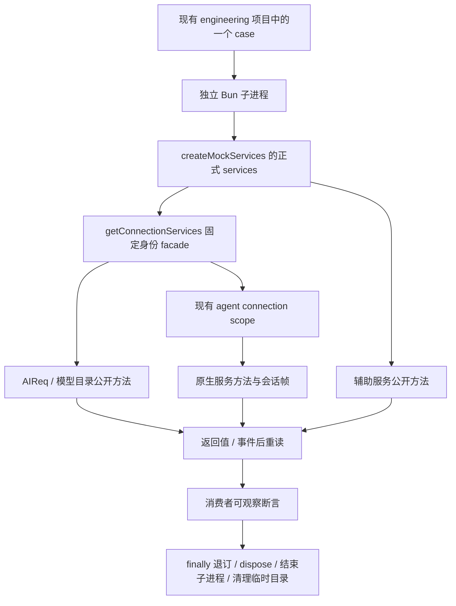

# 前端实际调用的后端服务接口测试

### 已确认目标与权限

为当前产品入口实际调用的后端服务方法、业务操作和可观察事件补自动化测试。测试直接调用正式服务方法，不启动浏览器、HTTP server、WebSocket 或 Channel RPC。被测对象是真实内存后端逻辑，不是测试替身。

本文件只是一份实施清单；文件生成不表示任务已经实施、测试已经通过或真实后端已经验收。只允许修改测试、必要测试配置及相关现行文档；不得修改产品行为。发现契约与实现冲突时保留有效失败断言、报告根因与影响，不放宽断言、不擅自修复产品，也不把错误实现固化成预期。

范围依据当前可达调用链，而非所有导出、descriptor、shared schema 或后端白名单。保留用户无关改动；源码可能继续变化，实施时核对直接相关消费者，不恢复已经删除的成员或旧实现。

### 范围与不做事项

- 纳入 AIReq 的 bootstrap、非 Skill 的 19 个 call operation、20 个前端业务 action；原生会话、队列、附件、文件/项目目录、模型目录、通用设置读取、系统信息、子代理目录、广播及当前恢复入口。
- 排除 Skill 设计隐藏入口专属行为、未调用公开成员、旧工作台，以及生产事实不能触发的保留 UI 分支。不按协议全集增加用例。
- 排除 HTTP/WS、路由、序列化、RPC 暴露、部署 token、遥测 HTTP、静态资源、浏览器交互、性能/压力、手机测试，以及真实后端接入与运行验收。
- 不新增产品 reset、推进时钟、调试入口、测试专用 DTO、window 夹具、假成功、故障注入或内部数据 setter。不恢复已删除功能，不进行相邻重构、依赖升级、远端同步或自动提交。
- 测试本身每次独立且可重复，不要求所有业务写接口新增幂等能力。仅测试契约已有的 CAS/幂等；例如 models/prompts 保存只有 CAS，scheduler 写操作没有统一 operationId/CAS。

### 已核验事实与材料

以下是生成文件前的源码/配置事实，不是测试运行证据：

|现存材料|已核验用途|
|---|---|
|`package.json`、`mise.toml`|Bun 固定 1.4.4；现场 `bun --version` 返回 1.4.4；已有工程测试与静态检查命令|
|`vitest.config.ts`、`vitest.setup.ts`|Bun 下 Vitest engineering 项目、forks、单 worker、文件串行、test/hook 各 30 秒；setup 不提供业务 reset|
|`scripts/engineering-test-files.json`|生成前精确登记为 `[]`，没有可复用的现行业务用例|
|`scripts/engineering-tests/process.mjs`|既有有限子进程执行辅助；没有长驻业务宿主或业务 reset|
|`docs/testing/unit-test-quality.md`|当前测试状态、已有 runner、affected 命令跳过语义|
|`packages/server/src/index.ts`、`mock/index.ts`|公共 createMockServices 装配服务，返回 services/runtime；测试只经 services 访问，不读取 runtime|
|`packages/server/src/aireq/{contract,service,identity,model-catalog}.ts`|现有固定身份 facade、请求局部身份、AIReq 模型目录投影|
|`packages/services/src/collection.ts`|ServiceCollection.get(descriptor) 返回正式服务|
|`packages/services/src/zcode-agent/zcodeAgentConnectionScope.ts`|现有连接作用域的 service、异步 dispose、订阅所有权|
|`packages/ui/src/aireq/shell/remote-data-source.ts`|AIReq bootstrap/call/event 的真实前端消费者及分派|
|`packages/ui/src/aireq/conversation/AIReqSessionPane.tsx`、`packages/ui/src/v4/SessionPane.tsx`|已有业务 sessionId、submission-only 及当前原生操作消费者|
|`packages/server/src/mock/{workspace,project,broadcast,zcodeTask,runtime,zcodeAgent}.ts`、`mock/domains/{assets,models,settings}.ts`|当前文件/目录、辅助服务、会话/附件 owner 与真实能力限制|
|`architecture-policy.yaml`、`docs/architecture/pure-web-module-ownership.md`|现行模块、公开入口与测试新增文件边界|

现行产品规则依据 `docs/specs/aireq-migration/` 下的 `contract-design.md`、`connection-identity.md`、`release-surface.md`、`section-navigation-and-ideas.md`、`proposals.md`、`tracking.md`、`conversation.md`、`tools-settings.md`、`document-surface.md`，以及 `docs/architecture/mock-backend.md`。现有文档说明产品契约，不作为实现已满足契约的证明。

workflow、模型和提示词有模块级状态；MockAIReqService 创建后台 timer。因此每例重新 createMockServices、改 workspace/clientId、vi.resetModules 或停 HTTP listener 均不能证明完全隔离。

既有业务启动数据可以通过正式 readWorkflow 读取后用于前置条件，不是测试注入。正式 SR、代码合入和部分失败事实没有公开创建入口；不得调用内部模拟合入/故障 setter。新提案正常公开链只能证明发布后等待合并，不能凭等待时间宣称转正。

### 直调与隔离设计

每个 Vitest case 启动一个有限 Bun 子进程，在该进程内执行该 case 的全部业务前置、调用、断言和清理；不同 case 不共享业务进程。测试侧子进程 helper 只是现有 runner 的生命周期辅助，不建立新框架、Vitest project、网络桥或产品验收 harness。

- 使用当前 Bun 的 `process.execPath`，不调用系统 Node/pnpm。子进程显式传递隔离的 HOME/USERPROFILE 与临时目录环境，去除宿主数据目录覆盖；不能假定 Vitest 模块 mock 自动传入子进程。
- `createMockServices({workspacePath})` 只建立真实业务 owner；不得读取或写入返回的 runtime、内部 Map、私有 Emitter、timer 或领域函数。
- 从 `getConnectionServices(services, identity)` 取得 AIReq、原生及模型 overrides。原生再经过 `createZCodeAgentConnectionScope(base, {connectionId, clientMode:"web-remote-replayable", role:"terminal-client"})`；执行正式 hello→initialize，保持 identity/clientHello/envelope 的 clientId 一致。
- Project 的 readTree/resolveSessionDirectories 复用现有 `withAIReqIdentity`，不自造全局工号或身份 owner。广播直调既有总线；HTTP 连接来源改写/排除发送端属于已排除的接入层，不复制那段匿名 facade。
- 多身份/多连接对照在同一 case 进程内共享服务 owner、分别建立正式 scope；不把不同 clientId 当作整个业务的隔离开关。
- 子进程完成必须等业务断言及清理结束；异常、取消或 Vitest 超时后由父侧 finally/afterEach 终止并等待其退出，清理自己创建的目录，不能留下孤儿进程。保留既有 30 秒 test/hook 限制，不新增更早截止时间或放宽总限时。
- 异步场景先订阅再发送，依据正式 ACK、事件、查询/重读事实等待完成，不用固定 sleep 当成功证明。accepted 不等于业务完成。需要计时的 scheduler 只走现有真实后台调度，不调用内部 tick 或伪造时钟。

### 覆盖口径与已知限制

正常返回、真实空集合、无变化和明确不支持分别按现行契约断言。当前 readMediaPreview、restartWorkspaceProcess、readWorkspacePresentation 不支持正向执行，测试明确失败，不能伪造媒体或进程成功。

正向事件覆盖使用 AIReq 的实际 workflow/models/prompts/scheduler 通知、原生 onDynamicConversationFrame、广播 onMessage；通知后重读同一业务事实，不要求每个写操作恰好一个事件。

经用户确认，四项当前无公开生产触发源的事件——onDynamicSessionLifecycle、onAgentRuntimeRestarted、onAgentRuntimeLifecycle、IModelSelectionService.onDidChange——逐项记录未覆盖原因，不用订阅/退订空监听计作行为覆盖，也不以 AIReq models 通知替代模型目录事件。它们的正向通知不属于本次通过条件；交付不得声称全部事件已覆盖。

当前保留消费者但没有生产前置状态/能力的 editUserQuery、retryTurn、forkAssistant、compact、sendGoalCommand、pauseGoal、resumeGoal、cancelBackgroundWork、stopSubagent、resolveInteraction、snoozeInteractionAutoResolution、requestWorkspaceHookReview 不强造正向场景；仅有实际可调用并明确拒绝的公开路径时验证拒绝，其余登记入口门控及不可达原因，不作为伪造成功的任务。

### 任务执行与验证约束

- 仅完整覆盖上述确认范围，不意味着覆盖所有可能改进。复用既有模式、runner 和仍适用的验证结果；新增检查必须对应具体验收缺口，不为覆盖率数字增加测试。断言业务结果、字节、顺序/归属或拒绝无副作用，不写 wiring、源码文本、回声、仅长度增长、bare not-throw 等占位测试。
- 所有同级 `##` 均为顺序任务组。依赖顺序固定为 G1→G2→G3→G4→G5→G6；前一组全部勾选且完成本组规定验证后才进入下一组，不能跳过未完成组。组内也按文件顺序完成，每个 checkbox 仅依赖共享前提、已完成组/checkbox 与自身工作；不得依赖后续任务补做自己的首次验证。
- 每个 checkbox 具有自己的产出、最小验证和完成标准。通过该项只表示该项局部完成，不等于全产品验收。最终验收可以检查更广契约，但不替代前面各项自己的验证；未完成、有效失败或环境阻塞均不得勾选，也不得缩窄断言使其通过。
- 下文标为“新增”的路径是明确规划的新文件，不冒充现存资产。实施后立即把真实用例精确加入 engineering 清单；每项测试的消费者断言在子进程 scenario 内执行，外层 Vitest 只负责注册和运行，不把仅成功启动进程当作断言。
- 既有产品行为不变，不机械改写业务规格；先在现行测试文档明确本次规则。若发现必须修改行为才能达成的要求，按权限报告，不扩大任务。测试添加后同步现行测试状态，直接改写失效描述，不追加历史补丁。
- 最终仅收口一次 `bun run typecheck`、`bun run lint`、`bun run architecture:check --changed`；不额外跑 build、fmt、knip、浏览器、全仓审查或 remote freshness。测试不是 UI 变更，不引入 React/hooks 改动。
- 全量入口是 `bun run test:engineering`。affected 的空选择、dry-run 或整套跳过可能返回 0，不能当执行通过证据。
- 明确停止条件：范围内任务完成，所列局部验证和最终验收成功，现行文档准确后立即停止；不增加相邻工作、不启动另一会话、不自动执行真实后端验收。若有有效失败，报告已完成/未完成、证据和产品缺陷，不宣称整体通过。

## G1 范围与现行测试规则
- [ ] 在现有测试文档建立准确的接口覆盖矩阵和验收口径。
  依赖：仅共享前提。本组产出完成后才开始 G2。
  产出：更新 `docs/testing/unit-test-quality.md`，列明真实前端消费者→服务成员→call/action/原生命令→预期可观察行为→当前覆盖状态。保留此时“清单为空”的现状，不把本任务计划抄成已有覆盖；后续各项实际新增用例后即登记其真实文件。无触发事件及不支持能力单列限制。
  核对：以现存 remote-data-source、AIReqSessionPane/SessionPane、services 契约及 http.ts 白名单交叉核对，仅把白名单作为上界。
  最小验证：逐项核对文档中的现存源码路径、现行方法名称及范围排除；覆盖矩阵不链接尚不存在的测试文件。纯文档检查，不运行测试或静态套件。
  完成标准：矩阵没有“待定接口”、未调用成员或虚构前置状态；本文件G2—G5完整承接纳入行为；文档仍准确说明当前没有用例，不宣称产品已通过。

## G2 直调与进程隔离基础
- [ ] 接入首批有效读取用例，并证明单用例隔离和重复运行。
  依赖：G1 完成；本项的基础设施和首批场景一起可验证，不拆成空壳任务。
  产出：新增 `scripts/engineering-tests/backend-process.mjs`、`backend-case-worker.mjs`；新增 `packages/server/test/interfaces/context.mjs`、`bootstrap.cases.mjs`；新增 `scripts/engineering-tests/backend-bootstrap.test.mjs` 并登记到 `scripts/engineering-test-files.json`。使用 .mjs 延续工程脚本惯例，不为本次搭建额外类型项目/runner。现有配置足够则不改 vitest.config.ts。
  实施：worker 只执行指定 scenario 的实际断言；context 通过 server 现有公开入口、aireq/contract.ts 现成身份 facade、services 公开 scope 组合服务。scenarios 位于 server 包测试目录以复用包依赖，跨模块只走已有公开入口，不为测试扩大产品导出。父进程不初始化被测业务。
  场景：bootstrap 返回现行契约/模型/提示词/项目事实；readWorkflow 的业务投影、session/workspace 配对正确；重复读取不制造业务转换；非法身份、连接与正文身份不匹配、未知 path/非法参数明确拒绝且公开事实不变。
  最小验证：执行 `bun --bun run vitest run --project engineering scripts/engineering-tests/backend-bootstrap.test.mjs`；再两次独立执行 `bun --bun run vitest run --project engineering scripts/engineering-tests/backend-bootstrap.test.mjs -t bootstrap-isolated-read`。为该确切名称建立一个含两身份/共享读取断言的独立 case，不能用空测试占名字。
  同步文档：首批用例实际存在后更新 unit-test-quality.md 的空清单描述及根 AGENTS.md 中“测试用例清单当前为空”这条事实；不改变其他仓库规则，不宣称后续组已覆盖。
  完成标准：目标用例确实执行且通过、单例两次结果均成立；子进程和临时目录清理完整，单例不依赖其他 case；文档现状准确。失败则保留断言并报告，不进入下一组。

## G3 辅助读取与广播
- [ ] 覆盖当前文件、项目、目录、设置及恢复服务的可观察契约。
  依赖：G2 完成。
  产出：新增 `packages/server/test/interfaces/auxiliary.cases.mjs`、`scripts/engineering-tests/backend-auxiliary.test.mjs` 并登记。每个 case 复用 G2 生命周期，不共享可写状态。
  范围：IFileService 的 searchWorkspaceFiles/stat/checkFilesExist/readFileRange/readMediaPreview；IProjectService 的 readTree/resolveSessionDirectories；ISystemService.info；ISettingService.get；ISubagentsService.list；IModelSelectionService.getView；IZCodeTaskService.restartWorkspaceProcess；IZCodeSessionService.readWorkspacePresentation。
  文件场景：只使用现有虚拟树中公开读取可见的 README.md、src、package.json 等事实；验证搜索/limit、文件与目录区分、含中文内容的 UTF-8 size/字节切片/EOF、混合存在性及缺失/目录误读。不得写 runtime.virtualRoot 或增加媒体夹具；readMediaPreview 只验证当前明确不支持。
  目录场景：用 readWorkflow 取得正式 session/workspace，在现有身份上下文中解析；错归属/workspace 拒绝、读取不创建会话。模型从 overrides 获取 AIReq 目录投影，不误测底座账户样例；系统 homedir 为空；子代理目录验证真实空目录和 capability；两项恢复入口验证 capabilityUnsupported，而非假成功。
  最小验证：执行 `bun --bun run vitest run --project engineering scripts/engineering-tests/backend-auxiliary.test.mjs`，逐类成员有有效消费者结果断言。无公开正向触发的目录事件维持限制记录，不新增占位订阅 case。
  完成标准：全部场景确实执行且通过，拒绝没有可观察副作用；矩阵准确反映此组完成和已有能力限制。
- [ ] 覆盖广播总线真实消息交付和退订效果。
  依赖：本组上一项完成。
  产出：新增 `packages/server/test/interfaces/broadcast.cases.mjs`、`scripts/engineering-tests/backend-broadcast.test.mjs` 并登记。
  场景：通过正式 send/onMessage 发布合法 channel/payload，多个订阅者收到同一业务消息；释放一个订阅后再次发送，仅其他订阅者继续接收且消息内容正确。只测总线契约，不复制 HTTP 的连接 sourceWindowId 包装、不把“发送者不回收自身消息”误当 raw bus 语义。
  最小验证：执行 `bun --bun run vitest run --project engineering scripts/engineering-tests/backend-broadcast.test.mjs`。
  完成标准：交付内容与退订后的差异均有断言且通过；没有私有 Emitter 注入、网络启动或仅订阅成功的断言。本组两项完成后才进入 G4。

## G4 原生会话与附件
- [ ] 覆盖正式握手、会话查询、订阅所有权和发送结果。
  依赖：G3 完成。
  产出：新增 `packages/server/test/interfaces/conversation.cases.mjs`、`scripts/engineering-tests/backend-conversation.test.mjs` 并登记；在 context.mjs 中只加入本项实际需要的公开会话等待/读取辅助。
  前置：由 AIReq 正常创建提案或 readWorkflow 读取已有业务会话；不调用原生 createSession/deleteSession 造产品外草稿。使用现成身份 facade 内层、agent scope 外层；hello→initialize 后才访问服务。
  范围：helloConversationV4、initializeConversationV4、subscribeConversationV4、resyncConversationV4、unsubscribeConversationV4、conversationRowsRangeV4、conversationPlansV4、sendConversationCommandV4、queryConversationCommandsV4、getSessionLifecycle、supportsConversationQuoteComment、getSkillReferenceCatalog，以及真实 onDynamicConversationFrame。
  场景：正常发送以 ACK、实际完成帧和公开 rows 对账；相同 commandId/同内容不重复生成行，同 ID 改内容拒绝；旧 revision/logEpoch、错 session/workspace/clientId 拒绝且事实不变。两 connection scope 验证帧不串订阅、resync 越权拒绝、非本连接 unsubscribe 不删除他人订阅、自己的退订/dispose 后不再接收随后可触发的帧。只验证已经公开的能力值和真实目录，不借此调用隐藏 Skill 设计操作。
  最小验证：执行 `bun --bun run vitest run --project engineering scripts/engineering-tests/backend-conversation.test.mjs`；初始化必须通过后续合法调用和拒绝路径证明，不给空 initialize 实现单独写 bare not-throw。
  完成标准：每项可观察契约通过；后续组可以复用的会话前置辅助已在此获得实际验证；无触发的生命周期事件仍明确未覆盖。
- [ ] 覆盖现产品实际支持的队列、停止、自动续跑和反馈命令。
  依赖：本组上一项完成。
  产出：新增 `packages/server/test/interfaces/queue.cases.mjs`、`scripts/engineering-tests/backend-queue.test.mjs` 并登记。
  范围：sendText 的运行中排队/立即投递、本次 submission 配置；stop、setFollowupMode、lockQueueItemEdit、releaseQueueItemEdit、editQueueItem、applyQueueItemsConfig、reorderQueueItem、deleteQueueItem、sendQueuedNow、setAutoDrain、setAssistantFeedback。submission-only 不发送 switchModelConfig/switchCollaborationMode。
  场景：从公开帧确认运行和队列状态后进行操作，核对顺序、正文/引用、编辑锁所有权、配置应用、停止保留队列、暂停/恢复与反馈行；按各命令真实 CAS/锁条件验证陈旧/错目标/锁冲突拒绝。停止或删除队列项后迟到执行不能恢复已失效事实；用正式状态等待，不注入 hold/运行状态。
  最小验证：执行 `bun --bun run vitest run --project engineering scripts/engineering-tests/backend-queue.test.mjs`。若公开执行窗口不足以可靠构造某必要场景，报告具体阻塞并保留未完成，不能用任意 sleep、私有 timer 或直接改队列强造通过。
  完成标准：上述实际命令的正常结果与关键拒绝路径均有确定的公开观察证据并通过；不把协议支持但当前入口不可达的命令塞入该组。
- [ ] 覆盖附件事务、实际采用后的读取和关键失败无污染。
  依赖：本组前两项完成。
  产出：新增 `packages/server/test/interfaces/attachment.cases.mjs`、`scripts/engineering-tests/backend-attachment.test.mjs` 并登记。
  范围：attachmentBeginV4/chunk/commit/abort/read。使用测试自身的小段文本/字节，经正式上传事务创建内容并由 sendText 采用，不改附件 Map。
  场景：完整字节摘要、分块 offset/顺序、提交收据、采用后全量/范围读取与 EOF；abort 后不能采用未提交内容；非法 chunk/摘要、跨身份/会话/workspace、未采用 ref 按现行契约拒绝，正常内容不被失败请求覆盖。覆盖取消分支但不调用前端上传封装当被测对象。
  最小验证：执行 `bun --bun run vitest run --project engineering scripts/engineering-tests/backend-attachment.test.mjs`，读回字节与原始输入逐字节相等。
  完成标准：五个方法的有意义结果及隔离/拒绝通过，不冒充文件媒体预览支持；G4 三项均完成后进入 G5。

## G5 AIReq 业务操作
- [ ] 覆盖想法、项目/Release 与模型/指令配置操作。
  依赖：G4 完成。
  产出：新增 `packages/server/test/interfaces/ideas-config.cases.mjs`、`scripts/engineering-tests/backend-ideas-config.test.mjs` 并登记。
  范围：command 的 createIdea/importIdeas/updateIdea/transferIdea/createRelease；call 的 projects.saveRepository/models.save/prompts.save；相应公开重读和 workflow/models/prompts 通知。
  前置：项目通过 saveRepository(expectedRevision:0) 创建；Release、想法和转入全部走正式 command。项目 revision、workflow revision、idea revision 不混用；完整模型/指令结构从 bootstrap 读取，不硬编码丢角色。
  场景：想法 trim/重复正文/原始身份时间保留，多目标转入原子消费且不提前生成 SR；批次非法项、过期版本、重复/错误目标拒绝且不留半成品。项目合法远程配置、同值不制造版本、坏地址/分支及旧 CAS 拒绝。模型和指令保存后 bootstrap 内容/revision/通知一致，非法角色/模型/过期 CAS/UTF-8 长度限制拒绝且原值保留。
  最小验证：执行 `bun --bun run vitest run --project engineering scripts/engineering-tests/backend-ideas-config.test.mjs`；包含确切名称 `idea-create-and-read-isolated` 的独立写入 case，供最终单例复跑，不要求其他 case 先建项目或想法。
  完成标准：这些业务操作及关键事务/版本规则有效通过；幂等只按既有 contract 测，不新增产品保证。
- [ ] 覆盖提案正常生命周期、恢复与失效门禁，止于公开可达的发布状态。
  依赖：本组上一项完成；材料前置仅复用已验证的原生会话调用。
  产出：新增 `packages/server/test/interfaces/proposal.cases.mjs`、`scripts/engineering-tests/backend-proposal.test.mjs` 并登记；case 内按其需要建立完整前置，不跨 case 串联生命周期。
  范围：createProposal/importProposals/assignContacts/runRequirementsReview/acceptProposal/returnProposal/reviseProposalMaterial/runFullReview/approveFullReview/confirmAlignment/confirmProposal/publishProposal/closeProposalPr/deleteRequirement；readPrHandoff/retryMaterial/retrySession 及相应读取/事件。
  正常链：项目/Release→短需求→requirements 原生讨论实际完成材料→单评审及当前 review/digest 人工通过→solution 原生讨论完成 SR/材料→完整三审/综合报告→当前审查人工放行→同版三个视角确认→交接读取/交付确认→当前 candidate 发布。每步使用最新公开 revision/ID，不调用内部生成/完成回调。
  拒绝与不变量：空/超限导入整批不写；新建不自动拆 SR；材料缺失、旧 review/digest/version/candidate/错误阶段拒绝；材料修订按范围撤销批准/确认，保留历史；退回非空原因留痕；发布后冻结，关闭当前未合并 PR 后才可修订；受保护对象不能删除；相同操作重试不重复创建事实。恢复调用只恢复现有目标，不制造故障状态；读材料错误/错归属按现有规则验证。
  最小验证：执行 `bun --bun run vitest run --project engineering scripts/engineering-tests/backend-proposal.test.mjs`；通过公开 readWorkflow/readPrHandoff/原生结果断言材料、审查、版本和发布事实，不把 accepted 或推送回执当合入。
  完成标准：所列 action/operation 的公开可达行为通过；发布保持 platformVerified:false/等待合并的真实限制；不要求新提案通过私有合入 setter 转正。
- [ ] 覆盖正式 SR 规划、验收、清理及已有失败分支恢复。
  依赖：本组前两项完成。
  产出：新增 `packages/server/test/interfaces/formal.cases.mjs`、`scripts/engineering-tests/backend-formal.test.mjs` 并登记。
  范围：planning.updateSr、progress.recordTest/cleanupPreview/cleanupBranches、command.retrySrBranch。
  前置：从公开 readWorkflow 取得并确认现存正式事实。已核验启动事实包括 demo-aurora/ir-export/sr-export-download（已合入待验收）、demo-mobile/ir-mobile/sr-mobile-notifications（待复测）、demo-aurora/ir-notifications/sr-notification-inbox（100%可清理）、demo-mobile/ir-mobile-offline/sr-mobile-offline（失败开发分支）。这些 ID 仅定位后端现存业务前置，先断言其公开语义，不读取 fixtures 私有对象或注入状态；真实后端迁移时前置须由其正式数据满足，不能宣称现已验收。
  场景：负责人/排期原子保存、显式清空与操作者留痕；坏工号/真实非法日历日期/反向或单端日期/旧 CAS 拒绝。验收绑定当前 codeMerge.commit 和版本，通过100/失败99与问题历史正确，open问题/错代码版本/空依据不写入。现有待复测样例通过后解决对应问题。preview仅登记分支；未达100/错误集合不清理；正常清理及幂等重试不改材料/报告/验收历史；已有失败分支重试恢复到正式文档合入基点。
  最小验证：执行 `bun --bun run vitest run --project engineering scripts/engineering-tests/backend-formal.test.mjs`。
  完成标准：四类操作正常及关键拒绝均通过；不通过私有代码合入、失败清理注入或分支 setter 制造完整开发链。
- [ ] 覆盖分析查询、配置、手动接纳、完成事实及去重。
  依赖：本组前三项完成。
  产出：新增 `packages/server/test/interfaces/scheduler.cases.mjs`、`scripts/engineering-tests/backend-scheduler.test.mjs` 并登记。
  范围：progressScheduler.read/queryTasks/queryRuns/readRun/setProjectEnabled/configure/runNow，以及实际 scheduler 失效通知。
  前置：公开读取已有未完成且分支可用的正式任务；空项目由正式项目操作建立。配置保存使用正整数分钟，不把五秒检查当一分钟已过去；不运行一分钟自动接纳用例来扩张范围。
  场景：25/50分页与项目/Release/IR/SR/搜索/历史筛选、有效页收敛、缺失详情null；坏页码/pageSize/日期/反向范围拒绝，同日起止按当前契约允许。全局关闭不阻止已启项目手动接纳，项目关闭不产生新run；同SR重复runNow不并发重复，关闭不取消已接纳任务。等待真实后台完成后验证历史/报告/输入配置快照一致；已知失败历史只通过公开查询读取，不注入fail-next/hold-next。
  最小验证：执行 `bun --bun run vitest run --project engineering scripts/engineering-tests/backend-scheduler.test.mjs`；在既有30秒内按正式完成事实结束，不提高限时或用私有tick加速。没有可公开构造的失败执行不伪造正向/失败覆盖。
  完成标准：七项operation及关键行为断言通过，配置和异步完成都在本项独立验证；G5四项均完成后进入G6。

## G6 重复运行与最终验收
- [ ] 完成独立写入复跑、整套重复执行、一次静态收口和真实交付说明。
  依赖：G1—G5全部完成；本项不是任何前项的首次有效验证。
  产出：所有实际新增测试精确登记；unit-test-quality.md 的覆盖矩阵/命令/隔离/限制与当前实现一致，AGENTS.md 的测试状态不再过期；交付说明区分已覆盖、明确不支持、无触发事件、实际失败和未执行项。没有接口遗漏或保留旧清单。
  独立执行：两次独立运行 `bun --bun run vitest run --project engineering scripts/engineering-tests/backend-ideas-config.test.mjs -t idea-create-and-read-isolated`，每次均由单case自身建立前置并验证创建后读取，不能因重复名称/残留数据而变化。复用G2已通过的独立读取复跑结果，不再重复该检查。
  整套执行：连续执行两次 `bun run test:engineering`。两次都必须实际发现并执行全部本次登记用例，非空、无失败、无跳过；状态由每case独立进程隔离。第二次用来证明重复执行，不额外引入随机顺序/压力轮次。
  静态收口：最后一次代码改动后各执行一次 `bun run typecheck`、`bun run lint`、`bun run architecture:check --changed`；报告既有基线与新问题的区别，不更新baseline绕过失败。相关输入未变且已有结果仍适用时不重跑；修改影响已验证部分时仅补受影响检查。
  完成标准：上述独立写入复跑、两次整套、三项静态检查确实通过；各组的局部通过证据仍适用，文档事实/路径/命令准确，无孤儿子进程和测试数据污染。不得将无测试、affected跳过、仅静态通过、模拟能力或任务文件生成当作产品验收。
  停止：条件满足后只交付实际范围与验证结果，立即停止。有效失败则保留未完成勾选状态和失败断言，报告阻塞，不擅自修产品、删用例或宣称全绿。
