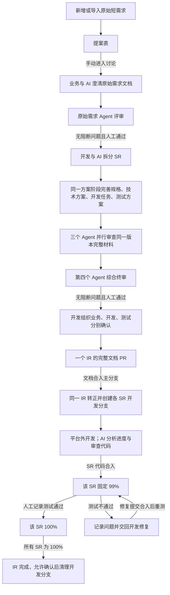
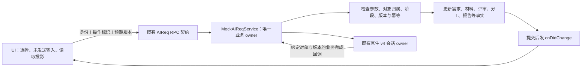

# AIReq 需求管理与跟踪平台改造任务

### 文件用途与授权

本文件是用户在 2026-11-15 完成逐轮访谈并确认后授权生成的实施任务，不是实施结果。文件应能独立使用，不依赖访谈记录，也不继承根目录 `todo.md` 中未经本次确认的任务。生成本文件不授权自动执行其中任务、提交代码、推送或开启另一会话。

目标仓库：`F:/code2026/ZCode`。本次文件生成前已两次确认 `.todo.md` 不存在；现有 `todo.md` 与其他文件不得覆盖、合并或顺带修改。后续实施者须保留所有与本任务无关的本地改动，不得通过恢复文件、切换分支或批量格式化覆盖它们。

### 已确认目标与边界

AIReq 是以 AI 为中心的需求讨论、管理和进度跟踪平台，不是开发执行平台。本次范围不是只改导航：须在现有电脑浏览器前端与共享内存模拟后端内，完成下述页面、契约、状态流转及可操作演示。真实 AI、Git 托管、数据库、认证与外部开发执行不在范围内；所有模拟结果必须明确标注，不能伪装真实模型调用、代码扫描、PR 或分支操作。服务重启恢复样例的现有边界保持不变。

暂不做权限体系。所有合法工号均可承担业务、开发、测试工作，包括代办、配置与项目管理；不引入管理员特权、角色鉴权、负责人独占操作或三人必须不同的限制。身份仅用于操作留痕、联系人及待办归属。输入校验、版本校验、幂等、对象归属、阶段门禁和会话隔离是正确性约束，不能随权限裁撤一起删除。保留现有工号入口，不新增真实登录认证。

平台可生成需求与开发文档、提交文档 PR、建立和清理 SR 开发分支、分析代码与进度；不得修改业务代码、执行开发任务、代开发人员合并代码 PR，或运行实际构建与测试。产品中的开发、测试执行发生在平台外；本仓库实施时必须执行的工程验证不受这一产品功能边界影响。

### 已确认信息模型与材料

- 项目包含 Release，Release 包含 IR；每个 IR 只属于一个项目和一个 Release。Release 不是 Git 分支。本次不新增 Release 生命周期、跨 Release 迁移或排期体系。
- IR 是业务提出的原始需求。提案与正式需求是同一个 IR 的不同生命周期，转正保留 ID、归属、讨论、材料与 SR，不复制成另一条需求。
- 原始短需求是最初提交的一两句话，独立保存，不被 AI 生成的完整原始需求文档覆盖；它是提案表展示和导出的唯一需求正文。不要把自然语言“一两句话”实现为任意的硬性句数限制。
- SR 是独立开发单元，每个 SR 对应独立 OpenSpec change，具有自己的 `proposal.md`、`design.md`、`tasks.md` 和 `specs/`，以及测试方案。不得继续沿用“IR 对应 change、SR 只是 capability spec”的旧映射。
- IR 保留业务原始需求文档、SR 拆分关系、跨 SR 依赖和整体验收场景。每个 SR 的测试方案必须追溯业务验收标准，不得只复述技术实现。SR 有依赖也不合并 change 身份。
- 一个 IR 一个讨论详情入口，复用分阶段 AI 对话与材料预览；可选择 SR 查看其独立材料，不新增 SR 开发工作台、手工文档编辑器或执行开发任务的按钮。历史阶段和旧版本只读。
- IR 记录业务、开发、测试联系人，业务联系人默认提交人；SR 记录开发、测试负责人，可继承 IR 对应联系人并显式调整。同一人可兼任，未分配的工作待认领，所有人都可代办并记录实际操作人。这些字段不能充当权限。

落地路径约定（以下是本次计划要求，不是现存仓库材料的事实）：模拟业务仓库中，IR 共享材料放在 `docs/requirements/<ir-id>/`，至少包括 `requirements.md`、`sr-dependencies.json`、`acceptance.md`；SR 材料放在 `openspec/changes/<sr-id>/`，测试方案为该 change 的 `test-plan.md`。标识使用稳定 ID，不从标题或当前操作者重新派生。这些是服务返回的模拟材料路径，不授权把用户业务文档写入本 ZCode 源码工作树。延续已有材料和依赖读取模式，不新增第二套文档存储或关系真相源。

### 已确认导航、表格与作用域

主导航依次为“项目进度、待办列表、正式需求、需求提案、进度分析”；登录后默认进入待办列表。

- 待办跨项目汇总。默认“我的待办”，支持“待认领／全部”，可按项目定位；不新增任意创建、随意勾选完成的个人任务系统。
- 项目进度页展示各项目的提案数、正式需求数及进度，可进入某项目查看正式 IR 及其进度。选择 Release 时按该 Release 统计。
- 正式需求、需求提案和进度分析共用当前项目、Release 作用域；支持“全部 Release”，不得让分析页另持一份不受导航选择约束的业务筛选事实。无项目或 Release 时提供现有设置入口，不自动创建项目或随意选择另一项目的数据。
- 需求提案页是表格，四个数据列为提交人、原始需求、提交日期、当前状态，右侧另有详情／讨论操作。工具栏顺序为“新增提案、导入、导出”。
- 新增提案只填写并保存原始短需求，成功后刷新并停留在提案表；失败保留输入。不得自动进入讨论、自动创建进行中的分析，或把首发聊天作为提案可见的前提。导入同样只创建提案。只有点击某条提案右侧讨论入口才开始澄清讨论。
- CSV 为 UTF-8，一行一条，仅含“原始需求”一列；提供模板、导入预览，空白行跳过，重复文本提示但不自动去重。导入到当前项目与具体 Release，提交人、提交时间取当前操作者及实际导入时间。无明确目标 Release 时不能提交导入。
- 导出当前筛选结果的全部提案，不限当前页；只导出原始短需求，不导出生成文档、聊天、测试方案、人员或日期。导入导出须正确处理中文、逗号、引号和单元格内换行，不把一条文本拆成多条 IR。
- 正式需求以 IR 为主行，展示原始需求、Release、整体状态与进度；展开 SR 显示负责人、进度、开发分支、最新审查摘要和操作。点击 IR 看汇总与材料，点击 SR 看独立材料与报告；复用既有同页报告／材料面板，不另建开发工作台。
- 移除 AIReq 自动化入口及其专属能力，移除侧栏旧提案列表和旧的独立新建提案导航。Skill 设计保留并移入设置，保留模型、Agent、Skill、项目与外观设置。通用基础控件、原生会话能力及仍有其他用途的底层设施不得删除。

### 已确认流程、评审与版本规则

最终流程已经替换早期“开发文档审查后另起测试方案阶段”的设想。不得恢复独立后置测试方案阶段或专用测试方案生成 Agent。

原始需求评审只有一个业务需求评审 Agent，检查目标、范围、歧义和可验收性；没有阻断问题后人工通过才进入 SR 拆分。业务澄清阶段不提前固定生成两个 SR。

方案阶段由开发牵头，通过 AI 逐步完善全部 SR 的规格、设计、开发任务和测试方案；“同一阶段”不要求在尚无规格时机械并行生成所有文档。三路完整材料审查分别关注需求覆盖／一致性、技术方案／依赖、任务可执行性／测试充分性。三路完成后第四个 Agent 汇总冲突和阻断项；终审不是自动授权，仍需人工通过。

开发随后组织三方对齐。业务、开发、测试三个视角的确认分别留痕并绑定同一材料版本；不要求三名不同人员。全部确认后才可提交文档 PR。

材料修改采用整包版本失效规则：完整送审包包含 IR 业务需求、SR 拆分与依赖、所有 SR 的规格／设计／任务／测试方案及整体验收场景；其中任何材料改变，原三路审查、综合终审、人工放行与三方确认全部失效，必须针对新的完整快照重新完成这些步骤。仅修改测试方案也不例外，不复用旧版本的部分审查结论作为新版本批准。若业务原始需求文档改变，还须先重新完成原始需求单 Agent 评审及人工通过，再检查和完善下游材料；仅修改其他材料不重跑原始需求单评审。保留旧内容和意见，显示失效原因；迟到的 AI 结果不能覆盖当前版本，也不能恢复旧批准。原始短需求与历史记录不因失效而删除。

每个 IR 一个完整文档 PR，包含 IR 共享材料、全部 SR change 和测试方案，不分批把 SR 转正。提交后冻结该版本材料；需要修改时先关闭未合并 PR，再回到对应阶段修改、审查和确认。关闭未合并 PR 不转正。服务核实同一候选材料完整合入主分支后才转正，不能仅凭 PR URL 或按钮点击推断合并。

转正后不直接扩充需求范围；新增业务范围另建关联 IR，关联仅用于追溯。本次不增加正式需求重新打开、重新拆分、跨 Release 迁移或升级迁移框架。人员安排、分析报告、开发问题和验收记录仍可更新。

### 已确认进度、验收与分支规则

- 每个 SR 转正时建立开发分支，基点为文档合入主分支的提交。保留实际模拟分支状态及错误，不能在创建失败时伪造可用分支。
- 未合入且未验收时，AI 基于该 SR 的 OpenSpec 开发任务、代码与合并证据给出 0–99 的估计，并返回最新代码审查意见；估计可随新证据下降。不执行 `tasks.md`，不把其勾选数直接冒充真实开发进度。
- **代码合入后业务进度固定为 99%，不依赖 AI 恰好打出 99 分；只有 99% 才可经测试人工验收转为 100%。** 该规则取代早期建议的“无需 99 前置”。保留原始 AI 评估作为报告证据，与业务有效进度区分；不得让低分或延迟分析覆盖合入后的 99。
- 测试确认记录操作者、时间、验收依据和代码版本。未合入不能确认完成，不能自由输入百分比；AI 不能设置 100，也不能覆盖已经确认的完成事实。代办仍须明确执行“测试验收通过”这一业务动作。
- 测试未通过保持 99%，标记验收未通过，记录问题并产生开发处理待办；仅重新点击通过不能绕过这些问题。修复提交合入、问题进入已处理待复测状态后，重新产生测试待办并记录对新版本的验收。不回退到提案流程。
- IR 进度是其全部 SR 有效进度的等权平均，全部 SR 100 才完成；项目和 Release 直接对范围内全部正式 SR 等权平均，不能先按 IR 平均再平均。提案不进分母，未分析正式 SR 按 0 并标记未分析，已验收按 100，无正式 SR 显示“暂无正式需求”。非全部完成不得因小数四舍五入显示 100%。新增正式需求可使聚合进度下降。
- 进度分析支持手动与定时，沿用现有调度设置；未变化的输入可以跳过。同一 SR 的代码／材料／合并事实版本进入分析指纹，结果只能更新匹配版本。最新成功报告同步到正式需求、项目进度和分析页；失败保留上次成功进度，明确失败或过期，不回落为 0。
- 整个 IR 全部 SR 100 后才允许清理开发分支；按钮列出本 IR 的待删 SR 分支并再次确认。只清理已登记的开发分支，永不删除主分支、材料、报告或验收历史。逐项记录成功／失败，失败项仍可处理，已删除分支重复操作不重新产生副作用；进度不因分支删除改变。

### 已确认待办语义

待办是工作流、分工和失败事实的服务端派生投影，不是另一套手工状态机，不复用开发 `tasks.md` 或分析调度任务作为个人待办。完成实际业务操作后自动消失，不能用“勾选完成”绕过门禁。

|触发事实|待办归属与动作|
|---|---|
|提案待讨论／业务补充|IR 业务联系人；进入原始需求讨论|
|原始需求评审完成且需人工决定|IR 业务联系人；通过或退回|
|需求通过、待拆 SR 或完善完整材料|IR 开发联系人；进入方案阶段|
|完整审查／终审完成且需人工决定|IR 开发联系人；处理意见并确认或退回|
|三方对齐缺少某个视角确认|分别给 IR 业务、开发、测试联系人；同一人仍看到三个明确动作|
|三方确认完成、文档 PR 尚未提交|IR 开发联系人；提交文档 PR|
|正式 SR 待开发／存在待处理开发问题|SR 开发负责人；查看任务、分支及代码审查意见，不在平台执行开发|
|SR 已合入、待测试或修复已合入待复测|SR 测试负责人；记录本次验收|
|验收不通过且问题待修复|SR 开发负责人；处理并等待修复版本合入|
|Agent／提交等步骤失败，需要人工处理|对应阶段联系人；查看失败并按已有运行入口处理|

未分配归属时进入待认领。AI 正常运行、等待文档 PR 合并及定时分析等待本身不制造空操作待办。待办点击定位到具体 IR／SR 和阶段。只保存联系人、确认、问题等第一手业务事实，待办列表随事实更新派生。

### 已核实的现状与证据路径

以下为生成文件时的源码／文档事实，不是目标已经实现：

|现状|已核实路径与关键位置|
|---|---|
|浏览器安全契约，单一业务 RPC 与事件失效；UI 只有读取投影，mock 为共享内存 owner|`packages/services/src/aireq/CONTRACT.md`、`contract.ts`、`data-source.ts`、`remote-operations.ts`；`packages/server/src/aireq/CONTRACT.md`、`service.ts`；`packages/ui/src/aireq/CONTRACT.md`|
|IR/change 与 SR/capability 的旧映射|`packages/server/src/aireq/proposal-storage.ts` 的 `prototypeChangeRoot`、`prototypeSpecPath`；`materials.ts`、`proposal-flow.ts`|
|当前四阶段、业务阶段提前拆 SR、方案不生成开发任务|`packages/server/src/aireq/native-business.ts`、`proposal-mutations.ts`、`agent-models.ts`；`packages/ui/src/aireq/proposals/AIReqPhaseHeader.tsx`|
|已有三路需求审查及综合评审，但主要审查 IR 与 SR 需求文件，不等同于新的完整方案审查|`packages/server/src/aireq/requirements-review.ts`；`packages/services/src/aireq/domain.ts`|
|已有模拟文档 PR／MR 与 SR 分支映射，缺少独立三方签署、测试通过事实与分支清理命令|`packages/server/src/aireq/proposal-delivery.ts`、`workflow.ts`；`packages/services/src/aireq/types.ts`、`remote-operations.ts`|
|当前完成门禁要求 AI 原始评分恰好 99、已合入、指定人员确认；需替换为本计划规则|`packages/services/src/aireq/progress.ts:36-43`；`packages/server/src/aireq/progress.ts`|
|进度调度已有过滤／分页／去重等能力，但模拟报告与正式进度尚未形成目标中的统一回写链|`packages/server/src/aireq/progress-scheduler.ts`、`progress.ts`；`packages/ui/src/aireq/tracking/RequirementAnalysisPage.tsx`|
|当前默认需求分析，侧栏存在新建提案、自动化、Skill 设计、正式需求和常驻提案列表；没有目标待办与项目进度主页面|`packages/ui/src/aireq/AIReqContext.tsx`、`contract.ts`、`shell/AIReqShell.tsx`、`shell/AIReqWorkspaceFooter.tsx`|
|正式需求已有 IR/SR 表与同页报告面板，可复用|`packages/ui/src/aireq/tracking/FormalProgress.tsx`、`formal/FormalReport.tsx`、`RequirementPlanning.tsx`|
|仍存在配置 owner 与固定工号门禁；不能只在新页面取消角色按钮|`packages/server/src/aireq/service.ts` 的 `ownerPaths`；`packages/ui/src/aireq/settings/AIReqProjectSettings.tsx`、`AIReqAgentModelSettings.tsx`、`AIReqPersonalizationSettings.tsx`、`AIReqPersonalConfigScope.tsx`|
|真实工号入口是自报标识而非认证|`packages/web/src/auth/EmployeeEntry.tsx`、`packages/web/src/main.tsx`|
|相关当前规格|`docs/specs/aireq-migration/proposals.md`、`tracking.md`、`integration.md`、`contract-design.md`、`conversation.md`、`document-surface.md`、`tools-settings.md`、`connection-identity.md`|
|工程验证与浏览器验收入口|`package.json`；`docs/testing/unit-test-quality.md`、`docs/testing/react-hooks-lint.md`|
|运行时与开发地址|`mise.toml` 固定 Bun 1.4.4；`packages/web/vite.config.ts:71-77` 指定前端 5174，代理后端 3031；启动时仍以实际日志确认地址，不沿用旧说明的 5173／3030|

本轮没有运行 App、类型检查、Lint、架构检查或浏览器验收。只执行了只读基线检查 `bun scripts/check-workspace-freshness.mjs --no-fetch`，结果通过：main 相对缓存的 origin/main ahead 1 / behind 0；未 fetch，不代表远端实时状态。仓库无 OpenWiki，现状调查来自源码。未发现当前 AIReq 专项自动化业务测试；工程 Vitest 使用显式清单，不应把历史业务单测或文档验收库存写成本次通过证据。

### 实施约束、状态所有者与验收纪律

继续使用 `aireq-contract`、`aireq-mock`、`aireq-ui` 三个现有受管模块，不为本需求新建平行应用、RPC 传输或会话系统。新的页面文件放入现有 UI 模块树，新增业务操作通过现有公开契约和 data source 接线。新文件名由实施者按现有命名约定选择，不改变上述产品决策。

原生会话消息、附件、订阅和水位仍归现有 MockRuntime／MockZCodeAgentService；业务模块只持有引用和业务回调。刷新／重连只重读，不重发已接纳写操作。迟到读取按代际丢弃，迟到运行结果按对象和材料版本拒绝写回。并行审查汇总必须等待同轮三份结果，重复确认、文档转正、建分支及清理操作不能重复制造对象。

规格先于行为实现；同步现有规格与模块契约，而非另起冲突规则。遵守 `DESIGN.md`，复用基础组件、主题、国际化与原生对话表面，不改无关保留 UI 风格；只做电脑浏览器，不做手机适配或上游截图／源码对比。bugfix 需中文原因注释，不能用超时掩盖同步问题。

最小充分验证按组执行：每个有代码变更的任务组在本组收口前运行 `bun run typecheck`、`bun run lint`、`bun run architecture:check --changed`，并完成本组列明的真实浏览器验收；不得把首次验证留到最后统一执行。首次实现前记录架构基线，后续组可复用输入未变的前组通过结果作为起点；本组修改了输入时只重新验证受影响部分，仓库强制检查仍保留。Hooks 告警也要复核本次相关依赖及调用位置；改到根 Lint 忽略的文件时，按 `docs/testing/react-hooks-lint.md` 对受影响文件补专项扫描。仅为具体验收缺口增加必要验证，不恢复 App 业务单测体系、不新建 E2E harness、不新增独立协议冒烟体系。纯业务改造不默认跑全部工程测试、build、knip 或推送检查；若实际改变工程门禁／测试配置，按对应仓库规则执行必要工程测试。

浏览器验收复用 `bun run dev` 和可用的真实浏览器工具，使用浏览器工具前读取 agent-browser 技能。按实际启动日志确认地址；当前 Vite 配置为 `http://localhost:5174`，后端代理目标 3031。相同服务与浏览器可跨组继续使用，不为分组重复搭建环境。模拟场景必须在所属功能组内完成契约、服务状态转换、可见控制入口和验证；不允许先交付未实现的公开操作、空页面或手工改内存的验收捷径。模拟结果只作为业务 owner 的外部输入，不能绕过版本、阶段、幂等和人工验收门禁。

**逐组完成门禁：每组必须独立完成实现、必要验证和文档记录，组内全部任务验收通过并勾选后，才能开始下一组。** 共用一次验收的实现、测试／模拟入口、UI、规格及记录合为同组；不设末尾替前组补首次验收或文档的任务组。每组先写本组规格与验收场景，再实现本组契约及全部消费者，最后执行本组检查并同步实际结果；共享契约随所属功能增量交付，不单独交付等待后组接线的接口。任务只有在所需工作和验证成功后才能勾选；受阻须报告原因、已尝试措施及未完成范围，不允许先跳到下一组。

### 分组前向依赖检查

以下按实际入口、数据、状态转换、验证工具与文档归属检查，不仅核对数字编号。原先拆开的提案、评审、文档 PR、正式需求、进度、验收及待办共用一条工作流验收，现合入同一业务组；模拟控制跟随各自业务实现，不再提前空置。项目聚合和项目进度页面也在同组实现及验收。

|任务组|开始时已具备的输入|本组完整交付与验收出口|前向依赖检查|
|---|---|---|---|
|1：共享配置与工具入口|当前可运行应用、工号入口和既有设置／工具页面|无权限门禁的配置及既有业务操作、Skill 设置入口、AIReq 自动化裁撤；本组浏览器检查和文档记录|不要求新需求流程、待办或项目进度页；无后组依赖|
|2：需求管理完整业务闭环|第 1 组已验收的应用与共享配置，既有 v4 会话／RPC／控件|提案到正式需求、分析／验收／分支清理、分工与待办、相应全部页面和模拟控制；一次贯穿业务流程的本组验收和文档记录|从真实创建入口推进至清理分支；只在本组正式表／报告／分析页核对 IR 与 SR 进度，不等待项目聚合页面；无后组依赖|
|3：项目进度与最终首页布局|第 2 组已验收的业务数据、有效 SR 进度、事件和可操作页面|项目／Release 聚合与项目进度页、完整五导航及其新交互验证、对应文档和交付记录|只消费已完成业务事实；此前两组已有有效验收记录，不承担其首次验收；无后组依赖|

每组开始前按此表复核当前代码是否出现新的前向依赖；若实际必须与尚未完成的另一组共用验收，先在本文件重排或合组，再实施，不能用延后验收、占位实现或口头“后补”绕过组门禁。后组改动若使已有证据失效，由该后组在自身收口前修复并复验受影响路径，不把它留成未完成事项。

**执行停止条件：全部任务组已各自验收并勾选，确认范围内的功能与文档均完成后立即停止。** 不额外重跑一套重复的全量业务验收，不追加重构、性能优化、真实后端接入、权限体系、测试体系建设或相邻产品功能，不自动提交、推送、部署或启动另一会话。

## 1. 共享配置、无权限门禁与工具入口闭环
- [x] 核对实施前置，并先更新本组规格和验收场景。
  本组无前置任务组；使用当前可运行应用、工号入口及设置页面即可独立验收。执行 `bun scripts/check-workspace-freshness.mjs`，失败时报告事实，不自行 merge、rebase、reset 或覆盖文件；运行 `bun run architecture:check --changed` 记录变更前结果，再运行 `bun run architecture:context aireq-contract`、`bun run architecture:context aireq-mock`、`bun run architecture:context aireq-ui`。阅读 `DESIGN.md` 相关章节及适用技能；使用 session-management 技能时以当前纯 Web 模拟实现为准，不恢复旧 CLI／SQLite／移动端路径。保留无关改动。
  本组文档为 `docs/specs/aireq-migration/tools-settings.md`、`integration.md`、`connection-identity.md` 的相应条款及实际受影响模块契约。先明确无权限但保留身份与正确性校验、Skill 设计设置入口和自动化裁撤场景；仅同步本组行为，不把尚未实现的目标记成已提供功能。
  执行记录（2026-11-15）：freshness 通过，main 相对 origin/main ahead 1 / behind 0；变更前 architecture:check --changed 通过（0 违规、0 baseline、0 new）；三个 architecture:context 已读取。已阅读 DESIGN、architecture-governance、jch-codebase-design、session-management 与 agent-browser；仅按当前 Web 模拟边界实施。本组规格及三个模块契约先行同步。
  本次复核：已勾选项与当前规格、三个模块契约相符；重新执行 freshness、架构基线及三个 architecture:context，结果仍通过。未将前置勾选当作后续实现或验收已完成。
- [x] 贯通移除现有业务与设置的 owner／固定工号限制。
  修改 `packages/server/src/aireq/service.ts` 的 `ownerPaths` 和实际调用守卫、`progress.ts` 的操作者限制，以及 `packages/ui/src/aireq/settings/` 中 `AIReqProjectSettings.tsx`、`AIReqAgentModelSettings.tsx`、`AIReqPersonalizationSettings.tsx`、`AIReqPersonalConfigScope.tsx` 和对应能力投影。用引用检索定位守卫定义，不猜路径；项目、Release、模型、提示词、Skill、分析设置及现有业务操作均不能再因操作者工号而只读。
  保留合法工号／clientId、对象归属、原生会话绑定、参数、预期版本、幂等及业务阶段门禁；本任务只移除操作者权限限制，不把移除权限误写成任意改进度或跳过完成条件。同步公开契约、能力文案和全部实际调用者，不留服务端隐藏门禁。
- [x] 同组完成 Skill 设计移入设置及 AIReq 自动化专属能力裁撤。
  将 `packages/ui/src/aireq/tools/AIReqSkillDesignPage.tsx` 接入 `settings/AIReqSettingsPage.tsx`，在 `shell/AIReqShell.tsx` 移除其原主导航入口，保留会话、模型配置与未保存门禁。移除 `tools/AIReqAutomations.tsx`、`packages/server/src/aireq/automations.ts` 及 `service.ts` 的实际专属实例／manifest 接线；删除前核实引用，保留通用自动化控件和其他业务仍使用的底层设施，不为隐藏入口保留无人使用的专属 owner 或定时任务。
  同步 `shell/AIReqWorkflowHelp.tsx`、本组规格、模块契约与示例中的相关说明；不新建无关总结或 changelog。其余仍在使用的导航保持可操作，不增加空的目标页面。
- [x] 完成本组检查、浏览器验收和文档记录，再勾选本组全部任务。
  组内验证：运行 `bun run typecheck`、`bun run lint`、`bun run architecture:check --changed`，预期通过且无本组新增架构违规；按共享规则复核相关 Hooks 诊断。已有失败如实记录并按组门禁处理，不靠改无关代码凑通过。
  浏览器场景：用两个不同合法工号分别访问项目／Release、模型／提示词及分析设置，执行代表性保存操作并确认都可用、记录实际操作者；旧版本配置保存仍被拒绝。使用当前已有提案／正式需求样例验证本组移除限制的业务动作：满足既有业务条件时不同工号均可操作，不满足阶段或版本条件时仍拒绝，不借助新流程作为验证前提。从设置进入 Skill 设计，确认其会话和保存流程可用，未保存离开门禁仍生效；检查自动化入口及其专属可调用能力已裁撤，通用控件和保留设置未受损。
  组内文档：把真实命令结果、操作路径与观察写回本组规格，明确模拟来源与未通过项；清理本组临时验证文件。完成标准：以上实现、验证、说明均完成且无待后组补齐项，方可勾完本组并进入下一组。
  收口记录（2026-11-15）：无权限守卫、settingsWrite 投影及全部消费者已贯通清理；业务回执／服务日志保留实际操作者。Skill 设置入口、唯一离开门禁、会话／正文／附件保留和全文件模拟保存已验证；AIReq 自动化专属页面、owner、manifest、nativeTasks 契约及接线已删除，通用控件和需求分析调度保留。最终 typecheck、lint（0 警告／0 错误）、architecture:check --changed（0 违规）通过；首轮超行数、类型循环及死参数已修正复验。两个非 owner 工号在真实浏览器保存配置，旧版本拒绝保留输入；现有提案代办、正式 SR 有条件确认、阶段／未合入门禁及实际工号留痕通过。浅／深主题与 1440×1000 布局通过。完整对象／版本／路径／命令和证据边界已写入 tools-settings.md 的“组 1 实际验收”，integration、connection-identity 及模块契约／帮助同步；无仓库临时验证文件。本次按用户范围只完成第一组，第二／三组保持未勾选；未提交、推送或扩展实施。

## 2. 提案到正式需求、进度验收与待办的完整业务闭环
- [x] 更新本组全流程规格，并在同组贯通所需契约、状态和消费者。
  本组依赖第 1 组全部验收通过并勾选。输入为可运行应用、共享配置与既有 v4 会话／RPC；本组完成从新建提案到测试通过、分支清理的全部实现和验收，不依赖项目进度页面。先更新 `docs/specs/aireq-migration/{proposals,tracking,contract-design,conversation,document-surface,integration}.md` 的本组条款与浏览器场景，明确最终流程、整包失效和状态所有者，再修改代码。
  本组前置记录（2026-11-15）：freshness 通过（main 相对 origin/main ahead 1 / behind 0）；变更前 architecture:check --changed 通过（0 违规），三个 architecture:context 已读取。已先更新本组六份规格的当前要求与验收场景，并区分历史记录；实现使用现有三个 AIReq 模块和唯一内存 owner。完整实现、最终检查及浏览器验收已完成，结果见本组收口记录；第 3 组未开始。
  契约与状态目标为 `packages/services/src/aireq/{types,contract,data-source,remote-operations,domain,progress}.ts`，`packages/server/src/aireq/{service,workflow,fixture-builders,fixtures}.ts`，`packages/ui/src/aireq/shell/remote-data-source.ts` 及全部实际消费者。本组内贯通原始短需求、稳定 IR/SR、阶段、材料版本、两类评审、三方确认、联系人、报告、验收问题、分支与关联 IR；不要先公开空方法再让其他组实现。
  原生消息／附件／订阅仍归原 owner；业务提交后发事件，UI 重读并丢弃迟到投影，重连不重放写操作。IR 业务联系人默认提交人，其余可指定／认领；SR 开发、测试负责人继承对应 IR 联系人并可调整。同人兼任、代办和未认领均留可区分的第一手事实，不构成权限。
- [x] 完成提案表、新增与 CSV 的服务、页面和实际导航入口。
  修改 `packages/server/src/aireq/proposal-mutations.ts`、`service.ts`、`packages/ui/src/aireq/AIReqContext.tsx`、`proposals/` 表格与 `shell/AIReqShell.tsx` 的创建／导航路径。提案主页面四个数据列及操作列遵守共享规则，工具栏为“新增提案、导入、导出”；在本组接入真实导航并移除旧侧栏提案列表和独立新建导航，不等待统一布局任务才让表格可达。
  创建操作独立于首发聊天，保存短需求后新行立即可见并停留表格，不依赖 `pendingFirstMessage`、不生成 SR、不启动 AI；失败保留输入，重复同一操作不重复创建。只有主动进入某 IR 详情才开始讨论；原始短需求不会被生成文档覆盖。
  UTF-8 CSV 提供单列模板和导入预览，确认前不写入；目标必须为明确项目和具体 Release，提交人／时间由服务端记录。空白行跳过、重复文本提示但保留；格式错误定位并阻止本次提交，不产生未知的部分结果。一次导入有稳定操作标识。导出全部匹配提案而非当前页，只含原始短需求；正确处理中文、逗号、引号及换行，使用现有浏览器下载能力，不写用户任意目录。
- [x] 完成原始需求澄清、单 Agent 评审和每 SR 独立 OpenSpec 材料。
  修改 `packages/server/src/aireq/{native-business,proposal-mutations,requirements-review,agent-models,proposal-storage,materials,proposal-flow}.ts`、契约材料读取及 `packages/ui/src/aireq/proposals/AIReqWorkbench.tsx`。业务阶段只生成 IR 原始需求文档，单 Agent 评审无阻断项且人工通过后才拆 SR；不提前固定生成两个 SR。开发在同一方案阶段逐步完善每 SR 的 proposal、design、tasks、specs、test-plan，IR 保留业务需求、唯一来源的依赖 JSON 和跨 SR 整体验收场景。
  按共享路径约定切换所有可达材料生成、读取、展示和样例，IR/SR ID 与文档路径不随改名或操作者变化；同步现有正式需求材料消费者，不加旧 IR/change 映射兼容层。一个 IR 一个分阶段对话入口，材料可按 SR 切换，历史只读；不新增手工文档编辑器、SR 开发聊天或执行按钮。
  同步方案提示词和模型角色，允许生成开发任务文档但仍禁止执行任务／编码；测试方案追溯业务验收标准，不设后置测试生成阶段或专用测试方案生成 Agent。材料不完整不能送完整审查。
- [x] 完成完整材料三路审查、终审、三方对齐及整包失效。
  修改评审领域函数、mock 状态／回调和 `proposals/{AIReqPhaseHeader,AIReqReviewNavigation,AIReqWorkbench,AIReqWorkflowTimeline}.tsx`。原始需求单评审与完整审查分开保存轮次和历史；完整审查三路绑定同一材料快照，分别覆盖需求一致性、技术方案／依赖、任务与测试充分性，三路全部完成后才由第四个 Agent 综合终审，再人工放行。
  开发牵头组织业务、开发、测试三个视角分别确认，可由同一人完成但分别记录版本、操作者和时间。任何送审材料变化都使三路、终审、人工放行及三方确认失效，测试方案单独修改也必须整包重新审查；业务原始需求文档变化时额外重跑前置单评审。失败、阻断、未完成、旧轮次或旧材料报告不能放行，迟到结果不能覆盖新版本或恢复旧批准。
  在本组同步实现原始需求评审与完整审查的正常／阻断／失败模拟控制及必要的旧结果暂缓／释放控制。复用 `packages/server/src/aireq/scenarios.ts`、`scenarioOperations` 和 `prototype.*` 操作模式，契约、服务、data source、详情入口全部落地；选择结果后仍通过正常评审按钮触发，不直接写入批准状态。
- [x] 完成整包文档 PR、关闭修改、转正与各 SR 建分支。
  修改 `packages/server/src/aireq/{proposal-delivery,proposal-mutations,workflow}.ts`、`proposals/AIReqProposalPrHandoff.tsx`、`AIReqProposalDeliveryControls.tsx` 和正式需求材料视图。一个 IR 一个 PR，候选必须包含当前完整材料及三方确认版本；提交后冻结材料，先关闭未合并 PR 才能回到对应阶段修改并触发整包失效。不能仅凭 PR URL、按钮或旧候选结果推断合并。
  在本组补齐 `prototype.setProposalMergeScenario` 对应浏览器入口，可选择待合并、关闭未合并、正确候选合入，并表达材料不完整／版本不符不能转正的场景；全部交由正常 owner 核验，不直接调用内部转正函数。转正保留 IR/SR 身份及历史，各 SR 分支基点为该次文档合入提交；保存逐项创建状态和错误，不伪造缺失分支，重复核验不复制对象。
  同组更新 `tracking/FormalProgress.tsx` 和材料／报告面板：IR 主行展示短需求、Release、状态与进度，SR 子行展示负责人、进度、分支、最新意见及操作，转正后从提案表移入正式表。正式材料不直接扩范围，新范围通过携带来源 IR 的新增提案追溯；不开放正式需求重新拆分或跨 Release 迁移。
- [x] 完成分析调度、报告统一写回和 SR／IR 有效进度。
  修改 `packages/server/src/aireq/{progress,progress-scheduler}.ts`、`packages/services/src/aireq/progress.ts`、`tracking/RequirementAnalysisPage.tsx`、正式表与报告读取。分析输入包含 SR OpenSpec tasks、代码／默认分支版本、材料和合并事实，不执行 tasks；手动与定时分析沿用现有配置、过滤、分页和去重，未变化可跳过。最新成功结果进入唯一报告事实，失败保留旧报告并显示失败／过期；对象或版本不符的迟到结果不能写回。
  未合入估计为 0–99，可随证据下降；代码合入后有效进度固定 99，不要求 AI 原始评分恰好为 99。保留 AI 原始意见作为证据，不能覆盖已合入 99 或人工确认 100。IR 平均全部所属 SR，全部 SR 100 才完成，非全部完成不四舍五入显示 100。
  在本组接入指定 SR 的“模拟代码合入”、下一次分析失败、暂缓旧版本结果和显式释放控制，产生真实可区分的模拟版本后走正常分析／合并事实接纳路径。进度分析页在本组统一名称与当前项目／Release 作用域，所有已有调用者同批适配，不能另持一份跨项目误分析的 scope。
- [x] 完成测试验收、问题复测和整 IR 完成后的分支清理。
  修改 `tracking/formal/FormalReport.tsx`、`FormalProgress.tsx`、公共操作与 mock 状态。人工只记录测试通过／不通过及依据，绑定已合入代码版本；只有 99 可经测试通过转为 100。未合入、缺少依据或仍有未处理失败问题不能确认；无操作者角色限制，代办仍留实际工号，同一有效确认重复提交保持幂等。
  不通过保持 99，记录问题和开发处理事实；本组实现“模拟修复合入”，针对该 SR 本次失败问题生成不同于失败版本的修复代码与合并事实，经过正常问题流转进入待复测，再由测试业务按钮验收，不提供直接设置 100 的模拟捷径。
  在本组完成全部 SR 100 的判定后接入清理按钮：先展示本 IR 的 SR 分支清单再确认，保护主分支和所有材料／报告／验收历史；部分失败逐项记录，重复请求幂等，仅处理未成功项，不引入通用分支管理器。同步实现指定分支“下一次清理失败”控制，由正常清理消费结果；清理不改变进度。
- [x] 完成待办投影、分工交互、默认首页及本组所有页面的统一接线。
  在现有 `aireq-ui` 模块内新增待办页面，通过同组已实现的业务事实派生“我的待办／待认领／全部”，不新增手工勾选完成状态。完整覆盖共享待办表中的业务补充、评审决定、开发方案、三方确认、提交 PR、正式开发、测试、修复及失败处理；AI 正常运行、等待合并与调度等待不制造空操作待办。
  联系人／负责人可指定或领取，同人兼任的三个确认动作分别可见；代办记录实际操作者但不暗改负责人，领取不形成权限。完成业务操作后待办经服务事件重读自动变化，点击直达 IR／SR 及阶段，跨项目汇总不受当前业务表格筛选误限。
  同组修改 `packages/ui/src/aireq/{contract.ts,AIReqContext.tsx}`、`shell/{AIReqShell,AIReqWorkspaceFooter}.tsx`、data source 和页面接线：登录默认待办，待办、正式需求、需求提案、进度分析均已有真实入口；新建归提案工具栏，旧侧栏列表不再挂载。项目／Release 选择统一经过未保存门禁，支持全部 Release 读取、明确 Release 创建，保留前进后退、身份隔离与读取代际。不得为尚不存在的页面增加空导航或临时占位。
- [x] 在本组一次完成贯穿业务流程的验收、相关文档与勾选。
  组内验证：全部上述实现及模拟控制完成后运行 `bun run typecheck`、`bun run lint`、`bun run architecture:check --changed`，预期通过并复核本组相关 Hooks 诊断。需要受影响的已有工程测试时按仓库规则执行；不新增业务单测体系。
  浏览器场景使用本组入口连续推进，可复用上一组运行环境。新增提案后停留表格且无 AI 运行；CSV 验证中文／逗号／引号／换行、空行／重复提示、错误阻止提交及跨分页导出仅原文；主动进入讨论才开始澄清，原始需求通过前无 SR。拆分至少两个 SR 并查看独立 change 与测试材料；模拟原始／完整审查阻断和失败不能放行，三路及终审完成后人工通过，三个视角缺一不可且同人可兼任。
  分别修改业务需求、SR 方案、测试材料，观察整包批准失效并重新完成；仅业务需求变化额外重跑单评审。用旧标签页和显式释放旧结果验证版本拒绝。提交文档 PR 后只读，保持待合并／关闭不转正，关闭修改重新确认后再提交正确候选，核验同一 IR 转正、分支同基点、刷新不复制，缺失材料／候选不符不放行。
  在正式表与分析页验证手动／定时分析、未变跳过、失败保留与旧版本拒绝；模拟代码合入即 99，不受 AI 原始分数影响。测试失败仍 99，开发待办出现且不能直接再点通过；模拟修复合入生成新版本和复测待办，人工通过才 100，未合入或无依据被拒绝，已确认完成不被分析覆盖。全部 SR 完成前禁止清理，完成后模拟一个分支清理失败并处理未成功项，确认主分支／历史和进度不受损。
  贯穿上述动作检查待办出现／归属／消失与深链接，双工号代办和同人兼任、未认领、跨项目／Release、前进后退及多标签页更新；正式表、报告、进度分析的 SR／IR 数值和版本一致。上述功能均在本组完成首次真实验收，不等待项目进度页面提供观察入口。
  组内文档：同步本组规格、三个受影响模块的 `CONTRACT.md`／示例、`shell/AIReqWorkflowHelp.tsx`、本组材料／入口说明与实际观察记录；清除旧四阶段、IR/change、后置测试 Agent、旧完成门禁等冲突指引，历史证据保留版本边界。记录场景对象、版本及命令结果，删除本组临时文件。本组完成标准为全部契约、服务、UI、模拟控制、业务场景和文档闭环且无占位、无待后组验证项，才能勾完本组并进入下一组。
  收口记录（2026-11-15）：本次只完成第 2 组，全部九项已实现并经本组真实浏览器及工程检查验收；第 3 组保持未勾选，没有新增项目进度空页或五导航占位。
  - 工程：最终 `bun run typecheck` 通过；`bun run lint` 0 警告／0 错误（含本组 Hooks）；`bun run architecture:check --changed` 0 违规／0 baseline／0 new。未改工程测试配置或忽略的基础控件，不增业务单测／E2E／协议 harness，不额外跑 build、knip、全量工程测试或推送检查。
  - 提案闭环：实际创建 `ir-demo-25`（demo-aurora／release-next），留表且无 AI／SR；原生澄清及单评审通过后生成 `sr-ir-demo-25-1/-2` 独立 change，共 13 件材料，测试追溯 AC-1／AC-2。两类评审正常／阻断／失败、三个视角缺一不可、三种材料修改失效、仅业务修改重做单评审、旧标签页与迟到结果拒绝均通过。MR #102 关闭修改重审为 #103；待合并／关闭／缺材料／旧候选不转正，正确候选保留同 IR 转正，分支同基点 `sample-proposal-merged-328`，SR2 创建失败如实显示并经正常入口重试，刷新无复制。
  - 进度闭环：手动／真实 1 分钟定时、未变跳过、失败保留、held-only 不跳小时及旧结果拒绝通过；恢复 60 分钟。`sr-export` 测试失败保持 99、问题阻止直接通过，修复新版本待复测再人工到 100。主 IR 两 SR 从 AI 0 合入即 99，再由 j00808876 测试通过到 100；在途 AI 原分 69 不覆盖人工 100。IR 50／99.5 禁清理，全 100 后逐支清理，指定 SR2 故障仅重试失败项，重复清理禁用；main、13 件材料、报告及验收历史保留。
  - 页面与留痕：CSV 33 条实际原子导入／跨页下载，中文逗号引号换行、空行重复、非法定位及仅原文导出通过；失败保留输入、显式重读保留操作 ID 不自动重发。j00808875／76／77 真实工号入口验证跨项目待办、认领分工、代办、同人三个确认、前进后退、统一 Release 及未保存门禁，浅／深主题电脑布局通过。
  - 收口修复：缺命令元数据、读取消除提交错误、不可恢复的版本基线、综合头像与实际会话不符、定时无运行项不接纳、样例分数／merged 文案及纯检查时间错误推进业务 revision 均已修复。最后两个弹窗跨两次实际 PR 检查仍可提交且无版本警告，真实业务变化仍拒绝；稳定窗口 errors 为空。
  - 文档与边界：六份规格、三个模块契约／示例、帮助及实际对象／版本／时间／命令记录同步；完整证据见 proposals、tracking、integration 的“第 2 组”段落。修复触发 Bun watch 重启恢复样例符合既有内存边界，不声称演示 IR 跨进程持久保存。临时输入／下载已清理，未提交、推送、部署或执行真实业务开发。

## 3. 项目进度、最终五导航与交付闭环
- [x] 先更新本组规格，同组实现项目／Release 聚合及项目进度页面。
  本组依赖第 2 组全部验收通过并勾选。只消费已验收的项目、Release、提案、正式 IR/SR、有效进度和事件；前两组无需本页面即可完成各自验收。本组先更新 `docs/specs/aireq-migration/tracking.md`、`integration.md` 的项目概览、范围选择、最终导航及验收场景，再实现所需契约和页面。
  在 `packages/services/src/aireq/progress.ts` 与当前读取契约补齐项目／Release 纯派生聚合，经 `packages/server/src/aireq/service.ts` 和既有 data source 提供一致投影；在 `packages/ui/src/aireq/` 受管目录接入实际项目进度页。直接平均范围内全部正式 SR，不先按 IR 平均；提案不计入、未分析按 0 并标记、验收通过按 100、无正式 SR 显示暂无正式需求，非全完成不显示四舍五入的 100。不保存第二份可独立修改的项目进度。
  页面展示各项目提案数、正式需求数、全部正式 IR 进度及项目总进度，支持进入项目并按 Release 查看；通过已存在事件重读，代码合入、测试确认和新增正式需求后自动更新，不建立另一条进度写入路径。此处聚合算法、服务返回、页面和验证均在本组完成。
- [x] 完成最终五导航及项目概览与既有业务页的交互。
  修改 `packages/ui/src/aireq/{contract.ts,AIReqContext.tsx}`、`shell/{AIReqShell,AIReqWorkspaceFooter}.tsx` 与本组项目页。五项依次为项目进度、待办列表、正式需求、需求提案、进度分析；保留已经验收的登录默认待办，不复建待办或正式需求逻辑。项目概览到正式 IR／SR 的跳转共用已有选择、未保存门禁和导航历史，相关页面沿用统一项目／Release 范围。
  检查最终布局中没有自动化、旧侧栏提案列表或独立新建提案导航，Skill 设计仍在设置；复用既有控件、主题和国际化，不改无关保留 UI 风格，不新增无数据功能入口。本组对已验收页面仅做必要接线，若影响既有行为，在本组修复并验证受影响路径。
- [x] 完成本组检查、浏览器验收和文档记录，汇总已有证据后停止。
  组内验证：运行 `bun run typecheck`、`bun run lint`、`bun run architecture:check --changed`，预期通过并复核相关 Hooks 诊断；前组业务证据对未变路径继续有效，不重跑整套提案到清理流程。
  浏览器场景：使用已完成的创建／转正／分析／验收操作准备两个 IR 且 SR 数不同的样例，核算项目与 Release 的 SR 等权平均；验证无正式 SR、未分析 SR、验收 100、提案不进分母、新增正式需求可能降低总进度及非全完成不显示 100。通过已验收的业务入口改变一个 SR 的进度或完成事实，确认概览与正式表／报告同步，不直接修改聚合值；观察多标签页重读。
  验证项目概览进入项目／Release／正式需求，前进后退与未保存门禁不串对象；登录仍到待办，五项导航顺序、真实页面入口、Skill 设置、主题及受影响电脑布局正确。不做手机适配／测试或上游截图对比。
  组内文档：同步本组规格、受影响模块契约／示例、`shell/AIReqWorkflowHelp.tsx` 和现有相关项目说明，记录真实观察及命令结果；本组文档只收口本组新增聚合和导航行为，不承担前组欠缺的首次验收／记录。完成标准：本组实现、验证及文档均通过且无遗漏，勾完本组全部任务。
  最终交付只汇总三个已完成任务组的有效证据、实际变更和已处理限制，清理本组临时验证文件并保留无关用户改动；不得在存在阻塞时宣称全部完成。达到共享停止条件后立即停止，不另开全量验收组，不自动提交、推送、部署或执行产品中的开发任务。
  收口记录（2026-11-15）：本次只实施第 3 组，三项全部完成；前两组保留原有效证据，没有重跑全套业务或扩展相邻功能。
  - 规格先行更新 tracking、integration；项目／Release 汇总经公共纯函数、既有 readWorkflow 和 data source 提供，唯一业务 owner 不变，无第二份进度写入或新 RPC。项目页展示全项目统计、当前项目／Release 全部正式 IR 及同页 IR／SR 报告入口；最终五导航、默认待办、历史和未保存门禁接线完成。模块契约／示例、帮助和 project-goal 同步。
  - 最终 `bun run typecheck`、`bun run lint`（2303 files，0 警告／0 错误，含相关 Hooks）、`bun run architecture:check --changed`（0 违规／0 baseline／0 new）通过。首轮超行数及中间类型循环已通过独立无依赖投影类型文件修正；未新增业务测试体系、未改工程门禁或基础控件，不额外运行 build、knip、全量工程测试或推送检查。
  - 真实 Chromium：Aurora 原有 5／2／1／1／1 SR 的五 IR 总和 556／10＝55.6%，不是 IR 平均 70.08%；Mobile 3／1 SR 的两 IR 总进度 50%。空项目／无 Release、空 Release、未分析 0 和提案不计分母均观察。正常新增并转正 `ir-demo-16` 的两个独立 SR 后，项目由 55.6 降为 46.3，该 Release 进度为 0；原始短需求、13 件材料及模拟 MR #102 经正常门禁。
  - 从概览进入 SR 报告，SR1 合入 `simulated-code-sr-ir-demo-16-1-30` 到 99、人工验收到 100；SR2 合入 `simulated-code-sr-ir-demo-16-2-32` 后 IR／Release 为 99.5 而非 100，人工通过后才为 100，项目最终 756／12＝63%。j00808876 操作、j00808877 第二标签页自动同源更新；正式表、报告、项目页一致。一次性公共函数场景另验证 99.95238095238095 显示 99.9、空 Release null、提案 SR 排除和未分析新增下降。
  - 项目／Release 前后退、跨项目 Release 隔离、IR／SR 同页报告、空范围正式表／分析、原生未保存确认取消保留与接受丢弃、重新登录默认待办、五导航、设置 Skill 均通过。浅色 1440×1000／1100×760、深色 1440×1000 真实截图可读可操作；稳定主／观察标签页 browser errors 均为空。未做手机或上游对照。
  - 完整对象、版本、数值、命令及工具／运行边界写入 tracking、integration“第 3 组实际验收”。Bun watch 类型修正期间恢复样例符合既有内存边界，最终 IR 证据在最后代码修正之后；不宣称跨进程保存或真实 AI／Git。无仓库临时验证文件，未提交、推送、部署或执行产品开发任务；本文件三个任务组均已按组收口，至此停止。
