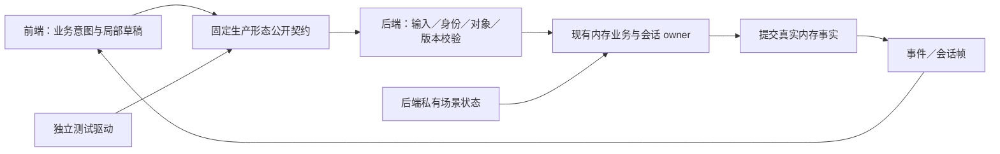

# 前端与公开接口生产标准整改任务

2026-11-16 新授权：实施已确认的展开分区导航、全局想法池及原子跨项目转入版本；底部复用原有展开 footer，设置保持不变。范围与覆盖规则见 [分区导航与想法池](docs/specs/aireq-migration/section-navigation-and-ideas.md)，不恢复裁撤功能。

### 授权、目标与交付边界

2026-11-16，用户确认修复前述 31 个 scout 审查中全部已确认问题，先生成文件跟踪进度；已单独同意整体覆盖现有 `F:\code2026\ZCode\.todo.md`，不合并旧任务或沿用旧勾选。本文是待实施计划，不是实施结果。此次生成只改本文件，不授权自动执行、提交、推送、部署或开启另一会话。

目标：产品前端源码、文案、运行时依赖和公开契约达到正式上线标准；清除原型、演示、mock、测试专用、debug 实现及占位成功。当前整改可以调整接口并同批迁移全部消费者；整改后定型的前端构建产物、SDK、传输、接口、DTO、descriptor、schema 在未来切生产后端时一行不改，只替换后端和必要部署配置，不留兼容别名、双轨接口或后端专用前端包。

已确认的取舍：

- 保留当前内存模拟后端及既定业务流程，模拟数据、执行和故障场景只能归后端内部；本轮不建设真实 AI、Git 托管、数据库、身份认证、权限体系或本机业务文件写入。未实现的能力返回正式不可用／不存在错误，不用空成功或虚假执行事实替代。
- 内存中确实完成的操作可以按正式业务契约返回结果；不得把它宣称为真实外部 AI／代码扫描／平台核验／持久落盘。环境限制和真实上线阻断项只写部署／交付说明，不向产品页面、提示词、用户材料或契约塞演示身份。
- 保持当前电脑浏览器产品结构：全局项目／待办，项目内概览／需求／分析运行，需求分提案／正式视图；默认全项目总览；设置为外观／项目配置／AI 配置。原生会话、材料、版本、幂等、对象归属、人工门禁、进度规则和未保存保护不因清理改变。
- Skill 入口继续隐藏，但其保留实现全部在整改范围；允许验证相关隐藏运行路径，不恢复主导航／设置／搜索入口。Sketch 的真实画布和 PNG 附件功能保留。
- 允许必要电脑浏览器、协议、错误路径、多连接广播验证；复用现有工程体系，不新建 E2E harness、不恢复 App 业务单测或桌面／CLI／手机工程。
- 普通业务“测试验收”、模型连接检查、生产诊断日志、真实代码展示、正常占位输入提示、稳定 DOM selector、独立工程测试、通用 UI 控件不按关键词误删。基础控件和无关本地改动必须保留。

### 已核实的材料与当前事实

审查依据：`docs/specs/aireq-migration/release-surface.md:7-26`；完整审查报告为 `out://production-compliance-31.md`。本文件已内嵌全部确认问题的实施目标，不依赖该会话报告或访谈才能执行。行号是审查定位线索，实施时以符号和当前源码为准。

| 已确认现状                                                            | 源码定位                                                                                                                                                                                  |
| --------------------------------------------------------------------- | ----------------------------------------------------------------------------------------------------------------------------------------------------------------------------------------- |
| MR 公共类型不能表达真实核验成功                                       | `packages/services/src/aireq/types.ts:136-146`，`AIReqPrFact.platformVerified: false`                                                                                                     |
| 未知业务异常可经会话正文绕过一般 RPC 错误脱敏                         | `packages/server/src/mock/zcodeAgent.ts:446-459`；已有安全出口 `packages/server/src/aireq/errors.ts`                                                                                      |
| sample/live 来源进入公开 bootstrap，登录／帮助仍显示演示说明          | `packages/services/src/aireq/{data-source,remote-operations}.ts`；`packages/ui/src/aireq/shell/remote-data-source.ts`、`AIReqWorkflowHelp.tsx`；`packages/web/src/auth/EmployeeEntry.tsx` |
| 故障注入字段仍在公共 SR／IR／Review DTO                               | `types.ts:99,254,362-364`；`packages/server/src/aireq/{workflow,progress,requirements-review,proposal-mutations}.ts`                                                                      |
| 产品输入器、会话、store 中有可写 E2E 桥、测试延迟、保活特判和状态镜像 | `packages/ui/src/{LexicalChatInput.tsx,store/,v4/}`，详见第 6 组全部文件清单                                                                                                              |
| 公共类型／传输中保留测试场景、开发信任、调试方法与测试限额            | `packages/shared/src/`、`packages/rpc/src/`，详见第 7 组                                                                                                                                  |
| 文件／Git／工作流产物读取、广播和设置存在具体公开语义问题             | `packages/server/src/mock/{workspace,broadcast,zcodeAgent}.ts`、`domains/settings.ts`；白名单在 `packages/server/src/http.ts:116-246`                                                     |
| 遥测只有无消费者的本地事件派发，没有正式接收路径                      | `packages/web/src/platform/index.ts:96-100,186-191`；`packages/shared/src/platform.ts:763-767`                                                                                            |
| 语言表／隐藏 Skill／退役 hook 仍有原型文案、假行为                    | `packages/ui/src/i18n/locales/zh-CN.ts`、`aireq/tools/`、`hooks/useBuiltinAgentCli.ts`、`lib/mcpStatusProbe.ts`                                                                           |

此前规则编辑时的 typecheck／Lint 通过，只证明当时输入；31 个 scout 的结果是静态审查，未运行整改验收。不得把这些历史结果写为本文件任务已通过。当前无真实生产后端，未来“同包切换真实后端”的实际验收本轮不能伪造。

### 状态所有者、接口和顺序不变量

业务状态仍归 `MockAIReqService`／既有领域 owner；会话行、附件、订阅和水位仍归 `MockRuntime`／`MockZCodeAgentService`。前端不得新增权威业务副本。先校验并提交，再发事件；迟到结果仍按对象／版本拒绝，重连只重读，不重放 mutation。私有故障状态不得借工作流对象或嵌套历史回执泄漏。

广播以连接 facade 绑定的发送源隔离，不能信任请求自行声明发送源；后端更新／路由完事实后通知其他连接，本连接不回声，断线注销。遥测只确认接收，不声称第三方上传或持久化成功；不为本需求加入重试队列、调度器或通用采集框架。

### 共享执行纪律与验证入口

- 任务组按第 1→9 组串行执行。第 N 组只能依赖共享前置与已完成的第 1…N−1 组；组内按文件顺序逐项完成。每项只有自己的产出、直接验证和相应文档完成后才能勾选，不等待后续项补首次验证；组内全部勾选且组收口通过后才进入下一组。
- 复位／测试桥清理按现有调用依赖顺序执行；公共类型变更在所属项内同批迁移 server、SDK、UI、schema、导出及实际工程消费者，不先提交坏类型或等待下一组补接线。后组影响前组有效证据时，由后组修复并复验受影响路径。
- 每个行为项先更新对应 spec 的规则／所有者／接口／失败语义／验收场景，再改实现；同步该项受影响 `CONTRACT.md`、示例及引用。修 bug 用中文注释说明原因与依据，必要处解释不变量，避免把已经删除的实现留在注释中。只编辑关联范围，不顺带恢复退役功能、重构、升级、重排布局或批量格式化。
- 以当前本地工作区实施，不执行远端新鲜度检查，不因落后远端暂停或重派任务；未经用户明确要求，不执行 fetch／pull／merge／rebase。代码变更遵守 architecture-governance，先跑架构基线再读受影响模块的 `architecture:context`。已核实模块包括 `aireq-contract`、`aireq-mock`、`aireq-ui`、`rpc`、`shared`、`services`、`server`、`mock-domains`、`ui`、`web`、`web-platform`、`client`、`conversation-telemetry-engine`；按目标路径选择，不为清理新建平行模块。
- 每项直接验证使用既有测试、最小真实运行场景或一次性 Bun 断言；后者放临时目录，验证后删除，不注册产品调试方法、window 全局、公开夹具或永久协议冒烟体系。对无业务消费者的删除项，精确引用检索／模块导入验证就是该项直接证据；静态关键词扫描不能替代运行时错误与状态验证。
- 每个有代码变更的组在本组收口时运行一次 `bun run typecheck`、`bun run lint`、`bun run architecture:check --changed`。检查退出码及本次相关 Hooks 警告，不以退出 0 忽略依赖问题；根 Lint 忽略的受影响 React 文件按 `docs/testing/react-hooks-lint.md` 做定向扫描。纯规则第 1 组不额外运行类型／Lint。
- Bun 固定版本以 `mise.toml` 为准，当前为 1.4.4；只使用 Bun。开发入口 `bun run dev`，也可分开 `bun run dev:server`／`bun run dev:web`；实际端口以日志为准，现有配置为后端 3031、前端 5174。运行浏览器工具前读 agent-browser，UI 修改前读 `DESIGN.md`／适用 UI 技能；不与上游或 base 做源码／截图比较。
- 现有工程测试唯一清单是 `scripts/engineering-test-files.json`，当前 11 项。指定文件用 `bun run test:engineering <真实清单路径>`；受影响选择用 `bun run test:engineering:affected --files <实际改动路径>`。改根 `package.json`、Vitest 公共配置或清单会按现行规则运行一次 `bun run test:engineering` 全量；新增工程测试只有具体消费者可见风险且现有证据确有缺口时才允许，同时登记并满足全量要求。不得为凑覆盖扩体系。未修改工程门禁实现就不默认跑 `test:architecture` 全套。
- 必要构建放第 9 组执行一次 `bun run build`，检查本次最终发布产物；此前项的直接行为／删除证明必须在各自完成时已经成立。输入未变的检查／浏览器场景复用，不在最后再跑一遍所有业务。
- 每组将实际命令结果、验证对象／条件／预期／观察、未验证限制写到现有 `docs/specs/aireq-migration/release-surface.md` 的本轮记录，相关协议细节回写已有契约／架构文档；不把旧日期证据改成新通过记录，不额外创建汇报文档。临时数据仅限隔离内存实例，不接触真实仓库、模型或用户文件。
- 单项完成不等于全产品发布验收；组完成不等于真实系统已上线。任何失败如实报告，修复本范围直接原因并复验；工具限制须记录已尝试措施与未完成项，不勾未完成任务、不靠缩验收通过。
- 停止条件：本文件确认范围全部完成，各组必要验证／文档已成功，第 9 组发布边界证明完成后立即停止；不追加全量审计、相邻优化、真实后端建设、权限改造、测试体系、提交、推送、部署或新会话。

### 覆盖与排除裁定

本计划覆盖原审查的 P1 两项、全部实际产品路径问题、公共故障控制、全部公开测试／开发残留，以及 15 个测试复位／单例注入口。重复发现只做一次完整修复，不相加凑数量。

路径约定：第 6 组省略前缀的 UI 路径均相对 `packages/ui/src/`；第 7 组省略前缀的共享协议路径均相对 `packages/shared/src/`。同组中“同文件”指该组已明确的文件，不指新建平行实现。

不单独采纳“opaque backend.id／workspaceIdentity 存在就必须删除”的推断；有效业务／连接隔离仍保留，sample/live 特判必须删除。`session-debug.ts` 的正常脱敏诊断快照、真实 network 状态映射、stdio 抓取若属于正常生产诊断，不能只因名字删除；明确开发者工具控制和退役调试 RPC 词表仍清理。`mockCdnDir`、`RUNTIME_ZCODE_DEBUG`、entitlement 固定值等未证实线索不当成确认缺陷扩范围。发现新证据只有确属本轮发布边界的直接缺口才登记到对应项；改变已确认产品取舍须重新与用户对齐，不默默缩范围。

## 1. 前置基线与规格收敛

- [x] G1.1 记录基线并先统一本轮规则、契约意图与验收场景。
      依赖：仅共享前置。执行变更前架构检查，读取本轮涉及模块受控上下文；仅定位必要源码，不重复 31 份全量审查。先更新 `docs/specs/aireq-migration/release-surface.md`：当前已获浏览器／隐藏 Skill 验证授权，旧“不进行浏览器验收”仅是历史记录；明确 mock 内部完整流程、正式前端／契约、未支持失败、未来同包替换和本轮真实能力限制。
      同步 `docs/project-goal.md`、`docs/architecture/mock-backend.md`、必要 `AGENTS.md` 相关指引，以及 `packages/web/src/auth/CONTRACT.md:7`、UI／services AIReq 领域 CONTRACT 的旧演示提示要求；现行业务规格继续作为业务真相源，不再引用被覆盖的旧 `.todo.md` 内容授权恢复场景按钮。部署／交付限制写入现有后端替换／上线限制章节，不再从前端常驻告知。
      直接验证：核对规则的术语、所有者、时序、验收范围与本文件一致，所有引用目标存在，历史证据未冒充本轮结果；记录架构真实结果与既有失败。完成标准：实施所需规则已落地，后续组无需等待新的产品决策；本项不声称代码已整改或已可上线。

  Execution: 2026-11-16，纯规则 G1 完成。Bun 1.4.4；freshness 退出 0（main ahead 0／behind 0），变更前 architecture:check --changed 退出 0（violations／baseline／new 均 0）。已读取 aireq-contract／aireq-mock／aireq-ui／web／server context，后两者返回 unmanaged，未把门禁通过扩大为全模块覆盖。13 份相关文档规则、所有者、时序和场景与本文件核对一致；只读 Bun 引用断言退出 0（49 本地链接、9 锚点、12 显式目标，0 失败）。详细证据见 release-surface.md“本轮生产标准整改记录／G1.1”；历史记录保留且不冒充本轮结果。未改产品代码，未运行类型／Lint／测试／构建／浏览器，不声明代码整改或上线通过；其他组未执行。

## 2. 关键错误边界、真实事实类型与严格入参

- [x] G2.1 修复会话正文旁路的未知异常泄漏。
      依赖：第 1 组完成。修改 `packages/server/src/mock/zcodeAgent.ts:428-459`，复用 `packages/server/src/aireq/errors.ts` 的安全业务错误区分和服务端诊断，不把任意 Error.message／String(error) 插入 assistantText；保持输入已接纳、失败、可恢复状态的真实语义，不以“complete 成功”掩盖失败。
      直接验证：在独立实例通过真实公开命令路径分别触发安全业务失败与含服务器路径／内部文本的未知异常，检查响应、会话帧和历史：前者可操作，后者仅稳定提示；未知异常详细信息只在服务端。注入通过临时服务装配完成，不增加产品故障开关。完成标准：正常回复与失败回执仍可消费，旁路不泄漏且有真实服务端诊断。

  Execution: 2026-11-16，已先更新发布规格和 server CONTRACT；隔离真实公开 create／subscribe／send／rowsRange 断言最终退出 0。安全业务错误可读，未知路径／内部文本仅见服务端诊断，ACK／帧／历史不泄漏；assistant／turnHeader failed、会话可恢复，后续正常发送成功。临时装配曾缺正式必需字段而被拒，补齐后通过；详见 release-surface.md G2.1。

- [x] G2.2 修复服务端与工具 fallback 的机器码直出。
      修改 `packages/server/src/aireq/native-business.ts` 中 `businessRule("fault.command.sessionNotFound")`／`INVALID_IDENTITY` 的安全文案映射；修改 `packages/ui/src/v4/toolCallRowAdapter.ts:64-80` 与实际 fallback 消费，code 不作为用户错误正文，保留机器分类和已有本地化失败提示。
      直接验证：不同操作者读取未发布私有草稿仍被拒绝但不显示内部码；对契约允许的空 message、空 output.text、非空 error.code 工具行，真实渲染显示正常失败提示而不是机器码；已有安全说明不被误吞。完成标准：两条独立出错链都具有可理解错误，身份／归属拒绝不削弱。

  Execution: 2026-11-16，身份／草稿拒绝安全映射及原生实际先行拒绝出口已收口；真实双操作者公开订阅仍拒绝。四类合法工具行通过真实 adapter＋fallback React 渲染及电脑浏览器 snapshot，空说明显示正常失败而非机器码，安全 message／output 不丢，raw 分类保留；断言最终退出 0，详见 release-surface.md G2.2。

- [x] G2.3 使 MR 核验契约能够表达真实平台事实，并同批迁移全部消费者。
      将 `packages/services/src/aireq/types.ts` 的 `AIReqPrFact.platformVerified: false` 收敛为正式布尔核验事实；定位并同步关联 schema、提案／SR／整体验收 PR、server 生产者、公共导出和 UI 消费者，不能让 true 被前端当异常，不能把模拟记录改成 true。
      直接验证：false 和 true 的合法对象都通过实际契约／消费者，false 不被显示成真实核验，非法值拒绝；现有内存后端保持 false。完成标准：无需未来改 DTO 即可接收生产核验成功，当前不虚构外部核验。

  Execution: 2026-11-16，单源公共 schema／类型、现有 exports、server 生产者与 UI 消费者及规格同批迁移。true／false 在提案、SR 当前／历史、整体验收共享事实和真实 React 渲染通过；7 类非法值被 schema／UI 拒绝，浏览器观察核验标签区分正确。现有及重建内存 MR 均保持 false；直接断言退出 0，详见 release-surface.md G2.3。

- [x] G2.4 严格拒绝 v4 信封、封闭 payload 与嵌套入参的未知字段。
      修改 `packages/shared/src/zcode-protocol-v4/command.ts` 的 envelope、createSession／sendText／resolveInteraction／pauseGoal／resumeGoal／deleteSession 等封闭对象及嵌套 firstInput／answer；修改 `transport.ts` 的 subscribe base、conversationRowsRange 入参；同步实际服务端解析／调用路径。保留确属业务扩展的 args／content 字典及可信连接层注入字段，不对所有 unknown 对象机械 strict。
      直接验证：正常创建／发送／交互／订阅／分页保持成功；额外键分别放在信封、空 payload、嵌套 firstInput／answer／base／分页时，公开边界拒绝且不产生业务副作用，不是先剥离后执行。订阅／分页必须验证实际服务入口，而不只验证孤立 schema。完成标准：本项全部指定输入路径已收口，旧未知操作拒绝保持。

  Execution: 2026-11-16，shared 严格 schema 与原生三订阅／分页真实入口同步接入，保留 args／content 扩展及可信连接字段。隔离真实 WebSocket＋现有 SDK＋Channel＋scope 全链 8 个正常调用成功，19 个额外键／未知操作拒绝且会话、任务、订阅状态不变；正常暂停／恢复保留未支持语义，断言退出 0。协议与证据见 mock-backend.md／release-surface.md G2.4。

- [x] G2.5 严格校验公开设置 patch，拒绝污染回读。
      修改 `packages/server/src/mock/domains/settings.ts:24-33`，复用 `packages/shared/src/validationAppSettings.ts` 等现有正式设置规则定义严格 patch；在 update 合并前验证键和值，部分更新不要求调用者补全 AppSettings，非法请求原子失败，不重置其他合法设置。
      直接验证：实际 RPC 正常主题／语言／字号 patch 保存并 get 一致；`{debug:true}`、错误类型、越界值、混合合法与非法 patch 拒绝，原状态不变。完成标准：未知键不进入内存或后续 get，合法已有设置未丢失。

  Execution: 2026-11-16，已先明确正式 AppSettings／locale 和外观规则；初值由正式 schema 生成，严格 patch 完整通过后一次合并，partial 不补默认，坏 endpoint 写入不再容错吞掉。真实 WebSocket／SDK／RPC 保存五主题、语言、字号边界回读一致，17 类非法／混合请求全部原子拒绝且原设置深等、无 debug 污染；断言退出 0，详见 release-surface.md G2.5。

- [x] G2.6 收口本组工程检查与证据。
      依赖：G2.1—G2.5 各自直接验证已完成。执行共享组收口的 typecheck／Lint／变更架构检查，复核相关 Hooks，记录本组安全／类型／输入的实际证据与文档。完成标准：本组实现、直接验证、检查和文档均完成；不把剩余演示／测试残留标为已解决。

  Execution: 2026-11-16，G2.1—G2.5 各项证据／文档已完成。首轮 typecheck 的合法清空值类型不一致和架构的既存 config 文件新归属告警已在本组修正；真实 RPC 定向复验退出 0。最终 typecheck／Lint／architecture:check --changed 均退出 0，Lint 0 告警／错误、架构 0 违例；定向 Hooks 2 文件 0 诊断、UI detector []。受影响工程选择 0/11（未执行用例，不冒充通过），未运行构建／架构全套；10 份临时文件及目录、隔离服务／浏览器已清理。详见 release-surface.md G2.6，仅完成第 2 组，不声明其他组或上线通过。

## 3. 公共投影隔离与真实客户端身份

- [x] G3.1 删除 sample/live 来源契约和产品演示身份分支。
      依赖：第 2 组完成。整体清理 `packages/services/src/aireq/data-source.ts` 的 `AIReqDataProvenance`、`remote-operations.ts` bootstrap provenance、server `aireq/service.ts` 返回、UI `shell/remote-data-source.ts` getter、`AIReqWorkflowHelp.tsx` 分支和 `packages/web/src/auth/EmployeeEntry.tsx` 演示页脚及全部实际导出／引用。同批同步模块说明，不能留兼容可选字段。
      保留确有业务用途的 opaque 隔离键，不按后端类型分支；不新增对真实 AI／认证的虚假承诺。直接验证：真实登录页／帮助无演示说明，bootstrap 与数据源类型／实际返回没有 provenance／notice 残留；切工号、导航、设置草稿隔离保持，换不透明部署 ID 不引入产品类型分支。完成标准：契约、生产者、adapter、页面与说明一次切净。

  Execution: 2026-11-16，公开类型／bootstrap 生产者／adapter／帮助／登录及设置说明同批切净，无兼容字段。隔离真实 owner＋adapter 断言退出 0，两种 opaque 部署 ID 与实例草稿隔离保持；真实电脑浏览器登录／帮助无演示说明，项目／待办导航、未保存取消／丢弃和切工号隔离完成。工具及同步失败如实记入 release-surface.md G3.1，不冒充业务结果；共享配置未写入验证数据。

- [x] G3.2 将下一次故障与 hold 暂存从公共 DTO 移回后端私有状态。
      清理 `packages/services/src/aireq/types.ts` 的 `trackingBranch.nextCleanupFailure`、`branchCreationFailures`、`heldReviews` 和仅表达模拟 hold 控制的 `AIReqReview.held`；迁移 server `progress.ts`、`workflow.ts`、`proposal-mutations.ts`、`requirements-review.ts`、私有场景／fixture 的实际读写，公共 `domain.ts` 门禁使用正常 agent 状态。私有状态按既有 project／IR／SR／轮次身份隔离，不新增前端控制入口。
      直接验证：正常读取、历史回执嵌套视图、事件结果均无这些控制字段；通过临时后端内部场景验证一次失败可被正常重试消费、等待评审仍不放行、旧结果不恢复批准、其他对象不受影响。完成标准：公共声明和真实投影都不泄漏，既有失败／并发门禁不被删除。

  Execution: 2026-11-16，故障暂存迁入既有后端私有类型，公共 held 删除，agent 正常状态门禁与递归投影同步；未新增控制入口。隔离真实公开读取／嵌套历史回执／48 次事件断言最终退出 0；清理和建分支一次失败后正常重试、转正失败消费、原始／完整等待、同材料旧轮次和改材料迟到拒绝、其他 SR 与错误归属均验证。初次脚本解析及 99% 清理拒绝记录于 release-surface.md G3.2，未弱化业务规则。

- [x] G3.3 将接纳时的真实 clientId 贯穿排队、执行与最终用户行。
      修改 `packages/server/src/mock/zcodeAgent.ts` 的 enqueue／startTurn／runTurn 数据传递，移除 userInput 的固定 `"mock-client"`；以可信连接校验后的 envelope／队列事实为源，不从浏览器后传任意字段覆盖。
      直接验证：两个客户端同会话发送的排队项、流式 userInput 与历史分页均保持各自真实 clientId；首发 createSession、后续 sendText、恢复／重试不改变来源，跨连接伪造仍拒绝。完成标准：公开 `origin:"realUser"` 的身份与实际接纳事实一致。

  Execution: 2026-11-16，真实 clientId 从接纳信封／原队列贯穿全部执行分支，HTTP 固定连接身份补充拒绝冒名握手后的信封。隔离真实 WebSocket＋SDK＋Channel／scope 断言最终退出 0：7 用户行、101 帧、A/B 排队、首发／后续／重连查询与幂等重试／两种提升／完整两行分页历史身份一致；两类跨连接伪造拒绝无副作用。临时装配初次遗漏 CAS／错误事件名等真实失败见 release-surface.md G3.3；连接和端口已关闭。

- [x] G3.4 收口本组工程检查与投影证据。
      依赖：G3.1—G3.3 已分别验证。运行共享组收口检查，记录 bootstrap／嵌套工作流投影／客户端行观察和相应规范。完成标准：投影隔离与身份修复已独立闭环，无需第 4 组提供数据或验收。

  Execution: 2026-11-16，G3.1—G3.3 各项直接验证与说明已完成；首轮 Lint 的一条死类型导入警告已修，最终 typecheck／Lint／architecture:check --changed 全退出 0（Lint 0 告警／错误，架构 0 违例）。定向 Hooks 2 文件／2 规则 0 诊断，UI detector []；受影响工程选择 0/11，无用例执行不冒充全套通过。投影比较链定向复验退出 0；6 临时文件、空目录与隔离连接／浏览器已清理，未运行构建。完整观察及失败记录见 release-surface.md G3.1—G3.4；仅完成第 3 组，不声明后续组或上线通过。

## 4. 公开后端读取、广播与遥测的真实语义

- [x] G4.1 使虚拟文件的存在性、类型、列表和字节数一致。
      依赖：第 3 组完成。修改 `packages/server/src/mock/workspace.ts` 的 readdir／stat／readTextFile／readFileRange／listWorkspaceFilesLength／listWorkspaceFilesRange：不存在对象和目录作文件读取明确失败，不 fallback 根目录或空内容成功；列表来自同一虚拟树，stat／分页以实际 UTF-8 字节为准，保持现有返回格式／编码及范围语义。
      直接验证：真实文件 RPC 覆盖目录、空文件、中文文件、缺失对象、目录误读、有效／边界分片；列表长度与分页内容一致，stat size 与读取 totalBytes 一致。完成标准：所有指定公开读取都符合虚拟对象事实，不要求访问真实磁盘。

  Execution: 2026-11-16，先更新 mock-backend 读取规格；真实隔离 HTTP/WebSocket＋SDK／RPC 的 `bun .tmp-g4/files.ts` 退出 0，目录／空文件／17 字节中文与 emoji、缺失／错类型、六类字节分片及 12 项索引重组一致。索引保持既有列式字符区间，stat／文本字节计数按原始 UTF-8；详情见 release-surface.md G4.1。

- [x] G4.2 使虚拟 Git diff 和身份返回实际配置事实。
      修改同文件 `MockGitService.getDiff/getIdentity/refresh`，移除固定“模拟差异上下文”patch、`ZCode Mock`／mock 来源；从现有虚拟 before／after 和身份配置生成一致结果，没有内容／身份就用既有不可用／未配置语义，不补假 patch／假身份。
      直接验证：有差异、无差异、缺失路径和无身份分别返回正确结果；diff 与实际前后内容一致，refresh 与单独读取一致。通过真实 UI 中仍实际消费的预览路径确认错误／空态可读，不恢复已退役 Git 页面。完成标准：公开 availability 不伪装成功，虚拟 Git 不需要真实托管平台。

  Execution: 2026-11-16，先更新 diff／身份规格；将原先不存在的内容／配置事实归既有 runtime.git，无记录明确不可用／未配置。真实 Git RPC 的中文前后 patch、相同／缺失／错误来源／空文件、身份与 refresh 一致断言最终退出 0；仍消费的 PreviewPaneContent 真实渲染经电脑浏览器确认错误／空态可读，不恢复 Git 页面。详见 release-surface.md G4.2。

- [x] G4.3 消除工作流产物／节点结果的固定空成功。
      修改 `packages/server/src/mock/zcodeAgent.ts` 的 `conversationWorkflowRunArtifactReadV4`、`conversationWorkflowRunWorkspaceV4`、`conversationWorkflowRunNodeResultV4` 及必要入口校验；按现有 run／artifact／node 关系读取真实内存内容并验证工作区／会话归属。当前无实现能力的具体读取返回既定不可用／不存在错误，不为本轮搭建完整工作流引擎。
      直接验证：不存在与其他会话标识不能得到成功空文件；若当前能力未实现，合法目标也应明确不可用，不能为凑成功场景新建工作流引擎；已有真实产物时其空内容与“不存在”可区分，消费者正确展示不支持／缺失，合法空列表语义保留。完成标准：不忽略请求参数伪造成功，仍无需真实外部产物存储。

  Execution: 2026-11-16，先收敛规格及 server CONTRACT；当前无工作流产物引擎，七个入口严格入参并校验驻留会话／归属，合法 runs 为空，指定 run 读取明确不支持，不再伪造空内容。真实 RPC 36 次拒绝及无副作用断言最终退出 0；真实 WorkspaceCardBody／hook 经隔离电脑浏览器显示可读不支持说明。详见 release-surface.md G4.3。

- [x] G4.4 实现排除发送源的多连接内存广播。
      修改 `packages/server/src/mock/broadcast.ts`、`http.ts:setupChannelServer` 和必要连接 facade：复用 `IBroadcastService` 的 send/onMessage，单一总线归现有服务 owner，各连接绑定可信源并在关闭时注销；只通知其他连接，不信任客户端 sourceWindowId，不为两个标签页引入权限体系或持久队列。
      直接验证：真实两个 WebSocket 连接／两个电脑浏览器标签页同步主题或语言，发送方无回声、接收方只应用一次、无回环；第三连接退出后不再收到事件，断线重连不累积监听，claims 既有语义保持。完成标准：send 不再静默丢消息，连接生命周期内广播有效。

  Execution: 2026-11-16，先更新连接时序／owner 规格；共享 send 真实投递，HTTP facade 可信源覆盖／本源过滤／关闭注销，claims 不变。真实三连接及三轮重连 RPC 断言退出 0；两个电脑浏览器标签页经真实 createZCodeStore 双向切主题，每方发送／接收各一次、发送无回声、接收无回发，DOM 主题一致。详见 release-surface.md G4.4。

- [x] G4.5 现在接通正式遥测接收契约，移除 mock 特例本地派发。
      修改 `packages/web/src/platform/index.ts` 两个 report 端口、`packages/shared/src/platform.ts`／`telemetry.ts` 和 `packages/server/src/http.ts`。计划新增同源 `POST /api/v1/telemetry/events`（这是待实现目标，不是已有路由）：严格区分 `{kind:"ui",payload:RendererTelemetryEventPayload}` 与 `{kind:"arms",payload:ArmsCustomEventPayload}`；复用既有脱敏规则，仅接收声明字段，复用现有 `/api/` 部署访问控制，不把工号当可信认证。
      Web 使用现有两种 payload 发送并等待 HTTP 接纳，非成功明确拒绝；后端在返回 202 前把清洗后的事件交给实际内存接收 owner／服务诊断，不公开测试读取或 suppress 网络命令。不搭建第三方 ARMS、持久队列、重试或新鉴权体系；202 只表示接收，不承诺外部送达。同步正式 HTTP 替换契约，移除无人消费 `zcode:telemetry` 和“mock 可丢弃”的接口约定。
      直接验证：真实会话反馈遥测到达接收边界；两种事件正常接纳，畸形／额外字段／敏感副本被拒绝或按既定规则脱敏，服务器错误使 report 拒绝但不掩盖主业务结果；配置部署 token 时无授权请求被拒绝。完成标准：换同契约后端不再需要补前端遥测接线，当前不假称第三方上传成功。

  Execution: 2026-11-16，先更新正式 HTTP／platform 规格、CONTRACT 和示例；严格 ui／arms 信封、副本脱敏、实际服务诊断先于 202、部署 token 接入完成，Web 两种 report 等待接纳且非 202 拒绝。真实 HTTP 6 次接纳／12 类非法拒绝／脱敏／401 与授权／安全 500 断言退出 0；真实会话反馈与 ARMS 经电脑浏览器分别观察 202，接收失败 500 时真实反馈 ACK／历史 like 与按压态仍保持。详见 release-surface.md G4.5。

- [x] G4.6 收口本组检查、运行时及部署契约。
      依赖：G4.1—G4.5 各有直接验证。运行共享组收口检查；记录公开读取、广播连接顺序、遥测 HTTP 方法／鉴权／错误／接纳语义到现有 mock-backend／发布边界和受影响 CONTRACT。完成标准：本组各公开方法有真实效果或明确不可用，浏览器观察已完成，不留给最后组首次验证。

  Execution: 2026-11-16，G4.1—G4.5 已各自直接验证并完成文档；本组一次 typecheck／Lint／architecture:check --changed 全退出 0，Lint 1935 文件 0 告警／错误、架构 0 违例。两文件定向 Hooks 0 诊断；受影响工程选择 0/11，未执行用例不冒充全套。14 份临时文件、空目录、隔离宿主与浏览器已清理，用户原有服务保留；未运行构建。详见 release-surface.md G4.6，仅完成第 4 组，不声明后续组或系统上线通过。

## 5. 业务内容、隐藏 Skill 与事实展示

- [x] G5.1 清理原生业务回复中的演示前缀和无依据的真实执行宣称。
      依赖：第 4 组完成。修改 `packages/server/src/aireq/native-business.ts:135-166` 及必要原生回复生成，删除“以下为演示内容”和面向用户的实现说明。完整保留内存业务状态推进；回复只能陈述实际接纳的输入／材料变化／阶段结果，不宣称真实模型、扫描或外部 Git 已执行，不把固定示例冒充用户请求的真实分析。
      直接验证：需求讨论、方案讨论、评审追问、仅附件和恢复后继续讨论各取代表性请求，公开行与历史无演示前缀，回复与本次输入／版本结果一致，未开放能力不假报成功。完成标准：产品回复不是内部模板说明，前组错误脱敏未回退。

  Execution: 2026-11-16，先更新规格和 server CONTRACT；`bun .tmp-g5/native-proof.ts` 退出 0，公开原生 create／subscribe／commands／分页历史 47 帧验证需求、方案、两类评审追问、PNG 仅附件、幂等与逻辑重订阅继续。回复材料路径／SHA-256 与本次 owner 变化一致，无演示或外部执行宣称；仅附件不改材料。恢复范围与限制见 release-surface.md G5.1。

- [x] G5.2 清理材料、评审、规划及合入回执的原型说明与虚构归因。
      修改 `packages/server/src/aireq/{materials,requirements-review,fixture-builders,planning,workflow}.ts`：删除 Markdown 注入“演示文档”，评审报告“前端展示样例”，合入／回执“样例／内存演示”与公开“一次性故障样例”。材料摘要／字节数继续从实际正文重算，不只替换 UI 显示。
      对 `planning.ts` 的无真实分析依据默认 `source:"ai"`／“AI 建议样例”，不伪装人工结果或新增 mock 来源枚举；没有真实建议时保持契约允许的未提供规划，人工配置走原正式保存动作。内部确定性流程仍可使用自己的场景事实，但不能把其文字输出为真实外部核验。
      直接验证：正常提案材料、评审历史／讨论种子、规划面板、合入检查和操作历史的公开内容与字段一致；无建议显示未提供且能人工保存；修改后的 SHA-256／UTF-8 size 正确，失败仍阻止放行。完成标准：全部列明出口都清净，不牺牲完整业务流程或版本门禁。

  Execution: 2026-11-16，规格先行；公开服务材料／版本摘要、评审当前／历史／种子、无规划与人工保存、失败及旧版门禁、合入与分支回执断言最终退出 0。独立一次故障拒绝／显式重试退出 0；真实电脑浏览器从未排期保存人工分工和区间后正确回读。材料和回执无演示身份／虚构外部核验；脚本收尾及浏览器定位失败如实记入 release-surface.md G5.2。

- [x] G5.3 贯通隐藏 Skill 的正式预览与保存语义，并清理演示资产。
      同批修改 `packages/ui/src/aireq/tools/AIReqSkillDesignPage.tsx`、server `aireq/{skill-design,skills}.ts`：去掉前端两处“演示环境／未写实际文件”，公开 prompt／SKILL.md／checklist／目录项／聊天模板中的演示说明；以实际内存文件内容／版本和已有 `AIReqSkillSaveReceipt` 确认保存，list/read 与收据一致，不声称写了宿主磁盘或永久存储。无法完成既定保存语义时明确失败，不能仅删说明。
      删除未引用的 `packages/ui/src/aireq/tools/skill-design-prompt.md` 演示模板，不新增重复客户端模板；清理 `sketch.html:2-5` prototype 定位注释但保留 MIT／来源署名和真实画布。保留原生私有会话、草稿、附件、预览和唯一未保存门禁，不恢复产品入口。
      直接验证：使用独立临时装配挂载现有 Skill 模块到真实浏览器而不修改产品导航／添加测试开关，完成 prompt 填入、讨论、逐文件预览、有效保存、同名冲突、失败保留及设置往返；收据 path/revision 与随后 list/read 的内存产物一致。Sketch 实际绘图回填 PNG 仍可发送。完成标准：隐藏实现也达正式契约，清理相关临时宿主且主导航继续隐藏。

  Execution: 2026-11-16，真实 WebSocket／SDK／RPC 保存与幂等、正文／版本／收据、祖先目录／stat／字节／索引／搜索、项目隔离与失败原子性退出 0。隐藏模块经隔离真实浏览器完成填入／讨论、逐文件门禁、两版项目／共享保存、冲突保留与设置往返；真实 Sketch 绘图 PNG 回填后发送。发现并修复设备与 v4 两套 clientId 的既有接线缺口，未放宽服务端校验。临时装配已清理，入口仍隐藏；见 release-surface.md G5.3／G5.6。

- [x] G5.4 修复待办模拟文案与两处 AI 原始评分补造。
      修改 `packages/services/src/aireq/domain.ts:315-318` 的失败待办标题，不改变职责／重试判定；修改 `packages/ui/src/aireq/tracking/analysis/ReportPane.tsx:130-131` 和 `tracking/formal/FormalReport.tsx:189-191`，缺失 aiPercent 就显示未提供／省略，不从业务 percent 补 AI 评分。
      直接验证：评审失败时待办正文和 aria-label 使用正式表达；aiPercent 存在／缺失且业务进度为 0、99、100 的报告，在正式需求和分析页一致，人工 100 不显示伪造 AI 99；合入 99／人工通过 100 规则不变。完成标准：三处真实消费者均正确，不能只改其中一个页面。

  Execution: 2026-11-16，六类合法评分事实经两处真实报告共十二次浏览器渲染通过：缺失显示未提供，已有 0／42 保留，合入 99／人工 100 不变。当前 failed 评审的真实待办正文、处理与分工 aria-label 均正式表达；隔离装配错误及观察见 release-surface.md G5.4。

- [x] G5.5 清理 demo 场景 URL 专用保留／兼容逻辑。
      修改 `packages/ui/src/aireq/AIReqContext.tsx:590-601` 和 `packages/web/src/main.tsx:308-313`，删除 demo 特例与解释，只输出明确的业务定位参数；不得用通用名称替代同一场景开关。保留必要的退役 remote 入口安全处理，不扩为清所有未知业务链接。
      直接验证：普通启动和启动后 URL 改变再分享均不传播 demo／敏感未知参数，项目／Release／IR／SR 定位、返回前进和未保存取消保持；服务端仍拒绝额外连接场景参数。完成标准：分享构造和入口都无 demo 专用实现，不误称原清理分支是功能后门。

  Execution: 2026-11-16，真实启动及运行后改变未知参数再分享只含项目／Release／IR／SR 四字段；浏览器后退恢复同一 SR、前进恢复待办。未保存设置取消保留草稿，随后丢弃未写入；服务端额外 demo／scenario 均 400 INVALID_ARGUMENT。见 release-surface.md G5.5。

- [x] G5.6 收口本组 UI、内容与工程证据。
      依赖：G5.1—G5.5 独立验证完成。运行共享组收口检查，在受影响电脑页面观察浅／深主题和相关布局／键盘／草稿，不做无关全页矩阵；记录隐藏 Skill 的临时装配、内存保存限制及清理结果。完成标准：源码、公开内容、真实页面／隐藏实现和文档同批完成。

  Execution: 2026-11-16，本组直接验证与文档完成；首次两处类型错误已分离修复并定向复验。最终 typecheck／Lint／architecture 全退出 0（0 告警／错误／违例），六文件定向 Hooks 0 诊断、UI detector []；工程受影响选择 0/11，不冒充执行用例。临时 Vite 缓存曾污染 Lint，清理后通过；临时文件、浏览器与隔离宿主均清理。仅完成第 5 组，未运行构建；见 release-surface.md G5.6。

## 6. 产品运行时测试桥、注入与复位接口清理

- [x] G6.1 移除真实 Lexical 输入框的可写 E2E 插件。
      依赖：第 5 组完成。删除 `packages/ui/src/LexicalChatInput.tsx:987-1072,1600` 的 `E2ELexicalInputBridgePlugin`、节点属性、ready 属性及轮询；保留正式 EditorApiPlugin、输入历史、IME、mention 原子编辑、发送快捷键和受控回填。
      直接验证：真实浏览器完成输入／中文组合／提及／回填／发送，节点没有 `__zcodeLexicalInputE2E`／专用 ready 属性，编辑器重挂不新建测试轮询。完成标准：正常输入可用，产品不再公开写编辑器的测试通道。
      Execution: 真实浏览器 IME／文件 mention／受控回填／发送及重挂无桥／ready；见 release-surface.md G6.1—G6.4。
- [x] G6.2 移除全部五类 Zustand 全局桥及附件 scope 专用暴露。
      清理 `store/TabStoreProvider.tsx:11-14,27-42`、`composerAttachmentUploadStore.ts:50-66`、`zcodeSessionStore.ts:25-36`、`subagentsStore.ts:192-203`、`skillStore.ts:230-241`，以及 `v4/composer/useComposerAttachments.ts:265` 的专用 import／调用／Window 声明；保留正常 store、Provider 和用户状态隔离。
      直接验证：正常与带旧 E2E 环境变量的运行中，五类可写 store 全局及附件 scope 全局都不产生；实际导航、附件上传／发送／失败重试、技能／子代理读取仍走正常服务链，切 scope 不串附件。完成标准：五处全部清理，不以去掉 bootstrap 代替模块自身修复；共享开关其他消费者在本组后续独立清理。
      Execution: 正常／旧开关两种真实挂载均无六全局；实际失败自动重试、PNG 发送、跨会话与工号附件隔离、RPC 空 catalog 消费通过；见 release-surface.md G6.1—G6.4。
- [x] G6.3 从真实传输与订阅生命周期移除 E2E 特判。
      删除 `v4/conversationTransportDelayE2E.ts` 和 `agentConversationTransport.ts:473-475` 包装，产品直接调用正式服务；删除 `sessionDataLayer.ts` E2E 保活常量／环境 resolver 分支，正式默认仍为 30 秒，保留正常构造参数。
      直接验证：正常发送／拒绝／断线恢复及引用 acquire/release 可用；旧全局延迟计划和旧环境变量不影响真实发送／ACK／保活。通过已有公开构造参数的临时隔离场景验证退订生命周期，不等待下一组或在产品加快速时钟。完成标准：无测试 helper 依赖与时序注入，重连仍不重放写操作。
      Execution: 公开真实 transport／SessionDataLayer 约 31 秒证明默认 30s 与显式 40ms 租约、幂等 release／退订／恢复，不重放写；旧延迟未消费，正常发送与拒绝可观察；见 release-surface.md G6.1—G6.4。
- [x] G6.4 清理 ACK 全局探针与三类隐藏 E2E 状态镜像。
      删除 `v4/commandAckObservability.ts` 的 window 缓冲及 SessionPane 全部调用；删除 `ConversationComposer.tsx:2161-2169,2857-2859` 截图文件名／状态串、`v4/composer/V4ComposerToolbar.tsx:1150-1176` 隐藏模型／usage span、`ConversationHeader.tsx:22-24,31-41` 专用 title 节点和专属传参。正常日志、模型用量、截图附件和可访问控件保持。
      直接验证：发送成功／拒绝不产生 ACK 测试全局，DOM 无三个专用镜像；模型切换、用量、截图上传、pane 操作与真实标题展示不受损。完成标准：不是把镜像改名为通用 data-\*，真实可见功能仍可用。
      Execution: 成功与拒绝无 ACK 全局，浏览器无三类镜像；真实模型菜单、用量、PNG 及标题保持；两独占 selector 同步删除。见 release-surface.md G6.1—G6.4。
- [x] G6.5 删除公开消息行渲染器中的 turnHeader 调试展示。
      清理 `packages/ui/src/v4/ConversationRowView.tsx:1621-1630,2217-2218` 的 `TurnHeaderRowView` 与 `turn · origin · state` 专用渲染分支，核对 `v4/index.ts` 和 `ConversationTurnRow` 的实际公开消费。保留 turnHeader 协议与 render-unit 结构事实，不能删除正常轮次分组或将内部值换名继续展示。
      直接验证：公开行渲染器不再对 turnHeader 产生协议调试行，正常 userInput／assistant／tool 行与主时间线分组保持；主时间线原本抽离 turnHeader，不能声称本项修复了已实测的当前可见故障。完成标准：已导出源码中的调试实现移除，不等待最终 bundle 摇树。
      Execution: 真实公共 renderer／ConversationTurnRow／schema／React 渲染 header 均无 DOM，三类普通行及分组事实通过；不声称原主时间线有可见故障。见 release-surface.md G6.5—G6.8。
- [x] G6.6 清理 UI 根公开的 TestActions／mock 消息接口。
      删除 `packages/ui/src/test-actions.ts` 和 `src/index.ts:12-13` 专用导出／全局声明；精确迁移仍实际存在的测试消费者到测试侧，不能创建新产品 shim。正常业务 BotsService inbound 契约不因被旧测试类型引用而误删。
      直接验证：产品根无该出口、全仓无遗留产品调用／`__testActions`；正常根导入／应用挂载仍可用。完成标准：假消息注入契约和 hook 从产品源码移除，非仅关闭注册条件。
      Execution: 精确产品依赖无该出口／全局／假消息接口，真实根 UI／AIReq 装配正常；Bots 业务未删。见 release-surface.md G6.5—G6.8。
- [x] G6.7 将 telemetry parity 场景／断言／运行桥从产品源码移出。
      清理 `lib/conversationTelemetryLegacyParityE2E.ts`、`conversationTelemetryParityScenarioDefinitions.ts`、`conversationTelemetryParityStateE2E.ts`、`v4/telemetry/conversationTelemetryParityE2E.ts` 的完整 harness、伪时钟、固定事实、assertion 和 window installer。先核实是否有现行独立工程消费者：有则迁入其测试私域，没有则删除死夹具；不恢复已退役 E2E 流程。
      直接验证：产品传递依赖／公开出口不再到这些场景文件，精确 import 无断链；实际正常会话遥测仍通过 G4.5 的正式出口，不能清掉生产 supervisor／builder。完成标准：场景桥不在产品 src，后续移除测试 reset 不再被它阻挡。
      Execution: 四文件仅互相导入且无现行工程消费者，已删除；实际依赖无断链，生产 builder／supervisor 和正式接收保留。见 release-surface.md G6.5—G6.8。
- [x] G6.8 移除 ARMS E2E 录制缓冲的产品导出。
      删除 `lib/armsCustomEventObservability.ts` 专用记录器／注入参数和 `src/index.ts:74` 的 `recordArmsCustomEventForE2E` 导出；保留真实 ARMS payload 与正式发送。
      直接验证：根出口及运行时依赖不包含 recorder／`__zcodeArmsCustomEventsE2E`，真实 reportArmsCustomEvent 经正式接收端完成接纳。完成标准：专用测试缓冲不存在，而非固定 enabled=false。
      Execution: 根／源码无 recorder，真实 Web platform 浏览器 POST 接纳 202，Promise 完成且无录制全局。见 release-surface.md G6.5—G6.8。
- [x] G6.9 删除产品 lib 的十个测试复位／单例替换出口。
      逐项清理：`chatSessionScrollMemory.ts:147` 的 `clearChatSessionScrollMemoryForTest`；`modeConfigUpdateGuard.ts:129` 的 `resetPendingModeSwitchGuardForTest`；`providerSettingsSnapshot.ts:82` 的 `resetProviderSettingsSnapshotForTest`；`reactErrorArmsTelemetry.ts:35` 的 `clearReactErrorArmsReporterForTest`；`sendFunnelArmsTelemetry.ts:34` 的 `clearSendFunnelArmsReporterForTest`；`sessionOpenArmsTelemetry.ts:72` 的 `clearSessionOpenArmsReporterForTest`；`taskSidePaneMemory.ts:188` 的 `clearTaskSidePaneMemoryStateForTest`；`uiPerfArmsTelemetry.ts:41` 的 `clearUiPerfArmsReporterForTest`；`workflowRunAckStore.ts:95` 的 `setWorkflowRunAckStoreForTesting`；`zcodeTaskUsageFallback.ts:105` 的 `resetTaskContextUsageUpdateRecordsForTest`。路径均位于 `packages/ui/src/lib/`。
      直接验证：十个符号及别名无产品导出／引用；其所在模块正常业务导入和代表性滚动／设置订阅／workflow ACK 记忆保持。若存在真实独立测试调用，在同项内改用测试实例隔离，不能等待后组。完成标准：十处全部删除，不只改 ForTest 名称，生产缓存／reporter 不被删。
      Execution: 十符号逐项退出；模块导入、滚动迁移／隔离／边界、provider 订阅注销、ACK 持久化／幂等证明退出 0。见 release-surface.md G6.9—G6.10。
- [x] G6.10 删除另外五个跨模块测试复位出口并收窄重导出。
      清理 `packages/shared/src/conversation-telemetry/messageTelemetry.ts:1552-1557` 的 `resetMessageTelemetryForTest`；UI `lib/messageTelemetry.ts` 不用 wildcard 将测试面再导出，明确保留现有生产符号。清理 `hooks/useWorkspaceHomePath.ts:30` 的 `resetWorkspaceHomePathCacheForTests`、`hooks/useWorkflowRunNodeResult.ts:30-33` 的 `resetWorkflowRunNodeResultCache`、`app-shell/workflowWorkspaceLogbook.ts:141` 的 `resetWorkspaceEntryOpenState`、`v4/sessionsIndexRegistry.ts:78` 的 `resetSessionsIndexScopeEndpointMismatchReportsForTest`，UI 相对路径均在 `packages/ui/src/`。
      直接验证：五个符号／别名无产品导出／引用，正常消息遥测、home-path、节点结果读取、卡片展开与订阅 registry 导入可用；保留 `useWorkflowRunNodeResult.ts` 原编码，不能因普通读取失败整文件重写。完成标准：与 G6.9 合计 15 个专用出口全部有删除证据，普通生命周期保持。
      Execution: 五符号无产品出口／引用，生产 telemetry 显式重导出与原绑定一致，相关模块导入通过；node-result UTF-8 与两 NUL 保留。见 release-surface.md G6.9—G6.10。
- [x] G6.11 清理已无消费者的 E2E 开关、bootstrap 与包子路径。
      依赖：本组之前各项已完成其独立功能清理。删除 `packages/ui/src/lib/e2eStoreBridge.ts`、`e2eStoreBridgeBootstrap.ts` 和 `packages/ui/package.json` 的 `./e2e-store-bridge` 导出及其实际残余引用；若仍有本轮已确认消费者，必须在本项清净，不能固定返回 false 掩盖。`./replay` 只重导出真实渲染器，不因名称误删。
      直接验证：产品依赖与包入口无该开关／bootstrap／子路径，旧 E2E 环境变量不激活任何产品桥，根 UI 与 AIReq 入口正常装配。完成标准：本组前面已完成的局部任务无需等待本项才证明局部行为，本项单独证明公共测试装配入口移除。
      Execution: 三项公共装配删除，UI／Web／client／server 精确 import 零残余；删除后旧开关原生编辑器与正常环境另一工号工作台实际挂载无桥，replay 保留。见 release-surface.md G6.11。
- [x] G6.12 收口本组代码、包配置与真实 UI 检查。
      依赖：G6.1—G6.11 已直接验证。运行共享组收口检查；按实际改动执行现行受影响工程检查，若触及根公共测试配置／清单则按共享规则全量，不为仅包子路径删除机械扩跑。记录输入、状态、会话、遥测与 15 个出口的覆盖证据。完成标准：所有测试桥／注入／镜像／复位已闭环，正常生产 UI／诊断／测试体系保留。
      Execution: 类型／Lint／架构最终均 0；10 React 文件 Hooks diagnostics=[]、detector[]；完整受影响工程选择 0/11，治理准入现有两文件 25 pass／1 skip。初始类型与原样准入问题定点修正，临时装配全清。见 release-surface.md G6.12。

## 7. 共享契约与 RPC 的公开测试／开发残留

- [x] G7.1 将 RPC 测试内存协议从产品模块与根出口隔离。
      依赖：第 6 组完成。从 `packages/rpc/src/protocol.ts:337-367`、`src/index.ts:56-71` 移除 `createQueuePair`；必要示例辅助放 `packages/rpc/examples/` 私域，迁移三个实际 example 调用，不引入产品兼容导出。保留正式 SocketProtocol／MessagePortProtocol。
      直接验证：产品 import 图／根 export 不包含该函数；现有 examples 可加载并保持各自内存通信，真实浏览器 WebSocket 仍连接／发送。完成标准：测试传输不在正式模块，示例不是损坏的悬空引用。
      Execution: 三个既有 example 实际通信均退出 0，正式模块无 queue 出口；真实浏览器原生发送／材料事实正常，Socket／MessagePort 保留。见 release-surface.md G7.1—G7.2。
- [x] G7.2 删除 shared 的 E2E 遥测控制门禁、频道与 DTO。
      清理 `packages/shared/src/e2e-test-bridge.ts`、`channels.ts:314-319,983-994` 的 Read／Clear／ConfigureFinalArmsCustomEventsE2E、`telemetry.ts:161-170` 的 E2E entry／suppressedEventNames 请求和根导出。保留 G4.5 正式遥测及正常最终 payload，不恢复 main／preload。
      直接验证：公开对象／联合／导出中三频道和测试门禁／抑制语义不存在，正常 telemetry 类型仍被 web/server 消费；未知旧频道不能成为当前 WebSocket 可调用能力。完成标准：不存在无 handler 却继续公开的测试合同。
      Execution: 公开门禁／三频道／DTO 引用归零；正式遥测 schema 接纳／抑制控制拒绝，实际浏览器二进制 RPC 三旧频道均 SERVICE_UNAVAILABLE。见 release-surface.md G7.1—G7.2。
- [x] G7.3 删除奖励页、套餐页、官方 MCP 与 CUA 的测试／开发专用放行。
      分别清理 `packages/shared/src/rewardsEmbedded.ts:16-32,39-50` 的 dev/e2e；`zcodeEndpoint.ts:103-123` 的 e2eStoreBridgeEnabled；`official-mcp-auth.ts:177-179,206-237,253-277` 的 devTrustedOriginsRaw／专用解析与 registry 透传；`runtimeEnv.ts:21-44` 的 CUA 开发模式常量／函数／强制开启分支，迁移所有真实消费者与出口。
      直接验证：正式允许／拒绝 origin 结果不变，原 dev/e2e 参数不再形成合法公共控制，HTTP loopback 自测不因旧开关被放行；正式 endpoint 配置、可信 MCP 目标与必要运行环境净化仍正确。当前未注册的页面无需恢复做 UI 验收，使用纯函数边界验证。完成标准：四个位置全部清理，不声称当前线上曾泄漏凭据或启动无认证 helper。
      Execution: 四处类型／开关退出，纯函数正式 origin 允许与旧 flag／异源／loopback 拒绝矩阵、MCP resolver 失败、CUA 禁用优先及环境净化证明退出 0。见 release-surface.md G7.3—G7.5。
- [x] G7.4 清理高速模式的模拟场景及虚假 accelerated 成功类型。
      修改 `packages/shared/src/highspeed.ts:209-237` 及导出／消费者：删除 `HighspeedMockScenario`；`kind:"accelerated"` 要求真实必需 execution，缺材料走既有 fallback，不因 mock 省略仍宣告加速。后端内部如需模拟预设，只留私有定义。
      直接验证：完整加速结果与 fallback 合法，缺 execution 的 accelerated 被契约／消费者拒绝，旧场景不在公共类型；正常模型路由不受损。完成标准：无需以后改接口才表达真实加速，没有为了本项建设新加速后端。
      Execution: TS compiler API 仅对缺 execution 与退役场景给出预期 2322／2305，完整结果／fallback 合法，模型路由不变；无执行后端不冒称加速实测。见 release-surface.md G7.3—G7.5。
- [x] G7.5 删除退役 session/debug 方法与消息 debug 可见性。
      清理 `packages/shared/src/zcode-protocol/index.ts:4330-4334,4462` 方法词表／联合及实际相关声明，`zcode-protocol-legacy-types.ts:201-224` 的 uiVisibility debug 值和全部当前消费者；旧数据转换如确有必要只能归后端内部，不保留公共兼容别名。正常 `session-debug.ts` 脱敏生产诊断快照按实际业务用途保留，不凭文件名删。
      直接验证：公开方法／schema 不接纳退役调试语义，visible/hidden 消息仍解析／渲染；当前 RPC 白名单不恢复调试 handler，SDK 协议方法类型无悬空值。完成标准：公开调试合同退出且正常诊断不受误伤。
      Execution: 词表／schema 退出，完整 user／assistant visible／hidden 解析与普通投影通过，debug 拒绝；实际 RPC 旧方法 UNSUPPORTED_OPERATION，正式脱敏诊断保留。见 release-surface.md G7.3—G7.5。
- [x] G7.6 移除公开工作流协议的测试缩界注入口。
      清理 `packages/shared/src/zcode-protocol-v4/coalesce.ts:75-85` 的 bounds 参数、`workflow-runs-delta.ts:421-440`／`workflow-runs-reducer.ts:117-124` 的测试 limits、`workflow-runs-eviction.ts:37-45,122-126,140-152,260-264,280-284` 的 WorkflowRunEntryLimits／各公开函数专用传参及 barrel。保留唯一正式 `WORKFLOW_RUNS_LIMITS`，同批迁移全部内部调用及真实工程消费者。
      直接验证：真实生产边界上合帧等价顺序施加，归约／腾位在容量临界前后正确，输入不被修改；公共类型不再能注入第二套界。不为减少构造量再加测试专用参数。完成标准：函数与实际行为只采用正式限额，现有工程消费者不损坏。
      Execution: 所有公开／私有 bounds／limits 链收敛；真实 1024 边界 6151 增量合帧 2 条，顺序等价／屏障／腾位／live／回退／冻结输入证明退出 0。见 release-surface.md G7.6。
- [x] G7.7 收口本组公共出口与工程证据。
      依赖：G7.1—G7.6 各自完成边界证明。运行共享组收口检查及实际受影响的现有工程文件，记录公共出口／允许语义／拒绝语义；不将静态类型检查冒充部署实测。完成标准：共享／RPC 测试开发残留已清理，后组不再承担本组首次迁移。
      Execution: 类型／Lint／最终架构均退出 0，Lint 零诊断、架构零违规；仅为两既有协议文件测试限额删除登记精确准入，受影响工程 0/11。临时证明与服务清理；见 release-surface.md G7.7。

## 8. 退役 UI、假能力与语言资源收尾

- [x] G8.1 清理开发者工具专用 tab、命令与调试词条。
      依赖：第 7 组完成。删除 `packages/ui/src/lib/workspaceSidePane.ts` 的 DeveloperToolsSidePaneTab／构造／激活／可见性分支，`packages/ui/src/app-shell/sidePaneTabPresentation.ts`、`SidePaneTabTrigger.tsx`、`AnimatedSidePanePanel.tsx` 的专用图标／标题／搜索／label 接线；同步 `SidePaneTabOverview` 实际消费者。
      清理 `packages/ui/src/i18n/locales/zh-CN.ts:1331,4493-4512` 的退役 tokenDebug／developerTools 专属词条，以及 `packages/shared/src/platform.ts:684`、`desktopMenu.ts:33,91,137`、UI locale 对应 ToggleDevTools 命令／标签。正常网络状态、用量、生产日志和通用 tab 资产保留；stdioTap 不因 Dev 名称被连带删除，只有核实为本次明确退役控制的接线才处理。
      直接验证：专用 tab 类型／激活器／命令／词条引用归零，正常 side-pane 的选择／关闭／搜索／恢复可用；当前 AIReq 导航与帮助不新增开发入口。完成标准：不是仅隐藏 launcher，公开和源码专属分支都退出。
      Execution: 专属类型／分支／命令／完整词条引用零；真实 Overview 与既有状态函数完成选择／搜索／关闭／恢复，主应用无新增入口，stdioTap／普通控件保留。见 release-surface.md G8.1—G8.4。
- [x] G8.2 删除正式 locale 中七个 Git／Diff 原型占位词条。
      删除 `packages/ui/src/i18n/locales/zh-CN.ts:1385-1388,1416-1417,1472-1477` 的 `diff.placeholder.badge/description/toast`、`git.diff.unavailableDescription` 旧占位实现话术、`git.commit.identityMissing/ready/placeholder` 旧研发接入说明；若正常消费者实际仍用某键，同项替换为真实业务失败／输入提示，不保留“未来接 service”语义。
      直接验证：七处原型话术无语言资源残留，locale 正常加载且实际消费者无缺词；正常 Git 不可用／身份缺失／提交输入不宣称开发进度。完成标准：原型文案退出，不删除普通占位输入或正常错误。
      Execution: 七键仅定义无消费者，已删除；Bun 导入逐键不存在，真实设置／提示正常无缺词，不恢复裁撤 Git 页面。见 release-surface.md G8.1—G8.4。
- [x] G8.3 删除无消费者的模拟安装／卸载和假 MCP stdio 探测。
      删除 `packages/ui/src/hooks/useBuiltinAgentCli.ts:286-339,380-445` 的无用模拟安装链及仅为其服务的随机曲线／延迟／导出引用；不删通用 provider 配置与真实安装能力。删除 `packages/ui/src/lib/mcpStatusProbe.ts:75-95` 的无消费者假成功检查及其专属接线；正常 MCP 配置归一化不因 ForTest 名称连带删。
      直接验证：引用检查确认无产品消费者被悬空，旧模拟流程不存在；现有模型／MCP 设置仍能真实保存或明确不可用，不返回非空 command 即连接成功。完成标准：两类假能力源码移除，不用改名、空函数或不可达 guard 保留。
      Execution: 无用 hook 整体删除，配置 helper 保留；三种 stdio 输入明确失败，真实模型设置保存／分区回读成功，MCP 合法写通过实际 RPC 明确拒绝。见 release-surface.md G8.1—G8.4。
- [x] G8.4 删除明确供测试／故障注入的 renderer 日志全局控制。
      清理 `packages/ui/src/logger.ts:23-30,40-48,98-101` 与 `packages/client/src/rendererLoggingEnv.ts:5-14` 的 `__ZCODE_RENDERER_DISABLE_LOGGING__` 分支和专属说明；保留当前正式环境日志级别／禁用策略，不顺带改造日志系统，不删除正常 debug／trace 生产诊断。
      直接验证：旧全局不能控制产品行为，普通开发与正式构建的既定日志策略仍成立，错误／生命周期调用不抛错；不把 production 原先整体禁日志误报为本开关关闭了已开启日志。完成标准：测试控制退出，正常 logger 合同不变。
      Execution: 产品旧符号零引用；实际普通／NODE_ENV=production Vite 环境，旧 flag true/false 不影响 guard／client 判定／调用结果，开发各 7 输出、生产无 G8 输出；最终 bundle 在 G9 集成。见 release-surface.md G8.1—G8.4。
- [x] G8.5 收口本组 UI、语言与工程检查。
      依赖：G8.1—G8.4 各自验证完成。运行共享组收口检查，在真实电脑浏览器查看受影响设置／侧栏／错误／输入提示，复用输入未变场景证据；同步 locale／共享菜单及本轮范围说明。完成标准：全部退役源码和文案处理完，生产诊断、控件与业务测试词未误删。
      Execution: 10 源文件格式收口，类型／Lint／架构均 0、零诊断／违规；三 React 文件 Hooks 与 detector[]，受影响工程 0/11。实际设置保存、侧栏、不可用错误与输入提示已证，临时环境全清。见 release-surface.md G8.5。

## 9. 最终发布产物、契约定型与交付

- [x] G9.1 检查全量确认问题覆盖，并验证本轮最终生产构建产物。
      依赖：第 1—8 组全部各自完成直接验证和组收口。对本文件所有指定符号／文件／出口做一次定向残留清单核对，范围含不可达代码、raw HTML、语言资源、全部包 exports 与传递依赖；排除文档／独立工程测试／正常诊断／业务“测试”后才作判定，不用全仓关键词零命中冒充正确性。
      运行一次 `bun run build`，验证 server 和 web 产物；检查最终 `packages/web/dist` 的当前构建内容，没有已移除测试桥／故障注入／原型场景／专属调试模板，源码映射不公开，HTTP 配置／静态资源／SPA／WebSocket Upgrade 策略仍正确。逐条解释必要的正常诊断／业务词命中，不用降低警告阈值掩盖构建问题。
      从同一构建产物启动实际部署入口，最小电脑浏览器检查登录、项目／待办、代表性原生输入／报告、设置保存、连接恢复及已改公开读取／广播／遥测；这是产物集成验收，不替第 2—8 组补首次验证，不重跑整个业务状态矩阵。完成标准：本轮最终产物可用且符合发布边界；若本项为发现问题而改代码，复验对应组受影响路径及被修改输入的必要检查。
      Execution: 指定源码／11 包出口静态核对无残余；唯一一次 production build 退出 0，保留大分块警告。1289 前端文件零指定残余／零 map；同次实际入口 HTTP／SDK／广播／遥测及真实电脑浏览器输入／报告／设置／新连接恢复通过。细节与正常词分类见 release-surface.md G9.1。
- [x] G9.2 固化生产替换契约与已确认问题的逐项交付记录，然后停止。
      保存本轮前端构建文件与公共契约源码的 SHA-256 清单及对应版本作为交付证据，不把 dist 产物提交到源码库；在 `docs/architecture/mock-backend.md` 的后端替换契约登记当前保留 HTTP／资源／新遥测端点、二进制 Channel RPC、服务／事件、Protocol v4、错误／身份／版本／幂等语义，明确真实后端实现这些契约而非修改前端适配。
      逐组记录实际结果和本文件问题映射：两项 P1、sample/live、三个内部故障控制、真实 clientId、严格入参、所有公开假空／广播／遥测、业务演示内容、两处评分、五类 store 桥、输入桥／ACK／延迟／保活／三个镜像／turnHeader 调试行、TestActions／ARMS／parity／bootstrap、15 个复位、RPC queue、shared E2E／四类开发控制／highspeed／旧 debug／测试限额、调试 UI／七词条／URL／Skill 资产／假安装／假 stdio／日志开关均有最终出处，不遗漏无调用残留。
      直接验证：按文件顺序复核每个已勾选项都有自身直接证据和完成的前置组，失效证据已由影响它的组复验；构建／接口清单对应 G9.1 的同一次产物，无待实现 shim、临时验证文件或公开夹具；原生草稿／隔离／人工门禁、当前导航、隐藏 Skill 和通用控件保留边界有相应有效证据。
      完成标准：全部确认整改和必要验证已完成，部署／交付文档明确当前仍为内存后端、真实认证／持久化／AI／Git 尚未独立验收；只声明本轮前端与契约发布边界通过，不宣称已执行真实生产后端替换或整个系统已上线。完成后停止，不自动提交、推送、部署、追加审查或启动另一会话。
      Execution: 产品 3.18.2／wire3／snapshot1 与逐文件 SHA 清单已保存并逐项校验 2043 条、零失败；47 个先行项证据／前置完成，最终问题映射及 21 公开频道替换合同登记完成。实际产物入口、内存与 HTTPS 未验收边界、构建警告和临时环境清理见 release-surface.md G9.2。未提交 dist，不继续提交／推送／部署或审查。

## 2026-11-17 本轮：前置检查全修复与生产接口收口

本节为用户最新授权的现行任务清单，优先于上方已完成的第 1—9 组；上方勾选与 Execution 保留历史事实，不作为本轮通过。正式取舍、版本／身份语义、逐项直接证据与验证限制见 `docs/specs/aireq-migration/release-surface.md` 顶部“本轮完成记录”，当前保留 API 见 `docs/architecture/mock-backend.md`。

- [x] R01 固定并完成本轮规格与逐项结果映射。Execution: 四份前置审查纳入合同，R01—R22 均登记实现、证据及能力边界；静态审查不冒充运行验证。
- [x] R02 修复原生命令 CAS。Execution: 真实 RPC 当前版本成功、旧版本拒绝，拒绝不改事实、队列或水位。
- [x] R03 修复行命令 baseLogEpoch、rowId 和 entityId 裁决。Execution: 真实 RPC 旧 epoch／错误实体拒绝，合法目标可执行，没有拒绝副作用。
- [x] R04 保持 commandId 决定幂等及 query 一致。Execution: 相同输入复用原决定，成功后 revision 变化仍可重试，改变输入拒绝。
- [x] R05 删除 reconcileSessionsIndexV4。Execution: 契约、SDK、白名单和实现退出，直接旧 RPC 拒绝；私有会话不进入他人投影。
- [x] R06 删除空成功 ensureSessionReady／stopSessionRuntime。Execution: 直接旧调用拒绝；保留 lifecycle 明确内存事实或 unavailable，不伪造进程管理。
- [x] R07 统一 switchModelConfig 能力与裁决。Execution: 业务绑定快照能力 false，切换拒绝且无副作用；补充能力检查通过。
- [x] R08 删除无 business 演示回复和字符串切块分支。Execution: 正常业务发送、历史和重连仍可用；未实现或宣称真实流式。
- [x] R09 公开并隔离 project.readTree。Execution: 从 runtime.sessions 投影真实可访问会话，真实 RPC 私有工号／clientId 隔离和浏览器 # 候选通过，不暴露目录演示项目。
- [x] R10 收口 Project／File 旧读取。Execution: Project 仅 resolveSessionDirectories/readTree，File 仅 5 项当前读取；旧公开调用拒绝，隐藏 Skill 私有文件 helper 不扩接口。
- [x] R11 删除四个 AIReq 冗余操作。Execution: 旧操作拒绝，bootstrap 配置读取、模型／提示词实际变更与 CAS 通过，隐藏 Skill 保存可用。
- [x] R12 整服务清退八组旧服务。Execution: descriptor/accessor/SDK/注册/白名单与旧独占消费者同批退出；HTTP config、原生 Skill catalog 和真实 v4 附件保留。
- [x] R13 收口 Broadcast／UsageStats／GenUI／Bots。Execution: 旧读写／事件及消费者退出；保留有效 claims、实际条件读取和发送前 listState，Bots／套餐 UI 只读，不造引擎。
- [x] R14 收口 ZCodeTask／ZCodeSession。Execution: 分别只保留 restartWorkspaceProcess／readWorkspacePresentation；未实现能力明确 unavailable，无空成功。
- [x] R15 清理 agent 旧 storage／附件重复包装／telemetry／workspace-config 服务面。Execution: 旧成员／事件退出，真实握手、发送、附件字节事务与恢复通过；普通 Web 遥测仍获 202。
- [x] R16 保留有当前通用消费者的 workflow／sessions-index／子代理及产物包装。Execution: 保留清单已登记；纯 DTO 不等于 capability，缺事实明确 unavailable，不建空产物。
- [x] R17 迁移全部 UI 旧服务接线并保留基础资产。Execution: 旧 hook／壳与假写面退出，无 shim；通用控件、隐藏 Skill、Sketch PNG 保留并完成对应浏览器验证。
- [x] R18 修复帮助 Cookie 请求。Execution: 实际同源 Cookie 200／无 Cookie 401；跨源 same-origin 不发 Cookie，include 对照发送；redirect:error 拒绝且未访问目标。
- [x] R19 固定认证和业务承诺边界。Execution: 工号自报、clientId 非认证、部署 token 非工号认证；Cookie／反代部署前提、现行 CAS／幂等与失效通知已登记，不新增认证或请求字段。
- [x] R20 保持单 owner、提交后事实及恢复顺序。Execution: wire3／snapshot1 不改，拒绝不改水位；真实 RPC 重连和最终产物刷新恢复已有正文，无重复发送。
- [x] R21 主代理统一完成必要工程及真实运行验证。Execution: 97 项临时协议／能力断言通过；实际电脑浏览器完成输入／mention／材料／草稿／设置／Sketch／隐藏 Skill 预览保存冲突。类型、Lint、架构、Hooks 和定向格式通过；受影响工程测试选中 0/11，未冒充全套通过。首次失败与源临时挂载观察如实保留于发布记录。
- [x] R22 固化最终同次 server/web 产物及精确接口清单。Execution: production build 与实际部署入口集成通过，1289 前端文件／480 契约文件／bundled server entry 的当前指纹另存 backend-preflight-artifacts.sha256；历史哈希不冒充新通过。临时装配、脚本、缓存、标签页及服务已清理；未实现真实后端，未提交、推送、同步或对照上游／base。

## 2026-11-17 追加：临时挂载异常查清并修复

- [x] M01 追溯原始错误和宿主源码，定位单一根因。Execution: 原始时间线排除后续 Skill 操作；真实 DOM 所有权诊断确认虚拟／规范双 URL 令同一入口执行两次，重复 createRoot 清空旧 P 后删除失败。
- [x] M02 先明确规范模块身份、单 root owner、异步接纳与卸载顺序。Execution: release-surface.md 的追加修复合同先于修复落地；不改产品协议或给产品加入调试入口。
- [x] M03 修复临时宿主虚拟入口别名，HTML 与 Refresh 使用同一规范 URL。Execution: 首次只实例化规范模块、旧别名 404；本代先停止接纳并 unmount，再关闭连接，不抑制异常或复用旧根。
- [x] M04 真实浏览器验证冷启动、组件卸载／重挂载及 StrictMode。Execution: 实际控件路径完成，初始每代单 root，合法删除均仍属于其容器，pageerror／console error 为空。
- [x] M05 实际完成 Skill 回填、发送、预览／保存、设置往返及规范入口 HMR。Execution: StrictMode 下真实发送、2/2 预览与内存保存收据通过；标签 A→B 的实际 HMR 后旧代先清理，新代恢复未发送正文及保存事实，没有重复发送，退出正常产品页亦无错误。
- [x] M06 主代理统一格式并运行最终类型、Lint、架构及实际受影响检查。Execution: 类型通过；Lint 1880 文件、0 warnings／0 errors；架构 0 违例；受影响工程测试选择 0/11，无用例执行，不冒充全套通过。
- [x] M07 同步根因／修复／验证证据及产物指纹有效边界并清理临时环境。Execution: 1770 条既有产物／契约指纹零不符；失败因果、修复后浏览器、退出及修复源码存证保留在外部证据目录。自有宿主／缓存、标签页和服务均已清理，仅更新本任务清单与发布记录；未改产品代码、实现真实后端、提交或推送。
