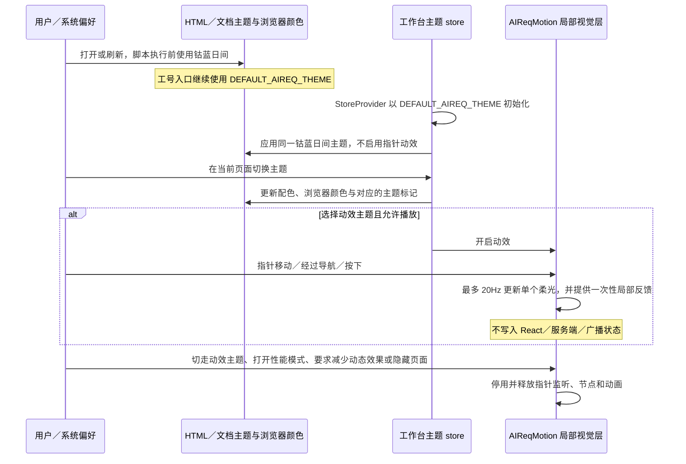

# ZCode Design System

## Overview

AIReq 使用当前 ZCode 界面体系：安静、紧凑、可长时间操作的电脑浏览器工作台。优先保证表格、阅读、会话及多面板操作一致，不采用营销式留白或整页品牌填色；动效仅在所选主题的明确边界内启用。独立的 `/chat` 在窄屏使用[单列会话和触控布局](docs/specs/web-agent-chat.md#页面与会话)。

实际 token 由 `packages/ui/src/styles.css` 定义，AIReq 彩色主题在 `packages/ui/src/aireq-themes.css` 中覆盖语义 token。基础控件由 `packages/ui/src/components/ui/` 提供；本文说明角色与用法，不复制另一份颜色值。当前源码是几何和控件行为依据，不依赖旧上游截图或已删除补丁规格。

## Colors

AIReq 可选择钴蓝日间、浅蓝灰、双区电光、极光深夜，以及已有的系统、浅色、深色和动效主题。钴蓝日间为 Web 首屏默认。基础 light／dark 变量保留作底层定义。业务界面复用语义 token，不引入独立主题状态或页面专属灰色。

动效主题复用 Zai Dark 的配色。主题默认值、切换与性能约束见[主题与动效](#主题与动效)。

| 角色           | token                                                                                  |
| -------------- | -------------------------------------------------------------------------------------- |
| 页面与结构     | `background`、`background-alt`、`background-win-alt`、`header`、`panel`、`sidebar`     |
| 卡片与普通表面 | `card`、`card-selected`、`card-border`、`surface`、`surface-hover`                     |
| 菜单与浮层     | `menu`、`menu-hover`、`popover`、`popover-border`、`tooltip`、`tooltip-foreground`     |
| 输入           | `input`、`input-focused`、`input-border`、`input-border-hover`、`input-border-focused` |
| 文字           | `foreground`、`foreground-subtle`、`foreground-subtlest`、`foreground-inverse`         |
| 操作与选择     | `primary`／`primary-foreground`、`secondary`、`hover`、`selected`、`brand`、`accent`   |
| 状态           | `success`、`warning`、`destructive` 及各自 foreground／surface                         |
| 更新中         | `progress-surface`／`progress-surface-foreground`                                      |
| Diff           | `diff-added`／`diff-added-foreground`、`diff-removed`／`diff-removed-foreground`       |

业务表格、项目数据及设置行使用卡片底色与边框，粘性表头保持不透明，需求共创的表头略区别于数据行，工具栏与卡片共用底色。标题和主要数值用主文字，提案标题下的原文摘要、工号、编号、日期及说明用次级文字；侧栏辅助文字使用 `remote-foreground-muted`。辅助文字在所属卡片和页面表面保持可读对比，不靠缩小字号制造层级。抬升表面（卡片内层面板、行悬停底色）会吃掉对比余量：其上的次级文字按实际合成底色核验 ≥4.5:1，不足时升为主文字或调整表面，不沿用外层卡片的通过结论。

按需评审结果随原生对话呈现。文档区正文及材料卡片排除指针柔光。

状态色只表达真实状态，不作装饰；surface 与对应 foreground 配对。等待确认使用 interaction-confirmation，不借 success 表示等待。Git 文件状态使用 `git-*`，不借 Diff 或 warning。文件、Skill、命令 mention 使用各自 node 的背景、hover 和前景；Markdown 行内代码使用 `markdown-inline-code`。

Lucide 次级／三级前景沿既有颜色适配整体混合，避免路径交叉变深；不全局改写其他 SVG。交互颜色、显式子颜色和额外 opacity 保持现有覆盖关系。

## Typography

普通 UI 使用默认 `font-sans`；路径、命令、标识符、快捷键和代码使用 `font-mono`。应用 UI 使用 `text-ui-*`，不增加 Tailwind 内建 `text-base/sm/xs`、任意字号或内联 UI 字号。

`--ui-font-size` 默认 14px，界面字号设置只更新该变量，不改变 html 字号；图标、间距、圆角等 rem 几何不随字体缩放。

| token             | 相对界面字号 | 默认 | 用途                           |
| ----------------- | ------------ | ---- | ------------------------------ |
| `text-ui-xl`      | +4px         | 18px | 一级阅读标题                   |
| `text-ui-lg`      | +2px         | 16px | 二级阅读标题、独立文档正文     |
| `text-ui-base`    | 不变         | 14px | 普通 UI、按钮、正文            |
| `text-ui-caption` | -1px         | 13px | 明确的紧凑辅助说明             |
| `text-ui-sm`      | -2px         | 12px | 次级说明、Tooltip、行内代码    |
| `text-ui-xs`      | -4px         | 10px | 徽标、数量和弱元信息           |
| `text-ui-2xs`     | -5px         | 9px  | 保留图表刻度／单位，不用于正文 |

AIReq 主页与设置 h1 共用 `text-ui-settings-title lg:text-ui-settings-title-lg font-semibold tracking-tight`，界面字号 +10px／+16px，默认 24px／30px。`text-ui-page-title` 保留为其他组件独立角色，不替代 AIReq 当前标题常量。

聊天正文使用 base；Markdown h1／h2 使用 xl／lg，h3–h6 使用 base 并以字重分层。独立 UIW 只读文档正文使用 lg 与库的相对标题比例。代码、Diff 和终端内容使用独立阅读字号，外侧控制仍使用 UI token。

标题和标签通常使用 medium／semibold；Tooltip 普通文字用 sm，快捷键用 xs。长翻译和技术值可换行或在明确区域截断，不依赖只适配短英文的固定布局。

`text-ui-xs`／`text-ui-2xs` 的徽标、数量与弱元信息是设计许可的小字号角色；设计检测器按 11px 通用下限对这类命中报警时，按本表角色豁免，不据此放大正文或徽标，也不把豁免扩展到承载说明或操作的小字。

## Layout

设置使用 256px 分区目录和浏览器全页覆盖层。右侧多对象、多种类 Tab 的行为见 [统一右侧工作区](docs/specs/aireq/unified-side-pane.md)。

阅读页与设置正文复用 `SETTINGS_FRAME_CONTENT_CLASSNAME`，在实际剩余面板内居中，`max-w-4xl px-4 lg:px-8`。正文限宽与外层滚动分离，使用稳定双侧滚动槽。右侧展开后聊天、输入器和工具栏随主区收窄。需求表格使用主区全宽。标题列使用 176px 基础宽度，优先接收各可见列排下后的余量，最多 320px。精简配置根据可用宽度展示独立列；停留时间可并入进展，两者在更窄的面板中并入标题。工作量及开发、测试责任人在能放下时显示。Agent 会话的返回入口位于聊天工具栏。

工作台采用全宽顶栏。品牌、「项目总览」和「需求共创」在左，角色管理、在线人数、帮助、工号与设置在右。总览与需求共创的标题左对齐。总览以可切换的项目名为主标题，在近期版本列表选择 Release。需求共创在标题行切换项目和版本范围。

主区以十二格组织，宽桌面左右边距各 24px，窄桌面各 16px，总览栏间距 20px。总览左侧三格列近期版本，列表下方放「项目全部需求」。项目有未分配的 IR 时，同一行右侧显示「未分配版本」及数量。右侧九格展示所选版本的进展、停留需求与文档动态，有文档更新时后两组按约二比一分栏，在窄桌面上下排列。无更新时显示一行提示。需求列表单独显示时占满主区，打开文档后默认七比五分栏，会话与文档默认等宽，分栏宽度可拖动调整。表格按实际容器宽度合并次要列。

常用间距基于 4px 节奏：4px 图标间隙、8px 紧凑控件、12px 列表、16px 卡片内边距、20–24px 较大分组。组间距大于组内距。嵌套 flex／滚动区域按需使用 `min-w-0`、`min-h-0`。优先流体宽度和 max-width，固定宽度用于菜单、对话框及稳定侧栏，不新增业务页面几何体系。

电脑窗口缩放时保持组件语义和主操作可达，以 grid、flex、宽度和可见性调整密度。保留的 compact-web 或 mobile-input-safe 兼容样式不构成手机交付要求。

1100 × 700 是窄桌面浏览器的验收尺寸。应能在该尺寸下切换两个 Agent、打开或收起文档区并完成版本确认。折叠次要列或让表格局部横滚时，正文保持原字号，主要操作可通过鼠标和键盘到达。顶栏及页面验收见[分区导航](docs/specs/aireq/section-navigation.md#页面与正文)。

## Elevation & Depth

层次主要由背景、边框和留白表达，普通布局不依赖大柔影。卡片低于浮层，菜单使用 menu，对话框使用 popover，不将菜单画成堆叠卡片。菜单保留原有 shadow，键盘聚焦不能清除其阴影。

交互浮层高于被动 Tooltip，Tooltip 不遮挡已打开菜单选项。Toast 使用共享定位、`bg-toast/60`、背景模糊及现有圆角外壳，调用方不添加独立偏移。

动效快速、克制，仅解释状态变化。数字和可访问状态即时更新。不用浮起、缩放或滚动数字模拟活跃；减少动态效果时直接呈现最终状态。

## 主题与动效

### 范围与契约

- `zai-motion`（动效主题），沿用 Zai Dark 的全部配色、布局、字体、文字及业务行为。原浅色 `zai-light`、深色 `zai-dark` 和 `system` 的解析与视觉行为不变；系统跟随仍只选原浅／深主题。
- 每次打开或刷新 AIReq，静态首屏、工号入口和工作台都使用钴蓝日间（`aireq-cobalt`），不读取旧主题选择。外观设置和账户主题菜单均提供四款彩色主题与既有选项。切换即时生效，仅保留在当前打开的页面中；刷新后恢复钴蓝日间。旧 `light`／`dark` 输入沿用原 Zai 浅／深主题映射。
- `Theme`、`AppSettings.theme` 和严格设置 schema 接纳彩色主题及动效主题。选择动效主题时，代码、Diff、Markdown、Mermaid 和登录视觉仍按深色解析，不生成专用前端包或后端分支。

### AIReq 彩色主题

| 主题     | 工作区                       | 强调方式                     |
| -------- | ---------------------------- | ---------------------------- |
| 钴蓝日间 | 浅蓝页面、白色表格、浅蓝侧栏 | 钴蓝操作与淡蓝选中态，版本标题沿用卡片底色，完整进度用绿色和勾选图标 |
| 浅蓝灰   | 低饱和蓝灰页面、白色表格     | 青蓝操作、低饱和选中态       |
| 双区电光 | 浅紫工作区、深紫侧栏         | 紫色操作与导航高亮           |
| 极光深夜 | 深海军蓝页面与表格           | 青蓝交互、低对比度表头           |

新主题复用语义色和当前版式。需求进展通过有文字的浅底或深底标签区分。筛选标签加入短暂入场效果，导航和主要操作使用短过渡。开启减少动态效果或性能模式时直接显示最终状态。中文使用系统中文无衬线字体，正文与数字延续现有字号。

### 动效与性能边界

- 工作台中可用的按钮、选择器、标签页和菜单项在鼠标经过时显示局部底纹，文字链接显示下划线，编辑区强调边界。底纹沿控件轮廓在约 120ms 内出现或退去；组件原有选中、输入焦点与错误提示优先。挂载到 body 的弹窗按钮与页面按钮使用相同的悬停过渡，导航继续使用滑动高亮。验收覆盖普通按钮、弹窗按钮、展开的选项、输入与禁用态；反馈由 CSS 读取指针状态，沿用现有动效开关。
- 工作区空白使用单个 240×240px 中性径向柔光，中心前景透明度 32%，24% 处 20%、49% 处 8%、72% 处透明。只在实际空白上可见，卡片、正文、表格、编辑器、弹层和可操作控件不被柔光覆盖；鼠标离开、滚动或切入上述内容立即淡出。
- 指针移动以 50ms 为最小处理间隔，最多 20Hz 更新一次局部节点；不在 React 中存坐标，不调服务、不广播坐标，不添加循环定时器、连续 requestAnimationFrame、Canvas、WebGL、模糊、混合模式或全屏渐变重绘。空闲时没有动效采样或自循环动画。
- 工作台导航高亮以约 230ms 滑至悬停项，图标与主文字分别平移 2px／5px；按下短暂缩至 97%，现有选中、键盘焦点、点击导航及未保存保护保持原义。离开导航时高亮隐藏，不形成另一套选中状态。
- 动效主题下的控件按下使用有边界、一次性的 96px 局部扩散反馈；通用按钮的反馈不位移非交互内容。列表／筛选原有业务状态和 DOM 顺序不变。
- 需求共创的行在悬停时，需求主内容以 200ms 平移 4px，离开复位；表头、空状态、单元格背景、版本、日期和操作列保持原位。由 CSS 读取行悬停状态，不新增业务状态、服务接口或指针监听；仍受同一动效主题、减少动态效果及性能模式开关控制。
- `prefers-reduced-motion: reduce` 或既有性能模式开启时，保留动效主题的选择和配色，停用该主题的空间动效、柔光与指针监听。主题切换、性能或系统偏好变化、卸载和页面隐藏均清理监听、装饰节点及未结束动画。控件状态和可访问反馈仍可用。

### 所有者与事件顺序

- `packages/web/index.html` 在脚本执行前即设置钴蓝日间的根样式类、浅色浏览器底色及主题 meta。工号入口沿用共享的 `DEFAULT_AIREQ_THEME`；工作台挂载时也将其传给 `StoreProvider` 初始化现有 store。`useTheme` 中通用的 `DEFAULT_THEME` 不参与这条 AIReq 初始化路径。
- 工作台主题由现有 store 持有。`applyTheme` 将主题应用到根样式类和浏览器颜色方案、主题色。切换和重连不重建 store，既有会话内广播保留防回环，入站主题不得覆盖本页主动选择。
- `AIReqMotion` 只持有可丢弃的视觉节点与当前动画；仅当 store 选择 `zai-motion` 且性能模式关闭、不要求减少动态效果、页面可见时挂载动效。它不持有导航、选择、业务事实或持久化状态。

### 验收

1. 在新浏览器上下文及带有旧主题记录的上下文打开页面。检查脚本执行前的静态首屏、工号入口、工作台 store 和外观设置均使用钴蓝日间，浏览器底色一致，无深色闪屏或动效柔光。分别从外观设置和账户菜单切换主题，核对四款彩色主题、浅色、深色、跟随系统和动效主题均即时应用；系统跟随仅在原浅／深之间切换。重连保留当前选择，刷新或重新打开恢复钴蓝日间。检查两个客户端的既有广播同步、防回环及本页主动选择优先。
2. Edge 电脑浏览器实际截图检查四款彩色主题的语义配色、进展标签、筛选入场及导航／操作过渡。显式选择动效主题后，检查空白柔光、连续经过导航和按下反馈；其正文位置、文字和配色与原深色一致，普通浅／深和彩色主题不挂载该柔光节点或指针监听。动效主题下相关材料／代码仍按深色解析，弹层及输入不受柔光干扰。
3. 指针快速移动后静止，新增动画停止且没有 React 提交或持续采样。启用系统减少动态效果或既有性能模式时，所选主题和配色保持一致，主题动效停止。检查离开、滚动、隐藏和切主题后的清理，以及原导航点击和键盘操作。
   在需求共创列表逐行悬停，主内容平移并在离开后复位；表格列宽、固定列、选中状态和操作入口不变。减少动态效果与性能模式下不发生平移。
   彩色主题在减少动态效果或性能模式下直接呈现最终状态，不启用其筛选入场及导航／操作过渡。
   在宽窄桌面检查「项目总览」与页头边线对齐，版本进度及选中状态清晰，项目全部需求和未分配版本同排可达，不出现需求或 Release 的新建、删除入口。
4. 尽可能在 Edge 软件渲染环境记录真实渲染模式及移动／静止期间的主线程开销；仅 CPU 节流不能宣称纯 CPU 通过。运行 typecheck、lint（复核 Hooks）、变更架构检查及实际受影响的现有工程测试；不新建永久 E2E harness、不增加产品调试接口。

验收记录关联本次构建与实际验证环境。

## Shapes

复用当前组件及容器圆角，不以重要性发明新半径。业务外层卡片常用 `rounded-xl`；近期版本条目使用紧凑圆角和整圈选中边框。布局包装本身不建立新圆角层级。

共享 Button 当前默认 `rounded-md`，xs／icon-xs 使用 `rounded-sm`，lg／icon-md／icon-lg 使用 `rounded-lg`。保留实际 variant，不以文档全局更改控件几何。对话框、菜单、输入器及预览外壳使用各自现有基础组件；普通卡片不借聊天输入器或 Toast 的大圆角。

`rounded-full` 仅用于明确的圆或胶囊，不因是图标按钮、计数或标签便自动使用。连接表面按现有样式移除相邻圆角，不添加任意像素半径。

## Components

### Buttons and inputs

复用 Button variants：default、outline、secondary、ghost、destructive、warning、link。default 使用 primary 配对色；危险和警告只用于对应业务动作。尺寸为 default h-7、xs h-5、sm h-6、lg h-8，图标按钮使用现有 icon variants，不另设宽高体系。图标通常 size-4，细节按组件 variant 缩放。

输入使用 input 背景及边框，hover／focus 使用对应 token，不默认发光。占位符与 Select 未选值使用 `foreground-subtle`，在输入表面保持 ≥4.5:1；`foreground-subtlest` 只用于弱元信息，不承载字段说明。标签、错误和辅助信息与控件关联；保存中保留文本控件挂载且只读，不因 disabled 移走输入焦点。错误使用真实错误语义，不将普通说明标红。

键盘焦点必须可见：全局仅清除系统默认 outline 与 focus ring 阴影，不整体禁用组件焦点样式；焦点表达由组件自有 border／ring token 承担。Button 各 variant 在 focus-visible 提供可见焦点边框（危险／警告沿各自状态色），输入与选择器沿 input-border-focused；强制颜色模式保留系统 Highlight outline。新增控件不得依赖被全局清除的默认描边，也不在组合输入上叠加第二套全局 outline。

### Navigation and tabs

顶栏导航项并排显示图标和名称，当前页面使用 selected 底色和较强字重。进入需求会话时，「需求共创」保持选中。键盘焦点独立可见，悬停不转移当前位置。品牌名称随界面语言切换，与装饰性 Logo 同行显示。

Tab 使用紧凑外观及 active／inactive 对比，不用品牌整块填色；Tab 与 panel 保持语义关联。内容 Tab 可见标题带短种类前缀，前缀不随对象名截断。关闭、排序（指针拖动或右键左移／右移）、折叠及完整视图复用统一框架，不为业务详情创建第二套壳。

### Menus and overlays

菜单使用紧凑 action rows、menu-hover 及共享 option-stack 的 2px 间距，保留禁用项位置。相同动作集在三点菜单与右键入口复用，选中使用现有勾选／radio，不给每行增加按钮外壳或边框。Popover 与 Dialog 复用基础组件。

主操作＋下拉触发器使用现有分段结构，Select trigger 保留输入语义，展开项沿菜单样式。浮层根据触发器及可用边界定位，保持紧凑偏移和稳定焦点返回。

### Reading and status

Markdown 表格、代码、Mermaid、图片与依赖图复用共享阅读器。材料查阅见[文档与版本](docs/specs/aireq/unified-side-pane.md#文档与版本)。状态同时有可读文字，不只靠颜色；loading、失败、真正空数据及过期不能互相替代。

## Do's and Don'ts

- 复用语义 token、共享组件、既有组件级焦点样式及国际化文本；全局层只清系统默认 outline／ring 阴影，不添加全局强制 outline，也不整体禁用组件焦点样式。
- 保持深浅主题的卡片、文字和浮层层次一致，容纳长名称和翻译。
- 将重复说明放入现有帮助或 disclosure，保留异常、门禁及完成任务必需的操作。
- 不新增 AIReq 手机或原生桌面交付规则，不恢复隐藏 Skill、插件或其他裁撤产品入口。
- 不从保留模块、兼容 CSS 或通用组件推断当前可见能力。
