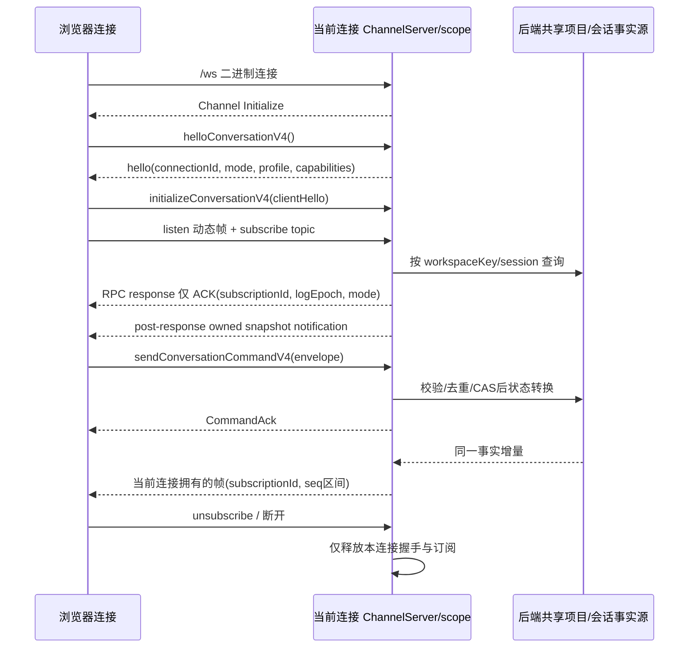

# 模拟后端（Mock Backend）规范

当前对外部署面以 [产品发布边界](../specs/aireq-migration/release-surface.md) 为准。模拟场景仅属服务端内部实现，不能由浏览器 URL、身份参数或公开 RPC 控制；部署按服务／方法／事件显式白名单暴露，内部异常不下发堆栈。

`packages/server` 是纯 Web 形态的内存模拟后端，经与真实服务端相同的 WebSocket RPC（`@zcode/rpc` ChannelServer + Protocol v4）向浏览器提供 `packages/services` 正式契约。本文记录能力、所有者、时序与替换要求，不建立独立能力矩阵实现层。本轮范围及顺序以根 `.todo.md` 现行任务为准，持续业务规则以发布边界和不冲突的领域规格为真相源；被覆盖的旧任务与历史实测不授权恢复场景按钮，也不证明本轮整改通过。

当前电脑 Web 全局为项目／待办，默认全项目总览；项目内概览／需求／分析运行，需求分提案／正式；设置为外观／项目配置／AI 配置。Skill 入口继续隐藏，`skillDesign.*` 实现、数据、私有原生会话、附件、预览、内存保存及唯一未保存门禁全部保留且纳入整改；允许隔离临时浏览器装配，不恢复主导航、设置或搜索入口。Sketch 真实画布／PNG 附件保留。接口删除／保留表见[契约设计](../specs/aireq-migration/contract-design.md)，不以历史页面或纯 DTO 扩大 RPC／HTTP 能力。

## 1. 范围与非目标

- 目标：协议语义保真，UI 不需要 mock 分支；未实现的能力必须**明确拒绝**，不能返回假成功。
- 非目标：生产级持久化、真实网络/文件写入、与真实 Agent 运行时等价。模拟后端只有内存状态。
- 唯一允许的本地读取：保留的底层目录浏览读取本机真实目录名（`projectService.readDirectory`），不读写文件内容；AIReq 项目不提供选本地目录入口。
- 唯一传输层例外：`MockRuntime` 内的 topic 水位账本（`MockTopicLog`）是协议顺序的权威来源；不落盘。

### 1.1 Bun 运行时

- 仓库唯一 JavaScript/TypeScript 执行运行时为 Bun，固定版本见 `mise.toml`；后端、前端开发/构建、测试与工程脚本均不得启动 Node.js。`node:*` 与 `@types/node` 仅作为 Bun 兼容 API/类型保留，不代表 Node.js 运行时依赖。
- 包管理继续使用 pnpm，但由 Bun 执行；不保留 Node.js 后端或脚本回退入口。
- `packages/server/src/http.ts` 只负责 Hono 路由、Bun HTTP/WebSocket 宿主与 `ISocket` 适配；保留 `/ws`、当前客户端配置与正式遥测 HTTP、可选部署访问控制、静态资源与 v4 二进制 RPC，不恢复无人消费的旧发现接口。
- 每个 WebSocket 连接独占一套 `ISocket`、`SocketProtocol`、`ChannelServer` 与 agent connection scope。升级前完成部署访问控制（若配置）及自报身份格式校验，这不是本人认证；open 时装配公开服务；二进制消息按原始字节视图传入协议；close 时仅触发一次关闭/结束并释放连接 scope 和 RPC 订阅。Bun 传输层不复制会话或 topic 状态，不新增重试/重放账本。
- `createMockHttpServer()` 返回 Bun server，由调用者通过 `stop()` 停止；开发入口在仓库根目录使用 Bun watch，覆盖跨 workspace 源码，默认 `workspacePath` 为仓库根（`ZCODE_SERVER_WORKSPACE` 可覆盖）；构建使用 Bun bundler，生产入口为 `bun packages/server/dist/entry-http.js`。

涉及 Bun 运行时或部署边界改动时，按受影响范围验证源码与构建产物启动、当前 HTTP 配置、部署访问控制／身份拒绝与允许、静态文件与 SPA fallback、带身份的真实二进制 RPC 及断连重连；工程门禁及必要构建必须由 Bun 执行，不使用 Node.js 回退。纯 AIReq 业务改造按根 `.todo.md` 逐组最小充分验证，不因此默认增加 build、全量工程测试或独立协议冒烟。

## 2. 能力状态

以下按具体方法／命令区分状态；一个频道可以同时包含支持的读取与未开放的写入，不能以频道存在推导整个领域已实现：

| 状态          | 定义                           | 可观察行为                                                                             |
| ------------- | ------------------------------ | -------------------------------------------------------------------------------------- |
| `supported`   | 已实际实现的内存状态转换或读取 | 结果与实际内存内容一致；命令发生转换才可 ACK `accepted`                                |
| `compatible`  | 契约允许的只读快照或真实空集合 | 仅表示对象确实存在且集合为空，不表示缺失资源或未实现读取成功                           |
| `unavailable` | 当前未实现的能力               | 通过既有正式错误明确不可用／不存在；v4 命令回 `rejected`，不返回空文件或空对象伪装成功 |

方法实际行为仍须在所属任务独立验证；上表是整改要求，不表示现有保留实现已全部符合。内存操作可按实际事实成功，但不能宣称真实 AI、代码扫描、Git 平台核验、宿主写盘或永久保存。

### 2.1 当前装配面

| 领域 / 接口                         | 实际边界                                                                                                                            |
| ----------------------------------- | ----------------------------------------------------------------------------------------------------------------------------------- |
| AIReq `bootstrap/call/onDidChange`  | 当前项目空间、三类设置、分析调度与隐藏 Skill 的共享内存业务；普通业务状态只归 AIReq owner                                           |
| conversation / sessions-index topic | 内存快照与增量、seq/logEpoch、workspace 隔离；不是旧任务侧栏或 controller RPC                                                       |
| workspace-config topic              | 确定性空配置目录（`configOptions: []`, `slashCommands: []`）与只读快照                                                              |
| v4 会话命令                         | §4 所列内存转换受支持；其它保留协议命令回 `rejected`，不能因 schema 存在记作已实现                                                  |
| 原生会话／任务／项目与分组          | 保留实际会话生命周期、重启／元数据、目录准备与 mention 读取、`admit` 依赖；不提供旧窗口 controller 或目录组服务                     |
| 文件／Git／文件监视／媒体预览       | 保留通用文件树、mention 与预览依赖；虚拟文件／Git 不等于真实磁盘／仓库；媒体写入或真实播放能力不因此开放                            |
| 设置／系统／broadcast／客户端配置   | 保留共享设置与基础读取；工号不是后端账号；broadcast 由共享总线和逐连接 facade 实现跨连接发送、过滤本源与断线释放，见 §8.3           |
| Provider / 模型选择 / 用量          | 原生模型目录、`getView/onDidChange/refresh` 与 quota 依赖；不再提供旧个人 Provider CRUD／连通性测试 RPC                             |
| GenUI                               | 保留非插件生成视图契约；产品插件管理、UI 桥、sampling、App tools、目录推荐与安装能力已删除，不注册兼容空服务                        |
| 子智能体／技能／MCP                 | 保留原生目录、Skill 引用及 MCP 加载依赖；不等于恢复旧命令、Hook、Memory 或配置同步管理服务                                          |
| Bots                                | 保留原生群组投递与偏好同步依赖；不宣称真实 IM 注册／账号接入已实现；AIReq embedded 会话不挂载旧草稿推荐，Onboarding／场景服务已裁撤 |
| 原生附件与附件转移                  | v4 begin/chunk/commit/read 持有实际内存字节、SHA-256 与采用授权；转移辅助服务按其方法的未开放边界处理，不写盘                       |

这张表记录装配及用途，不是逐方法“全部通过”或“所有写入明确拒绝”的实测声明。
保留辅助 mock 中的固定目录、空投影和未实现操作不构成真实 RPC 能力承诺；尤其不能把旧空成功实现
登记成 `supported`。§4 的 v4 ACK 约束继续适用，不能据辅助实现放宽命令状态转换规则。

当前集中装配共 23 个**内部注册**频道：`file`、`file-watcher`、`git`、`system`、`media-preview`、
`broadcast`、`aireq`、`zcode-agent`、`zcode-task`、`zcode-session`、`project`、`setting`、
`client-config`、`provider-settings`、`model-selection`、`usage-stats`、`subagents`、`skills`、
`mcp-sync`、`task-groups`、`bots`、`prompt-attachment-transfer`、`gen-ui`。
`mock/index.ts` 及 `mock/domains/*` 的注册不等于 Web 公开能力：`http.ts` 的 `publicMembers`
只发布其中 21 个频道的指定方法／事件；`task-groups` 与 `prompt-attachment-transfer`
均未公开，其 SDK 代理和内部注册仍保留，不能据此要求生产 `/ws` 开放。完整公开登记见 §8.3。

### 2.2 已裁撤服务与纯类型边界

本轮贯穿删除 25 个 accessor 字段及对应 descriptor、代理、mock、注册与旧专属消费者；
完整冻结删除／保留清单唯一维护于 [契约设计 §当前可达接口收口（2026-11-16）](../specs/aireq-migration/contract-design.md#当前可达接口收口2026-11-16)。
下表仅记录保留服务的方法级减面，不以历史调用面或纯类型恢复已删除接口。

此前已退役的终端、Git 检查点、营销触达、Desktop Provider Provisioning、会话分享与商业交易
继续不提供 descriptor、代理或服务注册。受管 worktree、扩展、商业套餐等纯 DTO/schema 若仍供
保留通用控件展示使用，不代表同名 RPC 存留，更不要求真实后端实现已裁撤能力。
`components/ui`、已有 `mobile-ui`、布局、弹层、图标、表单及原生会话控件不随服务删除。

产品插件退役同步删除 `pluginManagementService`、`pluginUiBridgeService`、
`pluginUiSamplingService`、`pluginUiAppToolsService` 的接口、descriptor、accessor、客户端代理、
mock 注册与实现；不保留可选 shim。`IZCodeAgentService` 不再暴露
`onDynamicPluginStartupDegraded`、`onDynamicPluginUiToolResult`，App 设置不再发布插件自动推荐偏好，
客户端配置不再发布 `pluginStoreOrder` 或 `uiPluginRecommendations`。
仍被原生会话消费的 v4 DTO/schema 仅表达协议数据，不恢复插件执行或安装能力。

保留服务中的方法级减面：

| 服务              | 本轮删除的方法                                                                                                                                                                                                                                                                                               | 保留边界                                                                        |
| ----------------- | ------------------------------------------------------------------------------------------------------------------------------------------------------------------------------------------------------------------------------------------------------------------------------------------------------------ | ------------------------------------------------------------------------------- |
| Provider settings | `createPersonalProvider`、`resolveModelConfig`、`savePersonalProviderOverlay`、`deletePersonalProvider`、`reorderPersonalProviders`、`reorderPersonalModels`、`addPersonalModel`、`renamePersonalModel`、`deletePersonalModel`、`savePersonalModelDraft`、`setPersonalModelEnabled`、`testModelConnectivity` | 仅 `getView/onDidChange/refresh`；AIReq 模型保存仍走 `models.save`              |
| File              | `resolvePath`、`ensureConversationWorkspace`、`createDefaultWorkspace`、`createScratchWorkspace`、`readWorkspaceFileSearchIgnore`、`applyWorkspaceFileSearchIgnoreTransform`、`writeWorkspaceFileSearchIgnore`                                                                                               | mention、文件树、分页列表及通用预览读取                                         |
| Project           | `saveProject`、`deleteProject`、`restoreProject`、`moveTask`、`reorderProjects`、`measureProjectData`、`deleteProjectData`                                                                                                                                                                                   | `readDirectory/readProjects/readTree/prepareSession/resolveSessionDirectories`  |
| Task groups       | `read/save/ungroup/move`                                                                                                                                                                                                                                                                                     | 原生 `admit`                                                                    |
| System / Setting  | `probeIntranet` / `updateDataBaseDir/getUserInstructions/saveUserInstructions`                                                                                                                                                                                                                               | `system.info`、`setting.get/update`；当前个性化指令走 AIReq `prompts.read/save` |
| Skills            | `buildPromptContext/copyToCommon/removeFromCommon/deleteSkill/setEnabled`                                                                                                                                                                                                                                    | 仅只读 `list`；不触碰 AIReq `skillDesign.*`                                     |
| Subagents         | `createAgent/updateAgent/deleteAgent/setBuiltInModelOverride/setPluginAgentModelOverride/getPrimaryUserAgentsDirectory/setEnabled`                                                                                                                                                                           | 仅只读 `list`，保留原生子智能体目录                                             |

原生 agent/task 的旧 prompt、snapshot、导入、重复插件／自动化／保存工作流包装方法随无消费者调用链删除；
最终保留方法以当前 `zcodeAgent.ts`、`zcodeTaskService.ts` 和实际装配为准。
这不删除 v4 命令 schema、只读工作流／产物投影、附件事务、生命周期、订阅水位或内部状态 owner。

## 3. 状态所有者

一个状态只有一个所有者；其它模块只能通过公开契约读取，不得持有副本。

| 状态                                                                                    | 唯一所有者                                        | 写入者                                                                                      |
| --------------------------------------------------------------------------------------- | ------------------------------------------------- | ------------------------------------------------------------------------------------------- |
| 会话 rows/`seq`/`logEpoch`/revision/phase/config/queue/plan/usage/pending               | `MockRuntime.sessions`（`MockSession`）           | `MockZCodeAgentService` 命令处理                                                            |
| 任务索引（title/pinned/archived/unread 等）                                             | `MockRuntime.tasks`                               | 保留的 `MockZCodeAgentService`／`MockZCodeTaskService` 原生入口；不再有窗口 controller 写者 |
| 虚拟文件系统 / 虚拟 Git                                                                 | `MockRuntime.virtualRoot` / `MockRuntime.git`     | `Mock*FileService` / `MockGitService`                                                       |
| topic 水位（sessions-index / workspace-config）                                         | `MockRuntime.topics`（`MockTopicLog`）            | 对应 topic 的唯一发布函数                                                                   |
| 应用设置                                                                                | `MockSettingService`（设置域）                    | `MockSettingService.update`                                                                 |
| v4 订阅表与 `subscriptionId` 归属                                                       | `MockZCodeAgentService` + 每连接 connection scope | subscribe/unsubscribe                                                                       |
| 共享 AIReq 项目／Release／IR／SR／材料／评审／报告／分支／Skill／调度事实及私有故障状态 | `MockAIReqService/workflow` 及既有领域 owner      | 类型化业务命令与后端内部输入；不由公共 DTO 暂存故障控制                                     |

UI 的 `AIReqContext` 只拥有导航与可失效读取投影，未发送正文／附件草稿沿用原 composer owner。写入先做输入、可信连接身份、对象、阶段、版本及幂等校验，再提交真实内存事实，最后发事件／会话帧；迟到结果按对象和版本拒绝，重连只重读、不重放 mutation。公开投影及嵌套历史回执均不得泄漏后端私有失败／hold 状态。

装配图：

```text
mock/index.ts（唯一集中装配）
  ├─ MockRuntime（权威内存状态 + topic 水位）
  ├─ workspace.ts / project.ts / zcodeTask.ts / zcodeAgent.ts（协议面）
  └─ domains/*（按领域注册服务，只写自己的私有状态）
        settings ─ models ─ assets ─ sync
        projects ─ automations（Bots）─ sharing ─ compat-surfaces
```

## 4. ACK 语义（v4 会话命令）

命令入口：`sendConversationCommandV4(envelope)`。信封与 payload 先经 `parseCommandEnvelope` 校验。

信封 `workspace` 按官方 schema 可选（Host 冷恢复注入）；一旦携带就必须是完整的
`ZCodeWorkspaceRef`：`workspacePath` 与 `workspaceKey` 必填，且
`workspaceKey = workspaceIdentity?.trim() || workspacePath`（身份唯一来源，不另行编造）。
`createSession` 的 payload 必带 `workspaceId = workspaceKey`（Host 预留归属）。信封字段不全即
`fault.command.invalidEnvelope`，不能靠 mock 兜底；真实 Host 发送命令时按这一构造携带身份。

| 情况                                      | ACK                                                                                                                           |
| ----------------------------------------- | ----------------------------------------------------------------------------------------------------------------------------- |
| 命令受支持且完成了状态转换                | `accepted`，`revisionAtDecision` = 当前 revision，必要时带 `result`                                                           |
| 受支持但目标已是终态/不存在，无需改变状态 | `noop`（可带 reasonCode，如 `proto.alreadyResolved`）                                                                         |
| 命令未实现                                | `rejected` + `reasonCode=fault.command.capabilityUnsupported` + `message`，零状态变更                                         |
| 信封或 payload 非法                       | `rejected` + `fault.command.invalidEnvelope`                                                                                  |
| 会话不存在或不属于信封 workspace          | RPC 错误 `fault.command.sessionNotFound: <sessionId>`                                                                         |
| 未知/已失效 `subscriptionId` 的 resync    | RPC 错误 `fault.subscription.unknownSubscription`；跨连接复用他人 id 时由 connection scope 先回 `fault.subscription.notOwned` |

规则：

1. **`accepted` 必须可观察**：写队列命令要更新 `queue.items`，会话生命周期命令要更新 `phase/control`，标题/模型命令要更新 `meta/config` 并下发帧。
2. **不做假成功**：未实现命令一律走 `rejected` 分支；`default` 分支只有这一个出口。
3. **命令重放**：当前原生 owner 按操作者/客户端、sessionId、commandId 保留已接纳 ACK 与输入摘要；相同请求重放返回原决定，不重复追加消息，不同输入复用编号拒绝。query 同时返回当前 turn 事实。
   真实用户行 `origin:"realUser"` 的 `clientId` 必须来自接纳时已校验的 envelope。立即执行显式传递该 ID，排队／提升／恢复续跑使用原 QueueItem.clientId；执行函数不得硬编码身份或采纳后续命令的来源覆盖原输入。流式 userInput、恢复快照与分页历史使用同一行事实，同编号重试不增加用户行；连接层继续拒绝 clientId 与可信连接不匹配的请求。
   浏览器 Web 连接、AIReq identity 与 v4 clientHello／command 共用既有持久 `getV4ClientId()`。设备级 stream singleton 不是业务身份；不能为了兼容两套 ID 放宽连接校验。
4. **CAS 边界**：通用原生命令仍按协议校验版本字段，不替代 AIReq 自身的材料版本、候选、配置 revision 与业务命令 CAS。AIReq 写入口在其唯一业务 owner 执行这些门禁。
5. `noop` 不改变 revision，也不推进 topic 水位（除显式 `patchQueue` 的受支持命令外）。
6. 会话从 `MockRuntime.sessions` 删除后，旧 turn 不得再次发布 sessions-index upsert 或启动队列下一项；通用展示控件不得越过原生 owner 删除会话。

### 4.1 受支持命令

| 命令                                          | 内存转换                                                                                                         |
| --------------------------------------------- | ---------------------------------------------------------------------------------------------------------------- |
| `createSession`                               | 新建 `MockSession` + task 记录，发 sessions-index upsert；有 firstInput 立即开 turn                              |
| `sendText`                                    | 空闲：开 turn；运行中：生成真实 queue item（ACK `delivery=queue`）并下发 `queue`                                 |
| `stop`                                        | 运行中：中断 turn、暂停自动续跑（`autoDrain=false`，`pauseReason=stopped`）；空闲但队列未暂停：暂停；否则 `noop` |
| `sendQueuedNow`                               | 从队列移除并立即开始；运行中先中断当前 turn，收口后开始该项                                                      |
| `lockQueueItemEdit` / `releaseQueueItemEdit`  | 冻结/释放 editLock；违反 `guard.queueItemReserved` / `guard.queueItemEditLocked` 时 `noop`                       |
| `editQueueItem`                               | 原地替换正文/附件/模型/模式；持锁校验失败回 `noop` + `guard.queueEditLockLost`；成功后释放锁                     |
| `reorderQueueItem` / `deleteQueueItem`        | 调整顺序/删除；锁定项回 `noop` + `guard.queueItemEditLocked`                                                     |
| `applyQueueItemsConfig`                       | 对匹配的排队项应用模型/模式；无适用项 `noop`                                                                     |
| `setAutoDrain`                                | 更新 autoDrain/pauseReason；恢复自动续跑时空闲会话立刻 drain                                                     |
| `resolveInteraction`                          | 移除 pendingInteraction；权限卡继续执行；已解决回 `noop` + `proto.alreadyResolved`                               |
| `renameSession`                               | 更新 session meta + task 标题 + sessions-index                                                                   |
| `deleteSession`                               | 删除 session/task，发 sessions-index removed                                                                     |
| `switchModelConfig`                           | 更新 config 并追加 modelChange 标记行                                                                            |
| `switchCollaborationMode` / `setFollowupMode` | 更新 config 并下发 `config` patch                                                                                |
| `setAssistantFeedback`                        | 更新/清除 assistantText 行反馈；目标不存在 `noop`                                                                |

### 4.2 未支持命令

`compact`、`forkAssistant`、`applyFileRewind`、`editUserQuery`、`retryTurn`、`setHighspeedMetrics`、`respondWorkspaceHookReview`、`toggleWorkspaceHookReviewItem`、`revokeWorkspaceHookTrust`、`requestWorkspaceHookReview`、`snoozeInteractionAutoResolution`、`sendGoalCommand`、`stopSubagent`、`pauseGoal`、`resumeGoal`、`cancelBackgroundWork`、`resumeWorkflowRun`、`startSavedWorkflow`、`amendWorkflowRunSettings`、`createSelectionSideSession`、`discardSharedContext`。

这些命令此前返回 `accepted` 但不改变任何状态，造成 UI 显示成功而实际未执行；现在统一 `rejected` + `fault.command.capabilityUnsupported`。UI 按协议通用错误路径展示，不新增 mock 分支。

## 5. Topic 顺序

### 5.1 水位不变量

- `logEpoch` 是 topic 的代际；同一 topic 内稳定，topic 创建时生成（conversation 由 session 创建时生成）。
- `seq` 单调递增；一条已发布记录 = `(fromSeq, toSeq]`，其中 `toSeq = fromSeq + 1`。
- **快照帧**：`fromSeq = 0`、`toSeq = 当前水位`；快照本身不推高水位。
- **增量帧**：发布时推进一次水位；同一批变更只发一个 `toSeq`，同一 topic 的所有订阅者拿到相同的 `(fromSeq, toSeq]`。
- `sessions-index` / `workspace-config` 由 `MockTopicLog` 记账：没有订阅者时不推进，避免无人观察的水位空洞。conversation 的 `seq` 是会话投影日志水位，随投影推进（即使暂无订阅者），快照用 `toSeq` 对齐。
- `subscriptionId` 每次订阅新生成、绝不复用；帧只携带其所属订阅的 id。

### 5.2 各 topic

| topic                            | 水位所有者                     | 发布时机                                                     |
| -------------------------------- | ------------------------------ | ------------------------------------------------------------ |
| `conversation/<sessionId>`       | `MockSession.seq/logEpoch`     | 每次 `patchState`、行追加/更新/增量、快照订阅（不推进）      |
| `sessions-index/<workspaceId>`   | `MockTopicLog`（workspace 级） | v4 createSession / renameSession / deleteSession / turn 收口 |
| `workspace-config/<workspaceId>` | `MockTopicLog`（workspace 级） | 订阅与 resync 快照；当前 mock 无配置变更，水位不推进         |

### 5.3 订阅与归属

```text
subscribe → 注册 subscriptionId
          → 返回 ack { subscriptionId, mode: "snapshot", logEpoch }
          → 下发快照帧（fromSeq=0, toSeq=当前水位）
变更      → 推进一次水位 → 向该 topic 的订阅者发同一区间增量帧
unsubscribe → 删除订阅；之后不再有该 subscriptionId 的帧（重复 unsubscribe 幂等）
resync    → 未知 subscriptionId 抛 fault.subscription.unknownSubscription
```

- conversation 订阅按 `sessionId` 匹配；session 属于另一个 workspace 时按 `fault.command.sessionNotFound` 处理，不读取跨工作区状态。
- sessions-index 与 workspace-config 订阅按 `workspaceKey`（`workspaceIdentity ?? workspacePath`）匹配，跨工作区不串帧。
- agent topic 的每个 WebSocket 连接由 `createZCodeAgentConnectionScope` 建立独立 ownership：帧只路由给拥有该 `subscriptionId` 的连接；跨连接 resync 报 `fault.subscription.notOwned`，非本连接的 unsubscribe 幂等忽略且不删除原连接订阅。

## 6. 能力投影与前端

- 服务端能力字面量直接由各服务按已有 wire 契约返回，不单独维护能力矩阵或新增 capability store。
- 浏览器本机操作归 `packages/web/src/platform`（见 `docs/ui/browser-capabilities.md`），不能据此推导服务端工作区能力。
- UI 只消费 wire 值；禁止按 `mock` 名称或能力来源新增分支。

## 7. 验证

本文件不新建测试体系或专用验证入口；仅为具体验收缺口增加必要验证，沿用既有入口：

- `bun run dev`：启动真实 mock HTTP/WS 服务与 Web UI（回环），浏览器内走真实 RPC/帧渲染路径，地址以实际日志为准（当前前端 :5174、后端 :3031）。
- 根 `bun run typecheck`：校验协议/服务装配与 wire 类型（含 `zcode-protocol-v4` 官方 schema 的类型面）。
- AIReq 每个代码变更组还运行 `bun run lint`、`bun run architecture:check --changed` 并完成本组真实浏览器验收和文档记录，全部通过后才进入下一组；不留到末尾统一首次验证。未变输入可复用前组证据，受影响路径在当前组复验；纯业务不默认跑 build、knip、全量工程测试或推送检查。
- 浏览器与协议行为按 §4、§5 的不变量人工验收：conversation、sessions-index、workspace-config 的快照/增量、`(fromSeq,toSeq]` 连续性、`logEpoch` 稳定、`workspaceKey` 隔离、`subscriptionId` 归属、unsubscribe/resync、受支持/未支持命令的 ACK 语义。

以下是历史交付修复阶段已观察到的真实协议结果，不是本次文档同步的验收：一次性协议冒烟的脚本已按用户要求删除、不作为仓库资产，也不保留任何根命令入口。该阶段流程实际执行完成，耗时约 1.10s，全流程通过，原始输出末尾为「subscriptionId 归属、unsubscribe、resync 通过」与「全部协议冒烟通过」。该次运行真实启动 mock 服务并经 `@zcode/client` 建立真实 WebSocket 连接，实际覆盖并校验：

- hello/initialize 握手（`protocolVersion=3`），两条独立连接均建立成功。
- conversation / sessions-index / workspace-config 三类 topic 的快照与增量帧：快照 `fromSeq=0`、`logEpoch` 与订阅 ack 一致，增量 `(fromSeq,toSeq]` 连续、会话 `logEpoch` 稳定，resync 重发快照。
- 工作区隔离：A 工作区创建会话不向 B 的 sessions-index 订阅者发帧；跨工作区订阅会话被拒（`fault.command.sessionNotFound`）。
- `subscriptionId` 归属：第二连接 resync 第一连接的订阅被拒（`fault.subscription.notOwned`）；unsubscribe 后该 `subscriptionId` 不再收帧，另一连接的订阅继续收帧。
- 受支持命令产生可观察状态转换：`createSession`、运行中 `sendText` 入队（ACK `delivery=queue` 与 `queue` 投影一致）、`renameSession`、`setFollowupMode`、`switchModelConfig`。
- 未支持命令 `pauseGoal` / `compact` 回 `rejected` + `fault.command.capabilityUnsupported`，revision 不变。
- 负例：信封本身合法、payload 非法的独立用例回 `fault.command.invalidEnvelope`，合法命令用例不受影响。

上述结果仅为当时交付修复阶段的实测证据；临时脚本已删除，不重新创建、不因本次文档同步重跑。当时的第二阶段 RPC adapter 不在该次实测范围内，不能据此记为已验证；当前 AIReq 各组实际通过范围以相应领域规格的分组记录为准，不能把历史范围说明当作另一个末尾补首次验收任务。

这些场景对应的行为契约（供人工/后续验证对照，不含新增脚本）：

1. hello/initialize 握手（`protocolVersion=3`）。
2. conversation / sessions-index / workspace-config 三类订阅的快照帧与 ack（`subscriptionId`、`logEpoch`、`fromSeq=0`）。
3. 增量帧的 `(fromSeq,toSeq]` 顺序与会话 `logEpoch` 稳定；快照重同步。
4. 工作区隔离：A 工作区创建会话不向 B 的 sessions-index 订阅者发帧；跨工作区订阅会话被拒。
5. `subscriptionId` 归属：第二连接不能 resync 第一连接的订阅（`fault.subscription.notOwned`）；unsubscribe：解除后不再收到该 `subscriptionId` 的帧，另一连接的订阅继续收帧。
6. 未支持命令（`pauseGoal`、`compact`）ACK `rejected` + `fault.command.capabilityUnsupported`，且 revision 不变；合法信封 + 非法 payload 的独立负例回 `fault.command.invalidEnvelope`，合法命令用例不受影响。
7. 受支持命令（`createSession`、`renameSession`、`setFollowupMode`、运行中 `sendText` 入队、`switchModelConfig`）产生可观察状态转换与合法帧；命令信封的 workspace 身份为完整 `ZCodeWorkspaceRef`（`workspaceKey = workspaceIdentity?.trim() || workspacePath`），`createSession` payload 带 `workspaceId = workspaceKey`。

该次历史实测未覆盖：浏览器渲染、真实文件/Git 操作、当时存在而现已裁撤的 controller topic，以及 command 去重/CAS；这不表示当前无需遵守 §4 的命令去重与 AIReq 版本门禁，也不是当前各业务组的完整未验收清单。

## 8. 真实后端替换契约

本节是裁剪后保留前端的对接规格，不授权开发真实业务后端。契约中的 Host 指服务所有者，
在当前 Web 拓扑中就是浏览器连接的后端，不意味着恢复 SSH、relay 或桌面进程。
方法的精确字段、联合类型和可选性以本节链接的源码契约与 zod schema 为准，不能将表中说明
当作可另行简化的 DTO。模拟实现的 `unavailable` 也属于可观察契约：能力未开放时明确拒绝，
不是要求为已经裁撤的产品页面重建实现。

前端与公开契约必须持续满足 [发布边界](../specs/aireq-migration/release-surface.md) 的上线标准，不含原型／测试专用／debug 文案和代码。模拟数据、场景和执行逻辑只能留在后端内部，不能进入前端运行时或公共契约。切换生产服务只替换原型后端服务及必要部署配置，前端源码、文案、SDK、传输实现、接口、descriptor、DTO 与协议 schema 一行不改；缺失语义由后端补齐，不能要求前端适配。

本轮不建设真实 AI、Git 托管、数据库、身份认证、权限体系或宿主业务文件写入；这些真实服务及持久化仍须独立实现和验收，是实际生产上线阻断项。工号是自报操作者，不是可信认证。Skill 保存只证明内存文件内容、版本、list/read 与收据一致，不承诺宿主落盘。限制仅在部署／交付文档中记录，不通过登录、帮助、提示词、用户材料或 provenance 展示后端身份。未实现能力明确失败；不得以删除说明掩盖假成功。

Skill 文件内容只归既有 skills 内存 owner。保存预先验证路径、版本和冲突，原子发布目录／文件及 catalog；通用文件服务经 server AIReq 公开只读节点接口合并虚拟树。项目和共享目录的祖先列表、索引、搜索、stat 与 UTF-8 读取一致，catalog `metadata.version` 对应 `AIReqSkillSaveReceipt.revision`。前端逐文件预览是当前版本的局部确认状态，不新增公开预览控制字段。

### 8.1 HTTP、资源与部署

| 接入面         | 请求与响应                                                                                                                                       | 必须保持的行为                                                                                                                                                                                                                                            |
| -------------- | ------------------------------------------------------------------------------------------------------------------------------------------------ | --------------------------------------------------------------------------------------------------------------------------------------------------------------------------------------------------------------------------------------------------------- |
| 客户端配置     | `GET /api/v1/client/configs` → `{code:0,data:{configs:{feedbackUrl:localAppConfig}}}`                                                            | 单一 handler、`Cache-Control: no-store`；平台 help/community 消费者仍可读取，不要求旧产品账号 Bearer token；配置部署 token 时仍受统一访问控制                                                                                                             |
| RPC            | 同源 `GET /ws?employeeId=…&clientId=…` 升级 WebSocket，双向二进制帧；可附部署 `token`                                                            | 不是 JSON WebSocket、REST 或 SSE；正式入口必须转发 Upgrade，不能只代理 `/api`；文本消息以 1003 关闭，连接不因空闲自动超时                                                                                                                                 |
| 站点           | 配置 `staticRoot` 后托管 `/`、构建 assets 与 SPA 路由，`spaFallback` 默认开启                                                                    | 提供同一前端构建产物及正确 MIME；index 为 `no-cache`，仅匹配 hash 命名的 assets 长期 immutable，其余资源重新验证；详见下文                                                                                                                                |
| 文件与媒体资源 | RPC 返回 `inline` 字节或浏览器可访问的 URL                                                                                                       | `C:\...`、服务器 `/home/...`、`file://` 不是浏览器可达资源；不要将后端本机路径直接放进 `src`                                                                                                                                                              |
| 下载           | `IPlatformService` 浏览器实现 fetch URL 或下载字节                                                                                               | URL 必须能由浏览器访问；跨源资源需对应 CORS，同 HTTPS 页面不能混用 HTTP 媒体                                                                                                                                                                              |
| 遥测           | 同源 `POST /api/v1/telemetry/events`，严格 `{kind:"ui",payload:RendererTelemetryEventPayload}` 或 `{kind:"arms",payload:ArmsCustomEventPayload}` | 复用 `/api/` 部署访问控制；shared schema 拒绝未知信封／payload／context 字段，清洗副本交服务诊断后返回 HTTP 202、空响应；非法 JSON／形状 400，未授权 401，接收失败安全 500。report 等待 202，其他状态／网络错误拒绝，不承诺第三方上传／持久化，无重试队列 |

旧产品账号授权、回调、轮询和 token 交换接口不属于替换合同。工号只由浏览器操作者模块
保存和恢复，本轮没有后端登录接口；不能把工号塞进 `clientId`、`subscriptionId`、
`hostId`、`workspaceIdentity` 或严格的 v4 帧。现有可选部署访问 token 是另一层站点访问控制，
不代表工号认证，也不允许据此分区共享业务数据。

部署访问控制由 `MockHttpServerOptions.authToken` 启用，只保护 `/api/`、`/ws` 与 `/ws/…`，
不保护站点静态页；接受匹配的 Bearer、查询 `token` 或 `zcode_lite_token` cookie。
查询 token 接纳时设置 `Path=/; HttpOnly; SameSite=Lax` cookie；此机制不是生产账号体系。
`/ws` 查询仅允许各出现一次的 `employeeId/clientId/token`，额外键或重复键返回安全 400，
身份无效亦返回安全 400，未满足 Upgrade 返回 400；已启用 token 时未授权先返回 401。
静态解析拒绝越界／盘符路径与 `.map`，受保护 API／WS 路径不作 SPA fallback；
响应设置 `Vary: Accept-Encoding`，按权重协商 br/gzip/identity，无可接受编码时返回 406。
通用 HTTP 异常只返回稳定 `INTERNAL_ERROR` 与安全说明（500），详细异常仅留服务端诊断。

遥测接收的唯一效果是 HTTP owner 将再次清洗后的声明事件交给实际服务诊断（telemetry:accepted），
不记录原始请求、不公开遥测读取接口。前端发送前也使用同一 shared 清洗函数；复用已有
sanitizeTelemetryEventDetail／redactTelemetryText，敏感键值副本整体抹除，所有自由字符串值及键脱敏，
ARMS 非字符串数字／布尔事实保留。只清洗副本，不改变业务正文或调用方对象。
验收使用两类真实 HTTP、畸形／额外字段／敏感文本、接收诊断失败 500 与部署 token；
现有会话反馈链路到接收边界，report 失败不改变已完成的反馈／主业务动作。

真实浏览器部署要求 HTTPS 安全上下文（开发 localhost 的豁免不证明服务器 HTTP 可用）；
允许站点使用 localStorage、sessionStorage、IndexedDB、WebSocket、Blob/object URL 和
`crypto.randomUUID`。存储被禁用、代理阻断 Upgrade 或资源证书不可用属于部署失败，
不能以 mock 特判修前端。同源 `/ws`、`/api` 及返回的资源路径必须在正式入口真实存在，
Vite 的开发代理不是生产路由。

### 8.2 二进制传输与 Channel RPC

直接复用 `@zcode/rpc` 最小且最不易产生协议漂移。非 TypeScript 后端也必须实现同一字节格式：

- `SocketProtocol` 的帧头固定 13 字节：type:u8、id:u32BE、ack:u32BE、payloadLength:u32BE；
  普通消息 type=1。解析必须支持跨 WebSocket message 的半帧与同一 message 内多帧。
  当前 `/ws` 用 `SocketProtocol`，不是 `PersistentProtocol` 的透明会话续传。
- payload 为 `serialize(header)` + `serialize(body)`；类型标签、VQL 长度、字符串 UTF-8、
  顶层 Uint8Array、嵌套二进制 marker 均沿用
  [`serialization.ts`](../../packages/rpc/src/serialization.ts)，不能换成自定义 JSON 编码。
- 服务端发 Channel Initialize，客户端再开始调用；客户端等待 Initialize 的现有上限为 15 秒。
  本 Web 入口直接 `ChannelServer`，不添加 `IPCServer` 的首条 ctx 消息。
- 请求头与响应类型以 [`channels.shared.ts`](../../packages/rpc/src/channels.shared.ts)、
  [`channelClient.ts`](../../packages/rpc/src/channelClient.ts)、
  [`channelServer.ts`](../../packages/rpc/src/channelServer.ts) 为准；请求 id 只在当前连接中对应结果。
  Promise success/error、事件 listen/fire/dispose 与取消都要保留，错误不能变成假成功的空值。
- [`ProxyChannel`](../../packages/rpc/src/proxy-channel.ts) 把方法实参作为数组传输；
  `onXxx` 是 Event，`onDynamicXxx(arg)` 是参数化 Event。销毁监听器会退订，
  不能将事件当成返回 Promise 的普通方法。
- [`ServiceCollection`](../../packages/services/src/collection.ts) 将内部注册与部署公开分离：
  `http.ts` 传入 `publicExposure.allowedMembers`，未列频道不注册到 ChannelServer，
  已列频道也只允许指定方法／事件。逐连接 overrides 仍受同一白名单限制，不反射开放实现类成员。
  工号不是本人认证；客户端代理可创建、descriptor 存在或纯 DTO/schema 存留均不能证明公开可调用。

断线终结旧 ChannelClient：所有 pending 请求失败、事件释放。浏览器按有限退避新建连接、
accessor 与 Root，重新握手/订阅，不让旧连接迟到关闭事件或旧订阅继续修改新页面。
失败后的下一次安排在连接标记清除后发生；首次启动失败、自动重试耗尽和手动恢复仍有可见状态。

### 8.3 业务调用面

公开 RPC 的唯一部署白名单是 [`http.ts` 的 `publicMembers`](../../packages/server/src/http.ts)；
[`IServiceAccessor`](../../packages/services/src/accessor.ts)、
[`RemoteServiceAccess`](../../packages/client/src/remoteServiceAccess.ts) 与
[`mock/index.ts`](../../packages/server/src/mock/index.ts) 记录更大的内部契约／代理／注册面，
不能反向扩大 Web 替换面。下表逐项登记当前 **21 个公开频道**；`—` 表示无公开事件，
不是要求为未开放能力返回空成功。契约路径相对 `packages/services/src/`。

| 公开频道            | 公开方法                                                                                                                                                                                      | 公开事件                  | 精确契约                                                |
| ------------------- | --------------------------------------------------------------------------------------------------------------------------------------------------------------------------------------------- | ------------------------- | ------------------------------------------------------- |
| `aireq`             | `bootstrap`、`call`                                                                                                                                                                           | `onDidChange`             | `aireq/contract.ts`、`aireq/remote-operations.ts`       |
| `zcode-agent`       | 下列原生方法清单                                                                                                                                                                              | 下列原生事件清单          | `zcode-agent/zcodeAgent.ts`，shared `zcode-protocol-v4` |
| `file`              | `searchWorkspaceFiles`、`readdir`、`stat`、`checkFilesExist`、`readTextFile`、`readMediaPreview`、`readFileRange`、`readBinaryPreview`、`listWorkspaceFilesLength`、`listWorkspaceFilesRange` | —                         | `file/file.ts`                                          |
| `file-watcher`      | `watch`、`unwatch`                                                                                                                                                                            | `onDynamicChange`         | `fileWatcher/fileWatcher.ts`                            |
| `git`               | `getRepositorySummary`、`getWorkspaceRepositoryInfo`、`getLocalBranches`、`getCommitGraph`、`getChanges`、`getIgnoredPaths`、`getDiff`、`getBranchComparison`、`getIdentity`、`refresh`       | —                         | `git/git.ts`                                            |
| `system`            | `info`                                                                                                                                                                                        | —                         | `system/system.ts`                                      |
| `project`           | `resolveSessionDirectories`                                                                                                                                                                   | —                         | `project/contract.ts`                                   |
| `media-preview`     | `prepare`、`refreshPlaybackUrl`、`release`                                                                                                                                                    | —                         | `media-preview/mediaPreview.ts`                         |
| `broadcast`         | `send`、`acquireClaim`、`commitClaim`、`releaseClaim`、`tryClaim`                                                                                                                             | `onMessage`               | `broadcast/broadcast.ts`                                |
| `setting`           | `get`、`update`                                                                                                                                                                               | —                         | `setting/setting.ts`                                    |
| `zcode-task`        | `getTaskMeta`、`restartWorkspaceProcess`                                                                                                                                                      | `onDynamicWorkspaceEvent` | `session/zcodeTaskService.ts`                           |
| `zcode-session`     | `readWorkspacePresentation`、`readSession`                                                                                                                                                    | —                         | `zcode-session/zcodeSession.ts`                         |
| `provider-settings` | `getView`、`refresh`                                                                                                                                                                          | `onDidChange`             | `model-provider/providerFacadeServices.ts`              |
| `model-selection`   | `getView`                                                                                                                                                                                     | `onDidChange`             | `model-provider/providerFacadeServices.ts`              |
| `usage-stats`       | `getAppUsageSnapshot`、`getCodingPlanUsageSnapshot`、`getCodingPlanRegularTps`、`getCodingPlanResetStatus`、`getSnapshot`、`getEntitlementSnapshot`                                           | —                         | `usage-stats/usageStats.ts`                             |
| `client-config`     | `getSnapshot`                                                                                                                                                                                 | —                         | `client-config/clientConfig.ts`                         |
| `skills`            | `list`                                                                                                                                                                                        | —                         | `skills/skills.ts`                                      |
| `subagents`         | `list`                                                                                                                                                                                        | —                         | `subagents/subagents.ts`                                |
| `mcp-sync`          | `loadMcpFromUserDirectory`、`listWorkspaceMcpServerStatuses`                                                                                                                                  | —                         | `mcp-sync/mcpSync.ts`                                   |
| `gen-ui`            | `readDocument`、`getState`、`listState`                                                                                                                                                       | `onStateChanged`          | `gen-ui/contract.ts`                                    |
| `bots`              | `syncAppRuntimePreferences`、`getStatus`、`getConfig`、`listWorkspaceRefs`、`getUserConfigOptions`、`listBots`、`getBotStates`                                                                | —                         | `bots/bots.ts`                                          |

`zcode-agent` 公开方法按用途分组，名称均为 Channel 包装方法而非 wire 路径：

- 存储／运行时／目录：`prepareStorage`、`getStorageStartupState`、`initialize`、
  `syncAppRuntimePreferences`、`getWorkspaceRuntimeIdentity`、`listSessionSubagents`、
  `supportsConversationQuoteComment`、`getSkillReferenceCatalog`、`closeSession`。
- 握手／conversation：`helloConversationV4`、`initializeConversationV4`、
  `subscribeConversationV4`、`resyncConversationV4`、`unsubscribeConversationV4`、
  `conversationRowsRangeV4`、`conversationPlansV4`、`sendConversationCommandV4`、
  `queryConversationCommandsV4`。
- 工作流／只读投影：`conversationWorkflowRunEventsV4`、`conversationWorkflowRunsV4`、
  `conversationWorkflowRunArtifactsV4`、`conversationWorkflowRunArtifactDataV4`、
  `conversationWorkflowRunArtifactReadV4`、`conversationWorkflowRunWorkspaceV4`、
  `conversationWorkflowRunNodeResultV4`、`backgroundBashOutputV4`、
  `conversationFileChangesV4`、`conversationFileRewindPreviewV4`。
- 附件：`attachmentBeginV4`、`attachmentChunkV4`、`attachmentCommitV4`、`attachmentAbortV4`、
  `attachmentPreviewSourceV4`、`attachmentReadV4`、`conversationAttachmentReadV4`、
  `conversationAttachmentStatV4`。
- 生命周期／索引／配置：`getSessionLifecycle`、`ensureSessionReady`、`stopSessionRuntime`、
  `restartSessionRuntime`、`reconcileSessionsIndexV4`、`subscribeSessionsIndexV4`、
  `resyncSessionsIndexV4`、`unsubscribeSessionsIndexV4`、`subscribeWorkspaceConfigV4`、
  `resyncWorkspaceConfigV4`、`unsubscribeWorkspaceConfigV4`。

`zcode-agent` 公开事件为 `onDynamicStorageStartupState`、`onDynamicSessionLifecycle`、
`onDynamicConversationFrame`、`onDynamicLocalTtftFacts`、`onDynamicConversationTelemetryFact`、
`onDynamicSessionsIndexFrame`、`onDynamicWorkspaceConfigFrame`、`onAgentRuntimeRestarted`、
`onAgentRuntimeLifecycle`、`onAgentRuntimeExited`；动态事件保留参数化订阅／释放语义。

`aireq.call` 只接受 `AIReqRemoteOperations` 声明的 path、对应 args 与 selection；
`bootstrap.contractVersion` 当前为 `AIREQ_CONTRACT_VERSION=4`，与 §8.4 的 wire 版本不同。
`onDidChange` 的 workflow/models/prompts/scheduler/skills/error 是失效事实，客户端重读当前选择，
不是第二份业务存储；`skillDesign.*` 及分析调度保留，不公开场景时钟或故障控制。
升级身份只接受 `employeeId/clientId`：工号匹配 `^[a-z][0-9]{8}$`，clientId 非空且不超过
200 字符，未知身份键拒绝。`getConnectionServices` 固定本连接身份，后续 AIReq bootstrap/call
必须与其一致，原生命令 envelope.clientId 亦须一致；对象／工作区／私有草稿归属继续由原 owner 校验。
格式与连接绑定不证明可信认证，不能按工号分区共享项目事实。

`project.readDirectory/readProjects/readTree/prepareSession`、`task-groups.admit`、
`prompt-attachment-transfer.stage/adopt/cancel/cleanup/onDynamicProgress` 虽仍有内部契约或代理，
均不在本 HTTP 白名单；不要求恢复目录型项目、附件转移 RPC、旧 Git 写面或产品插件管理。
保留控件使用的 worktree、扩展、命令、Hook、Memory、同步等 DTO/schema 也不是公开服务实现清单。
v4 未开放命令的 schema 继续保留并按 §4 拒绝。真实后端须实现上述公开方法／事件及其正式错误语义，
或按既有 wire 能力明确关闭，不能以缺方法空实现、假成功、吞错或前端按后端名称特判完成替换。
只有明确安全的业务错误可向用户保留原说明；未知异常留服务端诊断，公开错误不携带内部堆栈。

文件读取以同一虚拟树为事实源：缺失路径拒绝，readdir 拒绝文件，文本／字节读取拒绝目录，
空文件仍为合法零字节文件。stat.size、readTextFile.totalBytes／bytesRead 及 readFileRange
偏移均按原始 UTF-8 字节计数，分片跨字符时解码替换符不计入已读取字节。
文件索引继续使用 workspaceFileEntriesCodec 的列式字符串，包含指定根下的目录和文件；
Length／Range 保持既有字符数及半开字符区间（不是更换 wire 编码）。验收覆盖空文件、中文、
缺失／错类型、EOF／跨字符分片和索引完整重组，不访问宿主磁盘。

Git diff 只从 runtime 内已有的指定 source/path 前后内容生成；无内容返回
availability=unavailable／patch=null，有内容但无差异返回空 patch。没有身份配置时各身份字段为
null，refresh.includeIdentity 复用 getIdentity，不能补生成姓名、邮箱或来源。
验收比较 patch 与实际 before/after，覆盖缺失、相同、空文件和未配置身份；保留预览的正常错误／空态，
不恢复退役 Git 页面。

工作流读取先按正式输入 schema 校验，再只检查已驻留会话及工作区／操作者归属，不因查询补建会话。
当前 runtime 没有 workflow run／artifact／node 内容 owner，因此合法会话的 runs 枚举可以返回空列表，
但指定 run 的 events／artifacts／data／workspace／artifactRead／nodeResult 必须明确拒绝
fault.command.capabilityUnsupported（可读“不支持读取工作流产物或节点结果”），不能返回空文件、
空正文或伪造“该 run 的合法空列表”。未来已有真实产物时由同一 owner 校验 run→session、
artifact/version 与 node 关系再返回其真实内容；本轮不新建引擎或外部存储。
验收覆盖合法空 runs、合法会话指定目标不支持、缺失会话、错工作区与其他操作者私有草稿拒绝。

广播由既有共享服务 owner 持有单一总线；HTTP 每连接 facade 分配单调 sourceWindowId，
覆盖客户端自报 source，并只转发其他 source 的 onMessage。连接建立先登记总线监听，再公开 Channel；
关闭时先注销监听并拒绝迟到 send，再释放 scope／Channel。claims 始终委托同一 owner，
不随连接复制。浏览器接收后应用偏好时沿现有 applyingBroadcast 抑制再次发送；无回声、无重放队列。
验收使用真实多 WebSocket 和两电脑标签页：接收一次、发送方零回声、断线第三方不再收、
重连不累积监听、客户端伪造 source 不改变路由，claims acquire／release／commit 不变。

`setting.get/update` 只返回／保存正式 AppSettings。初值由 shared `appSettingsSchema` 生成，
更新先以严格 `appSettingsPatchSchema` 完整验证再一次合并；partial 不填默认，非法键／值或混合请求
原子失败，不污染随后 get。语言使用 locale／localePreference；theme 与 uiFontSizePx 是正式可选偏好，
复用当前主题枚举及 12—20px 整数字号规则。历史读取的 endpoint 容错不用于写入，坏 endpoint patch
必须拒绝而非覆盖为 undefined。此接口不改变浏览器本机 store 的 owner 或自动触发广播。

### 8.4 Protocol v4 与连接边界

wire 名称中的 v4 不是可自行填写的版本数字，使用 schema 的 `V4_WIRE_PROTOCOL_VERSION`。
`HelloMessage`、`ClientHello`、命令与帧均严格校验，当前 `V4_WIRE_PROTOCOL_VERSION=3`，
不得按产品名猜测版本或添加工号字段。



- `helloConversationV4 → initializeConversationV4` 的 mode/profile 由连接 scope 可信给定；
  当前 Web 为 `web-remote-replayable` / `replayable`。客户端只回应已协商能力，
  不得用 clientHello 覆盖可信 mode。`auth.userId` 留位不等于工号认证。
- 精确 wire 方法/通知词表见 shared `transport.ts` 的 `V4_METHODS/V4_NOTIFICATIONS`；
  RPC 公开包装方法见 `zcodeAgent.ts`，不能拿 wire 路径替换 Channel 方法名。
- conversation、sessions-index 和 workspace-config 实现 subscribe/resync/unsubscribe；
  subscribe/resync response 只含 ACK，首帧在响应之后作为 owned notification 发送，
  不能内嵌初始 snapshot 或在 ACK 前发出不可归属的帧。
  `subscriptionId` 按连接拥有；重连取得新 id，不跨浏览器取消或复用他人订阅。
- `workspaceKey = workspaceIdentity?.trim() || workspacePath`。路径用于目录展示与执行，
  identity 用于工作区隔离；两者均不能包含工号。同路径稳定 identity 的项目仍由当前 backend 服务。
- snapshot 对齐 logEpoch 与当前 toSeq；增量严格匹配 `(fromSeq,toSeq]`。丢帧/代际改变走
  既有 resync/snapshot 规则，不能伪造 seq 或把缺席 snapshot 当成删除。详细水位规则见 §5。
- `TopicWireFrame` 的 complete/fragment、logicalFrameId、deliveryKind、校验和、尺寸上限
  使用 `wire.ts`、`wire-codec.ts`、`wire-reassembly.ts`；conversation/sessions-index/
  workspace-config 的动态事件发 wire candidate，由客户端 assembler 校验重组，再应用逻辑帧。
  不能把逻辑 snapshot 直接当分片协议传递，或跳过坏分片的 typed fault。
- `sendConversationCommandV4` 接收 schema 定义的 envelope（commandId、workspace、
  sessionId 及命令所需版本等），返回 `accepted/noop/rejected/duplicate` 等规范 ACK；
  下行投影才是可观察状态。非法 envelope、能力未开放、会话不存在、订阅不属于本连接，
  保留 §4 与 `wire-fault.ts` 的 fault 分类，不返回通用“成功”。
- 真实后端需遵守完整 commandId 幂等/去重、baseRevision/baseLogEpoch 的冲突裁决与
  `queryConversationCommandsV4` 结果查询；本内存实现的结果在进程重启后清除，
  不代表生产持久化或完整通用 CAS。`conversationRowsRangeV4`、plans、workflow/artifact 查询
  与 attachment begin/chunk/commit 及字节查询的参数/返回值见 `transport.ts`、`snapshot.ts`、
  `command.ts`、`wire.ts` 及相应严格 schema，不重建第二套 DTO。
  封闭信封及命令 payload、firstInput／answer／create config、subscribe base 与 rowsRange 拒绝未知字段；
  明确声明的 args／content 字典仍保留扩展语义。Channel 的扁平 workspace 参数在原生 owner 入口
  通过 shared schema 的 omit／extend 复用同一规则，先验证原始请求再预热、登记订阅或恢复读取，
  不先挑字段后解析。可信连接 carrier 仍由现有 scope 覆盖并注入，不被误判成客户端扩展字段。
- `conversationRowsRangeV4` 指定 `residency: "resident-only"` 时只读取 `MockRuntime` 中已存在
  的会话；不存在返回 `proto.sessionNotResident`，工作区路径、身份或私有草稿操作者不匹配返回
  安全业务不可访问错误（不向用户直出内部 sessionNotFound 码）。此查询不创建会话、不补入模拟消息，也不修改配置或水位；未指定
  `residency` 的既有读取行为不变。预检和后续请求之间会话仍可能被移除，调用方须处理不可用结果。
- 附件预览、字节和元数据查询只检查现有会话；会话已移除时返回同一安全业务不可访问错误，
  不因读取重建会话，仍执行工作区、操作者与已采用附件的原有校验。`attachmentBeginV4` 继续沿用
  既有合法业务会话预热语义。
- 共享的是项目/会话事实，不是连接和握手状态。所有保留 Agent topic 均由逐连接 scope
  管理 ownership；真实后端保持同等隔离，不恢复已裁撤的 controller topic。
  主题等浏览器偏好不自动升级为共享业务事实。

### 8.5 固定前端的替换验收

本轮已完成唯一一次 `ZCODE_ENV=production bun run build`，同次 server/web 产物经实际本地部署入口完成电脑浏览器、HTTP 与二进制 RPC 集成。版本与逐文件 SHA-256 保存在 [交付清单](../specs/aireq-migration/release-artifacts.sha256)，实际条件、警告及限制见 [发布边界 G9 记录](../specs/aireq-migration/release-surface.md)。dist 未提交；该集成不替代第 2—8 组首次验证，也不等于真实后端替换。

未来明确实施真实后端替换时，使用本轮定型并完成验收的同一份前端构建产物、SDK、传输与契约，不为新后端修改源码、接口或重打专用包。保存替换前后产物和契约 SHA-256，只有两者都不变才满足替换要求；当前没有真实后端，不伪造替换通过。

本节登记了当前 HTTP／资源／遥测、21 个公开频道的方法／事件、二进制传输及 v4 的错误／身份／版本／幂等语义；大于部署白名单的内部注册与 SDK 类型不扩大替换能力。交付清单绑定当前工作区契约，不伪装为已提交版本；额外 server dist 快照不意味着每个存量编译文件都属于本次入口打包。
本轮实际部署入口为同次 `entry-http.js`，前端静态资源与该清单匹配。未来后端必须实现本节契约，而不是要求改前端适配。当前仍是内存后端，真实认证、持久化、AI、Git 平台及生产 HTTPS 入口尚未独立验收。

验收以电脑浏览器进行：工号进入／恢复／切换，两个独立上下文查看同一项目与共享事实。全局项目／待办、无对象链接时默认全项目总览；项目内概览／需求／分析运行，需求含提案／正式；设置外观／项目配置／AI 配置。Skill 主导航、设置与搜索入口继续隐藏，旧 `skill` 偏好回项目设置；全部保留实现仍须经隔离临时浏览器装配验证讨论、逐文件预览、内存保存、冲突、失败保留和设置往返，离开共用唯一未保存门禁，临时装配验证后清理。Sketch PNG 仍能发送。
不恢复 Issue、AIReq 自动化、旧侧栏提案列表、独立新建提案导航、目录型业务项目、文件树、
Git 面板、自由聊天或开发／测试执行入口。
共享事实不取消原生业务会话的身份／clientId／对象绑定与草稿隔离；一个连接退订/退出不影响另一个连接。
连接失败/恢复后重读当前事实，不自动重发创建、发送、确认、保存或分析动作。
同时检查 HTTPS 部署的 `/ws` 二进制 Upgrade、保留的客户端配置 HTTP、
正式遥测 202／拒绝及资源 URL／SPA 可达；不要求 `/api/server-info` 等已裁撤发现接口，
localhost 开发成功只证明开发链路。读取恢复不重放创建、发送、确认、保存或分析 mutation。
此替换契约不授权本轮接入真实后端，也不另设 AIReq 各组之后的首次业务验收。

## 9. AIReq 共享内存业务

`packages/server/src/aireq/contract.ts` 是服务端业务模块唯一公开接线面，浏览器安全契约位于
`packages/services/src/aireq`。`mock/index.ts` 装配当前保留原生服务，另注册仅含
`bootstrap/call/onDidChange` 的 AIReq RPC 对象，并把原生 admission/completion/seed
回调传给现有 `MockZCodeAgentService`。业务事实只归 `MockAIReqService`；原生 rows、附件、
订阅和 seq 只归 `MockRuntime/MockZCodeAgentService`，不建立第二套存储、RPC 或会话系统。

- 普通方法通过原 `/ws` 二进制 Channel 调用，每次显式传合法工号与 clientId，白名单、
  参数、对象归属、预期版本、幂等及阶段检查先于领域执行。全部合法工号均可配置、认领和代办，
  来源 owner、联系人及负责人不是权限，同一人可兼任业务／开发／测试。操作记录实际工号与客户端。
  `/ws?employeeId=…&clientId=…` 固定逐连接原生身份，不接受 `demo` 或额外场景参数；ALS 仅传递请求上下文。
  `createZCodeAgentConnectionScope` 管理握手、订阅和关闭，工号不是认证，不写入严格 v4 帧。
- 项目、Release、提案／正式 IR、SR、材料、评审、确认、报告、配置与已保存 Skill 共享，
  不按工号、连接或 URL 复制业务。项目仅保存名称、远程仓库和默认分支，Release 继承仓库；
  不把 VirtualProject 当业务项目，不要求选本地目录。需求／Skill 原生会话保持身份、clientId、
  对象与版本绑定，未发送表单和草稿保留各自作用域，不能借无权限体系跨用私有会话。
- 新增或导入只保存原始短需求并停留提案表，不启动 AI、生成 SR 或依赖首发聊天。只有主动讨论
  才开始澄清；IR 原始需求单 Agent 评审无阻断且人工通过后，开发才拆 SR。短需求独立保留。
  IR 共享材料路径为 `docs/requirements/<ir-id>/`；每个 SR 独立持有
  `openspec/changes/<sr-id>/` 下 proposal、design、tasks、specs 与 test-plan，全为稳定 ID 的模拟路径。
  不向本源码工作树写用户材料，不新增手工文档编辑器、SR 开发工作台或执行开发任务的操作。
- 同一方案阶段逐步完善全部 SR 材料，再对同一完整快照三路审查、第四 Agent 综合终审、
  人工放行及业务／开发／测试三视角分别确认；同人可分别确认，不设后置测试方案阶段或专用生成 Agent。
  任一包材料变化使三路、终审、人工放行与三方确认全部失效；只有原始需求文档变化额外要求
  重做前置单 Agent 评审及人工通过。旧记录只读，迟到结果不能覆盖新版本或恢复批准。
- 一个 IR 一个含 IR 共享材料与全部 SR change 的完整文档 PR；提交后冻结候选，
  需修改时先关闭未合并 PR 再修改并重新审查确认。唯一五秒时钟核验 PR opened/closed/merged、
  同一候选版本与完整当前文件，未合入／关闭／不完整／读取失败／候选失效均不转正。
  正确候选完整合入后保留同一 IR 身份转正，并逐 SR 从文档合入提交建分支；逐项保留错误，
  重复核验不复制对象。无代码分析证据的新 SR 为 0%，不伪造分支或分析结果。
- 分析任务按 SR 三元组唯一，保留过滤、25/50 分页摘要、按需报告、手动／定时及未变输入跳过。
  指纹绑定材料、任务、代码／默认分支及合并事实版本；失败保留上次成功报告并标记失败／过期，
  迟到结果只接纳匹配版本。未合入 AI 估计 0–99，可下降；合入后有效进度固定 99，
  不依赖 AI 原始评分恰为 99；只有绑定已合入代码版本及依据的人工测试通过才变 100。
  失败保持 99 并产生问题，不能直接再点通过；修复新版本合入后待复测，AI 不覆盖人工完成。
- IR 直接平均全部所属 SR；项目／Release 直接平均范围内全部正式 SR，而非 IR 平均再平均。
  提案不入分母、未分析为 0 并标记、无正式 SR 显示暂无正式需求，非全完成不四舍五入为 100。
  整个 IR 全部 SR 100 后才可预览分支清单并确认清理；只删登记的开发分支，逐项记录失败、
  幂等重试，保护主分支、材料、报告和验收历史，不改变进度。
- 待办从工作流、联系人／负责人和失败事实派生，覆盖我的／待认领／全部及跨项目定位；
  不保存另一份可手工勾选完成状态，不复用开发 tasks 或分析调度任务。业务动作后自动更新，
  代办不暗改负责人，正常 AI 运行、等待文档合并或等待调度不产生空操作待办。
- 模型、追加指令、项目与分析设置保留预期版本检查，不设 owner 专属配置权或固定工号门禁。
  模型角色沿当前公开契约，与原生模型目录同形；会话和分析历史保留创建时绑定。
  追加指令每角色限 102400 UTF-8 字节。Skill 内存保存绑定产物 revision／操作编号，包含全部临时文件并拒绝同名覆盖；收据 path/revision 与随后 list/read 一致，失败保留私有草稿。共享保存目录不意味着共享私有设计会话或写宿主磁盘。
- Issue 和 AIReq 自动化专属入口、状态／owner／manifest／RPC 及接线已裁撤；保留的 Bots、原生会话、通用控件与需求分析调度继续使用现有 owner，不恢复闲时任务服务。模拟数据、规模／故障预设和评审 hold／释放只可存在后端私域，不接受浏览器 URL、身份或公开方法控制，不泄漏到工作流及历史回执。
- 既有确定性内存流程继续走版本、阶段、幂等和人工门禁，不能直接设批准或 100。调度按真实服务时钟与配置间隔接纳，后台五秒检查不冒充业务时间流逝，不公开推进时钟。原生已接纳回合和分析 pending 不依赖页面存活，重连只重读、不重放写操作；进程重启清除内存事实。公共内容只陈述实际输入、材料、状态与版本结果，不将确定性模板归因为真实外部 AI、代码扫描或平台核验。

本节描述实现边界，不是 gate、构建或浏览器验收通过记录。
