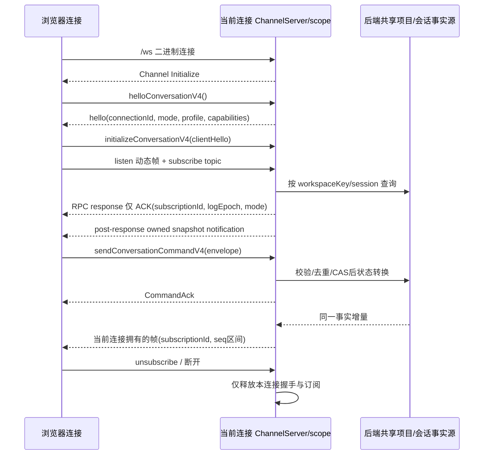

# 模拟后端（Mock Backend）规范

`packages/server` 是纯 Web 形态的模拟后端：内存态、确定性数据，经与真实服务端相同的 WebSocket RPC（`@zcode/rpc` ChannelServer + Protocol v4）向浏览器 UI 提供 `packages/services` 契约。本文记录模拟后端能力、状态所有者和协议约束，不建立独立的能力矩阵实现层。

## 1. 范围与非目标

- 目标：协议语义保真，UI 不需要 mock 分支；未实现的能力必须**明确拒绝**，不能返回假成功。
- 非目标：生产级持久化、真实网络/文件写入、与真实 Agent 运行时等价。模拟后端只有内存状态。
- 唯一允许的本地读取：项目选目录/目录浏览读取本机真实目录名（`projectService.readDirectory`），不读写文件内容。
- 唯一传输层例外：`MockRuntime` 内的 topic 水位账本（`MockTopicLog`）是协议顺序的权威来源；不落盘。

### 1.1 Bun 运行时

- 仓库唯一 JavaScript/TypeScript 执行运行时为 Bun，固定版本见 `mise.toml`；后端、前端开发/构建、测试与工程脚本均不得启动 Node.js。`node:*` 与 `@types/node` 仅作为 Bun 兼容 API/类型保留，不代表 Node.js 运行时依赖。
- 包管理继续使用 pnpm，但由 Bun 执行；不保留 Node.js 后端或脚本回退入口。
- `packages/server/src/http.ts` 只负责 Hono 路由、Bun HTTP/WebSocket 宿主与 `ISocket` 适配；业务状态所有者、`/api`/`/ws` 路径、鉴权、静态资源语义与 v4 二进制 RPC 不变。
- 每个 WebSocket 连接独占一套 `ISocket`、`SocketProtocol`、`ChannelServer` 与 agent connection scope。升级前完成鉴权/身份校验；open 时装配服务；二进制消息按原始字节视图传入协议；close 时仅触发一次关闭/结束并释放连接 scope 和 RPC 订阅。Bun 传输层不复制会话或 topic 状态，不新增重试/重放账本。
- `createMockHttpServer()` 返回 Bun server，由调用者通过 `stop()` 停止；开发入口在仓库根目录使用 Bun watch，覆盖跨 workspace 源码，默认 `workspacePath` 为仓库根（`ZCODE_SERVER_WORKSPACE` 可覆盖）；构建使用 Bun bundler，生产入口为 `bun packages/server/dist/entry-http.js`。

验收：Bun 下验证源码与构建产物启动、HTTP 元信息、鉴权拒绝/允许、静态文件与 SPA fallback、带身份的真实二进制 RPC 请求，以及断连后重新连接；工程门禁及前端构建也必须由 Bun 执行，不使用 Node.js 回退。

## 2. 能力状态

每个领域/接口在能力矩阵中只有一种状态：

| 状态          | 定义                                           | 可观察行为                                                   |
| ------------- | ---------------------------------------------- | ------------------------------------------------------------ |
| `supported`   | 有真实内存状态转换                             | 帧/返回值随操作变化；ACK 才会是 `accepted`                   |
| `compatible`  | 只读或空集合投影，形状合法，不改写状态         | 查询返回确定性空值/快照；写入口不存在或返回 `noop`/只读投影  |
| `unavailable` | 需要真实网络、磁盘、进程或账号，模拟后端不实现 | 读取返回空形状；写入抛 `mock: …未启用`；v4 命令回 `rejected` |

`compatible` 不是"假装支持"：它只用于 UI 需要的**只读目录/空集合**，任何会改变用户数据期望的写操作都必须是 `unavailable` 并显式失败。

### 2.1 矩阵

| 领域 / 接口                                         | 状态        | 说明                                                                |
| --------------------------------------------------- | ----------- | ------------------------------------------------------------------- |
| conversation / sessions-index topic                 | supported   | 快照 + 增量、seq/logEpoch、workspace 隔离                           |
| workspace-config topic                              | compatible  | 空配置目录（`configOptions: []`, `slashCommands: []`），只读快照    |
| controller/workspaces、controller/tasks-index       | supported   | workspaces 单工作区快照；tasks-index 由 runtime 任务投影并增量下发  |
| controller 任务/归档删除                            | unavailable | 不跨入会话生命周期执行删除，调用明确拒绝                            |
| v4 会话命令（见 §4）                                | supported   | 真实内存状态转换                                                    |
| 其它 v4 会话命令                                    | unavailable | ACK `rejected` + `fault.command.capabilityUnsupported`              |
| 文件树 / 文件读取 / 搜索                            | supported   | 虚拟工作区 fixture；不读写真实文件                                  |
| Git 面板                                            | supported   | 虚拟仓库状态；不发起真实 git/网络                                   |
| 设置、凭据（内存）、客户端配置                      | supported   | 设置域内存态；凭据不落盘                                            |
| 产品操作者                                          | supported   | 浏览器自报工号；不是服务端账号，不分区项目/会话，不提供旧产品 OAuth |
| Provider / 模型选择 / 用量                          | compatible  | 确定性模型目录与空用量；不联网                                      |
| 插件目录/安装/配置、扩展宿主、扩展视图/授权         | unavailable | 空目录 + `canInstall/canConfigure=false`；安装/配置/视图创建抛错    |
| 工作区资产（子智能体/命令/钩子/记忆/技能/输出风格） | compatible  | 只读空集合；写操作抛错                                              |
| 配置同步（MCP/插件/技能/用户配置/设备同步）         | compatible  | 只读空清单；写入返回不可写/空结果，不伪造远端成功                   |
| 任务分组 / 受管 worktree / Source Server            | compatible  | 空分组/空快照；需要真实仓库或远端的写操作抛错                       |
| 闲时任务 / Bots                                     | unavailable | 只读空投影，注册/保存/绑定抛错                                      |
| 会话附件 begin/chunk/commit/read                    | supported   | 原生服务持有实际内存字节与 SHA-256，上传与采用授权，不写盘          |
| Onboarding / 加速卡                                 | unavailable | 空快照；真实操作抛错                                                |
| 反馈 / GenUI / 语音 / 云内容                        | unavailable | 空形状读取；真实操作抛错                                            |

终端、Git 检查点、营销触达、Desktop Provider Provisioning、会话分享与商业订阅交易已退役，
不保留 descriptor、客户端代理或服务注册。当前需求／Skill／自动化使用的内存模拟业务与
原生 v4 会话、附件及模型目录继续保留；商业套餐 DTO 若仍供保留控件展示使用，不代表交易能力。

## 3. 状态所有者

一个状态只有一个所有者；其它模块只能通过公开契约读取，不得持有副本。

| 状态                                                                      | 唯一所有者                                        | 写入者                                                                         |
| ------------------------------------------------------------------------- | ------------------------------------------------- | ------------------------------------------------------------------------------ |
| 会话 rows/`seq`/`logEpoch`/revision/phase/config/queue/plan/usage/pending | `MockRuntime.sessions`（`MockSession`）           | `MockZCodeAgentService` 命令处理                                               |
| 任务索引（title/pinned/archived/unread 等）                               | `MockRuntime.tasks`                               | `MockZCodeAgentService`、`MockZCodeTaskService`、`MockWindowControllerService` |
| 虚拟文件系统 / 虚拟 Git                                                   | `MockRuntime.virtualRoot` / `MockRuntime.git`     | `Mock*FileService` / `MockGitService`                                          |
| topic 水位（sessions-index / workspace-config / controller）              | `MockRuntime.topics`（`MockTopicLog`）            | 对应 topic 的唯一发布函数                                                      |
| 应用设置                                                                  | `MockSettingService`（设置域）                    | `MockSettingService.update`                                                    |
| 内存凭据                                                                  | `MockCredentialService`（设置域）                 | `MockCredentialService.save/delete`                                            |
| v4 订阅表与 `subscriptionId` 归属                                         | `MockZCodeAgentService` + 每连接 connection scope | subscribe/unsubscribe                                                          |
| controller 订阅表                                                         | `MockWindowControllerService`                     | subscribe/unsubscribe/resync                                                   |

装配图：

```text
mock/index.ts（唯一集中装配）
  ├─ MockRuntime（权威内存状态 + topic 水位）
  ├─ workspace.ts / project.ts / zcodeTask.ts / zcodeAgent.ts（协议面）
  └─ domains/*（按领域注册服务，只写自己的私有状态）
        settings ─ models ─ plugins ─ extensions ─ assets ─ sync
        projects ─ automations ─ sharing ─ compat-surfaces
```

## 4. ACK 语义（v4 会话命令）

命令入口：`sendConversationCommandV4(envelope)`。信封与 payload 先经 `parseCommandEnvelope` 校验。

信封 `workspace` 按官方 schema 可选（Host 冷恢复注入）；一旦携带就必须是完整的
`ZCodeWorkspaceRef`：`workspacePath` 与 `workspaceKey` 必填，且
`workspaceKey = workspaceIdentity?.trim() || workspacePath`（身份唯一来源，不另行编造）。
`createSession` 的 payload 必带 `workspaceId = workspaceKey`（Host 预留归属）。信封字段不全即
`fault.command.invalidEnvelope`，不能靠 mock 兜底；真实 Host 发送命令时按这一构造携带身份。

| 情况                                      | ACK                                                                                                                           |
| ----------------------------------------- | ----------------------------------------------------------------------------------------------------------------------------- |
| 命令受支持且完成了状态转换                | `accepted`，`revisionAtDecision` = 当前 revision，必要时带 `result`                                                           |
| 受支持但目标已是终态/不存在，无需改变状态 | `noop`（可带 reasonCode，如 `proto.alreadyResolved`）                                                                         |
| 命令未实现                                | `rejected` + `reasonCode=fault.command.capabilityUnsupported` + `message`，零状态变更                                         |
| 信封或 payload 非法                       | `rejected` + `fault.command.invalidEnvelope`                                                                                  |
| 会话不存在或不属于信封 workspace          | RPC 错误 `fault.command.sessionNotFound: <sessionId>`                                                                         |
| 未知/已失效 `subscriptionId` 的 resync    | RPC 错误 `fault.subscription.unknownSubscription`；跨连接复用他人 id 时由 connection scope 先回 `fault.subscription.notOwned` |

规则：

1. **`accepted` 必须可观察**：写队列命令要更新 `queue.items`，会话生命周期命令要更新 `phase/control`，标题/模型命令要更新 `meta/config` 并下发帧。
2. **不做假成功**：未实现命令一律走 `rejected` 分支；`default` 分支只有这一个出口。
3. **命令重放**：当前原生 owner 按操作者/客户端、sessionId、commandId 保留已接纳 ACK 与输入摘要；相同请求重放返回原决定，不重复追加消息，不同输入复用编号拒绝。query 同时返回当前 turn 事实。
4. **CAS 边界**：通用原生命令仍按协议校验版本字段，不替代 AIReq 自身的材料版本、候选、配置 revision 与业务命令 CAS。AIReq 写入口在其唯一业务 owner 执行这些门禁。
5. `noop` 不改变 revision，也不推进 topic 水位（除显式 `patchQueue` 的受支持命令外）。
6. 会话从 `MockRuntime.sessions` 删除后，旧 turn 不得再次发布 sessions-index upsert 或启动队列下一项；controller 不直接删除会话。

### 4.1 受支持命令

| 命令                                          | 内存转换                                                                                                         |
| --------------------------------------------- | ---------------------------------------------------------------------------------------------------------------- |
| `createSession`                               | 新建 `MockSession` + task 记录，发 sessions-index upsert；有 firstInput 立即开 turn                              |
| `sendText`                                    | 空闲：开 turn；运行中：生成真实 queue item（ACK `delivery=queue`）并下发 `queue`                                 |
| `stop`                                        | 运行中：中断 turn、暂停自动续跑（`autoDrain=false`，`pauseReason=stopped`）；空闲但队列未暂停：暂停；否则 `noop` |
| `sendQueuedNow`                               | 从队列移除并立即开始；运行中先中断当前 turn，收口后开始该项                                                      |
| `lockQueueItemEdit` / `releaseQueueItemEdit`  | 冻结/释放 editLock；违反 `guard.queueItemReserved` / `guard.queueItemEditLocked` 时 `noop`                       |
| `editQueueItem`                               | 原地替换正文/附件/模型/模式；持锁校验失败回 `noop` + `guard.queueEditLockLost`；成功后释放锁                     |
| `reorderQueueItem` / `deleteQueueItem`        | 调整顺序/删除；锁定项回 `noop` + `guard.queueItemEditLocked`                                                     |
| `applyQueueItemsConfig`                       | 对匹配的排队项应用模型/模式；无适用项 `noop`                                                                     |
| `setAutoDrain`                                | 更新 autoDrain/pauseReason；恢复自动续跑时空闲会话立刻 drain                                                     |
| `resolveInteraction`                          | 移除 pendingInteraction；权限卡继续执行；已解决回 `noop` + `proto.alreadyResolved`                               |
| `renameSession`                               | 更新 session meta + task 标题 + sessions-index                                                                   |
| `deleteSession`                               | 删除 session/task，发 sessions-index removed                                                                     |
| `switchModelConfig`                           | 更新 config 并追加 modelChange 标记行                                                                            |
| `switchCollaborationMode` / `setFollowupMode` | 更新 config 并下发 `config` patch                                                                                |
| `setAssistantFeedback`                        | 更新/清除 assistantText 行反馈；目标不存在 `noop`                                                                |

### 4.2 未支持命令

`compact`、`forkAssistant`、`applyFileRewind`、`editUserQuery`、`retryTurn`、`setHighspeedMetrics`、`respondWorkspaceHookReview`、`toggleWorkspaceHookReviewItem`、`revokeWorkspaceHookTrust`、`requestWorkspaceHookReview`、`snoozeInteractionAutoResolution`、`sendGoalCommand`、`stopSubagent`、`pauseGoal`、`resumeGoal`、`cancelBackgroundWork`、`resumeWorkflowRun`、`startSavedWorkflow`、`amendWorkflowRunSettings`、`createSelectionSideSession`、`discardSharedContext`。

这些命令此前返回 `accepted` 但不改变任何状态，造成 UI 显示成功而实际未执行；现在统一 `rejected` + `fault.command.capabilityUnsupported`。UI 按协议通用错误路径展示，不新增 mock 分支。

## 5. Topic 顺序

### 5.1 水位不变量

- `logEpoch` 是 topic 的代际；同一 topic 内稳定，topic 创建时生成（conversation 由 session 创建时生成）。
- `seq` 单调递增；一条已发布记录 = `(fromSeq, toSeq]`，其中 `toSeq = fromSeq + 1`。
- **快照帧**：`fromSeq = 0`、`toSeq = 当前水位`；快照本身不推高水位。
- **增量帧**：发布时推进一次水位；同一批变更只发一个 `toSeq`，同一 topic 的所有订阅者拿到相同的 `(fromSeq, toSeq]`。
- `sessions-index` / `workspace-config` / `controller/*` 由 `MockTopicLog` 记账：没有订阅者时不推进，避免无人观察的水位空洞。conversation 的 `seq` 是会话投影日志水位，随投影推进（即使暂无订阅者），快照用 `toSeq` 对齐。
- `subscriptionId` 每次订阅新生成、绝不复用；帧只携带其所属订阅的 id。

### 5.2 各 topic

| topic                            | 水位所有者                     | 发布时机                                                     |
| -------------------------------- | ------------------------------ | ------------------------------------------------------------ |
| `conversation/<sessionId>`       | `MockSession.seq/logEpoch`     | 每次 `patchState`、行追加/更新/增量、快照订阅（不推进）      |
| `sessions-index/<workspaceId>`   | `MockTopicLog`（workspace 级） | v4 createSession / renameSession / deleteSession / turn 收口 |
| `workspace-config/<workspaceId>` | `MockTopicLog`（workspace 级） | 订阅与 resync 快照；当前 mock 无配置变更，水位不推进         |
| `controller/workspaces`          | `MockTopicLog`                 | 订阅/resync 快照                                             |
| `controller/tasks-index`         | `MockTopicLog`                 | 订阅/resync 快照；任务增删改时一条 delta 帧（同批共享水位）  |

### 5.3 订阅与归属

```text
subscribe → 注册 subscriptionId
          → 返回 ack { subscriptionId, mode: "snapshot", logEpoch }
          → 下发快照帧（fromSeq=0, toSeq=当前水位）
变更      → 推进一次水位 → 向该 topic 的订阅者发同一区间增量帧
unsubscribe → 删除订阅；之后不再有该 subscriptionId 的帧（重复 unsubscribe 幂等）
resync    → 未知 subscriptionId 抛 fault.subscription.unknownSubscription
```

- conversation 订阅按 `sessionId` 匹配；session 属于另一个 workspace 时按 `fault.command.sessionNotFound` 处理，不读取跨工作区状态。
- sessions-index 与 workspace-config 订阅按 `workspaceKey`（`workspaceIdentity ?? workspacePath`）匹配，跨工作区不串帧。
- agent topic 的每个 WebSocket 连接由 `createZCodeAgentConnectionScope` 建立独立 ownership：帧只路由给拥有该 `subscriptionId` 的连接；跨连接 resync 报 `fault.subscription.notOwned`，非本连接的 unsubscribe 幂等忽略且不删除原连接订阅。
- controller topic 仅由共享的 `MockWindowControllerService` 订阅表过滤，当前没有逐连接 ownership；这是原型限制，本次不新增 scope 机制。

## 6. 能力投影与前端

- 服务端能力字面量直接由各服务按已有 wire 契约返回，不单独维护能力矩阵或新增 capability store。
- 浏览器本机操作归 `packages/web/src/platform`（见 `docs/ui/browser-capabilities.md`），不能据此推导服务端工作区能力。
- UI 只消费 wire 值；禁止按 `mock` 名称或能力来源新增分支。

## 7. 验证

本文件不新增测试或专用验证入口。模拟后端的验证只走既有手段：

- `pnpm dev`：启动真实 mock HTTP/WS 服务与 Web UI（回环），浏览器内走真实 RPC/帧渲染路径。
- 根 `pnpm typecheck`：校验协议/服务装配与 wire 类型（含 `zcode-protocol-v4` 官方 schema 的类型面）。
- 浏览器与协议行为按 §4、§5 的不变量人工验收：三类 topic 的快照/增量、`(fromSeq,toSeq]` 连续性、`logEpoch` 稳定、`workspaceKey` 隔离、`subscriptionId` 归属、unsubscribe/resync、受支持/未支持命令的 ACK 语义。

已观察到的真实协议结果（一次性协议冒烟，脚本已按用户要求删除、不作为仓库资产，也不保留任何根命令入口）：交付修复后该流程实际执行完成，耗时约 1.10s，全流程通过，原始输出末尾为「subscriptionId 归属、unsubscribe、resync 通过」与「全部协议冒烟通过」。该次运行真实启动 mock 服务并经 `@zcode/client` 建立真实 WebSocket 连接，实际覆盖并校验：

- hello/initialize 握手（`protocolVersion=3`），两条独立连接均建立成功。
- conversation / sessions-index / workspace-config 三类 topic 的快照与增量帧：快照 `fromSeq=0`、`logEpoch` 与订阅 ack 一致，增量 `(fromSeq,toSeq]` 连续、会话 `logEpoch` 稳定，resync 重发快照。
- 工作区隔离：A 工作区创建会话不向 B 的 sessions-index 订阅者发帧；跨工作区订阅会话被拒（`fault.command.sessionNotFound`）。
- `subscriptionId` 归属：第二连接 resync 第一连接的订阅被拒（`fault.subscription.notOwned`）；unsubscribe 后该 `subscriptionId` 不再收帧，另一连接的订阅继续收帧。
- 受支持命令产生可观察状态转换：`createSession`、运行中 `sendText` 入队（ACK `delivery=queue` 与 `queue` 投影一致）、`renameSession`、`setFollowupMode`、`switchModelConfig`。
- 未支持命令 `pauseGoal` / `compact` 回 `rejected` + `fault.command.capabilityUnsupported`，revision 不变。
- 负例：信封本身合法、payload 非法的独立用例回 `fault.command.invalidEnvelope`，合法命令用例不受影响。

上述结果为交付修复阶段的实测证据；临时脚本已删除，不重新创建、不重跑。第二阶段的 RPC adapter 不在这轮实测范围内，尚需按前文既有方式（`pnpm dev` / 根 `pnpm typecheck` / 浏览器）单独验收，不能记为已验证。

这些场景对应的行为契约（供人工/后续验证对照，不含新增脚本）：

1. hello/initialize 握手（`protocolVersion=3`）。
2. conversation / sessions-index / workspace-config 三类订阅的快照帧与 ack（`subscriptionId`、`logEpoch`、`fromSeq=0`）。
3. 增量帧的 `(fromSeq,toSeq]` 顺序与会话 `logEpoch` 稳定；快照重同步。
4. 工作区隔离：A 工作区创建会话不向 B 的 sessions-index 订阅者发帧；跨工作区订阅会话被拒。
5. `subscriptionId` 归属：第二连接不能 resync 第一连接的订阅（`fault.subscription.notOwned`）；unsubscribe：解除后不再收到该 `subscriptionId` 的帧，另一连接的订阅继续收帧。
6. 未支持命令（`pauseGoal`、`compact`）ACK `rejected` + `fault.command.capabilityUnsupported`，且 revision 不变；合法信封 + 非法 payload 的独立负例回 `fault.command.invalidEnvelope`，合法命令用例不受影响。
7. 受支持命令（`createSession`、`renameSession`、`setFollowupMode`、运行中 `sendText` 入队、`switchModelConfig`）产生可观察状态转换与合法帧；命令信封的 workspace 身份为完整 `ZCodeWorkspaceRef`（`workspaceKey = workspaceIdentity?.trim() || workspacePath`），`createSession` payload 带 `workspaceId = workspaceKey`。

已知未覆盖：浏览器渲染、真实文件/Git 操作、controller topic（由 UI 运行时使用），以及 command 去重/CAS（见 §4 限制）。

## 8. 真实后端替换契约

本节是裁剪后保留前端的对接规格，不授权开发真实业务后端。契约中的 Host 指服务所有者，
在当前 Web 拓扑中就是浏览器连接的后端，不意味着恢复 SSH、relay 或桌面进程。
方法的精确字段、联合类型和可选性以本节链接的源码契约与 zod schema 为准，不能将表中说明
当作可另行简化的 DTO。模拟实现的 `unavailable` 也属于可观察契约：能力未开放时明确拒绝，
不是要求为已经裁撤的产品页面重建实现。

### 8.1 HTTP、资源与部署

| 接入面         | 请求与响应                                                                          | 必须保持的行为                                                                                                                                          |
| -------------- | ----------------------------------------------------------------------------------- | ------------------------------------------------------------------------------------------------------------------------------------------------------- |
| 启动元信息     | `GET /api/server-info` → `ServerRemoteInfo`，用 `serverRemoteInfoOutputSchema` 校验 | 稳定 serverId、version/protocolVersion、compatibility、capabilities、workspaces 的 path/identity；目录均属于后端。identity 合法非空不触发另一条远程连接 |
| 客户端配置     | `GET /api/v1/client/configs` → 当前 `code/data.configs` 配置响应                    | 平台 help/community 等消费者仍可读取；不得要求旧产品账号 Bearer token                                                                                   |
| RPC            | 同源 `GET /ws` 升级 WebSocket，双向二进制帧                                         | 不是 JSON WebSocket、REST 或 SSE；正式部署的入口必须转发 Upgrade，不能只代理 `/api`                                                                     |
| 站点           | `/`、构建 assets 与 SPA 路由                                                        | 提供相同的前端构建产物、正确 MIME；index 不缓存，带 hash 的构建资源可长期缓存                                                                           |
| 文件与媒体资源 | RPC 返回 `inline` 字节或浏览器可访问的 URL                                          | `C:\...`、服务器 `/home/...`、`file://` 不是浏览器可达资源；不要将后端本机路径直接放进 `src`                                                            |
| 下载           | `IPlatformService` 浏览器实现 fetch URL 或下载字节                                  | URL 必须能由浏览器访问；跨源资源需对应 CORS，同 HTTPS 页面不能混用 HTTP 媒体                                                                            |

旧产品账号授权、回调、轮询和 token 交换接口不属于替换合同。工号只由浏览器操作者模块
保存和恢复，本轮没有后端登录接口；不能把工号塞进 `clientId`、`subscriptionId`、
`hostId`、`workspaceIdentity` 或严格的 v4 帧。现有可选部署访问 token 是另一层站点访问控制，
不代表工号认证，也不允许据此分区共享业务数据。

真实浏览器部署要求 HTTPS 安全上下文（开发 localhost 的豁免不证明服务器 HTTP 可用）；
允许站点使用 localStorage、sessionStorage、IndexedDB、WebSocket、Blob/object URL 和
`crypto.randomUUID`。存储被禁用、代理阻断 Upgrade 或资源证书不可用属于部署失败，
不能以 mock 特判修前端。同源 `/ws`、`/api` 及返回的资源路径必须在正式入口真实存在，
Vite 的开发代理不是生产路由。

### 8.2 二进制传输与 Channel RPC

直接复用 `@zcode/rpc` 最小且最不易产生协议漂移。非 TypeScript 后端也必须实现同一字节格式：

- `SocketProtocol` 的帧头固定 13 字节：type:u8、id:u32BE、ack:u32BE、payloadLength:u32BE；
  普通消息 type=1。解析必须支持跨 WebSocket message 的半帧与同一 message 内多帧。
  当前 `/ws` 用 `SocketProtocol`，不是 `PersistentProtocol` 的透明会话续传。
- payload 为 `serialize(header)` + `serialize(body)`；类型标签、VQL 长度、字符串 UTF-8、
  顶层 Uint8Array、嵌套二进制 marker 均沿用
  [`serialization.ts`](../../packages/rpc/src/serialization.ts)，不能换成自定义 JSON 编码。
- 服务端发 Channel Initialize，客户端再开始调用；客户端等待 Initialize 的现有上限为 15 秒。
  本 Web 入口直接 `ChannelServer`，不添加 `IPCServer` 的首条 ctx 消息。
- 请求头与响应类型以 [`channels.shared.ts`](../../packages/rpc/src/channels.shared.ts)、
  [`channelClient.ts`](../../packages/rpc/src/channelClient.ts)、
  [`channelServer.ts`](../../packages/rpc/src/channelServer.ts) 为准；请求 id 只在当前连接中对应结果。
  Promise success/error、事件 listen/fire/dispose 与取消都要保留，错误不能变成假成功的空值。
- [`ProxyChannel`](../../packages/rpc/src/proxy-channel.ts) 把方法实参作为数组传输；
  `onXxx` 是 Event，`onDynamicXxx(arg)` 是参数化 Event。销毁监听器会退订，
  不能将事件当成返回 Promise 的普通方法。
- [`ServiceCollection`](../../packages/services/src/collection.ts) 的公开边界与凭据恢复限制保留。
  不做本人认证不等于放开网络端的 `recoverStore`，更不能把原来非公开的宿主方法全部开放。
  客户端代理是惰性的，能创建代理不证明服务端存在频道；可选能力依能力协商开放。

断线终结旧 ChannelClient：所有 pending 请求失败、事件释放。浏览器按有限退避新建连接、
accessor 与 Root，重新握手/订阅，不让旧连接迟到关闭事件或旧订阅继续修改新页面。
失败后的下一次安排在连接标记清除后发生；首次启动失败、自动重试耗尽和手动恢复仍有可见状态。

### 8.3 业务调用面

以下按实际页面消费者分组，而不是只给接口名。所有路径相对 `packages/services/src/`；
接口参数/返回 DTO 中引用的 `@zcode/shared` 类型同属替换合同。
完整客户端装配以 `packages/client/src/remoteServiceAccess.ts` 和 `IServiceAccessor` 为准，
可选服务缺席时不得伪造可用能力。

| 保留消费者                           | 方法／事件与数据语义                                                                                                                                                                                                                                     | 精确契约                                                                                                                                                                                                                  |
| ------------------------------------ | -------------------------------------------------------------------------------------------------------------------------------------------------------------------------------------------------------------------------------------------------------- | ------------------------------------------------------------------------------------------------------------------------------------------------------------------------------------------------------------------------- |
| 项目选择、侧栏、创建会话             | `readDirectory({path?,includeHidden?}) → {path,entries}` 浏览后端目录；`readProjects/readTree` 返回共享项目/roots/任务；`saveProject`、软删除/恢复/排序/移动需真实状态变化；`prepareSession/resolveSessionDirectories` 返回固化 cwd、附加目录与 identity | `project/contract.ts`、`project-storage/repository-contract.ts`；`broadcastService.onMessage` 的 `state:projects` 使其他连接刷新                                                                                          |
| 文件树与目录刷新                     | `readdir({path,includeHidden?}) → FileEntry[]`、`stat → FileStat`；`watch/unwatch` 与 `onDynamicChange(id)`；搜索用 rootPath/query/limit，返回有界路径候选而不是整个磁盘                                                                                 | `file/file.ts`、`fileWatcher/fileWatcher.ts`；UI `useFileService`、`useFileWatcherService`                                                                                                                                |
| 文件搜索/忽略配置                    | `searchWorkspaceFiles`；`listWorkspaceFilesLength` + `listWorkspaceFilesRange({rootPath,offset,length})` 返回列式打包裸字符串；忽略规则 read/transform/write 保持用户编辑语义                                                                            | `file/file.ts`、shared 的 workspaceFileEntriesCodec；未提供写能力时明确拒绝                                                                                                                                               |
| 文本、代码、Markdown、SVG、HTML 预览 | `readTextFile({path,offset?,length?}) → FileTextSlice` 保持分页/截断；`readMediaPreview → {dataBase64,mediaType,...}` 支持图片及 SVG 原字节下载；服务器路径只作为 RPC 参数                                                                               | `file/file.ts`、UI `PreviewPane.tsx`、`components/ai-elements/markdown-image.tsx`                                                                                                                                         |
| 音频／视频                           | `prepare({path,expectedKind}) → MediaPreviewPreparation`；inline 为 base64 + MIME，URL 分支必须浏览器可达；`host-range-url` 带 previewId/过期时间，`refreshPlaybackUrl` 续期，`release` 释放                                                             | `media-preview/mediaPreview.ts`；URL 服务需正确 Content-Type/Range/Content-Range 与过期行为；不恢复 PDF/Office/PPTX 预览                                                                                                  |
| 文件字节                             | `readFileRange({path,offset,length}) → Uint8Array` EOF 可短读；`readBinaryPreview` 返回有界预览，不改变当前已裁剪的页面范围                                                                                                                              | `file/file.ts`；保持顶层二进制快速通道                                                                                                                                                                                    |
| Git 面板与分支                       | `refresh({workspacePath,...})` 返回一致状态快照；summary/repositoryInfo/localBranches/changes/ignoredPaths/diff/branchComparison/identity 查询；stage/unstage/discard、switch/createBranch、commit/push 后应可重新读取变化                               | `git/git.ts` 与 shared Git DTO；UI `useGitRepository`、`useGitBranchSwitcher`、GitActions。结构化失败保留，不把冲突/不存在仓库当空成功                                                                                    |
| 历史会话、时间线和组织态             | `zcodeTaskService` 的列表/任务查询与动态 workspace 事件；controller workspaces/tasks-index 快照增量及 unread/tasksRemoved 信号；标题、置顶、归档、未读、删除按唯一 owner 改写                                                                            | `session/zcodeTaskService.ts`、`window-controller/windowController.ts`、`task-groups/contract.ts`；不得按工号拆表或过滤                                                                                                   |
| 会话正文、输入、队列、权限、模型切换 | 先 hello/initialize，再 conversation/sessions-index/workspace-config subscribe；命令 ACK 与下行投影分离，分页查询有界；具体见 §8.4                                                                                                                       | `zcode-agent/zcodeAgent.ts`、shared `zcode-protocol-v4`；UI `v4` 消费                                                                                                                                                     |
| 模型设置与选择器                     | `providerSettingsService.getView/refresh`、个人 Provider/模型创建修改启停排序、`testModelConnectivity`；`modelSelectionService.getView` 与变更事件保持设置视图/执行目录分工                                                                              | `model-provider/providerFacadeServices.ts`；UI `useModelProviders`、Composer。工号切换不清理 API Key 或切换模型目录                                                                                                       |
| 设置、凭据、系统与跨连接刷新         | setting get/update/变更事件；credential load/save/delete 及网络恢复限制；system info 返回后端信息/home；broadcast 消息用于失效刷新，不作为另一份业务事实                                                                                                 | `setting/setting.ts`、`credential/credential.ts`、`system/system.ts`、`broadcast/broadcast.ts`                                                                                                                            |
| 保留设置页与辅助面                   | 插件/MCP/子智能体/命令/hooks/memory/output-style 的读配置与写操作；同步、用量、分享、附件、自动化等只在既有能力开放时执行，未实现写入明确失败                                                                                                            | `plugins/plugins.ts`、`plugins/pluginManagement.ts`、`mcp-sync/`、`subagents/`、`commands/`、`hooks/`、`memory/`、`output-style/` 等 `IServiceAccessor` 指向的契约；§2 能力表记录 mock 当前限制，不授权裁撤这些尚保留入口 |

这里保留协议中已有但页面未使用的字段/方法，不意味着恢复其退役页面，例如 Git commit graph。
模型/工具授权独立于产品登录；MCP OAuth 等调用凭据不得按关键字批量删除。
真实后端须逐个实现保留消费者所需的公开方法和事件，或按现有能力语义明确关闭；
不能靠前端按后端名称判断、假数据分支、缺方法空实现或吞掉业务错误通过验收。

### 8.4 Protocol v4 与连接边界

wire 名称中的 v4 不是可自行填写的版本数字，使用 schema 的 `V4_WIRE_PROTOCOL_VERSION`。
`HelloMessage`、`ClientHello`、命令与帧均严格校验，当前 `V4_WIRE_PROTOCOL_VERSION=3`，
不得按产品名猜测版本或添加工号字段。



- `helloConversationV4 → initializeConversationV4` 的 mode/profile 由连接 scope 可信给定；
  当前 Web 为 `web-remote-replayable` / `replayable`。客户端只回应已协商能力，
  不得用 clientHello 覆盖可信 mode。`auth.userId` 留位不等于工号认证。
- 精确 wire 方法/通知词表见 shared `transport.ts` 的 `V4_METHODS/V4_NOTIFICATIONS`；
  RPC 公开包装方法见 `zcodeAgent.ts`，不能拿 wire 路径替换 Channel 方法名。
- conversation、sessions-index、workspace-config 和 controller topic 都要实现
  subscribe/resync/unsubscribe；subscribe/resync response 只含 ACK，首帧在响应之后作为
  owned notification 发送，不能内嵌初始 snapshot 或在 ACK 前发出不可归属的帧。
  `subscriptionId` 按连接拥有；重连必须取得新 id，不跨浏览器取消或复用他人订阅。
- `workspaceKey = workspaceIdentity?.trim() || workspacePath`。路径用于目录展示与执行，
  identity 用于工作区隔离；两者均不能包含工号。同路径稳定 identity 的项目仍由当前 backend 服务。
- snapshot 对齐 logEpoch 与当前 toSeq；增量严格匹配 `(fromSeq,toSeq]`。丢帧/代际改变走
  既有 resync/snapshot 规则，不能伪造 seq 或把缺席 snapshot 当成删除。详细水位规则见 §5。
- `TopicWireFrame` 的 complete/fragment、logicalFrameId、deliveryKind、校验和、尺寸上限
  使用 `wire.ts`、`wire-codec.ts`、`wire-reassembly.ts`；conversation/sessions-index/
  workspace-config 的动态事件发 wire candidate，由客户端 assembler 校验重组，再应用逻辑帧。
  不能把逻辑 snapshot 直接当分片协议传递，或跳过坏分片的 typed fault。
- `sendConversationCommandV4` 接收 schema 定义的 envelope（commandId、workspace、
  sessionId 及命令所需版本等），返回 `accepted/noop/rejected/duplicate` 等规范 ACK；
  下行投影才是可观察状态。非法 envelope、能力未开放、会话不存在、订阅不属于本连接，
  保留 §4 与 `wire-fault.ts` 的 fault 分类，不返回通用“成功”。
- 真实后端需遵守完整 commandId 幂等/去重、baseRevision/baseLogEpoch 的冲突裁决与
  `queryConversationCommandsV4` 结果查询；本内存实现的结果在进程重启后清除，
  不代表生产持久化或完整通用 CAS。`conversationRowsRangeV4`、plans、workflow/artifact 查询
  与 attachment begin/chunk/commit 及字节查询的参数/返回值见 `transport.ts`、`snapshot.ts`、
  `command.ts`、`wire.ts` 及相应严格 schema，不重建第二套 DTO。
- 共享的是项目/会话事实，不是连接和握手状态。Agent 的逐连接 ownership 已实现；
  mock controller topic 的 ownership 简化仍为 §5.3 的原型限制，本轮不扩成生产安全框架。
  真实后端应对所有逐连接订阅实施同等隔离。主题等浏览器偏好不自动升级为共享业务事实。

### 8.5 固定前端的替换验收

完成裁剪与浏览器验收后，将同一次 `pnpm build:web` 的 `packages/web/dist` 整体作为
替换验收对象，保存部署包与各文件 SHA-256 清单；mock 与真实后端必须使用完全同一份产物，
不得为新后端重打带特判的前端包。清单跟随交付包，不提交构建产物到源码库。

验收以电脑浏览器进行：工号进入/恢复/切换，两个独立上下文查看同一项目与 AIReq 业务事实；
新入口只含提案、需求分析、正式需求、Issue、Skill 设计、自动化及 AIReq 设置，不恢复目录型业务项目、
文件树、Git 面板、自由聊天或执行验收入口。一个连接退订/退出不影响另一个连接；
连接失败/恢复后重读当前事实，不自动重发创建、发送、确认、保存或分析动作。
同时检查 HTTPS 部署的 `/ws` Upgrade、HTTP 元信息和资源 URL 可达；localhost 开发成功只证明开发链路。

## 9. AIReq 共享内存业务

`src/aireq/contract.ts` 是业务模块唯一公开接线面。`mock/index.ts` 保留原服务装配，
另注册仅含 `bootstrap/call/onDidChange` 的 AIReq RPC 对象，并把原生 admission/completion/seed
回调传给现有 `MockZCodeAgentService`。业务模块不持有第二套 rows、附件、订阅或 seq。

- 普通方法通过原 `/ws` 二进制 Channel 调用，每次显式传工号与 clientId；白名单和参数检查先于领域执行。
  `/ws?employeeId=…&clientId=…&demo=…` 固定逐连接原生身份，ALS 仅传递请求上下文；
  随后仍由 `createZCodeAgentConnectionScope` 管理握手、订阅和关闭。工号不是认证。
- 项目、Release、提案、IR/SR、Issue、材料、配置与已保存 Skill 共享。项目仅保存名称、远程仓库、
  默认分支，服务分配明确模拟托管路径，不把 VirtualProject 当业务项目，不要求用户选本地目录。
  Skill 设计会话与未发送表单按工号＋clientId＋项目独立；保存后技能目录仍共享。
- 提案只允许当前公开动作；IR/SR 生成与方案更新只由已接纳原生消息完成回调调用。
  源开发执行、自由聊天、人工登记 MR、手工宣称已合入、编码和验收动作不在 RPC 白名单。
  首发草稿编号与操作编号去重；业务命令校验读取 revision，确认和发布额外绑定完整材料与候选版本。
- 唯一五秒时钟检查 MR opened/closed/merged 与完整当前文件；未合入、不完整、读取失败或候选失效
  都保留提案及原因。核验通过才转正并登记 SR 分支；新 SR 没有代码分析证据，保持 0%。
  原生已接纳回合和分析 pending 不依赖页面存活；重连不重放，进程重启恢复样例。
- 正式负责人、排期、99→100 人工门禁与 Issue 完成/重开由服务端复核；Issue 仅属于项目，
  不属于 Release。分析任务按 SR 三元组唯一，25/50 分页只传摘要，报告按需读取；
  启动现有后端前设置 `AIREQ_DEMO=analysis-scale`，再打开 `/?demo=analysis-scale`，可得到初始 300 任务、1000 历史的规模样例；不写入正式需求列表，所有连接仍共享唯一调度器，不按 URL 或工号复制任务。
- 模型、追加指令及项目保存有版本门禁，平台配置仅 owner 写；九个当前角色与原生模型目录同形，
  会话和分析历史保留创建时绑定。追加指令每角色限 102400 UTF-8 字节。Skill 显式保存绑定
  产物 revision/操作编号、包含全部临时文件且拒绝同名覆盖。
- 自动化复用原生服务方法，定义和 stopped 模拟运行记录都在内存；历史主/actor 会话只读，
  task/workpool 输出按需读取，不创建真实调度或影响 IR/SR。所有模拟材料均为本仓库自含文本，
  dev tsx 和 tsup 无源仓库、浏览器 `?raw` 或独立 worker 依赖。

本节描述实现边界，不是 gate、构建或浏览器验收通过记录。
