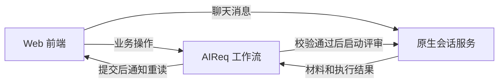

# AIReq 模块与依赖检查

Web 入口负责浏览器装配和平台操作。client／rpc 负责连接与传输，services／shared 提供公开契约、协议和共享规则，server 实现业务写入及会话服务。具体公开入口、依赖方向和分层以[模块登记](../../architecture-policy.yaml)及各包 manifest 为准。

## 状态与职责

| 模块           | 持有的状态和职责                                                                                        |
| -------------- | ------------------------------------------------------------------------------------------------------- |
| Web 前端       | 当前项目和 Release、页面与浏览历史、右侧标签、未发送草稿。业务界面读取服务端投影                        |
| Web Agent 聊天 | `/chat` 独立入口、最近列表、会话选择和草稿。通过 ZCode 原生显示层和独立 Agent 通道装配                  |
| AIReq 工作流   | 项目、Release、IR、SR、材料及校验结果、评审、人工确认、文档合入事实。保存业务对象与原生会话的关联 |
| 原生会话服务   | 会话、消息、附件和 Agent 执行。正式对接使用 OMP 原生 Agent，当前由内存原型模拟                          |

列表、详情、待办和项目统计从同一工作流事实推导。提案沿用八态，文档 PR 合入核验后归档为正式文档。

工作流将原生执行结果关联到原对象、会话及材料快照，校验文件后启动对应评审。正式文档及只读材料见[正式文档规格](../specs/aireq/tracking.md#正式文档)。

当前可运行的服务是[单进程内存原型](mock-backend.md#2-权威状态)。正式对接按[发布边界](../specs/aireq/contract-design.md#发布边界)复用前端产物、公开契约和测试。

`web-agent-chat` 与 `aireq-ui` 管理各自的 UI 装配。独立聊天通过[公开入口](../../packages/ui/package.json)使用 ZCode 通用会话部件，其运行行为见[聊天规格](../specs/web-agent-chat.md)。

## 检查范围

- 浏览器依赖检查覆盖策略中的浏览器源码目录和包入口，检查 Node 内置模块、原生包和服务端专属入口。
- 包入口检查核对 workspace 的 `exports`、`imports` 和资源路径。策略引用的根与入口也必须存在。
- 受管模块按登记检查跨模块导入、允许依赖、层级、循环和文件规模。模块以 `module.ts` 声明依赖，策略中的 `publicEntrypoints` 指向实际接口文件，`CONTRACT.md` 记录约束。

## 命令

| 场景                         | 仓库根命令                                             |
| ---------------------------- | ------------------------------------------------------ |
| 定位一个模块的入口和依赖     | `bun run architecture:context aireq-ui`                |
| 检查当前变更及受影响的依赖方 | `bun run architecture:check --changed`                 |
| 对指定提交比较               | `bun run architecture:check --changed --base <commit>` |
| 策略或检查器变更             | `bun run architecture:check`                           |

上下文命令默认列出相关文件路径。需要连同直接依赖的契约正文一起查看时加 `--full`。

新增受管模块时，在 `architecture-policy.yaml` 登记模块目录、依赖和公开入口，同步模块的 `module.ts` 与 `CONTRACT.md`，再运行全量检查。检查发现违规时返回非零退出码。

增量模式从 Git 取得本地差异和未跟踪文件。比较基线依次取 `--base`、`ARCHITECTURE_BASE`、CI 提供的提交、上游或默认分支的共同祖先，最后回退到 `HEAD`。浏览器边界与包入口仍全量检查。新增文件按当前目录和依赖关系接受检查。业务验证见[前端 UT 与后端 ST](../testing/unit-test-quality.md)。
