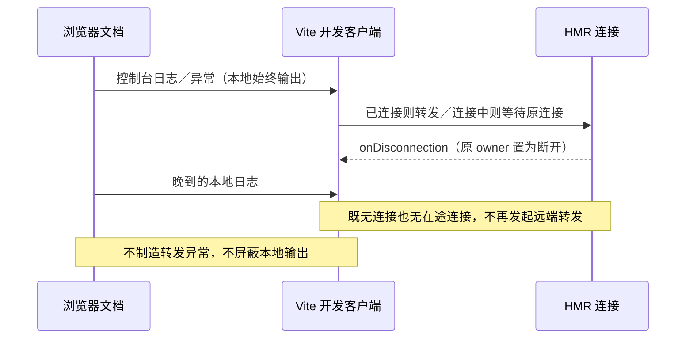

# Web 构建与清理工作流

本文定义纯 Web 形态（浏览器前端 + 内存态 mock 后端）的工具链、首装链、构建产物与清理语义。根 `package.json` 脚本、`mise.toml` 任务与 README 均以本文为准。

## 适用范围

- 只覆盖当前仓库现存工程：`packages/web`（Vite 前端）与 `packages/server`（Hono + WebSocket RPC 的 mock 后端）。
- 非目标：桌面 shell、桌面 runtime、远程资源发行（旧 `bootstrap:with-remote` / `stage:remote-assets`）、`apps/*` 子模块。这些入口随桌面端裁撤一并移除，任何脚本都不再初始化或下载它们。

## 工具链固定

- `mise.toml` 的 `[tools]` 固定 Bun `1.4.4`；根 `package.json` 的 `packageManager` 固定 pnpm `10.33.2`。不要求安装 Node.js；Bun 统一执行后端、Vite 与工程脚本，pnpm 仅负责依赖管理。
- `scripts/bootstrap.mjs` 由 Bun 执行，在依赖刷新、读取锁文件和安装之前先校验：
  - Bun 不可执行、当前进程不是 Bun，或 Bun 版本与固定版本不一致 → 直接失败，提示 `mise install` 与固定版本安装入口；
  - 从 `packageManager` 读取 pnpm 固定版本，通过 `bun x --bun --package pnpm@<版本> pnpm --version` 获取并校验；解析、下载或版本校验失败时明确报错，不借助系统 pnpm / Node.js / npm / Corepack。
- 不使用 mise 时，按 [Bun 官方安装说明](https://bun.sh/docs/installation) 安装 Bun `1.4.4` 并加入 `PATH`，无需全局安装 pnpm。显式包选择绕开系统 pnpm shim；首次调用需要访问配置的包 registry，离线环境须预先准备 Bun 缓存。
- 工程入口统一使用 `bun run <脚本>`；安装依赖使用 `bun x --bun --package pnpm@10.33.2 pnpm install`，不使用 `bun install` 替代 workspace 包管理。

## 首装链

入口：`bun run bootstrap`（`mise run bootstrap` 只是转发）。

```text
工具链校验
  └─ 刷新 hoisted patched dependencies
       └─ bun x --bun --package pnpm@10.33.2 pnpm install
            └─ bun run build（根契约：build:server → build:web，串行）
                 └─ 校验产物：packages/server/dist/entry-http.js、packages/web/dist/index.html
```

- **被 patch 依赖刷新**：`scripts/bootstrap-patched-dependencies.mjs` 依据根 `package.json` 的 `pnpm.patchedDependencies` 解析目标包，只删除 `node_modules` 内对应包目录。原因是 pnpm 10 + `node-linker=hoisted` 会把 patch 直接应用到目标目录，重复 install 会再次应用同一 diff 并稳定失败。该步骤不触碰 pnpm store 与任何用户文件，也不新建其它清理抽象。
- **构建复用根脚本**：bootstrap 调用 `bun run build`，不自行拼装包过滤或 workspace 递归命令。根 `build` 的串行顺序属于 `package.json` 契约，改动只发生在那里。
- **不接受参数**：`--with-remote` 等旧入口已移除；传入任何参数都会显式报错退出，避免静默忽略“下载远程资源 / 准备桌面 runtime”的意图。

## 构建产物

| 路径                                 | 来源                                                       | 说明                                                  |
| ------------------------------------ | ---------------------------------------------------------- | ----------------------------------------------------- |
| `packages/server/dist/entry-http.js` | `bun build --target=bun --outdir=dist ./src/entry-http.ts` | 内联 workspace 源码与全部非 builtin 依赖；由 Bun 执行 |
| `packages/web/dist/`                 | `vite build`（`packages/web`）                             | 静态站点；可由 mock server 以静态根托管               |
| `packages/*/tsconfig.tsbuildinfo`    | `tsc -b`（类型检查增量元数据）                             | 只用于加速类型检查，删除后自动重建                    |
| `node_modules/`（根与各包）          | 固定版本 pnpm 安装                                         | 依赖，不是构建产物；只有 `clean:deps` 会删除          |

workspace 内其它包（`shared` / `rpc` / `services` / `ui` 等）以源码形式被前端与 mock 后端消费，不进入首装链，也不需要单独构建；它们由 `tsc -b` 与打包器按需处理。

### 无损发布资源收敛

- 默认生产构建不生成源码映射；开发／非生产调试仍生成映射。`hidden` 仅隐藏引用、仍发布源码，不符合此规则；如需线上诊断，另行授权生成并私存映射，不随公开站点分发。
- 公式排版继续使用现有 KaTeX 样式、字体与语义；电脑浏览器只发布 WOFF2，不发布同字体的 WOFF／TTF 兼容副本。构建输入中移除旧格式引用，不在打包后手工删文件，不改字体族、字重、字形或公式布局。
- 全部通用组件、图标与第三方许可继续保留。源码映射和未选用字体格式主要影响发布包体积，不等同于浏览器首屏下载量。
- 验收生产构建的 `.map`／字体格式与 CSS URL，真实浏览器确认公式字体加载、浅／深色下公式正常且无重复可见层；不提高已有最低浏览器要求。

2026-11-15 发布实测：`bun run build` 通过，生产目录无源码映射及 WOFF／TTF；CSS 字体 URL 无断链。真实 Chromium 在深浅主题下读取实际需求材料，公式字形、隐藏 MathML 层、JSON 高亮及 Mermaid 正常，实际请求仅使用 WOFF2。构建仍提示存在大于 500 kB 的 JS chunk，本轮未裁撤渲染能力或进行首屏性能基准。

## 清理语义

入口：`bun run clean`、`bun run clean:deps`（均由 `scripts/clean.mjs` 实现；`mise` 任务 `clean` / `clean-deps` 只转发）。

- `bun run clean`：只删除构建产物，即根与 `packages/*` 下的 `dist` 目录和同层的 `*.tsbuildinfo`。**不删除** `node_modules`，因此清理后无需重装依赖，可直接 `bun run build`。
- `bun run clean:deps`：在 `clean` 基础上额外删除根与各包的 `node_modules`，用于重置安装。删除后运行 `bun x --bun --package pnpm@10.33.2 pnpm install` 或 `bun run bootstrap` 恢复；它不删除源码、用户数据、编辑器配置或其它缓存目录。
- 路径保护：每个待删目标必须是某个 owner 目录（仓库根或 `packages/<pkg>`）的**直接子项**，且名字落在受控集合内（`dist`、`*.tsbuildinfo`、`node_modules`）。不满足即抛错拒绝，防止误传路径导致递归删除任意目录。脚本只扫描仓库根与 `packages/*` 一层，不做任意深度遍历。
- 未知参数直接报错；`--help` 打印用法。

## 开发

- `bun run dev` 并行启动两端：后端包的 `dev` 从包目录执行 `cd ../.. && bun --watch packages/server/src/entry-http.ts`，将 Bun watch 的执行位置固定为仓库根，保证其它 workspace 的共享源码变更也触发重启（默认 `:3031`，`PORT` 可覆盖）。不在 `packages/server` 内直接 watch，避免遗漏包外源码；后端默认 `workspacePath` 因此为仓库根，可用 `ZCODE_SERVER_WORKSPACE` 覆盖。`packages/web` 以 Bun 执行 Vite（`:5174`，`/api`、`/ws` 代理到 `:3031`）。后端不提供其它运行时 fallback。
- main 使用前端 `5174`、后端 `3031`；base 保持前端 `5173`、后端 `3030`，支持两套服务同时运行。前端端口与代理目标由 `packages/web/vite.config.ts` 配置，后端入口与 `createMockHttpServer` 的默认监听端口均为 `3031`（生产静态托管也适用）；不根据分支名动态切换。`PORT` 仅覆盖后端监听端口，不自动修改 Vite 代理。
- VS Code 配置与之一致：任务 `zcode: mock server (:3031)`、`zcode: web dev (:5174)`、`zcode: dev (mock server + web)`；启动配置 `ZCode Web: Chrome (:5174)` 调试浏览器（先起两端），`ZCode Server: Mock (:3031)` 通过 `type: "bun"`、`runtime: "bun"` 直接调试 `src/entry-http.ts`（仅先起 web）。后端需要安装 [Oven 的 Bun 扩展 `oven.bun-vscode`](https://marketplace.visualstudio.com/items?itemName=oven.bun-vscode)，不能使用 Chrome 调试器调试 Bun。
- Bun 调试字段以[扩展 schema](https://github.com/oven-sh/bun/blob/main/packages/bun-vscode/package.json) 为准。[官方调试说明](https://bun.sh/guides/runtime/vscode-debugger) 提醒该扩展存在稳定性问题，并推荐 Bun Web debugger；这里不承诺扩展无故障。

### Firefox 开发客户端生命周期

- Vite 8.0.8 实际开发客户端启用了 `forwardConsole`，会将 warning/error 与未处理异常转发给开发服务器。
  HMR 连接断开后仍转发日志，send 失败生成的未处理异常又被转发，形成
  `send was called before connect` 连锁错误。当前 `isBundleMode=false`，不把未执行的 bundled-dev 分支当根因。
- 使用 pnpm 精确版本补丁：连接 owner 派生 `isDisconnected`，仅在既无已连接通道、也无在途连接时，
  不发起无接收方的控制台转发。连接建立中仍沿用原 send 等待；本地控制台输出与活页转发均保留。
  不以 beforeunload/pagehide 另建状态或等待窗口：Firefox 的断开和晚到日志不受这些事件顺序保证。
- HMR 连接、活页错误报告、React Fast Refresh 和样式更新继续启用，不关闭 HMR／overlay，
  不增加定时等待或屏蔽未处理异常。仅修复当前 Vite 版本，升级时按真实行为移除补丁。
- 验收：真实 Firefox 通过局域网 HTTP 首次打开、刷新、热更新现有 React 组件并还原，
  可见标题双向更新且页面时间原点不变，浏览器无 warning/error 或未处理异常。
- Web RPC 的关闭码 1000（正常关闭）／1001（端点离开）按 info 生命周期事件记录；
  异常关闭仍为 warn，断线提示与重连流程不变。
- 工程回归执行已安装 Vite 的真实转发与连接函数：覆盖未连接、建连等待和断开，
  检查原始日志仍可见、等待中的日志连接成功后送达、断开后不再触发转发异常；不比较补丁文字。



2026-11-15 实测：Firefox 128.14 ESR 通过 `http://192.168.31.171:5173` 打开开发模式，
首次加载及连续 3 次刷新无 warning/error 或未处理异常。临时改动真实需求分析标题后，
标题热更新为验收文本并热恢复原文，`performance.timeOrigin` 保持不变，临时源码改动已还原。
另明确注入 HMR 断开后的 warning 与异常：原始 warning／异常各自可见，未出现转发连锁错误。
该故障注入独立于正常场景的零告警结果，不将原始诊断屏蔽或算作修复失败。

### 生产静态托管

- 生产形态：从仓库根运行以下命令，`ZCODE_WEB_STATIC_ROOT` 指向前端构建目录的绝对路径，由一个 Bun 进程托管 HTTP + WebSocket + SPA fallback：

  ```bash
  ZCODE_WEB_STATIC_ROOT="$PWD/packages/web/dist" bun packages/server/dist/entry-http.js
  # 或：ZCODE_WEB_STATIC_ROOT="$PWD/packages/web/dist" bun run --cwd packages/server start
  ```

  PowerShell 使用 `$env:ZCODE_WEB_STATIC_ROOT = (Resolve-Path packages/web/dist).Path`，再运行 `bun packages/server/dist/entry-http.js`。只发布两端 `dist` 时仍须安装固定版本 Bun；后端包内已打包非 builtin 依赖，不依赖生产目录的 `node_modules`。

- 静态响应由 `packages/server/src/http.ts` 统一协商 `Accept-Encoding`：支持 `br`、`gzip`、`identity`，
  按有效 `q` 权重选择，压缩编码同权时优先 Brotli；显式编码优先于 `*`，`q=0` 不得选中。
  未声明或空头返回原文；仅在没有可接受的压缩编码时使用隐式允许的原文。
  显式 `identity` 权重高于压缩编码时返回原文；所有支持的表示均被禁止时返回 `406`。
- 压缩按请求异步执行，不依赖预生成的 `.br` / `.gz` 文件、不新增缓存状态；
  Brotli 使用 quality 4，避免默认高压缩等级拖慢请求。所有协商响应（含原文与 `406`）
  设置 `Vary: Accept-Encoding`，压缩响应设置对应 `Content-Encoding`；
  `Content-Type`、现有 `Cache-Control`、静态目录安全检查与 SPA fallback 不变。
- 回归验收：真实 HTTP 请求覆盖 gzip/Brotli 解压后与源文件字节一致、不同权重与同权优先级、
  编码大小写、`q=0`、通配符、缺省/空头、显式原文、不可接受编码的 `406`、
  SPA fallback 的 HTML 类型与 `no-cache`，以及 HEAD 无响应体。不修改 `/api`、`/ws` 的编码行为。

- 对外部署必须提供 HTTPS 安全上下文、同源 `/api` 与 `/ws` Upgrade，以及预览/下载返回的可达资源路径。
  localStorage、sessionStorage、IndexedDB、Blob/object URL、WebSocket 与 `crypto.randomUUID` 必须可用；
  不能将 localhost HTTP 的可用性当作任意服务器 HTTP 可部署的证据。
- 后端替换验收固定一份 `packages/web/dist`，将部署包与逐文件 SHA-256 清单一起保存；
  同一包先连 mock 再连真实后端，不因后端差异重建带特判的前端。完整接入面见
  [模拟后端规范 §8](mock-backend.md#8-真实后端替换契约)。本仓库仍只实现模拟后端。

## 扩展与维护规则

- 新增 workspace 包：`pnpm-workspace.yaml` 的 `packages/*` 会自动覆盖 install、`pnpm -r`、`clean` 的扫描范围，本工作流脚本无需维护包名单。若新包产生 `dist` / `*.tsbuildinfo` 之外的持久构建目录，先更新本文并同步 `scripts/clean.mjs` 的受控产物名。
- 删除包：同步 `pnpm-workspace.yaml`、根脚本与本文；不保留“已退役路径”的占位分支。
- 职责边界：根 `package.json` 的 `build` / `clean` / `clean:deps` / `bootstrap` 是唯一命令入口；`mise.toml` 只做同语义转发，不得各用一套构建或清理实现。

## 验收要点

1. `bun run bootstrap` 在干净 clone（无 `node_modules` / `dist`）上完成安装与构建，且过程不出现桌面 runtime、远程资源、子模块相关命令。
2. 缺少 Bun、Bun 版本不符或 pnpm 解析/版本校验失败时，bootstrap 在依赖刷新、读锁文件与安装前失败，给出清晰修正指引；全新环境不需要安装 Node.js 或全局 pnpm。
3. `bun run clean` 后 `node_modules` 仍在、`dist` 与 `*.tsbuildinfo` 消失，随后 `bun run build` 可重建。
4. `bun run clean:deps` 后 `node_modules` 消失、源码与仓库外文件不受影响。
5. `scripts/clean.mjs` 对未知参数、越权目标路径失败，而非静默跳过。
6. base 使用 `5173` / `3030` 运行时，main 的 `bun run dev` 仍在 `5174` / `3031` 启动；访问 main 的 `/api/v1/client/configs` 与 `/ws` 均到达 main 后端，Vite 开发客户端继续可用。VS Code 任务、就绪匹配和调试 URL 使用同一组 main 端口。
