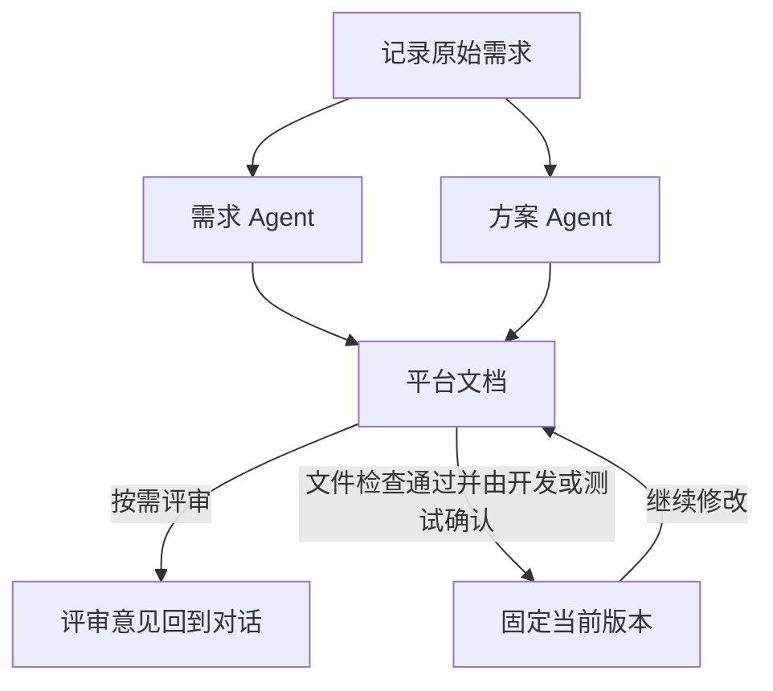

# 从一句业务诉求到确认版本

业务牵头整理初始需求。最熟悉场景的人用自己的专业判断，结合企业知识库和代码 Wiki 回答 AI 的追问，核对 AI 写下的业务含义。开发依据团队讨论形成的需求做方案，测试依据同一份验收标准设计用例。

## 1. 需求到版本

业务在需求 Agent 中补充真实场景和验收要求。开发与测试在方案 Agent 中完善技术方案、任务和测试材料。任一聊天都可邀请独立子代理评审当前材料，供团队参考。

首份文件生成时开始 V1。团队讨论期间，文件继续更新同一未确认版本。开发或测试检查文件，补齐缺失并修正格式。检查通过后确认定版，固定当前全部文件。随后继续改动时自动进入下一版本。详细入口见[需求共创](../specs/aireq/proposals.md)。

## 2. FDTH 案例复盘

当时，业务同事在聊天里写下了这句原始需求。

> fdth增加3个接口，给lander查询

业务同事随后做过串讲。开发刚接手这项业务，对真实使用场景还不熟。在与 AI 整理需求文档时，开发把自己当时的理解写进了文档。后续实现沿用了这份理解，交给业务验收时才发现与预期有偏差，多次返工。

这个案例里，理解偏差在口头串讲转成书面需求时就已出现。让最熟悉场景的业务人员牵头成文，开发接手前就有一次核对原意的机会。

## 3. 用同一句 FDTH 诉求验证新流程

现场可以请 AI 向业务人员追问以下三个问题，具体答案由业务提供。

1. **使用场景**　Lander 在什么情况下会发起这次查询？
2. **业务目的**　拿到结果以后，业务人员要完成什么动作？
3. **验收例子**　举一次实际查询，返回什么结果才算正确？

业务结合专业知识和参考资料，核对 AI 整理出的场景与预期结果。开发对照这个例子判断三个接口是否合适、怎样实现。测试将业务认可的例子写成可执行的用例。预期收益是在编写代码前纠正需求理解偏差，实际效果通过试用和后续验收记录衡量。

## 4. 业务需求文档写什么

业务和 AI 共同起草 `requirements.md`，业务核对。文档可对照原始诉求，并结合项目与版本理解上下文。团队采用统一格式，可为各类文档自定义必需章节。下表是供内部讨论的需求文档模板。[文档格式规则](../specs/aireq/tools-settings.md#文档格式)

| 建议章节   | 需要业务说清的问题                               |
| ---------- | ------------------------------------------------ |
| 目标与场景 | 谁在什么情境下，要完成哪件事？                   |
| 范围与规则 | 本次覆盖哪些查询？适用条件和边界是什么？         |
| 验收标准   | 给定一个具体场景，预期结果是什么，怎样判定正确？ |
| 待确认事项 | 还缺哪条业务解释，由谁补充、谁核对？             |

交接时，业务能在文档里认出自己的场景，开发能解释要解决的问题，测试能举出据此验证的用例。经确认的业务需求是后续方案、任务和测试计划的共同依据。

## 5. 首次试用与收益验证

先在内部对齐场景和流程，由熟悉 FDTH 的业务同事输入原话，与需求 Agent 澄清。开发复述要解决的问题，测试举出一个验收例子，由业务核对理解是否一致。开发或测试确认版本并记录后续需要改动的内容。

- **试用效果**。记录哪些歧义在需求成文时就被发现。后续对照试用前后因需求理解偏差产生的验收返工次数。
- **投入与日期**。确认参与人员、知识资料范围和接入方式后，估算准备、开发和联调的人天，再排首次试用日期。
- **进展同步**。每天下班前简报当天完成项、待确认的问题和下一步。
