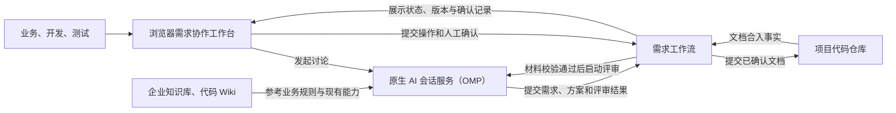
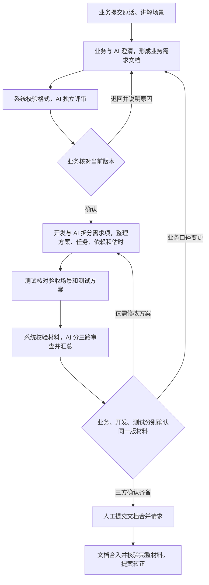

# 从一句业务诉求到正式文档

业务牵头整理初始需求。最熟悉场景的人用自己的专业判断，结合企业知识库和代码 Wiki 回答 AI 的追问，核对 AI 写下的业务含义。开发依据业务确认的需求做方案，测试依据同一份验收标准设计用例。

## 1. 系统架构

业务、开发和测试在同一项目、同一版本的浏览器工作台协作。图中展示目标架构。企业知识库和代码 Wiki 是规划中的澄清资料来源。当前服务的接入情况见[系统范围](../README.md#系统范围)，各模块职责见[架构说明](../architecture/pure-web-module-ownership.md#状态与职责)。

原始诉求独立保留，可与后续文档对照。工作流记录谁确认了哪一版材料。文档合入并核验后，正式文档保留原始需求、规格、方案、测试材料与讨论评审历史。

## 2. 从提出需求到正式文档

业务口径变更后，需求文档须重新评审、重新确认，原方案的审查和确认随之失效。仅调整技术方案时，保留业务已确认的需求，重新审查和确认方案。提交后的文档需修改时，先关闭仍打开的合并请求。详见[版本变更与文档交付](../specs/aireq/proposals.md#版本失效与文档交付)及[正式文档](../specs/aireq/tracking.md#正式文档)。

## 3. 提案八阶段的人机分工

IR 指一条整体业务需求，SR 指从中拆出的正式需求项。状态取决于当前有效的材料、报告、确认和交付记录。[提案八态定义](../specs/aireq/proposals.md#提案业务状态)

| 阶段          | AI 做什么                                            | 系统做什么                                   | 人做什么                             |
| ------------- | ---------------------------------------------------- | -------------------------------------------- | ------------------------------------ |
| 1. 未启动     | 追问使用场景，起草或补齐需求                         | 保留业务原话，校验文档                       | 业务解释场景，提供真实例子           |
| 2. IR 待评审  | 独立检查目标、范围、歧义和可验收性                   | 格式校验通过后启动评审                       | 业务查看评审进展                     |
| 3. IR 待确认  | 提供评审意见                                         | 将评审与材料版本关联                         | 业务决定是否采纳意见，确认或退回补充 |
| 4. 方案待完善 | 辅助拆分需求项，编制方案、任务、测试计划和估时       | 校验方案材料、依赖、工作日预估及假设         | 开发设计方案，测试核对场景           |
| 5. 方案待评审 | 分别审查需求覆盖、技术与依赖、任务与测试，再汇总意见 | 将三路审查和综合报告关联到同版材料           | 开发、测试查看意见                   |
| 6. 方案待确认 | 提供综合意见供三方判断                               | 按角色记录对该版材料的确认                   | 业务、开发和测试分别确认             |
| 7. 待提交     | —                                                    | 收到提交授权后建分支、创建文档合并请求（PR） | 核对完整文件清单，明确提交           |
| 8. 待合入     | —                                                    | 核验已合入的版本和完整清单，满足条件后转正   | 按仓库流程合入文档                   |

## 4. FDTH 案例复盘

当时，业务同事在聊天里写下了这句原始需求。

> fdth增加3个接口，给lander查询

业务同事随后做过串讲。开发刚接手这项业务，对真实使用场景还不熟。在与 AI 整理需求文档时，开发把自己当时的理解写进了文档。后续实现沿用了这份理解，交给业务验收时才发现与预期有偏差，多次返工。

这个案例里，理解偏差在口头串讲转成书面需求时就已出现。让最熟悉场景的业务人员牵头成文，开发接手前就有一次核对原意的机会。

## 5. 用同一句 FDTH 诉求验证新流程

现场可以请 AI 向业务人员追问以下三个问题，具体答案由业务提供。

1. **使用场景**　Lander 在什么情况下会发起这次查询？
2. **业务目的**　拿到结果以后，业务人员要完成什么动作？
3. **验收例子**　举一次实际查询，返回什么结果才算正确？

业务结合专业知识和参考资料，核对 AI 整理出的场景与预期结果。开发对照这个例子判断三个接口是否合适、怎样实现。测试将业务认可的例子写成可执行的用例。预期收益是在编写代码前纠正需求理解偏差，实际效果通过试用和后续验收记录衡量。

## 6. 业务需求文档写什么

业务和 AI 共同起草 `requirements.md`，业务核对。文档可对照原始诉求，并结合项目与版本理解上下文。团队采用统一格式，可为各类文档自定义必需章节。下表是供内部讨论的需求文档模板。[文档格式规则](../specs/aireq/tools-settings.md#文档格式)

| 建议章节   | 需要业务说清的问题                               |
| ---------- | ------------------------------------------------ |
| 目标与场景 | 谁在什么情境下，要完成哪件事？                   |
| 范围与规则 | 本次覆盖哪些查询？适用条件和边界是什么？         |
| 验收标准   | 给定一个具体场景，预期结果是什么，怎样判定正确？ |
| 待确认事项 | 还缺哪条业务解释，由谁补充、谁核对？             |

交接时，业务能在文档里认出自己的场景，开发能解释要解决的问题，测试能举出据此验证的用例。经确认的业务需求是后续方案、任务和测试计划的共同依据。

## 7. 首次试用与收益验证

先在内部对齐场景和流程，首次试用只走到业务确认需求文档。由熟悉 FDTH 的业务同事输入原话，与 AI 澄清，核对并确认文档。开发随后复述要解决的问题，测试举出一个验收例子，由业务判断双方是否理解一致，当场记录分歧。

- **试用效果**。记录哪些歧义在需求成文时就被发现。后续对照试用前后因需求理解偏差产生的验收返工次数。
- **投入与日期**。确认参与人员、知识资料范围和接入方式后，估算准备、开发和联调的人天，再排首次试用日期。
- **进展同步**。每天下班前简报当天完成项、待确认的问题和下一步。
