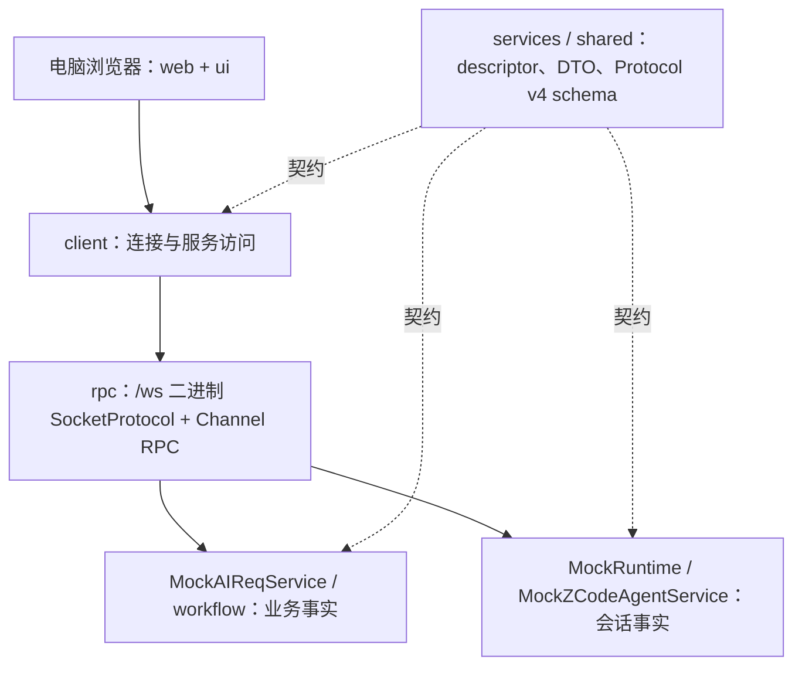

# 当前系统范围

AIReq 是面向电脑浏览器的需求协作平台。运行形态为浏览器前端加单进程内存模拟后端；文档中的能力以当前检出的源码与公开契约为准。

## 产品入口

| 范围                   | 当前页面                                         |
| ---------------------- | ------------------------------------------------ |
| 全局                   | 项目总览、想法池                                 |
| 当前项目与具体 Release | 当前项目、需求共创、开发任务、进度分析、我的待办 |
| 设置                   | 外观、项目配置、AI 配置                          |
| 右侧工作区             | 多对象的报告、材料、历史与分析执行报告标签       |

默认进入项目总览，显式对象链接按对象归属定位。项目和具体 Release 由侧栏统一选择；想法池不随项目过滤，待办使用当前项目／Release。项目没有 Release 时显示真实空态，不制造“全部版本”业务事实。

需求从原始输入进入提案，经过原生澄清、评审、材料编写与人工门禁后转正为 IR／SR；正式需求保留材料、分工、分析、测试验收和进度记录。项目及 Release 进度由正式 SR 派生，不另建可写进度来源。完整规则见[产品规格索引](README.md#产品与交互)。

Sketch 提供真实绘图与 PNG 附件。Skill 设计实现及其私有会话、草稿、预览和内存保存保留，但不在主导航、设置或搜索中公开。

## 运行拓扑与状态所有者

- 业务状态、材料与分析记录归服务端 owner。原生会话行、附件、队列、订阅与水位归原生运行时 owner。
- UI 只持导航、可失效读取投影、界面标签和未发送草稿；不能复制服务端接受事实。
- 写操作按现行签名进行身份、对象、版本与幂等校验；成功提交后再通知。事件用于失效重读，不是持久事件日志。
- 连接恢复重建订阅、重读事实，不自动重发业务写入。迟到结果不得覆盖其他对象或更新版本。

详细传输与公开服务面见[前后端接线](specs/aireq-migration/integration.md)及[服务端说明](architecture/mock-backend.md)。

## 身份和当前能力限制

工号为一个小写英文字母加八位数字，保留前导零，自报且不验证本人。所有合法工号共享进程内业务数据，可以配置、认领和代办；不设置 owner／访客角色。身份、对象归属、业务门禁和原生私有会话隔离仍执行。

当前后端只完成内存中的操作，不提供真实模型执行、代码开发、Git 托管操作、数据库持久化或可信认证。服务进程重启会重新初始化数据；内存保存和验收记录不表示宿主文件已写入或外部构建测试已执行。部署 token 与 Cookie 接线不等于工号认证，详见[身份与连接](specs/aireq-migration/connection-identity.md)。

不提供桌面应用、手机支持、真实 Agent／CLI 运行时、普通自由聊天产品、目录型项目管理、Git 工作台、终端、远程主机或插件商店入口。保留的共享类型、算法和通用组件不扩大产品范围。

## 界面与模块边界

以当前实现和 [DESIGN.md](../DESIGN.md) 为界面基准，复用 `packages/ui/src/components/ui`。现有通用控件、已有 `mobile-ui`、布局、表单、弹层和图标资产保留；没有引用不是删除理由。只支持电脑浏览器，不以保留兼容资产承诺手机支持。

业务模块通过浏览器安全服务契约接入，平台操作通过注入的 `IPlatformService`。业务 owner、导航 owner、局部草稿与标签状态分离；跨包依赖通过公开入口，遵守[模块所有权](architecture/pure-web-module-ownership.md)。

## 后端替换边界

后端实现必须遵循当前同源 HTTP／资源、WebSocket 二进制 RPC、服务 descriptor 与 Protocol v4 的形状和语义。后端替换不改变前端源码、构建产物、文案、SDK、传输或公开接口，也不要求增加后端专用 UI 分支或适配包。

真实后端替换尚未实施；发布验收须绑定实际部署的同次产物与契约，约束见[发布边界](specs/aireq-migration/release-surface.md)，不以文档描述代替运行验证。
