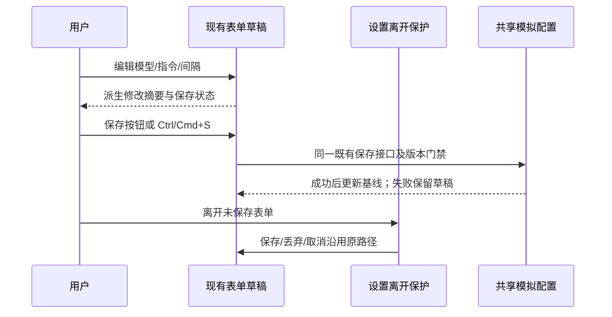

# AI 配置可用性（2026-11-16）

用户要求处理 AI 配置评审的全部问题，包含共享范围、指令职责与生效说明、模型长表提交、术语及间隔行精简，保持当前控件、主题、密度、68px 侧栏与三个页签，不新增业务能力。

## 产品规则与接口

- 模型与指令仍显式保存；模型表单在滚动时保持保存／取消及修改摘要可见，默认模型与修改 Agent 数由现有 saved/draft 派生。快捷键提示为 Ctrl/Cmd+S，与现有保存动作一致。成功／失败反馈放在同一操作区。
- Agent 的简短职责由现有模型描述字段提供，模型与指令页复用同一份内容，不复制角色映射。指令选择器下显示当前职责，用“追加指令”代替“追加系统提示词”。说明保存更新团队共享配置、不改写已有讨论或报告；新建评审和分析读取已保存指令，已有结果保持快照。明确模拟执行，不声称存在真实模型调用。
- 共享说明使用业务语言；保留模拟目录信息的按需展开与真实路径值，将 profile／OMP 等内部术语改为共享技能目录／外部服务。不改变配置归属与权限。
- 分析开关附近明确全部工号共享、全局及项目开关立即保存。暂停不取消进行中的分析，已开启项目仍可手动分析。
- 统一间隔只在“自定义”时显示数值输入；保留 15／30／60／120 分钟预设与正整数校验。切换自定义保留当前数值，不隐式保存。模型直达链接移出间隔表单，保持需求分析 Agent 定位和未保存保护。
- 中英文文案遵守相同含义；不修改 RPC、revision、模型绑定及已有调度写入语义。

### 提交中的草稿保护（2026-11-17）

- 模型与 Agent 指令提交期间锁定编辑控件，唯一离开门禁同时禁止保存和丢弃；提交完成前不能通过切页、历史或返回绕过。草稿动作在提交期间继续登记，不因回读后差异短暂归零而解除保护。
- 保存失败保留全部输入与进入提交前的版本基线；成功仅在提交完成后解除忙态。模型与指令不允许在请求进行中接受新编辑，避免“保存并离开”只持久化旧快照却丢弃后续输入。

## 所有者与事件

共享已保存事实继续由 mock 持有。模型、指令和间隔草稿沿用各自组件；间隔的预设／自定义模式仅为本地展示状态，不存第二份分钟值。设置页 guard 仍是唯一待导航所有者。

## 验收

- Edge 正常和较窄电脑窗口、深浅主题截图实际检查三个页签及关键弹窗；模型顶部编辑、滚动底部仍能看到摘要及操作，长文与错误不覆盖控件。
- 修改默认模型和一个 Agent，摘要准确；取消恢复原值。指令切换 Agent 更新职责，跨 Agent 草稿清单与取消导航仍保留输入。
- 预设只显示一个间隔控件；自定义才出现输入，保留当前值，非正整数禁止保存；取消离开保留输入，丢弃恢复原间隔。模型链接仍经 guard。
- 必要检查为 typecheck、lint（复核 Hooks 诊断）、架构检查和实际交互；不做手机或上游对照，不为文案与布局增加业务测试体系。

## 本轮验证记录

- typecheck、Lint（0 warning / 0 error，修改文件未被根 Hooks 扫描忽略）、架构检查及差异空白检查通过。
- Edge 深色约 1700×781 与浅色 1100×760 实际查看三页签；模型底部滚动时提交区仍可见，修改默认模型和一个 Agent 显示对应摘要，取消后恢复。指令选择评审 C 显示职责，取消离开保留输入，最终清除草稿。
- 预设间隔仅一个控件，自定义保留 60；输入 0 时显示校验且保存禁用，改 61 后模型直达触发原离开保护，取消保留 61，丢弃后定位需求分析 Agent，返回间隔仍为 60。关键下拉和确认弹窗已截图检查，未提交共享配置，主题和视口已恢复。
- 开发服务热更新期间观察到连接中断，刷新后业务页恢复；主题切换日志仍出现 `ChannelClient is disposed`，本次没有修改相关连接／主题服务。未实测保存失败、并发和完整辅助技术流程，不将其写为通过。
