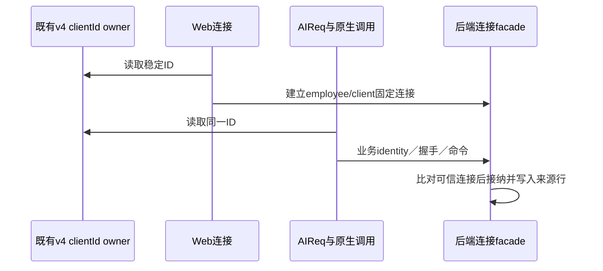

# AIReq 连接身份与订阅收敛

> 当前产品前端与公开接口以 [发布边界](release-surface.md) 为准：原型／调试控制和场景身份参数已退出产品契约；下文相关模拟入口与浏览器故障注入记录仅属于历史版本，不构成恢复入口或接口的要求。

## 身份与所有权

- Web entry 是当前连接的唯一 owner。首次连接前读取 `getV4ClientId()` 的持久稳定值并固定；每次 `/ws` 只传合法 `employeeId` 与同一 `clientId`，不携带额外场景参数。设备级 stream ID 保留原用途，不再作为原生命令身份。
- AIReqApplication 在同一登录生命周期固定业务 identity：工号来自 entry，clientId 来自同一 v4 owner；原生握手、命令与业务 employee/client 必须完全一致。队列、执行和公开 `origin:"realUser"` 行保持可信接纳时 clientId，客户端不能事后覆盖来源。私有 Skill 不能退化为仅按工号授权。
- 不设 owner／负责人权限：所有合法工号可修改共享配置及执行满足门禁的动作，联系人／负责人仅分工和留痕；合法身份、clientId、参数、对象与原生会话归属、版本、幂等及阶段校验仍保留。opaque backend.id／workspaceIdentity 的有效隔离用途不变，不公开来源或 sample/live 分支。Skill 主导航、设置及搜索入口继续隐藏，保留私有会话、草稿与唯一未保存门禁，允许隔离临时浏览器装配验证，不改变 employee/client、连接和订阅 owner。
- accessor 换代仅更换 attachment 和订阅；不得以连接代次作为 React key。退避、旧 attempt 失效和明确退出行为保持不变，正文、附件、当前选择及草稿 owner 不重挂。连接成功状态只需布尔值，不维护无用途的累计代次。
- 局域网 HTTP（非 loopback）是受支持的访问方式；Firefox 中 `isSecureContext=false` 时
  `crypto.randomUUID` 和 `crypto.subtle` 不可用。浏览器会话、草稿、操作、遥测和预览的 UUID
  统一复用 shared 的 `createUuid`，以 `getRandomValues` 生成同形 UUID v4；不改写全局 crypto，
  不把 ID 当凭据，不改变命令 UUID v7 或幂等键的分配与重试时点。
- 附件仍按完整字节计算并提交 `sha256:<hex>`，不省略摘要或降低提交校验。
  安全上下文继续使用 WebCrypto；局域网 HTTP 使用浏览器可用的标准 SHA-256 实现计算同一摘要，
  不改分块、abort、重试或提交所有权。验收：Sketch 生成 PNG 后上传成功，预览与标注可用，
  无 `fault.attachment.checksumUnavailable`，未明确发送前不产生新消息。

组 1 历史实测（2026-11-15，当时 Skill 位于设置）：两个合法非 owner 工号均可保存共享设置，日志和回执使用实际 employee/client；Skill 设置往返后未发送正文和一个 ready 图片保留，跨 client 读取同一私有 Skill 会话被拒。当时为 Chromium／localhost 环境，详见 tools-settings.md 的组 1 记录；不证明当前隐藏实现或本轮整改通过，也不授权恢复设置／主导航入口。

## 时间与失效边界

1. 创建 remote data source 时先安装 `onDidChange`，然后才读取 bootstrap。
2. 初始化期间每个变更推进本地失效代次；读取捕获其起始代次，期间发生变更则丢弃该次 bootstrap 并补读，直到一次读取完整覆盖已观察的失效。现有 bootstrap 不暴露全局 epoch/revision 水位，不能把事件可选 revision 伪装成快照水位或持久重放能力。
3. 初始化失败立即释放订阅，不返回半初始化 source。事件错误保留为可见错误；后续读取可以修复，不重放写请求。
4. 后续 metadata 读取共用单一 flight；读取期间收到 metadata 失效则补读收敛。dispose 使迟到结果失效。配置读取不修改本地 selection；dirty prompt 不被异步配置刷新覆盖，保存完成也不能清掉保存期间的新编辑。
5. 事件只负责失效；新 attachment 重新读取当前选择和服务端状态。重连不执行 create/send/save/confirm 等写请求，不另建全量业务缓存或通用重试框架。

## 回归证据要求

- 比较同页业务 identity 与 native `/ws` query 的合法工号和规范 clientId；额外 `demo`／场景字段拒绝，私有 Skill 仅精确 employee/client scope 可读写。通过真实两个客户端验证排队、流式用户行与历史分页来源一致，跨连接伪造拒绝。
- 在首个 bootstrap pending 及 resolve 周期触发变更，必须补读，不得遗漏；初始化 reject 后订阅已释放。
- 并发配置失效和本地 prompt 编辑不丢新输入；切换项目与重连不恢复旧 selection，不卸载正文和附件。验证由集成 owner 统一执行。
- 当前受影响电脑浏览器路径按[发布边界](release-surface.md)与根 `.todo.md` 逐项验证，不沿用历史八工作页／五设置或当前已被取代的六并列导航。保留原 UUID／附件摘要规则，必要时覆盖缺失原生 `randomUUID` 的浏览器环境；不因此重跑无关全页矩阵。
  记录实际浏览器、页面清单、失败请求和控制台观察，开发环境与正式产物证据分开；隐藏 Skill 用隔离临时装配，不恢复产品入口。

第 2 组之前主集成的历史观察（旧首发创建已被先建提案、手动进入讨论取代）：已核对bootstrap、actor与client/demo精确scope样例，并实测首发使用同owner/workspace的原生预热session：完整PNG及两次独立原生首发均自动打开canonical accepted会话。visitor会话读取失败后点击“重新连接”，通过重连前作用域化回调恢复同一会话编辑器，console零错误；刷新/关闭后服务任务状态延续及mock重启恢复初始样例也有观察。模型设置往返时工作页保持隐藏且inert，返回完整canonical未发送正文、PNG及临时GPT/medium均保留且不自动发送；Skill的完整PNG、四字段、手工追加与预览Tabs/折叠往返亦已实测。上述只保留当时具体场景证据，不等于每个bootstrap竞态、迟到响应或真实WS关闭场景均独立通过，不赋予owner业务权限。

临时模型/模式属于每次Submission，不是Session持久默认；发送后工具栏恢复Session默认不构成执行丢失证据，不引入promotion快照或永久override。mock沿userInput/queue/runTurn传递受支持Submission字段，并在await前捕获回复模型；该实现的运行核验及最终真实WS重连、工程门禁结果统一引用根 `todo.md` 主集成最终记录，不在本文维护中间待验清单。

## 入口高度边界

登录成功后的 entry 容器必须继续作为纵向 flex 容器传递确定的视口高度，工作页只在内部表格／正文区域滚动。真实 1440×1000 浏览器曾观察到中间 block 容器使工作页膨胀至 1360px、侧栏项目和退出入口落到视口外；验收要求工作页高度不超过 1000px，页脚始终可达，不以隐藏正文或禁用滚动掩盖问题。

第 2 组之前主集成的历史观察：在 Chrome（精确终验版本见根 `todo.md`）的 1440×1000 与 1122×763 视口完成当时全部8工作页及5设置页渲染与截图；entry flex 和分支状态修正后，1440×1000 的 viewport／document／main 高度均为 1000px，页脚可达，正常页面console零warning/error。深色与visitor独立浅色已测，不以Chrome代称Firefox；当时最终系统主题与全页证据、精确命令和结果只以根 `todo.md` 主集成最终记录为准，不作为当前六导航或已裁撤页面的验收声明。文档同步不将这些历史浏览器或工程检查记录冒充本次结果，必要检查仍遵守当前请求与仓库规则。

## 2026-11-15 Firefox 局域网复验（历史版本）

以下是当时八工作页／五设置分区、旧首发流程及 Issue／自动化仍在的历史记录，不是当前页面清单或恢复已裁撤能力的要求，也不证明当前六导航在当时已验收。当前规则以根 `.todo.md` 为准，本次同步不新增浏览器通过记录。

- 环境：Windows、真实 Firefox 128.14 ESR、`http://192.168.31.171:5173`，正式构建由
  Bun 模拟后端单进程托管；未使用 localhost／127.0.0.1 或安全上下文特权。
- 实际逐页覆盖登录、8 个工作区、5 个设置分区，以及提案各阶段、四路评审、依赖图与工期、
  IR／SR 报告和材料、分析设置和报告、Issue 详情与完成弹窗、自动化编辑／历史／只读会话、
  Skill 两个生成文件预览、项目／Release 表单、帮助、搜索、Sketch 和图片标注，共 70 个页面／子页场景。
- 修复前已复现提案预热 `crypto.randomUUID is not a function`，以及 PNG 附件
  `fault.attachment.checksumUnavailable`；修复后在 `isSecureContext=false`、
  `randomUUID`／`subtle` 均为 undefined 的原生环境中，PNG 上传状态为 ready、失败附件为 0，
  实际拖动画出 1 个矩形标注；未通过改写浏览器 API 或绕过校验通过验收。
- 正式构建累计控制台 warning/error 为 0、未处理 JS 异常为 0、HTTP 4xx／5xx 为 0。
  另记录 4 次页面切换／刷新取消请求（Firefox `NS_BINDING_ABORTED`），不计为服务失败。
  当时开发模式另观察到刷新／热更新期间 Vite 客户端的 `send was called before connect`，
  现已按[开发客户端生命周期](../../architecture/web-build-workflow.md#firefox-开发客户端生命周期)
  修复并单独完成真实 Firefox 开发模式刷新／热更新复验，不以正式构建结果替代。
- 证据仅覆盖上述页面访问与明确执行的交互，不代表全部业务状态组合、真实模型或真实 Git 操作已验收。
