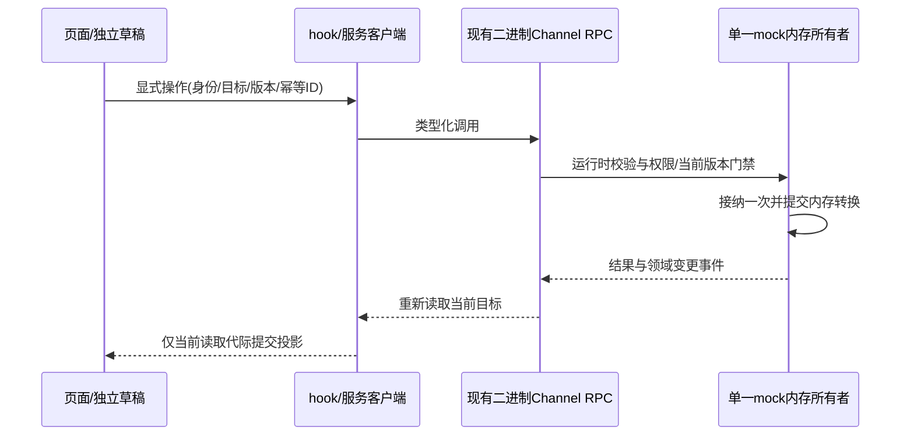

# AIReq 迁移公共实施契约

> 当前产品前端与公开接口以 [发布边界](release-surface.md) 为准：原型／调试控制和场景身份参数已退出产品契约；下文相关模拟入口与浏览器故障注入记录仅属于历史版本，不构成恢复入口或接口的要求。

> 2026-11-16 当前页面组织以 [项目空间规格](project-space.md) 为准：全局项目／待办，项目内概览／需求／分析运行，需求含提案／正式视图，同一 IR 工作区；设置为外观／项目配置／AI 配置，保留 68px 图标栏。下文退役记录中的五导航、六导航和四设置仅描述对应版本，不恢复旧入口。既有 RPC 与业务写入接口不变；只读待办投影增加从所属 IR 派生的 `requirementTitle`／`releaseId`，用于跨项目名称展示与正确范围直达，不增加状态 owner 或本地业务缓存。

## 需求管理资源收敛与插件退役（2026-11-16）

本次用户明确授权大幅裁剪 Shiki，并删除插件功能；该范围取代下方历史记录中“保留插件工具”的旧边界，不恢复其他已退役能力。

- Shiki 的统一语言／主题范围及验收见 [代码预览规格](../../code-viewer-diffs.md#需求管理产品的高亮资源范围2026-11-16)。不删除共享代码／差异展示控件，不改变需求业务状态所有者和会话顺序。
- 删除插件商店、安装／启停／配置／推荐、插件创建及预览、插件面板／iframe 桥／sampling／App tools、插件提及与插件安装交互。对应专属页面、hooks、store、资源、服务 descriptor、accessor、客户端代理、mock 注册与实现同步删除，不保留隐藏入口、空服务或假成功。
- 保留五个需求导航、四个设置分区、原生业务会话、附件、模型选择和暂时隐藏的 Skill 设计。Lexical／Remark 等编辑器库中的“Plugin”是内部机制，不是产品插件功能，不按名称误删。仍被现行会话协议或共享纯展示消费的 DTO/schema 不代表保留插件运行能力。
- 删除模块同步清理架构、Knip、公开导出、依赖与说明；历史协议／验收记录不冒充当前功能。实际使用的通用控件和非插件业务能力不连带删除。
- 验收：当前导航、设置、提案讨论／发送和材料预览正常，界面没有插件入口、推荐、安装或面板能力；无缺失频道／方法／模块错误；生产构建中插件专属资源不再出现。执行类型、Lint（相关 Hooks）、架构及真实电脑浏览器验证，记录构建体积。

本轮已删除插件 UI／扩展插槽／插件预览模块、商店与推荐／安装卡片／提及链、管理 store、五项直接依赖和八张插件 PNG；插件管理／桥／sampling／App tools 的服务、客户端代理及 mock 注册同批退出。原生 V4 仍消费的纯历史载荷 schema 保留，但不广告插件能力或提供安装执行。公开导出、模块登记、Knip、锁文件、三方声明和产品说明已同步。

实际验证：最终类型、Lint（零诊断）、架构（零违规）与生产构建通过。产物只有三种文档语法、两种高亮主题，未包含已删除插件模块；真实生产页面可见四个设置入口，完成浅／深高亮预览、提案讨论发送及中文材料展示，无浏览器错误，临时提案已删除。Shiki／插件合计的同口径 JS 缩减见 [代码预览验证记录](../../code-viewer-diffs.md#本轮实际验证)；隐藏 Skill 未测试，未提交或推送。

## 无当前入口的旧功能页清理（2026-11-16）

本轮只删除已经确认无当前挂载入口的五类页面及其独占实现，不把上一轮接口清理扩大为全仓库未使用资产删除。

| 删除功能                 | 已确认入口／编排                                                           | 保留边界                                                                               |
| ------------------------ | -------------------------------------------------------------------------- | -------------------------------------------------------------------------------------- |
| 桌面资源管理器           | `resource-manager/ResourceManagerApp.tsx`，仅剩 barrel 导出与模块登记      | 保留其他模块仍消费的共享类型、格式化函数及通用基础控件                                 |
| 旧数据库迁移／失败恢复页 | `root/GlobalDatabaseStartupLoading.tsx`，无调用者                          | 保留 `RootStartupLoading` 中仍被 logo／通用加载界面使用的内容，不改变当前 Web 工号入口 |
| 旧 Git 工作台            | `GitPane.tsx`，仅由无当前挂载入口的旧侧栏编排调用                          | 保留原生会话仍用的分支选择器、文件变更／差异展示、文件预览与通用菜单                   |
| 旧开发者工具页           | `DeveloperToolsPane.tsx`，同属旧侧栏编排                                   | 仅删除此页独占的诊断 hook／RPC／模拟方法；其他遥测及会话能力不随之裁撤                 |
| 旧全局命令／任务搜索面板 | `quickpick/QuickPickCommandDialog.tsx`、`TaskFindDialog.tsx`，无运行时挂载 | 保留被当前会话／设置搜索复用的搜索算法、快捷键和基础弹层                               |

旧侧栏只移除已裁撤功能专属接线，不删除通用布局、Tabs、Resizable、图标、表单与弹层资产。隐藏 Skill 设计、当前五导航／四设置及原生会话、附件、模型选择保持不变；状态所有者、订阅水位、幂等与事件顺序均不改变。删除时同步公开导出、模块清单、架构策略与依赖诊断登记，不保留 shim、空实现或失效入口。

本轮开始时已有 `conversation.md`、`AIReqSessionPane.tsx` 和 `SessionPane.tsx` 的未提交修改；它们属于用户，必须保留。本轮不自行提交、推送或继续清理未列入表格的相邻功能。

验收场景：当前五导航和四设置仍能读取；需求讨论可打开并发送，模型选择和图片附件仍可使用；原生会话的 Git 分支选择接线与共享差异控件不被删除。执行类型、Lint（含相关 Hooks）、架构及受影响工程验证；用实际电脑浏览器验证当前界面，不测试或恢复手机、旧桌面窗口与隐藏 Skill 入口。

### 本轮删除与实测记录

- 删除 35 个文件：五类旧页面及其独占 storage/network UI、Git 页面 helper、诊断／可见性／Git hook、旧搜索目录与导航算法；同步移除 `readSessionDebug` 服务／模拟方法、公开导出、类型字段和 resource-manager 治理／诊断入口。
- `conversationFindSearch.ts` 经源码引用核实仅供退役任务搜索面板使用，因此随该面板删除；当前需求搜索仍消费的 `quickPickStyles.ts`、`HighlightedMatchText.tsx` 及通用弹层保留。原生 Git 分支选择、共享差异控件、其他侧栏布局与工作流文件定位回调均未删除。
- 最终 `bun run typecheck`、`bun run lint --format json`、`bun run architecture:check --changed` 通过，Lint 零诊断、架构零违规。`bun run test:architecture` 为 60 项通过、1 项跳过、0 失败；本轮未改工程测试注册，不新增或恢复业务测试体系。
- 实际电脑浏览器验证五导航、四设置与设置搜索跳转；项目设置读到 2 项目／4 Release，原生模型菜单可用。临时提案经 Sketch 画图、PNG 附件发送后收到明确标记的内存模拟回复，图片预览可见笔迹，刷新重开仍可读取；临时提案已通过正常入口删除，最终冷启动无浏览器错误。
- 未修改本轮开始时的三个用户文件，未测试隐藏 Skill，未连接真实 AI／Git／数据库，未提交或推送；本轮保留控件目录不在修改范围内。

## 当前可达接口收口（2026-11-16）

本次按当前 Web 入口 `packages/web/src/main.tsx` → `AIReqApplication` 的实际消费者收口服务接口与模拟实现，不以旧页面文件存在、barrel 导出、客户端代理自引用或历史规格作为保留依据。

- 可见产品范围为五个主导航：项目进度、待办列表、正式需求、需求提案、进度分析；设置保留项目／Release、模型、个性化、外观及其搜索和帮助。
- Skill 设计按根 `.todo.md` 的明确暂存规则保留原有实现、接口和数据，不因入口暂隐藏而删除或重新显示。
- 保留当前业务实际使用的原生会话、附件、模型目录、配置、身份隔离、事件／订阅、断线重连和通用基础控件；无独立页面不等于无消费者。
- 对没有当前产品消费者且不属于上述保留范围的服务，删除接口／descriptor、访问器字段、客户端代理、模拟注册与实现；对仍保留的服务，移除已证实仅供裁撤功能使用的方法。不得用空实现、可选字段、兼容代理或假成功代替删除。
- 旧功能专属页面与 hook 若仅为已删除服务保留编译依赖，随其调用链移除；通用布局、图标、表单、弹层、`components/ui` 和已有 mobile-ui 资产不得删除。
- HTTP 以实际启动、帮助、资源及部署消费者判定；保留 `/ws` 二进制 Channel RPC 和仍被使用的 HTTP 接口，不改为 REST，不改变当前业务状态所有者及 v4 顺序／幂等语义。
- 以当前工作树为唯一基准，保留本次之前的未提交修改；不与 upstream／base 比对，不提交或推送。

冻结删除表（共 25 个 accessor 字段；窗口项目目录组同时移除其两个专属频道）：

| 已退出当前产品的职责                | 删除的访问字段                                                                                                        |
| ----------------------------------- | --------------------------------------------------------------------------------------------------------------------- |
| 旧窗口项目与任务壳                  | `windowProjectDirectory`、`windowControllerService`                                                                   |
| 云内容与旧凭据入口                  | `cloudContentService`、`credentialService`                                                                            |
| 远程主机与迁移                      | `sourceServerWorkspaceService`、`sourceServerManagementService`                                                       |
| 桌面设备、扩展与录音转发            | `deviceSyncStateService`、`extensionsService`、`extensionViewsService`、`extensionGrantsService`、`voiceInputService` |
| 闲时任务、商业加速卡与旧反馈工单    | `offPeakTaskService`、`highspeedCardService`、`feedbackService`                                                       |
| 旧配置同步                          | `skillSyncService`、`pluginSyncService`、`userConfigSyncService`、`settingsSyncService`                               |
| 旧插件商店及命令／Hook／Memory 管理 | `pluginsService`、`commandsService`、`hooksService`、`memoryService`                                                  |
| 未启用的受管 worktree               | `managedWorktreeService`                                                                                              |
| 当前嵌入式会话不可达的旧新聊天推荐  | `onboardingRecordService`、`clientScenesService`                                                                      |

最后一项依据：提案讨论和隐藏 Skill 的 `AIReqSessionPane` 都传入 `embedded`，旧推荐容器仅在非 embedded 草稿挂载；不能因原生组件中存在条件分支，就要求当前后端继续实现这两个旧服务。

保留面为当前 AIReq 业务及隐藏 Skill、原生 v4／附件／生命周期／索引、模型读取与选择、共享设置与 broadcast，以及通用文件／预览／插件工具／子智能体／群组投递控件仍实际依赖的接口。保留服务也须删除已证实无消费者的旧管理方法；[模拟后端规范 §2](../../architecture/mock-backend.md#2-能力状态)集中记录实际剩余频道及逐方法减面，不能从一个保留字段推导整个历史管理面仍需实现。

验收：类型检查、Lint（含相关 Hooks）和架构检查通过；实际电脑浏览器验证五导航、四个设置分区、提案讨论的原生会话与附件调用，确认没有缺失 channel／方法错误。删除清单及实际验证结果另记录于本次收口记录，不把此前结果当作本次通过。

### 本次收口实测

- 最终 `bun run typecheck`、`bun run lint --format json`、`bun run architecture:check --changed` 均通过；Lint 为零诊断，架构为零违规。未修改根 Lint 忽略目录内的 React 控件，无需补扫被忽略文件。
- `bun run test:engineering`：11 个文件、119 项通过；`bun run test:architecture`：60 项通过、1 项跳过、0 失败。已删除仅测试退役 Host 开关的专属测试及登记，其他协议测试保留。
- 初次集成发现连接构造器残留旧参数、Memory 纯展示控件仍导入退役服务 DTO，以及两处多余 Hook 依赖；已修正，以上结果均来自修正后的最终输入。Memory 展示改用自身输入类型，没有恢复 RPC。
- 实际电脑浏览器验证五个主导航、项目／Release、模型、个性化和外观设置均能读取；原生模型菜单显示 GPT-5.2 与思考强度，未出现缺失 channel／方法错误。
- 新建临时提案，经 Sketch 绘制并回填 PNG，原生发送成功，收到明确标记的服务端内存模拟回复与业务材料；图片预览可见实际笔迹。刷新后重开同一提案，消息和材料仍可读取；随后通过正常删除入口移除该临时提案。
- 热更新期间曾观察到 Vite 把非空 Composer 源码缓存为空转换模块；重新触发该文件的失效通知后恢复，最终刷新及上述会话验证无浏览器错误。未以业务兜底或模拟成功隐藏该开发缓存问题。
- HTTP 实测：退役 `/api/server-info` 返回 404；保留 `/api/v1/client/configs` 返回 200，且现行配置 envelope 有效。移除 `croner` 后 services manifest 与锁文件同步。
- 未测试明确要求暂存隐藏的 Skill 设计，未连接真实模型／Git／数据库，未提交或推送；本次之前的工作树改动保持保留。

## 当前实施契约（以根 `.todo.md` 为准）

本节及 `proposals.md`、`tracking.md` 当前规格共同落实根 `.todo.md` 的完整当前规则，不限于第 2 组阶段导航；取代下方冲突历史合同。规格、阶段实施记录与实际验收证据分开，本次文档同步不新增实现或通过声明。

- 继续使用 `aireq-contract`、`aireq-mock`、`aireq-ui`，公开 seam 仍为 `IAIReqService.call` 的类型化 operation 白名单、既有 data source 与 UI `contract.ts`。不建平行 RPC、存储、会话或执行系统；所有合法工号均可配置、代办、指定和认领，身份用于留痕、联系人与个人会话隔离，不做角色授权、管理员特权或负责人独占。owner 只表示数据／配置来源与状态所有权，不是操作者权限。
- `MockAIReqService/workflow` 唯一持有项目、Release、IR/SR、原始短需求、版本材料、两类评审历史、三方确认、PR 候选、分工、报告、合并、问题、验收及分支事实。待办是这些事实的只读派生，不持久化独立完成状态。现有 v4 owner 保留消息、附件、订阅、水位；业务仅保存引用及版本绑定完成回调。
- 每个写操作携带合法工号／clientId、稳定操作 ID、目标及预期版本，经参数、对象及原生会话归属、阶段、版本、幂等及材料门禁后提交，再发 `onDidChange`。同操作同参数复用回执，同 ID 改参数拒绝；迟到读取按 UI 代际丢弃，迟到 AI 结果按对象和材料／代码版本拒绝。刷新重连只重读，不重放已接纳写操作。
- 业务 `command` 的幂等比较包含目标和业务参数，不包含首次接纳用的 `expectedRevision`／RPC `revision`。同一操作重读版本后先返回已有回执，不能重复创建；不同业务内容仍拒绝。新增／导入冲突时允许显式重新读取版本并保留输入及操作 ID，不自动重发；未知回执若已接纳，下次显式提交复用原结果。
- 文档 PR 轮询的检查时间／相同状态消息是观测元数据，只发失效通知，不推进业务 CAS revision；MR 实际状态或转正等业务事实改变才推进 revision。否则无关 PR 每五秒重读会让测试／清理弹窗永久过期。真实业务变化仍使旧表单失效。
- 项目包含 Release，Release 包含 IR；每个 IR 只属于一个项目及一个 Release，Release 不是 Git 分支。提案与正式需求是同一 IR 生命周期，转正不复制 ID、归属、讨论、材料或 SR；不新增 Release 生命周期、跨 Release 迁移或正式需求重开／重新拆分框架。
- 创建提案独立保存一两句话的原始短需求并立即可见，不施加任意硬性句数限制，不需要原生首发接纳、`pendingFirstMessage` 或 SR，不启动 AI；保存成功刷新并停留提案表，失败保留输入。仅主动进入讨论才开始澄清，原文不被生成文档覆盖。
- 提案表四个数据列为提交人、原始需求、提交日期、当前状态，另有详情／讨论操作；工具栏为新增提案、导入、导出。UTF-8 CSV 仅“原始需求”一列，提供模板与预览，空行跳过、重复提示不去重，正确处理中文、逗号、引号及单元格内换行；绑定明确项目和具体 Release，由服务记录实际操作者和时间。导入只创建提案并复用相同业务 owner 与原子校验，不另建 store；导出全部筛选提案而非当前页，仅导出原始短需求。
- IR 共享材料为 `docs/requirements/<ir-id>/{requirements.md,sr-dependencies.json,acceptance.md}`；每个 SR 是独立 `openspec/changes/<sr-id>/`，包含 `proposal.md`、`design.md`、`tasks.md`、`specs/`、`test-plan.md`，路径绑定稳定 ID，不保留 IR/change、SR/capability 的旧映射。依赖 JSON 是跨 SR 关系唯一来源，IR 保留整体验收；每 SR 测试方案追溯业务验收标准。这些路径仅是模拟业务仓库引用，不写入本源码工作树或新建第二套材料存储。
- 一个 IR 一个分阶段讨论详情入口，可按 SR 查看独立材料；历史阶段和版本只读，不新增 SR 开发工作台、手工文档编辑器或执行开发任务入口。原始需求澄清不提前固定拆两个 SR；单个业务需求评审 Agent 检查目标、范围、歧义、可验收性，无阻断项并人工通过后才拆 SR。
- 开发牵头在同一方案阶段逐步完善全部 SR 规格、设计、开发任务和测试方案，不要求无规格时机械并行产出。完整同版材料三路分别审查需求覆盖／一致性、技术方案／依赖、任务可执行性／测试充分性；等待三路完成才由第四 Agent 终审，无失败或阻断且版本匹配后再人工放行。继而组织业务／开发／测试各视角确认，全部同版确认后才能提交 PR。`originalReview` 与完整 `review` 分离，`alignment` 逐视角保存材料版本、工号、时间；同人可兼任但动作分开，不设后置测试生成阶段或专用测试方案生成 Agent。
- 完整送审包包含 IR 业务需求、SR 拆分与依赖、全部 SR 规格／设计／任务／测试方案及整体验收。任一材料变化使完整三路、终审、人工决定和三方确认一起失效，包括仅改测试方案；保留历史与失效原因，不删除原始短需求。仅业务原始需求文档变化额外要求重新完成前置单评审及人工通过，再检查完善下游材料；其他材料变化不重跑单评审。材料修改经正常 mutation（`reviseProposalMaterial`），不直接写批准；模拟评审 normal、blocked、failed、hold 和显式 release 仍须正常入口及版本检查，迟到结果不能恢复旧批准。
- 每 IR 一个包含共享材料及全部 SR change／测试方案的整包文档 PR，不分批转正；提交冻结版本，修改前先关闭未合并 PR，再回相应阶段修改、重审和确认。待合并／关闭不转正，不能凭 URL 或点击推断合入；完整、同候选、同版的模拟主分支合入证据经业务 owner 核验才转正，保留 IR/SR 身份。逐 SR 分支基点为文档合入提交，保存成功／失败，不伪造可用分支，重复核验幂等。转正后新增业务范围另建关联 IR，仅用于追溯；人员、分析报告、开发问题和验收记录仍可更新。
- 未合入且未验收时 AI 基于该 SR OpenSpec tasks、代码与合并证据估计 0–99，可随证据下降，不执行任务或把勾选数当真实进度；代码核实合入后有效进度固定 99，不依赖 AI 原始评分。仅有效 99、核实合入、非空人工测试依据且无未处理失败问题才能 100，记录实际工号、时间、验收依据和代码版本，代办仍执行明确测试动作。失败仍 99、记录问题并派生开发待办，不能只再点通过绕过；修复新版本合入后进入待复测并派生测试待办，再人工确认。报告统一写回并保留 AI 原值，失败保留上次成功并标失败／过期，不回落 0；AI 不设 100，过期结果不覆盖合入／验收事实。
- 手动与定时分析沿用既有配置、过滤、分页和去重，输入未变可跳过；分析指纹包含同一 SR 的代码／默认分支、材料及合并事实版本，结果只能更新匹配对象与版本。最新成功报告同步到正式需求、项目进度及进度分析。定时分析由唯一服务端调度 owner 按真实服务时钟及 `intervalMinutes` 到期接纳，即使没有运行项也检查待调度项；后台五秒 tick 只是检查频率，不得每次暗中推进模拟一小时。既有 `progressScheduler.advance` 只供用户显式“模拟推进下一次调度检查”，明确全局模拟时间效果，仍走相同指纹、去重、范围和版本接纳，不增加新 RPC。模拟触发记录 `schedule` 不等于真实等待配置间隔的验收证据，二者分别记录。
- IR 等权平均全部所属 SR；项目／Release 直接等权平均范围内全部正式 SR，不先按 IR 平均。提案不入分母，未分析正式 SR 按 0 并标注，已验收按 100；无正式 SR 显示“暂无正式需求”，非全部完成不四舍五入 100，新增正式需求可降低聚合进度。项目页展示各项目提案数、正式 IR 数与进度，可进入项目查看正式 IR 并按 Release 统计；聚合是同源纯派生，不保存第二份可修改进度。
- 整个 IR 全部 SR 100 后才能预览本 IR 登记开发分支并再次确认清理；逐项记录成功／失败，重试仅处理未成功项，已删不再制造副作用。永不删除主分支、材料、报告或验收历史，不改进度、不建通用分支管理器。
- 联系人与负责人是业务事实，可指定／领取，IR 业务默认提交人，IR 另记开发／测试联系人，SR 开发／测试继承对应联系人后可调整；同人兼任、未分配待认领，代办留实际工号但不暗改分工。待办是服务端派生，跨项目汇总，默认我的待办并可切待认领／全部及按项目定位，点击直达 IR/SR 和阶段，不复用 tasks 或分析任务、不允许手工新建／勾选完成。覆盖业务补充与原始评审决定（IR 业务联系人）、方案与完整审查决定及提交 PR（IR 开发联系人）、三个对齐动作（对应 IR 联系人）、正式开发及修复（SR 开发负责人）、测试／复测（SR 测试负责人）与失败处理（阶段联系人）；完成实际业务动作后自动变化，不为正常 AI 运行／等合并／等调度制造空待办。
- UI 登录默认项目进度，当前主导航依次为“项目进度、待办列表、正式需求、需求提案、进度分析、Skill 设计”。正式需求、需求提案、进度分析共用当前项目／Release，支持全部 Release 读取、具体 Release 创建；待办跨项目。无项目／Release 提供既有设置入口，不自动创建或取别的项目。所有切换消费既有唯一未保存门禁与导航历史，保留身份隔离和读取代际。
- 正式需求以 IR 为主行，显示原始短需求、Release、整体状态与进度；展开 SR 显示开发／测试负责人、进度、登记开发分支、最新审查摘要及操作。IR 汇总及 SR 独立报告／材料复用同页面板，不新建开发工作台。
- Issue 和 AIReq 自动化专属入口与能力已裁撤，旧侧栏提案列表及独立新建提案导航不恢复。Skill 设计在主页面，不在设置导航或搜索，旧 `skill` 设置偏好回项目设置；保留模型、Agent、项目、外观设置，Skill 原生会话、预览、模拟保存、设置往返草稿和唯一离开门禁。通用基础控件、原生会话与仍有用途的底层设施保留。
- 平台仅生成需求／开发文档、提交文档 PR、建立／清理 SR 分支和分析代码／进度，不改业务代码、不执行开发任务、不代合代码 PR、不运行产品中的实际构建／测试。真实 AI、Git、数据库、认证与外部执行不在模拟范围；所有模拟明确标记。仓库实施所需工程验证不受产品边界限制。

实施与验收：每组先同步规格与验收场景，再贯通本组契约、服务、全部消费者及可操作模拟，最后完成本组必要检查、浏览器验收和文档记录后才进入下一组，不把首次验证留到末尾。代码组保留 typecheck、lint、architecture 检查及相关 Hooks 复核；仅补具体验收缺口所需验证，不新建业务单测／E2E／协议 harness，纯业务不默认 build、knip 或全量工程测试。受影响既有工程门禁仍按仓库规则验证，不绝对禁止必要验证。实际对象、版本、观察及命令结果记录在相应规格及 integration；历史记录、模拟结果或文档同步不等于当前通过。文档同步的必要检查遵守当前请求与仓库规则，不将历史检查、格式化或浏览器／真实 AI／Git 记录冒充本次结果。

### 第 2 组阶段实施边界（历史记录，非最终导航）

第 2 组当时只挂载“待办列表、正式需求、需求提案、进度分析”四个真实导航，未交付第 3 组项目进度页面；这不是当前四导航合同，也不要求恢复 Skill 设置入口。第 3 组当时五导航／设置 Skill 的观察保留在 tracking 与 integration；当前六导航与主页面 Skill 按上方合同及根 `.todo.md` 维护，不将本次同步改写成历史已通过。

## 历史迁移合同（第 2 组之前）

以下接口调查、旧首发提升、旧四阶段／四路前置评审、IR/change、角色门禁、自动化及旧默认页和检查清单仅保留历史证据；冲突要求已由上方当前合同替换，不要求本组额外 build／格式化／全量测试。

## 历史：公共模块与所有权

| 模块           | 实现位置                    | 唯一职责与公开面                                                                                                  |
| -------------- | --------------------------- | ----------------------------------------------------------------------------------------------------------------- |
| aireq-contract | packages/services/src/aireq | 浏览器安全领域类型、纯派生、类型化业务方法与 descriptor；公开 `@zcode/services/aireq`                             |
| aireq-mock     | packages/server/src/aireq   | 共享内存项目、Release、IR/SR、Issue、材料、模型配置、Skill、任务与报告；不引入另一服务进程                        |
| aireq-ui       | packages/ui/src/aireq       | 独立 AIReqApplication、导航与读取投影；草稿／附件仍归原生 composer；canonical `contract.ts` 与应用入口 `index.ts` |

业务组件沿用源端开放功能，导入当前目标的 Button/Input/Dialog/Select/Tabs/Resizable/Markdown/代码等组件。不得复制源通用控件、旧 CSS、Root/App 或 v4 组件。源端 types/domain/progress/planning/sr-dependencies/issues/progress-scheduler 等中立契约迁到 services，不建立旧路径兼容 re-export。

`aireq-ui/contract.ts` 是本模块唯一 canonical contract/port，登记为 contract 层；页面、hook 与 shell 均以相对路径访问它，不直接依赖 services 包。该 port 仅具名公开当前 UI 所需的 `@zcode/services/aireq` 公共类型、纯派生函数和 `IServiceAccessor`，复用服务契约而不维护第二份业务类型。应用 props 与主视图仍由此 contract 定义；`index.ts` 保持 UI 层应用入口，仅公开应用及 props，不反向进入 contract。其他页面与 shell 保持 UI 层，连接生命周期及领域状态所有权不变。

三个模块已登记为 managed，owner 均为 requirements：aireq-contract 为 app 层，aireq-mock 为 adapters 层；aireq-ui 的 `contract.ts` 为 contract 层，其余为 ui 层。当前并非仍待登记的模块设计。

## 历史：服务接入

已接入 `IAIReqService` descriptor、`IServiceAccessor.aiReqService`、ServiceChannels、client RemoteServiceAccess 及 server 集中装配，通过原同源 `/ws` 二进制 Channel RPC 提供：

- `bootstrap(identity)`：返回目标业务元数据、模拟归属、能力／serviceManifest、初始选择、已存配置与版本；不复制源 HTTP bootstrap 或返回用户未发送草稿。
- `call
(identity, path: P, args: AIReqRemoteArgs
, selection?)`：返回 `AIReqRemoteResult
`。当前 `remote-operations.ts` 的 `AIReqRemoteOperations` 为实际 tuple/result 白名单；源 backend/contract.ts 仅为调查参考。`models.save`、`prompts.save` 带 expectedRevision；`prompts.updateDraft` 仅 UI 本地适配，不是 RPC path；`nativeTasks.listRuns/readOutput` 是只读类型化业务调用。
- `onDidChange`：workflow/models/prompts/skills/scheduler/issues/error；客户端失效重读。epoch/revision/scope 字段在类型中可选，不能视为完整持久事件日志或 v4 水位。

历史身份与权限记录（已取代）：`identity` 至少包含 `employeeId`、`clientId`，可携带具名内存样例 `demo`；工号为小写字母加八位数字、保留前导零，不是认证。样例 owner 为 `j00808874`；当时“设置仅 owner 写、排期与完成按角色门禁”的限制已取消，当前所有合法工号可配置与代办，owner 仅标来源。

原生会话仍走现有 v4 `IZCodeAgentService` 与 SessionPane/ConversationComposer。连接 URL 可携带固定工号，server 逐连接 facade 将原生方法绑定该操作者；保留现有 createZCodeAgentConnectionScope 对握手/订阅/关闭的隔离。可使用服务端 AsyncLocalStorage 实现请求上下文，不建立进程级可变当前工号。普通领域方法不伪造 v4 帧。原生发射帧必须用当前 shared schemas 校验并维护真实 subscriptionId/seq/logEpoch。

`createMockServices` 只构建一次 `MockAIReqService`，将其 `remote` 注册为 IAIReqService，并将同一业务对象传给使用现有 `MockRuntime` 的 MockZCodeAgentService。业务项目／任务／材料归 AIReq 内存域；消息、附件、订阅与帧日志归原生 v4 owner，不另建数据库、第二 native runtime 或第二连接。

## 历史：状态、顺序与失败

共享业务不按工号复制；未发送草稿、浏览选择、连接订阅、外观按各自客户端/工号作用域。项目是名称+远程仓库+默认分支，不是旧 VirtualProject；模拟托管路径只用于协议和材料归属，不要求用户提供本机目录。Release 继承项目仓库；需求按项目/有效 Release，Issue 仅按项目，即使没有 Release 仍可用。

历史首发提升流程（已被先保存提案规则取代，不再实施）：首次发送前不创建可见提案。`conversationExtension.prepareFirstSend(text, options, preparedSessionId)` 复用原生预热session，经 `createProposal.preparedSessionId` 登记provisional，服务返回同一ID；不分配第二消息/附件目标。原Composer冻结正文/完整附件/临时模型后发送，accepted/duplicate ACK后先完成附件adopt和草稿结算，再提升binding并由 `onFirstSendAccepted` 发布选择；过程中不切组件或draft scope。稳定clientDraftId及pending command registry支持显式重试，失败保留输入，未知回执不自动重发。完整链、拒绝保留完整PNG、双击重试仅接纳一提案及两次独立首发自动打开canonical会话已有当时证据（proposals 历史 §10），不据此推定所有未知ACK情形或当前创建规则通过。原生 Session 默认、Submission 临时选项及附件结算等未冲突语义继续遵循 `conversation.md` 当前合同，不将提案可见性重新绑定聊天首发。

历史门禁记录（旧完成条件已取代）：材料未生成、读取失败、无效、过期和连接错误分别呈现；失败不假成功、不回落其他对象样例。当时评审版本规则、MR 五秒检查和“AI 原分 99＋分支＋合入＋权限＋依据”完成门禁只描述旧实现；当前整包失效、同候选核验、合入固定有效 99／人工测试 100 及无权限规则以上方合同为准，不能复用旧批准或角色门禁。

### 历史已裁撤：自动化共享定义与原生历史投影

自动化定义、运行及 task/workpool 样例输出由共享内存业务 owner 保存，稳定业务 ID 不包含操作者的私有原生身份。当前 `MockAIReqService.workflow` 是共享项目工作区权威：返回项目真实样例 root 与 `aireq-mock:<project>` identity；自动化必须严格匹配二者，不接纳缺失 identity 或 `aireq-remote:<client>` unavailable fallback。远端 source 通过项目级 `readWorkflow({projectId})` 读取该投影，不自行拼接 identity，也不创建 IR／会话。项目选项只使用权威返回的 path/identity 配对，不能混搭 development root 与不可用客户端 fallback。

自动化历史及嵌套 actor 使用同一共享项目工作区和稳定业务 session ID，所有合法工号可读取共享历史；它们不属于个人 Skill／未发送提案草稿的私有作用域。历史打开、task/workpool 快照与输出均复检项目、定义、运行和会话关系；错误项目或不匹配 session 拒绝，删除历史不回落其他样例。历史会话只读，不提升私有草稿权限。

创建、重启、立即运行及删除可携带原生可选 `operationId`。自动化 owner 在校验当前业务作用域后，以 actor/client、方法、已验证项目作用域和 operationId 保存进程内成功回执；反序列化重试返回原结果，同 ID 改输入拒绝。未携带 ID 的其他原生调用保持原可选语义，不承诺去重。不同显式点击使用不同 ID；失败仅允许用户显式重试，无通用自动重试或真实后台调度。立即运行只增加 stopped 模拟历史并明确未执行模型／工具／调度，不改变 IR/SR。

主集成已在重启后的服务实测完整CRUD、筛选、暂停/继续、脏编辑Cancel/Discard、Run与只读历史、跳到会话无编辑器、实际JSON/文本CodeViewer、task/workpool及actor只读、失败卡Restart清除失败标记。另以克隆请求实测创建/运行/重启/删除的稳定operationId不重复、同ID改参数拒绝、不同点击ID独立、错误scope拒绝及visitor读取共享结果；这些是模拟状态与投影证据，不表示执行真实引擎。

历史需求分析调度证据：AIReq 内存 owner 持有单一调度器，页面与报告弹窗不拥有业务 timer。重启后的单一服务当时实测 `analysis-scale` 300任务/1000历史、25/50条全部页、全匹配133项批量确认及取消、运行去重、完成项排除、单项失败不阻断其他项与明确重试。项目开关及间隔即时保存，visitor 当时读取同一配置／历史且只读；生产 SDK 的45秒背景刷新保留打开报告和 Escape 焦点。这是旧样例证据，“visitor 只读”不再是权限要求，不能把当前页或缓存当全匹配集。

## 历史：集成与验收

登录阶段不挂载业务 StoreProvider；ThemeHeroVisual 可接收显式 theme，无假 store，未提供时沿用既有 store 主题且 Hook 顺序固定。主壳已使用 AIReqApplication，旧产品专属 App/Root 入口已移除，全部通用控件／布局／v4 资产保留。

已取代的迁移验收安排：当时默认需求分析、一次性全量检查与全页验收、正式及 Issue 角色完成门禁均属旧计划，不再作为实施指令。当前默认项目进度、六导航、无权限及逐组规格先行／实现／必要检查／浏览器验收／记录以上方合同和根 `.todo.md` 为准；不留到最后统一补首次验证，也不默认 format、build 或全量测试。历史浏览器报错必须如实保留，不能靠屏蔽日志或假接口隐藏。

历史主集成证据按领域集中：`proposals.md` 历史 §10 记录完整 PNG 首发／失败重试、旧四路评审／退回补充、方案 JSON／图、版本确认、MR 五秒门禁和一次转正；`tracking.md` 历史 §7 记录正式筛选／布局／排期／旧完成门禁及已裁撤 Issue 证据；`tools-settings.md` 历史记录 Skill、配置角色和访客写入拒绝等旧场景。`integration.md` 历史 §6.1 汇总当时 8 工作页／5 设置页、电脑布局、独立身份／外观、规模／自动化及读取失败重连恢复。上述均是旧版本观察，不恢复已裁撤能力或角色，不等于当前规则通过；原生草稿／附件／Submission 保留等未冲突行为继续适用。旧 `todo.md` 仅保留历史最终命令与证据，当前需求权威为根 `.todo.md`；文档同步不将这些历史检查、浏览器或真实 AI／Git 记录冒充本次结果，不新增测试体系或真实外部 IO。
