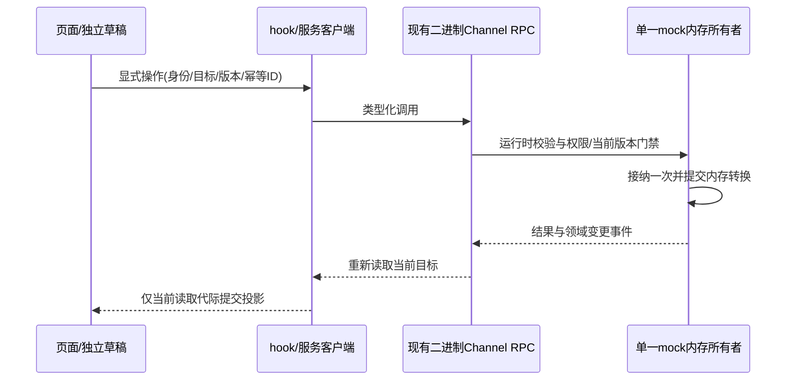

# AIReq 迁移公共实施契约

本规格落实根 `todo.md` 已授权范围；业务逐项覆盖与源端冲突裁决分别见同目录 integration、proposals、tracking、tools-settings 规格。实现必须保留所有当前可达业务，不恢复源端残留的编码／交付／自由聊天入口。

状态：实现已集成，验证进行中。本文同步公开接口、唯一所有权及主集成实际证据，不代表全部反例或浏览器门禁通过；最终权威完整结果由主集成追加至根 `todo.md`。源仓库仅作只读调查依据，不是运行依赖。

## 公共模块与所有权

| 模块           | 实现位置                    | 唯一职责与公开面                                                                                                  |
| -------------- | --------------------------- | ----------------------------------------------------------------------------------------------------------------- |
| aireq-contract | packages/services/src/aireq | 浏览器安全领域类型、纯派生、类型化业务方法与 descriptor；公开 `@zcode/services/aireq`                             |
| aireq-mock     | packages/server/src/aireq   | 共享内存项目、Release、IR/SR、Issue、材料、模型配置、Skill、任务与报告；不引入另一服务进程                        |
| aireq-ui       | packages/ui/src/aireq       | 独立 AIReqApplication、导航与读取投影；草稿／附件仍归原生 composer；canonical `contract.ts` 与应用入口 `index.ts` |

业务组件沿用源端开放功能，导入当前目标的 Button/Input/Dialog/Select/Tabs/Resizable/Markdown/代码等组件。不得复制源通用控件、旧 CSS、Root/App 或 v4 组件。源端 types/domain/progress/planning/sr-dependencies/issues/progress-scheduler 等中立契约迁到 services，不建立旧路径兼容 re-export。

`aireq-ui/contract.ts` 是本模块唯一 canonical contract/port，登记为 contract 层；页面、hook 与 shell 均以相对路径访问它，不直接依赖 services 包。该 port 仅具名公开当前 UI 所需的 `@zcode/services/aireq` 公共类型、纯派生函数和 `IServiceAccessor`，复用服务契约而不维护第二份业务类型。应用 props 与主视图仍由此 contract 定义；`index.ts` 保持 UI 层应用入口，仅公开应用及 props，不反向进入 contract。其他页面与 shell 保持 UI 层，连接生命周期及领域状态所有权不变。

三个模块已登记为 managed，owner 均为 requirements：aireq-contract 为 app 层，aireq-mock 为 adapters 层；aireq-ui 的 `contract.ts` 为 contract 层，其余为 ui 层。当前并非仍待登记的模块设计。

## 服务接入

已接入 `IAIReqService` descriptor、`IServiceAccessor.aiReqService`、ServiceChannels、client RemoteServiceAccess 及 server 集中装配，通过原同源 `/ws` 二进制 Channel RPC 提供：

- `bootstrap(identity)`：返回目标业务元数据、模拟归属、能力／serviceManifest、初始选择、已存配置与版本；不复制源 HTTP bootstrap 或返回用户未发送草稿。
- `call
(identity, path: P, args: AIReqRemoteArgs
, selection?)`：返回 `AIReqRemoteResult
`。当前 `remote-operations.ts` 的 `AIReqRemoteOperations` 为实际 tuple/result 白名单；源 backend/contract.ts 仅为调查参考。`models.save`、`prompts.save` 带 expectedRevision；`prompts.updateDraft` 仅 UI 本地适配，不是 RPC path；`nativeTasks.listRuns/readOutput` 是只读类型化业务调用。
- `onDidChange`：workflow/models/prompts/skills/scheduler/issues/error；客户端失效重读。epoch/revision/scope 字段在类型中可选，不能视为完整持久事件日志或 v4 水位。

`identity` 至少包含 `employeeId`、`clientId`，可携带具名内存样例 `demo`。工号只接受一个小写 a-z 加八位数字，保留前导零，不是认证。所有者样例 `j00808874`。平台设置仅所有者写；提案共享讨论与个人 Skill 设计沿用开放规则；排期和完成确认按既有业务角色门禁。

原生会话仍走现有 v4 `IZCodeAgentService` 与 SessionPane/ConversationComposer。连接 URL 可携带固定工号，server 逐连接 facade 将原生方法绑定该操作者；保留现有 createZCodeAgentConnectionScope 对握手/订阅/关闭的隔离。可使用服务端 AsyncLocalStorage 实现请求上下文，不建立进程级可变当前工号。普通领域方法不伪造 v4 帧。原生发射帧必须用当前 shared schemas 校验并维护真实 subscriptionId/seq/logEpoch。

`createMockServices` 只构建一次 `MockAIReqService`，将其 `remote` 注册为 IAIReqService，并将同一业务对象传给使用现有 `MockRuntime` 的 MockZCodeAgentService。业务项目／任务／材料归 AIReq 内存域；消息、附件、订阅与帧日志归原生 v4 owner，不另建数据库、第二 native runtime 或第二连接。

## 状态、顺序与失败

共享业务不按工号复制；未发送草稿、浏览选择、连接订阅、外观按各自客户端/工号作用域。项目是名称+远程仓库+默认分支，不是旧 VirtualProject；模拟托管路径只用于协议和材料归属，不要求用户提供本机目录。Release 继承项目仓库；需求按项目/有效 Release，Issue 仅按项目，即使没有 Release 仍可用。

首次发送前不创建可见提案。`conversationExtension.prepareFirstSend(text, options, preparedSessionId)` 复用原生预热session，经 `createProposal.preparedSessionId` 登记provisional，服务返回同一ID；不分配第二消息/附件目标。原Composer冻结正文/完整附件/临时模型后发送，accepted/duplicate ACK后先完成附件adopt和草稿结算，再提升binding并由 `onFirstSendAccepted` 发布选择；过程中不切组件或draft scope。稳定clientDraftId及pending command registry支持显式重试，失败保留输入，未知回执不自动重发。完整链、拒绝保留完整PNG、双击重试仅接纳一提案及两次独立首发自动打开canonical会话已有实际证据（proposals §10），不据此推定所有未知ACK情形通过。已有Session默认不随平台更新，新草稿继承新默认；临时模型/模式是每次Submission的选项，不是Session永久默认。接纳后工具栏回到Session默认是原生语义，不证明本次执行丢失，不要求promotion快照或持久覆盖。窄范围mock修正沿userInput/queue/runTurn传递受支持Submission字段并在await前捕获回复模型；运行核验由根 `todo.md` 最终记录给出。详细原生接口见 `conversation.md`。

材料未生成、读取失败、无效、过期和连接错误分别呈现；失败不假成功、不回落其他对象样例。评审和方案绑定当前需求/材料版本，版本变化撤销决定/确认但保留只读历史。后台每五秒检查模拟MR真实状态与完整材料，已创建/关闭不等于已合入。正式SR必须持有平台分支，AI仅0–99%，99%+分支+核实合入+权限+人工依据才能100%；IR取全部SR算术平均。

### 自动化共享定义与原生历史投影

自动化定义、运行及 task/workpool 样例输出由共享内存业务 owner 保存，稳定业务 ID 不包含操作者的私有原生身份。当前 `MockAIReqService.workflow` 是共享项目工作区权威：返回项目真实样例 root 与 `aireq-mock:<project>` identity；自动化必须严格匹配二者，不接纳缺失 identity 或 `aireq-remote:<client>` unavailable fallback。远端 source 通过项目级 `readWorkflow({projectId})` 读取该投影，不自行拼接 identity，也不创建 IR／会话。项目选项只使用权威返回的 path/identity 配对，不能混搭 development root 与不可用客户端 fallback。

自动化历史及嵌套 actor 使用同一共享项目工作区和稳定业务 session ID，所有合法工号可读取共享历史；它们不属于个人 Skill／未发送提案草稿的私有作用域。历史打开、task/workpool 快照与输出均复检项目、定义、运行和会话关系；错误项目或不匹配 session 拒绝，删除历史不回落其他样例。历史会话只读，不提升私有草稿权限。

创建、重启、立即运行及删除可携带原生可选 `operationId`。自动化 owner 在校验当前业务作用域后，以 actor/client、方法、已验证项目作用域和 operationId 保存进程内成功回执；反序列化重试返回原结果，同 ID 改输入拒绝。未携带 ID 的其他原生调用保持原可选语义，不承诺去重。不同显式点击使用不同 ID；失败仅允许用户显式重试，无通用自动重试或真实后台调度。立即运行只增加 stopped 模拟历史并明确未执行模型／工具／调度，不改变 IR/SR。

主集成已在重启后的服务实测完整CRUD、筛选、暂停/继续、脏编辑Cancel/Discard、Run与只读历史、跳到会话无编辑器、实际JSON/文本CodeViewer、task/workpool及actor只读、失败卡Restart清除失败标记。另以克隆请求实测创建/运行/重启/删除的稳定operationId不重复、同ID改参数拒绝、不同点击ID独立、错误scope拒绝及visitor读取共享结果；这些是模拟状态与投影证据，不表示执行真实引擎。

需求分析只有AIReq内存owner持有一个调度器，页面与报告弹窗不拥有业务timer。重启后的单一服务实测 `analysis-scale` 300任务/1000历史、25/50条全部页、全匹配133项批量确认及取消、运行去重、完成项排除、单项失败不阻断其他项与明确重试。项目开关及间隔设置即时保存，visitor读取同一共享配置/历史且只读；生产SDK的45秒背景刷新保持打开报告的事实和Escape焦点。不得把当前页数据或客户端缓存当作全匹配任务集。

## 集成与验收

登录阶段不挂载业务 StoreProvider；ThemeHeroVisual 可接收显式 theme，无假 store，未提供时沿用既有 store 主题且 Hook 顺序固定。主壳已使用 AIReqApplication，旧产品专属 App/Root 入口已移除，全部通用控件／布局／v4 资产保留。

登录、主壳、设置完整切换为 AIReq，默认进入需求分析，不并行挂载旧聊天产品。只保留当前ZCode的底层通用资产。行为修改前维护对应业务规格；实现后由编排者统一执行 typecheck、lint、架构、格式、build、现有工程测试，并在真实电脑浏览器打开全部导航与设置页，覆盖深浅主题、窄电脑窗口、全提案链、失败/版本失效、正式与Issue完成门禁、分析分页/全匹配范围、Skill显式发送保存、设置离开门禁、独立身份/草稿/重连。浏览器控制台错误与告警必须修复，不能通过屏蔽日志或假接口隐藏。仅按本次证据更新 todo.md，不沿用源原型历史通过记录。

主集成实际证据按领域集中：`proposals.md` §10记录完整PNG首发/失败重试、四路评审/退回补充、方案JSON/图、版本失效确认、MR五秒门禁与仅一次转正；`tracking.md` §7记录正式筛选/布局/排期/完成门禁及Issue领域证据；`tools-settings.md`记录Skill明确发送/版本化确认保存、共享目录scope、完整PNG/人工追加往返、设置角色/UTF-8边界/跨客户端版本冲突/访客写入拒绝与输入辅助。`integration.md` §6.1汇总Chrome（精确终验版本见根 `todo.md`）全部8工作页/5设置页、1440×1000与1122×763、正常console零告警/错误、1000px视口高度及footer可达、独立身份/外观、规模和自动化实际操作、精确identity样例与会话读取失败后的显式重连恢复。管理模型时原工作页隐藏且inert，返回完整正文、PNG及临时GPT/medium均保留。现有观察不等于全部负例、bootstrap竞态或真实WS关闭重连独立验证，也不作Firefox或全完成声明。本次文档同步未运行检查；不新增永久业务测试或真实模型/Git/认证/DB/文件/Skill IO。最终浏览器系统主题/全页、真实WS重连、Submission核验及工程门禁的完整命令、精确结果与限制统一归根 `todo.md` 主集成最终记录，不复制中间通过结论或另一份待验清单。
