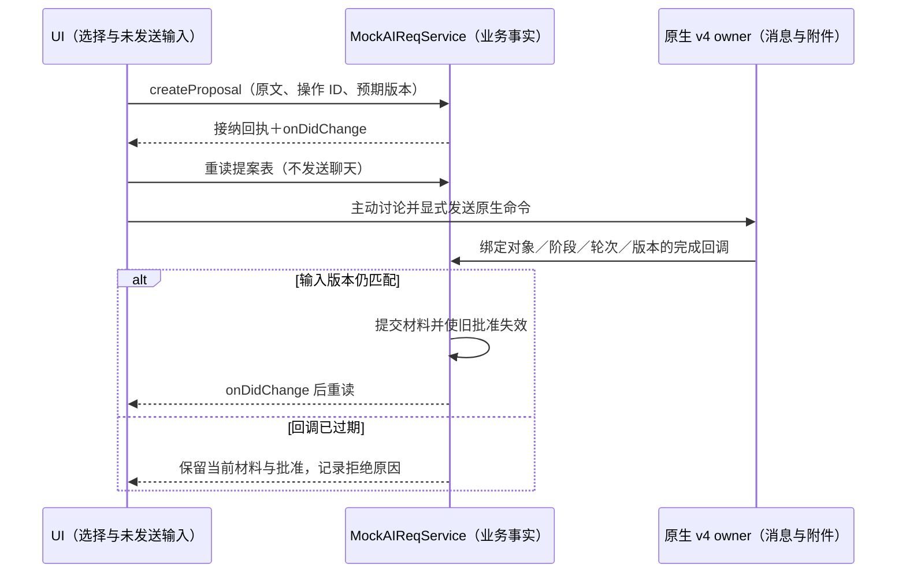

# 原生对话适配

> 当前页面组织按 [项目空间规格](project-space.md)（2026-11-16）：需求讨论归项目 → 需求，提案／正式视图共用稳定 IR 上下文，项目与 Release 在页头持续可见。导航与范围仍归 AIReqContext，设置覆盖层往返不卸载原生 composer、不复制或重发草稿／附件。三方确认在阶段主体直接显示，材料区负责阅读；既有会话接纳、回调版本与消息所有者不变。本轮验收按该规格执行，以下历史通过记录不替代本轮证据。

## 边界与唯一所有者

AIReq 页面只导入 `aireq/conversation/AIReqSessionPane`；调用者维持现有 V4PaneConversationProvider 的明确 scope。v4 不导入 AIReq；SessionPane 增加可选 `conversationExtension`、embedded、composerPlaceholder、composerAriaLabel、conversationEmptyState、externalTextInsertRequest、onExternalTextInsertApplied、composerInputPreview、onInputPreview、composerTools、composerTrailingTools。未传端口时保持当前原生行为。原生 Draft owner、附件上传/移交事务、临时模型与思考等级、命令 registry 和订阅水位继续是唯一事实源，不新增聊天存储。

### 2026-11-17 命令裁决与生产减面

原生命令唯一裁决者为 MockZCodeAgentService。先按操作者、会话、commandId 查询原决定并校验同输入，再对首次命令执行实际 baseRevision 比较；ROW_TARGETING 同时比较 baseLogEpoch 与 rowId/entityId。过期版本、epoch 或错误实体返回稳定 fault，不修改行、配置、队列或水位；拒绝同样记录为原决定，重试不重新裁决。普通 sendText、编辑锁命令保持已有非 CAS 语义。

业务绑定会话的 switchModelConfig 可用性与拒绝结果一致；临时模型继续属于消息 Submission。恢复快照、分页和实时帧均来源于同一权威行集合，模型边界行也必须先写权威行。当前装配只保留 AIReq business 回复，不保留未装配的演示工具、虚构 plan 或切字符串伪流；缺少业务执行者明确拒绝发送，不建设真实流引擎。

删除无消费者的 storage prepare/state/initialize、workspace runtime identity 查询、closeSession、ensure/stop runtime、reconcileSessionsIndexV4、重复附件读与 preview-source、workspace-config 包装及未消费 telemetry/storage 事件；未装配的旧 ZCodeProtocolClient 与其专属 storage gate 同步退出。保留真实附件事务与 attachmentReadV4、当前会话生命周期、Skill catalog、通用控件仍消费的 workflow/sessions-index 和底层纯 wire DTO/schema/transport。内存会话 ready 仅表示可接纳命令，不宣称外部进程已运行或停止。

运行验收输入：同 commandId/同输入重试复用 ACK；改变输入拒绝；首次 stale revision/epoch/wrong entity 不改变 rows/config/revision/seq；新鲜版本反馈与队列命令正常执行；业务会话恢复显示模型切换不可用；正常业务消息、PNG 事务与重连恢复仍保持同一权威事实。本段是本轮规格，不代表已执行检查。

## 第 2 组：先建提案、后进入分阶段讨论

新增／导入先由业务 owner 保存原始短需求、生成可见 IR，成功停留提案表；不预热会话作为创建前提、不启动 AI、不生成 SR。提案可见不再依赖 `pendingFirstMessage` 或首发 ACK。仅用户主动进入该 IR 讨论时绑定现有原生会话，显式发送仍走原 Composer、命令 registry、附件事务及原生接纳语义；不重建消息 store、不重发创建或已接纳消息。

一个 IR 一个详情入口：业务澄清／原始需求单评审／方案完整材料／完整三路和综合终审／人工及三方／PR 的历史和当前视图复用现有表面。前置单评审与人工通过前不得拆 SR；方案逐步生成每个 SR 独立 change 的全材料与测试方案，不新增后置测试生成会话或专用 Agent。切 SR 只选择材料／报告，不建立 SR 开发聊天。业务完成回调必须匹配 IR、阶段、轮次和材料版本，迟到完成不能改写新版本。

已存在提案的精确会话引用由 canonical workflow 裁决共享读取，读取仍验证 session/workspace 归属；私有预热、未发送草稿和 Skill 会话不因此共享。附件字节唯一归原生 owner，跨 actor 读取还须 canonical userInput 已采用该 ref 及目标行／附件索引精确匹配；上传、abort 和新 Submission 仍核实当前 actor。不能因进入讨论而转移私有草稿或放宽附件归属。

每轮原生执行以该轮取消句柄为唯一运行所有者；停止后该轮必须标记为中断，并撤销尚未完成的私有业务接纳，不能再提交材料、报告或完成回复。所有异步等待后的流式输出、业务完成、异常与收尾均核对本轮取消状态和所有权；旧轮迟到结果只能收口自身行，不能清空替代轮句柄、覆盖其控制状态或推进其队列。停止仍暂停自动续跑并保留队列；立即发送队列项仍先中断旧轮再启动指定项，普通发送和错误收尾只由当前轮推进队列。验收覆盖“发送旧输入 → 运行中停止 → 立即发送新输入”：旧轮中断且旧文不进入材料，新轮成功且新文进入材料；此合同不表示修复后已实测。

第 2 组原实施验收场景：新增后无 AI、无 SR，进入讨论后才有可操作澄清；历史／旧版本及 PR 冻结版只读，材料选择不发送消息；原生输入／PNG／临时模型失败保留，刷新重连不重放；双工号读取已发布讨论但不能读取私有 Skill／草稿，错误 workspace/ref/行索引拒绝；旧版本 AI 完成结果释放后不能覆盖当前材料或批准。实际执行范围见下方本组观察及 proposals 的第 2 组收口记录，不是待后续集成补验的清单，也不表示本次文档同步重跑验收。

临时模型与模式属于本次 Submission，不是会话默认值。SessionPane 只为 followupMode 同步 Session 配置，显式发送将 Composer 冻结的 modelSelection／mode／planEnabled 随 sendText 原子提交；不通过 switchModelConfig 或业务提案提升改写共享 Session。mock 接纳后将该配置保留在原生 userInput 行，队列提升沿用队列项配置，模拟回复使用对应输入的模型；业务 session.modelConfig 仍保留角色创建快照。首次接纳后工具栏恢复会话默认值并不能证明本轮选模丢失，必须通过原生 conversationRowsRangeV4 读取对应 sourceCommandId 的 userInput.modelSelection（包括 reasoningLevel）和回复模型核对。拒绝重试仍保留原文、PNG、session 与命令身份，不另发消息；平台默认、新草稿和历史会话不得被本轮临时选择改写。

已绑定业务会话及私有 Skill 会话的模型与思考等级选择通过可选端口仅更新原生 Composer 草稿，发送时再随本次消息提交；AIReq 宿主统一启用此端口，不以当前业务 selection 是否命中 session 判断私有会话的提交语义。未启用端口的通用会话保持既有配置命令行为。验收须覆盖供应商及思考等级切换、设置往返保留草稿，并核对实际接纳的消息模型。

业务及私有 Skill 会话的普通消息被接纳后，草稿中仍与该次提交一致的模型、模式与计划状态恢复会话默认；等待回执期间用户已更改的字段必须保留。拒绝、失败或切换到其他草稿不触发重置；不改变通用会话配置。

原生组合选模菜单保留既有“管理模型”入口，使用宿主提供的模型设置导航；不能因组合菜单已承载模型和思考选项而丢失该动作。进入设置再返回保持当前讨论、未发送正文、附件与临时选择，不因导航提交消息。

2026-11-17 私有 Skill 原生选模回归证据：同 Anthropic 的 Sonnet／Opus 点击曾显示“切换连接失败”，因为宿主仅对当前业务 selection 开启临时提交端口；私有会话因此误发 `switchModelConfig`，服务端按创建绑定拒绝。修复应保持该拒绝规则，将私有会话纳入同一原生草稿端口；不得改写 Agent 创建模型、关闭错误或强制勾选。运行验收需双向改选后明确发送，并按该次 sourceCommandId 核对 userInput 的 modelSelection／reasoningLevel／mode／planEnabled 与回复模型；失败保留正文、附件和临时选择，等待期间的新意图不被旧回执重置。本段为问题及验收合同，不代表修复后已实测通过。

2026-11-16 内置浏览器实测：从 OpenAI 切换到 Anthropic／Claude Opus 4.5、中等思考强度，模型设置往返后正文和计划模式保留；发送后原生 userInput 记录上述模型、medium 和 planEnabled，模拟回复模型一致，业务会话创建配置仍为 GPT-5.2／high。

同日补测已绑定会话：提交临时 Claude Sonnet 4.5 后，原生消息与模拟回复保留该模型，输入框恢复 GPT-5.2／high；临时计划模式在消息接纳后消失。未注入延迟回执或发送失败，不能将此观察视为上述竞态场景的运行验证。

同日另启隔离模拟服务注入 15 秒回执延迟：使用 Claude Opus 发送后，等待中改选 Claude Sonnet，回执到达后新选择仍保留。一次性拒绝时显示发送失败，正文及 Sonnet 选择保留；手动重试后聊天中显示一条该消息并恢复默认模型。上述拒绝场景未携带附件，未验证附件失败恢复或命令编号。计划模式等待期间取消后重新选择，回执到达后计划标识仍保留；先前一次因共享工作区依赖安装触发页面重载而中断，页面恢复后重新执行并观察到该结果。

新建提案的业务幂等 ID 由新增／导入操作生成，与项目／Release 输入槽、后续原生消息身份分离。同操作重试保持同 ID；第二次明确新建使用新 ID。原生讨论消息继续使用现有 commandId/clientId/issuedAt 去重，不能通过会话首发再次创建 IR。

## 输入辅助

外部草稿使用既有 externalTextInsertRequest 与 requestId ACK，仅回填不发送。append 模式仅替换完整存在的 replaceText，否则追加；相同全文已存在时不重复插入。onInputPreview 提供完整 canonical text，不从摘要猜测匹配。composerInputPreview 仅在非空全文 trim 精确匹配时显示摘要，完整编辑器保持挂载。composerTools/composerTrailingTools 接收 appendText（实际插入成功布尔值）、addFiles（实际接纳 ID）、disabled、focusInput；扩展位置和展示服从当前 ZCode 原生输入器，不以 AIReq 的按钮坐标或顺序判定视觉保真。语音示例追加当前编辑器，Sketch 完整 PNG 走既有附件管线，不创建业务对象也不发送。取消和失败不改原输入。临时模型/思考选项、附件预览使用目标当前实现，不复制旧 v4。embedded 取消旧任务推荐及新草稿居中，不重建输入框；评审会话通过 autoFocusEnabled=false 不抢焦点。

2026-11-16 在内置浏览器的提案聊天中验证 Sketch：绘制、撤销、取消后文字保留；重新绘制并添加附件后，图片预览保留完整笔迹，原文字仍在且未自动发送。随后移除样例附件并清空测试草稿。

同日后续前端改动后复核：语音示例可预览并回填文字；Sketch 绘制后作为附件上传，预览保留笔迹和原有文字，均未自动发送。验证后移除样例附件并清空示例文字。

## 事件顺序与隔离

第 2 组事件顺序为：显式保存短需求 → 业务 owner 校验并创建可见 IR → onDidChange 重读表格并保持表格 → 用户主动打开讨论 → 读取／绑定已有原生阶段会话 → 显式发送由 Composer 冻结正文、附件和临时模型 → 原生接纳及原事务结算 → 版本绑定业务完成回调 → 提交材料后业务事件重读。业务工作区使用服务端项目 root 与 `aireq-mock:<projectId>`；私有草稿按 client/employee/project/release 隔离。读取按代际、回调按对象及版本拒绝迟到结果；不得为补偿导航重发消息。

业务流程帮助的中英文说明必须区分进入讨论与执行：打开讨论只读取同一需求及会话，只有显式发送消息才开始本次 AI 澄清，不把导航描述为隐式提交。

本组实际观察：`ir-demo-25` 从表格创建、原生澄清、单评审、方案对话至完整终审均经过上述路径；完整审查重新运行后实际选择综合原生会话，不再把方案讨论伪标为综合。历史阶段无可写输入，返回当前不重发消息；文档 PR 冻结后显示只读交接而非可写会话。旧版本暂缓／释放、跨工号与材料路径证据见 proposals 的第 2 组实际观察；未改动的 PNG／临时模型原生路径不在本组重复全矩阵，历史记录不冒充本组新执行。

纯浏览器 File／Sketch PNG 通过 attachmentPut 预上传，`staged=false`，不进入主机 localPath 暂存移交；此次保留原生 Composer 单次 finalize／adopt 语义，不增加附件重试队列或再次发送。主机 staged 附件的 transfer/adopt 异常处理属于既有独立路径，本次不改其语义，也不把它描述为浏览器 PNG 的可达失败。

显式“重新连接”先等待可选 `onBeforeReconnect(): Promise<void>`，业务宿主只恢复当前确切 session 对应的可重读事实，成功后再重试原 v4 lease；失败停留并保留原故障与输入。回调不能恢复其他历史／自动化／Skill 会话；等待期间切换 pane／session／workspace 后不得重试新目标，不自动重发消息或创建会话。未提供端口的通用消费者保留既有重连语义。

## 历史首发迁移观察（第 2 组之前）

下方首发创建／自动导航观察记录的是旧流程，不再授权通过聊天创建可见提案；其消息、附件、临时模型和隔离事实仅作为原生能力历史证据，不代表本组验收。原生输入扩展的通用约束继续适用。

### 历史源端可达性裁决

源 `AIReqNativeSurface.tsx:24–38` 明确两种数据源都没有 native-surface 传输，hook 永远不提供 target/snapshot，predictionAction 直接拒绝。因此源 AIReqNativePredictions 虽被 Composer 装配，实际上永远不显示，不是当前可达产品功能；tools-settings 的输入建议验收只适用于未来存在真实能力的情况。本次不制造预测样例、不添加第二传输，也不迁移 ANSI widget/header/footer 的不可达占位层。

已实测连续两次首发自动导航、同 owner／workspace 预热和浏览器非 staged PNG 上传；发送拒绝保留正文与完整 PNG，明确双击重试只接纳一份提案。Skill 的完整 canonical 草稿、摘要匹配、人工补文、表单再次准备、Tabs、左栏折叠及 1440×889 PNG 均保留，未明确发送时不生成文件。“管理模型”往返保留原正文、PNG 与临时选模，工作页隐藏且 inert，不自动发送；Sketch 取消与语音示例追加不改变业务阶段。

跨客户端实测 `draft-demo-36` 的同一原生会话只有三行（turnHeader、userInput、assistantText），输入记录思考等级 medium，业务角色创建快照仍为 high；第二员工读取同一回复及 32996 字节、1440×889 PNG。错误行、附件索引、workspace 和 ref 均被实际 RPC 拒绝；独立 Skill 会话的其他 actor 原生读取及业务读取也均被拒绝。显式会话故障重连恢复原 session，不自动重发。完整命令、浏览器覆盖、模拟边界及证据限制统一记录于根 `todo.md`。

## 原生输入工具扩展

提案和 Skill 通过同一原生输入扩展提供语音示例与 Sketch；上下文、模式、模型、发送及扩展布局均复用当前 ZCode Composer 的原生实现和插槽，不复制源输入器、不以原版几何或按钮坐标验收。未使用扩展端口的通用消费者保持不变；不新增草稿或发送链。只核对功能可达、失败保留输入、辅助输入不自动发送及当前 ZCode 的显示规范。
