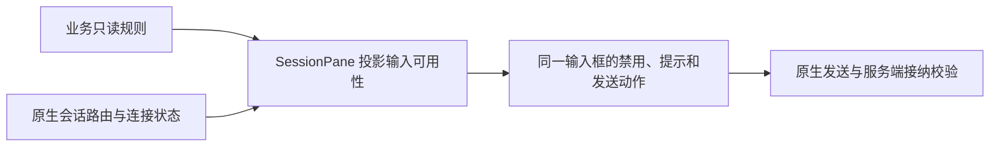

# 原生讨论、附件与连接恢复

## 讨论入口与所有权

新增／导入先保存可见提案，成功留在需求共创表，不靠首条消息创建或发布 IR。提案入口进入工作台，不自动挂载会话；主动进入需求澄清、方案设计或独立审查任务只读取需求及专属会话，显式发送才开始本次澄清。

同一 IR 的业务澄清、原始评审、方案、完整审查和综合终审使用原生会话。业务评审通过前不拆 SR；SR 只作为材料和报告目标，不建立开发聊天。历史阶段、历史评审和冻结交付只读，返回当前不重发或重跑。历史任务页在页头显示历史只读状态和摘要，不保留可写 composer；主动作改为查看当前阶段或返回工作台。材料读取中、失败、空态分别明确并可重试。评审追问只记录会话，不直接修改材料、报告或人工决定。阶段规则见[需求共创](proposals.md)。

需求澄清的历史只读摘要显示原始需求和当前阶段。人工确认额外展示工号与时间，须来自通过且与当前材料版本和评审 ID 匹配的决定。验收覆盖已进入需求评审但仍待人工确认，以及人工已确认两种状态。

文件列表与输入器中的文件引用统一使用文件夹、文档、图片和代码四类图标，未知文件类型使用文档图标。

主区承载讨论，材料、报告与历史使用[统一右侧多 Tab](unified-side-pane.md)；阅读目标切换不复制正文、重建会话或发送消息。

AIReqSessionPane 复用 SessionPane、原生 Composer 和 V4PaneConversationProvider。业务服务持有需求、材料、阶段版本与会话引用；原生服务持有消息行、命令收据、附件字节、订阅序列和恢复水位。业务事件不拼成原生帧，不另建聊天存储或发送链。

草稿正文、附件与临时选项归原生 owner。设置往返保留挂载和输入，非活动工作区禁止交互和抢焦点；导航不提交消息。不同工号、客户端、项目与 Release 的私有草稿不互相接管。需求／阶段／评审切换只调整会话引用，不改变连接身份。

对象读取中、失败、归属无效或阶段只读时不可发送；目标不存在、读取失败、会话不可用与交付状态分别显示，不自动创建会话兜底。

## 输入可用性与反馈

AIReq 业务讨论保留同一个原生输入框及按会话隔离的草稿。只读时禁用编辑、附件、画板、工具和发送，使用次级表面显示只读原因，不卸载或清空草稿；原生其他只读观察视图仍默认隐藏输入框。AIReq 由业务只读规则提供原因，原生 snapshot/inputRouting 仍唯一裁决立即发送、排队、补充指令、队列选择和拒绝。Agent 评审“已完成”不能自动置灰，当前有效评审仍允许追问；历史、阶段不符或已交付沿现有门禁只读。

输入区用一条短提示说明当前动作：允许排队时说明等待本轮结束，允许补充指令时说明可继续输入，choice 保留原发送时的队列选择，拒绝／断连／重建时解释暂不可用。保持既有停止、恢复命令和重试语义；只读不得执行停止或恢复命令。禁用状态不能只改变颜色，输入、快捷键和发送仍服从原门禁。每个 Agent 按本会话事实投影，不引入跨 Agent 的全局忙碌标志。

## 显式发送与临时选项

Composer 冻结本次正文、附件、模型、思考等级、模式与计划状态，随同一次 Submission 原子提交。临时选模只属于本次消息，不改共享会话默认配置；Agent 保留创建模型快照。模型菜单的“管理模型”进入已有设置，返回保持草稿与临时选择。

消息接纳成功后，仅将仍与本次提交一致的临时模型／模式／计划字段恢复默认；等待期间用户的新选择保留。拒绝、失败或已切换草稿不重置。

命令身份归原生 registry。同一操作者、会话、commandId 与相同输入重试复用原决定，不能以同编号替换正文或操作者。消息接纳不等于材料完成。失败或回执不明保留输入与附件，显式重试沿用原身份；刷新、导航与重连不自动重发。

需要版本裁决的原生命令首次检查 revision，定位行命令还检查日志 epoch 与行／实体；拒绝同样稳定保存。普通发送不因此增加另一套业务版本协议。

## 完成、取消与迟到结果

业务消息接纳先核对项目、IR、阶段、轮次与输入身份；进入队列不提前冻结尚未执行的材料版本。每项实际开始执行时，业务 owner 以接纳操作者重新核对阶段／轮次，将当时材料版本及原生 owner 当前确认的输入冻结为本次执行快照。前一队列项正常提交后的材料是后一项的起点；完成回调仍须核对自己的执行快照才提交材料，不能在完成时重新绑定或用命令重试刷新它。执行中版本变化、退回后旧轮或历史评审完成不能覆盖当前材料及批准。

顺序为显式发送 → 原生接纳（可能排队）→ 同一 startTurn 路径通知业务 owner 开始执行并冻结快照 → 当前轮完成及业务版本校验 → 原子提交材料 → 业务事件重读。直接发送、提升项与自动续跑共用这条路径；私有 Skill 仍校验私有归属，不套用提案材料版本。原生消息和回执仍走自身发布链，页面不假定事件与回执先后，迟到读取不能覆盖当前目标。

停止以当前轮取消句柄为准，标记中断并撤销未完成的私有业务接纳。停止后的输出、异常或完成不再提交材料、报告或成功回复；旧轮只能收口自身行，不能清除替代轮控制状态或推进其队列。

停止暂停自动续跑并保留队列；立即发送指定队列项先中断旧轮再启动该项。队列项使用自身配置，不取随后输入框选项，只有当前轮可推进队列。

队列编辑锁归原生会话 owner 持有。已有锁不能被再次获取；冻结项提交编辑时，命令已校验的 clientId 与 payload.editorId 必须同时匹配锁，省略 editorId 或其他 client 冒用已知 editorId 都不能修改或释放锁。现有 releaseQueueItemEdit 不携 editorId，按锁记录的 clientId 校验释放，不把它扩展为同一 client 内的标签页隔离。拒绝不改变队列内容、顺序或消息；持有者正常编辑原子替换后释放锁，正常取消释放后其他 client 可重新获取。锁期间删除、重排、立即发送仍拒绝，批量配置跳过冻结项。

## 附件与辅助输入

浏览器文件与 Sketch 完整 PNG 走原生上传、预览及发送事务，不只存文件名或摘要。浏览器附件不是主机 localPath 暂存移交，沿用单次 finalize／adopt，不另建附件重试队列或补发消息。

Sketch 支持绘制、撤销、取消，并将 PNG 加入当前草稿；保留正文与其他附件，不自动发送、创建需求或推进阶段。没有识别服务时不显示伪录音／语音识别入口。

文字插入扩展只回填草稿，使用请求身份与应用回执；摘要展示须完整 canonical text 精确匹配，不从摘要推断正文。取消、失败不改变原输入，不构成业务执行证据。

附件字节统一归原生 owner。跨操作者共享读取要求附件已经被 canonical 用户输入采用，workspace、会话、目标行和附件索引精确匹配。上传、取消上传与新提交仍校验当前操作者，不能借共享需求读取他人的私有草稿附件。

## 共享读取与重连

Composer Skill 引用目录不带 sessionId 时读取当前工作区可用技能；带 sessionId 时只读取该驻留会话首次初始化时冻结的目录，返回 session authority。目录条目只投影身份、描述、路径、scope 和启用状态，不携带正文或管理元数据。原生会话 owner 持有该快照；后续保存技能只影响工作区目录及新会话，不改变旧会话。未知／未驻留会话、工作区不匹配或私有会话归属无效必须拒绝，不补建会话，不回退工作区目录。

已保存需求的精确 canonical 会话引用由业务工作流裁决共享读取，仍校验会话与 workspace 归属。未发送草稿、私有预热和私有 Skill 会话不因此共享；底层会话能力保留不表示对应产品入口开放。

显式重新连接先执行当前业务会话恢复回调，再重试原 v4 lease。AIReq 仅恢复当前选择对应的确切已有 session；失败保留故障和输入，不新建、清空或恢复其他历史／私有会话。等待期间 pane、session 或 workspace 已变化时，旧结果不得应用到新目标。

恢复快照、分页和实时帧来自同一权威消息集合。重连只订阅、重读，不重放消息或业务命令。回复、生成及外部执行边界集中见[后端运行说明](../../architecture/mock-backend.md)；可接纳命令不表示外部 AI 进程已运行，材料回调不证明真实模型或 Git 已执行。

## 事实来源

`packages/ui/src/aireq/conversation/AIReqSessionPane.tsx`、`shell/AIReqProposalWorkspace.tsx`；`packages/server/src/aireq/native-business.ts`；原生 `packages/ui/src/v4/SessionPane.tsx`、`ConversationComposer.tsx`；`packages/services/src/aireq/remote-operations.ts`。
