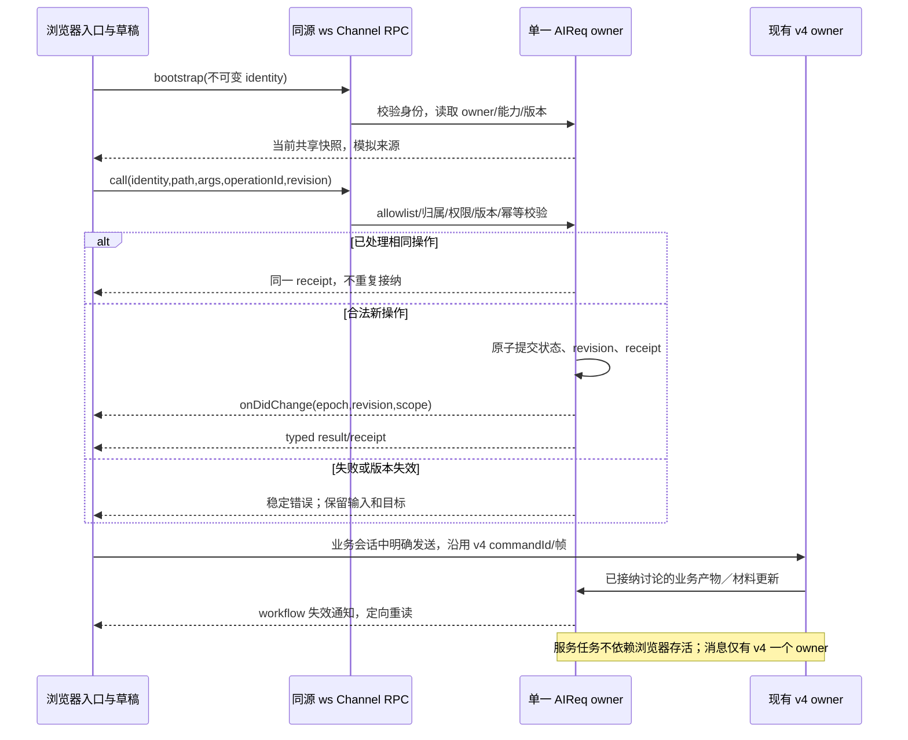
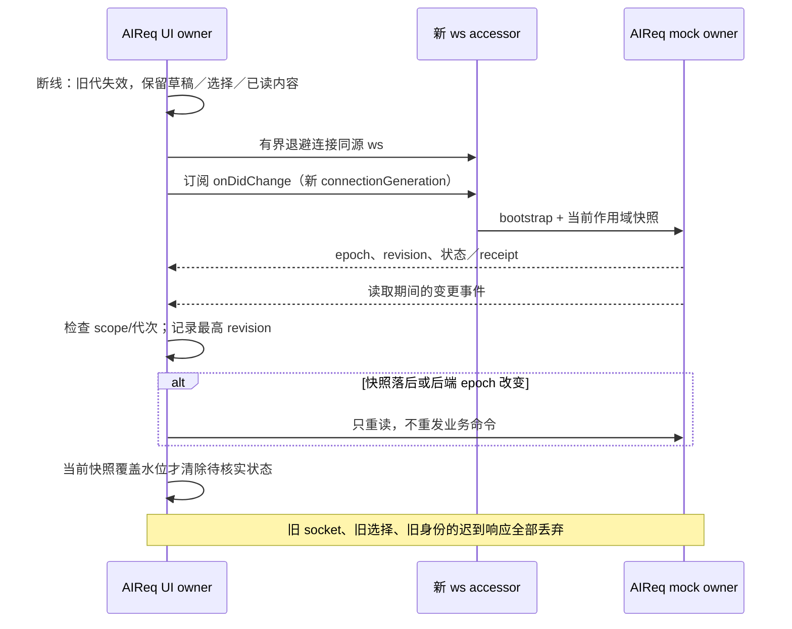
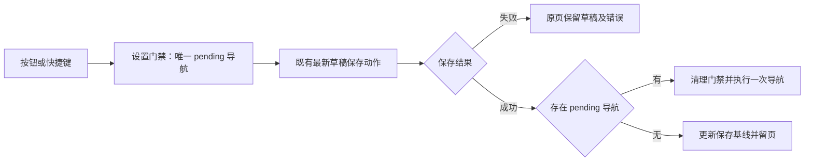

# AIReq 迁移：公共契约、唯一入口与集成规格

状态：实现已集成，验证进行中。本文件保留实施前确立的需求与覆盖场景，并按当前目标源码同步接口与所有权；不表示全部 85 项待办或浏览器门禁已经完成。授权依据为根目录 `todo.md`，覆盖第 2、3、4、10 节全部 41 个待办；最终权威证据由主集成追加至 `todo.md`，提案、正式需求／分析／Issue、工具／设置的详细业务规格仍须同时成立。

## 1. 事实依据与冲突裁决

源路径以下相对 `F:/code2026/oh-my-pi/packages/aireq-frontend/`，仅供调查，不可成为构建或运行时依赖。

| 已读事实来源                                                                       | 当前事实及目标裁决                                                                                                                                                                                                                                     |
| ---------------------------------------------------------------------------------- | ------------------------------------------------------------------------------------------------------------------------------------------------------------------------------------------------------------------------------------------------------ | -------------------------------------- | -------------------------------------------------------------------------------------------------------------------- |
| `app/bootstrap.tsx` → `client/remote-data-source.ts` → `app/AIReqApplication.tsx`  | preview/runtime 使用同一应用；源端 HTTP bootstrap/call、事件 WS、services WS 三路接入。目标只保留当前同源 `/ws` 二进制 Channel RPC，不复制源启动器、HTTP 路由或独立进程。                                                                              |
| `backend/contract.ts:43,92-201`                                                    | 当前合同为 **3**，不是 README／源 `aireq-browser-workbench/spec.md:32` 的 version 1。以当前 operation 参数／结果及实际可达行为为业务参考；HTTP envelope/version 冻结条款不约束目标传输。                                                               |
| `backend/scope.ts`、`prototype-data-source.ts`、`mock/backend.ts`                  | 单 worker 原型 owner、请求局部身份、内存任务；目标单 mock 进程内一个 AIReq owner，移除 worker 与旧协议，普通业务显式传入请求身份；server 局部 AsyncLocalStorage 可为迁入的纯 mock getter 提供并发安全上下文，不能使用全局可变工号。                    |
| 源 `AIReqContext.tsx:63-198`、`navigation.ts`                                      | 每次登录／刷新默认进入需求分析，仅继承初始项目；不恢复上次页面、IR／SR、筛选或展开。当前生命周期内支持前进／后退；切项目保留功能页并清理旧对象。不得误读“刷新恢复”为恢复旧聊天页。                                                                     |
| 源 `AIReqSidebar.tsx:55-67` 与 `WorkspaceShellLayout.tsx:1489-1490,1723-1813`      | 实际装配提案、自动化、Skill 设计、需求分析、正式需求、Issue 三页和设置。不能从 `types.ts` 中的旧 Action 或 Workbench 中未使用的只读开发组件推断开放能力。                                                                                              |
| 源侧栏 Issue 按 `!project                                                          |                                                                                                                                                                                                                                                        | !releaseId` 禁用；Issue 服务按项目读取 | 按 todo §7.2 裁决：Issue 三页只要求项目，没有 Release 仍可管理；Release 切换不重建 Issue。需求页仍要求有效 Release。 |
| 源项目对象仍含 `root/commonDir`，应用启动要求 workspace.path；源规格只要求远程仓库 | 项目用户模型为名称＋远程仓库＋默认分支，Release 继承仓库；遗留路径仅作服务端模拟 workspace 标识，不展示目录恢复页、不要求用户选服务器目录，不转换为 `VirtualProject`。                                                                                 |
| 源 mock 权限                                                                       | 固定 owner 样例 `j00808874`；平台配置仅 owner 修改，所有已登录访问者可查看、使用外观与独立 Skill 设计。`prototypeProposalDiscussionAllowed()` 取决于共享 Web 类型而非当前工号；不能误扩为“所有访客提案都只读”。具体进度和 Issue 操作权限沿源领域检查。 |
| 源规格的旧控件复制、Firefox 上限／禁止 polyfill、OMP 独占部署条款                  | 目标采用当前 ZCode 控件、已存在浏览器补丁和运行环境，不复制源控件／主题、不撤销目标已有兼容能力、不启动 OMP。Firefox 验证证据要求仍有效；已有 Chrome 证据不能代称 Firefox。                                                                            |
| 实施前目标 `Root.tsx/App.tsx` 与源 `AIReqApplication.tsx`                          | 历史调查：旧目标整棵 Root/App 绑定目录、账号恢复及文件／Git 主壳，不适合复用。当前已移除旧产品专属 App/Root 入口，改由独立 AIReqApplication 与业务壳装配必要 Provider、基础组件及 v4 会话竖切；全部通用控件和通用资产保留，不移植源 Root/App。         |

源 `openspec/specs/aireq-browser-workbench/spec.md` 的业务用途、明确发送、共享后端、需求管理非编码、讨论与只读材料、远程仓库和状态门禁继续适用；布局与显示仅依当前 ZCode，不以源三栏几何作为约束。真实 OMP 接入及持久化不是本次交付；旧 SR 编码、执行／验收 Agent、自由聊天等类型与样例不因此重新开放。

## 2. 页面与入口可达清单

可达性依据是源 sidebar 回调、shell 分派、SettingsPage 分支及 capabilities，不是文件存在性。

| 源实际入口／子面                   | 目标工作区与服务                                   | 可观察验收                                                                                                                                                                                        |
| ---------------------------------- | -------------------------------------------------- | ------------------------------------------------------------------------------------------------------------------------------------------------------------------------------------------------- |
| `AIReqEntry`                       | 现有 `packages/web/src/auth` owner，AIReq 登录内容 | 标题“以AI为中心的需求和ISSUE管理平台”；副标题“与团队一起澄清需求、评审方案和跟踪需求和issue进度”；工号、进入工作台、标识非认证说明。表单 Enter 与按钮一致，空值禁用，非法值就地报错，前导零保留。 |
| `AIReqContext` 默认导航            | `AIReqApplication` → requirementAnalysis           | 初次进入、重新登录和刷新从需求分析开始，不打开旧会话；恢复合法工号并重读当前服务端状态。                                                                                                          |
| 新建需求提案／提案 IR 列表／搜索   | 原生工作区与面板；workflow、v4                     | 新建只进入未发送草稿；列表搜索、组合筛选、排序、阶段、提出人、继续讨论、允许删除的确认和取消可用；正式需求不被草稿删除。                                                                          |
| 提案时间线、四路评审与材料         | 原生讨论与材料阅读区；workflow、readPrHandoff、v4  | 澄清→评审→方案→模拟入库；历史只读、可返回当前；材料选择、只读 Markdown／代码／依赖图、工期预估和逐文件确认均有实际内容，过期／失败不伪造结果。                                                    |
| 自动化                             | 独立内容区；既有自动化服务及 v4 只读运行记录       | 列表／筛选／编辑与受支持操作、详情及独立运行会话可达；不切换 IR／SR 执行对象，不展示退役通用工作流说明卡或保持电脑运行选项。                                                                      |
| Skill 设计                         | 独立内容区；skillDesign 与 v4                      | 说明表单、可折叠左栏、可编辑准备草稿、明确发送、临时文件 Tabs／预览、明确目标与模拟保存；关闭分栏不丢草稿。                                                                                       |
| 需求分析                           | 独立内容区；progressScheduler                      | 项目范围、统一设置、任务／执行历史、统计、分页、报告弹窗、批量确认、失败与重试可达。                                                                                                              |
| 正式需求                           | 大表格＋同页右栏；workflow、planning、progress     | 无正式需求树／开发聊天；IR／SR 选择只改变报告／材料，保留筛选、滚动、展开与分栏；分支复制和人工完成门禁生效。                                                                                     |
| 新建 Issue／Issue 分析／Issue 进度 | 三个独立页；issues                                 | 无 Release 可用；字段校验、创建稳定编号／分支、分析任务／历史／报告、进度、合入后人工完成及重开均真实改变内存状态。                                                                               |
| 项目／Release 菜单                 | footer 菜单；workflow、projects                    | 当前工号／切换工号、Web 所有者样例、项目单选、Release 单选、添加／管理、帮助；Release 仅列当前项目的项。长名称完整 title 可读，无项目和无 Release 文案不同。                                      |
| 前进／后退                         | AIReqContext 单一 history owner                    | 浏览器与工具栏前进／后退一致；新导航截断 forward 分支；只改变浏览选择，不发消息、不推进阶段；失效对象提示不可用，不偷偷创建。                                                                     |
| 设置                               | AIReqSettingsPage（复用当前控件）                  | 个人工具只含外观；平台配置含项目／Release、模型、个性化、技能。外观浅色／深色／系统，模型／个性化脏草稿离开门禁，普通访问者可看不可写平台配置。                                                   |
| 帮助／输入辅助／弹窗               | 当前 Dialog、Dropdown、Tooltip、Input、Button 等   | 帮助关闭回触发按钮；菜单／弹窗可键盘打开、取消、关闭并还原焦点；Sketch 只回填 PNG，语音仅示例文字；无音频权限请求、自动发送或隐式推进。                                                           |

所有首次读取有加载／空／失败三态；背景重读保留已读内容、滚动及打开的报告，固定位置反馈错误；明确材料“生成中／尚未生成／缺失／读取失败／版本过期”，与网络断开分开。消息、附件、模型与目标在失败／取消后保留。完整页面字段和按钮的业务细节由各领域规格补足，不以本表概述缩窄范围。

### 2.1 原生 footer 的业务菜单端口

项目／Release 入口必须装配当前 `WorkspaceSidebarFooter`，保留其 Avatar、Button、独立设置齿轮、DropdownMenu 和原生主题子菜单；不复制源 footer，不使用常驻 HTML select 或工号／帮助图标条。通用 footer 仅增加可选 presentation 端口（ReactNode 菜单内容、标题、次行说明、无障碍标签和触发按钮 ref）；未传端口时默认产品的 DOM、菜单顺序与账户／用量行为不变。自定义业务菜单模式不挂载账户／用量／entitlement 查询组件，不显示登录、Coding／Office 或旧产品账户菜单。

`AIReqWorkspaceFooter` 经当前 AIReq context/data-source 读取项目、当前项目 Release、工号和 `backend.owner`／provenance，不制造 UserInfo 或第二份选择状态。主菜单按工号、切换工号、Web 所有者（sample 标注演示）、项目单选子菜单（添加或管理项目）、Release 单选子菜单（添加或管理 Release）、帮助、原生主题排序；无项目禁用 Release，无 Release 提供明确空态。项目／Release 命令只经已注册的 `ai.navigate` 未保存门禁接纳。管理回调显式进入项目设置，齿轮回调打开 shell 记忆的设置页，切换工号调用既有退出回调。设置 back 模式保留身份、切换工号、帮助和主题，齿轮执行同一受门禁保护的返回回调，不恢复旧产品账号或用量功能。主题只使用当前 ZCode store 的 system／zai-dark／zai-light。

帮助复用当前 Dialog/Button，以受限滚动区呈现“需求提案／开发进度跟踪”两组八步完整业务说明（提出需求、检查需求、制定方案、自动入库、安排人员与排期、查看代码证据、核对完成条件、持续跟踪遗留问题），不缩成简短占位文案。旧个人 OMP／数据库／真实 Git 描述替换为共享模拟项目和后端内存边界。关闭／我知道了回焦到实际打开帮助的 footer 按钮；每个 footer 自持触发 ref，onHelp(returnFocusTo?) 传递具体按钮，帮助组件消费 returnFocusRef，不持有导航状态。

## 3. 公共契约与最小传输设计

### 3.1 公开 API

`packages/services/src/aireq/` 拥有浏览器安全领域类型、纯派生函数及服务合同；当前源文件按职责分置，业务不依赖源仓库。身份以显式请求参数传入 server，服务端局部请求上下文不进入公共领域层。

公开 descriptor 为 `IAIReqService`、channel 为 `aireq`、accessor 字段为 `aiReqService`；服务公开入口为 **`@zcode/services/aireq`**，根入口导出 descriptor，不公开 mock 实现。UI canonical port 为 **`packages/ui/src/aireq/contract.ts`**：具名选择性导出服务公共类型／纯派生与 `IServiceAccessor`，并定义应用 props／主视图；业务页面、hook、shell 经相对路径消费该 port，不直接导入 services，不维护第二套领域类型。UI `index.ts` 仅公开应用与 props；server 不能从 UI 取领域类型，UI 不能从 server 取类型。

服务接口以 `packages/services/src/aireq/contract.ts` 为准，实际 operation tuple/result 白名单位于 `remote-operations.ts`：

```ts
interface AIReqIdentity {
  employeeId: string;
  clientId: string;
  demo?: string;
}
interface IAIReqService {
  bootstrap(identity: AIReqIdentity): Promise<AIReqRemoteBootstrap>;
  call<P extends AIReqRemotePath>(
    identity: AIReqIdentity,
    path: P,
    args: AIReqRemoteArgs<P>,
    selection?: AIReqSelection,
  ): Promise<AIReqRemoteResult<P>>;
  readonly onDidChange: Event<AIReqRemoteEvent>;
}
```

当前 `AIReqRemoteOperations` 以 `Operation<args,result>` 生成 correlated path/args 判别联合，不能用 `(path: string, args: unknown[]) => any` 替代。`readWorkflow` 一并返回 view/session/workspace，保留会话／材料关联。bootstrap 返回合同版本、backend 模拟归属、provenance、能力、serviceManifest、初始选择、模型配置与 revision、已存提示词、样例目录／协作元信息；`projects.directories/developmentRoots` 只是模拟资源标签，不开放目录选择或真实 fs。bootstrap 不返回所有分页报告或用户未发送草稿。

`ProxyChannel.toService` 将普通方法名和参数数组交给 `channel.call`，`fromService` 用 `target.apply(handler,args)` 分派；generic 在运行时擦除，不影响映射。`onDidChange` 自动转 listen，无第二 channel。**静态类型不是 wire 验证**：server 校验身份、operation allowlist、参数与领域约束。当前普通写入多返回 null，command 返回 `AIReqWorkflowResult/receipt`，Skill 保存返回专门 receipt；业务拒绝通过现有 RPC Error/message，事件错误使用类型化 error，不存在统一包裹所有调用的判别结果 envelope，也不能依赖跨 RPC 保留 Error 自定义 code。

UI 的 `data-source.ts` 保留源 hook／数据源接口的业务形状，改为这个 typed service 的适配，不保留 fetch、源 HTTP URL 或事件 WS。仅保留当前可达成员；删掉 freeChat、用户目录选择和旧开发动作的调用链与别名，不为兼容旧字段保留空实现。`connectWorkspace` 若仍为会话组件适配所需，只绑定当前 accessor 与已有会话服务，不新开源 `/api/aireq/services` socket。

### 3.2 源 operation 的明确映射

下列名称均来自当前 `backend/contract.ts`；参数／结果采用该文件的 tuple/result 及引用领域类型，除作用域和幂等元信息外不擅改业务含义。

| 源 operation 组                                                                                                                                                                                | 目标处理／owner                                                                                                                                                                                                                       |
| ---------------------------------------------------------------------------------------------------------------------------------------------------------------------------------------------- | ------------------------------------------------------------------------------------------------------------------------------------------------------------------------------------------------------------------------------------- |
| `readWorkflow`、`command(action,selection,revision)`、`readPrHandoff(group)`、`retryMaterial(path,selection)`、`retrySession(selection)`                                                       | AIReq owner；command 按当前开放 Action allowlist，保留失败 receipt、文件版本和返回 view。retrySession 只针对已有有效业务会话。                                                                                                        |
| `progress.assignOwner(projectId,irId,employeeId)`、`progress.updateSr(projectId,irId,srId,percent,reason)`、`planning.updateSr(projectId,irId,srId,input)`                                     | 同一 owner，验证复合归属、权限、排期和 99→100 门禁；不可任意改百分比。                                                                                                                                                                |
| `issues.read/create/configure/runNow/confirm/reopen`                                                                                                                                           | 保留源 scope/input/snapshot 和编号／分支；project scope，不注入 Release。Issue 设置写入仍按 owner 限制，完成／重开按领域权限。                                                                                                        |
| `projects.saveRepository(input)`；command 内 `registerProject/createRelease`                                                                                                                   | 同一 owner，远程仓库配置只校验并内存保存；名称、URL、默认分支、Release 项目归属均保留。                                                                                                                                               |
| `models.read/save/samples/revision/bindingChanged`、`prompts.read/updateDraft/save`                                                                                                            | 实际 wire 保留 models 各方法和 `prompts.read/save`；`models.save(settings,expectedRevision)`、`prompts.save(value,expectedRevision)` 校验版本／owner／UTF-8 上限。`updateDraft` 仅为 UI 本地编辑适配，不是 RPC path，不广播私人草稿。 |
| `skills.list`、`skillDesign.session/binding/workspaceIdentity/read/saveDraft/prompt/temporaryDirectory/readPreview/listSkills/savePreview`                                                     | 保留预览与模拟归属，个人设计草稿／会话按 employee+client 绑定；prompt 只准备草稿，savePreview 明确确认并改变内存样例，不写真实文件。逻辑临时路径不可用于浏览器 fs。                                                                   |
| `collaboration.peers`                                                                                                                                                                          | 只读样例协作投影；不引入真实员工目录或认证。                                                                                                                                                                                          |
| `progressScheduler.read/queryTasks/queryRuns/readRun/setProjectEnabled/configure/runNow`                                                                                                       | 单 owner 调度器，保留服务端分页与全匹配范围；advance 仅受控演示场景，不作为浏览器计时器职责。                                                                                                                                         |
| `prototype.setProposalMergeScenario`、`prototype.readPrHandoff`                                                                                                                                | 明确演示操作；不替代普通 readPrHandoff 与实际门禁，不自动将 opened/closed 当 merged。                                                                                                                                                 |
| `createFreeChat/readFreeChat/readRecentFreeChats`、`selectProject` 的后端全局选择；`projects.readDevelopmentRoot/listDirectories/check*Directory`、`prototype.directoryIssue/restoreDirectory` | 不进入目标产品公开操作集；目录恢复链和自由聊天已裁撤。项目选择只归 UI，业务请求必须显式带 projectId，不写全局 project context。                                                                                                       |
| contract 中存在但页面不开放的旧编码／验收 Action                                                                                                                                               | 从目标可执行判别联合和 dispatch 分支去掉，不用 capabilities 隐藏按钮却留下可调用后门。材料历史仍按需求材料规则只读。                                                                                                                  |

源事件映射为单一 `onDidChange` 的 `workflow/issues/models/prompts/scheduler/skills(sessionId)/error`；`freeChats` 不迁。当前类型中的 `backendEpoch/revision/projectId/irId/operationId` 为可选字段，不能宣称每个通知均具备完整持久水位；事件只失效重读，不携带私人草稿，也不借用 v4 的 `seq/logEpoch/subscriptionId`。来源错误转固定错误反馈，不当作成功变更；§3.4 的一致性场景仍是验收要求。

### 3.3 单一状态所有权、ID 与隔离

| 状态                                                                                                       | 唯一 owner／作用域                                                                                           | 非 owner 的职责                                                                                             |
| ---------------------------------------------------------------------------------------------------------- | ------------------------------------------------------------------------------------------------------------ | ----------------------------------------------------------------------------------------------------------- |
| 项目、Release、IR／SR、材料、文件摘要、评审、确认、MR／合入事实、正式进度、排期、Issue、报告、操作 receipt | server 单一 `MockAIReqService`／AIReq 内存域，同一 mock 后端全工号共享                                       | UI 只保留可丢弃读投影；无 localStorage 业务数据库，无每工号复制项目／需求。                                 |
| 模拟分析任务、五秒提案合入检查、自动化共享定义／运行和业务产物                                             | 单一 AIReq 内存业务 owner；自动化复用既有native服务入口；native 消息／附件归既有 `MockRuntime` v4 owner      | 页面不拥有业务 timer，不因离线取消，不在 mount 自动发送或 runNow。自动化项目scope见下文。                   |
| 模型／提示词平台配置、配置版本、模拟 Skill 保存结果                                                        | 同一 server owner；固定 Web owner 的模拟配置归属                                                             | 切工号不切账号、凭据或配置根；表单 save/取消与只读投影。                                                    |
| 业务对话消息与附件接纳／帧日志                                                                             | 现有 v4 server owner，AIReq 只登记业务会话关联和产物；不得另建聊天数据库                                     | v4 SessionDataLayer 为会话投影 owner；AIReq 订阅材料变化，不复制消息真相。                                  |
| 自报工号和登录／退出                                                                                       | `browser-employee-entry`，当前标签页，sessionStorage                                                         | `^[a-z][0-9]{8}$` 严格校验 trim 后原字符串，不 lower-case／数字化；存储失败仍可本页使用并说明刷新不能恢复。 |
| 未发送提案／Skill 输入、附件及临时模型选择                                                                 | 既有 composer draft owner；key 含 backend ID、employeeId、client namespace、projectId、Release 或业务会话 ID | AIReqContext 仅导航／首发交接，不建第二份已接纳队列。换工号不能看上个工号草稿。                             |
| 浏览页、项目／Release／对象选择、history、筛选、排序、展开、面板尺寸、设置脏草稿                           | AIReqContext 与对应 UI controller；当前浏览器／标签页、项目和 Release 的正确作用域                           | 不写 server 当前项目；页面 history 不作为重放命令。                                                         |
| 外观／字体／代码预览偏好                                                                                   | 当前 ZCode 外观 store，浏览器本地偏好                                                                        | 不同步为后端共享配置。不同浏览器上下文相互独立，不将偏好算入业务 revision。                                 |

ID 沿用源稳定 string ID，不将标题、数组索引、材料路径或百分比当对象 ID。Release 必须属于 project；IR 属于 project+Release；SR 属于 project+IR；Issue 只属于 project，可选 IR／SR 关联必须属于该项目且为正式需求；会话绑定 project+IR/角色/轮次，Skill 独立会话绑定用户设计空间。每次读取／写入检查复合归属，不能在跨项目切换后凭同名 ID 误写。`root/commonDir/sessionFile` 若仍为 v4 需要，仅是模拟资源标识，绝不表示本机文件已存在。

每次 AIReq RPC 都传不可变身份快照；server 方法和异步 continuation 保留该上下文，不使用全局 `setEmployeeId`、全局 selectedProject 或连接共享可变身份。server 内可将显式请求身份放入局部 `AsyncLocalStorage.run` 以复用源纯 mock getter，异步延续必须保持请求隔离；此 Node 能力只属于 server adapter，不进入浏览器合同，也不替代每次业务 RPC 的 identity 参数。原生 `IZCodeAgentService` 方法不带工号：同源 `/ws?employeeId=...` 建连时校验并固定当前标识，逐连接 facade 将调用绑定此不可变身份，同时保留现有 `createZCodeAgentConnectionScope`；切工号关闭旧连接并换代，不在存活连接上更换 actor。准备／解析业务会话时由 AIReq owner 校验允许绑定，不能向别人的私有 Skill 会话发送；未经校验的 selection 不是权限，不修改 v4 schema 来伪装普通业务帧。

自动化只接受AIReq owner项目级 `readWorkflow({projectId})` 返回的真实样例root与 `aireq-mock:<project>` identity配对；不接受缺identity或 `aireq-remote:<client>` unavailable fallback，不为取得scope创建IR/会话。共享历史/task/workpool投影复检项目、定义、run/session关系，不借用个人Skill/未发送草稿身份。创建/重启/立即运行及删除的显式operationId由server按actor/client、方法和已验证scope存成功receipt；同ID同参数重取原结果、改参数拒绝，不依赖WeakMap对象身份。主集成已在重启后的服务实测自动化CRUD、筛选、暂停/继续、stopped运行记录与只读历史，实际代码预览及task/workpool/actor只读投影；另以克隆请求验证创建/运行/重启/删除不重复、改参数及错误scope拒绝、独立点击ID不同、visitor读取共享结果。没有执行真实模型、工具或自动化引擎。

### 3.4 版本、失败、幂等与连接顺序

以下保留实施前确立的一致性／失败验收要求，不是逐条已通过声明。当前实现以 operationId／参数摘要、稳定 clientDraftId、Issue requestId 和原生命令 registry 分别去重；通知版本字段可选，普通 RPC 并无统一 receipt 查询方法或全局 epoch envelope。验收须核实各具体入口，不得把需求中的目标能力写成已完成的通用机制。

- server 接纳写入前检查权限、归属、当前 revision、材料摘要及当前轮次。版本不匹配返回 `CONFLICT`／可读失效原因和当前版本，保留输入，不自动重试写入；旧评审／确认留历史，不能再批准。
- 写入以 `{backendEpoch, employeeId, clientId, operationId}` 去重，另记录目标和参数 digest；同 key 同参数返回同 receipt，同 key 不同参数拒绝；创建 proposal/Issue/MR、转正、Skill 保存及分析任务接纳不可重复。操作 receipt 存于 server，UI 禁用按钮不能代替去重。进程重启换 epoch，旧 operationId 不跨初始数据集自动重放。
- 接纳后的业务变更、receipt 与 revision 原子提交，再发事件；事件可以先于 RPC 响应抵达。UI 根据 revision 合并失效提示并重读，不要求 response→event 固定网络到达顺序。
- 连接 owner 沿用 web main 的 generation/attemptGeneration、断线 fail-closed 和有限退避，重连只建当前 `/ws` accessor；不搬 source 双 socket。UI application、个人草稿和布局 owner 不因 accessor 换代重建；只替换服务 attachment 和订阅。显式退出才卸载当前身份范围。
- 重连先安装事件订阅，再 bootstrap／读快照，读取期间按领域收集最高 revision；快照落后事件则补读，直到当前 epoch 水位覆盖。onDidChange 只做 invalidation，不声称拥有持久事件重放日志。v4 按现有 fresh-subscribe／snapshot 与 gap repair 实现，AIReq 不伪造水位。
- 每次读捕获 `{identityGeneration,connectionGeneration,selectionKey,requestRevision}`；任一变化则丢弃迟到结果。旧响应不能改新项目、材料、报告弹窗或把后台完成导航到旧提案。logout、unsubscribe 和旧 socket close 均使旧回调失效。
- 断线期间已发写入可能已接纳：UI 显示“结果待核实”，重连从 receipt／当前快照确认，不自动重发。用户明确重试必须沿用原 operationId。明确拒绝的请求不生成新成功记录。错误区分 INVALID_IDENTITY/INVALID_ARGUMENT/UNKNOWN_PATH/INVALID_ACTION/FORBIDDEN/NOT_FOUND/CONFLICT/BACKEND_UNAVAILABLE，不能以样例回退掩盖异常。





## 4. 模块登记、接线文件与契约生产顺序

### 4.1 登记与唯一集成负责人

当前已在 `architecture-policy.yaml` 与模块清单登记以下 managed 模块；下表记录真实 ID、层与公开面，不再是建议名称。根模块 unmanaged 不构成绕过登记的理由。

| 模块                          | 已登记根／层／公开入口                                                                 | owner 与允许依赖                                                                                  |
| ----------------------------- | -------------------------------------------------------------------------------------- | ------------------------------------------------------------------------------------------------- |
| `aireq-contract`              | `packages/services/src/aireq`；app 层；`contract.ts/index.ts`                          | requirements；requires services、shared、rpc；领域公共面保持浏览器安全。                          |
| `aireq-ui`                    | `packages/ui/src/aireq`；contract 层 `contract.ts`、其余 ui 层；`contract.ts/index.ts` | requirements；requires aireq-contract、services、shared、ui；canonical port 选择性复用服务合同。  |
| `aireq-mock`                  | `packages/server/src/aireq`；adapters 层；`contract.ts`                                | requirements；requires aireq-contract、services、shared、rpc；业务内存域单 owner，不反向导入 UI。 |
| 既有 `browser-employee-entry` | `packages/web/src/auth`；保持既有身份 owner                                            | 表单、严格校验、存储与不可变操作者，不拥有业务状态。                                              |

三个新增 managed 模块已有 `module.ts/contract.ts/contract.example.ts/CONTRACT.md`。后续新增依赖仍须先登记 requires；跨域命令在唯一 AIReq owner 编排，不另建 provider／状态表。合同和集中装配由主集成维护。

源码默认单文件不超过 800 行，不沿用源大页面 lint-disable 绕过。UI 当前按 `proposals/`、`tracking/`、`tools/`、`settings/`、`shell/`、`conversation/` 分工；根保留 data-source、AIReqContext、identity、canonical contract 与入口／模块元信息。按职责拆分不新增 owner，不在 UI 根创建 types/domain 兼容 re-export。

### 4.2 目标最小接线闭包

| 目标文件／目录                                                                                                      | 必要变更                                                                                                                                                                                                  |
| ------------------------------------------------------------------------------------------------------------------- | --------------------------------------------------------------------------------------------------------------------------------------------------------------------------------------------------------- |
| `packages/services/src/aireq/{contract.ts,index.ts,types.ts,remote-operations.ts,...}`                              | 已集成公共领域类型、operation map、错误、事件和纯派生；具体文件按职责拆分，不存在必须创建 `domain/*` 的约定。                                                                                             |
| `packages/services/src/index.ts`、`accessor.ts`、`packages/services/package.json`                                   | 导出 descriptor，登记 `@zcode/services/aireq` 浏览器安全子入口和唯一 `aiReqService` 字段；不导出 mock 实现。                                                                                              |
| `packages/client/src/remoteServiceAccess.ts`                                                                        | 依现有 ProxyChannel 模式构造 aireqService；无专用 HTTP client。                                                                                                                                           |
| `packages/server/src/aireq/*`、`mock/runtime.ts`、`mock/index.ts`                                                   | `createMockServices` 仅创建一个 `MockAIReqService`，注册其 `remote` 为 IAIReqService，并将同一对象传给使用既有 MockRuntime 的 MockZCodeAgentService；AIReq 业务域与 native v4 消息／附件 owner 各司其职。 |
| `packages/server/src/mock/index.ts`                                                                                 | 唯一集中装配点，经现有 ChannelServer 暴露 descriptor；没有 `mock/domains/aireq.ts` 第二实例，也不改造 rpc 框架。                                                                                          |
| `packages/server/src/http.ts`、`mock/zcodeAgent.ts` 等现有 v4 adapter                                               | 只做确有需要的会话授权／业务回复与当前 owner 接线，保留 LoggingChannelServer 和现有 connectionScope；不能把普通业务方法包装为伪 v4 帧。                                                                   |
| `packages/ui/src/aireq/{shell,proposals,tracking,tools,settings}/`、根 `data-source.ts/AIReqContext.tsx`            | 新模块独立主壳、页面与 typed service adapter；AIReqApplication/AIReqShell 在 shell，设置在 settings，不复制源通用 App／Root／WorkspaceShellLayout。                                                       |
| `packages/ui/src/index.ts`、`packages/web/src/main.tsx`、`packages/web/src/auth/{EmployeeEntry,contract,index}.ts*` | 唯一产品入口改为 AIReqApplication；保留当前兼容补丁、主题初始化、同源连接、错误边界与非认证身份 owner。迁移时同步 auth 模块合同。                                                                         |
| `architecture-policy.yaml`、相关模块 `module.ts/CONTRACT.md`、包 exports（仅确需新增公开子入口时）                  | 真实登记根和依赖边；跨包使用公开入口，不留失效路径或兼容 re-export。                                                                                                                                      |

当前 Provider 链为 AppErrorBoundary → ZCodeIntlProvider → LucideProvider → TooltipProvider → ServiceProvider（当前 accessor、工号／client 草稿 namespace）→ PlatformProvider → StoreProvider → TabStoreProvider → AIReqDataSourceProvider → AIReqProvider → AIReqShell。未引入目录 Provider、旧账号恢复门禁、旧 session/tab 自动恢复或旧 Root 的 DiffsWorkerPoolProvider；弹窗／toast 沿用当前实现。

会话分支才挂 `V4ConversationProvider`／`V4PaneConversationProvider` → 当前 `SessionPane`；正式需求、分析、Issue 不挂它。`useWorkspaceServices` 实际依赖 TabStoreProvider 和 base service 注册，进入连接时 `registerBaseWorkspaceServices`，换 attachment／退出时按既有生命周期清理；仅用逻辑 workspace identity，不生成第二远程 workspace 连接。必要的 Tab 只是组件上下文，不恢复旧任务导航。分栏拖动只变布局，不改变 session key、订阅 scope 或重建会话。当前 SessionPane 必须禁止旧文件／Git／自由聊天入口，但保留合法附件、草稿与临时模型能力；不能另写一个聊天组件规避其依赖。

#### 4.2.1 当前 v4 组件的最小集成接口

当前 `SessionPane/ConversationComposer` 已增加可选、业务无关扩展，由 `aireq/conversation/AIReqSessionPane.tsx` 包装；未传端口时保持原生行为，v4 不反向导入 AIReq。接口与结算顺序详见只读参照 `conversation.md`。

- 首发端口为 `conversationExtension.prepareFirstSend(text, options, preparedSessionId)`：明确发送时等待原生预热 binding 就绪，以稳定 clientDraftId 创建 provisional，并将已有 native sessionId 传给 `createProposal.preparedSessionId`；服务核实连接操作者／workspace，返回同一 sessionId。预热不创建可见提案，不分配第二消息／附件目标。
- 正文、附件、临时模型／思考及提交选项由原 Composer 冻结、claim 和发送。首发不切换组件或草稿 scope，不再采用源 open/take/finish 跨组件复制／转移 accepted queue。
- 原生 accepted/duplicate ACK 后仍保持 pending binding；原 Composer 完成附件 adopt 与草稿结算后提升 binding，再经 `onFirstSendAccepted(sessionId)` 发布提案选择。拒绝／上传失败保留原草稿与附件；未知回执显式重试复用 pending registry 的 commandId/clientId/issuedAt，未核实前不允许改写 payload，不自动重发。
- 输入辅助使用 `externalTextInsertRequest/onExternalTextInsertApplied`、`composerInputPreview/onInputPreview`、`composerTools/composerTrailingTools`；port 提供 appendText、addFiles、disabled、focusInput。Sketch 只添加完整 PNG，语音只追加示例文字；取消／失败不改原输入。
- placeholder、ariaLabel、emptyState、embedded、只读历史和定向评审复用可选原生端口；业务材料由 AIReq 服务读取。不可达nativeSurface/nativePrediction不启用。完整首发及拒绝后显式重试已有真实证据（见proposals §10）。临时模型／模式是每次Submission的选项，不是持久Session默认值；接纳后工具栏回到Session默认不表示本次执行丢失选择，不要求promotion快照或永久覆盖Session。窄范围mock修正沿userInput／queue／runTurn传递受支持Submission字段，并在await前捕获回复模型；该修正的运行核验以根 `todo.md` 最终记录为准，不能用新草稿继承或旧绑定不变代替证明。

源依据：`AIReqContext.openFirstDiscussion/takeFirstDiscussion/finishFirstDiscussion`，`AIReqProposalDraftComposer` 的 null session 草稿，以及源 ConversationComposer 中捕获 handoff、复原附件、发送失败回滚与 Sketch/Speech 回填。移植这些**语义**，不移植源 v4 UI 实现。

### 4.3 实施依赖顺序

1. 根 freshness／architecture baseline 与目标模块受控上下文（本批由主代理已有记录；本文不重复运行）；涉及 session/workspace 前读 session-management，视觉遵循 DESIGN，Skill 按 CONTEXT。
2. **先确认本规格和各领域规格，再生产合同**：完整源领域类型、operation／结果／错误／事件、权限／版本／幂等、模块登记及示例。不可先造页面再反推一套缩水 DTO。
3. 公共接线：services export/accessor → client proxy → server 单 owner／registrar → event 和 read adapter。v4 接纳／材料更新桥接必须在提案首次发送可用之前完成。
4. 并行迁移业务模块；每个页面必须依已固定合同接入，不能在浏览器 mock 业务数据。集成负责人一次性接入 shell／登录／设置／菜单并完成唯一入口切换。
5. 清理旧产品专属入口、调用和无用分支，保留基础组件和实际复用的 v4／布局资产；再执行 §6 的最终验证与证据登记。

## 5. 精确源依赖与建议迁移文件闭包

本节保留实施前源调查与裁切依据；目标当前接线以 §3／§4 的实际模块和入口为准，以下“迁移／抽取”描述不是尚未实施声明。

### 5.1 公共壳／领域的最小源文件集

- 仅参考装配，不复制：`app/bootstrap.tsx`、`app/AIReqApplication.tsx`、`backend/{contract,scope,call-validation,transport}.ts`、`client/remote-data-source.ts`；源 `Root.tsx/App.tsx/app-shell/WorkspaceShellLayout.tsx/DeferredWorkspacePages.tsx/SettingsPage.tsx/settings/settingsPageConfig.ts` 中提取实际路由和组装，不整文件移植。
- UI 直接迁移／适配起点：`packages/ui/src/aireq/{AIReqContext,AIReqSidebar,AIReqProjectReleaseMenu,AIReqWorkflowHelp,AIReqEmptyState,AIReqEntry}.tsx`、`navigation.ts`、`data-source.ts`、`identity.ts`。登录仅提取业务内容／校验到现有 auth owner，不保留第二 AIReqEntry 身份 owner；browserStorage 作用域改用目标既有草稿／偏好能力，不复制全局 `__ompAIReq*` 存储代理。
- 公共领域：同目录 `types.ts/domain.ts/sr-dependencies.ts/progress.ts/planning.ts/issues.ts/progress-scheduler.ts/proposal-list.ts/skill-design-fields.ts`；身份依赖去全局化。UI 文件中对旧类型的相对引用全部迁到公开合同，不留下兼容 aliases。
- server 起点：`backend/prototype-data-source.ts`、`prototype-issues.ts`、`mock-services.ts`。**不是逐字复制的最小体积**：这三者实际静态导入会拖入退役开发模块，必须按下述真实依赖边裁切。不得把其 UI 包依赖留在目标 server。

### 5.2 server 真实依赖边与裁撤点

`prototype-data-source.ts` 直接依赖 `mock/{workflow,free-chats,workspace,recovery,project-settings,project-directories,agent-models,personalization,skill-design,skills,collaboration,proposal-pr-handoff,progress,planning,progress-scheduler,backend}.ts` 和 `mock-services.ts`；后者直接依赖 `mock/{free-chats,chat,files,settings,skills,events}.ts`。这说明只复制 prototype-data-source 不是闭包，也说明不能把此整包视为全可达业务。

- 必需业务闭包：`mock/{workflow,proposal-delivery,proposal-flow,proposal-pr-handoff,proposal-storage,requirements-review,project-settings,project-releases,agent-models,model-settings,personalization,progress,planning,progress-scheduler,skill-design,skills,collaboration,recovery,events,backend,materials}.ts` 的当前可达部分，加 `backend/prototype-issues.ts`；`mock/{workspace,files,settings,chat,automations}.ts` 仅保留当前 v4／材料／自动化桥接所需部分。所有模块 state 收口到 server owner，而非在多个导入单例里另存一份表。
- `workflow.ts` 还实际导入 `sr-delivery.ts/ir-acceptance.ts/requirement-freeze.ts/project-directories.ts`；`chat.ts` 实际导入 `free-chats.ts`、旧 ir-acceptance/planning/executing/pr 样例。迁移时删除对应 Action、分派、种子会话／材料及 import 的运行链，不因“依赖闭包”恢复编码／验收／自由聊天／目录设置。只读需求历史所需的事实字段保留，不转换为执行功能。
- 当前聊天回复依赖的可达样例：`mock/{proposal-discussion,proposal-solution-discussion,proposal-solution-updated,requirements-generated,requirements-supplemented,requirements-review-dialogue,requirements-review-independent-request,requirements-review-request,requirements-review-a,requirements-review-b,requirements-review-c,requirements-review-summary,automation-output,skill-design-chat,skill-design-checklist,skill-design-discussion,skill-design-generated,skills-detail,proposal-solution}.md`；以及 `mock/prompts/{proposal-discussion,automation-review,automation-summary}.md` 和同目录 `skill-design-prompt.md`。角色配置仍引用的 `mock/prompts/*.md` 由模型／个性化规格按实际角色闭包保留，不把停用角色提示词作为新功能。
- 源大量 `?raw` Markdown import 依赖 Vite；目标 server 构建不能默认支持。将实际可达样例作为目标 server 源码字符串／受支持构建资源提供，确保生产单进程可读；不复制源 build/public 发行包，不从绝对源路径读取。

业务页面闭包从 §2 实际分派的 `AIReqWorkbench/AIReqFormalProgress/AIReqRequirementAnalysisPage/AIReqIssuePages/AIReqSkillDesignPage/AIReqAutomations` 及项目／模型／个性化设置递归迁移，只迁 AIReq 自有组件／领域与必需样例；其 Button/Dialog/Markdown/SessionPane 等导入改接**当前目标已有实现**。各领域规格负责精确业务叶子文件和字段，不把源通用 UI、preview/runtime、copy-manifest、node_modules、build 或旧图标／预览引擎纳入闭包。

## 6. todo §2／3／4／10 逐项覆盖与验收

以下 ID 按各节待办的原始顺序编号；“验收”均为必须观察的需求场景，不因实现已集成或部分场景已验证而自动全部通过。

| todo 项 | 源功能 → 目标页面／服务                    | 可观察验收／交付                                                                                                    |
| ------- | ------------------------------------------ | ------------------------------------------------------------------------------------------------------------------- |
| 2-01    | 当前 ZCode 基线 → 实施前门禁               | 根 freshness、改前 architecture changed 与受控上下文有实际记录；不复用其他任务通过记录。                            |
| 2-02    | session／视觉／Skill 前置 → 对应模块       | 实施前读取匹配 skill、DESIGN、CONTEXT；不把目录型项目当 AIReq 项目。                                                |
| 2-03    | 源装配 → 本文 §2／领域规格覆盖表           | 每个实际可达页、菜单、按钮、字段、材料、键盘和错误／空态均有目标及验收映射。                                        |
| 2-04    | 源业务 → docs/specs/aireq-migration        | 规格早于行为代码，不另初始化 OpenSpec 工程。                                                                        |
| 2-05    | 源领域／异步 → §3                          | ID、权限、版本、失败、幂等、唯一 owner 和事件顺序明确，拒绝失效和跨项目写入。                                       |
| 2-06    | AIReq 产品授权 → docs/project-goal.md      | 唯一 AIReq 入口替换旧任务聊天；当前组件视觉保留，不沿旧“所有业务默认可见”规则。                                     |
| 2-07    | 源规格／代码差异 → §1                      | version 3、无 Release Issue、默认需求分析、目录及停用 Action 有明确裁决，无真实能力扩域。                           |
| 3-01    | 源业务模块 → ui/aireq                      | 新模块与必要主壳接线；不整包替换 UI、复制通用控件或降级依赖。                                                       |
| 3-02    | 源服务接口 → services/client/server        | 浏览器安全 descriptor、accessor、ProxyChannel、唯一集中装配可用，跨包无深导入。                                     |
| 3-03    | contract v3 operations/events → §3.2       | 当前可达参数／结果／错误经 `/ws`，不启动旧 HTTP/WS worker 服务。                                                    |
| 3-04    | 原生业务会话 → 当前 v4                     | 真正会话走 schema 校验／真实水位；普通 AIReq 方法非会话帧，无伪造 subscriptionId/seq/logEpoch。                     |
| 3-05    | 源共享内存 → 单 MockRuntime owner          | 两个浏览器读同一业务变化；浏览器没有另一数据库／后端副本。                                                          |
| 3-06    | 源作用域 → §3.3                            | 共享项目／需求、个人未发送草稿／选择／连接／外观分别独立，换工号不切后端数据。                                      |
| 3-07    | 服务任务 → server 生命周期                 | 刷新／关闭／断线不重置或停任务；重连只重读，mock 重启才恢复初始样例。                                               |
| 3-08    | 样例回复／MR／Skill → server 操作          | 明确模拟，受支持操作改变状态；失败无假成功、无样例回退。                                                            |
| 3-09    | 材料／读取／连接状态 → UI 反馈             | 尚未生成、生成中、缺失、失败、过期、断开分别可见；失败保留输入；迟到结果不盖新目标。                                |
| 3-10    | 平台／日志 → 现有 web/LoggingChannelServer | 浏览器依赖图无 Node/Bun/OMP／真实 fs，日志沿现有口径。                                                              |
| 4-01    | AIReqEntry → web/auth                      | 精确产品标题／副标题、工号正则、按钮、加载、错误、退出；无密码/OAuth/API Key。                                      |
| 4-02    | 源业务登录 → 当前视觉组件                  | 现有背景、卡片、图标、字阶、Input/Button；不复制旧主题，不恢复旧账号流。                                            |
| 4-03    | Sidebar／Context → AIReqShell              | 所有导航、提案列表、菜单、前后退、设置可达；登录／刷新默认落需求分析、项目切换与空态符合 §1。                       |
| 4-04    | shell 实际分派 → §2 八类工作区             | 新建提案、自动化、Skill、分析、正式需求和 Issue 三页均显示真实业务内容，不空占位。                                  |
| 4-05    | 需求讨论／材料 → 当前 resizable primitives | 讨论、材料和正式表格／报告功能完整；复用当前 ZCode 面板与布局，不复刻源几何，不恢复普通任务聊天产品。               |
| 4-06    | scope 切换 → Context + typed reads         | 切项目保留功能页、清旧对象；需求按 Release、Issue 按项目；无项目／Release／内容分别呈现。                           |
| 4-07    | 项目设置 → AIReqProject/Release            | 只要求名称、仓库、默认分支；Release 继承；不强加目录，不混用 VirtualProject。                                       |
| 4-08    | 当前 DESIGN → 所有业务 UI                  | 语义 token、text-ui-\*、当前图标控件状态，浅／深／系统及窄电脑窗口可用。                                            |
| 4-09    | 拖动／弹窗／输入 → 实际父面板              | 不溢出／裁按钮，不固定旧宽度；开合和拖动不丢草稿或重建会话。                                                        |
| 10.1-01 | Web 启动→登录→主界面→设置                  | 完整 AIReq 唯一入口；旧普通聊天无可见并行入口。                                                                     |
| 10.1-02 | 被替代入口 → 干净切换                      | 删除专属调用／死分支／失效引用，不留隐藏菜单、空页面、成功占位或兼容 aliases；无关代码不动。                        |
| 10.1-03 | 当前组件资产 → 保留                        | components/ui 全部、mobile-ui 兼容控件和通用布局／弹窗／表单保留，unused 不构成删除理由。                           |
| 10.1-04 | 源码资源 → 目标构建                        | 仅实际引用资源；无源 build/node_modules/内嵌发行包／旧主题／预览引擎；运行不依赖源绝对路径。                        |
| 10.1-05 | 规格／合同／模块登记 → 同步文档            | project-goal、本规格、模块合同／架构登记和必要变更说明一致，明确模拟非真实能力。                                    |
| 10.2-01 | 目标工程 → typecheck/lint/Hooks            | 主代理实施完成后运行 pnpm typecheck、pnpm lint；记录失败与警告；相关忽略 React 文件按 react-hooks-lint 专项复核。   |
| 10.2-02 | 模块／构建 → 最终工程门禁                  | 最终 pnpm architecture:check --changed、pnpm build 有实际结果，目标独立可构建。                                     |
| 10.2-03 | pnpm dev／目标构建 → 真实电脑浏览器        | 使用 browser skill，登录、导航、设置、每个业务模块实际走通；不能以源码／编译／旧截图代替。                          |
| 10.2-04 | 当前视觉 → 浅／深、普通／窄窗口            | 弹窗限宽、拖动／滚动、焦点、键盘、复制成功／失败、草稿和背景刷新可用，不与上游/base 对照。                          |
| 10.2-05 | 提案首发→评审→方案→MR→转正                 | 完整模拟链，含失败／退回／版本失效；观察正式 SR 分支与 0% 待分析。                                                  |
| 10.2-06 | 正式／Issue／分析／Skill／设置             | 99→100 门禁／IR 平均、Issue 完成重开、全匹配分页确认、Skill 明确发送保存、设置离开门禁逐项验证。                    |
| 10.2-07 | 独立浏览器上下文 → 共享／私有／权限        | 工号登录共享业务、草稿／外观／连接独立；owner 可写访客只读；刷新重连无重放；重启恢复样例。                          |
| 10.2-08 | 最小充分场景 → 验证范围                    | 全部代码文档完成后集中复用现有工程／架构测试与必要浏览器场景；不新增测试文件、用例、框架或临时成功接口。            |
| 10.2-09 | 浏览器证据 → 精确版本／入口／结果          | Firefox 声明仅真实 Firefox＋既有 Selenium/geckodriver＋隔离 profile；不安装、不以 Chromium 代称；未验证项明确列出。 |
| 10.2-10 | 验证产物 → todo 最终证据                   | 删除一次性脚本；记录实际修改、命令／浏览器结果及限制，按证据勾选，不提交／推送。                                    |

### 6.1 主集成实际证据范围

- Chrome（精确终验版本见根 `todo.md`）、1440×1000及1122×763电脑窗口已打开/截图全部8工作页与5设置页，正常页面console零warning/error；修正后viewport/document高度均1000且footer可达。owner/visitor独立浏览器共享业务，私人表单隔离、深浅主题独立；不以Chrome证据代称Firefox。
- 完整提案 `draft-demo-21`、MR102及五秒查询失败/关闭未合入/已合入材料不全门禁、四路评审与退回补充、逐文件当前版本确认、最终仅一次转正为两个0% SR、PNG拒绝保留及双击显式重试只接纳一提案、两次独立原生首发自动打开canonical会话、依赖图真实边/平移/缩放、历史只读的详细证据集中在 `proposals.md` §10。正式筛选/展开/横向滚动/同页Tabs与分栏保留、同名员工精确消歧、人工排期/冲突/非法日期与大写工号拒绝、SR门禁/IR算术平均、AI报告保留、新SR无虚假代码证据、真实剪贴板拒绝与成功，以及Issue领域证据见 `tracking.md` §7；不据此宣称全部反例独立验证。
- 实际重启的单一server以 `analysis-scale` 样例提供300任务/1000历史；任务和历史均实测25/50条分页及全部页，50条时末页分别6/6和20/20。批量确认作用于全部匹配133项而非当前页，取消不创建运行，接纳后合计1133/133运行中且无并发重复，完成后排除已有100%项；SR权限失败不阻断其他项，明确重试只增加一次记录至1134。项目开关与30分钟配置即时保存、visitor共享只读；通过生产SDK将间隔改为45分钟所触发的背景重读保持打开报告事实及Escape焦点，不是等待45秒或由页面另建调度器。
- 自动化实测范围见 §3.3：CRUD/筛选/暂停继续、权威workspace配对、脏编辑Cancel/Discard、Run的stopped只读历史、跳到会话无编辑器、JSON/文本CodeViewer、task/workpool及actor只读、失败卡Restart清除失败标记均有实际操作证据；稳定operationId另经克隆请求核实，不意味着执行真实引擎。
- 设置全部9角色默认继承、Save/Cancel已操作；旧GPT5.2/high绑定与新Opus/low默认分别保持其语义。提示词恰100KiB的ASCII/UTF-8保存、超限中文与CtrlEnter拒绝、独立Agent草稿、其他客户端版本冲突的Save&Leave失败留页及Discard加载新值、visitor合法RPC写入拒绝且revision不变均已实测。模型管理时原工作页隐藏且inert，返回完整正文、PNG及临时GPT/medium保留；Sketch完整PNG不自动发送、取消不改草稿，语音停止仅追加样例文字且保留正文/PNG，无音频请求。每次Submission选项与Session默认严格区分，不以工具栏复位推导执行丢失。
- Skill实际完整PNG1440×889在左栏折叠、预览Tabs及重新打开后保留，四字段与canonical正文一致；手工追加后修改字段再准备仍保留人工文字与PNG。明确发送/版本化临时文件/只读完整路径预览、项目或共享profile明确保存、旧版本确认失效及同名不覆盖、owner/visitor共享目录正确scope的业务证据见 `tools-settings.md`。
- 已核对bootstrap、actor与client/demo精确scope样例；visitor会话读取失败后点击“重新连接”恢复同一会话编辑器且console零错误，使用重连前作用域化回调；模型设置往返的完整正文/PNG/临时选择不丢。刷新/关闭后的服务任务状态延续及mock重启恢复初始样例亦有观察。这些证据不等于每个bootstrap竞态或真实WS关闭场景均独立通过。

全部覆盖合同继续有效。本节记录实施过程中的实测范围，不单独替代85项整体验收；最终系统主题/全页、真实WS重连、Submission核验及工程门禁的实际命令、结果、限制和待办判定已统一记录于根 `todo.md`。不引入源运行依赖、真实模型/Git/认证/DB/Skill IO或永久业务测试框架，不维护第二份动态门禁结论。

## 7. 用户确认的最终产品保真标准

- AIReq 仅是当前可达业务功能与操作语义的来源；保留登录、导航、讨论、正式需求、两类分析、Issue、Skill、自动化和五项设置的功能，不迁移其视觉实现或将其控件坐标、间距、布局和分栏比例作为验收基准。
- 架构和全部视觉（主界面、业务页、设置、弹窗及输入辅助）以当前检出的 ZCode 与 `DESIGN.md` 为唯一依据。复用现有服务、状态所有者、控件、字体、语义颜色、布局、底栏、菜单与设置框架，不复制旧组件库、源 CSS 或恢复已裁撤产品。已有合理业务布局不因撤销几何复刻标准而重建。
- 主导航沿用当前 ZCode `DesktopWindowFrame` 的浏览器不透明底层 `bg-background-win-alt`，工作内容区使用 `bg-background`，深浅主题均保持原生分层。不能直接用与内容背景同值的 Zai Dark `bg-sidebar` 代替原生窗口底层，也不能写死颜色或修改全局主题 token 来补救。
- 导航、讨论／材料和各工具工作区使用当前 ZCode 的布局与可调整面板实现，按实际父容器保证阅读及操作可达，保留用户分栏偏好与草稿。不再以 AIReq 的导航宽度、分隔线宽度、是否折叠或默认百分比裁决当前 ZCode 设计。
- 独立功能页必须保留原版工具栏、筛选、分页、表格／报告同页关系、操作顺序和状态反馈；模拟后端只替换事实来源，不成为删减控件或另造操作流程的理由。
- 设置使用当前 ZCode 同一套完整窗口框架；首次入口、分区记忆、强制管理定位、返回、未保存门禁和原生私人草稿保持同时成立。
- 全部代码和文档完成前禁止执行验证，包括检查命令、格式化、测试、构建和浏览器。完成后才集中运行已有必要检查并实际查看目标页面；原版仅核对功能，不做视觉或几何比对。不新增任何测试文件或用例；工程检查通过不等于产品显示验收通过。

### 7.1 检查配置与保留资产

未使用代码检查须按仓库当前“复用资产库＋纯 Web 入口”的真实结构建模：显式保留的基础控件、布局、弹层、图标、表单及架构公开入口不是待删除的旧产品。只将有源码／架构依据的保留资产或动态入口声明为检查入口；不能用整个业务目录忽略、关闭诊断、无依据基线或删除保留控件凑绿。真正的缺失直接依赖须由使用包正确声明。其余发现如不能在本次范围内正确消除，保留真实失败与原因，不冒充通过。

### 7.2 静态 Review 修复合同

- 设置内容列直接沿用当前原生标题基线，删除为模仿 AIReq 增加的顶部间距。项目／Release 弹窗限制于电脑浏览器可见高度，正文可滚动、主要操作可达；不改变表单业务字段。
- 工作区标题使用普通 `text-ui-*` 标题角色，不使用设置页专用大标题；失败徽标使用原生成对状态表面／前景 token。Sketch 的粗细指示、选中边框和成功／错误提示均使用当前主题语义 token；真实画笔和画布颜色不改。
- 设置门禁只有一个 pending 导航所有者。弹窗已打开时，Ctrl/Cmd+S 与“保存并离开”共用同一忙态、最新草稿、错误处理及成功结算；普通页内快捷保存没有 pending 导航时只保存。失败留页、保留输入，成功最多执行一次原导航。
- 服务端会话投影对显式入库，以及未指定历史阶段的已确认／已推送当前提案返回空会话；用户主动查看历史方案时仍解析其原会话。UI 只对确实有效的入库提案显示入库状态；对象缺失或会话不可用须显示相应提示、重新读取及返回项目入口，不伪装正常入库、不创建新会话兜底。
- 自动化定义仍由原生管理 store／服务唯一持有；编辑快照仅在显式保存成功后从已保存对象更新并重置脏基线，普通列表刷新不得覆盖未保存草稿。暂停／恢复不能用保存前快照回填旧标题和指令，保存失败不更新快照。同一任务保存回填不重置标签和运行分页，避免异步保存期间切到历史后被迟到完成响应带回设置；只有新建或切换任务才重置导航。
- “立即运行”保留原型的显式模拟功能，包括原版可操作的终态定义：一次明确调用登记一条独立 stopped 历史，说明未执行模型或调度，不冒充真实成功，不自动重启或改写既有终态。不能仅隐藏原入口来掩盖新后端拒绝造成的功能缺口。沿用现有作用域校验与操作收据。
- 自动化状态筛选纯派生归入已有通用自动化工具实现并迁移全部引用，移除本轮新增且未受管的平行 helper；不新建模块、兼容转发或放宽全目录治理。



### 7.3 本次接入相关告警边界

- 仅处理新增 AIReq 代码及本次实际修改的原生会话、输入器、自动化和材料控件中的相关诊断，不因依赖到某个旧组件就扩大为其整个目录整改。沿用现有 lint 规则，不禁用规则、不新增忽略或第二套 lint 工具。
- SessionPane 保留草稿代次、会话／workspace 和附件身份等真实失效边界；不得为删除多余依赖而使外部草稿或已更换目标的回调失效。低成本外部读取不使用错误的 memo 缓存；清理回调绑定注册时的资源，不读取被其他实例替换后的 ref。
- Composer 的回调依赖只包含实际读取且需要更新的输入；附件预览随语言变化更新文字，不能用整体不稳定对象反复重建订阅或输入器。首发接纳、正文及 PNG 唯一所有者、明确发送和失败保留规则不变。
- 自动化日期按实际日期值稳定解析，打开或选择日期变化才更新日历；历史轮询只按 tab 与稳定任务 ID 启停，保存／启停快照更新不重建轮询。目标 workspace 复用已有稳定选项或既有编辑目标投影，不在每次渲染构造新的提交依赖。
- 所有代码和文档完成后再集中执行根 lint、类型检查及涉及的忽略文件专项 Hooks 扫描；仅复用已有运行场景，不新增测试或验证脚本。报告相关诊断与未触及存量诊断，不把退出码0写成全库无告警。

