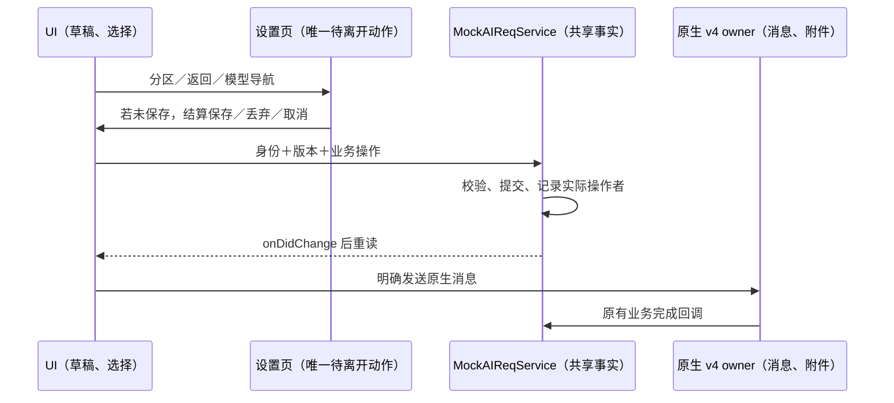
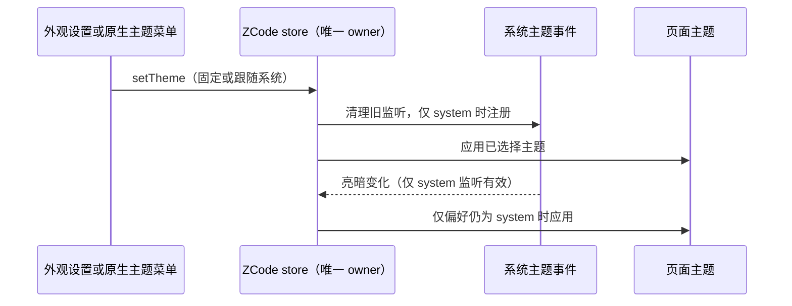
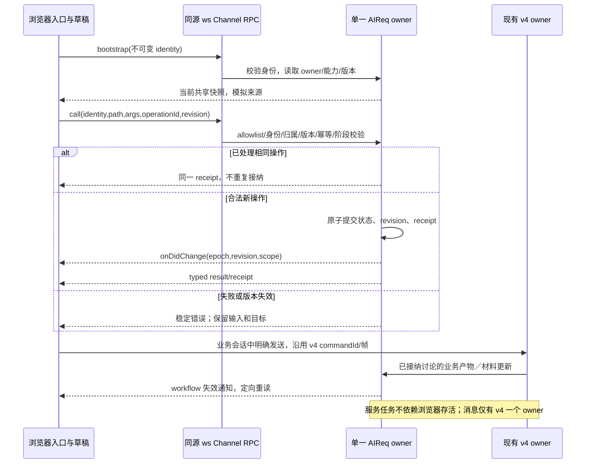
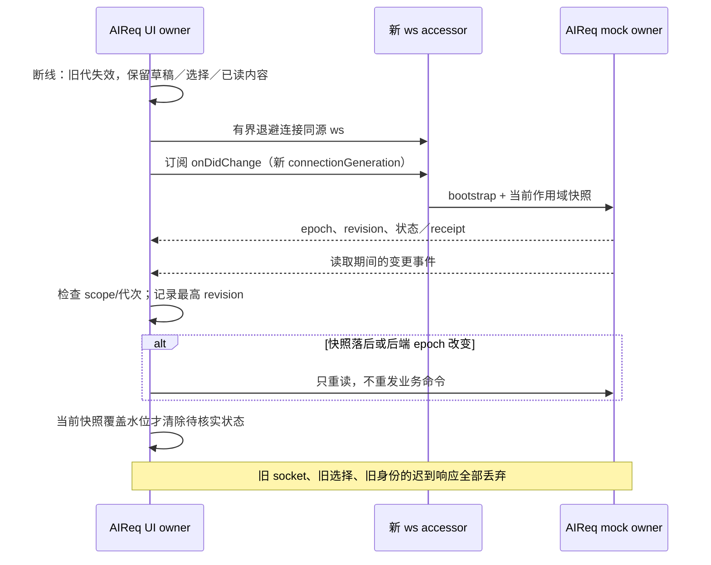
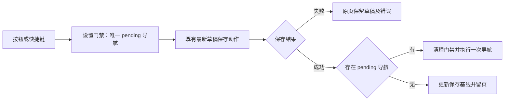

# AIReq 迁移：公共契约、唯一入口与集成规格

> 当前产品前端与公开接口以 [发布边界](release-surface.md) 为准：原型／调试控制和场景身份参数已退出产品契约；下文相关模拟入口与浏览器故障注入记录仅属于历史版本，不构成恢复入口或接口的要求。

## 当前项目空间组织（2026-11-16）

当前[项目空间规格](project-space.md)和[导航可达性规格](navigation-usability.md)取代下方旧五／六项并列导航、混合项目总览、头像项目／Release 菜单及四设置分区。全局为项目／待办，无显式对象链接时登录与刷新进入全项目总览；项目内为概览／需求／分析运行，需求含提案／正式视图，同一 IR 的阶段及材料归属不变。工作台与设置保留固定 68px 导航栏；设置为外观／项目配置／AI 配置，AI 内为模型／Agent 指令／分析设置。

`AIReqContext` 继续唯一持有导航、项目／Release 与目标需求；页头、选中和层级从同一选择派生，导航先经过既有未保存处理，再记录历史并读取目标投影。待办跨项目，新增只读需求名称／Release 字段从同一 IR 派生，不新增 RPC 或 UI 项目缓存。服务端仍唯一接纳业务事实，事件只使当前读取失效，不重放写入。三方确认动作在阶段主体直接呈现，材料区专注阅读；正式需求仍使用同页 IR／SR 报告与材料。

此前项目空间实施的静态检查与真实 Edge 电脑截图记录见[项目空间历史验证记录](project-space.md#本轮实际实施与验证2026-11-16)，仅证明该记录版本。下列分组及项目空间证据都不是本轮前端与公开契约生产整改的通过记录。

根 `.todo.md` 现行任务固定本轮整改范围与第 1→9 组执行顺序，[发布边界](release-surface.md)和不冲突的现行业务规格继续提供规则；被覆盖的旧任务与历史验收不授权恢复场景按钮、公开演示身份或已裁撤能力。Skill 主导航、设置与搜索入口继续隐藏，但全部保留实现属于整改与验证范围，可隔离临时装配到真实浏览器，不增加产品测试开关。工号非可信认证，合法身份／client、对象与会话归属、版本、幂等及阶段门禁不变；owner 不授予权限。后续组在 release-surface 记录自身直接证据，最终第 9 组只验收同次产物集成与契约 SHA-256，历史浏览器、工程或外部能力记录不得冒充本轮通过。

## 历史实施组 3：项目进度与当时导航

本组以前两组已勾选的真实验收为前置，只增量实现项目／Release 纯派生汇总与最终布局；第 2 组当时的四导航与第 3 组当时的五导航仅属历史。当前六导航依次为“项目进度、待办列表、正式需求、需求提案、进度分析、Skill 设计”，登录及刷新默认项目进度。无独立新建提案导航、旧侧栏提案列表、Issue 或 AIReq 自动化；Skill 设计是主页面，不在设置导航或搜索中，旧 `skill` 设置偏好回到项目设置。保留 Skill 原生会话、预览、模拟保存、设置往返草稿及唯一未保存门禁。

`MockAIReqService` 在既有 `readWorkflow` 返回 `view.projectProgress`，覆盖所有项目的全部 Release 及逐 Release 汇总；计算函数位于公共进度契约。它只读已接纳事实，不保存第二份项目进度、不添加另一 RPC 或事件通道。项目总进度直接平均全部正式 SR；IR 摘要、无正式 SR、未分析、99／100 及展示规则见 tracking 当前第 3 组条款。

项目页的当前详情与正式需求／提案／分析共用 `AIReqContext` 项目及 Release；全项目列表统计不受当前项目的 Release ID 错误过滤。概览到项目与正式对象走既有未保存门禁、选择和历史，保留读取代际与工号隔离。无项目／Release 提供设置入口，不自动创建、不取其他对象兜底。owner 提交事实再发事件，UI 重读投影，不重放写入。

本组验收采用 tracking 的第 3 组场景：不同 SR 数的 IR 聚合、空／未分析／验收与新增转正、业务按钮驱动同步及多标签页、最终导航与范围历史、未保存门禁和电脑深浅主题。完成后运行 typecheck、lint（含相关 Hooks）及 architecture:check --changed，记录真实结果后才勾选；不新增测试体系、不重跑前两组未变业务链、不提交或推送。

### 第 3 组实际交付与验收记录（2026-11-15）

以下命令和 Chromium 观察均保留 2026-11-15 当时五导航／设置 Skill 版本，不能证明六导航在当时通过，也不授权恢复旧入口。后续主页面 Skill 的既有验收记录见 tools-settings.md 当前布局节。

- 前置 freshness 通过（main 相对 origin/main ahead 1／behind 0），变更前架构检查 0 违规，已读取 aireq-contract／aireq-mock／aireq-ui context、DESIGN 及适用技能。先更新本组规格，再实现公共投影、唯一 mock 读取和项目页；模块契约、公开调用示例、帮助及 project-goal 同步。没有新增业务事实 owner、RPC、缓存或测试体系。
- 最终 `bun run typecheck` 通过；`bun run lint` 为 0 warnings／0 errors（2303 files，相关 Hooks 无诊断）；`bun run architecture:check --changed` 为 0 violations／0 baseline／0 new。首轮类型文件 805 行超过 800；先移至进度文件产生类型循环，再将无依赖投影类型独立为 `progress-types.ts`，保持公共入口导出，最终上述检查全部通过。未改忽略的基础控件、工程测试／门禁配置；未运行 build、knip、全量工程测试或推送检查。
- 真实 Chromium 中确认五导航顺序为项目进度、待办列表、正式需求、需求提案、进度分析；重新登录仍默认待办。没有自动化、旧侧栏提案列表或独立新建导航。Skill 设计仍在设置，实际会话、说明表单、输入与临时文件入口正常加载。
- 项目进入、Release 与全部 Release、IR／SR 按钮打开原正式表及同页报告；后退恢复 Release 范围、前进恢复正式对象。从 Aurora 切 Mobile 自动清除 Aurora Release，选项仅含 Mobile 的两个 Release；选择“2026.12 · 离线体验”后，正式表为 0 IR／0 SR、分析为 0 SR，返回概览仍同范围，无跨项目兜底。全项目总表始终保持各项目全 Release 统计。正式表／分析页受影响选择器同批补齐未保存门禁与项目过滤。
- 新建提案保留未保存原文时，通过真实 history.back 触发原生确认：dismiss 保留原文及当前项目／Release；accept 丢弃，再前进并打开新草稿为空，没有恢复已丢弃文本。浏览器工具最初在未处理原生 confirm 时阻塞，改为显式 accept／dismiss 策略后完成验证；未为此修改应用或放松门禁。
- 本组真实新增 `ir-demo-16` 从创建推进至文档合入并验收两 SR；与既有不同 SR 数 IR 核算项目与 Release，验证提案不计分母、未分析 0、合入 99、人工 100、新增转正下降和不舍入完成。`j00808877` 第二标签页持续同源自动重读。精确数值、代码与材料版本及纯函数舍入边界见 tracking 第 3 组记录；不把本组准备数据视作重跑前组所有失败路径。
- 浅色 1440×1000／1100×760、深色 1440×1000 真实截图检查项目表、IR 列表、控件、换行、报告按钮及页面滚动可读可用，不做手机或上游对照。稳定版本主操作／观察两个标签页的 browser errors 均为空。前端由本次 `bun run dev:web` 启动于日志确认的 5174，复用现有 3031 模拟后端；IPv4 readiness 探测未就绪但 localhost 浏览器实际可达。类型修正期间 watch 重启恢复样例是既有内存边界，最终 IR 的完整证据发生在最后代码修正之后。
- 交付汇总：组 1 的共享无权限配置、Skill 设置和自动化裁撤，组 2 的提案至验收／清理及待办证据继续有效；本组只补齐项目聚合与最终五导航，并在本组验证受影响路径。全部仍为内存模拟，不调用真实模型／Git／认证，不执行产品中的开发或测试任务。没有仓库临时验证文件，未提交、推送、部署或扩展功能。

## 第 2 组完整业务闭环：现行规则与阶段记录

依据根 `.todo.md` 第 2 组，本组先以 proposals、tracking、contract-design、conversation、document-surface 条款确立需求，再同步现有契约、服务和 UI 全部消费者。下列业务闭环继续有效；组 1 结果只作前置证据，不替代本组验收。下方实际观察、命令与“未实施第 3 组”仅描述第 2 组当时的交付范围，不表示当前项目进度尚未交付。

### 真实入口、作用域与所有者

登录默认项目进度，当前六导航及主页面 Skill 入口以上方当前规则为准。第 2 组当时只有“待办列表、正式需求、需求提案、进度分析”四个业务导航、Skill 在设置且未实施项目进度，属于阶段历史，不能据此删除当前入口。新增／CSV 从提案工具栏进入，旧侧栏提案列表与独立新建入口不再挂载。AIReq 自动化及其专属能力不恢复；模型、Agent、项目、外观设置与基础控件、Skill 和原生会话能力保留。

正式需求、提案、分析共用当前项目及 Release，全部 Release 可读，新增／导入须具体 Release；无项目／Release 提供设置入口而不自动创建或取另一项目。待办跨项目，可看我的／待认领／全部并定位具体 IR/SR 和阶段。导航、项目／Release、前进后退统一经过现有未保存门禁，保留身份隔离及迟到读取代际。

共享事实唯一归现有 `MockAIReqService/workflow`；类型与操作经既有 services 契约、RPC 白名单、data source 和 UI canonical port 接线。原生 v4 owner 保留消息、附件、订阅和水位。身份、参数、归属、版本、幂等、阶段和完整材料门禁全部保留，合法工号可代办但留实际操作者。业务先提交再发事件，刷新重连只读不重放写操作；同轮三路全部完成才汇总，迟到回调不得写当前版本。

### 本组连续验收场景

1. 新增短需求成功留表，无 AI／SR，失败保留输入；CSV 模板／预览／中文逗号引号换行／空行重复／错误整批拒绝及跨页原文导出。主动进入讨论才开始澄清。
2. 业务单 Agent 评审正常／阻断／失败，人工通过前无 SR；通过后至少两个 SR，分别查看独立 change 全材料与业务追溯测试方案。完整三路同版本、第四终审、人工及三个视角确认缺一不可，同人可兼任。
3. 分别改业务／SR 方案／测试材料验证整包批准失效；只改业务额外重做单评审。旧标签页及显式暂缓／释放旧 AI 结果不得恢复批准。
4. 整包 PR 冻结只读，待合并／关闭不转正，关闭修改后重新审查确认；缺材料／错候选不可转正。正确合入保留同 IR/SR，逐分支同文档合入基点、错误真实记录，重复核验不复制；正式表能读同材料。
5. 手动／定时分析、未变跳过、统一报告、失败保留、旧结果拒绝；模拟指定 SR 代码合入立即固定有效 99，与原 AI 评分分开。未合入或无依据禁止人工验收。
6. 测试失败仍 99，开发问题待办出现，不能直接再通过；模拟新版本修复合入后问题待复测、产生测试待办，人工通过才 100，AI 不覆盖。IR 及全部 SR 数值一致，非全部完成不显示 100。
7. 全部 SR 完成前禁止清理；完成后显示分支清单并确认，指定一次清理失败，重试仅未成功项；主分支、材料、报告、验收历史、进度保留。
8. 贯穿各动作观察待办归属／消失／深链接、联系人指定／领取、未认领、双工号代办、同人三视角、跨项目／Release、前进后退和多标签页更新。正常 AI、等合并、等调度无空待办。

所有模拟控制通过现有 `scenarios.ts`／`scenarioOperations`／`prototype.*` 正常入口影响外部输入，不能直接批准、转正或设置 100。真实 AI、Git 托管、数据库、认证及外部开发执行均不在范围；不运行平台业务构建测试或执行 tasks。

本组规格先行，再完整实现契约、服务、UI 和模拟入口，最后在本组收口前由主集成执行 `bun run typecheck`、`bun run lint`、`bun run architecture:check --changed` 并复核相关 Hooks，完成上述真实浏览器场景及文档记录，才能勾选并进入下一组；不能延到全部任务结束才首次验证。不新增业务单测／E2E／协议 harness，不默认跑 build、knip 或全量工程测试，仅为具体缺口补必要验证；纯文档同步仍按当前请求与仓库规则执行必要检查，不虚构通过。

### 第 2 组实际交付与验收记录（2026-11-15）

本段为第 2 组当时版本的真实证据，含其阶段导航及原生接线边界；后续组和导航更新不追溯改写这些记录。

- 前置 freshness 通过：main 相对 origin/main ahead 1／behind 0；变更前架构检查 0 违规，三个受管 AIReq context 已读取。保留原生消息／附件／订阅 owner，业务继续唯一内存 owner，通过既有二进制 RPC、data source 和事件更新，不新增平行存储或协议。
- 本组从真实新增入口的 `ir-demo-25` 连续经过原生业务澄清、单评审、两个独立 SR 全材料、完整三审终审、三个视角确认、整包 PR 冻结／关闭修改／重新提交、同候选合入转正、代码合入与人工验收，最终两个 SR 及 IR 为 100，再完成逐支清理及单项失败重试。主 IR／材料与各版本、错误拒绝及截图观察分别记录于 proposals、tracking 的第 2 组段落，不使用第 3 组项目页或内部状态写入捷径。
- 真实 Chromium 1440×1000；`j00808875`／`j00808876`／`j00808877` 使用各自标签页和普通工号入口。覆盖新增留表、CSV 模板与严格预览及实际跨页下载、无权限代办、联系人清空／领取／分配、待办跨项目／三个视角各自动消失、统一 Release、历史与未保存导航、浅／深主题。旧标签页确认被材料变化撤销；暂缓旧审查／旧分析结果均由 owner 拒绝。具体第一手对象和版本见领域记录。
- 浏览器发现并修复了普通按钮缺少 operationId／expectedRevision、背景重读吞提交错误、版本拒绝后表单基线无法显式恢复、完整方案伪选综合会话、定时在没有 running 时不接纳、样例 after 分数及同版 merged 文案不一致，以及观测时间错误推进业务 CAS 等问题。没有通过放宽身份、版本、幂等或人工验收门禁掩盖失败。
- 最终执行 `bun run typecheck` 通过；`bun run lint` 为 0 warnings／0 errors；`bun run architecture:check --changed` 为 0 violations／0 baseline／0 new。相关 React Hooks 无诊断，未改根 Lint 忽略的基础控件目录，不额外跑全库专项扫描。未修改工程测试配置，不新增 App 单测／E2E harness／协议测试体系；未额外运行 build、knip、全量工程测试或推送检查。
- 运行使用 `bun run dev:web` 的 Vite `http://localhost:5174` 与现有 `3031` 模拟后端；另起后台实例因 EADDRINUSE 未启动，已停止本次失败实例，未停止用户现有服务。Bun watch 在修复时重启并恢复样例是既有边界；主 IR 完成与清理证据记录的是修复前当次真实内存事实，最终仅样例文案和观测 CAS 修复后按影响范围复验，不伪称演示对象跨进程持久保存。
- 最后观测 CAS 回归使用等 PR 样例 `draft-audit-subscription`／MR `#101` 作独立时钟观察：实际最近／下一次检查从 21:59:51／21:59:56 推进至 21:59:56／22:00:01，`ir-notifications` 的清理确认仍可提交、无版本警告（取消，未删除）；`sr-export-head` 的验收弹窗在 22:00:26／22:00:31、22:00:31／22:00:36 两次实际检查后仍保留依据、确认可用（取消，未验收）。真实业务版本变化的拒绝继续成立；该稳定观察窗口浏览器 errors 为空。自建验收标签页已关闭。
- 所有 Agent、材料、Git／PR／分支、报告均明确模拟，无真实模型调用、Git 托管写入、数据库、认证或业务开发执行。本组没有手机测试、上游源码／截图比较、提交、推送、部署或第 3 组实施；临时输入与下载证据不作为产品文件保留。

## 历史实施与验收记录（第 2 组之前）

以下组 1、裁撤、源端迁移及既往观察保留版本边界，不是第 2／3 组或当前六导航的通过证据。旧默认需求分析、首发聊天创建、四阶段／IR change／后置测试 Agent、旧完成权限、自动化保留及 Skill 设置入口均已被根 `.todo.md` 和本文当前条款替换。与新规则不冲突的控件、状态所有权、失败保留及 UI 细化继续有效；各处历史证据只证明当时版本。

## 历史实施组 1：无权限门禁与当时工具入口

本节记录组 1 当时的范围，不授权恢复旧导航。无权限规则继续有效：共享配置仍仅由 MockAIReqService 内存域接纳，合法工号均可操作，身份只用于留痕及会话隔离。服务与 UI 同步移除 owner／负责人独占操作，保留 allowlist、合法 employee/client、对象归属、预期版本、参数、幂等和业务阶段／完成条件。

历史入口：组 1 曾将 Skill 设计放入设置分区，现已由主页面 Skill 取代。原生消息／附件仍归既有 v4 owner，设置及模型往返保留会话和未发送草稿；所有离开入口消费唯一未保存门禁，这些约束继续有效。裁撤 AIReq 自动化专属页面、模拟实例、manifest 与其独占 RPC／数据源字段，不影响通用控件或进度分析调度。下方组 1 验收只证明当时版本，不证明当前六导航。

共享设置不再投影 `settingsWrite` 权限布尔值。业务命令回执记录请求身份；配置保存／负责人分配等成功调用通过现有服务日志记录实际工号、clientId、操作名及时间，不保存提示词／业务正文。日志只覆盖进程生命周期，不承诺数据库审计。服务日志沿 `@zcode/services/logger` 公开入口复用现有 `createServiceLogger`。



组 1 已收口（2026-11-15）：最终 typecheck、lint（0 warning／0 error）、架构检查（0 violation）及本组真实浏览器场景通过；对象、版本、双工号保存、门禁、Skill 全文件模拟保存与附件保留的证据见 tools-settings.md“组 1 实际验收”。本次只勾选 `.todo.md` 第一组，未实施第二／三组，不提交或推送。

## Issue 功能裁撤（2026-11-15）

本节取代本文及 tracking、tools-settings、todo 中此前要求迁移 Issue 的条款。当前产品只保留需求管理；删除“新建 Issue／Issue 分析／Issue 进度”三个入口、页面、导航类型与专属草稿，不以隐藏按钮替代删除。登录标题与说明同步移除 ISSUE 产品承诺。

服务端删除 Issue 内存状态、样例、调度、订阅与 `issues.*` 分派；公共契约、数据源和事件联合不再开放 Issue 类型、方法或通知。移除 `issue-analysis` 模型角色及个性化配置，不留下别名或空实现。需求报告中的问题／风险字段不属于 Issue 产品，继续保留。

保留需求提案、正式需求、进度分析、主页面 Skill 设计、项目／Release、设置及全部通用控件和原生 v4 会话能力；不改变这些能力的状态所有者、调用路径和协议。早期曾保留 AIReq 自动化的要求已被 `.todo.md` 裁撤规则取代。

当前验收要求：真实电脑浏览器登录前后均无 Issue 产品文案及三个入口，默认项目进度、六导航及保留设置正常；旧 `issues.*` 由既有操作白名单拒绝。相关实现必须在所属组内完成检查、浏览器验收及记录后才能进入下一组，不延至所有组结束统一验证；本次纯文档同步不执行验收。

### 技能设置页裁撤

删除设置中的“技能”分区、搜索目标、恢复该页的导航映射与专属目录组件，同时删除仅供该页使用的 `skills.list` 普通业务操作及数据源字段。旧的 skill 设置偏好按既有默认规则回到项目设置，不增加兼容页面。保留工作区独立“Skill 设计”、设计预览／模拟保存所需目录数据和全部通用技能控件，不修改原生服务的通用技能能力。

设置只保留外观、项目／Release、模型、个性化四个分区。电脑浏览器验证设置侧栏及搜索不再提供技能页、旧偏好不打开空页，Skill 设计仍可进入。

## 无损资源清理（2026-11-15）

本节是当时资源清理范围与实测记录。下列保留 Scheduled／NativeTaskRuns／自动化入口、默认需求分析及全量完成后统一构建验收的指令已经被 `.todo.md` 替换，不是当前任务；仍有其他用途的通用控件、底层设施、翻译与发布资源要求继续有效。记录中的“本轮”均指该历史清理版本。

本轮仅清理已关闭的旧产品分支及冗余发布资源，不裁撤现有 AIReq 功能，不改变服务端业务 owner、工号／workspace 身份、v4 帧、会话发送和重连规则。保留提案、评审、正式需求、需求分析、定时自动化、NativeTaskRuns、Skill 设计、Sketch、普通工具文本、Markdown、Mermaid、代码高亮、公式及全部通用控件。

- 自动化收敛为当前可达的 Scheduled 与 NativeTaskRuns；移除固定 `scheduledOnly`／`nativeWorkflowContent` 接线下不可达的闲时任务与旧 Saved Workflow 中枢专属分支，保留列表、编辑、启停、模拟立即运行、历史、筛选和既有草稿语义。不增加另一份任务状态或服务实现。
- 当前 Web 平台不提供 `pluginSandbox`，不承诺 Plugin UI／Gen UI／桌面扩展沙箱呈现。断开其不可用的产品渲染与宿主接线，普通 assistant 正文仍经原 MessageResponse 显示，普通 MCP 文本工具结果仍正常可读；不可用交互资源不得假装加载或执行成功。仅在全部消费者退役后移除专属实现与 SDK 依赖，不删除通用弹层、布局、代码／图表控件，不改变 v4 wire 契约。
- 中文表只删除确认没有保留代码消费者的旧产品词条；静态与动态 ID、模板前缀、通用控件、异常和隐藏交互分支均计入消费者。不得用未翻译 ID 回显或宽泛默认文案代替丢失的翻译，不删除仍供保留资产使用的词条。
- 生产源码映射与公式字体发布规则遵循 `docs/architecture/web-build-workflow.md`；保留开发调试与现有电脑浏览器兼容能力。

验收：代码和文档全部完成后集中运行 typecheck、lint、架构检查与受影响既有工程测试，构建一次并确认生产目录没有 `.map`、WOFF／TTF 兼容副本及失效字体 URL。真实电脑浏览器验证登录、默认需求分析、提案／Skill 对话与材料、自动化列表／编辑／模拟运行及历史、NativeTaskRuns、设置，以及公式与代码／图形阅读；检查相关中文文案、字体加载和控制台。体积报告区分磁盘产物、入口脚本和实际网络，不把删除 map 说成同额首屏加速；不新增永久测试文件或用例。

本轮实测：根 typecheck、lint（最终 0 警告／0 错误）、architecture:check --changed（0 违规）、前后端生产构建通过；现有 Vite 工程测试 6 项通过。生产 Web 目录 22,727,406 字节（21.67 MiB），没有 `.map`、WOFF 或 TTF，19 个独立 WOFF2 文件的 CSS URL 均有效。中文表保守删除 36 个确认无消费者的旧词条（源码减少 2,497 字节）；归档、项目管理等仍有动态或保留控件消费者的词条未删。MCP Apps 三项 SDK 仍供保留的旧壳／扩展资产使用，未卸依赖。

隔离生产服务与真实 Chromium 1440×1000 验证：工号进入、默认需求分析、自动化筛选／编辑保存、立即运行后的手动 stopped 历史与只读会话；选择现有提案后 NativeTaskRuns 的 task／workpool 与报告输出可读。提案显式发送补充后正文正常、材料实际显示行内／块级公式、JSON 高亮和 Mermaid；深浅主题截图确认保真，KaTeX_Main／Math／Size1 实际经 WOFF2 加载，辅助 MathML 层仍裁剪。Skill 表单回填、明确发送、临时文件预览及全部文件模拟保存正常，设置可进入；最终浏览器错误与 warning 均为 0。未重走全部历史业务／浏览器组合，未测首屏提速；旧 dist 不是同源码基线，不将其体积差作为此次精确性能收益。

## 废弃接口与实现清理（2026-11-15）

本节保留当时退役范围及命令／浏览器证据。下列自动化保留、旧流程与最后集中验证仅属该历史版本，不再授权当前产品入口或验证时序；无消费者专属接口应删除、通用资产与原生 owner 应保留的原则仍有效。

当前业务不消费的终端、Git 检查点、营销触达、Desktop Provider Provisioning、会话分享与商业订阅交易接口全部退役：同步移除专属契约、客户端代理、服务注册、模拟实现、失效导出与架构登记；仍有旧调用链的先移除专属消费者，不保留兼容别名、空实现或假成功。清理无消费者的 AIReq 响应封装与原型辅助函数。
商业灰度查询随订阅服务退役，不得借此启用以前不可用的旧工作流 Resume／配置／保存入口；删除这些专属入口和调用，保留 Scheduled 自动化及 NativeTaskRuns 的只读运行、材料和原生会话展示。

保留当前需求提案／评审／模拟 MR 入库、正式需求／排期／需求分析、Skill 设计与内存保存、Scheduled 自动化／NativeTaskRuns、设置及其模型目录、原生 v4 会话与附件。业务事实继续由现有 AIReq 内存 owner 和 MockRuntime 各自持有，不新增状态、传输或写入路径。通用控件及仍被保留能力消费的共享类型不因旧业务裁撤而删除。

验收：被裁撤 descriptor 不再注册或由浏览器 SDK 提供；废弃契约与专属消费者无残留引用；typecheck、lint、架构检查通过。完成所有代码与文档后集中验证，复用现有运行场景确认工号进入、需求分析、提案／Skill 对话和自动化仍可用，不新增永久测试用例。

本轮实测：根 typecheck、lint（最终 0 警告／0 错误）、architecture:check --changed（0 违规）及前后端 build 通过，构建仍有大 chunk 提示。隔离服务与 Chromium 1440×1000 验证工号进入、默认需求分析、提案补充发送与内存回复、Skill 明确发送／两文件预览／全文件模拟保存、自动化列表与手动 stopped 历史、NativeTaskRuns 的 task／workpool 及报告、设置入口；观察区间页面错误与 console warning 均为 0。未重复完整业务链、全部主题及浏览器兼容矩阵；未新增永久测试或验证脚本。

## 1. 事实依据与冲突裁决

源路径以下相对 `F:/code2026/oh-my-pi/packages/aireq-frontend/`，仅供调查，不可成为构建或运行时依赖。

| 已读事实来源                                                                       | 当前事实及目标裁决                                                                                                                                                                                                                             |
| ---------------------------------------------------------------------------------- | ---------------------------------------------------------------------------------------------------------------------------------------------------------------------------------------------------------------------------------------------- |
| `app/bootstrap.tsx` → `client/remote-data-source.ts` → `app/AIReqApplication.tsx`  | preview/runtime 使用同一应用；源端 HTTP bootstrap/call、事件 WS、services WS 三路接入。目标只保留当前同源 `/ws` 二进制 Channel RPC，不复制源启动器、HTTP 路由或独立进程。                                                                      |
| `backend/contract.ts:43,92-201`                                                    | 当前合同为 **3**，不是 README／源 `aireq-browser-workbench/spec.md:32` 的 version 1。以当前 operation 参数／结果及实际可达行为为业务参考；HTTP envelope/version 冻结条款不约束目标传输。                                                       |
| `backend/scope.ts`、`prototype-data-source.ts`、`mock/backend.ts`                  | 单 worker 原型 owner、请求局部身份、内存任务；目标单 mock 进程内一个 AIReq owner，移除 worker 与旧协议，普通业务显式传入请求身份；server 局部 AsyncLocalStorage 可为迁入的纯 mock getter 提供并发安全上下文，不能使用全局可变工号。            |
| 源 `AIReqContext.tsx:63-198`、`navigation.ts`                                      | 源端历史默认需求分析已取代；当前登录／刷新默认项目进度。当前生命周期支持前进／后退，切项目保留功能页并清理旧对象，不恢复旧聊天或重放写入。                                                                                                     |
| 源 `AIReqSidebar.tsx:55-67` 与 `WorkspaceShellLayout.tsx:1489-1490,1723-1813`      | 历史源端曾装配提案、自动化、Skill、需求分析、正式需求、Issue 与设置；不是当前入口清单。当前按六导航，Issue 与 AIReq 自动化专属能力已裁撤，不能凭旧类型恢复能力。                                                                               |
| 源项目对象仍含 `root/commonDir`，应用启动要求 workspace.path；源规格只要求远程仓库 | 项目用户模型为名称＋远程仓库＋默认分支，Release 继承仓库；遗留路径仅作服务端模拟 workspace 标识，不展示目录恢复页、不要求用户选服务器目录，不转换为 `VirtualProject`。                                                                         |
| 源 mock 权限                                                                       | 源固定 owner／visitor 写入限制为历史，已裁撤。全部合法工号可配置、代办、认领；来源 owner 和联系人／负责人不是权限，仍校验身份、归属、版本、幂等及业务阶段。                                                                                    |
| 源规格的旧控件复制、Firefox 上限／禁止 polyfill、OMP 独占部署条款                  | 目标使用当前 ZCode 控件、已有补丁和运行环境，不复制源控件／主题、不启动 OMP。历史 Firefox 要求不新增当前兼容矩阵；任何浏览器证据只归实际运行的浏览器，不以 Chrome 代称 Firefox。                                                               |
| 实施前目标 `Root.tsx/App.tsx` 与源 `AIReqApplication.tsx`                          | 历史调查：旧目标整棵 Root/App 绑定目录、账号恢复及文件／Git 主壳，不适合复用。当前已移除旧产品专属 App/Root 入口，改由独立 AIReqApplication 与业务壳装配必要 Provider、基础组件及 v4 会话竖切；全部通用控件和通用资产保留，不移植源 Root/App。 |

源 `openspec/specs/aireq-browser-workbench/spec.md` 的业务用途、明确发送、共享后端、需求管理非编码、讨论与只读材料、远程仓库和状态门禁继续适用；布局与显示仅依当前 ZCode，不以源三栏几何作为约束。真实 OMP 接入及持久化不是本次交付；旧 SR 编码、执行／验收 Agent、自由聊天等类型与样例不因此重新开放。

## 2. 页面与入口可达清单

本表按根 `.todo.md` 的当前入口与业务流程维护；源 sidebar、shell 与 SettingsPage 仅作历史调查，不能凭文件存在恢复已裁撤能力。

| 源实际入口／子面        | 目标工作区与服务                                   | 可观察验收                                                                                                                                                                          |
| ----------------------- | -------------------------------------------------- | ----------------------------------------------------------------------------------------------------------------------------------------------------------------------------------- |
| `AIReqEntry`            | 现有 `packages/web/src/auth` owner，AIReq 登录内容 | 标题“以AI为中心的需求管理平台”；副标题“与团队一起澄清需求、评审方案和跟踪需求进度”；工号、进入工作台、标识非认证说明。表单 Enter 与按钮一致，空值禁用，非法值就地报错，前导零保留。 |
| `AIReqContext` 默认导航 | `AIReqApplication` → 项目进度                      | 初次进入、重新登录和刷新默认项目进度；合法工号重读共享状态，草稿、历史、读取代际和唯一未保存门禁保持隔离。                                                                          |
| 新增提案／需求提案表    | 提案工具栏；workflow                               | 独立保存原始短需求后留表，无 AI／SR；CSV 只创建提案，主动点讨论才进入澄清。四数据列、导入预览与跨页仅原文导出按 proposals 当前规则。                                                |
| 提案阶段、评审与材料    | 同一 IR 讨论与材料区；workflow、readPrHandoff、v4  | 原始单 Agent 评审＋人工后拆 SR；同一方案阶段完善所有 SR 独立 change（含 test-plan），完整三审／第四终审／人工／同版三视角确认后整包 PR；冻结、先关闭再修改，同候选核实合入后转正。  |
| 项目进度／待办列表      | 项目纯派生汇总与服务端待办投影                     | 项目／Release 直接均正式 SR；待办跨项目、支持我的／待认领／全部，由业务事实派生，不允许手工勾选绕过门禁。                                                                           |
| Skill 设计              | 独立内容区；skillDesign 与 v4                      | 说明表单、可折叠左栏、可编辑准备草稿、明确发送、临时文件 Tabs／预览、明确目标与模拟保存；关闭分栏不丢草稿。                                                                         |
| 进度分析                | 独立内容区；progressScheduler                      | 与正式需求／提案共用当前项目和 Release，可读全部 Release；保留手动／定时、筛选、分页、报告与失败反馈，成功结果统一回写，失败保留旧进度，迟到结果按版本拒绝。                        |
| 正式需求                | 大表格＋同页右栏；workflow、planning、progress     | 无正式需求树／开发聊天；IR／SR 选择只改变报告／材料，保留筛选、滚动、展开与分栏；分支复制和人工完成门禁生效。                                                                       |
| 项目／Release 菜单      | footer 菜单；workflow、projects                    | 当前工号／切换工号、Web 所有者样例、项目单选、Release 单选、添加／管理、帮助；Release 仅列当前项目的项。长名称完整 title 可读，无项目和无 Release 文案不同。                        |
| 前进／后退              | AIReqContext 单一 history owner                    | 浏览器前进／后退恢复历史；新导航截断 forward 分支；只改变浏览选择，不发消息、不推进阶段；失效对象提示不可用，不偷偷创建。                                                           |
| 设置                    | AIReqSettingsPage（复用当前控件）                  | 外观、项目／Release、模型、个性化四项全体合法工号可配置；Skill 不在设置或搜索，旧 `skill` 偏好回项目；保存／取消、大小与版本校验、唯一未保存门禁保留。                              |
| 帮助／输入辅助／弹窗    | 当前 Dialog、Dropdown、Tooltip、Input、Button 等   | 帮助关闭回触发按钮；菜单／弹窗可键盘打开、取消、关闭并还原焦点；Sketch 只回填 PNG，语音仅示例文字；无音频权限请求、自动发送或隐式推进。                                             |

所有首次读取有加载／空／失败三态；背景重读保留已读内容、滚动及打开的报告，固定位置反馈错误；明确材料“生成中／尚未生成／缺失／读取失败／版本过期”，与网络断开分开。消息、附件、模型与目标在失败／取消后保留。完整页面字段和按钮的业务细节由各领域规格补足，不以本表概述缩窄范围。

### 2.1 原生 footer 的业务菜单端口

项目／Release 入口必须装配当前 `WorkspaceSidebarFooter`，保留其 Avatar、Button、独立设置齿轮、DropdownMenu 和原生主题子菜单；不复制源 footer，不使用常驻 HTML select 或工号／帮助图标条。通用 footer 仅增加可选 presentation 端口（ReactNode 菜单内容、标题、次行说明、无障碍标签和触发按钮 ref）；未传端口时默认产品的 DOM、菜单顺序与账户／用量行为不变。自定义业务菜单模式不挂载账户／用量／entitlement 查询组件，不显示登录、Coding／Office 或旧产品账户菜单。

`AIReqWorkspaceFooter` 经当前 AIReq context/data-source 读取项目、当前项目 Release、工号和 `backend.owner`／provenance，不制造 UserInfo 或第二份选择状态。主菜单按工号、切换工号、Web 所有者（sample 标注演示）、项目单选子菜单（添加或管理项目）、Release 单选子菜单（添加或管理 Release）、帮助、原生主题排序；无项目禁用 Release，无 Release 提供明确空态。项目／Release 命令只经已注册的 `ai.navigate` 未保存门禁接纳。管理回调显式进入项目设置，齿轮回调打开 shell 记忆的设置页，切换工号调用既有退出回调。设置 back 模式保留身份、切换工号、帮助和主题，齿轮执行同一受门禁保护的返回回调，不恢复旧产品账号或用量功能。主题只使用当前 ZCode store 的 system／zai-dark／zai-light。

footer 的原生偏好菜单恢复“界面缩放”，主工作区和设置 back 模式均保留；主题之后提供放大、缩小、实际大小及平台对应快捷键。菜单和键盘统一调用 Web 平台端口，规则与验收见 `docs/ui/browser-capabilities.md`，不恢复桌面宿主或旧账户功能。

主题唯一所有者为现有 StoreProvider 创建的 ZCode store（与 `base` App 读写路径一致），AIReqApplication 不额外挂载带独立状态的 useTheme。事件顺序与边界如下；固定主题时，旧系统监听必须被清除，系统事件不得覆盖选择。用户指定本轮不运行浏览器验证。



本轮六项修复验证：`bun run typecheck` 通过，`bun run lint` 为 0 警告／0 错误，`bun run architecture:check --changed` 为 0 违规。Bun + JSDOM 临时场景调用真实 ZCode store，验证 system → 固定深色 → system → 固定浅色，系统明暗事件不覆盖固定选择，监听数量依次为 1／0／1／0。未打开浏览器，1100×450 布局与其余视觉效果由用户验收。开工 freshness 检查因 `git fetch origin --prune` 的 TLS 握手失败未完成，本轮以本地 `base` 为视觉参照。

帮助复用当前 Dialog/Button 和受限滚动区，完整说明当前提案、评审、方案、三方确认、整包文档 PR、转正、分析、人工测试及分支清理流程，不以旧八步流程或简短占位替代。待办是派生事实；平台不执行开发或测试；模拟项目与后端内存边界如实说明。关闭／我知道了回焦到实际打开帮助的 footer 按钮；每个 footer 自持触发 ref，onHelp(returnFocusTo?) 传递具体按钮，帮助组件消费 returnFocusRef，不持有导航状态。

流程帮助的主要说明沿用户指定 `base` 正文角色使用 `text-ui-base leading-6 text-foreground`，不得沿用辅助字号和弱化颜色。保留步骤标题、序号及弹窗交互，不固定旧八步业务顺序，内容跟随当前完整流程；既有未运行浏览器的显示修复记录不作为本次验收。

## 3. 公共契约与最小传输设计

### 3.1 公开 API

`packages/services/src/aireq/` 拥有浏览器安全领域类型、纯派生函数及服务合同；当前源文件按职责分置，业务不依赖源仓库。身份以显式请求参数传入 server，服务端局部请求上下文不进入公共领域层。

公开 descriptor 为 `IAIReqService`、channel 为 `aireq`、accessor 字段为 `aiReqService`；服务公开入口为 **`@zcode/services/aireq`**，根入口导出 descriptor，不公开 mock 实现。UI canonical port 为 **`packages/ui/src/aireq/contract.ts`**：具名选择性导出服务公共类型／纯派生与 `IServiceAccessor`，并定义应用 props／主视图；业务页面、hook、shell 经相对路径消费该 port，不直接导入 services，不维护第二套领域类型。UI `index.ts` 仅公开应用与 props；server 不能从 UI 取领域类型，UI 不能从 server 取类型。

服务接口以 `packages/services/src/aireq/contract.ts` 为准，实际 operation tuple/result 白名单位于 `remote-operations.ts`：

```ts
interface AIReqIdentity {
  employeeId: string;
  clientId: string;
  demo?: string;
}
interface IAIReqService {
  bootstrap(identity: AIReqIdentity): Promise<AIReqRemoteBootstrap>;
  call<P extends AIReqRemotePath>(
    identity: AIReqIdentity,
    path: P,
    args: AIReqRemoteArgs<P>,
    selection?: AIReqSelection,
  ): Promise<AIReqRemoteResult<P>>;
  readonly onDidChange: Event<AIReqRemoteEvent>;
}
```

当前 `AIReqRemoteOperations` 以 `Operation<args,result>` 生成 correlated path/args 判别联合，不能用 `(path: string, args: unknown[]) => any` 替代。`readWorkflow` 一并返回 view/session/workspace，保留会话／材料关联。bootstrap 返回合同版本、backend 模拟归属、provenance、能力、serviceManifest、初始选择、模型配置与 revision、已存提示词、样例目录／协作元信息；`projects.directories/developmentRoots` 只是模拟资源标签，不开放目录选择或真实 fs。bootstrap 不返回所有分页报告或用户未发送草稿。

`ProxyChannel.toService` 将普通方法名和参数数组交给 `channel.call`，`fromService` 用 `target.apply(handler,args)` 分派；generic 在运行时擦除，不影响映射。`onDidChange` 自动转 listen，无第二 channel。**静态类型不是 wire 验证**：server 校验身份、operation allowlist、参数与领域约束。当前普通写入多返回 null，command 返回 `AIReqWorkflowResult/receipt`，Skill 保存返回专门 receipt；业务拒绝通过现有 RPC Error/message，事件错误使用类型化 error，不存在统一包裹所有调用的判别结果 envelope，也不能依赖跨 RPC 保留 Error 自定义 code。

UI 的 `data-source.ts` 保留源 hook／数据源接口的业务形状，改为这个 typed service 的适配，不保留 fetch、源 HTTP URL 或事件 WS。仅保留当前可达成员；删掉 freeChat、用户目录选择和旧开发动作的调用链与别名，不为兼容旧字段保留空实现。`connectWorkspace` 若仍为会话组件适配所需，只绑定当前 accessor 与已有会话服务，不新开源 `/api/aireq/services` socket。

### 3.2 源 operation 的明确映射

下列源名称是迁移调查映射，不是要求恢复的旧 API；当前公开操作以实际契约及根 `.todo.md` 的业务动作定义为准，已裁撤路径不保留兼容别名。

| 源 operation 组                                                                                                                                                                                | 目标处理／owner                                                                                                                                                                    |
| ---------------------------------------------------------------------------------------------------------------------------------------------------------------------------------------------- | ---------------------------------------------------------------------------------------------------------------------------------------------------------------------------------- |
| `readWorkflow`、`command(action,selection,revision)`、`readPrHandoff(group)`、`retryMaterial(path,selection)`、`retrySession(selection)`                                                       | AIReq owner；command 按当前开放 Action allowlist，保留失败 receipt、文件版本和返回 view。retrySession 只针对已有有效业务会话。                                                     |
| `progress.assignOwner`、旧 `progress.updateSr`、`planning.updateSr`                                                                                                                            | 现有 owner 接纳联系人／负责人及业务事实；不设操作者权限，仍校验复合归属、版本和阶段。合入固定有效 99，人工测试通过才 100；失败须问题处理、新修复版本合入和复测，不能任意改百分比。 |
| `projects.saveRepository(input)`；command 内 `registerProject/createRelease`                                                                                                                   | 同一 owner，远程仓库配置只校验并内存保存；名称、URL、默认分支、Release 项目归属均保留。                                                                                            |
| `models.read/save/samples/revision/bindingChanged`、`prompts.read/updateDraft/save`                                                                                                            | wire 保留实际 models 方法及 `prompts.read/save`；保存校验身份、版本和 UTF-8 上限，不校验 owner 权限。`updateDraft` 仅为 UI 本地编辑适配，不是 RPC path，不广播私人草稿。           |
| `skillDesign.session/binding/workspaceIdentity/read/saveDraft/prompt/temporaryDirectory/readPreview/listSkills/savePreview`                                                                    | 保留预览与模拟归属，个人设计草稿／会话按 employee+client 绑定；prompt 只准备草稿，savePreview 明确确认并改变内存样例，不写真实文件。逻辑临时路径不可用于浏览器 fs。                |
| `collaboration.peers`                                                                                                                                                                          | 只读样例协作投影；不引入真实员工目录或认证。                                                                                                                                       |
| `progressScheduler.read/queryTasks/queryRuns/readRun/setProjectEnabled/configure/runNow`                                                                                                       | 单 owner 调度器，保留服务端分页与全匹配范围；advance 仅受控演示场景，不作为浏览器计时器职责。                                                                                      |
| `prototype.setProposalMergeScenario`、`prototype.readPrHandoff`                                                                                                                                | 明确演示操作；不替代普通 readPrHandoff 与实际门禁，不自动将 opened/closed 当 merged。                                                                                              |
| `createFreeChat/readFreeChat/readRecentFreeChats`、`selectProject` 的后端全局选择；`projects.readDevelopmentRoot/listDirectories/check*Directory`、`prototype.directoryIssue/restoreDirectory` | 不进入目标产品公开操作集；目录恢复链和自由聊天已裁撤。项目选择只归 UI，业务请求必须显式带 projectId，不写全局 project context。                                                    |
| contract 中存在但页面不开放的旧编码／验收 Action                                                                                                                                               | 从目标可执行判别联合和 dispatch 分支去掉，不用 capabilities 隐藏按钮却留下可调用后门。材料历史仍按需求材料规则只读。                                                               |

源事件映射为单一 `onDidChange` 的 `workflow/models/prompts/scheduler/skills(sessionId)/error`；`freeChats` 不迁，`issues` 已裁撤。当前类型中的 `backendEpoch/revision/projectId/irId/operationId` 为可选字段，不能宣称每个通知均具备完整持久水位；事件只失效重读，不携带私人草稿，也不借用 v4 的 `seq/logEpoch/subscriptionId`。来源错误转固定错误反馈，不当作成功变更；§3.4 的一致性场景仍是验收要求。

### 3.3 单一状态所有权、ID 与隔离

| 状态                                                                                                | 唯一 owner／作用域                                                                                           | 非 owner 的职责                                                                                                                  |
| --------------------------------------------------------------------------------------------------- | ------------------------------------------------------------------------------------------------------------ | -------------------------------------------------------------------------------------------------------------------------------- |
| 项目、Release、IR／SR、材料、文件摘要、评审、确认、MR／合入事实、正式进度、排期、报告、操作 receipt | server 单一 `MockAIReqService`／AIReq 内存域，同一 mock 后端全工号共享                                       | UI 只保留可丢弃读投影；无 localStorage 业务数据库，无每工号复制项目／需求。                                                      |
| 模拟分析任务、文档合入检查与业务产物                                                                | 单一 AIReq 内存业务 owner；native 消息／附件归既有 `MockRuntime` v4 owner                                    | 页面不拥有业务 timer，不因离线取消，不在 mount 自动发送或 runNow。AIReq 自动化专属 owner／契约已裁撤，通用设施另有消费者时保留。 |
| 模型／提示词配置、版本、模拟 Skill 保存结果                                                         | 同一 server owner，Web owner 只标识模拟来源                                                                  | 全部合法工号可保存；切工号不切账号、凭据或配置根，保留表单保存／取消和版本校验。                                                 |
| 业务对话消息与附件接纳／帧日志                                                                      | 现有 v4 server owner，AIReq 只登记业务会话关联和产物；不得另建聊天数据库                                     | v4 SessionDataLayer 为会话投影 owner；AIReq 订阅材料变化，不复制消息真相。                                                       |
| 自报工号和登录／退出                                                                                | `browser-employee-entry`，当前标签页，sessionStorage                                                         | `^[a-z][0-9]{8}$` 严格校验 trim 后原字符串，不 lower-case／数字化；存储失败仍可本页使用并说明刷新不能恢复。                      |
| 未发送提案／Skill 输入、附件及临时模型选择                                                          | 既有 composer draft owner；key 含 backend ID、employeeId、client namespace、projectId、Release 或业务会话 ID | AIReqContext 仅导航与选择，不建第二份已接纳队列。创建提案独立保存短需求，不能依赖首发消息；换工号不能看到他人草稿。              |
| 浏览页、项目／Release／对象选择、history、筛选、排序、展开、面板尺寸、设置脏草稿                    | AIReqContext 与对应 UI controller；当前浏览器／标签页、项目和 Release 的正确作用域                           | 不写 server 当前项目；页面 history 不作为重放命令。                                                                              |
| 外观／字体／代码预览偏好                                                                            | 当前 ZCode 外观 store，浏览器本地偏好                                                                        | 不同步为后端共享配置。不同浏览器上下文相互独立，不将偏好算入业务 revision。                                                      |

ID 沿用源稳定 string ID，不将标题、数组索引、材料路径或百分比当对象 ID。Release 必须属于 project；IR 属于 project+Release；SR 属于 project+IR；会话绑定 project+IR/角色/轮次，Skill 独立会话绑定用户设计空间。每次读取／写入检查复合归属，不能在跨项目切换后凭同名 ID 误写。`root/commonDir/sessionFile` 若仍为 v4 需要，仅是模拟资源标识，绝不表示本机文件已存在。

每次 AIReq RPC 都传不可变身份快照；server 方法和异步 continuation 保留该上下文，不使用全局 `setEmployeeId`、全局 selectedProject 或连接共享可变身份。server 内可将显式请求身份放入局部 `AsyncLocalStorage.run` 以复用源纯 mock getter，异步延续必须保持请求隔离；此 Node 能力只属于 server adapter，不进入浏览器合同，也不替代每次业务 RPC 的 identity 参数。原生 `IZCodeAgentService` 方法不带工号：同源 `/ws?employeeId=...` 建连时校验并固定当前标识，逐连接 facade 将调用绑定此不可变身份，同时保留现有 `createZCodeAgentConnectionScope`；切工号关闭旧连接并换代，不在存活连接上更换 actor。准备／解析业务会话时由 AIReq owner 校验允许绑定，不能向别人的私有 Skill 会话发送；未经校验的 selection 不是权限，不修改 v4 schema 来伪装普通业务帧。

以下自动化 scope／收据及实测是裁撤前历史，不是当前保留 AIReq 自动化的授权，也不证明当前入口存在：

自动化只接受AIReq owner项目级 `readWorkflow({projectId})` 返回的真实样例root与 `aireq-mock:<project>` identity配对；不接受缺identity或 `aireq-remote:<client>` unavailable fallback，不为取得scope创建IR/会话。共享历史/task/workpool投影复检项目、定义、run/session关系，不借用个人Skill/未发送草稿身份。创建/重启/立即运行及删除的显式operationId由server按actor/client、方法和已验证scope存成功receipt；同ID同参数重取原结果、改参数拒绝，不依赖WeakMap对象身份。主集成已在重启后的服务实测自动化CRUD、筛选、暂停/继续、stopped运行记录与只读历史，实际代码预览及task/workpool/actor只读投影；另以克隆请求验证创建/运行/重启/删除不重复、改参数及错误scope拒绝、独立点击ID不同、visitor读取共享结果。没有执行真实模型、工具或自动化引擎。

### 3.4 版本、失败、幂等与连接顺序

以下一致性／失败约束继续适用于当前业务，但不是逐条已通过声明。实现按具体操作的 operationId／参数摘要和原生命令 registry 去重，事件只失效重读；不能宣称拥有统一 receipt 查询、全局 epoch envelope 或持久重放机制。旧 Issue requestId 和聊天首发创建机制仅属裁撤／替换前历史。

- server 接纳写入前检查合法身份、对象／原生会话归属、当前 revision、材料摘要及轮次，不设 owner／负责人权限。版本不匹配返回可读失效原因，保留输入、不自动重试；旧评审／确认只保留历史，不能再批准。
- 写入以作用域内稳定 operationId 和参数摘要去重，同 key 同参数返回同结果、不同参数拒绝；创建提案、整包 PR、转正、Skill 保存、建分支、清理和分析接纳不能重复产生对象。UI 禁用按钮不能代替服务去重，重启后的旧操作不自动重放。
- 接纳后的业务变更、receipt 与 revision 原子提交，再发事件；事件可以先于 RPC 响应抵达。UI 根据 revision 合并失效提示并重读，不要求 response→event 固定网络到达顺序。
- 连接 owner 沿用 web main 的 generation/attemptGeneration、断线 fail-closed 和有限退避，重连只建当前 `/ws` accessor；不搬 source 双 socket。UI application、个人草稿和布局 owner 不因 accessor 换代重建；只替换服务 attachment 和订阅。显式退出才卸载当前身份范围。
- 重连先安装事件订阅，再 bootstrap／读快照，读取期间按领域收集最高 revision；快照落后事件则补读，直到当前 epoch 水位覆盖。onDidChange 只做 invalidation，不声称拥有持久事件重放日志。v4 按现有 fresh-subscribe／snapshot 与 gap repair 实现，AIReq 不伪造水位。
- 每次读捕获 `{identityGeneration,connectionGeneration,selectionKey,requestRevision}`；任一变化则丢弃迟到结果。旧响应不能改新项目、材料、报告弹窗或把后台完成导航到旧提案。logout、unsubscribe 和旧 socket close 均使旧回调失效。
- 断线期间已发写入可能已接纳：UI 显示“结果待核实”，重连从 receipt／当前快照确认，不自动重发。用户明确重试必须沿用原 operationId。明确拒绝的请求不生成新成功记录。错误区分 INVALID_IDENTITY/INVALID_ARGUMENT/UNKNOWN_PATH/INVALID_ACTION/FORBIDDEN/NOT_FOUND/CONFLICT/BACKEND_UNAVAILABLE，不能以样例回退掩盖异常。





## 4. 模块登记、接线文件与契约生产顺序

### 4.1 登记与唯一集成负责人

当前已在 `architecture-policy.yaml` 与模块清单登记以下 managed 模块；下表记录真实 ID、层与公开面，不再是建议名称。根模块 unmanaged 不构成绕过登记的理由。

| 模块                          | 已登记根／层／公开入口                                                                 | owner 与允许依赖                                                                                  |
| ----------------------------- | -------------------------------------------------------------------------------------- | ------------------------------------------------------------------------------------------------- |
| `aireq-contract`              | `packages/services/src/aireq`；app 层；`contract.ts/index.ts`                          | requirements；requires services、shared、rpc；领域公共面保持浏览器安全。                          |
| `aireq-ui`                    | `packages/ui/src/aireq`；contract 层 `contract.ts`、其余 ui 层；`contract.ts/index.ts` | requirements；requires aireq-contract、services、shared、ui；canonical port 选择性复用服务合同。  |
| `aireq-mock`                  | `packages/server/src/aireq`；adapters 层；`contract.ts`                                | requirements；requires aireq-contract、services、shared、rpc；业务内存域单 owner，不反向导入 UI。 |
| 既有 `browser-employee-entry` | `packages/web/src/auth`；保持既有身份 owner                                            | 表单、严格校验、存储与不可变操作者，不拥有业务状态。                                              |

三个新增 managed 模块已有 `module.ts/contract.ts/contract.example.ts/CONTRACT.md`。后续新增依赖仍须先登记 requires；跨域命令在唯一 AIReq owner 编排，不另建 provider／状态表。合同和集中装配由主集成维护。

源码默认单文件不超过 800 行，不沿用源大页面 lint-disable 绕过。UI 当前按 `proposals/`、`tracking/`、`tools/`、`settings/`、`shell/`、`conversation/` 分工；根保留 data-source、AIReqContext、identity、canonical contract 与入口／模块元信息。按职责拆分不新增 owner，不在 UI 根创建 types/domain 兼容 re-export。

### 4.2 目标最小接线闭包

| 目标文件／目录                                                                                                      | 必要变更                                                                                                                                                                                                  |
| ------------------------------------------------------------------------------------------------------------------- | --------------------------------------------------------------------------------------------------------------------------------------------------------------------------------------------------------- |
| `packages/services/src/aireq/{contract.ts,index.ts,types.ts,remote-operations.ts,...}`                              | 已集成公共领域类型、operation map、错误、事件和纯派生；具体文件按职责拆分，不存在必须创建 `domain/*` 的约定。                                                                                             |
| `packages/services/src/index.ts`、`accessor.ts`、`packages/services/package.json`                                   | 导出 descriptor，登记 `@zcode/services/aireq` 浏览器安全子入口和唯一 `aiReqService` 字段；不导出 mock 实现。                                                                                              |
| `packages/client/src/remoteServiceAccess.ts`                                                                        | 依现有 ProxyChannel 模式构造 aireqService；无专用 HTTP client。                                                                                                                                           |
| `packages/server/src/aireq/*`、`mock/runtime.ts`、`mock/index.ts`                                                   | `createMockServices` 仅创建一个 `MockAIReqService`，注册其 `remote` 为 IAIReqService，并将同一对象传给使用既有 MockRuntime 的 MockZCodeAgentService；AIReq 业务域与 native v4 消息／附件 owner 各司其职。 |
| `packages/server/src/mock/index.ts`                                                                                 | 唯一集中装配点，经现有 ChannelServer 暴露 descriptor；没有 `mock/domains/aireq.ts` 第二实例，也不改造 rpc 框架。                                                                                          |
| `packages/server/src/http.ts`、`mock/zcodeAgent.ts` 等现有 v4 adapter                                               | 只做确有需要的会话授权／业务回复与当前 owner 接线，保留 LoggingChannelServer 和现有 connectionScope；不能把普通业务方法包装为伪 v4 帧。                                                                   |
| `packages/ui/src/aireq/{shell,proposals,tracking,tools,settings}/`、根 `data-source.ts/AIReqContext.tsx`            | 新模块独立主壳、页面与 typed service adapter；AIReqApplication/AIReqShell 在 shell，设置在 settings，不复制源通用 App／Root／WorkspaceShellLayout。                                                       |
| `packages/ui/src/index.ts`、`packages/web/src/main.tsx`、`packages/web/src/auth/{EmployeeEntry,contract,index}.ts*` | 唯一产品入口改为 AIReqApplication；保留当前兼容补丁、主题初始化、同源连接、错误边界与非认证身份 owner。迁移时同步 auth 模块合同。                                                                         |
| `architecture-policy.yaml`、相关模块 `module.ts/CONTRACT.md`、包 exports（仅确需新增公开子入口时）                  | 真实登记根和依赖边；跨包使用公开入口，不留失效路径或兼容 re-export。                                                                                                                                      |

当前 Provider 链为 AppErrorBoundary → ZCodeIntlProvider → LucideProvider → TooltipProvider → ServiceProvider（当前 accessor、工号／client 草稿 namespace）→ PlatformProvider → StoreProvider → TabStoreProvider → AIReqDataSourceProvider → AIReqProvider → AIReqShell。未引入目录 Provider、旧账号恢复门禁、旧 session/tab 自动恢复或旧 Root 的 DiffsWorkerPoolProvider；弹窗／toast 沿用当前实现。

会话分支才挂 `V4ConversationProvider`／`V4PaneConversationProvider` → 当前 `SessionPane`；正式需求、分析不挂它。`useWorkspaceServices` 实际依赖 TabStoreProvider 和 base service 注册，进入连接时 `registerBaseWorkspaceServices`，换 attachment／退出时按既有生命周期清理；仅用逻辑 workspace identity，不生成第二远程 workspace 连接。必要的 Tab 只是组件上下文，不恢复旧任务导航。分栏拖动只变布局，不改变 session key、订阅 scope 或重建会话。当前 SessionPane 必须禁止旧文件／Git／自由聊天入口，但保留合法附件、草稿与临时模型能力；不能另写一个聊天组件规避其依赖。

#### 4.2.1 当前 v4 组件的最小集成接口

当前 `SessionPane/ConversationComposer` 已增加可选、业务无关扩展，由 `aireq/conversation/AIReqSessionPane.tsx` 包装；未传端口时保持原生行为，v4 不反向导入 AIReq。接口与结算顺序详见只读参照 `conversation.md`。

- 历史首发端口：`conversationExtension.prepareFirstSend`／`createProposal.preparedSessionId` 曾以聊天首发创建提案。当前已改为先独立保存原始短需求，主动进入既有 IR 才讨论，不再把首发 ACK 作为提案可见前提；原生预热不得创建业务对象或第二消息／附件目标。
- 正文、附件、临时模型／思考及提交选项由原 Composer 冻结、claim 和发送。首发不切换组件或草稿 scope，不再采用源 open/take/finish 跨组件复制／转移 accepted queue。
- accepted/duplicate ACK 的消息、附件 adopt 与草稿结算仍由原 Composer 唯一处理；历史 `onFirstSendAccepted` 创建／发布提案选择的描述不再是当前创建路径。拒绝／上传失败保留原草稿和附件；未知回执显式重试复用原命令标识，未核实前不改 payload、不自动重发。
- 输入辅助使用 `externalTextInsertRequest/onExternalTextInsertApplied`、`composerInputPreview/onInputPreview`、`composerTools/composerTrailingTools`；port 提供 appendText、addFiles、disabled、focusInput。Sketch 只添加完整 PNG，语音只追加示例文字；取消／失败不改原输入。
- placeholder、ariaLabel、emptyState、embedded、只读历史和定向评审复用可选原生端口；业务材料由 AIReq 服务读取。不可达 nativeSurface/nativePrediction 不启用。历史首发证据见 proposals 历史段，不证明当前新增提案。临时模型／模式属于每次 Submission，不提升为 Session 默认；接纳后工具栏复位不等于执行丢失。旧根 `todo.md` 的提交字段核验仅为当时证据，当前规则以 `.todo.md` 为准。

历史源依据为 `AIReqContext.openFirstDiscussion/takeFirstDiscussion/finishFirstDiscussion`、null session 草稿及原 Composer 的附件事务。旧聊天首发创建提案已被替换；只保留当前仍需要的原生唯一草稿／消息 owner、失败恢复和 Sketch／Speech 回填语义，不移植源 v4 UI 或旧业务创建路径。

### 4.3 实施依赖顺序

1. 根 architecture baseline 与目标模块受控上下文（本批由主代理已有记录；本文不重复运行）；以当前本地工作区为准，不执行远端新鲜度检查或未经用户明确要求的远端同步。涉及 session/workspace 前读 session-management，视觉遵循 DESIGN，Skill 按 CONTEXT。
2. **逐组规格先行**：先确认本组规格、领域类型、业务动作、错误、事件、版本、幂等、模块登记和示例，再实现，不先造页面反推缩水 DTO。
3. 在本组贯通公共接线、server 唯一 owner、全部服务消费者、UI 和模拟入口；不单独交付等后组接线的空接口。原生 v4 只负责真实会话接纳与业务回调，提案先保存短需求。
4. 本组实现完整后执行本组必要工程检查、真实浏览器验收和文档记录，全部通过并勾选后才进入下一组；不把首次验证留到最后集中进行。
5. 清理本组 obsolete 专属入口和死分支，保留通用及仍有消费者的设施。纯业务不默认 build、knip、全量业务／工程测试，不新增测试体系；全部组收口后只汇总已有证据并停止，不另起全量终验组。

## 5. 精确源依赖与建议迁移文件闭包

本节保留实施前源调查与裁切依据；目标当前接线以 §3／§4 的实际模块和入口为准，以下“迁移／抽取”描述不是尚未实施声明。

### 5.1 公共壳／领域的最小源文件集

- 仅参考装配，不复制：`app/bootstrap.tsx`、`app/AIReqApplication.tsx`、`backend/{contract,scope,call-validation,transport}.ts`、`client/remote-data-source.ts`；源 `Root.tsx/App.tsx/app-shell/WorkspaceShellLayout.tsx/DeferredWorkspacePages.tsx/SettingsPage.tsx/settings/settingsPageConfig.ts` 中提取实际路由和组装，不整文件移植。
- UI 直接迁移／适配起点：`packages/ui/src/aireq/{AIReqContext,AIReqSidebar,AIReqProjectReleaseMenu,AIReqWorkflowHelp,AIReqEmptyState,AIReqEntry}.tsx`、`navigation.ts`、`data-source.ts`、`identity.ts`。登录仅提取业务内容／校验到现有 auth owner，不保留第二 AIReqEntry 身份 owner；browserStorage 作用域改用目标既有草稿／偏好能力，不复制全局 `__ompAIReq*` 存储代理。
- 公共领域：同目录 `types.ts/domain.ts/sr-dependencies.ts/progress.ts/planning.ts/issues.ts/progress-scheduler.ts/proposal-list.ts/skill-design-fields.ts`；身份依赖去全局化。UI 文件中对旧类型的相对引用全部迁到公开合同，不留下兼容 aliases。
- server 起点：`backend/prototype-data-source.ts`、`prototype-issues.ts`、`mock-services.ts`。**不是逐字复制的最小体积**：这三者实际静态导入会拖入退役开发模块，必须按下述真实依赖边裁切。不得把其 UI 包依赖留在目标 server。

### 5.2 server 真实依赖边与裁撤点

`prototype-data-source.ts` 直接依赖 `mock/{workflow,free-chats,workspace,recovery,project-settings,project-directories,agent-models,personalization,skill-design,skills,collaboration,proposal-pr-handoff,progress,planning,progress-scheduler,backend}.ts` 和 `mock-services.ts`；后者直接依赖 `mock/{free-chats,chat,files,settings,skills,events}.ts`。这说明只复制 prototype-data-source 不是闭包，也说明不能把此整包视为全可达业务。

- 必需业务闭包：`mock/{workflow,proposal-delivery,proposal-flow,proposal-pr-handoff,proposal-storage,requirements-review,project-settings,project-releases,agent-models,model-settings,personalization,progress,planning,progress-scheduler,skill-design,skills,collaboration,recovery,events,backend,materials}.ts` 的当前可达部分；`mock/{workspace,files,settings,chat,automations}.ts` 仅保留当前 v4／材料／自动化桥接所需部分。所有模块 state 收口到 server owner，而非在多个导入单例里另存一份表。
- `workflow.ts` 还实际导入 `sr-delivery.ts/ir-acceptance.ts/requirement-freeze.ts/project-directories.ts`；`chat.ts` 实际导入 `free-chats.ts`、旧 ir-acceptance/planning/executing/pr 样例。迁移时删除对应 Action、分派、种子会话／材料及 import 的运行链，不因“依赖闭包”恢复编码／验收／自由聊天／目录设置。只读需求历史所需的事实字段保留，不转换为执行功能。
- 当前聊天回复依赖的可达样例：`mock/{proposal-discussion,proposal-solution-discussion,proposal-solution-updated,requirements-generated,requirements-supplemented,requirements-review-dialogue,requirements-review-independent-request,requirements-review-request,requirements-review-a,requirements-review-b,requirements-review-c,requirements-review-summary,automation-output,skill-design-chat,skill-design-checklist,skill-design-discussion,skill-design-generated,skills-detail,proposal-solution}.md`；以及 `mock/prompts/{proposal-discussion,automation-review,automation-summary}.md` 和同目录 `skill-design-prompt.md`。角色配置仍引用的 `mock/prompts/*.md` 由模型／个性化规格按实际角色闭包保留，不把停用角色提示词作为新功能。
- 源大量 `?raw` Markdown import 依赖 Vite；目标 server 构建不能默认支持。将实际可达样例作为目标 server 源码字符串／受支持构建资源提供，确保生产单进程可读；不复制源 build/public 发行包，不从绝对源路径读取。

业务页面闭包从 §2 实际分派的 `AIReqWorkbench/AIReqFormalProgress/AIReqRequirementAnalysisPage/AIReqSkillDesignPage/AIReqAutomations` 及项目／模型／个性化设置递归迁移，只迁 AIReq 自有组件／领域与必需样例；其 Button/Dialog/Markdown/SessionPane 等导入改接**当前目标已有实现**。各领域规格负责精确业务叶子文件和字段，不把源通用 UI、preview/runtime、copy-manifest、node_modules、build 或旧图标／预览引擎纳入闭包。

## 6. 历史 todo §2／3／4／10 覆盖与验收清单

以下 ID 对应旧根 `todo.md` 的迁移清单，保留历史追溯，不是当前执行清单。表内默认需求分析、聊天首发、旧四阶段、逐文件确认、Issue／自动化、owner 只读、Firefox 专项及全部完成后统一 build／验证均已被根 `.todo.md` 取代，不得恢复；无冲突的可达性、原生控件、唯一 owner、隔离和失败保留要求继续适用。当前逐组验收按本文上方及 `.todo.md`，不能据下方表格预报通过。

| todo 项 | 源功能 → 目标页面／服务                    | 可观察验收／交付                                                                                                    |
| ------- | ------------------------------------------ | ------------------------------------------------------------------------------------------------------------------- |
| 2-01    | 当前 ZCode 基线 → 实施前门禁               | 改前 architecture changed 与受控上下文有实际记录；不复用其他任务通过记录，不再要求远端新鲜度检查。                            |
| 2-02    | session／视觉／Skill 前置 → 对应模块       | 实施前读取匹配 skill、DESIGN、CONTEXT；不把目录型项目当 AIReq 项目。                                                |
| 2-03    | 源装配 → 本文 §2／领域规格覆盖表           | 每个实际可达页、菜单、按钮、字段、材料、键盘和错误／空态均有目标及验收映射。                                        |
| 2-04    | 源业务 → docs/specs/aireq-migration        | 规格早于行为代码，不另初始化 OpenSpec 工程。                                                                        |
| 2-05    | 源领域／异步 → §3                          | ID、权限、版本、失败、幂等、唯一 owner 和事件顺序明确，拒绝失效和跨项目写入。                                       |
| 2-06    | AIReq 产品授权 → docs/project-goal.md      | 唯一 AIReq 入口替换旧任务聊天；当前组件视觉保留，不沿旧“所有业务默认可见”规则。                                     |
| 2-07    | 源规格／代码差异 → §1                      | version 3、Issue 裁撤、默认需求分析、目录及停用 Action 有明确裁决，无真实能力扩域。                                 |
| 3-01    | 源业务模块 → ui/aireq                      | 新模块与必要主壳接线；不整包替换 UI、复制通用控件或降级依赖。                                                       |
| 3-02    | 源服务接口 → services/client/server        | 浏览器安全 descriptor、accessor、ProxyChannel、唯一集中装配可用，跨包无深导入。                                     |
| 3-03    | contract v3 operations/events → §3.2       | 当前可达参数／结果／错误经 `/ws`，不启动旧 HTTP/WS worker 服务。                                                    |
| 3-04    | 原生业务会话 → 当前 v4                     | 真正会话走 schema 校验／真实水位；普通 AIReq 方法非会话帧，无伪造 subscriptionId/seq/logEpoch。                     |
| 3-05    | 源共享内存 → 单 MockRuntime owner          | 两个浏览器读同一业务变化；浏览器没有另一数据库／后端副本。                                                          |
| 3-06    | 源作用域 → §3.3                            | 共享项目／需求、个人未发送草稿／选择／连接／外观分别独立，换工号不切后端数据。                                      |
| 3-07    | 服务任务 → server 生命周期                 | 刷新／关闭／断线不重置或停任务；重连只重读，mock 重启才恢复初始样例。                                               |
| 3-08    | 样例回复／MR／Skill → server 操作          | 明确模拟，受支持操作改变状态；失败无假成功、无样例回退。                                                            |
| 3-09    | 材料／读取／连接状态 → UI 反馈             | 尚未生成、生成中、缺失、失败、过期、断开分别可见；失败保留输入；迟到结果不盖新目标。                                |
| 3-10    | 平台／日志 → 现有 web/LoggingChannelServer | 浏览器依赖图无 Node/Bun/OMP／真实 fs，日志沿现有口径。                                                              |
| 4-01    | AIReqEntry → web/auth                      | 精确产品标题／副标题、工号正则、按钮、加载、错误、退出；无密码/OAuth/API Key。                                      |
| 4-02    | 源业务登录 → 当前视觉组件                  | 现有背景、卡片、图标、字阶、Input/Button；不复制旧主题，不恢复旧账号流。                                            |
| 4-03    | Sidebar／Context → AIReqShell              | 所有导航、提案列表、菜单、前后退、设置可达；登录／刷新默认落需求分析、项目切换与空态符合 §1。                       |
| 4-04    | shell 实际分派 → §2 五类工作区             | 新建提案、自动化、Skill、分析、正式需求均显示真实业务内容，不空占位。                                               |
| 4-05    | 需求讨论／材料 → 当前 resizable primitives | 讨论、材料和正式表格／报告功能完整；复用当前 ZCode 面板与布局，不复刻源几何，不恢复普通任务聊天产品。               |
| 4-06    | scope 切换 → Context + typed reads         | 切项目保留功能页、清旧对象；需求按 Release；无项目／Release／内容分别呈现。                                         |
| 4-07    | 项目设置 → AIReqProject/Release            | 只要求名称、仓库、默认分支；Release 继承；不强加目录，不混用 VirtualProject。                                       |
| 4-08    | 当前 DESIGN → 所有业务 UI                  | 语义 token、text-ui-\*、当前图标控件状态，浅／深／系统及窄电脑窗口可用。                                            |
| 4-09    | 拖动／弹窗／输入 → 实际父面板              | 不溢出／裁按钮，不固定旧宽度；开合和拖动不丢草稿或重建会话。                                                        |
| 10.1-01 | Web 启动→登录→主界面→设置                  | 完整 AIReq 唯一入口；旧普通聊天无可见并行入口。                                                                     |
| 10.1-02 | 被替代入口 → 干净切换                      | 删除专属调用／死分支／失效引用，不留隐藏菜单、空页面、成功占位或兼容 aliases；无关代码不动。                        |
| 10.1-03 | 当前组件资产 → 保留                        | components/ui 全部、mobile-ui 兼容控件和通用布局／弹窗／表单保留，unused 不构成删除理由。                           |
| 10.1-04 | 源码资源 → 目标构建                        | 仅实际引用资源；无源 build/node_modules/内嵌发行包／旧主题／预览引擎；运行不依赖源绝对路径。                        |
| 10.1-05 | 规格／合同／模块登记 → 同步文档            | project-goal、本规格、模块合同／架构登记和必要变更说明一致，明确模拟非真实能力。                                    |
| 10.2-01 | 目标工程 → typecheck/lint/Hooks            | 主代理实施完成后运行 pnpm typecheck、pnpm lint；记录失败与警告；相关忽略 React 文件按 react-hooks-lint 专项复核。   |
| 10.2-02 | 模块／构建 → 最终工程门禁                  | 最终 pnpm architecture:check --changed、pnpm build 有实际结果，目标独立可构建。                                     |
| 10.2-03 | pnpm dev／目标构建 → 真实电脑浏览器        | 使用 browser skill，登录、导航、设置、每个业务模块实际走通；不能以源码／编译／旧截图代替。                          |
| 10.2-04 | 当前视觉 → 浅／深、普通／窄窗口            | 弹窗限宽、拖动／滚动、焦点、键盘、复制成功／失败、草稿和背景刷新可用，不与上游/base 对照。                          |
| 10.2-05 | 提案首发→评审→方案→MR→转正                 | 完整模拟链，含失败／退回／版本失效；观察正式 SR 分支与 0% 待分析。                                                  |
| 10.2-06 | 正式／Issue／分析／Skill／设置             | 99→100 门禁／IR 平均、Issue 完成重开、全匹配分页确认、Skill 明确发送保存、设置离开门禁逐项验证。                    |
| 10.2-07 | 独立浏览器上下文 → 共享／私有／权限        | 工号登录共享业务、草稿／外观／连接独立；owner 可写访客只读；刷新重连无重放；重启恢复样例。                          |
| 10.2-08 | 最小充分场景 → 验证范围                    | 全部代码文档完成后集中复用现有工程／架构测试与必要浏览器场景；不新增测试文件、用例、框架或临时成功接口。            |
| 10.2-09 | 浏览器证据 → 精确版本／入口／结果          | Firefox 声明仅真实 Firefox＋既有 Selenium/geckodriver＋隔离 profile；不安装、不以 Chromium 代称；未验证项明确列出。 |
| 10.2-10 | 验证产物 → todo 最终证据                   | 删除一次性脚本；记录实际修改、命令／浏览器结果及限制，按证据勾选，不提交／推送。                                    |

### 6.1 主集成实际证据范围

本节全部命令／浏览器观察属于旧迁移版本，包含裁撤前 Issue／自动化、owner 权限、聊天首发与旧评审流程；仅作历史证据，不证明当前六导航或新业务门禁。

- Chrome（精确终验版本见根 `todo.md`）、1440×1000及1122×763电脑窗口已打开/截图全部8工作页与5设置页，正常页面console零warning/error；修正后viewport/document高度均1000且footer可达。owner/visitor独立浏览器共享业务，私人表单隔离、深浅主题独立；不以Chrome证据代称Firefox。
- 完整提案 `draft-demo-21`、MR102及五秒查询失败/关闭未合入/已合入材料不全门禁、四路评审与退回补充、逐文件当前版本确认、最终仅一次转正为两个0% SR、PNG拒绝保留及双击显式重试只接纳一提案、两次独立原生首发自动打开canonical会话、依赖图真实边/平移/缩放、历史只读的详细证据集中在 `proposals.md` §10。正式筛选/展开/横向滚动/同页Tabs与分栏保留、同名员工精确消歧、人工排期/冲突/非法日期与大写工号拒绝、SR门禁/IR算术平均、AI报告保留、新SR无虚假代码证据、真实剪贴板拒绝与成功，以及Issue领域证据见 `tracking.md` §7；不据此宣称全部反例独立验证。
- 实际重启的单一server以 `analysis-scale` 样例提供300任务/1000历史；任务和历史均实测25/50条分页及全部页，50条时末页分别6/6和20/20。批量确认作用于全部匹配133项而非当前页，取消不创建运行，接纳后合计1133/133运行中且无并发重复，完成后排除已有100%项；SR权限失败不阻断其他项，明确重试只增加一次记录至1134。项目开关与30分钟配置即时保存、visitor共享只读；通过生产SDK将间隔改为45分钟所触发的背景重读保持打开报告事实及Escape焦点，不是等待45秒或由页面另建调度器。
- 自动化实测范围见 §3.3：CRUD/筛选/暂停继续、权威workspace配对、脏编辑Cancel/Discard、Run的stopped只读历史、跳到会话无编辑器、JSON/文本CodeViewer、task/workpool及actor只读、失败卡Restart清除失败标记均有实际操作证据；稳定operationId另经克隆请求核实，不意味着执行真实引擎。
- 设置全部9角色默认继承、Save/Cancel已操作；旧GPT5.2/high绑定与新Opus/low默认分别保持其语义。提示词恰100KiB的ASCII/UTF-8保存、超限中文与CtrlEnter拒绝、独立Agent草稿、其他客户端版本冲突的Save&Leave失败留页及Discard加载新值、visitor合法RPC写入拒绝且revision不变均已实测。模型管理时原工作页隐藏且inert，返回完整正文、PNG及临时GPT/medium保留；Sketch完整PNG不自动发送、取消不改草稿，语音停止仅追加样例文字且保留正文/PNG，无音频请求。每次Submission选项与Session默认严格区分，不以工具栏复位推导执行丢失。
- Skill实际完整PNG1440×889在左栏折叠、预览Tabs及重新打开后保留，四字段与canonical正文一致；手工追加后修改字段再准备仍保留人工文字与PNG。明确发送/版本化临时文件/只读完整路径预览、项目或共享profile明确保存、旧版本确认失效及同名不覆盖、owner/visitor共享目录正确scope的业务证据见 `tools-settings.md`。
- 已核对bootstrap、actor与client/demo精确scope样例；visitor会话读取失败后点击“重新连接”恢复同一会话编辑器且console零错误，使用重连前作用域化回调；模型设置往返的完整正文/PNG/临时选择不丢。刷新/关闭后的服务任务状态延续及mock重启恢复初始样例亦有观察。这些证据不等于每个bootstrap竞态或真实WS关闭场景均独立通过。

本节仅记录旧迁移版本的实测范围及证据边界，旧 85 项合同和旧根 `todo.md` 终验记录不再作为当前执行要求；它们只保存当时命令、结果和限制。当前需求以 `.todo.md` 为准，不恢复真实模型／Git／认证／DB／Skill IO 或永久业务测试体系，也不维护第二份动态门禁结论。

## 7. 用户确认的最终产品保真标准

- AIReq 是业务功能与操作语义来源，当前范围由根 `.todo.md` 裁决：六主导航含 Skill 设计，四项设置保留，Issue 和 AIReq 自动化专属能力裁撤。源控件坐标、间距和分栏比例不是验收基准；通用控件和仍有用途的设施不随专属入口删除。
- 架构和全部视觉（主界面、业务页、设置、弹窗及输入辅助）以当前检出的 ZCode 与 `DESIGN.md` 为唯一依据。复用现有服务、状态所有者、控件、字体、语义颜色、布局、底栏、菜单与设置框架，不复制旧组件库、源 CSS 或恢复已裁撤产品。已有合理业务布局不因撤销几何复刻标准而重建。
- 主导航沿用当前 ZCode `DesktopWindowFrame` 的浏览器不透明底层 `bg-background-win-alt`，工作内容区使用 `bg-background`，深浅主题均保持原生分层。不能直接用与内容背景同值的 Zai Dark `bg-sidebar` 代替原生窗口底层，也不能写死颜色或修改全局主题 token 来补救。
- 导航、讨论／材料和各工具工作区使用当前 ZCode 的布局与可调整面板实现，按实际父容器保证阅读及操作可达，保留用户分栏偏好与草稿。不再以 AIReq 的导航宽度、分隔线宽度、是否折叠或默认百分比裁决当前 ZCode 设计。
- 独立功能页必须保留原版工具栏、筛选、分页、表格／报告同页关系、操作顺序和状态反馈；模拟后端只替换事实来源，不成为删减控件或另造操作流程的理由。
- 设置使用当前 ZCode 同一套完整窗口框架；首次入口、分区记忆、强制管理定位、返回、未保存门禁和原生私人草稿保持同时成立。
- 逐组执行“规格先行→完整实现→本组检查、浏览器验收及记录→勾选后下一组”，不得等全部代码文档完成才首次验证。纯业务只做必要验证，不默认 build／knip／全量测试，不新增业务测试体系；工程检查不等于产品显示验收。文档同步的必要检查仍遵守当前请求与仓库规则，不把历史记录冒充本次通过。

### 7.1 检查配置与保留资产

未使用代码检查须按仓库当前“复用资产库＋纯 Web 入口”的真实结构建模：显式保留的基础控件、布局、弹层、图标、表单及架构公开入口不是待删除的旧产品。只将有源码／架构依据的保留资产或动态入口声明为检查入口；不能用整个业务目录忽略、关闭诊断、无依据基线或删除保留控件凑绿。真正的缺失直接依赖须由使用包正确声明。其余发现如不能在本次范围内正确消除，保留真实失败与原因，不冒充通过。

### 7.2 静态 Review 修复合同

- 设置内容列直接沿用当前原生标题基线，删除为模仿 AIReq 增加的顶部间距。项目／Release 弹窗限制于电脑浏览器可见高度，正文可滚动、主要操作可达；不改变表单业务字段。
- 工作区标题使用普通 `text-ui-*` 标题角色，不使用设置页专用大标题；失败徽标使用原生成对状态表面／前景 token。Sketch 的粗细指示、选中边框和成功／错误提示均使用当前主题语义 token；真实画笔和画布颜色不改。
- 设置门禁只有一个 pending 导航所有者。弹窗已打开时，Ctrl/Cmd+S 与“保存并离开”共用同一忙态、最新草稿、错误处理及成功结算；普通页内快捷保存没有 pending 导航时只保存。失败留页、保留输入，成功最多执行一次原导航。
- 当前整包文档 PR 提交后冻结材料，需要修改先关闭未合并 PR；历史阶段和旧版材料只读。不存在对象或会话应明确提示、重读及返回，不伪装转正、不创建会话兜底；同一候选材料核实合入后才转正。
- 历史自动化编辑快照修复：原管理 store／服务为唯一定义 owner，显式保存才重置基线，背景刷新不覆盖草稿、迟到响应不改变用户页签。该记录不授权恢复已裁撤的 AIReq 自动化；仍有其他消费者的通用控件保留原行为。
- 历史“立即运行”修复只登记 stopped 演示记录，不执行真实模型／调度。它不再是 AIReq 当前可调用能力，也不授权为文档同步重新验证或恢复入口。
- 通用自动化筛选等仍有其他用途的底层设施可继续保留，删除 AIReq 专属接线及无人使用的 owner／契约，不新建平行 helper、兼容转发或放宽治理。



### 7.3 本次接入相关告警边界

- 仅处理新增 AIReq 代码及本次实际修改的原生会话、输入器、自动化和材料控件中的相关诊断，不因依赖到某个旧组件就扩大为其整个目录整改。沿用现有 lint 规则，不禁用规则、不新增忽略或第二套 lint 工具。
- SessionPane 保留草稿代次、会话／workspace 和附件身份等真实失效边界；不得为删除多余依赖而使外部草稿或已更换目标的回调失效。低成本外部读取不使用错误的 memo 缓存；清理回调绑定注册时的资源，不读取被其他实例替换后的 ref。
- Composer 的回调依赖只包含实际读取且需要更新的输入；附件预览随语言变化更新文字，不能用整体不稳定对象反复重建订阅或输入器。首发接纳、正文及 PNG 唯一所有者、明确发送和失败保留规则不变。
- 历史通用自动化日期／轮询修复要求仅适用于仍保留的通用消费者：依赖稳定日期、tab、任务 ID 和既有 workspace，不能据此恢复 AIReq 专属入口或运行链。
- 本组代码、消费者及文档完整后，在本组收口前执行受影响 lint、类型、架构及必要 Hooks 检查，不延到所有组结束；只补具体缺口的必要验证，不新建测试体系。报告真实诊断与存量边界，不把退出码 0 写成全库无告警；纯文档同步的必要检查仍遵守当前请求与仓库规则。
