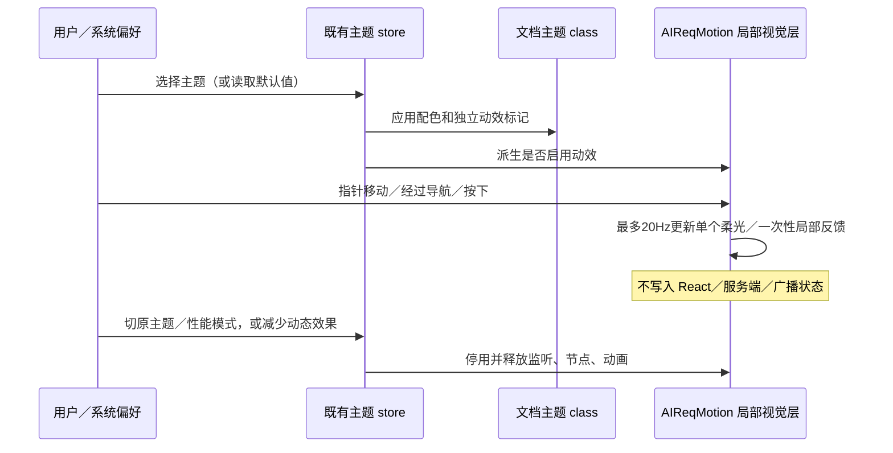

# 默认动效主题

## 范围与契约

- 新增 `zai-motion`（动效主题），沿用 Zai Dark 的全部配色、布局、字体、文字及业务行为。原浅色 `zai-light`、深色 `zai-dark` 和 `system` 的解析与视觉行为不变；系统跟随仍只选原浅／深主题。
- 无已保存偏好时，Web 入口、Zustand store 与 AppSettings 默认值均为 `zai-motion`。已保存偏好原样保留，旧 `light`／`dark` 仍只归一化为原 Zai 浅／深主题。外观选择和账户主题菜单均增加同一个“动效主题”选项，主题说明同步列全动效、浅色、深色与跟随系统；其余已有文字和布局不变。
- `Theme`、`AppSettings.theme` 和严格设置 schema 同批接纳新枚举；代码、Diff、Markdown、Mermaid 和登录视觉仍按深色解析，不生成专用前端包或后端分支。

## 动效与性能边界

- 工作区空白跟随用户确认的预览：单个 240×240px 中性径向柔光，中心前景透明度 32%，24% 处 20%、49% 处 8%、72% 处透明。只在实际空白上可见，卡片、正文、表格、编辑器、弹层和可操作控件不被柔光覆盖；鼠标离开、滚动或切入上述内容立即淡出。
- 指针移动以 50ms 为最小处理间隔，最多 20Hz 更新一次局部节点；不在 React 中存坐标，不调服务、不广播坐标，不添加循环定时器、连续 requestAnimationFrame、Canvas、WebGL、模糊、混合模式或全屏渐变重绘。空闲时没有动效采样或自循环动画。
- 工作台导航高亮以约 230ms 滑至悬停项，图标与主文字分别平移 2px／5px；按下短暂缩至 97%，现有选中、键盘焦点、点击导航及未保存保护保持原义。离开导航时高亮隐藏，不形成另一套选中状态。
- 控件按下使用有边界、一次性的 96px 局部扩散反馈；通用按钮的按下与颜色过渡仅在新主题下生效，不位移非交互内容。列表／筛选原有业务状态和 DOM 顺序不变。
- 当前项目的待确认筛选底板以约 230ms 在原位置之间滑动，只读取已提交的 `aria-pressed`；列表悬停时主内容和箭头分别平移 4px／6px，退出复位，不改变文档流或状态内容。
- 项目总览只读卡片使用 CSS 悬停反馈：项目分组边框轻微渐亮，版本卡片边框及底色在 200ms 内渐变，退出以 120ms 复位。仅在动效启用且鼠标可悬停时生效；不浮起、缩放、显示手形或重播进度，不监听指针坐标、不新增视觉节点或业务状态。减少动态效果、性能模式、页面隐藏及其他主题沿用静态外观。
- 需求共创、开发任务的 IR／SR 行、进度分析的任务及执行历史行复用相同悬停反馈：需求主内容以 200ms 平移 4px，离开复位；表头、空状态、单元格背景、进度、日期和操作列保持原位。由 CSS 读取行悬停状态，不新增业务状态、服务接口或指针监听；仍受同一动效主题、减少动态效果及性能模式开关控制。
- `prefers-reduced-motion: reduce` 或既有性能模式开启时，停用新增空间动效、柔光与指针监听，保留原有可见状态及可访问性。主题切换、性能／系统偏好变化、卸载、页面隐藏均清理监听、装饰节点和未结束动画。隐藏或禁用页面不继续采样。

## 所有者与事件顺序

- 主题唯一 owner 仍是现有 store；入口只读取同一个安全偏好函数。广播沿用既有防回环及重连释放机制。
- `AIReqMotion` 只持有可丢弃的视觉节点与当前动画，按 store 是否为新主题挂载监听；不持有导航、选择、业务事实或持久化状态。

## 验收

1. 未保存偏好时入口、store 和设置均默认动效主题；显式旧偏好刷新后仍为原主题。两个真实客户端可广播新主题且不回环，刷新仍可回读。
2. Edge 电脑浏览器实际截图检查空白柔光、连续经过导航、按下反馈、主题菜单和外观选择；新主题与原深色的正文位置、文字、配色一致，原浅／深主题没有新增节点或监听。相关材料／代码依旧深色，弹层及输入不受柔光干扰。
3. 指针快速移动后静止，新增动画停止且没有 React 提交或持续采样；离开、滚动、隐藏、切主题和减少动态效果后可清理。检查原导航点击与键盘操作保持可用。
   在需求共创、开发任务（含展开的 SR）、进度分析任务及执行历史表格逐行悬停，主内容平移并在离开后复位；表格列宽、固定列、选中状态和操作入口不变。减少动态效果与性能模式下不发生平移。
4. 尽可能在 Edge 软件渲染环境记录真实渲染模式及移动／静止期间的主线程开销；仅 CPU 节流不能宣称纯 CPU 通过。运行 typecheck、lint（复核 Hooks）、变更架构检查及实际受影响的现有工程测试；不新建永久 E2E harness、不增加产品调试接口。

实际证据在验证后写入现有 `release-surface.md`，不沿用预览截图作为产品通过证明。
