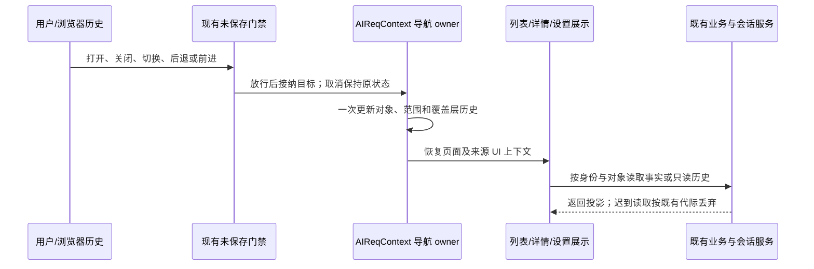
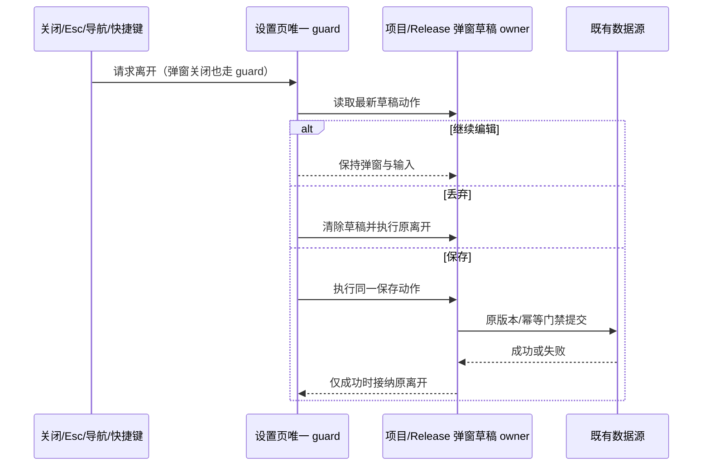

# AIReq 导航可达性与布局

2026-11-16 用户要求处理整应用导航审查的全部问题。本规格覆盖现有项目空间的入口、返回、列表上下文、需求追溯及设置定位；其余业务门禁与模拟边界不变。工作台与设置继续使用固定 68px 图标栏和现有控件、主题及电脑浏览器布局，不恢复已裁撤入口。

## 产品规则

1. 全项目总览进入项目概览后，概览提供可见的提案列表入口；从全项目总览经项目、提案、目标提案或新增入口不超过三次点击。项目内从其他页回“需求”恢复最近的提案／正式子视图。提案名称或明确操作可进入讨论，列表显示并可按 IR 编号或原文筛选。
2. 新增及 CSV 导入需要具体 Release；在“全部 Release”下打开时可在弹窗中选择当前项目的 Release，不关闭弹窗或丢弃已输入的原文／导入预览。更换 Release 后按目标范围重新计算导入重复提示；无 Release 时说明如何前往项目配置，不自动创建或选择其他对象。提交继续使用原业务校验、版本与幂等门禁。
3. 从提案、待办进入详情再返回，保留来源列表的关键词、状态、项目筛选、页码和滚动位置；各项仍只有一个 UI 状态所有者。切换项目时清理不适用的项目内列表状态；待办继续跨项目独立筛选。
4. 同项目在“全部 Release”下打开需求时保留列表范围，详情明确显示该需求所属 Release；跨项目待办或目标不属于当前具体 Release 时，页头原子定位目标的项目与 Release。页面内返回和浏览器后退均不能意外收窄来源列表。
5. 设置、新增提案和导入弹窗与浏览器历史一致：浏览器后退优先关闭当前覆盖层，前进恢复；不能在不可见的工作区后退。关闭、后退、前进与其他离开动作复用既有未保存门禁，取消保持覆盖层、页面、历史及输入不变；保存失败留在原处。
6. 需求详情提供显式复制对象链接。链接只含项目、Release、IR/SR 等必要对象标识，不含工号、clientId、会话、草稿或凭据；已有查询参数只保留产品已知的非敏感 `demo`。无对象参数时登录和刷新仍进入全项目总览；显式对象链接登录后校验项目、Release 和需求归属再定位。目标无效或不存在时明确说明，不静默选择其他对象；链接提示独立于业务读取失败，不能将已成功读取的数据误标为旧快照。切换工号清除对象目标。
7. 正式 IR 可查看同一需求提案阶段的讨论和评审历史；历史只读，材料与现有报告入口继续可用。会话读取复用既有服务、身份及对象归属校验；没有可用历史时明确显示空态，不创建新会话、不伪造或跨身份复用他人的私有会话。只读会话不发送消息、编辑或自动同步会话配置。
8. 分析失败待办可携带项目、Release、IR/SR 直达对应分析任务及其重试入口；分析任务和报告可打开同一正式需求。重试仍通过原调度服务与门禁，导航本身不发起分析。
9. 设置搜索覆盖当前产品的项目配置、模型、共享 Agent 指令和分析设置的可见字段与常用同义词，命中后经既有离开门禁定位实际区域或控件；需要先选具体项目时提示选择，不自动修改对象。旧产品设置项和隐藏 Skill 不进入搜索。
10. 从项目分析运行进入分析设置时突出来源项目，但全局设置作用范围保持明确且不自动变更；从分析设置进入模型配置时定位需求分析 Agent。其他入口不凭空选择项目。
11. 保持固定侧栏宽度，通过可见短标签或同等直接提示区分项目、待办及各设置分区；设置内退出工作区与返回上一级的含义应清楚。布局维持当前设计体系、焦点顺序和中英文电脑浏览器可读性。
12. 设置页左下角保留与工作台相同位置、尺寸的设置齿轮，使用既有选中样式并以 `aria-current="page"` 表达当前位置，悬停及键盘聚焦显示“设置”提示。再次点击只保持当前分区、滚动及未保存输入，不触发导航、保存或确认；顶部“返回工作区”仍经原未保存门禁退出。固定 68px 图标栏在较窄电脑窗口也保留该按钮，不改三类设置及 AI 页签布局。
13. 工作台的后退／前进横向并列于内容区左上角、紧邻侧栏，在全项目总览、待办及项目空间保持同一位置；侧栏只承载主导航与底部入口。项目空间保留“全部项目”并与历史按钮留出间隔，前者回总览，后退返回实际历史位置。按钮沿用现有浏览器历史、可用状态及未保存门禁，提供中英文可访问名称和提示；设置页继续使用现有“返回工作区”入口。较窄电脑窗口中按钮不得遮挡项目页头内容。

## 状态所有者与事件顺序

浏览器导航、项目／Release、目标需求及覆盖层历史由现有 `AIReqContext` 统一接纳；Shell 管理设置分区和面板挂载展示。列表筛选和未提交输入为各自视图的 UI 状态，不复制服务端业务事实。设置搜索只持有查询、结果和待定位意图，设置行挂载后复用既有定位机制；项目和 Agent 的标识来自既有 context 与服务投影。已接受的业务、会话和调度事实仍属于现有服务端 owner。

在新增／导入弹窗内选择 Release 是同一表单的范围选择，不是离开表单；原文和预览不重置。分享链接只是对象定位，不写入业务状态，也不绕过工号或对象归属检查。

### 正式需求历史的只读分页

历史会话只读取当前项目／IR 中已登记的精确会话引用，完成既有 V4 连接握手后，通过 `conversationRowsRangeV4` 的 `resident-only` 模式按 rowId 向前分页；缺失、无权限或会话不在内存时显示可理解的真实错误或空态，不使用会自动预热、补建或写入评审报告的订阅。mock 在读取时原子校验现有会话、工作区和 actor，不因查询重建会话。页面复用现有 V4 时间线呈现已记录行和只读附件，隐藏所有编辑、发送和会话配置动作。

历史时间线的宽度与响应式消息布局以正式需求侧栏为准，不使用外层工作区的容器宽度。同一历史加载期间，页面只在 logEpoch 与 revision 均一致时合并更早页；水位变化、读取失败或会话被删除时保留已读取内容并提示重新读取，不把失败伪装成已到历史顶部。切换对象或会话后丢弃旧请求的迟到结果。

## 可重复验收场景

### 项目配置布局与草稿保护（2026-11-16）

- 保留现有设置内容列、项目卡片与基础控件。先展示项目／Release 数量与添加项目，再展示共享范围及一次公共说明。项目卡按名称与编辑操作、仓库与默认分支、Release 列表组织；移除重复权限、模拟边界与逐 Release 的继承说明。仓库以可选择复制、可换行的只读文本展示，不呈现为可编辑输入框；“编辑项目”涵盖名称和仓库配置。
- Release 用于归集需求，不是 Git 分支，沿用项目仓库与默认分支；统计直接标明正式需求（IR）、开发单元（SR）及提案，避免依赖缩写记忆。模拟保存、仓库与分支未检查、内存数据刷新保留／服务重启恢复的事实仍可见或在公共说明中展开，不改服务语义。
- 项目与 Release 弹窗各自唯一持有输入草稿；项目打开时捕获字段基线及 revision，Release 打开时捕获所属项目。只有字段变化或保存中才向 `AIReqSettingsPage` 注册既有草稿动作。关闭、Esc、遮罩、取消与设置导航共用该页唯一 guard；Ctrl/Cmd+S 与按钮共用保存动作。取消离开保留全部输入及焦点，丢弃不写服务；保存失败保留弹窗与输入，保存期间不允许关闭、丢弃或重复提交。未修改表单直接退出。

- 验收：编辑项目后 Esc／关闭／取消触发确认，继续编辑保留输入，丢弃后重开原值不变；Release 输入名称或改变所属项目后同样受保护；空白或未修改表单直接关闭。格式错误保存留页；Ctrl/Cmd+S 和保存并离开使用同一提交。Edge 截图检查深浅主题、正常／较窄电脑窗口、长文本与上述关键弹窗，不做手机验收。

本轮实际验证：Edge 在 1699×780 与 1000×720 电脑视口截图检查深浅主题、项目列表及项目／Release／未保存确认弹窗；仓库为可选只读文本，无横向溢出。项目修改后 Esc 触发确认，取消保留输入并恢复原输入焦点，丢弃后重开原值不变；Ctrl+S 对非法仓库地址显示错误并保留草稿。通过仅添加名称尾部空格、保存后 trim 保持业务字段原值的方式验证保存并离开成功；未新建项目或 Release。Release 重名提示保留表单，只改变所属项目且名称为空时仍触发离开确认，保存禁用；空白新建项目直接取消。浏览器后退取消后长名称草稿与焦点保留。主题和视口已还原；热更新后的主题切换曾记录 ChannelClient disposed，刷新后重复深浅切换无新增错误。typecheck、lint（0 告警／0 错误）、变更架构检查及受影响文件格式检查通过。未构造网络中断、版本冲突或真实 Git 操作。

### 其余导航场景

- 从全项目总览三次点击内进入新增提案或指定提案讨论；切换项目页签后回需求仍保留最近子视图。
- 全部 Release 下打开新增与导入，输入原文或形成预览后在弹窗内选择版本，内容保留、重复提示使用新版本；未选版本时不允许提交。
- 筛选提案与待办，进入详情后通过页面内返回和浏览器后退分别检查筛选、页码、位置及 Release；跨项目待办仍定位正确归属。
- 打开设置、新增及导入弹窗分别后退／前进；有未保存输入时取消、丢弃、保存失败均按现有门禁保持一致，不改变遮罩下的页面。
- 复制提案及正式 IR/SR 链接，在新标签和登录后定位同一对象；无目标参数仍到总览；非法目标和切工号不泄露或复用旧身份。
- 正式 IR 历史入口只读显示已有讨论／评审；无历史或无权读取时显示真实状态，不能创建会话或发送消息。
- 分析失败待办直达对应单 SR 任务；从任务／报告返回同一需求，过程中不自动触发重试。
- 搜索默认模型、间隔、指令、仓库和 Release，验证结果定位；脏表单取消跳转不丢草稿。项目分析入口定位当前项目，模型入口定位需求分析 Agent。
- 从工作台进入设置，深浅主题及正常／较窄电脑窗口下齿轮位置与尺寸不变并显示选中态；有未保存输入时点击齿轮不切页、不弹窗，返回工作区仍触发原确认，取消保留输入，丢弃后返回来源工作区。
- 全项目、待办和项目空间检查历史按钮位置、横向排列、禁用状态与提示；从待办进入项目后分别验证后退回待办和“全部项目”回总览，前进恢复历史。设置入口和未保存门禁沿用既有行为，宽、窄电脑窗口均不得与项目页头重叠。
- 在 Edge 电脑窗口截图并实际检查上述页面及关键弹窗，覆盖正常与较窄窗口；不做手机验收。按项目规则执行架构检查、typecheck、lint 与必要的受影响验证。
