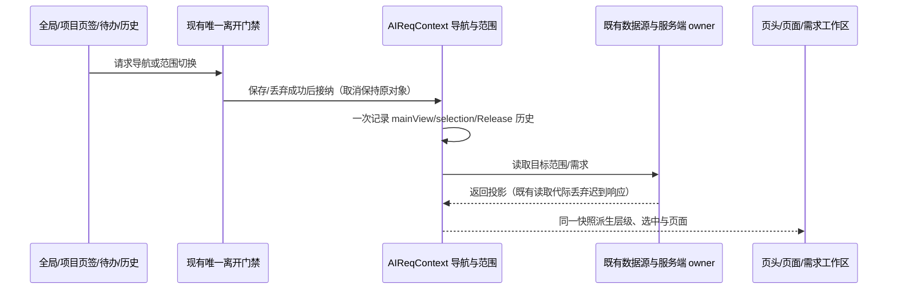

# AIReq 项目空间导航与页面组织

> 当前产品和公开接口以 [发布边界](release-surface.md) 为准；下文历史模拟操作与场景控制不构成恢复入口的要求。分析运行保留正常分析、历史、重试、配置入口及业务帮助。

2026-11-16 导航审查后的入口、历史、对象定位与设置搜索调整以[导航可达性规格](navigation-usability.md)为准；本文保留其余不冲突的项目空间和业务规则。

2026-11-16 用户确认：采用“全局工作台 → 项目空间 → 需求工作区”，保留工作台／设置固定 68px 单列图标栏。本文取代旧五项并列主导航及旧页面归属；其余业务规则、阶段、版本门禁、角色兼任、模拟边界与基础控件保持现有契约。

## 页面层级与范围

### 项目配置入口（2026-11-16）

- 项目总览顶部提供“添加项目”，直接打开既有新建项目表单；无项目时仍可从同一入口创建。每张项目卡片右上角提供可聚焦的“配置此项目”按钮，与整卡进入项目的按钮互不嵌套，激活配置不得切换当前项目或进入项目空间。
- 卡片配置按钮打开既有设置的项目配置并定位、聚焦对应项目卡片，可编辑项目和添加 Release；目标来自被点击卡片，不从当前项目推断。不存在的目标或读取失败明确提示，不静默定位其他项目。设置保留集中管理入口；从项目总览打开并返回时保持原有项目选择与列表位置。
- 移除项目空间页头的配置图标；无项目或 Release 时引导返回项目列表，再通过新增项目或对应卡片配置，不另行暴露其他页面的项目配置快捷入口。项目／Release 业务、设置表单及未保存门禁仍由现有 owner 管理，导航继续复用 AIReqContext；仅一次性携带定位／新建意图，不另存业务状态。
- 验收：从非当前项目卡片打开配置，确认目标项目及 Release 操作、当前项目不变；添加项目打开空表单，取消不写入；草稿离开取消、丢弃与保存门禁保持；键盘焦点、重复打开、浏览器历史、空项目／无 Release、深浅主题及宽窄电脑窗口均可用。
- 本次实际验证：Chromium 宽／窄电脑窗口检查深浅主题；从非当前项目卡片以鼠标和键盘进入，确认对应项目及 Release、焦点和当前项目不变；重复打开不同项目、浏览器前进／后退、新建空表单取消、编辑草稿取消与丢弃通过。未创建或修改业务数据；演示数据没有空项目／无 Release 场景，未实测保存及该两种空态。

### 项目概览 Dashboard（2026-11-16）

- 项目概览按已确认的截图展示“需求概览”和“任务概览”两区，不显示正式需求明细表或额外待办区。正式需求与需求提案数量使用当前项目／Release 的既有 `projectProgress` 汇总，点击分别经现有导航与未保存门禁进入正式／提案列表，保留当前范围。
- “需求想法”尚无数据模型或列表，显示“暂不可用”，不伪造数字或提供无效入口；想法的采集、列表及生命周期另行建设。
- 任务统计正式需求下的开发单元（SR），从当前工作流同一快照的正式 IR 与 SR 按项目及 Release 派生，不新增状态所有者或缓存。复用 `srProgressStatus`：待开发归入待处理；开发中、待合入和待验收归入进行中；已完成人工验收归入已完成。总任务为三类之和；无任务显示 0 和空状态条，不将缺失或读取失败伪装成 0。状态条和数字表达同一分布，提供文本标签且不只依赖颜色。
- 保留项目／Release 选择、无项目／无 Release 引导、读取失败与重试；项目变更或迟到读取沿用既有选择就绪与代际门禁。中英文、深浅主题和宽窄电脑窗口均可用。验收核对全部／单个 Release 的三类需求和 SR 统计、列表入口、空 Release、浏览器历史以及暗浅主题截图；不得把 SR、分析任务和待办混为一谈。

- 提案／正式切换必须保持二级页签的坐标、行高、顶部留白以及表格起点一致。两个列表使用同一面板容器宽度与双侧滚动槽；页签及筛选固定，数据表格内部滚动，不能随提案内容长短改变导航位置。Edge 在宽、窄桌面往返切换并对比实际坐标及截图，覆盖空结果和有数据状态。

### 需求提案表格工具区（2026-11-16）

- 项目／Release 与需求页签继续由常驻页头表达；提案正文不重复“需求提案”大标题。第一行左侧为“提案／正式”视图切换，右侧按“新增提案、导入、导出”集中表格操作，桌面窗口变窄时允许整组换行并保持靠右。
- 第二行集中原文／编号搜索、提交人工号、状态筛选，右侧仅显示总条数或筛选命中／总条数。导出范围说明附于导出按钮，不常驻重复说明。无具体 Release 时仍可打开新增／导入，在原有弹窗中选择 Release 并保留提交限制，不在列表重复提示。
- 仅调整既有列表布局，不更改创建、导入导出、分页、筛选和草稿门禁的状态所有权或行为。验收在 Edge 桌面检查提案／正式切换、筛选零结果及恢复、新增／导入弹窗与 Release 限制、宽窄桌面及深浅主题。
- 本次已在 Edge 1250×625、1100×760 截图检查布局，覆盖深浅主题、提案／正式切换、搜索零结果及“报表”命中 1 / 5、状态选择、新增／导入弹窗无 Release 时禁用提交；未执行业务写入。typecheck、lint（0 warnings／0 errors）、变更架构、定向格式及差异空白检查通过。

- 项目首页的使用说明和进度计算规则收进标题旁的圆圈问号帮助按钮；项目概览以本节 Dashboard 规则为准。首页复用原生 ghost 图标按钮与 Popover，鼠标悬停、键盘聚焦及点击均可查看；按钮有明确中英文可访问名称，Escape／外部交互可关闭。浮层只持有局部打开状态，不读写业务或导航。首页说明全部 Release 的项目总进度，保留正式 SR 等权、提案不计入、未分析按 0、合入 99%／人工验收 100% 的既有规则。错误、加载及空态引导仍在页面直接展示。
- 帮助默认不占说明行；鼠标与键盘均能打开对应范围的完整说明，深浅主题沿用原生浮层样式，开关浮层不推移正文。
- 全局主导航只有“项目、待办”；设置与身份／帮助位于底部。无显式对象链接时登录、刷新进入全项目总览；切换工号清除对象目标并回到总览，不恢复前一身份页面。项目总览只列所有项目的总进度、提案／正式需求数；点击项目进入该项目概览，不把跨项目卡片继续混在项目内页。
- 项目空间页头常驻项目选择、Release 选择和返回全部项目的入口，正文使用三个可见文字页签“概览、需求、分析运行”。需求内以“提案／正式”视图切换复用原有表格及字段；新增、CSV 导入导出仍属于提案工具栏，不新增全局新建或自动开始讨论。
- 项目内概览、需求、分析与详情共用唯一项目／Release；“全部 Release”可读，新增／导入必须选具体 Release。项目切换清除旧 Release 和需求；同项目全部 Release 下进入详情保持该范围，详情另显示所属 Release；跨项目或目标不属于当前具体 Release 时按目标 IR 的归属定位。无项目／Release 引导返回项目列表，不自动创建或选择其他对象兜底。
- 待办仍跨项目，保持我的／待认领／全部和独立项目过滤，不受当前项目空间范围限制。对象主文案使用需求名称，辅助显示项目、IR／SR 编号；点击直接进入目标需求和待处理阶段。既有只读 `AIReqTodo` 投影补充 `requirementTitle` 和 `releaseId`，均由同一服务端快照的所属 IR 派生；前者用于跨项目名称识别，后者用于跨项目直达时原子定位范围，不增加 RPC、缓存或业务 owner。
- 分析运行只呈现当前项目／Release 的任务、执行历史、重试和明确模拟控制。项目范围由常驻页头选择，不重复建立页内项目／Release 筛选。全局开关、周期、模型及各项目分析配置集中到设置的 AI 配置；运行页提供受保护的设置入口。
- 设置保持 68px 图标栏，分为外观、项目配置、AI 配置。AI 配置用文字页签组织模型、Agent 指令、分析设置；现有模型／提示词保存、版本校验和未保存门禁继续有效。共享 Agent 指令不称为个人偏好。模型直达、旧分区偏好与设置搜索指向同一分区所有者，不创建平行表单或设置状态。

## 项目表格上方的信息层级（历史，概览已由 Dashboard 取代）

- 项目与 Release 选择、项目页签仍分属上下文和页面导航两层；选中“概览”后正文不重复“项目概览”标题，选中“正式”后不重复“正式需求”标题及介绍。
- 概览用无卡片底色的紧凑统计带展示整体进度、正式需求、提案、开发单元（SR）与未分析单元。不重复页头的 Release 范围，不常驻“按 0 计”；保留提案入口，计算规则由整体进度旁原有帮助读取。进度与全部数量继续消费同一 summary，null 不伪装成 0%。
- 概览表格前将“正式需求”、数量与“仅未分析”筛选组成同一工具行；未筛选显示总条数，筛选后显示命中／总条数，不再常驻“显示 N / N 个正式 IR”。
- 正式需求页保留需求二级页签，紧接搜索、状态筛选及问号帮助。表底只显示一份需求数量；无筛选时补充开发单元总数，有筛选时显示命中／总条数，不把“全部 Release”误称为“当前 Release”。原“IR 时间由 SR 计划汇总，进度为 SR 平均值”移入帮助；空反馈不再保留一整行，实际错误、复制反馈和重试仍可见。
- 本轮只调整显示布局与辅助文案，状态所有者及事件顺序沿用本文既有时序图；不增加导航路径、业务写入或投影。验收在 Edge 的宽桌面及 1100×760、浅／深主题截图检查概览和正式需求；核对帮助、未分析筛选、Release 空态、搜索与详情入口，执行类型、Lint、架构和定向格式检查。
- 实际验收：Edge 在 1699×828 与 1100×760 桌面查看概览、正式列表及帮助浮层，覆盖浅／深主题；未分析筛选显示 2 / 5 条，搜索“报表”显示 1 / 5 条，空 Release 保持“暂无正式需求”，报告可打开并返回。已恢复深色主题和默认视口，浏览器 error 日志为空。typecheck、lint（0 warnings／0 errors，相关 Hooks 无诊断）、变更架构检查和定向格式检查通过；受影响工程测试选择为空，未新增测试或执行业务写入。

## 分析运行表格工具区（2026-11-16）

- 项目页签已标明“分析运行”，正文不重复大标题及介绍；说明收进原生问号帮助。上方紧凑状态行区分自动分析状态／周期、下次调度检查和项目运行数量，右侧集中分析设置及模拟操作，不以均分空白将辅助操作拉散。
- 内容按“分析任务／执行历史 → 搜索与需求筛选 → 表格”排列。任务页签不再称“SR 任务”；全部需求选择器以需求名称为主、IR 编号为辅，搜索说明使用“开发单元”，保留原有查询与筛选字段。未读取的历史数量不显示省略号假装正在加载；读取后才显示数量。
- 手动分析保留独立主动作、全部匹配分页的数量、确认与去重。原全局模拟推进入口放入明确命名的“模拟操作”菜单，并提示不受当前筛选限制；仍调用同一 scheduler.advance，不改时间、状态或共享业务 owner。设置仍走原导航门禁。帮助说明模拟与真实能力边界，不常驻说明段落。
- 验收：Edge 宽桌面与 1100×760、浅／深主题实际截图检查任务、历史及帮助／模拟菜单／批量确认；只打开并取消确认，不推进调度或提交分析。核对搜索、需求筛选、空态与页签切换；执行 typecheck、lint（含相关 Hooks）、架构及定向格式检查。
- 实际验收：Edge 在 1699×828 与 1100×760 检查任务与历史，覆盖深浅主题；帮助、模拟菜单、需求选择菜单及分析确认均查看截图。搜索 `sr-export` 命中 1 项，按“报表导出”筛选后历史命中 1 项，无匹配搜索为空，清除后恢复 10 项任务；7 项分析确认只打开并取消。已恢复默认视口与深色主题，浏览器 error 日志为空。typecheck、lint（0 warnings／0 errors，相关 Hooks 无诊断）、变更架构与定向格式检查通过，受影响工程测试选择为空；未手动推进调度或提交分析。

## 同一 IR 的需求工作区

### 需求讨论的导航与内容对齐（2026-11-16）

- 进入提案讨论后，顶部显示左上角“返回提案列表”，并保留“项目 → 需求提案 → 需求讨论”层级及只读 Release 上下文；提案层级不重复作为按钮。返回入口与项目空间“全部项目”在内容区左上角对齐，不再显示项目选择器、项目三页签或提案／正式切换。返回项目和提案列表仍通过既有导航门禁；列表页的项目导航保持原样。正式报告页面不受本次调整影响。
- 需求名称、编号与 Release、阶段轨道和原生输入框使用讨论面板自身的同一容器断点、居中宽度、双侧滚动槽与内边距。返回列表放在讨论工具栏，名称起点与输入框外边缘对齐；材料展开、收起及拖拽后继续对齐，不用固定偏移补偿。
- 只改变既有导航投影与布局，不新增状态 owner、会话写入或 RPC；沿用下文既有事件顺序。Edge 截图检查宽桌面与 1100×760、材料展开／收起及拖拽，核对标题和输入框的边缘，返回列表与前进恢复讨论，设置往返保留未发送草稿。执行 typecheck、lint、变更架构与定向格式检查。

- 提案与正式需求是同一个 IR 的生命周期，保留稳定 ID、归属、讨论、材料及历史。详情始终属于项目 → 需求，主轨道“项目”和项目内“需求”保持选中；不因内部 chat 视图失去模块归属。
- 固定上下文包含需求名称、项目／Release、阶段和返回对应列表的入口。提案仍复用原生分阶段会话及只读材料，正式 IR／SR 继续复用同页报告／材料，不新增 SR 开发工作台、手工编辑器或开发执行。
- 当前阶段主体优先呈现待处理动作、剩余条件及确认状态。三方确认的三个同版独立动作直接可见，不藏在材料更多菜单；同一工号可分别完成三种视角确认，服务端阶段／版本门禁不变。只读历史不能显示可执行的当前确认。
- 讨论与材料保留已有可拖拽、收起／展开面板，并分配可读空间；材料阅读区不承载阶段主决策。正式报告先展示状态、关注问题及当前动作，再展示计划、代码证据；分支清理等维护操作归入完成后的维护区域。

## 状态所有者与事件顺序

导航、项目、Release、目标 IR／SR 和浏览器历史仍唯一归 AIReqContext；全局／项目／需求层级从其现有 mainView 与 selection 派生，不再保存第二套当前项目或已选页签。Shell 仅拥有设置覆盖层、帮助与面板展示状态；业务事实与确认仍由现有服务端 owner 持有。新增 projectOverview 仅表达项目内概览，projectProgress 保留为全局项目入口。

本轮仅给既有待办读取投影增加上述两个归属展示字段，不增加 RPC 或写入契约，不改变命令幂等、事件与重连规则；重读不重放写入。导航不能卸载设置覆盖层下面的原生 composer、未发送内容与附件，仍沿用现有挂载保护。

## 本轮浏览器验收场景

1. 从真实工号入口登录：68px 导航仅“项目、待办”，默认全项目总览。进入项目后出现常驻项目／Release 和概览／需求／分析运行；全部项目入口返回总览。
2. 切换项目与 Release，在三个页签和提案／正式视图间往返：范围一致，无重复筛选；跨项目不能沿用另一项目的 Release／IR；前进后退恢复完整范围及层级。
3. 提案表新增／导入没有具体 Release 时显示明确限制；主动讨论进入同一 IR，项目与需求保持选中、上下文和返回入口清楚；历史阶段只读。
4. 三方确认阶段直接显示三项状态、动作和提交剩余条件；通过既有正常界面验证确认门禁，不以写内存绕过。材料收起／展开及拖拽可读，原生输入／附件与设置往返保留。
5. 正式 IR／SR 继续同页读取报告／材料，优先看到状态／问题／下一步；从项目概览和待办直达同一对象。
6. 待办显示需求名称，仍跨项目；从另一项目的待办进入后，页头正确定位目标项目／Release。
7. 设置只有外观、项目配置、AI 配置三类；模型／Agent 指令／分析设置真实可达。分析运行中的设置入口直达分析设置；取消未保存导航保持原表单、范围及工作区草稿。
8. Edge 在宽桌面和较窄桌面检查主要页面与关键弹窗截图，覆盖现有浅／深主题；不做手机或上游对照。运行 typecheck、lint（复核 Hooks）、变更架构检查及受影响文件格式检查。没有受影响现存工程测试时不重建业务测试体系。

## 本轮设计评审修复（2026-11-16）

- 保持现有电脑工作台风格、控件、主题与国际化。项目／Release 与概览／需求／分析运行仍是全局项目页头；提案／正式是需求内容区的二级切换，不与项目页签并列。需求身份、所属 Release、编号、复制链接与返回列表放到实际详情面板附近，取消横跨工作区的重复详情行。
- 首页保留项目卡片与进入项目主动作，提案／正式数量提供独立可聚焦的直达入口，不嵌套交互；就地提供正式 SR 等权、未分析按 0、合入 99／人工验收 100 的口径说明。后台更新反馈使用固定位置或固定高度，不使已有卡片位移；不得捏造读取时间或增加计时器。
- 项目概览的 SR 数提供可见下钻入口，报告操作保持可发现；同列进度槽等长，数值固定宽度。未分析项提供简单定位／优先展示；验收状态由真实 SR 事实派生，不从 IR 百分比反推完成。
- 正式表折叠 IR 汇总子 SR 的未分析、分析失败及报告过期事实；未分析不得仅显示“分析问题 0 项”。状态列保留业务状态、有效进度及首要异常，分支和详细审查继续由现有同页报告／菜单读取，不能删除已有能力。长表列头在自身滚动域中保持可见。
- 导航唯一 owner 仍为 AIReqContext；列表筛选／展开仍为各列表组件的 UI 状态。以上仅由既有读取投影派生，不新增业务 owner、RPC、服务端写入或缓存。事件顺序仍遵循上文“离开门禁 → Context 更新目标／历史 → 读取投影 → 页头及列表／面板渲染”的时序图。
- 首页数量直达复用 `openProject(projectId, mainView?)`，可选目标仅概览／提案／正式，默认概览；同一次被门禁接纳的导航先清空 Release 再选择目标列表，只记录一条历史，不串联多次页面切换。
- 验收：Edge 在宽桌面与 1100×760 较窄桌面、当前浅／深主题实际查看首页、项目概览、正式列表／展开详情、提案列表／详情及关键菜单截图；检查数量直达、SR 下钻、返回列表、页签归属、分析可信度、纵横滚动表头、等长进度槽与后台重读位置稳定。只读样例，不制造业务写入。执行 typecheck、lint（复核 Hooks）、变更架构检查及本次文件格式检查。

### 该轮实际交付与验收

- 主代理负责项目三页签、需求内容二级切换与详情上下文接线；三个代理分别实施首页卡片、项目概览表、正式 IR／SR 表。详情对象的名称／Release／编号及复制／返回集中到实际面板，不再占全工作区第三行。现有离开门禁和 Context 历史继续复用；首页可选目标通过同一次 `openProject` 完成。
- Edge 实际查看约 1699×781 与 1100×760 的深／浅主题截图，覆盖首页、项目概览、正式列表与报告分栏、提案列表／讨论材料分栏；SR 菜单、Release 菜单及主题菜单也实际截图检查。恢复原深色主题、默认电脑视口与约 69%／31% 正式详情分栏。
- 从首页跨项目进入 Mobile 提案得到全部 Release 的 1 条提案，一次后退回首页；正式入口得到 2 个 IR。先选空的 2026.12 Release 再从首页数量直达，范围恢复全部 Release。项目概览“仅未分析”从 5 行筛至 2 行，SR 数菜单可直达对应 SR 报告；5 行进度槽宽度实测均约 201.80px，待验收与已验收提示分别来自既有 SR 状态。
- 正式列表折叠行直接显示 1 个未分析、1 个分析失败、1 个报告过期；未分析 IR 不再显示问题 0。较窄分栏横滚约 100.67px 后首列与容器左边缘仍一致；纵滚约 651.33px 后表头与容器顶端均为 310px。验收中发现绝对定位的读屏排期文字逃逸，已在人员单元格建立定位容器；修复后 document 高度与视口一致、整页 scrollY 为 0。
- 首页 60 次采样跨约 12.9 秒，卡片顶端始终为约 158.67px；该采样段未捕获短暂 pending，另一次截图实际捕获配置按钮下“正在更新…”且卡片顶端不变。不增加计时器或伪造读取时间。
- typecheck 通过；lint 为 0 warnings／0 errors，相关 Hooks 无诊断；变更架构检查 0 violations，13 个本轮文件定向格式检查及差异空白检查通过。按 11 个本轮源码文件查询受影响工程测试返回空清单，未新增测试体系或运行无关测试。
- 并行编辑曾触发 Vite 新文件解析缓存与开发态 Context 热更新异常；仅触碰前端配置的文件时间使 Vite 重载，未重启模拟后端。所有源码稳定后真实刷新、从首页重新进入正式详情，新增 error 日志为空。没有执行需求创建、确认、验收、Git／PR 等业务写入，也未做手机或上游对照；未重新验证真实外部集成、全部语言或完整无障碍合规。

## 后台刷新布局稳定性（2026-11-16）

- 全项目页、项目概览页和项目配置页已有内容时，后台重读不能插入或移除占据文档流的加载提示。保留刷新前的内容位置、间距、滚动位置与既有卡片布局，不为提示额外预留空白行。
- 更新提示使用不占布局空间的 `role="status"` 读屏文本；首次加载的可见反馈、失败说明和重试入口继续保留。项目配置的空项目提示依据已读取的项目投影展示，不能随后台 loading 切换而闪现或消失。
- 仅调整展示。后台五秒检查、事件发布、订阅、请求、pending/loading 所有者、迟到响应丢弃和旧快照保留均沿用上文既有顺序；不加定时器、延迟、防抖、缓存或第二套加载状态。分析任务／历史已有 `QueryFeedback(hasData)` 保护和固定高度反馈区，维持原实现。
- 验收：Edge 分别截图检查全项目、项目概览、项目配置；在现有后台检查持续运行时跨越至少两个刷新周期，记录卡片／详情／配置列表的顶端与滚动位置，并确认刷新状态实际发生且位置不变。覆盖当前主题下正常与较窄电脑窗口；只读观察，不修改业务数据。执行 typecheck、lint、变更架构检查及本次文件格式检查。
- 本次实际验证：Edge 当前深色主题，1699×780 与 1100×760 电脑视口均实际查看三页截图。每页连续采样超过十秒并捕获至少两次加载提示变化：全项目区顶端固定为 134px，概览详情顶端固定为约 228.67px，配置首卡顶端固定为约 284.33px；配置滚动到 290px 后跨周期保持 290px，首卡视口坐标保持约 −5.67px。后台事件及读取继续发生，未通过停刷新掩盖问题。浏览器 error 日志为空，视口已还原；未切换用户主题、制造网络故障或清空项目数据，浅色主题与空项目运行场景未重新执行。typecheck、lint（0 warnings／0 errors）、变更架构检查（0 violations）、四个本次文件的格式检查和差异空白检查通过。

以上为验收场景；本轮实际执行与边界如下，不以未执行场景补充通过声明。

## 本轮实际实施与验证（2026-11-16）

- 规格先于实现落盘，根 `.todo.md` 与工具设置规格先声明当前优先级，再修改代码。全局／项目概览拆分，68px 两入口图标栏、统一项目／Release 页头、项目三页签、提案／正式视图及详情归属接线完成。设置归为三类，AI 配置内含模型／Agent 指令／分析设置，头像菜单只保留身份与界面辅助项。
- `AIReqContext` 仍持有唯一导航和范围，`projectOverview` 表达项目内概览；跨项目待办由既有服务端派生 `requirementTitle`、`releaseId`，通过 `select(selection, releaseId)` 同次记录目标归属与历史。没有新增 RPC、项目缓存或业务写入所有者。
- `bun run typecheck` 通过；`bun run lint` 为 0 warnings／0 errors，改动 React 文件在根扫描范围内，相关 Hooks 无诊断；`bun run architecture:check --changed` 为 0 violations／0 baseline／0 new。26 个受影响 UI 源码／合同及本规格的定向 `oxfmt --check` 通过，`git diff --check` 通过。受影响工程测试 dry-run 返回空清单，未新增业务测试体系或运行无关工程套件。
- 服务 `types.ts`、`domain.ts` 保留最小字段差异；HEAD 临时副本的 `oxfmt --check` 已确认两个文件均存在原有格式问题，未将其记为通过、重排或拆分。曾扫描整个 UI 目录得到的另外 10 个格式问题均位于本次未修改文件，未扩展清理。根 `.todo.md` 保留原有历史表格格式，仅增加最新授权段。
- Edge 复用现有 localhost:5174 与 3031 服务，以模拟工号 a12345678 登录；实际检查全项目总览、项目概览、正式表／报告、提案表、确认与业务讨论、分析运行、三类设置及 AI 三个页签、帮助、设置搜索和关键菜单／确认弹窗。每个主要页面与关键弹窗均实际查看截图。证据保存于本次 Codex 对话的 `project-space` 截图目录，共 35 张 JPEG。
- 正常登录及刷新均回到全项目总览，68px 图标栏只有项目／待办；项目内三页签、提案／正式和详情保持选中。跨项目待办“移动搜索体验”直接带入 Mobile／2026.11 移动端优化；切到空的 2026.12 离线体验后，正式需求和分析均为空，前进／后退恢复页面及 Release。切回 Aurora 清除 Mobile 的 Release，页头显示全部 Release，没有跨范围兜底。
- 三方确认入口在主体直接可见。实际执行一次模拟业务视角确认，显示当前操作者／时间，开发与测试仍各自待确认，提交继续禁用；没有提交文档 PR 或调用真实外部服务。历史业务阶段显示只读并隐藏当前确认操作。材料收起／恢复后保持可读分栏。
- 分析设置从运行页与设置搜索均能直达；将间隔从 60 改为未保存的 61，切页签触发保存／丢弃／取消，取消保留 61，丢弃回到模型且后端间隔保持 60。提案新增在全部 Release 下保存禁用且说明页头选择要求；填写临时原文后真实浏览器后退触发草稿确认，继续编辑保留原文，丢弃允许导航，未创建提案。
- 未发送讨论草稿在设置往返后原样保留，验收后清除测试草稿。以原有约 1700px 宽桌面和 1100×760 较窄桌面检查布局，并检查浅／深主题的相关项目／需求／设置页面；恢复原深色主题与浏览器默认视口。稳定操作和刷新后的浏览器 error 日志均为空。
- 未重新执行完整评审转正／PR 合入／验收清理业务链、附件上传回归、全部语言及完整键盘／无障碍合规检查；没有通过删除项目制造空项目数据，没有手机或上游对照。未启停用户现有服务、提交、推送或部署。
