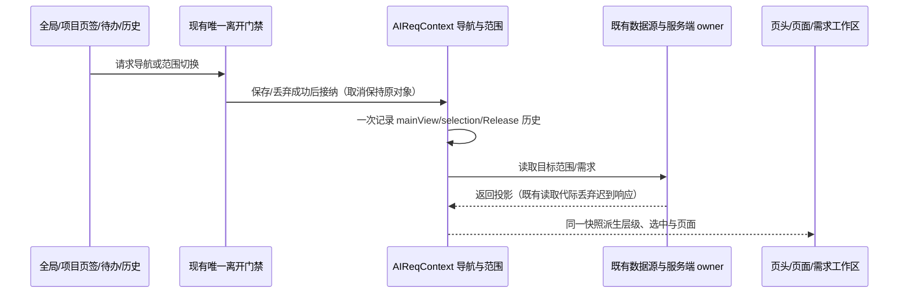

# AIReq 项目空间导航与页面组织

2026-11-16 用户确认：采用“全局工作台 → 项目空间 → 需求工作区”，保留工作台／设置固定 68px 单列图标栏。本文取代旧五项并列主导航及旧页面归属；其余业务规则、阶段、版本门禁、角色兼任、模拟边界与基础控件保持现有契约。

## 页面层级与范围

- 全局主导航只有“项目、待办”；设置与身份／帮助位于底部。登录、刷新及切换工号后进入全项目总览，不恢复前一身份页面。项目总览只列所有项目的总进度、提案／正式需求数；点击项目进入该项目概览，不把跨项目卡片继续混在项目内页。
- 项目空间页头常驻项目选择、Release 选择和返回全部项目的入口，正文使用三个可见文字页签“概览、需求、分析运行”。需求内以“提案／正式”视图切换复用原有表格及字段；新增、CSV 导入导出仍属于提案工具栏，不新增全局新建或自动开始讨论。
- 项目内概览、需求、分析与详情共用唯一项目／Release；“全部 Release”可读，新增／导入必须选具体 Release。项目切换清除旧 Release 和需求；详情跨项目／Release 进入时按目标 IR 的归属定位，不允许页头显示另一范围。无项目／Release 提供现有配置入口，不自动创建或选择其他对象兜底。
- 待办仍跨项目，保持我的／待认领／全部和独立项目过滤，不受当前项目空间范围限制。对象主文案使用需求名称，辅助显示项目、IR／SR 编号；点击直接进入目标需求和待处理阶段。既有只读 `AIReqTodo` 投影补充 `requirementTitle` 和 `releaseId`，均由同一服务端快照的所属 IR 派生；前者用于跨项目名称识别，后者用于跨项目直达时原子定位范围，不增加 RPC、缓存或业务 owner。
- 分析运行只呈现当前项目／Release 的任务、执行历史、重试和明确模拟控制。项目范围由常驻页头选择，不重复建立页内项目／Release 筛选。全局开关、周期、模型及各项目分析配置集中到设置的 AI 配置；运行页提供受保护的设置入口。
- 设置保持 68px 图标栏，分为外观、项目配置、AI 配置。AI 配置用文字页签组织模型、Agent 指令、分析设置；现有模型／提示词保存、版本校验和未保存门禁继续有效。共享 Agent 指令不称为个人偏好。模型直达、旧分区偏好与设置搜索指向同一分区所有者，不创建平行表单或设置状态。

## 同一 IR 的需求工作区

- 提案与正式需求是同一个 IR 的生命周期，保留稳定 ID、归属、讨论、材料及历史。详情始终属于项目 → 需求，主轨道“项目”和项目内“需求”保持选中；不因内部 chat 视图失去模块归属。
- 固定上下文包含需求名称、项目／Release、阶段和返回对应列表的入口。提案仍复用原生分阶段会话及只读材料，正式 IR／SR 继续复用同页报告／材料，不新增 SR 开发工作台、手工编辑器或开发执行。
- 当前阶段主体优先呈现待处理动作、剩余条件及确认状态。三方确认的三个同版独立动作直接可见，不藏在材料更多菜单；同一工号可分别完成三种视角确认，服务端阶段／版本门禁不变。只读历史不能显示可执行的当前确认。
- 讨论与材料保留已有可拖拽、收起／展开面板，并分配可读空间；材料阅读区不承载阶段主决策。正式报告先展示状态、关注问题及当前动作，再展示计划、代码证据；分支清理等维护操作归入完成后的维护区域。

## 状态所有者与事件顺序

导航、项目、Release、目标 IR／SR 和浏览器历史仍唯一归 AIReqContext；全局／项目／需求层级从其现有 mainView 与 selection 派生，不再保存第二套当前项目或已选页签。Shell 仅拥有设置覆盖层、帮助与面板展示状态；业务事实与确认仍由现有服务端 owner 持有。新增 projectOverview 仅表达项目内概览，projectProgress 保留为全局项目入口。

本轮仅给既有待办读取投影增加上述两个归属展示字段，不增加 RPC 或写入契约，不改变命令幂等、事件与重连规则；重读不重放写入。导航不能卸载设置覆盖层下面的原生 composer、未发送内容与附件，仍沿用现有挂载保护。

## 本轮浏览器验收场景

1. 从真实工号入口登录：68px 导航仅“项目、待办”，默认全项目总览。进入项目后出现常驻项目／Release 和概览／需求／分析运行；全部项目入口返回总览。
2. 切换项目与 Release，在三个页签和提案／正式视图间往返：范围一致，无重复筛选；跨项目不能沿用另一项目的 Release／IR；前进后退恢复完整范围及层级。
3. 提案表新增／导入没有具体 Release 时显示明确限制；主动讨论进入同一 IR，项目与需求保持选中、上下文和返回入口清楚；历史阶段只读。
4. 三方确认阶段直接显示三项状态、动作和提交剩余条件；通过既有正常界面验证确认门禁，不以写内存绕过。材料收起／展开及拖拽可读，原生输入／附件与设置往返保留。
5. 正式 IR／SR 继续同页读取报告／材料，优先看到状态／问题／下一步；从项目概览和待办直达同一对象。
6. 待办显示需求名称，仍跨项目；从另一项目的待办进入后，页头正确定位目标项目／Release。
7. 设置只有外观、项目配置、AI 配置三类；模型／Agent 指令／分析设置真实可达。分析运行中的设置入口直达分析设置；取消未保存导航保持原表单、范围及工作区草稿。
8. Edge 在宽桌面和较窄桌面检查主要页面与关键弹窗截图，覆盖现有浅／深主题；不做手机或上游对照。运行 typecheck、lint（复核 Hooks）、变更架构检查及受影响文件格式检查。没有受影响现存工程测试时不重建业务测试体系。

以上为验收场景；本轮实际执行与边界如下，不以未执行场景补充通过声明。

## 本轮实际实施与验证（2026-11-16）

- 规格先于实现落盘，根 `.todo.md` 与工具设置规格先声明当前优先级，再修改代码。全局／项目概览拆分，68px 两入口图标栏、统一项目／Release 页头、项目三页签、提案／正式视图及详情归属接线完成。设置归为三类，AI 配置内含模型／Agent 指令／分析设置，头像菜单只保留身份与界面辅助项。
- `AIReqContext` 仍持有唯一导航和范围，`projectOverview` 表达项目内概览；跨项目待办由既有服务端派生 `requirementTitle`、`releaseId`，通过 `select(selection, releaseId)` 同次记录目标归属与历史。没有新增 RPC、项目缓存或业务写入所有者。
- `bun run typecheck` 通过；`bun run lint` 为 0 warnings／0 errors，改动 React 文件在根扫描范围内，相关 Hooks 无诊断；`bun run architecture:check --changed` 为 0 violations／0 baseline／0 new。26 个受影响 UI 源码／合同及本规格的定向 `oxfmt --check` 通过，`git diff --check` 通过。受影响工程测试 dry-run 返回空清单，未新增业务测试体系或运行无关工程套件。
- 服务 `types.ts`、`domain.ts` 保留最小字段差异；HEAD 临时副本的 `oxfmt --check` 已确认两个文件均存在原有格式问题，未将其记为通过、重排或拆分。曾扫描整个 UI 目录得到的另外 10 个格式问题均位于本次未修改文件，未扩展清理。根 `.todo.md` 保留原有历史表格格式，仅增加最新授权段。
- Edge 复用现有 localhost:5174 与 3031 服务，以模拟工号 a12345678 登录；实际检查全项目总览、项目概览、正式表／报告、提案表、确认与业务讨论、分析运行、三类设置及 AI 三个页签、帮助、设置搜索和关键菜单／确认弹窗。每个主要页面与关键弹窗均实际查看截图。证据保存于本次 Codex 对话的 `project-space` 截图目录，共 35 张 JPEG。
- 正常登录及刷新均回到全项目总览，68px 图标栏只有项目／待办；项目内三页签、提案／正式和详情保持选中。跨项目待办“移动搜索体验”直接带入 Mobile／2026.11 移动端优化；切到空的 2026.12 离线体验后，正式需求和分析均为空，前进／后退恢复页面及 Release。切回 Aurora 清除 Mobile 的 Release，页头显示全部 Release，没有跨范围兜底。
- 三方确认入口在主体直接可见。实际执行一次模拟业务视角确认，显示当前操作者／时间，开发与测试仍各自待确认，提交继续禁用；没有提交文档 PR 或调用真实外部服务。历史业务阶段显示只读并隐藏当前确认操作。材料收起／恢复后保持可读分栏。
- 分析设置从运行页与设置搜索均能直达；将间隔从 60 改为未保存的 61，切页签触发保存／丢弃／取消，取消保留 61，丢弃回到模型且后端间隔保持 60。提案新增在全部 Release 下保存禁用且说明页头选择要求；填写临时原文后真实浏览器后退触发草稿确认，继续编辑保留原文，丢弃允许导航，未创建提案。
- 未发送讨论草稿在设置往返后原样保留，验收后清除测试草稿。以原有约 1700px 宽桌面和 1100×760 较窄桌面检查布局，并检查浅／深主题的相关项目／需求／设置页面；恢复原深色主题与浏览器默认视口。稳定操作和刷新后的浏览器 error 日志均为空。
- 未重新执行完整评审转正／PR 合入／验收清理业务链、附件上传回归、全部语言及完整键盘／无障碍合规检查；没有通过删除项目制造空项目数据，没有手机或上游对照。未启停用户现有服务、提交、推送或部署。
