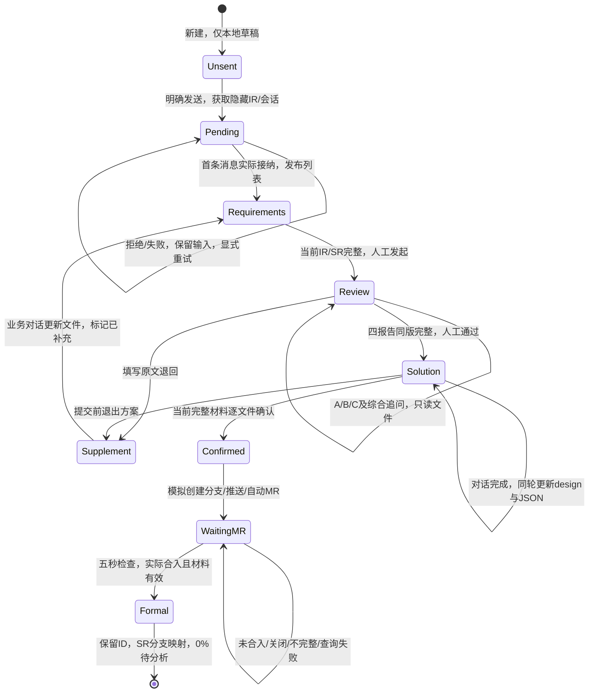
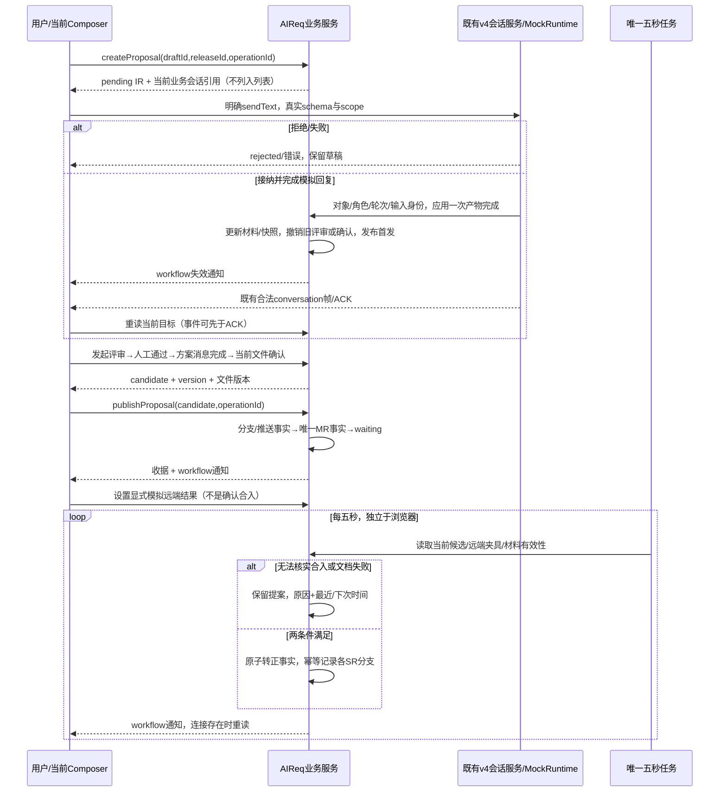

# AIReq 需求提案迁移规格

## 1. 范围、依据与目标落点

本规格覆盖 `todo.md` §5 的 12 项，服从 §2、§3、§10 的一次切换、当前 ZCode 视觉和服务端内存边界。状态：实现已集成，验证进行中；保留实施前需求与全部验收义务，不表示全部场景通过。本文只同步主集成实际证据，不运行检查；最终权威完整证据与待办判定归根 `todo.md`。

源根记为 `S = F:/code2026/oh-my-pi/packages/aireq-frontend/`，业务根 `A = S/packages/ui/src/aireq/`。下文源码路径均按这两个前缀展开；源仓库只读，目标产物不可依赖该绝对路径。

规范依据直接读取：源 `openspec/specs/aireq-requirement-intake/spec.md`（尤其自然语言拆分、四路评审、共享材料、提案阶段、补充循环、自动建 MR、会话引用条款），`aireq-browser-workbench/spec.md` 的提案首发、三栏、列表、四 Agent、方案、五秒检查、局部切换及最新 MR 条款。源 workbench 规格仍声称合同 version 1；实际 `S/backend/contract.ts:43` 为 **3**，以实际代码的数据形状和本规格裁决为准，不保留旧传输合同。

目标保留原 AIReq 业务组件组织，适配当前 `packages/ui` 的控件、Markdown、工作流图、Canvas、v4 会话及主题；不搬旧通用控件库、不复制 CSS。`@zcode/services` 提供 AIReq 业务公开契约，客户端按目标同源 `/ws` 二进制 Channel RPC 调用；目标 `packages/server/src/mock/index.ts` 集中装配 AIReq 内存域。业务状态只能由该 mock 域持有，聊天 rows/协议水位仍由现有 MockRuntime 和会话服务持有。

### 1.1 实际可达装配（不是按文件名推断开放）

1. `S/app/AIReqApplication.tsx:34-146`：AIReqProvider → BrowserApplication → Root；连接 key 只取后端、访问工号、项目，IR/Agent/轮次只更换 task/session。此结构语义需迁移，不复制旧连接实现。
2. `S/packages/ui/src/app-shell/WorkspaceShellLayout.tsx:290-299` 识别提案 SR、历史、切换中目标；实际工作台装配 `AIReqSidebar`、`AIReqStageHeader`、只读/空态和会话。`A/AIReqEmptyState.tsx:17-20` 把未发送草稿接到 ProposalDraftComposer，入库接到 ProposalStageBody。
3. `A/AIReqWorkbench.tsx:23,80-205`：PhaseHeader + ReviewNavigation + ProposalFeedback；MaterialsPane 白名单选择业务材料，底部 DocumentPhaseActions；不是 ProposalControls 的旧整块流程。
4. `S/packages/ui/src/WorkspaceHeaderSections.tsx:405` 挂提案 RequirementMenu；菜单只含信息、操作记录和允许删除。`A/AIReqRequirementMenu.tsx:28-65` 为退回意见、旧评审及操作事实的实际历史入口。
5. `A/AIReqContext.tsx:157-166,230-265` 和 `v4/ConversationComposer.tsx:1466-1470,1692-1755,1792-1812` 完成草稿首发交接；实际消息由 `A/mock/chat.ts:266-296` 触发需求/方案材料更新。
6. `S/backend/prototype-data-source.ts:92-120` 服务端五秒时钟与动作过滤是最终开放边界。`generateProposalSolution`、手工登记/确认 MR、正式修订和争议裁决虽然仍在联合类型或旧组件中，却被直接拒绝，不能据其存在重新开放。

## 2. todo §5 逐项覆盖表

编号 P01–P12 按 todo 原顺序对应；以下为必须满足的覆盖要求，已观察场景见 §10，不自动代表整行验收通过。

| 项                       | 源功能与行为依据                                                                                                                                                            | 目标页面／服务                                                                                                | 可观察验收（成功、失败、空态）                                                                                                                                                                                                                                                                                                                                                                                                 |
| ------------------------ | --------------------------------------------------------------------------------------------------------------------------------------------------------------------------- | ------------------------------------------------------------------------------------------------------------- | ------------------------------------------------------------------------------------------------------------------------------------------------------------------------------------------------------------------------------------------------------------------------------------------------------------------------------------------------------------------------------------------------------------------------------ |
| P01 未发送草稿与首次发送 | `AIReqContext:157-166,230-265`、`AIReqProposalDraftComposer:8-18`；workflow `createProposal:559-573` 创建隐藏 pending；chat `publishPrototypeProposalForSession:295` 才发布 | 新建提案三栏；AIReq createProposal + 现有 v4 明确发送；服务端保留 pending 身份                                | 点击新建、切页再回来只恢复同 scope 文字/附件，无列表项、SR、材料或回复；空文字且无附件不能发。首发实际接纳才出现一条 IR。模拟发送拒绝/连接失败保留文字附件并显示“尚未生成”，手动重试复用 pending IR；连续点击、超时后对账不重复 IR/消息/材料。附件单独发送可接纳讨论，但没有可用文字材料时仍明确待生成，不伪造正文。                                                                                                           |
| P02 提案列表及删除       | `AIReqRequirementList:23-82`、`proposal-list:12-83`、`AIReqRequirementSearch:19-41`、RequirementMenu 与 DeleteRequirement                                                   | 左栏仅 IR 列表、搜索弹窗、更多菜单；AIReq readWorkflow/deleteRequirement                                      | 按项目和有效 Release 展示已接纳 IR；标题/ID、所属 SR 标题/ID 不区分大小写搜索，命中 SR 仍进入 IR。阶段、提交人（全部/我提交/指定工号）、“需要处理”组合筛选；最近更新/创建时间降序，稳定 ID 决胜，查看不改排序。默认无常驻统计，筛选后有数量/清除。无提案、无匹配独立空态。删除显示目标、确认/取消，取消零变更；失败不关框。正式、修订及受保护历史 UI 与后端都拒绝删除，不能通过直接调用绕过。                                  |
| P03 IR/SR 澄清及材料     | chat `280-288`、workflow `648-689`；Workbench `94-107,139-202`                                                                                                              | IR 业务需求会话、右材料；AIReq readWorkflow/retryMaterial，消息通过 v4                                        | 业务消息用固定样例整理 IR 和两个 SR，后续消息补充当前稳定 ID，清楚标模拟。IR 默认 proposal.md，可选全部 SR spec、design、依赖；SR 只看自身 spec，中栏给返回 IR 入口，不挂聊天/阶段条。未生成、读取中、缺失、读取失败、无正文、失效分别显示；不能显示别的 IR/SR 或旧开发文件。路径默认折叠，展开完整换行；只读 Markdown 无编辑/复制/下载/带入讨论。重新读取只修复可恢复读取失败，不产生材料或推进阶段。                         |
| P04 四路评审             | `AIReqReviewNavigation:35-78`、PhaseHeader `67-72`、`domain:21-65`、mock/requirements-review `10-35`                                                                        | 当前评审综合/A/B/C 会话、流程弹窗、材料底栏人工通过/退回；runRequirementsReview/acceptProposal/returnProposal | 无需方案即可发起；A/B/C 三个不同模型绑定同轮同版 IR+全部 SR，只读文件，第四综合引用三份意见。默认综合，可定向追问且不改需求/批准；头像方向键/Home/End 后焦点留头像，可展开三路汇入综合再到人工图（人非 Agent）。四份 completed 且非空、同版本才可人工通过；missing/pending/running/failed/stale 或正文不可读都禁止。通过记录人/时间/reviewId/digest并进入方案。更新需求使旧报告/决定失效，历史仍可读；单路失败不冒充完整成功。 |
| P05 对话方案             | PhaseHeader `73-76,99-102`、chat `284-288`、workflow `691-704`、mock/proposal-flow                                                                                          | 方案 IR 会话、右“技术方案／SR依赖／工期预估”；内部完成回调不暴露生成按钮                                      | 人工通过后进入方案但不生成文件；只有当前轮已接纳、完成的方案对话更新 design.md 和 sr-dependencies.json，并同轮绑定 requirementsDigest。修订同时可见，任一文件变化撤销旧确认/候选有效性。失败/取消/拒绝消息、历史方案消息不产出。无生成/重新生成方案按钮，不把打开页、输入草稿、切材料当产出。                                                                                                                                  |
| P06 依赖 JSON 权威       | `sr-dependencies:3-43`、mock/proposal-flow `8-17`                                                                                                                           | 服务端校验，UI 只读派生；confirm/publish/poll 共用完整校验                                                    | JSON 精确覆盖所有当前稳定 SR ID 一次；工作日正有限数（支持小数）、假设非空；前置项原因非空、ID 属本 IR、不得重复、自依赖或循环；无依赖 `[]`。缺失/损坏/错版本不从 SR 元数据、设计正文或旧文件回退。用于提交须全量预估有效。                                                                                                                                                                                                    |
| P07 只读依赖图           | `AIReqSrDependencyGraph:12-61`、readSrDependencies(requireEstimates=false)                                                                                                  | 右材料 Canvas/Controls                                                                                        | 节点含 ID、标题、预估；箭头从 prerequisite 指向依赖方。缩放、平移、选线显示原因、点空白清除；独立节点保留，无边显示可独立安排。禁止拖节点、接线、重连、Delete 修改。依赖结构无效/过期/读取失败显示原因不绘图；只有预估缺项时仍画有效拓扑并标“待预估”，绝不因此放行提交。                                                                                                                                                       |
| P08 提交人与预估         | RequirementList `37-48,79`、RequirementPlanning `81-105`；RequirementMenu `51-53`                                                                                           | 固定提出人工号、方案参与人事实；工期只读 Markdown 表                                                          | 不增加提案 owner/developer/date 编辑或负责人筛选。原 developerAcceptance 仅记方案参与来源，不成为独占权限。工期表逐 SR 显工作日、假设，缺失项单元格“待预估／待补充”，其他有效行可读；表格内部横滚/全屏，不加复制下载。不得把工作日求和宣称 IR 总周期，也不得自动转为正式排期。                                                                                                                                                 |
| P09 补充、退回与历史     | PhaseHeader `104-110,119`；ProposalFeedback；RequirementMenu `58-65`；workflow `706-718`                                                                                    | 评审/方案退回大输入框、业务讨论意见栏、操作记录、时间线历史                                                   | 当前评审或提交前方案可填写非空原文退回，取消不变；成功直接到业务阶段，列表同步，保留工号/时间/轮次/原文，不自动拆题/分派。待处理意见未通过业务对话更新 IR/SR 前不能重评；更新记录 resumedAt，重评通过后继续新轮方案。长文本内部滚动、键盘聚焦、全屏只读阅读并返回原讨论位置。已进入时间线节点只读历史，返回当前阶段不发消息/不运行任务；浏览器后退不是业务退回。                                                               |
| P10 逐文件确认至转正     | ProposalDeliveryControls `112-172`；mock/proposal-delivery；workflow `720-751,299-315`                                                                                      | 确认弹窗、MR 信息、入库状态；confirmProposal/publishProposal/服务端 poll                                      | 当前 IR、全部 SR、design 和依赖 JSON 每文件勾选＋总确认，绑定版本/候选。完整有效才创建模拟提案分支、提交推送并自动 MR；之前无提案/SR分支。MR 编号/标题/正文/只读URL/来源目标分支可查看。外部人工合并仅以演示场景表达事实，下一轮服务端核验两条件后自动转正式，ID/项目/Release保留，SR分支唯一、基点记录，新 SR 0%待分析，无开发聊天或入库 Agent。                                                                              |
| P11 MR 门禁及幂等        | workflow `326-367,735-751`、proposal-delivery `15-56`                                                                                                                       | 入库三栏、最近/下次检查时间；业务候选/收据                                                                    | MR opened 不等于 merged，closed且未合入仍保留提案；缺少平台 MR、候选不符、材料缺失/不可读/无效/过期、查询失败均保留原因和最后已知事实，不转正。重复发布复用同候选 MR/分支；重复 tick不重复转正/SR分支。新版本不得沿用旧确认/MR合入证据。推送已成功而创建 MR 失败需保留推送事实并允许显式重试，只补缺失步骤。                                                                                                                   |
| P12 五秒原型检查         | backend/prototype-data-source `85-92`；workflow `317-367`；DeliveryControls `22-74`                                                                                         | mock 生命周期唯一五秒定时器；prototype.setProposalMergeScenario                                               | 五个实际场景为 unmerged、merged完整、incomplete、failed、mr-closed。下拉仅改变后端远端结果夹具，下一次五秒 tick才更新检查/转正，不是人工批准。场景更新中禁重入、失败固定反馈，切 IR不串结果。关页/刷新/断线不停止检查，重连读当前快照；mock重启恢复样例。明确模拟，不请求真实 Git/MR，不加手填链接/自动合并/“已合入确认”按钮。                                                                                                 |

## 3. 状态所有权、领域类型与权限

### 3.1 唯一所有者

| 状态                                                                                                                | 唯一所有者                                                     | 其他模块允许行为                                                                   |
| ------------------------------------------------------------------------------------------------------------------- | -------------------------------------------------------------- | ---------------------------------------------------------------------------------- |
| 项目、Release、IR/SR、当前阶段/轮次/版本、评审及决定、材料正文/版本、反馈历史、交付候选/MR/检查、操作收据、模拟任务 | 目标 mock AIReq 业务域（服务进程生命周期）                     | UI hooks订阅并读取投影；不得 localStorage、前端 mock、Context 全量可写副本另起权威 |
| 会话 rows、附件内存字节、会话命令接纳/完成结果、v4 seq/logEpoch、topic水位                                          | 目标现有 MockRuntime/会话服务；AIReq 只登记引用与业务完成回调  | SessionPane/V4ConversationContext/Composer复用现有协议；业务事件不得拼成 v4帧      |
| 当前主页面、项目/Release选择、IR/SR/材料/评审头像/历史选择、请求代次                                                | AIReq UI controller                                            | 选择只读取；旧请求不得覆盖新目标；路由/history不写业务阶段                         |
| 未发送文字/附件/临时输入选择                                                                                        | 当前 composer 草稿 owner；按后端+工号+项目+Release隔离首发草稿 | 可本地保存未发送草稿，不保存共享业务数据库；切换不复制草稿给其他对象               |
| 逐文件勾选、总确认勾选、弹窗/图缩放/连线选择/滚动                                                                   | 各 UI 实例，绑定目标及文件版本                                 | 材料更新后清理旧勾选；未提交不写业务事实                                           |
| 外观、分栏、搜索/筛选/排序偏好                                                                                      | 目标已有偏好存储                                               | 不得成为材料、审批、任务权威；偏好不可用不影响业务                                 |

### 3.2 沿用类型而不重造简化产品

从 `A/types.ts` 保留当前可达字段的语义：

- `AIReqObjectRef {projectId, irId, srId?}`、`AIReqRelease`（projectId）和项目 repositoryId/repositoryUrl/defaultBranch；Release不是分支。一次IR对应一个稳定change-id；SR稳定ID对应一个能力spec，标题/查看人变化不改变ID与路径。
- `AIReqRequirementGroup` 的 `id/projectId/releaseId/title/documentPath/origin/status/revision/srIds/files/sessions/snapshot/review/reviewHistory/confirmation/proposalDelivery/proposalDeliveryHistory/requirementsPr/merge/createdAt/proposalStage/proposalRound/developerHandoff/developerAcceptance/requirementSupplements/proposalSolution/returnFeedback/returnFeedbackHistory/proposalLocation/pendingFirstMessage/clientDraftId`。提案有效状态为 draft、solution-ready、requirements-pr，转正进入formal；review是讨论阶段而非新增业务状态。
- `AIReqSystemRequirement` 当前提案使用稳定ID、归属、标题、documentPath；转正写 trackingBranch。保留既有已正式样例的保护事实可读，不移植执行行为。
- `AIReqRequirementSnapshot`（IR/SR文件与digest）、`AIReqFileVersion {path,sha256,size}`、`AIReqMaterialView`（project/IR/SR、kind、round、valid、content/error）和 `AIReqReview/AIReqReviewAgent`（a/b/c/summary、pending/running/completed/failed、会话引用、report、inputFiles、snapshotDigest、round、humanDecision）。源 `sha256` 和 digest 的 `sample:` 值只是内存版本，不声称真实内容hash/Git证据。
- `AIReqNativeSessionRef` 保留对象、sessionId、业务role/phase、round、modelConfig快照；`sessionFile`/proposalLocation.directory仅为明确模拟来源，不复制源宿主路径或要求用户提供目录。通过目标业务项目→会话scope映射接入现有会话能力，不将AIReq项目当旧目录型VirtualProject。
- `AIReqProposalDelivery {candidate,version,files,confirmedBy,confirmedAt,pushedCandidate,pushedAt,prCandidate,branch,mergeScenario,mergeCheck}`；`AIReqPrFact` 的编号/URL/标题/正文/来源目标/状态和 platformVerified:false；`AIReqMergeFact` 的版本/文件事实；`AIReqOperationReceipt/AIReqWorkflowResult` 保留running/completed/failed和步骤、错误。
- `AIReqSrDependencyDocument` 的 JSON 正文是依赖与预估唯一来源；可派生映射但不可持久化第二份可编辑依赖。`dependencySrIds`仅可作样例初次生成输入，之后所有读者必须读JSON。正式排期元数据独立归Tracking领域。
- `AIReqSelection`仅保留本范围的projectId/irId/srId/materialPath/reviewAgent/proposalStep/discussionPhase/proposalDraftId/proposalDraftReleaseId及必要历史round，不把旧执行stage/freeSession等变成产品入口。

### 3.3 操作权限

浏览器自报工号为 `[a-z][0-9]{8}`，字符串保留前导零，不是认证。源 `mock/backend.ts:5-11` 的共享团队Web owner固定j00808874，proposalDiscussion由该Web身份决定，不由当前访问者是否owner决定。因此目标单共享mock中**所有合法访问工号可创建/讨论/评审追问/人工判断/退回/确认/发布/允许的草稿删除及演示场景操作**；设置写入仍由owner限制，不能把后者套到提案。方案参与工号只记录事实，不形成独占权。来源不支持讨论时可完整读材料/历史，所有写口同时拒绝，不引导用户另起OMP。SR只读、历史只读、已发MR当前版本只读在UI和服务端均执行。

删除保护不仅靠source按钮：按project+IR精确校验，正式/merge记录、修订历史、frozen或已开始历史的对象拒绝；删除只能移除允许的内存草稿及所属SR/材料/引用，不操作Git、不以执行退役为由放开历史删除。不存在对象返回实际错误，不假成功。

### 3.4 当前提案菜单与删除确认绑定

提案顶栏复用 `AIReqPhaseHeader.details` 扩展挂载唯一 `AIReqRequirementMenu`，业务需求、评审、技术方案及入库阶段均可打开信息和操作／历史评审只读弹窗；无提案、SR 或正式对象不提供提案删除入口。顶栏扩展不得挤出窄分栏，菜单不改变阶段、不发送消息。

菜单和删除确认绑定同一 `projectId + irId` 及当前查看阶段，切换目标或历史节点后不能沿用旧确认。删除只从当前选择对应的最新服务端草稿投影取目标；历史节点只读，正式、merge、修订、frozen、已开始 SR 历史继续受保护并展示禁用原因。服务端仍是最终删除权限权威。

确认后组件单飞调用既有 `deleteRequirement`，等待期间保留目标、禁用重复确认及取消；取消在提交前仅关闭确认框，失败保留当前目标与错误供显式重试，成功才关闭。不得借旧 IR ID 删除另一项目对象，也不得把旧选择的异步结果应用到新选择。

## 4. 最小后端操作与事件契约

这是目标AIReq业务service的行为需求，不要求保留源operation名称包装、HTTP envelope、路径或独立事件WS。领域类型在浏览器安全公开契约中定义；UI不得跨包引用mock内部。

| 源实际操作/入口                                                       | 目标最小行为/参数/结果                                                                                                                                                                                                                                                                                                                    |
| --------------------------------------------------------------------- | ----------------------------------------------------------------------------------------------------------------------------------------------------------------------------------------------------------------------------------------------------------------------------------------------------------------------------------------- |
| readWorkflow(selection) → RemoteWorkflow                              | 返回当前项目有效Release、IR/SR、选择对象材料/会话引用、全局业务revision和能力/来源；保留选择局部刷新，不因旧返回切走当前IR。正文失败保留path/error，不以元数据当正文。                                                                                                                                                                    |
| command(action,selection,revision)                                    | 公开当前可达 createProposal(clientDraftId,releaseId)、deleteRequirement(version=1)、runRequirementsReview、acceptProposal(reviewId,snapshotDigest)、returnProposal(reason)、confirmProposal(version)、publishProposal(candidate)。补齐operationId和expectedRevision的目标传递，返回WorkflowResult/Receipt；不要继续只靠隐式选择和前端锁。 |
| generateRequirements/supplementRequirements；generateProposalSolution | 需求/方案会话消息**完成后的服务端内部业务操作**，绑定project/IR/role/round、输入消息ID和材料快照；对浏览器不加生成按钮或任意动作通路。源远端允许前两类但没有当前可达独立表单，目标只保留对话入口。                                                                                                                                        |
| retryMaterial(path,selection) → boolean                               | 校验属于当前project/IR/SR和允许材料路径，重读结果真实返回；永久缺失false，暂时读取故障恢复true；禁止从其他对象材料填补。                                                                                                                                                                                                                  |
| retrySession(selection)                                               | 仅重读当前已有会话，不新建/清空；错误可重试且发送禁用至绑定就绪。                                                                                                                                                                                                                                                                         |
| readPrHandoff(group) → AIReqPrHandoff                                 | 目标请求按稳定对象ID读取服务器当前group，不接受浏览器可伪造group正文作为权威；返回ready/blockers、仓库/分支/文件版本与模拟来源。                                                                                                                                                                                                          |
| prototype.readPrHandoff(group,scenario)                               | 保留current/wrong-repository/change-conflict/stale-version预览；仅原型演示，不改变真实材料/仓库，不增加目录配置。                                                                                                                                                                                                                         |
| prototype.setProposalMergeScenario(projectId,irId,scenario)           | 已推送当前候选才允许；校验五个枚举；只更新远端夹具，tick推进。                                                                                                                                                                                                                                                                            |
| subscribeWorkflow → workflow event                                    | 对应源contract.ts `workflow`失效通知；目标业务事件含足以定向重读的projectId/irId/revision（名称由公共契约统一），不是v4 conversation topic。订阅初始先读快照，重连重读；不依赖事件完整回放重建业务。                                                                                                                                      |

错误保留源稳定语义：INVALID_IDENTITY、INVALID_ARGUMENT/INVALID_ACTION、NOT_FOUND/UNKNOWN_PATH、FORBIDDEN、BACKEND_UNAVAILABLE、INVALID_SCENARIO；目标既有RPC错误通道表达即可。另明确版本冲突/过期候选可辨识结果，不能包装为成功。源 `prototype-data-source.command` 虽收revision却未传入apply；不可据此宣称源已实现CAS。

### 4.1 版本、幂等及失败边界

1. 业务revision用于可写快照与冲突反馈；用户确认必须额外绑定实际内容版本，不只检查全局revision（其他IR/五秒tick更新不能误当当前文件确认有效）。相同operationId+相同命令返回已记录结果，复用operationId但不同payload拒绝；本域内部实现，不修改通用MockRuntime全部命令语义。
2. 首发clientDraftId为后端+工号+项目+Release的稳定草稿身份，服务端长期映射pending及已接纳IR；不能像源仅搜索pending而在接纳ACK丢失后另建IR。页面单飞锁只是交互优化，不能代替后端防重。已接纳但结果不明先读取/查询结果，重连不自动重发。
3. v4消息以现有command/输入身份关联AIReq产物完成，保留“消息接纳”与“材料有效完成”区别。一次消息只运行一次业务完成回调；重复通知/历史消息不增round或重复生成。源chat.commandResults已有局部去重，而目标mock文档明确通用会话服务不保证command去重，迁移必须在AIReq首发/产物作用点收敛，不谎称目标现成具备源去重。
4. 需求版本为proposal+全部SR spec的稳定文件集合、digest、round；评审绑定该快照，生成design本身不使业务评审过期。四路报告必须全部存在、completed、非空、可读，不能沿用domain旧分支“没有agents也可能通过”的兼容漏洞。重试单路若使用已有重读只能恢复读取；源没有可达真实单路重跑命令，不新增真实并行模型执行。模拟失败恢复不得绕过重新综合、撤销旧决定的规则。
5. proposalVersion沿用源round/digest/title/SR IDs/两个方案产物/文件版本语义作为不透明内存token。两份方案文件同轮提交，任一变动使逐文件确认/DeliveryCurrent失效；UI弹窗保留旧版警告但不能提交，关闭重开以当前文件重新勾选。后台也重新校验当前材料正文、有效性、版本及JSON完整预估。
6. 候选确认和发布分步；UI正常确认成功后可串行发布，任一步失败停在可观察当前事实。确认不能声称已推送，推送不能声称MR成功。已推送缺MR只重试创建该候选MR。MR有唯一候选关联，转正及SR分支按project/IR/SR幂等。分支映射创建失败保留已核实正式事实和失败待重试，不撤销转正或填猜测名。
7. 读失败保留当前选择及输入，不还原旧IR为可写。异步加载以选择代次和目标身份过滤；事件重读不可用旧请求覆盖新选择。pending仅禁止对应写入，不卸载Root/项目连接或清空左右栏。历史选择不改变真实phase；动作失败不推进或清空退回文本。

## 5. 状态与事件顺序

业务与conversation两个通道不得假定通知先后；事实提交必须先于通知，UI通过当前目标和revision重读收敛。会话协议真实的subscriptionId/seq/logEpoch由目标原有发布链生成，AIReq不得为了模拟对话自行拼帧。关页仅释放连接/订阅，不销毁业务owner或五秒时钟。

## 6. 源差异与自主裁决

| 源现状／冲突                                                                                                                                                                                                              | 本次裁决                                                                                                                                                                     |
| ------------------------------------------------------------------------------------------------------------------------------------------------------------------------------------------------------------------------- | ---------------------------------------------------------------------------------------------------------------------------------------------------------------------------- |
| 源规格/README冻结HTTP+文本事件WS且写version1，当前contract实际3                                                                                                                                                           | 业务字段以实际3为据；目标仅现有Channel RPC，不搬remote-data-source或另一后端进程。真实OMP/SQLite/固定dir条款不落地。                                                         |
| RequirementDraft、ProposalControls、RequirementReview、RequirementsDecision、ProposalRevisionControls存在，但当前Workbench不装配；后端拒绝recordRequirementsDecision、beginProposalRevision及外部generateProposalSolution | 不移植生成按钮、争议表单、交开发/接手中间流程或正式修订入口。迁移当前PhaseHeader评审→方案直接推进、原文退回和历史展示。保留历史数据只读不等于恢复写入口。                    |
| intake旧条款称“上一步业务需求无弹窗”；实际PhaseHeader和workbench更新条款要求非空原因确认                                                                                                                                  | 当前实际“返回业务补充”采用原因大输入框+确认/取消；时间线查看业务历史仍无确认且零业务变更，二者不得混淆。                                                                     |
| 旧字段developerAcceptance/菜单“接手开发人”、provenance文案称前端本地样例                                                                                                                                                  | 改呈“方案参与人”和“服务端内存模拟”；不增提案负责人、开发执行人、独占接手或个人目录。                                                                                         |
| 源hasCurrentProposalSolution只查元数据部分；readiness旧兼容分支允许无agents；业务命令无完善CAS                                                                                                                            | 服务端按本规格完整材料/四路报告/候选版本校验；不复制漏洞，不以新增真实能力解决。                                                                                             |
| 源五秒恢复fixture默认指向旧development材料/旧SR会话，不能证明当前提案失败态已演示                                                                                                                                         | 仅迁移当前提案可达故障含义（正文missing/read failure、会话读失败、首发send failure、return operation failure、MR五场景），将夹具目标改到当前提案；不要搬旧开发故障场景入口。 |
| 源图/表最新条款允许预估缺失读拓扑；todo P06说有效方案必须有预估                                                                                                                                                           | 分离只读拓扑与提交完整性校验；部分预估可读，提交/转正必须全量有效，不用全局“方案不完整”遮掉有效表格。                                                                        |
| 源returnProposal保留review对象，phase/round使其失效；RequirementMenu旧评审仅展示综合report                                                                                                                                | 保留旧报告及四会话引用、版本、决定历史可读，明确旧轮只读。不可把旧综合正文展示误称当前批准依据；不新增争议裁决。                                                             |
| 源首发防重仅pending匹配，MR分支创建无实际失败路径                                                                                                                                                                         | todo的重复失败边界高于原型薄弱实现：本域draftId映射/候选步骤保留/显式错误结果必须端到端生效；不建立通用工作流引擎或真实Git。                                                 |
| 源BackgroundStatus分支缺失时猜`ir/<id>`                                                                                                                                                                                   | 已推送事实缺映射应报数据异常；准备阶段的预期分支可以明确为“拟创建”，不能把猜测当已创建事实。                                                                                 |
| 源材料错误文字含“生成当前开发材料”、菜单含登记PR、正式冻结执行历史                                                                                                                                                        | 仅按当前提案/历史语义改文案；材料无时如实显示，不恢复旧执行/验收/归档动作。                                                                                                  |

## 7. 精确源依赖与建议迁移闭包

下列是**选取业务段后的文件闭包**，不是整文件复制清单。混合文件必须删掉停用分支；通用依赖一律使用目标现有对应公开入口，不从源复制。源码中未使用部分不因列入文件而自动开放。

### 7.1 UI与领域（A前缀）

- 迁移/适配：`AIReqContext.tsx`（选择/请求保护/首发/业务操作段）、`AIReqWorkbench.tsx`（StageHeader/MaterialsPane，排除ReadonlyOverview旧开发）、`AIReqPhaseHeader.tsx`（仅proposal分支/DocumentPhaseActions/ProposalStageBody）、`AIReqWorkflowTimeline.tsx`（仅提案投影）、`AIReqReviewNavigation.tsx`、`AIReqProposalFeedback.tsx`、`AIReqProposalDeliveryControls.tsx`、`AIReqProposalPrHandoff.tsx`、`AIReqRequirementMenu.tsx`（提案信息/操作历史/删除，排除旧执行字段）、`AIReqDeleteRequirement.tsx`、`AIReqRequirementList.tsx`、`AIReqRequirementSearch.tsx`（提案搜索）、`AIReqProposalDraftComposer.tsx`、`AIReqEmptyState.tsx`（提案草稿/无项目Release/提案SR/入库段）、`AIReqSrDependencyGraph.tsx`、`AIReqRequirementPlanning.tsx`（仅AIReqPlanningSummary提案工期分支）、`AIReqAgentModelSummary.tsx`、`AIReqMarkdownDocument.tsx`。
- 领域闭包：`types.ts`（§3.2白名单）、`domain.ts`（选择、评审输入/当前性/门禁、proposalVersion/DeliveryCurrent、材料命名、方案有效、提案阶段/处理人/只读；不带执行门禁）、`sr-dependencies.ts`、`proposal-list.ts`、`navigation.ts`（列表偏好字段）、`identity.ts`（工号展示/校验，业务权由服务端传入）、`data-source.ts`（仅行为接口转目标service hooks，不保留第二数据源框架）、`browserStorage.ts`（不搬全局\_\_omp存储补丁，用目标偏好机制）。
- 共同壳接线依据（只取AIReq相关接线）：`S/app/AIReqApplication.tsx`、`S/packages/ui/src/app-shell/WorkspaceShellLayout.tsx`、`S/packages/ui/src/WorkspaceHeaderSections.tsx`、`WorkspaceHeaderSections/WorkspaceHeaderActionSection.tsx`、`v4/SessionPane.tsx`、`v4/ConversationComposer.tsx`。目标这些现有组件不整体替换。`AIReqSidebar.tsx`、`AIReqProjectReleaseMenu.tsx`和`AIReqWorkflowHelp.tsx`由公共壳owner迁移，提案列表/搜索/帮助内容依赖其接线。
- 会话输入辅助共享依赖：`AIReqSketchButton.tsx`、`AIReqSpeechInputButton.tsx`、`sketch.html`仅作为工具模块迁移参考（由该模块owner负责），提案只接PNG/示例文字回填，不复制另一编辑器。
- 目标复用组件族：Button/Input/Checkbox/Label/Select/DropdownMenu/Dialog/AlertDialog/Collapsible/Tabs/Command、ControlHintTooltip、SettingsFormTextarea、WorkspacePurposeSection、quickpick样式/HighlightedMatchText、MessageResponse/Markdown表格/代码阅读、workflow-timeline、ai-elements Canvas/Controls、当前V4PaneConversationProvider/SessionPane/Composer与已有分栏和store。旧@xyflow通用依赖复用目标现有，不添加旧版本库。

### 7.2 服务端内存业务与样例（A/mock前缀）

- `workflow.ts`：样例提案/稳定映射与当前提案状态段，createProposal/发布首发/generateRequirements/supplementRequirements/review/accept/return/confirm/publish/poll/complete；剔除SR执行、验收、人工登记合入及目录配置动作。不能将模块顶层state直接留在UI包。
- `proposal-storage.ts`、`proposal-pr-handoff.ts`、`proposal-delivery.ts`、`proposal-flow.ts`、`requirements-review.ts`、`materials.ts`（prototypeMaterial、requirementMaterials，仅IR/SR/方案，不迁developmentMaterials）、`events.ts`（如目标已有事件工具则直接复用）、`recovery.ts`（仅本规格故障语义）、`requirement-freeze.ts`仅作为正式快照保护语义参考，不恢复开发冻结/锁。
- 服务端共享配置依赖：`backend.ts`（归属/权限含义）、`agent-models.ts`、`personalization.ts`、`model-settings.ts`、`settings.ts`（模型/提示词数据供角色快照，不复制旧设置服务）、`project-settings.ts`、`project-releases.ts`（仅读有效业务项目/Release/仓库；目录检查、个人developmentRoot不迁）。这些由公共契约/设置owner提供同一个状态owner，不在提案再复制一套。
- `chat.ts`仅取对象/角色/轮次绑定、样例会话初始内容、实际发送接纳及产物完成/去重/附件语义，接到目标MockRuntime扩展点，**不搬该文件自建的taskService/agentService、订阅表或seq生成器**。`workspace.ts`仅项目scope和对象会话引用映射，不能移植宿主目录/旧执行workspace创建。
- 精确样例资源：`proposal-discussion.md`、`proposal-solution.md`、`proposal-solution-discussion.md`、`proposal-solution-updated.md`、`requirements-generated.md`、`requirements-supplemented.md`、`requirements-review-a.md`、`requirements-review-b.md`、`requirements-review-c.md`、`requirements-review-summary.md`、`requirements-review-request.md`、`requirements-review-independent-request.md`、`requirements-review-dialogue.md`；角色提示词共享资源 `prompts/requirements.md`、`prompts/solution.md`、`prompts/proposal-discussion.md`、`prompts/requirements-review-independent.md`、`prompts/requirements-review.md`。只打包选中业务实际引用的资源，不复制未引用同名前缀文件。
- `S/backend/contract.ts`（version3字段/错误/操作/事件映射依据）、`prototype-data-source.ts`（当前允许动作、唯一时钟、resolveSession/读取规则）、`scope.ts`（请求级工号/客户端scope）和`mock-services.ts`（现有会话装配参考）只用于目标现有service集中装配适配，不复制旧后端入口/路由/worker。

### 7.3 已停用或本范围明确不迁移

- `AIReqProposalControls.tsx`、`AIReqRequirementDraft.tsx`、`AIReqRequirementReview.tsx`、`AIReqRequirementsDecision.tsx`、`AIReqProposalRevisionControls.tsx`：当前正常工作台无可达装配；旧生成表单、交给开发、争议裁决/修订按钮不迁移。历史评审/决定字段必要时只读展示。
- `AIReqSrDeliveryControls.tsx`、`AIReqIrAcceptance.tsx`、`AIReqIrFinalPrControls.tsx`、`AIReqReadonlyOverview`、`AIReqFormalProgressBody`旧开发分支；`mock/sr-delivery.ts`、`mock/ir-acceptance.ts`、`mock/sr-delivery-guide.md`、`mock/ir-acceptance-*.md`、`mock/prompts/planning.md`、`mock/prompts/ir-acceptance.md`及任何旧开发UT/ST/修复/归档材料。
- startSr/approveStage/backStage/generateStageMaterials/prepareSrDelivery/publishSrDelivery/verifySrDelivery/markCodePrSubmitted/markCodeMerged/IR验收终审及stop旧执行动作；markRequirementsPrSubmitted、markRequirementsMerged不作为浏览器可写能力；generateProposalSolution只保留内部消息完成函数。
- free-chats.ts、AIReqFreeChatDraftComposer、旧自由聊天提示词/聊天、文件树/Git审查/Office预览/通用白板/内嵌浏览器入口；不得因chat.ts的静态import把它们带入闭包。`files.ts`虚拟文件工具如仅为旧会话服务依赖不整包搬入，材料由AIReq服务读取。
- `S/client/remote-data-source.ts`旧HTTP/事件WS实现、源backend独立服务/worker、整个源app/bootstrap、build/node_modules、旧通用控件/CSS，以及任何OMP CLI/TUI/SQLite/真实Git模型适配。

## 8. 完整验收场景清单（实际观察另见 §10）

1. 新工号/两个独立浏览器：未发送草稿隔离、共享列表/材料；首发发送故障后明确重试、接纳ACK丢失后对账，只一IR/一输入；无项目/Release/提案、搜索零结果、取消删除及保护删除。
2. 一条端到端：需求讨论→IR+两个SR→四路报告/定向追问→人工通过→仅方案对话产出→只读图/预估→逐文件确认→自动模拟MR→合并场景→五秒转正，观察同ID、SR稳定分支和0%待分析。
3. 当前方案退回：长原文、取消/故障保留、直接业务阶段、未补充不能重评、补充后旧报告决定方案确认全失效、新轮恢复；时间线/操作记录历史只读及返回当前，不能误推进。
4. 依赖缺失、坏JSON、未知/重复ID、自环/循环、过期、工作日非正/非法、假设空；有效拓扑缺预估只读可见但提交禁止。正文读失败与尚未生成分别呈现，无旧图/样例兜底。
5. MR五场景以及候选版本变化、推送成功MR失败再试；打开/关闭均不等于合入；重复发布/tick不重复，失败需要处理筛选只匹配failed/incomplete，正常等合入不报警。
6. 快速IR与四评审头像切换，乱序请求、会话读失败、背景刷新及右栏拖窄/开合：Root/连接不重建、选择/滚动/分栏/焦点保留、发送不落旧会话、底栏不溢出；浅/深/系统主题按当前ZCode控件，不与源/base比图。
7. 关页超过五秒再重连观察服务端已推进且不重发；mock重启恢复样例；所有回复/MR链接/分支/检查明确模拟，无真实外部请求。主代理按todo §10统一运行必要检查与真实电脑浏览器验收并记录证据，本文件不预先勾选通过。
8. 默认打开当前版本已确认或已推送、待 MR 的提案，以及显式查看有效入库阶段时，服务端投影不返回方案会话，中栏显示真实入库状态；主动选择历史业务、评审或方案仍解析原会话并保持只读，不创建入库 Agent。已失效确认不能仅凭旧方案会话或旧交付记录冒充当前入库。
9. 另一客户端删除当前提案、保留失效 IR 的历史导航、选择加载中、读取失败或所选阶段无会话时，分别显示加载、对象不存在、读取失败或会话不可用；提供重新读取和返回项目操作。不得把空会话统一渲染为正常入库，不新建／发送会话兜底；正常未发送草稿及已有原生会话挂载保持不变。

## 9. 已确定的迁移目录与会话最小集成契约

目录采用统一边界：浏览器安全共享类型、领域及纯派生放 `packages/services/src/aireq`，以 `@zcode/services/aireq` 公开入口导出；服务端实现放 `packages/server/src/aireq`，由现有mock集中装配；UI managed module为 `packages/ui/src/aireq`，提案组件放 `proposals/`，共同AIReqContext与数据源hooks在该根，其他模块分属 `tracking/ tools/ settings/ shell/`。原组件相对导入改为此边界，不在UI保留types/domain兼容re-export。源workflow/chat/PhaseHeader等混合文件按提案、评审、材料、交付、会话绑定职责拆解，单文件遵守默认800行限制；不能整文件复制再关闭lint。

目标已通过最小可选原生接口接入，不复制旧v4组件，不让通用组件静态依赖AIReqContext。下表记录当前统一接口与仍须满足的行为，详细绑定合同见 `conversation.md`：

| 集成点             | 必需输入／输出与生命周期                                                                                                                                                                                                                                                                                                                                                   |
| ------------------ | -------------------------------------------------------------------------------------------------------------------------------------------------------------------------------------------------------------------------------------------------------------------------------------------------------------------------------------------------------------------------- |
| 空会话草稿标识     | 稳定draftScopeKey隔离后端、工号、客户端、项目、Release；原生预热binding只准备会话，不创建可见提案。普通会话未传扩展时行为不变，不开放自由任务创建入口。                                                                                                                                                                                                                    |
| 首发接纳准备       | 明确发送时 `conversationExtension.prepareFirstSend(text, options, preparedSessionId)` 等待原生binding就绪，以稳定clientDraftId和既有sessionId登记provisional；服务校验操作者/workspace并返回同一ID，不创建第二消息或附件目标。失败保留原输入，空白无附件先拒绝。                                                                                                           |
| 草稿结算           | 原Composer冻结并claim本次正文、完整附件、临时模型/思考与选项后沿原生链发送；不再跨组件handoff复制草稿或accepted队列，不在首发中切组件或draft scope。accepted/duplicate ACK后保持pending binding，先完成附件adopt和草稿结算，再提升binding并由 `onFirstSendAccepted(sessionId)` 发布选择。                                                                                  |
| 完成与恢复         | 拒绝/上传失败保留文字和附件；仅清已提交版本，不清随后新输入。未知回执的显式重试复用pending registry commandId/clientId/issuedAt，未核实不改payload，不自动重发。server pending/clientDraftId仍是业务幂等依据，不能只靠UI锁。                                                                                                                                               |
| 对话绑定就绪       | 可选readOnlyReason/targetReady、已有sessionId和scope由父层提供；目标读取中/失败/历史/提案SR/入库不能发送。IR、Agent、轮次切换只更新现有会话绑定，不参与Root/project连接key。新阶段会话引用由业务服务显式创建并返回，禁止Composer自建普通任务代替。                                                                                                                         |
| 角色模型与临时选项 | 已绑定 Agent 保留创建时 modelConfig，平台设置只影响新会话；原生临时模型／思考／模式属于本次 Submission，必须随该次发送传递，不改写 Session 默认。接纳后工具条恢复 Session 默认是预期行为，不能据此认定执行丢失或要求持久覆盖。旧 seed GPT5.2/high 不随平台 Opus/low 改变、新会话继承 Opus/low 已观察；mock 最新提交字段传递修正的运行结论以根 `todo.md` 为准，不预报通过。 |
| 输入辅助扩展槽     | 由tools模块提供可选composer action slots和draft bridge：读取当前草稿、追加/替换文字（带当前scope/version）、导入完整PNG到现有附件草稿接口、取消/失败返回而不提交。Sketch只回填PNG，语音只把可编辑示例文字追加/替换；保持其他文字、附件、模型/思考选择，不发消息、不新建IR、不更新阶段。                                                                                    |
| 服务端会话业务钩子 | 在现有mock会话命令接纳/模拟turn完成链提供可选、定向AIReq handler：根据已登记session引用解析project/IR/role/round，校验当前可写版本，按稳定input/turn身份一次应用材料结果。业务handler返回模拟回复与材料更新结果给现有MockRuntime发布链；不持有第二rows、副订阅表、水位或会话执行器。拒绝/取消/失败不提交方案产物。                                                         |

附件使用目标现有暂存/附件生命周期的真实内存实现，保留完整字节与引用而非只复制文件名；拒绝后可显式重试。主集成已观察完整1280×788 PNG保留、重试发送与canonical回复，不代表全部上传故障/未知ACK场景已通过。不恢复真实文件写入或分享。

### 9.1 已统一的会话包装入口

跨模块会话接入统一使用 `packages/ui/src/aireq/conversation/AIReqSessionPane.tsx` 的命名导出 `AIReqSessionPane`，不复制源SessionPane/ConversationComposer。输入扩展包含 `embedded`、`composerPlaceholder`、`externalTextInsertRequest`、`onExternalTextInsertApplied`、`onInputPreview({text})`、`composerTools(port)`；port含 `appendText`、`addFiles`、`disabled`、`focusInput`。这些接口只预览/回填，不自动发送，不是产物完成证据；首发结算遵循上表及共同 `contract-design.md`、`integration.md`、`conversation.md`，输入工具遵循 `tools-settings.md`，不得另建同名包装层。

## 10. 主集成已观察证据与验收边界

- Chrome（精确终验版本见根 `todo.md`） 中 `draft-demo-21` 完整链已走通：首次PNG→IR与两个稳定SR→A/B/C及综合非空报告和定向追问→填写原因退回→业务对话更新版本使旧评审失效→新评审人工通过→方案对话同时生成design/权威JSON（两个独立节点各3工作日）→全部五文件与总确认→模拟分支/推送/MR102。visitor在owner确认弹窗开启时更新方案，旧确认显示版本变化且禁用；重开全部未勾选。
- 服务端五秒检查的查询失败、关闭未合入、已合入但材料不完整均保留提案与原因；已合入且完整后自动转正一次，两个SR均有非空映射分支、0%待分析且无伪代码证据。模拟事实不代表真实Git操作。
- 显式发送故障 URL 中，完整 1280×788 PNG 与文字被拒后保持同一输入且侧栏无提案；明确双击 Send 重试只接纳一条 `draft-demo-190`，canonical 回复／完整 PNG 可见并清编辑器。两个独立正常首发 245/248 均自动打开各自提案与 canonical 回复，ID 未复用，无需侧栏补救。未知 ACK 与断线对账仍是保留的失败合同，不由拒绝重试证据替代。
- 当前seedroom图为两个节点3/2工作日，箭头从前置到依赖方；点击真实边显示原因，缩放1→1.2、指针平移translate95,35→45,75及适应视图已观察；此前独立节点图也已观察。需求历史标“历史只读”且无contenteditable，返回当前评审不改阶段；方案填写原因退回后直接“待业务补充”，保留旧评审/历史且不自动发送。
- 主集成以内联纯 canonical JSON 解析器运行 10 个案例通过（含损坏、未知 ID、自环／循环、非正预估、空假设、旧轮、摘要和方向）；无永久业务测试。解析器证据不替代 UI 材料读失败、缺预估拓扑、重复发布、推送成功 MR 失败、乱序请求等场景的真实交互。
- “管理模型”实际隐藏并 inert 原工作页，返回保留完整正文、PNG 和临时 GPT／medium；历史阶段原生无 contenteditable，返回当前不改阶段。临时模型／模式按 Submission 使用，接纳后工具条回 Session 默认正常；本文不声称存在持久覆盖缺陷或以 Session 快照提升修复它，也不提前确认最新 mock 提交字段修正的运行结果。

§8 为完整验收场景库存而非全部已测声明，所有业务接受条件和失败合同保留。最终命令、系统主题全页、真实 WS 关闭／重连精确证明及最终判定统一查根 `todo.md`，不在本文维护过期的待验证清单或预报全绿。公共页面与工程历史记录见 `integration.md`，不将 Chrome 证据称作 Firefox 验收；全部模型、分支、推送、MR 和调度事实仅为同一服务内存模拟，不是生产执行。

## 11. 逐页布局与操作保真补充

原版 AIReq 仅为主导航、讨论／材料、四阶段工具栏、材料标签、历史及菜单的业务功能与操作语义依据；布局、尺寸、折叠能力、默认分栏比例及全部视觉以当前检出的 ZCode 与 `DESIGN.md` 为准，不复制源几何或控件实现。保留已有合理布局和可调整面板偏好，不以撤销几何标准为由重建工作区。

逐项保留新建、选择提案、阶段动作、材料展开／收起、历史及菜单操作；按实际父容器保证操作可达、拖动偏好和草稿保留。所有权和私人草稿合同不变，布局调整不得重建 Session 或引入第二份正文状态；投影与缺失／错误分流按 §8 验收。
