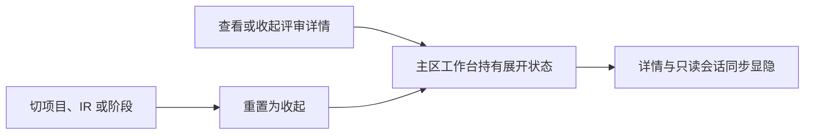

# 需求共创与提案转正

## 身份与材料

IR 属于唯一项目和 Release。提案与正式需求是同一 IR 生命周期，转正保留稳定 ID、原始短需求、联系人、讨论、材料及历史。Release 是业务版本，不是分支。原始短需求独立保存，不被生成文档覆盖。

| 对象 | 材料                                                                                                |
| ---- | --------------------------------------------------------------------------------------------------- |
| IR   | `docs/requirements/<ir-id>/requirements.md`、`sr-dependencies.json`、`acceptance.md`                |
| SR   | `openspec/changes/<sr-id>/` 下的 `proposal.md`、`design.md`、`tasks.md`、`specs/` 与 `test-plan.md` |

每个 SR 对应独立 OpenSpec change。依赖 JSON 是 SR 依赖、工作日预估与假设的唯一来源，不从正文或元数据补造。预估不直接转换为正式排期，工作日求和也不是 IR 总周期。材料阅读规则见[文档表面](document-surface.md)；材料路径不表示已写入真实仓库，运行边界见[后端运行说明](../../architecture/mock-backend.md)。

## 创建与导入导出

需求共创使用左侧当前项目与具体 Release。提案表展示提交人、原始需求、提交日期与状态，提供原文／编号搜索、提交人工号及状态筛选、分页和详情入口。

新增只保存短需求，成功刷新并留在提案表，失败保留输入；不会自动发送消息、生成材料或 SR。主动进入讨论只读取会话，显式发送才开始本次澄清。

- UTF-8 CSV 模板只有“原始需求”一列，支持中文、逗号、引号与单元格内换行。空白行跳过，重复正文提示但不去重，格式错误阻止整批提交。CSV 导出包含全部筛选结果而非当前页，只含短需求。
- Markdown 业务文档支持 `.md`／`.markdown`，一次一份，UTF-8 正文不超过 1 MiB。预览完整正文，并单独确认可编辑的短需求，默认来自首个一级标题或文件名。
- 导入以 `proposals: { originalText, businessDocument? }[]` 整批校验、原子创建新提案，不覆盖现有提案。附带文档保存为该 IR 业务材料，但不产生 SR、批准或自动执行，仍须原始评审。
- Markdown 导出明确选择筛选结果中的一个 IR，只下载其当前有效、可读取的业务文档；未生成、失效或读取失败时说明原因，不下载占位文本。
- SR 规格、方案、任务、测试方案、依赖和整体验收不提供导入导出。

文件、预览与原文受同一草稿门禁保护；在途禁止重复提交和离开，失败保留输入，成功回执后才清理。版本冲突需显式重读后重试，不自动覆盖。

## 业务澄清与原始评审

业务讨论完善 IR 业务文档，不提前拆分 SR。原始需求评审由单个业务评审 Agent 检查目标、范围、歧义和可验收性。报告必须完整可读、运行成功、无阻断且匹配当前文档版本，才可人工通过；决定绑定评审 ID 和材料版本。

评审区默认只展示确认状态：当前评审有匹配 reviewId 的人工通过记录时，显示实际确认人工号、时间和确认对象；执行完成不能冒充人工确认。原始需求与完整方案采用同一精简展示，完整方案的未确认状态明确为“方案审查已完成，等待人工确认”，通过后显示“工号于时间确认了完整方案”。未确认时区分等待人工确认、评审中、执行失败、阻断问题和材料不完整；旧版本显示需重新评审确认，不沿用旧确认。Agent 切换、报告、轮次、输入材料和技术版本标识统一收进默认关闭的“查看评审详情”，评审只读会话也随该入口显隐，不默认另铺一份重复报告；方案讨论会话不受影响。展开状态仅归当前主区工作台，切项目、IR 或阶段重置，隐藏不卸载会话，保留只读及原导航门禁。

人工通过后进入方案阶段，但进入阶段本身不生成方案。退回须填写非空原因，保留操作者、时间及轮次；业务补充后再评审。查看历史不是业务退回，也不运行任务。

## 方案、完整审查与三方确认

方案讨论在所属 IR 进行，形成独立 SR 的规格、设计、开发任务、测试方案、依赖及 IR 整体验收。测试方案追溯业务验收标准，没有独立后置测试方案生成阶段。后续补充保留已有 SR 身份。

依赖 JSON 准确覆盖当前 SR；前置项属于本 IR，不重复、不自依赖、无环，依赖原因、正有限工作日和假设完整。预估缺项时可以阅读有效拓扑，但不能提交不完整包。

完整材料齐备后，三路独立评审针对同版材料分别检查需求覆盖／一致性、技术方案／依赖、任务可执行性／测试充分性，再由综合 Agent 终审。缺报告、失败、阻断、不可读或版本不符均不能人工放行；原始评审与完整审查独立保存轮次和历史。

人工放行后，业务、开发、测试三个视角分别确认同一版本，保存实际工号与时间。同人可兼任，但必须完成三个独立动作；阶段主体展示状态与剩余条件，历史视图不呈现当前可执行确认。

## 版本失效与文档交付

完整包任一材料变化，完整三审、终审、人工放行与三方确认全部失效，测试方案也不例外。业务需求文档变化还使前置原始评审失效；仅 SR 方案或测试材料变化不额外重做前置单评审。旧材料、报告、决定和失效原因保留只读，迟到结果不恢复旧批准。

交付确认弹窗按提交目标、文件确认及固定底部操作组织，正文单独滚动，头部和关闭／提交按钮不随清单滚走。仓库和来源／目标分支只展示一份摘要，材料完整路径次级展示，版本技术信息按需展开，不重复嵌入材料准备卡片及第二份清单。文件区提供全选／取消全选、半选状态及实际选中数量，空清单不可全选和提交；批量勾选仅改变当前弹窗快照的文件选择，不自动勾选最终人工授权。只有完整清单全部勾选且明确确认后才允许提交；版本失效、只读、未就绪及提交中沿用原禁用和防重复提交规则。确认选择仍由交付弹窗持有，不新增业务事实 owner。

每 IR 提交一个完整文档 PR，不分批转正。交付确认绑定当前版本、候选与完整清单；确认、推送和 PR 创建分别保留结果，确认不等于已发布。推送成功但 PR 创建失败只重试当前候选的缺失步骤。

PR 提交后材料冻结。修改前先关闭当前未合并 PR，再补充、重审和确认。等待合并、关闭未合并、材料不完整、候选或版本不符均不转正；只有同候选的完整合入事实与材料核验一致才转正。

转正逐 SR 记录开发分支及同一文档合入基点，逐项保存状态与错误；失败显式重试，不伪造可用分支，重复核验不复制对象。正式范围不直接扩充、重开、重新拆分或跨 Release 迁移；新增范围另建关联 IR。

## 分工与工作区

IR 业务联系人默认提交人，开发／测试联系人可指定或待认领；SR 分工、验收及待办见[正式需求与进度](tracking.md)。实际操作者与联系人分别记录，联系人不是独占权限。

讨论复用[原生会话](conversation.md)，材料、报告与历史使用[统一右侧多 Tab](unified-side-pane.md)。SR 只读材料不挂开发会话，阅读不修改业务。联系人、补充说明、退回原因和交付确认绑定原对象与编辑版本，后台重读不提升草稿基线；失败保留输入，在途冻结重复提交及关闭。

普通草稿可经确认删除；正式、已合入或具有受保护历史的需求不能以删除释放记录。公开入口不提供场景控制、强制推进、手填合入事实或编码执行；外部 AI、Git 与 PR 限制集中见[后端运行说明](../../architecture/mock-backend.md)。

## 事实来源

`packages/server/src/aireq/` 下的 `workflow.ts`、`proposal-mutations.ts`、`proposal-delivery.ts`、`native-business.ts`、`requirements-review.ts`；`packages/services/src/aireq/` 下的 `domain.ts`、`sr-dependencies.ts`、`remote-operations.ts`；`packages/ui/src/aireq/` 下的提案表、导出组件和 `shell/AIReqProposalWorkspace.tsx`。
