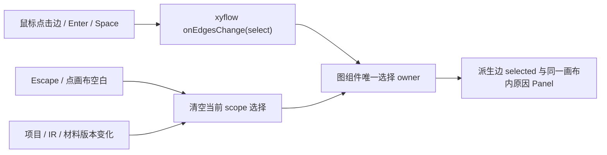
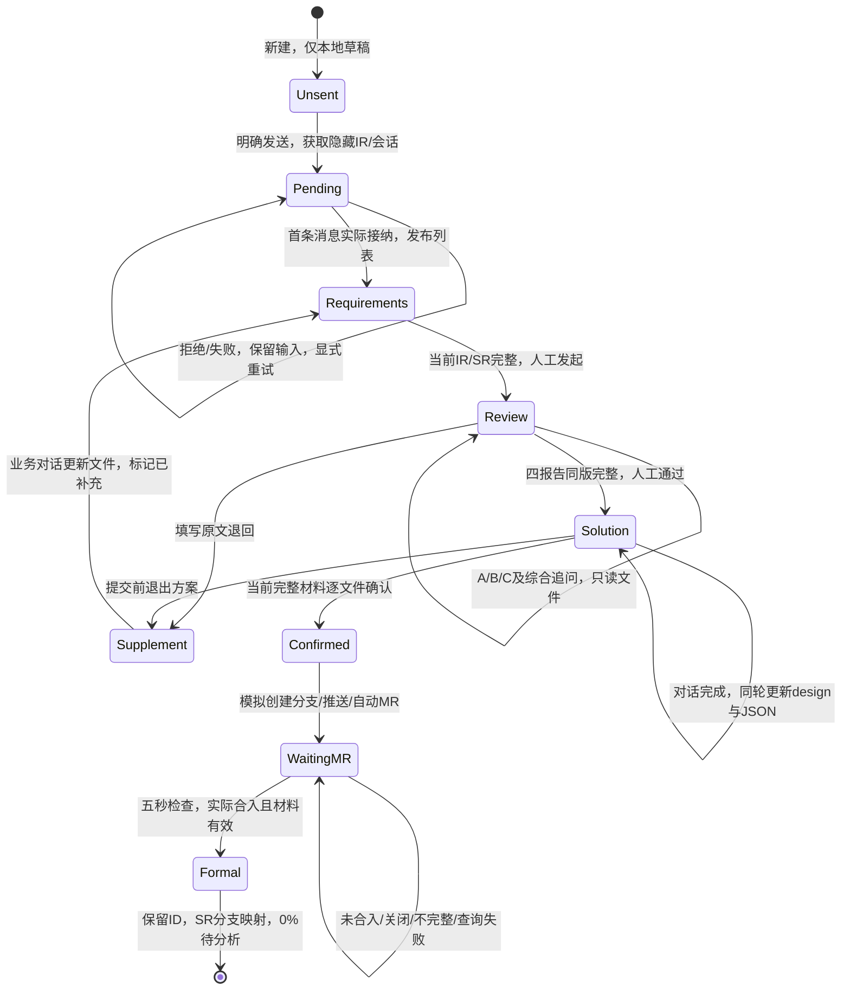
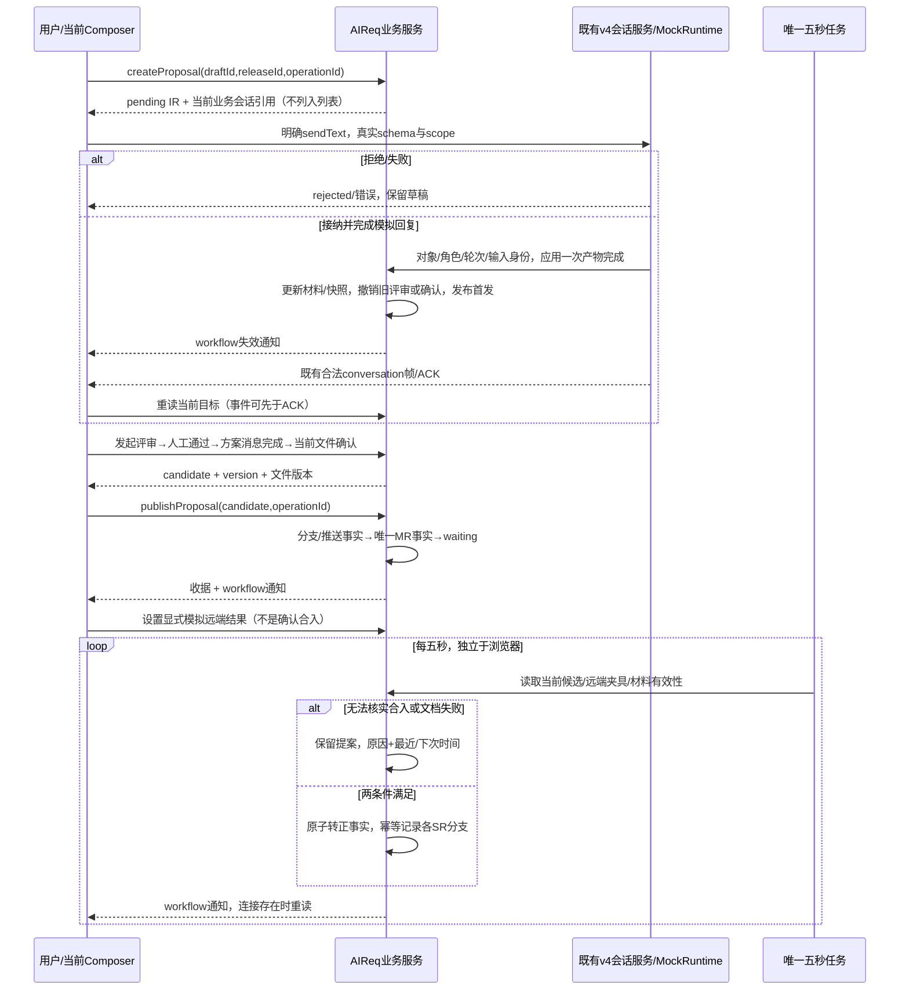

# AIReq 需求提案迁移规格

> 当前产品前端与公开接口以 [发布边界](release-surface.md) 为准：原型／调试控制和场景身份参数已退出产品契约；下文相关模拟入口与浏览器故障注入记录仅属于历史版本，不构成恢复入口或接口的要求。


## 当前项目空间入口与确认组织（2026-11-16）

页面归属与本轮验收采用 [项目空间规格](project-space.md)：从全局项目进入项目空间，“需求 → 提案”保留新增／导入／导出及原表格字段；项目／Release 常驻页头，需求提案与正式视图共用唯一范围。新增或导入仍要求具体 Release，成功留表，主动讨论才开始澄清。提案与正式需求共用稳定 IR 身份和需求上下文；详情始终高亮项目 → 需求，保留返回对应列表的入口。

三方确认阶段主体直接展示三个同版视角的状态、独立确认动作与提交剩余条件；不再把必要确认藏在材料更多菜单。服务端材料版本、完整审查、人工放行、三方确认、PR 冻结／核验规则不变；历史只读不能呈现当前可执行确认。材料区保留阅读和定位，原生会话、附件与草稿复用既有所有者。下文旧导航／材料操作位置及已执行记录保留其历史版本，本轮结果另由主集成记录。

## 当前规格：第 2 组完整业务闭环

本节依据根 `.todo.md` 的当前规则及第 2 组业务边界，取代下方冲突历史条款。先列现行要求，实际验收另列“第 2 组提案实际观察”；第 3 组项目进度独立记录于 tracking，不把当时阶段状态当作当前欠项。本次只同步文档，不新增浏览器、AI／Git 或工程检查通过声明。

### 提案原文、表格与导入导出

#### 提案表操作列（2026-11-16）

- 提案表操作列与进度分析一致：固定 56px 操作列、32px 三点按钮，行悬停或键盘聚焦时显示。该列只有详情／讨论一个动作，点击直接进入对应提案；原文按钮继续直达同一提案，复用原选择与导航门禁。
- 验收：电脑浏览器截图检查表格与三点入口，键盘聚焦及点击三点、原文分别进入正确提案；检查表格长内容和空态不受影响。

内置浏览器实测：操作列为 56px、按钮为 32px，键盘聚焦显示三点并进入对应提案，原文仍可进入讨论。当前样例表格与详情页截图检查通过；未构造长原文或空数据。

#### 讨论页评审信息与材料操作（2026-11-16）

- 材料栏底部始终为单行操作栏；主要阶段动作直接显示，其他动作、说明、视角状态、评审报告及模拟控制通过更多入口访问。需要更多横向空间时操作行可横向滚动，不折行或挤压阅读区；模拟控制的未提交输入在面板关闭后仍保留，导航门禁保持原所有者。
- 材料栏头部筛选、正文（含 Markdown、依赖图、空态和错误态）与底部操作使用同一居中内容宽度和边距；缩小电脑窗口时共同收缩，保持滚动条空间一致，不裁剪内容。历史材料沿用只读规则。
- 验收：逐阶段及历史状态截图检查单行底栏，检查说明／报告／模拟控制、禁用原因和三方确认入口；核对收放面板时未保存模拟输入，以及材料筛选、Markdown、依赖图、头部与底栏左右对齐。
- 聊天上方的评审信息区以现有主题卡片呈现并留内边距，其外边界与聊天输入框对齐；材料展开、收起及电脑窗口变化时保持居中，阶段、会话与消息不变。
- 需求材料底部每个业务阶段至多显示三个操作按钮（包含三点入口）：原始评审与完整审查保留主要操作，次要操作收入三点菜单；三方确认状态放入说明，三个确认操作集中到三点菜单，交付及冻结操作继续可达。报告与模拟控制通过更多入口访问，不更改业务命令、禁用门禁或确认弹窗。
- 验收：以“团队报表导出”原始评审为基础截图核对信息卡与输入框的左右边界，检查材料展开／收起；验证三点菜单、禁用原因及退回弹窗，检查其他阶段操作仍可达。

内置浏览器实测：“团队报表导出”材料展开时卡片与输入框均为 x=92px、宽 515.4px，收起后均为 x=123.3px、宽 943.3px；截图检查两种状态。原始评审三点可打开退回弹窗并取消；完整审查保留禁用原因及退回入口，三方确认菜单列出三个视角且交付入口仍显示。未执行退回或三方确认命令。浏览器错误日志为空；类型检查、Lint 与架构检查通过。

单行底栏与对齐实测：内置浏览器检查业务需求、原始评审、完整审查、三方确认和历史阶段，操作栏均为一行；退回弹窗、评审报告、三方确认菜单及依赖图可打开，模拟修改说明收起后重新打开仍保留，测试输入已清除。常用宽度下材料栏标题、筛选、正文和操作列的左右边界均为 x=653.1～1103.3px；缩窄材料栏后底栏仍为一行。当前样例未提供历史材料版本，不声明该状态已实测。

#### 详情页对齐与返回（2026-11-15）

- 提案讨论页的流程导航和评审导航均在讨论栏内居中，使用与原生聊天内容列一致的宽度规则和中心线；右侧材料展开、收起或调整宽度时随讨论栏变化，不覆盖阶段按钮或聊天内容。收起材料必须释放其全部宽度，展开时恢复之前宽度；通过分隔条键盘或拖动折叠时，展开按钮与面板状态保持一致。
- 讨论页标题左侧提供带可访问名称的“返回提案列表”入口，使用现有 AIReqContext 导航及未保存门禁，明确返回当前项目的提案列表，不依赖浏览器历史；不改变项目、Release、提案业务状态、消息或材料。保留工作区通用前进／后退。
- 评审详情与会话内容共用同一居中列；报告复用现有 Markdown 文档渲染，评审状态与标签显示使用一致的中文状态，不直接展示 Markdown 标记或内部枚举。
- 桌面讨论栏变窄时，评审 Agent 标签允许换行，容器随实际行数增高；标签与后续操作、报告互不重叠，所有标签均可点击。
- 桌面窗口缩小或材料栏加宽时，四个阶段标题和“当前”标记允许整体换行，但标记本身不得拆字竖排；各阶段的 Agent 入口保持同一行对齐，阶段与当前状态语义不变。截图检查 1024 像素宽及材料收起后的讨论页。
- 退回业务补充弹窗使用与新增提案一致的居中限宽及多行输入区；在较小电脑窗口中允许滚动，保留原因输入和失败反馈。
- 当前或显式选择三方确认阶段时，中栏显示该阶段交付状态，不渲染仍被投影返回的方案会话或完整评审导航；材料栏收起时提供明确入口展开材料与确认操作。历史业务、评审和方案阶段仍可阅读原会话。
- 交付推送成功但 MR 创建失败时，保留失败原因和已推送事实；弹窗内外均将后续操作标为“重试创建 MR”，只重试当前候选。
- Edge 桌面验收：从提案列表打开详情，在材料展开与收起时检查流程导航和聊天输入框的中心与宽度对齐，阶段仍可切换；点击返回可回到提案列表，项目／Release 不变，未发送内容遵循现有草稿所有者与导航门禁。

实际观察：Edge 1700×828、1122×763 下材料展开及收起时流程列与输入框的宽度和中心一致；收起后材料栏实测为 0px，重新展开恢复原宽度，分隔条 End 折叠后按钮正确显示“展开材料”。阶段切换、明确返回提案表、重新进入后的未发送草稿均已检查。以上为详情页局部验收，不代表全部业务流程完成。

2026-11-16 内置浏览器在 1024×768 复验：讨论栏与材料分隔条拖至约 38.2% 后，按钮收起／展开及分隔条 End 折叠再展开均恢复该比例；收起时材料隐藏，流程区与输入框保持居中。窄讨论栏的“当前”标记不拆字，三个 Agent 入口对齐；查看历史阶段时仍区分当前阶段和选中阶段。

- 原始短需求独立保存，既不被生成文档覆盖，也不限制为任意固定句数。新增仅保存短需求：成功立即刷新并停留提案表，失败保留输入；不创建 SR、不运行 AI、不依赖首发聊天。只有手动进入 IR 讨论才开始澄清。
- 提案表四个数据列为提交人、原始需求、提交日期、当前状态，右端三点入口打开详情／讨论。工具栏按“新增提案、导入、导出”排列。删除旧侧栏提案列表及独立新建导航，保留基础控件。
- 原始需求正文可通过鼠标或键盘直接进入对应讨论，右侧三点入口同样可用；两者使用相同的选择和导航路径。
- 评审导航和报告入口默认展示当前／历史状态及轮次，内部评审标识放在展开后的技术信息中；长标识不得挤占聊天正文或输入区。验收检查原始评审与完整审查界面及技术信息展开。

2026-11-16 内置浏览器实测原始评审与完整审查：默认摘要显示版本状态或轮次，长评审标识不再占据聊天列；展开“评审与材料版本标识”仍可查看标识。隔离模拟项目从原始评审、人工通过、方案生成、完整三审终审与三方确认，完成模拟文档 MR；材料不完整时未转正，完整合入后转为一个正式 IR 和两个 SR。

- 新增提案使用居中的限宽原生弹窗和可见的原始需求标签，编辑区提供多行高度；未选具体 Release 时在弹窗内说明保存条件。桌面窗口缩小时弹窗内容可滚动，保存、取消与关闭门禁维持原有语义。
- UTF-8 CSV 模板仅有“原始需求”一列；一行一条、正确处理中文、逗号、引号和单元格内换行。预览不写入，跳过空白行，重复文本提示但不去重；格式错误定位并阻止本批提交。导入绑定明确项目及具体 Release、稳定操作 ID，服务端记录实际工号和时间。导出全部筛选结果而非当前页，只含原始短需求，不含生成材料、人员、日期或聊天。
- 未选具体 Release 时，CSV 导入弹窗内也说明确认条件和选择位置，避免禁用按钮缺少原因。
- 导入确认或取消后，弹窗退场动画保留当次预览；再次打开时从空预览开始，不把已关闭预览视为未保存草稿。
- 完整包提交成功时，确认弹窗退场期间保留原确认内容；只有推送失败需要重试时才切换到推送步骤。
- 选择 CSV 后显示本次文件名，清空原生文件输入以支持重选同一文件时不得让用户误以为预览未加载。
- 有未保存原文或 CSV 预览时，关闭弹窗、切换页面和浏览器历史导航使用应用内确认框；取消保留当前输入与预览，确认丢弃后只执行一次原导航。浏览器关闭或刷新仍由浏览器原生离页提示保护。

```text
离开请求 → 提案页草稿门禁 → 应用内确认
                              ├─ 取消 → 保留草稿和当前位置
                              └─ 丢弃 → 清理草稿 → 执行原导航一次
```

- 提案页处于当前六导航“项目进度、待办列表、正式需求、需求提案、进度分析、Skill 设计”，登录默认项目进度。正式需求、需求提案、进度分析共享当前项目／Release，支持全部 Release 读取，创建／导入必须具体 Release。Skill 设计在主页面而非设置或设置搜索，旧 `skill` 设置偏好回项目设置；保留原生会话、预览、模拟保存、设置往返草稿与唯一未保存门禁。Issue、AIReq 自动化专属能力不恢复，通用控件及仍有用途的底层设施保留。

### 评审缺陷回归约束（2026-11-15）

- CSV 表头前后空白行均跳过；重复提示按服务端保存的 trim 后正文比较但不去重。读取失败后可立即重选同一文件重试。
- 导入批次不归属于此前选择的 IR；每个新提案保留同批次身份、实际操作者与创建记录。重复完整评审放行不得覆盖首次人工决定。
- 退回且尚未补充的提案显示业务补充待办；失败待办按实际业务／方案阶段修改对应联系人。跨项目领取从目标项目最新工作流读取完整联系人，以同一 revision 提交，其他联系人保持不变。
- 讨论页的联系人名称完整显示，输入框占用剩余空间；在桌面宽度的材料面板中截图检查标签与输入框。
- 评审模拟选择展示该 IR、该评审种类的服务端已保存值；“下一次”场景在接纳一次评审时消费，之后恢复正常，不改变已暂缓结果的版本门禁。
- 历史版本切换始终恢复该版本可读材料路径；版本状态不得串 IR。IR 汇总材料菜单同时标明 SR 身份和材料名。退回失败原因在打开的对话框内可见，保留退回理由。
- 通知方案样例能沿完整审查、人工放行、三方确认、整包交付正常完成；`review-chat` 入口实际提供其所选提案的评审会话。

回归验收：跨项目领取前后逐项比较三类联系人；退回后检查补充待办；连续两轮评审检查场景消费和首次审批来源；导入两条后分别检查新 IR 创建记录及原 IR 操作历史；导入前置空行及带空格重复正文，并重选同文件；只改测试方案后切换历史版本，逐 SR 识别材料；模拟版本冲突时在退回弹框看到错误。

2026-11-16 使用内置浏览器及隔离模拟服务验证 `draft-report-export`：补充退回意见后设置一次性阻断，第二轮原始需求评审显示阻断并禁用人工放行，下一次模拟结果恢复正常；补充业务材料后第三轮无阻断，人工放行入口可用。结果均来自内存模拟，未调用真实模型。

同日检查提案组合筛选与导出：原文“团队”和提交人工号共同筛出“团队报表导出”，下载的 CSV 仅含原始需求表头及该条原文；叠加不匹配的业务阶段后显示 0 条空态，导出仅含表头。此前跨分页导出记录仍见下方第 2 组实际观察。

同日以隔离模拟项目导入两条样例，预览保留逗号与换行；两条提案各自显示同批导入操作记录。重新选择同一文件时，第 2、3 行均提示重复；取消离开保留预览，确认丢弃后列表仍为两条。历史材料两个版本分别显示变更前正文和第一次补充，切回当前材料显示两次补充。

同日补验格式错误和空行：缺少结束引号时显示物理行列并禁用导入，重新选择有效文件可立即显示预览；表头前后两个空行被跳过，带前后空格的批内重复正文保留两条并提示第 5 行。此次仅预览并丢弃，未新增提案；期间工作区其他改动触发前端刷新，已重新进入后完成上述检查。

### 身份、材料与最终流程

- 提案与正式需求是同一 IR 生命周期，转正保留稳定 IR/SR ID、归属、历史及材料。IR 属于唯一项目和 Release；Release 不是分支。
- IR 共享材料为 `docs/requirements/<ir-id>/{requirements.md,sr-dependencies.json,acceptance.md}`。每个 SR 是独立 OpenSpec change：`openspec/changes/<sr-id>/` 内含 `proposal.md`、`design.md`、`tasks.md`、`specs/` 和 `test-plan.md`。路径是模拟业务仓库材料引用，不写本源码工作树；不保留“一个 IR 对应 change、SR 只是 capability spec”兼容映射。
- 原始需求澄清阶段只生成 IR 业务需求文档，不提前固定两个 SR。单个业务需求评审 Agent 检查目标、范围、歧义、可验收性；无阻断项且人工通过后进入拆分。
- 开发牵头在同一方案阶段逐步完善全部 SR 规格、设计、开发任务和测试方案；测试方案追溯业务验收标准。依赖 JSON 是跨 SR 关系唯一来源，IR 保留整体验收。没有独立后置测试方案阶段或专用测试方案生成 Agent。
- 完整材料齐备后，三个 Agent 针对同一版本分别审查需求覆盖／一致性、技术方案／依赖、任务可执行性／测试充分性。三路全部完成后第四 Agent 综合终审；无阻断、无失败、报告完整且版本匹配才可人工放行。单评审与完整审查分开保存轮次和历史。
- 人工放行后分别记录业务、开发、测试三个视角确认，均绑定同一材料版本、实际操作者与时间；同人可兼任但不能合并为一个确认动作。全部确认后才可提交一个 IR 的整包文档 PR。

### 版本失效、冻结与转正

完整送审包包含 IR 业务需求、SR 拆分与依赖、全部 SR 规格／设计／任务／测试方案及整体验收。任一内容改变，三路审查、终审、人工放行、三方确认全部失效；仅改测试方案也不可复用旧批准。业务需求文档变化还须重做前置单 Agent 评审及人工通过，其他材料变化不额外重做前置单评审。保留旧材料、意见及失效原因；迟到结果按对象和版本拒绝，不恢复旧批准；不删除原始短需求或历史。

每 IR 一个完整文档 PR，不分批转正。提交后冻结候选版本，需修改必须先关闭未合并 PR，再返回对应阶段修改并重审确认。待合并或关闭均不转正；仅服务核实同一候选完整合入主分支才转正，不信任 URL 或按钮点击。每 SR 开发分支以该次文档合入提交为基点，逐项记录创建状态和错误，失败不伪造分支；重复核验不复制对象。正式范围不可直接扩充、重开、重新拆分或跨 Release 迁移；新增范围另建关联 IR，仅用于追溯。

### 所有者、分工及可操作模拟

现有 `MockAIReqService/workflow` 是共享业务事实唯一 owner；材料、评审、确认、PR、联系人、问题及报告仅经既有 RPC/data source 更新。原生 v4 owner 保留消息、附件、订阅及水位，业务只持引用与版本绑定完成回调。提交事实后发 `onDidChange`，UI 重读且丢弃迟到投影；刷新／重连只读，不重放写操作。保留合法工号／clientId、参数、对象及原生会话归属、阶段、版本、幂等和完整材料门禁。

IR 业务联系人默认提交人，开发／测试联系人可指定或待认领；SR 开发／测试负责人继承 IR 对应联系人并可调整。同人兼任，所有合法工号均可配置、代办、指定与认领，未分配进入待认领；实际操作人与负责人分开记录，不构成权限，owner 只标来源而非特权。模拟结果始终明确标记，经 `scenarios.ts`、`scenarioOperations`、`prototype.*` 与正常业务动作接纳，不直接写批准：单评审／完整审查正常、阻断、失败，旧结果暂缓／释放，以及 PR 待合并、关闭、正确候选合入、材料不完整和候选版本不符都有浏览器控制。

### 本组真实浏览器验收场景

1. 新增后停留表格、无 AI／SR；失败输入保留、同操作重试不重复。CSV 覆盖中文／逗号／引号／换行、空行、重复、错误整批拒绝及跨分页只导出原文。
2. 主动讨论后澄清，前置单评审通过前无 SR；通过后拆至少两个 SR，逐一读取独立 change 全材料及业务可追溯测试方案。只读历史不发送消息。
3. 单评审与完整审查的阻断／失败不可放行；完整三路齐备才终审，再人工、三方分别确认，同人可兼任，缺一禁止 PR。
4. 分别修改业务需求、SR 方案、测试方案验证整包失效；只有业务需求变化重做前置评审。旧标签页及显式释放旧结果不能覆盖当前材料或批准。
5. PR 后只读，待合并／关闭不转正；关闭修改重审后重新提交，缺材料／错候选不可转正。正确候选保持 IR/SR 身份，各分支同基点，刷新不重复；正式表可读同一材料。

工程验收按根 `.todo.md` 逐组规格先行→完整实现→本组必要检查／浏览器验收／记录后再进入下一组，不留到最后统一补首次验证。平台不执行产品中的构建／测试，不等于禁止仓库必要工程验证；不默认 build、knip、全量业务测试，也不新建测试体系。进度、验收、聚合及派生待办的当前合同见 tracking 当前规格，不能以文档 PR 合入替代 SR 代码合入后的有效 99／人工测试 100。

### 第 2 组提案实际观察（2026-11-15）

- 真实 Chromium 1440×1000，工号 `j00808875` 从新增入口保存 `ir-demo-25`（Aurora／`release-next`），成功留表且无材料、SR 或 AI；进入讨论并明确发送后才生成 IR 文档，单评审通过前没有 SR。原文始终为“组2验收：需求闭环与测试追溯。业务验收结果需追溯各独立开发单元。”，未被澄清或方案内容覆盖。
- 方案对话产生稳定 `sr-ir-demo-25-1`／`sr-ir-demo-25-2`；每个 SR 可选 proposal、spec、design、tasks、test-plan，测试方案逐项引用 AC-1／AC-2 与 IR 业务路径。逐 SR 只读材料不挂开发聊天。文档 PR 确认清单包含 3 份 IR 共享材料及两个 SR 各 5 份材料，共 13 份。
- `draft-report-export` 的单评审阻断轮、失败轮均禁人工通过；主 IR 完整审查阻断轮禁放行，失败轮 A 失败、终审等待，正常轮三路完成后终审报告明确汇总同轮三份意见。修复了完整方案讨论伪选综合头像的问题；重新完整审查后实际进入综合终审原生会话。
- `j00808875` 可分别确认三个视角；缺业务／开发／测试任一视角不能提交。仅修改测试方案、修改 SR 设计、修改业务需求均撤销完整批准及三方确认；前两者留在完整方案阶段，只有业务需求变化回到前置单评审，再核对下游材料。相同 SR ID 未重新派生。
- 暂缓完整审查后修改 SR 方案，再释放旧结果，UI 显示 `sample-full-review:demo-aurora:ir-demo-25:4:9` 的真实拒绝原因“迟到模拟结果的轮次或材料版本已过期，拒绝写回”，未恢复批准。另一个真实工号 `j00808876` 修改测试包时，旧标签页已勾全文件的送审弹窗撤销，旧确认不能提交新包。历史阶段只读可返回当前，旧材料／意见与原因保留。
- 第 8 轮整包 PR `#102` 冻结材料；待合并、合入但材料不完整、旧候选版本及关闭未合并均未转正。关闭后修改测试材料、重做第 9 轮完整审查和三个视角，重新提交 `#103`；只有正确完整候选合入才使同一 IR 转正。两 SR 基点均为 `sample-proposal-merged-328`；SR2 显示真实模拟创建失败及“未产生可用分支”，未伪造 ready 状态，正常重试及刷新证据见 tracking 的本组记录。
- CSV 由 `j00808876` 实际下载并导入：33 条，空行跳过、两条重复保留，含中文、逗号、双引号及单元格内换行；非法未闭合引号定位第 4 行第 1 列并禁止整批提交。跨分页下载仅有“原始需求”一列，保留完整多行单元格、两个重复值及分页末项 30；浅／深主题电脑布局均可操作。
- 真实版本拒绝保留新增原文。显式重新读取版本保留输入及操作 ID、没有自动写入，随后明确保存 `ir-demo-36` 仅一条；远程命令唯一入口补齐缺省操作 ID／预期版本，后台重读不再清除提交失败。所有材料、Agent、Git／PR 均为共享内存模拟，未调用真实外部系统。

## 历史迁移依据与观察（第 2 组之前）

以下旧 `todo.md` 编号、源代码装配、旧流程及验收记录只描述当时版本，不再是当前行为要求。各历史章节和清单保留旧方案，不授权首发聊天才可见、业务阶段固定两个 SR、四路前置需求评审、四阶段、IR/change 映射、逐文件确认替代三方或旧权限。历史“通过”不能作为当前证据；不冲突的搜索、时间、头像、面板和菜单可达性等 UI 细化保留，具体边界见末尾当前布局补充。

## 历史 §1. 范围、依据与目标落点

本节记录旧 `todo.md` §5 的 12 项迁移及当时“实现已集成、验证进行中”的状态，不是当前实施或待办清单。旧 `todo.md` 仅承载该次历史证据，当前需求及停止条件以根 `.todo.md` 为准；文档同步的必要检查仍遵守当前请求与仓库规则。

源根记为 `S = F:/code2026/oh-my-pi/packages/aireq-frontend/`，业务根 `A = S/packages/ui/src/aireq/`。下文源码路径均按这两个前缀展开；源仓库只读，目标产物不可依赖该绝对路径。

规范依据直接读取：源 `openspec/specs/aireq-requirement-intake/spec.md`（尤其自然语言拆分、四路评审、共享材料、提案阶段、补充循环、自动建 MR、会话引用条款），`aireq-browser-workbench/spec.md` 的提案首发、三栏、列表、四 Agent、方案、五秒检查、局部切换及最新 MR 条款。源 workbench 规格仍声称合同 version 1；实际 `S/backend/contract.ts:43` 为 **3**，以实际代码的数据形状和本规格裁决为准，不保留旧传输合同。

目标保留原 AIReq 业务组件组织，适配当前 `packages/ui` 的控件、Markdown、工作流图、Canvas、v4 会话及主题；不搬旧通用控件库、不复制 CSS。`@zcode/services` 提供 AIReq 业务公开契约，客户端按目标同源 `/ws` 二进制 Channel RPC 调用；目标 `packages/server/src/mock/index.ts` 集中装配 AIReq 内存域。业务状态只能由该 mock 域持有，聊天 rows/协议水位仍由现有 MockRuntime 和会话服务持有。

本轮显示验收以用户指定的 `base` 同类 Quick Pick 和 Dialog 为参照：搜索沿用居中弹层、语义颜色与列表字阶；非空查询命中 SR 时逐项显示其标题与编号，选择后仍进入父提案，不新增导航状态。操作记录、退回意见和历史人工评审时间统一显示为北京时间，并明确时区，原始时间保留在 `time.dateTime`。浏览器验收包括同提案多个 SR 命中、父提案跳转及同弹窗三类时间显示。

本轮修复后 `bun run typecheck`、`bun run lint`（0 警告、0 错误）与 `bun run architecture:check --changed` 均通过。用户随后取消浏览器验证，实际显示效果由用户验收；上述搜索、设置、排期和时间场景未完成浏览器验收。

本轮六项显示修复按用户指定的 `base` 原生控件实施：评审切换入口同时展示头像与可见名称，不依赖颜色或悬停辨认；窄讨论栏允许换行，不裁掉入口。顶部阶段导航独立表示“正在查看”（原选中样式）与“实际当前”（可见“当前”标记、`aria-current`），切换历史不改写业务阶段。工作台导航的功能入口与提案列表放在同一纵向滚动区，顶部工具条和底部项目菜单保留，1100×450 桌面下可滚动访问全部提案。浏览器验收由用户执行。

SR 依赖图的箭头方向、平移缩放与依赖原因查看说明属于操作辅助信息，按 `base` 字阶使用 `text-ui-sm leading-6 text-foreground-subtle`，不得使用弱元数据字号。图与交互行为不变。

本轮提交确认显示修复：逐文件及总确认沿用原生 Checkbox，局部加强未勾选态边框，不改动通用控件与勾选语义；待核对路径使用 `font-mono text-ui-base text-foreground`。完整交付流程只保留弹窗说明一处，材料准备卡片保留自身标题与材料事实，不重复流程。工作区菜单中的工号和 Web 所有者使用可读的非交互菜单说明，不以 disabled 操作项呈现，不新增身份操作。浏览器由用户验收。

### 历史 §1.1 实际可达装配（不是按文件名推断开放）

1. `S/app/AIReqApplication.tsx:34-146`：AIReqProvider → BrowserApplication → Root；连接 key 只取后端、访问工号、项目，IR/Agent/轮次只更换 task/session。此结构语义需迁移，不复制旧连接实现。
2. `S/packages/ui/src/app-shell/WorkspaceShellLayout.tsx:290-299` 识别提案 SR、历史、切换中目标；实际工作台装配 `AIReqSidebar`、`AIReqStageHeader`、只读/空态和会话。`A/AIReqEmptyState.tsx:17-20` 把未发送草稿接到 ProposalDraftComposer，入库接到 ProposalStageBody。
3. `A/AIReqWorkbench.tsx:23,80-205`：PhaseHeader + ReviewNavigation + ProposalFeedback；MaterialsPane 白名单选择业务材料，底部 DocumentPhaseActions；不是 ProposalControls 的旧整块流程。
4. `S/packages/ui/src/WorkspaceHeaderSections.tsx:405` 挂提案 RequirementMenu；菜单只含信息、操作记录和允许删除。`A/AIReqRequirementMenu.tsx:28-65` 为退回意见、旧评审及操作事实的实际历史入口。
5. `A/AIReqContext.tsx:157-166,230-265` 和 `v4/ConversationComposer.tsx:1466-1470,1692-1755,1792-1812` 完成草稿首发交接；实际消息由 `A/mock/chat.ts:266-296` 触发需求/方案材料更新。
6. `S/backend/prototype-data-source.ts:92-120` 服务端五秒时钟与动作过滤是最终开放边界。`generateProposalSolution`、手工登记/确认 MR、正式修订和争议裁决虽然仍在联合类型或旧组件中，却被直接拒绝，不能据其存在重新开放。

## 历史 §2. 旧 todo §5 逐项覆盖表（非现行验收清单）

编号 P01–P12 按旧 todo 原顺序对应，表内为当时覆盖要求，已观察场景见历史 §10，不自动代表整行曾通过。P01 首发可见、P03 固定拆 SR、P04 前置四路、P08 禁止联系人／负责人字段和 P10 逐文件确认替代对齐均已被当前规格取代，不得按此表回退当前产品。

| 项                       | 源功能与行为依据                                                                                                                                                            | 目标页面／服务                                                                                                | 可观察验收（成功、失败、空态）                                                                                                                                                                                                                                                                                                                                                                                                                                                              |
| ------------------------ | --------------------------------------------------------------------------------------------------------------------------------------------------------------------------- | ------------------------------------------------------------------------------------------------------------- | ------------------------------------------------------------------------------------------------------------------------------------------------------------------------------------------------------------------------------------------------------------------------------------------------------------------------------------------------------------------------------------------------------------------------------------------------------------------------------------------- |
| P01 未发送草稿与首次发送 | `AIReqContext:157-166,230-265`、`AIReqProposalDraftComposer:8-18`；workflow `createProposal:559-573` 创建隐藏 pending；chat `publishPrototypeProposalForSession:295` 才发布 | 新建提案三栏；AIReq createProposal + 现有 v4 明确发送；服务端保留 pending 身份                                | 点击新建、切页再回来只恢复同 scope 文字/附件，无列表项、SR、材料或回复；空文字且无附件不能发。首发实际接纳才出现一条 IR。模拟发送拒绝/连接失败保留文字附件并显示“尚未生成”，手动重试复用 pending IR；连续点击、超时后对账不重复 IR/消息/材料。附件单独发送可接纳讨论，但没有可用文字材料时仍明确待生成，不伪造正文。                                                                                                                                                                        |
| P02 提案列表及删除       | `AIReqRequirementList:23-82`、`proposal-list:12-83`、`AIReqRequirementSearch:19-41`、RequirementMenu 与 DeleteRequirement                                                   | 左栏仅 IR 列表、搜索弹窗、更多菜单；AIReq readWorkflow/deleteRequirement                                      | 按项目和有效 Release 展示已接纳 IR；标题/ID、所属 SR 标题/ID 不区分大小写搜索，命中 SR 仍进入 IR。阶段、提交人（全部/我提交/指定工号）、“需要处理”组合筛选；最近更新/创建时间降序，稳定 ID 决胜，查看不改排序。默认无常驻统计，筛选后有数量/清除。无提案、无匹配独立空态。删除显示目标、确认/取消，取消零变更；失败不关框。正式、修订及受保护历史 UI 与后端都拒绝删除，不能通过直接调用绕过。                                                                                               |
| P03 IR/SR 澄清及材料     | chat `280-288`、workflow `648-689`；Workbench `94-107,139-202`                                                                                                              | IR 业务需求会话、右材料；AIReq readWorkflow/retryMaterial，消息通过 v4                                        | 业务消息用固定样例整理 IR 和两个 SR，后续消息补充当前稳定 ID，清楚标模拟。IR 默认 proposal.md，可选全部 SR spec、design、依赖；SR 只看自身 spec，中栏给返回 IR 入口，不挂聊天/阶段条。未生成、读取中、缺失、读取失败、无正文、失效分别显示；不能显示别的 IR/SR 或旧开发文件。路径默认折叠，展开完整换行；只读 Markdown 无编辑/复制/下载/带入讨论。重新读取只修复可恢复读取失败，不产生材料或推进阶段。                                                                                      |
| P04 四路评审             | `AIReqReviewNavigation:35-78`、PhaseHeader `67-72`、`domain:21-65`、mock/requirements-review `10-35`                                                                        | 当前评审综合/A/B/C 会话、流程弹窗、材料底栏人工通过/退回；runRequirementsReview/acceptProposal/returnProposal | 无需方案即可发起；A/B/C 三个不同模型绑定同轮同版 IR+全部 SR，只读文件，第四综合引用三份意见。默认综合，可定向追问且不改需求/批准；头像方向键/Home/End 后焦点留头像，可展开三路汇入综合再到人工图（人非 Agent）。四份 completed 且非空、同版本才可人工通过；missing/pending/running/failed/stale 或正文不可读都禁止。通过记录人/时间/reviewId/digest并进入方案。更新需求使旧报告/决定失效，历史仍可读；单路失败不冒充完整成功。                                                              |
| P05 对话方案             | PhaseHeader `73-76,99-102`、chat `284-288`、workflow `691-704`、mock/proposal-flow                                                                                          | 方案 IR 会话、右“技术方案／SR依赖／工期预估”；内部完成回调不暴露生成按钮                                      | 人工通过后进入方案但不生成文件；只有当前轮已接纳、完成的方案对话更新 design.md 和 sr-dependencies.json，并同轮绑定 requirementsDigest。修订同时可见，任一文件变化撤销旧确认/候选有效性。失败/取消/拒绝消息、历史方案消息不产出。无生成/重新生成方案按钮，不把打开页、输入草稿、切材料当产出。                                                                                                                                                                                               |
| P06 依赖 JSON 权威       | `sr-dependencies:3-43`、mock/proposal-flow `8-17`                                                                                                                           | 服务端校验，UI 只读派生；confirm/publish/poll 共用完整校验                                                    | JSON 精确覆盖所有当前稳定 SR ID 一次；工作日正有限数（支持小数）、假设非空；前置项原因非空、ID 属本 IR、不得重复、自依赖或循环；无依赖 `[]`。缺失/损坏/错版本不从 SR 元数据、设计正文或旧文件回退。用于提交须全量预估有效。                                                                                                                                                                                                                                                                 |
| P07 只读依赖图           | `AIReqSrDependencyGraph:12-61`、readSrDependencies(requireEstimates=false)                                                                                                  | 右材料 Canvas/Controls                                                                                        | 节点含 ID、标题、预估；箭头从 prerequisite 指向依赖方。拖动画布平移、中文按钮缩放／适应视图；画布滚轮不截获材料面板滚动。点击边或 Tab 聚焦边后 Enter／Space 选线，均在画布内同一可视浮层显示原因，长原因局部滚动、不挡全部图，1280×720 无须下滚寻找；点空白清除，切 IR／材料版本不串线。选线状态只由图组件持有。独立节点保留，无边显示可独立安排。禁止拖节点、接线、重连、Delete 修改。依赖结构无效/过期/读取失败显示原因不绘图；只有预估缺项时仍画有效拓扑并标“待预估”，绝不因此放行提交。 |
| P08 提交人与预估         | RequirementList `37-48,79`、RequirementPlanning `81-105`；RequirementMenu `51-53`                                                                                           | 固定提出人工号、方案参与人事实；工期只读 Markdown 表                                                          | 不增加提案 owner/developer/date 编辑或负责人筛选。原 developerAcceptance 仅记方案参与来源，不成为独占权限。工期表逐 SR 显工作日、假设，缺失项单元格“待预估／待补充”，其他有效行可读；表格内部横滚/全屏，不加复制下载。不得把工作日求和宣称 IR 总周期，也不得自动转为正式排期。                                                                                                                                                                                                              |
| P09 补充、退回与历史     | PhaseHeader `104-110,119`；ProposalFeedback；RequirementMenu `58-65`；workflow `706-718`                                                                                    | 评审/方案退回大输入框、业务讨论意见栏、操作记录、时间线历史                                                   | 当前评审或提交前方案可填写非空原文退回，取消不变；成功直接到业务阶段，列表同步，保留工号/时间/轮次/原文，不自动拆题/分派。待处理意见未通过业务对话更新 IR/SR 前不能重评；更新记录 resumedAt，重评通过后继续新轮方案。长文本内部滚动、键盘聚焦、全屏只读阅读并返回原讨论位置。已进入时间线节点只读历史，返回当前阶段不发消息/不运行任务；浏览器后退不是业务退回。                                                                                                                            |
| P10 逐文件确认至转正     | ProposalDeliveryControls `112-172`；mock/proposal-delivery；workflow `720-751,299-315`                                                                                      | 确认弹窗、MR 信息、入库状态；confirmProposal/publishProposal/服务端 poll                                      | 当前 IR、全部 SR、design 和依赖 JSON 每文件勾选＋总确认，绑定版本/候选。完整有效才创建模拟提案分支、提交推送并自动 MR；之前无提案/SR分支。MR 编号/标题/正文/只读URL/来源目标分支可查看。外部人工合并仅以演示场景表达事实，下一轮服务端核验两条件后自动转正式，ID/项目/Release保留，SR分支唯一、基点记录，新 SR 0%待分析，无开发聊天或入库 Agent。                                                                                                                                           |
| P11 MR 门禁及幂等        | workflow `326-367,735-751`、proposal-delivery `15-56`                                                                                                                       | 入库三栏、最近/下次检查时间；业务候选/收据                                                                    | MR opened 不等于 merged，closed且未合入仍保留提案；缺少平台 MR、候选不符、材料缺失/不可读/无效/过期、查询失败均保留原因和最后已知事实，不转正。重复发布复用同候选 MR/分支；重复 tick不重复转正/SR分支。新版本不得沿用旧确认/MR合入证据。推送已成功而创建 MR 失败需保留推送事实并允许显式重试，只补缺失步骤。                                                                                                                                                                                |
| P12 五秒原型检查         | backend/prototype-data-source `85-92`；workflow `317-367`；DeliveryControls `22-74`                                                                                         | mock 生命周期唯一五秒定时器；prototype.setProposalMergeScenario                                               | 五个实际场景为 unmerged、merged完整、incomplete、failed、mr-closed。下拉仅改变后端远端结果夹具，下一次五秒 tick才更新检查/转正，不是人工批准。场景更新中禁重入、失败固定反馈，切 IR不串结果。关页/刷新/断线不停止检查，重连读当前快照；mock重启恢复样例。明确模拟，不请求真实 Git/MR，不加手填链接/自动合并/“已合入确认”按钮。                                                                                                                                                              |

## 历史 §3. 状态所有权、领域类型与权限

### 3.1 唯一所有者

| 状态                                                                                                                | 唯一所有者                                                     | 其他模块允许行为                                                                   |
| ------------------------------------------------------------------------------------------------------------------- | -------------------------------------------------------------- | ---------------------------------------------------------------------------------- |
| 项目、Release、IR/SR、当前阶段/轮次/版本、评审及决定、材料正文/版本、反馈历史、交付候选/MR/检查、操作收据、模拟任务 | 目标 mock AIReq 业务域（服务进程生命周期）                     | UI hooks订阅并读取投影；不得 localStorage、前端 mock、Context 全量可写副本另起权威 |
| 会话 rows、附件内存字节、会话命令接纳/完成结果、v4 seq/logEpoch、topic水位                                          | 目标现有 MockRuntime/会话服务；AIReq 只登记引用与业务完成回调  | SessionPane/V4ConversationContext/Composer复用现有协议；业务事件不得拼成 v4帧      |
| 当前主页面、项目/Release选择、IR/SR/材料/评审头像/历史选择、请求代次                                                | AIReq UI controller                                            | 选择只读取；旧请求不得覆盖新目标；路由/history不写业务阶段                         |
| 未发送文字/附件/临时输入选择                                                                                        | 当前 composer 草稿 owner；按后端+工号+项目+Release隔离首发草稿 | 可本地保存未发送草稿，不保存共享业务数据库；切换不复制草稿给其他对象               |
| 逐文件勾选、总确认勾选、弹窗/图缩放/连线选择/滚动                                                                   | 各 UI 实例，绑定目标及文件版本                                 | 材料更新后清理旧勾选；未提交不写业务事实                                           |
| 外观、分栏、搜索/筛选/排序偏好                                                                                      | 目标已有偏好存储                                               | 不得成为材料、审批、任务权威；偏好不可用不影响业务                                 |

P07 连线选择由 `AIReqSrDependencyGraph` 单独持有 `{scope, id}`，`scope` 为项目、IR、材料路径和 sha256；React Flow 只接收派生的 `selected`，不另存业务选择。事件顺序如下，切版本在渲染新图前清空选择，返回旧版也不恢复：



### 历史 §3.2 当时沿用的领域类型（旧映射已取代）

以下是从当时 `A/types.ts` 保留的可达字段记录，不是当前类型白名单；尤其 IR/change、SR/capability、`pendingFirstMessage` 及旧阶段状态不能作为现行材料映射或创建前置。

- `AIReqObjectRef {projectId, irId, srId?}`、`AIReqRelease`（projectId）和项目 repositoryId/repositoryUrl/defaultBranch；Release不是分支。一次IR对应一个稳定change-id；SR稳定ID对应一个能力spec，标题/查看人变化不改变ID与路径。
- `AIReqRequirementGroup` 的 `id/projectId/releaseId/title/documentPath/origin/status/revision/srIds/files/sessions/snapshot/review/reviewHistory/confirmation/proposalDelivery/proposalDeliveryHistory/requirementsPr/merge/createdAt/proposalStage/proposalRound/developerHandoff/developerAcceptance/requirementSupplements/proposalSolution/returnFeedback/returnFeedbackHistory/proposalLocation/pendingFirstMessage/clientDraftId`。提案有效状态为 draft、solution-ready、requirements-pr，转正进入formal；review是讨论阶段而非新增业务状态。
- `AIReqSystemRequirement` 当前提案使用稳定ID、归属、标题、documentPath；转正写 trackingBranch。保留既有已正式样例的保护事实可读，不移植执行行为。
- `AIReqRequirementSnapshot`（IR/SR文件与digest）、`AIReqFileVersion {path,sha256,size}`、`AIReqMaterialView`（project/IR/SR、kind、round、valid、content/error）和 `AIReqReview/AIReqReviewAgent`（a/b/c/summary、pending/running/completed/failed、会话引用、report、inputFiles、snapshotDigest、round、humanDecision）。源 `sha256` 和 digest 的 `sample:` 值只是内存版本，不声称真实内容hash/Git证据。
- `AIReqNativeSessionRef` 保留对象、sessionId、业务role/phase、round、modelConfig快照；`sessionFile`/proposalLocation.directory仅为明确模拟来源，不复制源宿主路径或要求用户提供目录。通过目标业务项目→会话scope映射接入现有会话能力，不将AIReq项目当旧目录型VirtualProject。
- `AIReqProposalDelivery {candidate,version,files,confirmedBy,confirmedAt,pushedCandidate,pushedAt,prCandidate,branch,mergeScenario,mergeCheck}`；`AIReqPrFact` 的编号/URL/标题/正文/来源目标/状态和 platformVerified:false；`AIReqMergeFact` 的版本/文件事实；`AIReqOperationReceipt/AIReqWorkflowResult` 保留running/completed/failed和步骤、错误。

现行发布边界覆盖本段旧 `platformVerified:false` 字面量限制：`AIReqPrFact` 由公共 `aiReqPrFactSchema` 推导，核验字段为严格布尔值；提案／历史、SR 当前／历史代码 PR、整体验收 PR 同批共享这一契约。当前内存记录仍为 false；UI 明确区分已核验／未核验，非法值拒绝，不能从合入状态或链接补造平台核验事实。
- `AIReqSrDependencyDocument` 的 JSON 正文是依赖与预估唯一来源；可派生映射但不可持久化第二份可编辑依赖。`dependencySrIds`仅可作样例初次生成输入，之后所有读者必须读JSON。正式排期元数据独立归Tracking领域。
- `AIReqSelection`仅保留本范围的projectId/irId/srId/materialPath/reviewAgent/proposalStep/discussionPhase/proposalDraftId/proposalDraftReleaseId及必要历史round，不把旧执行stage/freeSession等变成产品入口。

### 历史 §3.3 操作权限（设置 owner 限制已取消）

浏览器自报工号为 `[a-z][0-9]{8}`，字符串保留前导零，不是认证。源 `mock/backend.ts:5-11` 的共享团队 Web owner 固定 j00808874，当时 proposalDiscussion 来自该 Web 身份，所有合法访问工号可承担提案操作，但设置仍由 owner 限制；该设置权限已取消，当前全部合法工号可配置／代办／认领，owner 仅标来源。方案参与人、联系人及负责人均为事实而非独占权。历史只读、已发 PR 冻结及对象／阶段正确性门禁仍保留，不得作为角色鉴权恢复。

删除保护不仅靠source按钮：按project+IR精确校验，正式/merge记录、修订历史、frozen或已开始历史的对象拒绝；删除只能移除允许的内存草稿及所属SR/材料/引用，不操作Git、不以执行退役为由放开历史删除。不存在对象返回实际错误，不假成功。

### 历史 §3.4 当时提案菜单与删除确认绑定

提案顶栏复用 `AIReqPhaseHeader.details` 扩展挂载唯一 `AIReqRequirementMenu`，业务需求、评审、技术方案及入库阶段均可打开信息和操作／历史评审只读弹窗；无提案、SR 或正式对象不提供提案删除入口。顶栏扩展不得挤出窄分栏，菜单不改变阶段、不发送消息。

菜单和删除确认绑定同一 `projectId + irId` 及当前查看阶段，切换目标或历史节点后不能沿用旧确认。删除只从当前选择对应的最新服务端草稿投影取目标；历史节点只读，正式、merge、修订、frozen、已开始 SR 历史继续受保护并展示禁用原因。服务端仍是最终删除权限权威。

确认后组件单飞调用既有 `deleteRequirement`，等待期间保留目标、禁用重复确认及取消；取消在提交前仅关闭确认框，失败保留当前目标与错误供显式重试，成功才关闭。不得借旧 IR ID 删除另一项目对象，也不得把旧选择的异步结果应用到新选择。

## 历史 §4. 最小后端操作与事件契约

下表是当时迁移 service 的行为需求与方法映射记录，不是当前公开操作白名单；当前方法以既有公共契约及上方现行流程为准。不保留旧 HTTP envelope、独立事件 WS 或跨包 mock 内部依赖。

| 源实际操作/入口                                                       | 目标最小行为/参数/结果                                                                                                                                                                                                                                                                                                                    |
| --------------------------------------------------------------------- | ----------------------------------------------------------------------------------------------------------------------------------------------------------------------------------------------------------------------------------------------------------------------------------------------------------------------------------------- |
| readWorkflow(selection) → RemoteWorkflow                              | 返回当前项目有效Release、IR/SR、选择对象材料/会话引用、全局业务revision和能力/来源；保留选择局部刷新，不因旧返回切走当前IR。正文失败保留path/error，不以元数据当正文。                                                                                                                                                                    |
| command(action,selection,revision)                                    | 公开当前可达 createProposal(clientDraftId,releaseId)、deleteRequirement(version=1)、runRequirementsReview、acceptProposal(reviewId,snapshotDigest)、returnProposal(reason)、confirmProposal(version)、publishProposal(candidate)。补齐operationId和expectedRevision的目标传递，返回WorkflowResult/Receipt；不要继续只靠隐式选择和前端锁。 |
| generateRequirements/supplementRequirements；generateProposalSolution | 需求/方案会话消息**完成后的服务端内部业务操作**，绑定project/IR/role/round、输入消息ID和材料快照；对浏览器不加生成按钮或任意动作通路。源远端允许前两类但没有当前可达独立表单，目标只保留对话入口。                                                                                                                                        |
| retryMaterial(path,selection) → boolean                               | 校验属于当前project/IR/SR和允许材料路径，重读结果真实返回；永久缺失false，暂时读取故障恢复true；禁止从其他对象材料填补。                                                                                                                                                                                                                  |
| retrySession(selection)                                               | 仅重读当前已有会话，不新建/清空；错误可重试且发送禁用至绑定就绪。                                                                                                                                                                                                                                                                         |
| readPrHandoff(group) → AIReqPrHandoff                                 | 目标请求按稳定对象ID读取服务器当前group，不接受浏览器可伪造group正文作为权威；返回ready/blockers、仓库/分支/文件版本与模拟来源。                                                                                                                                                                                                          |
| prototype.readPrHandoff(group,scenario)                               | 保留current/wrong-repository/change-conflict/stale-version预览；仅原型演示，不改变真实材料/仓库，不增加目录配置。                                                                                                                                                                                                                         |
| prototype.setProposalMergeScenario(projectId,irId,scenario)           | 已推送当前候选才允许；校验五个枚举；只更新远端夹具，tick推进。                                                                                                                                                                                                                                                                            |
| subscribeWorkflow → workflow event                                    | 对应源contract.ts `workflow`失效通知；目标业务事件含足以定向重读的projectId/irId/revision（名称由公共契约统一），不是v4 conversation topic。订阅初始先读快照，重连重读；不依赖事件完整回放重建业务。                                                                                                                                      |

错误保留源稳定语义：INVALID_IDENTITY、INVALID_ARGUMENT/INVALID_ACTION、NOT_FOUND/UNKNOWN_PATH、FORBIDDEN、BACKEND_UNAVAILABLE、INVALID_SCENARIO；目标既有RPC错误通道表达即可。另明确版本冲突/过期候选可辨识结果，不能包装为成功。源 `prototype-data-source.command` 虽收revision却未传入apply；不可据此宣称源已实现CAS。

### 历史 §4.1 版本、幂等及失败边界

本清单的首发 pending、方案变更不使前置旧四评审失效、两份方案文件及逐文件批准等仅是旧版本机制，不再实施；当前先保存提案、前置单评审、完整包任意材料变更全部失效与同版三方确认以上方规格为准。未冲突的幂等、失败保留及迟到读取防护继续保留。

1. 业务revision用于可写快照与冲突反馈；用户确认必须额外绑定实际内容版本，不只检查全局revision（其他IR/五秒tick更新不能误当当前文件确认有效）。相同operationId+相同命令返回已记录结果，复用operationId但不同payload拒绝；本域内部实现，不修改通用MockRuntime全部命令语义。
2. 首发clientDraftId为后端+工号+项目+Release的稳定草稿身份，服务端长期映射pending及已接纳IR；不能像源仅搜索pending而在接纳ACK丢失后另建IR。页面单飞锁只是交互优化，不能代替后端防重。已接纳但结果不明先读取/查询结果，重连不自动重发。
3. v4消息以现有command/输入身份关联AIReq产物完成，保留“消息接纳”与“材料有效完成”区别。一次消息只运行一次业务完成回调；重复通知/历史消息不增round或重复生成。源chat.commandResults已有局部去重，而目标mock文档明确通用会话服务不保证command去重，迁移必须在AIReq首发/产物作用点收敛，不谎称目标现成具备源去重。
4. 需求版本为proposal+全部SR spec的稳定文件集合、digest、round；评审绑定该快照，生成design本身不使业务评审过期。四路报告必须全部存在、completed、非空、可读，不能沿用domain旧分支“没有agents也可能通过”的兼容漏洞。重试单路若使用已有重读只能恢复读取；源没有可达真实单路重跑命令，不新增真实并行模型执行。模拟失败恢复不得绕过重新综合、撤销旧决定的规则。
5. proposalVersion沿用源round/digest/title/SR IDs/两个方案产物/文件版本语义作为不透明内存token。两份方案文件同轮提交，任一变动使逐文件确认/DeliveryCurrent失效；UI弹窗保留旧版警告但不能提交，关闭重开以当前文件重新勾选。后台也重新校验当前材料正文、有效性、版本及JSON完整预估。
6. 候选确认和发布分步；UI正常确认成功后可串行发布，任一步失败停在可观察当前事实。确认不能声称已推送，推送不能声称MR成功。已推送缺MR只重试创建该候选MR。MR有唯一候选关联，转正及SR分支按project/IR/SR幂等。分支映射创建失败保留已核实正式事实和失败待重试，不撤销转正或填猜测名。
7. 读失败保留当前选择及输入，不还原旧IR为可写。异步加载以选择代次和目标身份过滤；事件重读不可用旧请求覆盖新选择。pending仅禁止对应写入，不卸载Root/项目连接或清空左右栏。历史选择不改变真实phase；动作失败不推进或清空退回文本。

## 历史 §5. 旧首发与评审状态／事件顺序（已取代）





业务与conversation两个通道不得假定通知先后；事实提交必须先于通知，UI通过当前目标和revision重读收敛。会话协议真实的subscriptionId/seq/logEpoch由目标原有发布链生成，AIReq不得为了模拟对话自行拼帧。关页仅释放连接/订阅，不销毁业务owner或五秒时钟。

## 历史 §6. 当时源差异与裁决（非当前产品裁决）

下表保留旧迁移判断。禁止联系人／负责人、旧四路前置评审及裁撤所有验收动作的旧裁决均已取代；现行分工、完整评审与人工测试验收不得由此删除。

| 源现状／冲突                                                                                                                                                                                                              | 本次裁决                                                                                                                                                                     |
| ------------------------------------------------------------------------------------------------------------------------------------------------------------------------------------------------------------------------- | ---------------------------------------------------------------------------------------------------------------------------------------------------------------------------- |
| 源规格/README冻结HTTP+文本事件WS且写version1，当前contract实际3                                                                                                                                                           | 业务字段以实际3为据；目标仅现有Channel RPC，不搬remote-data-source或另一后端进程。真实OMP/SQLite/固定dir条款不落地。                                                         |
| RequirementDraft、ProposalControls、RequirementReview、RequirementsDecision、ProposalRevisionControls存在，但当前Workbench不装配；后端拒绝recordRequirementsDecision、beginProposalRevision及外部generateProposalSolution | 不移植生成按钮、争议表单、交开发/接手中间流程或正式修订入口。迁移当前PhaseHeader评审→方案直接推进、原文退回和历史展示。保留历史数据只读不等于恢复写入口。                    |
| intake旧条款称“上一步业务需求无弹窗”；实际PhaseHeader和workbench更新条款要求非空原因确认                                                                                                                                  | 当前实际“返回业务补充”采用原因大输入框+确认/取消；时间线查看业务历史仍无确认且零业务变更，二者不得混淆。                                                                     |
| 旧字段developerAcceptance/菜单“接手开发人”、provenance文案称前端本地样例                                                                                                                                                  | 改呈“方案参与人”和“服务端内存模拟”；不增提案负责人、开发执行人、独占接手或个人目录。                                                                                         |
| 源hasCurrentProposalSolution只查元数据部分；readiness旧兼容分支允许无agents；业务命令无完善CAS                                                                                                                            | 服务端按本规格完整材料/四路报告/候选版本校验；不复制漏洞，不以新增真实能力解决。                                                                                             |
| 源五秒恢复fixture默认指向旧development材料/旧SR会话，不能证明当前提案失败态已演示                                                                                                                                         | 仅迁移当前提案可达故障含义（正文missing/read failure、会话读失败、首发send failure、return operation failure、MR五场景），将夹具目标改到当前提案；不要搬旧开发故障场景入口。 |
| 源图/表最新条款允许预估缺失读拓扑；todo P06说有效方案必须有预估                                                                                                                                                           | 分离只读拓扑与提交完整性校验；部分预估可读，提交/转正必须全量有效，不用全局“方案不完整”遮掉有效表格。                                                                        |
| 源returnProposal保留review对象，phase/round使其失效；RequirementMenu旧评审仅展示综合report                                                                                                                                | 保留旧报告及四会话引用、版本、决定历史可读，明确旧轮只读。不可把旧综合正文展示误称当前批准依据；不新增争议裁决。                                                             |
| 源首发防重仅pending匹配，MR分支创建无实际失败路径                                                                                                                                                                         | todo的重复失败边界高于原型薄弱实现：本域draftId映射/候选步骤保留/显式错误结果必须端到端生效；不建立通用工作流引擎或真实Git。                                                 |
| 源BackgroundStatus分支缺失时猜`ir/<id>`                                                                                                                                                                                   | 已推送事实缺映射应报数据异常；准备阶段的预期分支可以明确为“拟创建”，不能把猜测当已创建事实。                                                                                 |
| 源材料错误文字含“生成当前开发材料”、菜单含登记PR、正式冻结执行历史                                                                                                                                                        | 仅按当前提案/历史语义改文案；材料无时如实显示，不恢复旧执行/验收/归档动作。                                                                                                  |

## 历史 §7. 精确源依赖与建议迁移闭包

下列是**选取业务段后的文件闭包**，不是整文件复制清单。混合文件必须删掉停用分支；通用依赖一律使用目标现有对应公开入口，不从源复制。源码中未使用部分不因列入文件而自动开放。

### 7.1 UI与领域（A前缀）

- 迁移/适配：`AIReqContext.tsx`（选择/请求保护/首发/业务操作段）、`AIReqWorkbench.tsx`（StageHeader/MaterialsPane，排除ReadonlyOverview旧开发）、`AIReqPhaseHeader.tsx`（仅proposal分支/DocumentPhaseActions/ProposalStageBody）、`AIReqWorkflowTimeline.tsx`（仅提案投影）、`AIReqReviewNavigation.tsx`、`AIReqProposalFeedback.tsx`、`AIReqProposalDeliveryControls.tsx`、`AIReqProposalPrHandoff.tsx`、`AIReqRequirementMenu.tsx`（提案信息/操作历史/删除，排除旧执行字段）、`AIReqDeleteRequirement.tsx`、`AIReqRequirementList.tsx`、`AIReqRequirementSearch.tsx`（提案搜索）、`AIReqProposalDraftComposer.tsx`、`AIReqEmptyState.tsx`（提案草稿/无项目Release/提案SR/入库段）、`AIReqSrDependencyGraph.tsx`、`AIReqRequirementPlanning.tsx`（仅AIReqPlanningSummary提案工期分支）、`AIReqAgentModelSummary.tsx`、`AIReqMarkdownDocument.tsx`。
- 领域闭包：`types.ts`（§3.2白名单）、`domain.ts`（选择、评审输入/当前性/门禁、proposalVersion/DeliveryCurrent、材料命名、方案有效、提案阶段/处理人/只读；不带执行门禁）、`sr-dependencies.ts`、`proposal-list.ts`、`navigation.ts`（列表偏好字段）、`identity.ts`（工号展示/校验，业务权由服务端传入）、`data-source.ts`（仅行为接口转目标service hooks，不保留第二数据源框架）、`browserStorage.ts`（不搬全局\_\_omp存储补丁，用目标偏好机制）。
- 共同壳接线依据（只取AIReq相关接线）：`S/app/AIReqApplication.tsx`、`S/packages/ui/src/app-shell/WorkspaceShellLayout.tsx`、`S/packages/ui/src/WorkspaceHeaderSections.tsx`、`WorkspaceHeaderSections/WorkspaceHeaderActionSection.tsx`、`v4/SessionPane.tsx`、`v4/ConversationComposer.tsx`。目标这些现有组件不整体替换。`AIReqSidebar.tsx`、`AIReqProjectReleaseMenu.tsx`和`AIReqWorkflowHelp.tsx`由公共壳owner迁移，提案列表/搜索/帮助内容依赖其接线。
- 会话输入辅助共享依赖：`AIReqSketchButton.tsx`、`AIReqSpeechInputButton.tsx`、`sketch.html`仅作为工具模块迁移参考（由该模块owner负责），提案只接PNG/示例文字回填，不复制另一编辑器。
- 目标复用组件族：Button/Input/Checkbox/Label/Select/DropdownMenu/Dialog/AlertDialog/Collapsible/Tabs/Command、ControlHintTooltip、SettingsFormTextarea、WorkspacePurposeSection、quickpick样式/HighlightedMatchText、MessageResponse/Markdown表格/代码阅读、workflow-timeline、ai-elements Canvas/Controls、当前V4PaneConversationProvider/SessionPane/Composer与已有分栏和store。旧@xyflow通用依赖复用目标现有，不添加旧版本库。

### 7.2 服务端内存业务与样例（A/mock前缀）

- `workflow.ts`：样例提案/稳定映射与当前提案状态段，createProposal/发布首发/generateRequirements/supplementRequirements/review/accept/return/confirm/publish/poll/complete；剔除SR执行、验收、人工登记合入及目录配置动作。不能将模块顶层state直接留在UI包。
- `proposal-storage.ts`、`proposal-pr-handoff.ts`、`proposal-delivery.ts`、`proposal-flow.ts`、`requirements-review.ts`、`materials.ts`（prototypeMaterial、requirementMaterials，仅IR/SR/方案，不迁developmentMaterials）、`events.ts`（如目标已有事件工具则直接复用）、`recovery.ts`（仅本规格故障语义）、`requirement-freeze.ts`仅作为正式快照保护语义参考，不恢复开发冻结/锁。
- 服务端共享配置依赖：`backend.ts`（归属/权限含义）、`agent-models.ts`、`personalization.ts`、`model-settings.ts`、`settings.ts`（模型/提示词数据供角色快照，不复制旧设置服务）、`project-settings.ts`、`project-releases.ts`（仅读有效业务项目/Release/仓库；目录检查、个人developmentRoot不迁）。这些由公共契约/设置owner提供同一个状态owner，不在提案再复制一套。
- `chat.ts`仅取对象/角色/轮次绑定、样例会话初始内容、实际发送接纳及产物完成/去重/附件语义，接到目标MockRuntime扩展点，**不搬该文件自建的taskService/agentService、订阅表或seq生成器**。`workspace.ts`仅项目scope和对象会话引用映射，不能移植宿主目录/旧执行workspace创建。
- 精确样例资源：`proposal-discussion.md`、`proposal-solution.md`、`proposal-solution-discussion.md`、`proposal-solution-updated.md`、`requirements-generated.md`、`requirements-supplemented.md`、`requirements-review-a.md`、`requirements-review-b.md`、`requirements-review-c.md`、`requirements-review-summary.md`、`requirements-review-request.md`、`requirements-review-independent-request.md`、`requirements-review-dialogue.md`；角色提示词共享资源 `prompts/requirements.md`、`prompts/solution.md`、`prompts/proposal-discussion.md`、`prompts/requirements-review-independent.md`、`prompts/requirements-review.md`。只打包选中业务实际引用的资源，不复制未引用同名前缀文件。
- `S/backend/contract.ts`（version3字段/错误/操作/事件映射依据）、`prototype-data-source.ts`（当前允许动作、唯一时钟、resolveSession/读取规则）、`scope.ts`（请求级工号/客户端scope）和`mock-services.ts`（现有会话装配参考）只用于目标现有service集中装配适配，不复制旧后端入口/路由/worker。

### 7.3 已停用或本范围明确不迁移

- `AIReqProposalControls.tsx`、`AIReqRequirementDraft.tsx`、`AIReqRequirementReview.tsx`、`AIReqRequirementsDecision.tsx`、`AIReqProposalRevisionControls.tsx`：当前正常工作台无可达装配；旧生成表单、交给开发、争议裁决/修订按钮不迁移。历史评审/决定字段必要时只读展示。
- `AIReqSrDeliveryControls.tsx`、`AIReqIrAcceptance.tsx`、`AIReqIrFinalPrControls.tsx`、`AIReqReadonlyOverview`、`AIReqFormalProgressBody`旧开发分支；`mock/sr-delivery.ts`、`mock/ir-acceptance.ts`、`mock/sr-delivery-guide.md`、`mock/ir-acceptance-*.md`、`mock/prompts/planning.md`、`mock/prompts/ir-acceptance.md`及任何旧开发UT/ST/修复/归档材料。
- startSr/approveStage/backStage/generateStageMaterials/prepareSrDelivery/publishSrDelivery/verifySrDelivery/markCodePrSubmitted/markCodeMerged/IR验收终审及stop旧执行动作；markRequirementsPrSubmitted、markRequirementsMerged不作为浏览器可写能力；generateProposalSolution只保留内部消息完成函数。
- free-chats.ts、AIReqFreeChatDraftComposer、旧自由聊天提示词/聊天、文件树/Git审查/Office预览/通用白板/内嵌浏览器入口；不得因chat.ts的静态import把它们带入闭包。`files.ts`虚拟文件工具如仅为旧会话服务依赖不整包搬入，材料由AIReq服务读取。
- `S/client/remote-data-source.ts`旧HTTP/事件WS实现、源backend独立服务/worker、整个源app/bootstrap、build/node_modules、旧通用控件/CSS，以及任何OMP CLI/TUI/SQLite/真实Git模型适配。

## 历史 §8. 旧验收场景库存（实际观察另见历史 §10）

以下不是当前必须执行的整套清单，尤其首发发布、业务阶段固定两 SR、前置四路与逐文件替代三方已失效；当前按所属组规格先行、实现、本组必要验收后继续，不照旧 todo 留到最后统一验证。

1. 新工号/两个独立浏览器：未发送草稿隔离、共享列表/材料；首发发送故障后明确重试、接纳ACK丢失后对账，只一IR/一输入；无项目/Release/提案、搜索零结果、取消删除及保护删除。
2. 一条端到端：需求讨论→IR+两个SR→四路报告/定向追问→人工通过→仅方案对话产出→只读图/预估→逐文件确认→自动模拟MR→合并场景→五秒转正，观察同ID、SR稳定分支和0%待分析。
3. 当前方案退回：长原文、取消/故障保留、直接业务阶段、未补充不能重评、补充后旧报告决定方案确认全失效、新轮恢复；时间线/操作记录历史只读及返回当前，不能误推进。
4. 依赖缺失、坏JSON、未知/重复ID、自环/循环、过期、工作日非正/非法、假设空；有效拓扑缺预估只读可见但提交禁止。正文读失败与尚未生成分别呈现，无旧图/样例兜底。
   - P07 回归：1280×720 下点击连线即在画布内看见原因；Tab 到边后分别用 Enter、Space 显示同一原因，Escape／点空白清除；长原因仅浮层内部滚动。画布区域滚轮滚动右侧材料而不先平移／缩放；拖动画布及“放大／缩小／适应视图”仍有效，三个按钮辅助名为中文。切换 IR／依赖材料版本不保留旧边选择，节点／边及 Delete 仍不能修改拓扑。由主代理统一执行并记录观察，不预先声明通过。
5. MR五场景以及候选版本变化、推送成功MR失败再试；打开/关闭均不等于合入；重复发布/tick不重复，失败需要处理筛选只匹配failed/incomplete，正常等合入不报警。
6. 快速IR与四评审头像切换，乱序请求、会话读失败、背景刷新及右栏拖窄/开合：Root/连接不重建、选择/滚动/分栏/焦点保留、发送不落旧会话、底栏不溢出；浅/深/系统主题按当前ZCode控件，不与源/base比图。
7. 关页超过五秒再重连观察服务端已推进且不重发；mock重启恢复样例；所有回复/MR链接/分支/检查明确模拟，无真实外部请求。主代理按todo §10统一运行必要检查与真实电脑浏览器验收并记录证据，本文件不预先勾选通过。
8. 默认打开当前版本已确认或已推送、待 MR 的提案，以及显式查看有效入库阶段时，服务端投影不返回方案会话，中栏显示真实入库状态；主动选择历史业务、评审或方案仍解析原会话并保持只读，不创建入库 Agent。已失效确认不能仅凭旧方案会话或旧交付记录冒充当前入库。
9. 另一客户端删除当前提案、保留失效 IR 的历史导航、选择加载中、读取失败或所选阶段无会话时，分别显示加载、对象不存在、读取失败或会话不可用；提供重新读取和返回项目操作。不得把空会话统一渲染为正常入库，不新建／发送会话兜底；正常未发送草稿及已有原生会话挂载保持不变。

## 历史 §9. 当时迁移目录与会话最小集成契约

目录采用统一边界：浏览器安全共享类型、领域及纯派生放 `packages/services/src/aireq`，以 `@zcode/services/aireq` 公开入口导出；服务端实现放 `packages/server/src/aireq`，由现有mock集中装配；UI managed module为 `packages/ui/src/aireq`，提案组件放 `proposals/`，共同AIReqContext与数据源hooks在该根，其他模块分属 `tracking/ tools/ settings/ shell/`。原组件相对导入改为此边界，不在UI保留types/domain兼容re-export。源workflow/chat/PhaseHeader等混合文件按提案、评审、材料、交付、会话绑定职责拆解，单文件遵守默认800行限制；不能整文件复制再关闭lint。

下表记录当时统一接口及其要求，不是当前首发创建合同。原生消息／附件与草稿所有权、Submission 临时选项、既有包装复用等不冲突语义保留；隐藏 provisional 与首发后提案可见已由先保存短需求规则取代。现行绑定详见 `conversation.md` 当前合同：

| 集成点             | 必需输入／输出与生命周期                                                                                                                                                                                                                                                                                                                                                   |
| ------------------ | -------------------------------------------------------------------------------------------------------------------------------------------------------------------------------------------------------------------------------------------------------------------------------------------------------------------------------------------------------------------------- |
| 空会话草稿标识     | 稳定draftScopeKey隔离后端、工号、客户端、项目、Release；原生预热binding只准备会话，不创建可见提案。普通会话未传扩展时行为不变，不开放自由任务创建入口。                                                                                                                                                                                                                    |
| 首发接纳准备       | 明确发送时 `conversationExtension.prepareFirstSend(text, options, preparedSessionId)` 等待原生binding就绪，以稳定clientDraftId和既有sessionId登记provisional；服务校验操作者/workspace并返回同一ID，不创建第二消息或附件目标。失败保留原输入，空白无附件先拒绝。                                                                                                           |
| 草稿结算           | 原Composer冻结并claim本次正文、完整附件、临时模型/思考与选项后沿原生链发送；不再跨组件handoff复制草稿或accepted队列，不在首发中切组件或draft scope。accepted/duplicate ACK后保持pending binding，先完成附件adopt和草稿结算，再提升binding并由 `onFirstSendAccepted(sessionId)` 发布选择。                                                                                  |
| 完成与恢复         | 拒绝/上传失败保留文字和附件；仅清已提交版本，不清随后新输入。未知回执的显式重试复用pending registry commandId/clientId/issuedAt，未核实不改payload，不自动重发。server pending/clientDraftId仍是业务幂等依据，不能只靠UI锁。                                                                                                                                               |
| 对话绑定就绪       | 可选readOnlyReason/targetReady、已有sessionId和scope由父层提供；目标读取中/失败/历史/提案SR/入库不能发送。IR、Agent、轮次切换只更新现有会话绑定，不参与Root/project连接key。新阶段会话引用由业务服务显式创建并返回，禁止Composer自建普通任务代替。                                                                                                                         |
| 角色模型与临时选项 | 已绑定 Agent 保留创建时 modelConfig，平台设置只影响新会话；原生临时模型／思考／模式属于本次 Submission，必须随该次发送传递，不改写 Session 默认。接纳后工具条恢复 Session 默认是预期行为，不能据此认定执行丢失或要求持久覆盖。旧 seed GPT5.2/high 不随平台 Opus/low 改变、新会话继承 Opus/low 已观察；mock 最新提交字段传递修正的运行结论以根 `todo.md` 为准，不预报通过。 |
| 输入辅助扩展槽     | 由tools模块提供可选composer action slots和draft bridge：读取当前草稿、追加/替换文字（带当前scope/version）、导入完整PNG到现有附件草稿接口、取消/失败返回而不提交。Sketch只回填PNG，语音只把可编辑示例文字追加/替换；保持其他文字、附件、模型/思考选择，不发消息、不新建IR、不更新阶段。                                                                                    |
| 服务端会话业务钩子 | 在现有mock会话命令接纳/模拟turn完成链提供可选、定向AIReq handler：根据已登记session引用解析project/IR/role/round，校验当前可写版本，按稳定input/turn身份一次应用材料结果。业务handler返回模拟回复与材料更新结果给现有MockRuntime发布链；不持有第二rows、副订阅表、水位或会话执行器。拒绝/取消/失败不提交方案产物。                                                         |

附件使用目标现有暂存/附件生命周期的真实内存实现，保留完整字节与引用而非只复制文件名；拒绝后可显式重试。主集成已观察完整1280×788 PNG保留、重试发送与canonical回复，不代表全部上传故障/未知ACK场景已通过。不恢复真实文件写入或分享。

### 历史 §9.1 已统一的会话包装入口

跨模块会话接入统一使用 `packages/ui/src/aireq/conversation/AIReqSessionPane.tsx` 的命名导出 `AIReqSessionPane`，不复制源SessionPane/ConversationComposer。输入扩展包含 `embedded`、`composerPlaceholder`、`externalTextInsertRequest`、`onExternalTextInsertApplied`、`onInputPreview({text})`、`composerTools(port)`；port含 `appendText`、`addFiles`、`disabled`、`focusInput`。这些接口只预览/回填，不自动发送，不是产物完成证据；首发结算遵循上表及共同 `contract-design.md`、`integration.md`、`conversation.md`，输入工具遵循 `tools-settings.md`，不得另建同名包装层。

## 历史 §10. 主集成当时已观察证据与验收边界

- Chrome（精确终验版本见根 `todo.md`） 中 `draft-demo-21` 完整链已走通：首次PNG→IR与两个稳定SR→A/B/C及综合非空报告和定向追问→填写原因退回→业务对话更新版本使旧评审失效→新评审人工通过→方案对话同时生成design/权威JSON（两个独立节点各3工作日）→全部五文件与总确认→模拟分支/推送/MR102。visitor在owner确认弹窗开启时更新方案，旧确认显示版本变化且禁用；重开全部未勾选。
- 服务端五秒检查的查询失败、关闭未合入、已合入但材料不完整均保留提案与原因；已合入且完整后自动转正一次，两个SR均有非空映射分支、0%待分析且无伪代码证据。模拟事实不代表真实Git操作。
- 显式发送故障 URL 中，完整 1280×788 PNG 与文字被拒后保持同一输入且侧栏无提案；明确双击 Send 重试只接纳一条 `draft-demo-190`，canonical 回复／完整 PNG 可见并清编辑器。两个独立正常首发 245/248 均自动打开各自提案与 canonical 回复，ID 未复用，无需侧栏补救。未知 ACK 与断线对账仍是保留的失败合同，不由拒绝重试证据替代。
- 当前seedroom图为两个节点3/2工作日，箭头从前置到依赖方；点击真实边显示原因，缩放1→1.2、指针平移translate95,35→45,75及适应视图已观察；此前独立节点图也已观察。需求历史标“历史只读”且无contenteditable，返回当前评审不改阶段；方案填写原因退回后直接“待业务补充”，保留旧评审/历史且不自动发送。
- 上述依赖图观察不覆盖 1280×720 原因可视性、键盘选边、滚轮交接及控件中文辅助名；用户实测这些场景存在缺陷，修复按 P07 与 §8 回归入口验收，旧鼠标操作证据不替代本次验证。
- 主集成以内联纯 canonical JSON 解析器运行 10 个案例通过（含损坏、未知 ID、自环／循环、非正预估、空假设、旧轮、摘要和方向）；无永久业务测试。解析器证据不替代 UI 材料读失败、缺预估拓扑、重复发布、推送成功 MR 失败、乱序请求等场景的真实交互。
- “管理模型”实际隐藏并 inert 原工作页，返回保留完整正文、PNG 和临时 GPT／medium；历史阶段原生无 contenteditable，返回当前不改阶段。临时模型／模式按 Submission 使用，接纳后工具条回 Session 默认正常；本文不声称存在持久覆盖缺陷或以 Session 快照提升修复它，也不提前确认最新 mock 提交字段修正的运行结果。

历史 §8 只是当时场景库存，并非全部已测或当前待验清单。旧 `todo.md` 仅保留该次最终命令、系统主题／连接证据与判定；根 `.todo.md` 才是当前规则权威。公共工程历史见 integration，Chrome 证据不称 Firefox 验收；模型、分支、推送、MR 与调度事实都是同一服务内存模拟，非生产执行，不由本次同步增加通过结论。

## 当前 UI 细化：逐页布局与操作保真补充

原版 AIReq 仅提供不冲突的讨论／材料、材料标签、历史及菜单功能参考；旧四阶段、侧栏提案列表、首发可见与角色流程不再是功能依据。布局、尺寸、折叠能力、默认分栏比例及视觉以当前检出的 ZCode 与 `DESIGN.md` 为准，不复制源几何或控件实现。保留已有合理布局、可调整面板偏好及上文不冲突的搜索命中、北京时间、头像名称、当前／历史标识和勾选可读性细化，不借文档同步回退 UI。

保留当前新增／选择提案、阶段动作、材料开合、历史和菜单操作，创建位于提案表工具栏而非旧独立导航。按实际父容器保证可达性、拖动偏好和草稿保留；布局调整不重建 Session 或复制正文状态，owner 为来源／状态所有权而非权限。投影、缺失／错误分流按上方当前验收场景及对应现行 UI 条款在所属组验证，不重跑历史 §8 整套库存。
