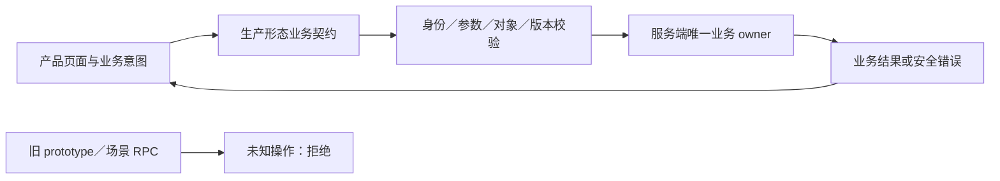

# 产品前端与公开接口的发布边界

2026-11-16 用户要求并行全面审查原型、debug、模拟控制等对用户和接口的暴露，前端与接口按上线标准实现。本规格覆盖当前全部可达 AIReq 页面、保留原生会话和同源 HTTP／RPC；取代历史文档中要求公开模拟控制及故障场景参数的条款。

## 产品规则

- 普通业务页面只展示用户任务、业务事实与可操作错误。删除原型控制、故障注入、强制推进调度、预设评审／合入结果、伪造录音等入口，不把未实现能力改个名字继续呈现为成功。
- 联系人分配、材料修改、正常评审／交付、人工验收、分析和重试、分支清理继续通过原业务命令、版本与幂等门禁执行。业务入口与内部故障场景解耦；不允许由浏览器伪造代码合入或评审事实。
- 前端与公共契约不再持有 prototype 场景服务、调试时钟、样例配置读取或场景 URL／身份字段。服务端删除对应参数验证和分派，直接构造旧 RPC 也必须失败；不通过隐藏按钮、环境开关或空实现保留接口。
- bootstrap 只返回当前产品实际消费的业务能力与元数据，不公开服务注册清单、后端 owner、整个配置目录或无消费者的员工／协作／样例数据。隐藏 Skill 的必要工作区和共享技能目录属于该业务的存储目标元数据，不作为后端身份信息展示；不恢复隐藏入口。
- 登录及帮助集中、清楚地说明演示环境的真实能力限制，业务页面不反复讲述内存、mock、owner 或协议实现。内存数据、自报工号与未连接真实 AI／Git 的事实不能通过清文案掩盖，也不能宣称已经具备正式身份认证、持久化或真实执行能力。
- 尚未实现的语音识别撤下入口；Sketch 等能真正生成用户文件的功能保留。原生示例回复明确其演示性质，移除服务端类名、内部调试前缀和实现说明，不冒充真实模型结果。
- 公开边界验证输入结构、身份和对象归属，拒绝未知操作及额外调试参数。保留有用且安全的业务错误；未知异常仅在服务端记完整日志，对客户端返回稳定、可理解的失败信息，不下发内部堆栈。内部 fault code 可供协议和日志使用，不直接替代用户文案。
- 即使数据来自演示实现，公开字段也须符合其业务语义：材料的 `sha256` 和 `size` 按实际 UTF-8 内容计算摘要与字节数，修改后重算；不能用 `sample:` 字符串冒充内容摘要。没有实际可访问的 MR 地址时不返回占位 URL，前端只在存在有效 HTTP(S) 地址时呈现外链；保留 MR 编号及状态，不把演示记录伪装成真实仓库已核验。
- 提交 SHA、IR／SR 编号、材料版本、业务报告中的代码与正常诊断日志不是原型入口，继续保留。基础 UI 控件不因本次清理被删除。

## 所有者与边界

服务端仍唯一持有业务与会话状态，前端只发业务意图并读取投影；重连不重放 mutation。故障场景只允许作为服务端内部实现或隔离验证夹具，不属于可替换后端的公共契约。

## 检查与证据

1. 全量静态盘点用户可见原型／debug字串、可达入口、公开路径和客户端场景参数；记录审查覆盖及不可达保留代码。
2. 浏览器源码没有调用被删除的场景能力；公开操作类型、参数白名单、服务分派与客户端代理同时收口。直接调用旧接口、额外场景参数及畸形对象失败，不返回堆栈。
3. 类型、Lint（含相关 Hooks）、变更架构检查与必要构建通过。测试只使用现存工程体系，不恢复退役 App 单测或新建业务 E2E 框架。
4. 按用户此前要求不进行浏览器验收；运行时未验证项如实记录，不把源码检查等同于全页、全状态验收。

## 上线限制

本次清理前端和契约，不把内存模拟后端替换为真实产品后端。可信身份认证、持久化、真实 AI、代码托管以及实际文件保存仍须真实服务实现并独立验证；这些是上线阻断项。审查和改动完成不等于整个系统已可上线。

## 本次并行审查范围与修复

五个子代理分别审查提案／正式需求／分析页面，Web 入口／壳／设置／项目／工具，公开 AIReq 契约与服务分派，原生会话／附件／错误展示，以及 HTTP／RPC／发布边界；主代理复核跨层接线、后端材料产物、文档和集成结果。保留的基础控件不因没有当前产品入口被删除。

| 已确认问题                                                           | 修复边界                                                                                          |
| -------------------------------------------------------------------- | ------------------------------------------------------------------------------------------------- |
| 联系人和材料修改与故障注入混在同一面板                               | 保留正常业务管理；删除评审预设、合入预设、建分支／清理故障、旧结果释放和调度时钟入口              |
| 旧场景操作可通过普通 RPC 直接调用                                    | 删除 7 个 `prototype.*`、2 个调度控制及样例模型／协作读取；类型、验证、分派和前端代理同步收口     |
| 身份接受 `demo`，业务请求操作者可能与连接不一致                      | 身份只接受工号和客户端标识，业务及原生请求绑定同一连接身份，拒绝额外场景字段                      |
| bootstrap 暴露服务注册清单、后端所有者、配置目录和无消费者的样例数据 | 缩减元数据；隐藏 Skill 的业务保存目标独立建模，保持入口隐藏                                       |
| RPC 可反射调用实现类私有／原型方法和旧假成功写接口                   | HTTP 部署对 21 个 channel 的方法与事件逐项白名单；撤下目录遍历、旧 Git 写面和无消费者的占位写接口 |
| 真实主机 home 与错误堆栈可传给浏览器                                 | 系统信息返回安全投影；公开错误仅含已标记的安全业务消息和有限重试标识，未知异常留服务端            |
| 普通页面回显原始异常、组件堆栈或内部 fault                           | 统一用户错误格式化，保留业务错误、追踪编号及重试，去掉未经保证的“已记录日志”承诺                  |
| 语音按钮填入固定文字，恢复／压缩等能力假报可用或成功                 | 撤下假语音；不支持的能力明确不可用，不返回虚假成功                                                |
| 材料、报告和业务步骤反复显示原型／内存／owner 实现话术               | 正常业务表达；完整演示文档明确标注一次用途，不伪装真实模型或代码核验                              |
| 假 MR 地址可点击、材料摘要使用 `sample:` 占位                        | 没有地址时不提供外链；材料按实际内容计算摘要和 UTF-8 字节数                                       |
| 无 hash 静态资源被长期不可变缓存，残留源码映射可能可下载             | 仅 hash 产物长期缓存，普通资源重新验证，配置不缓存，源码映射不公开                                |

详细部署成员清单的事实来源为 `packages/server/src/http.ts` 的 `publicMembers`，由服务 descriptor 和 `keyof` 在编译期核对；公开 API 版本为 4，不提供旧调试入口兼容别名。

## 本次验证记录（2026-11-16）

- 全仓类型检查、Lint（0 告警／0 错误）、变更架构检查及改动源码格式检查通过；工程套件 11 个文件、119 个用例通过。
- 前后端生产构建通过。构建器仍提示既有大于 500 kB 的 chunk；未通过提高告警阈值或关闭告警隐藏该事实，本次未进行首屏性能基准。
- 使用当前机器的非 loopback IPv4 地址，启动隔离的内存服务并经真实 HTTP／WebSocket 二进制 RPC 验证：11 个旧调试／样例路径全部拒绝；额外场景身份、与连接不一致的操作者、畸形仓库／模型参数、非法分页及客户端伪造交接对象均拒绝。
- 同一连接验证私有方法、Object 原型方法、真实目录遍历和旧假成功写接口不可调用；未实现的工作区重启明确返回不支持。错误消息不含服务器路径、堆栈及任意附属错误对象，系统信息不含真实 home。
- 正常模型读取／保存、项目保存、提案业务命令均可执行；同操作 ID 重试的回执及返回视图持有一致摘要。验证 96 份有正文材料的 SHA-256 与 UTF-8 字节数；长不透明版本／候选 token 继续通过合法结构校验，不混同于摘要字段。
- 静态站点的 HTML、hash 资源、普通资源、配置与源码映射发布策略经真实 HTTP 检查。只在隔离内存实例中产生验证数据，未接触外部 Git、模型或真实业务文件。
- 本次没有进行浏览器逐页、主题、焦点和业务全状态验收；此前浏览器记录不作为本次通过证据。服务端与客户端须配套更新到本次 v4 契约。
