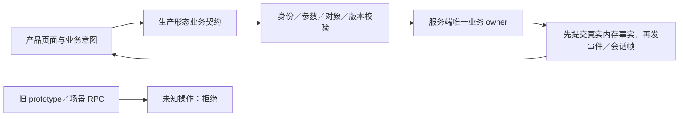

# 产品前端与公开接口的发布边界

## 侧栏品牌行验证（2026-11-17）

- 侧栏顶部新增现有应用 Logo 与 `AIReq` 单行品牌标识，仅修改 `AIReqSidebarNavigation` 的顶部呈现与分组起始留白；未修改底部账户、待办、设置控件及其行为。
- Edge 电脑窗口实际截图检查深浅主题的品牌行、导航和底部，设置往返正常，已恢复原深色主题。截图为聊天 `navigation-evidence` 下的 `sidebar-brand-dark.jpg`、`sidebar-brand-light.jpg`；浏览器 error 日志为空。
- 类型检查、Lint（0 warnings / 0 errors）、变更架构检查、定向格式与差异空白检查通过。

## 分区导航与想法池交付验证（2026-11-16）

后续简化：移除项目总览顶部的独立项目切换器，通过项目／版本卡片进入目标；同步更新规格、产品说明与帮助文案。Edge 截图确认总览无切换器，点击 Mobile 的 2026.12 版本卡片可进入对应项目概览与版本，浏览器 error 日志为空。类型检查、Lint（0 warnings / 0 errors）、变更架构检查与差异空白检查通过；底部和设置未改。本次截图为 `projects-no-switcher.jpg` 与 `project-card-direct-entry.jpg`，下文切换器记录仅代表此前实现。

用户后续确认：项目切换器仅在“项目总览”显示，其他工作台页面隐藏；项目内页面继续显示项目名称和版本范围。当前导航形态、想法池与转入规则以 [分区导航与想法池](section-navigation-and-ideas.md) 为准，覆盖下文冲突的旧主导航和顶部页签说明；设置页面及原生账户菜单保持原有实现。

- 已实施展开分区导航、项目搜索／键盘选择、全局想法池、编辑原文及一次转入多个项目／版本。转入在现有 workflow owner 的同一克隆事务内完成全部目标验证、独立提案创建、原想法移除和收据登记；公开命令沿用严格 wire schema、连接身份、版本、幂等和提交后广播。未添加产品调试接口、浏览器业务存储或前端模拟分支。
- Edge 实际完成：新增想法无需项目／版本；取消触发未保存确认，继续编辑保留原文；另一个工号编辑后提交人与提交时间不变；一次转入 Aurora 和 Mobile 的两个 2026.12 版本后，原想法消失，生成两个不同 IR。目标入口可跨项目直达，材料尚未生成、没有自动 AI 执行或 SR；返回共创列表保留目标版本，项目搜索以键盘选择后清除旧版本范围。
- Edge 在默认约 1699×780 和 1100×760 电脑窗口检查深浅主题、项目总览、想法池、提案／讨论、开发任务、进度分析、关键表单／菜单及原有设置往返。最新两张总览／共创截图确认“仅总览有项目切换器”的最终规则；此前常驻切换器截图仅用于未变化控件，不作为最终入口范围证据。底部使用原生展开 footer，设置页面源码未改。临时视口已复原；验收标签页的浏览器 error 日志为空。
- 隔离内存服务通过真实二进制 WebSocket Channel RPC 完成 16 项检查：空白正文、跨工号编辑来源保留、旧全局／想法版本、空目标、错误项目／版本归属、重复目标、额外字段、跨项目原子创建与消费、原信息和无 SR／材料、同操作重试、不同输入复用、消费后再提交、单目标转入及第二连接广播。拒绝请求前后 revision／想法／提案不变，成功重试无新增；第二连接观察到 5 次工作流广播。服务在验证后关闭，不向产品增加夹具或场景入口。
- 类型检查、Lint（0 warnings / 0 errors）、变更架构检查通过；受影响工程测试选择为 0/11，未新增或恢复 App 业务单测／E2E harness。定向格式与差异空白检查通过。独立视觉复核最新两张截图、源码与规格后给出 ship，未发现当前范围内需要修复的视觉问题。
- 截图保存在本聊天的 `navigation-evidence` 目录；可重复协议验证脚本位于同一聊天的独立文件，未进入产品运行时依赖图。未重跑无关完整 AI／文档 PR／代码合入／测试验收链，未执行手机、上游对照、生产构建、提交、推送或部署。

2026-11-16 用户确认整改全部已确认问题。本文固定本轮产品规则、所有者、失败语义与验收场景；根 `.todo.md` 跟踪第 1—9 组执行，现行业务规格继续提供不冲突的领域细节。下方历史审查与通过记录仅证明当时版本，不是本轮整改结果，也不授权恢复场景按钮或接口。

## 产品规则

### 持续生效的上线标准（2026-11-16 补充）

- 前端代码、文案和协议接口必须按正式上线标准交付，不因当前使用原型后端而降级。范围包括 `packages/web`、`packages/ui`、浏览器连接与传输代码，以及 `packages/services`、`packages/shared` 的公开契约。
- 产品前端和公开接口不得包含原型、演示、mock、测试专用或 debug 的文案、入口、场景参数、控制命令、假数据、固定回复、占位成功和后端类型特判；源码中不可达、隐藏按钮、环境开关及仅在开发模式启用均不构成保留理由。禁止把这些实现改名成业务代码继续保留。
- “测试”作为真实需求验收业务概念、模型连接检查、正常业务代码展示、生产诊断日志、正常占位输入提示、稳定 DOM selector、通用 UI 控件及独立工程测试不属于上述禁令；测试夹具与调试工具不得进入产品前端运行时代码、发布产物或公共契约。模拟数据、执行和故障场景只允许归属 `packages/server` 内部实现，不得改变公开字段的业务语义。
- 切换生产服务只替换原型后端服务及必要的部署路由／配置。前端源码、文案、构建产物、连接 SDK、传输实现、接口、descriptor、DTO 和协议 schema 一行都不改；禁止以切后端为由新增字段、兼容分支、适配层或重打专用前端包。后端必须实现既定契约，语义差异在后端解决。
- 原型后端的能力限制与上线阻断项记录在部署／交付文档，不作为前端常驻演示说明或后端身份字段。不得通过去掉说明掩盖假成功或宣称已有真实认证、持久化、AI／Git 能力；未开放能力按正式业务契约返回不可用。
- 这是后续变更与上线验收的强制边界，不是现存实现已全部达标的声明。本节优先于下文历史审查记录中允许前端保留演示说明、示例回复的条款。
- 保留完整内存业务流程、材料与版本、幂等、对象归属、人工门禁、合入有效进度 99／人工验收 100、未保存保护及原生会话／附件。内存中确实完成的操作可以成功；不能把它陈述为真实外部 AI、代码扫描、平台核验或宿主文件落盘。
- 产品保持全局项目／待办、默认全项目总览；项目内概览／需求／分析运行，需求分提案／正式；设置为外观／项目配置／AI 配置。Skill 入口继续从主导航、设置和搜索隐藏，但其保留实现全部在整改与验证范围；Sketch 真实画布及 PNG 附件保留。
- 当前授权必要电脑浏览器、协议、错误路径和多连接广播验证，也允许隔离临时装配现有隐藏 Skill 模块。不恢复产品入口、不增加测试开关，不新建 E2E harness 或恢复 App 业务单测、桌面／CLI／手机工程。

### 业务发布规则

- 普通业务页面只展示用户任务、业务事实与可操作错误。删除原型控制、故障注入、强制推进调度、预设评审／合入结果、伪造录音等入口，不把未实现能力改个名字继续呈现为成功。
- 联系人分配、材料修改、正常评审／交付、人工验收、分析和重试、分支清理继续通过原业务命令、版本与幂等门禁执行。业务入口与内部故障场景解耦；不允许由浏览器伪造代码合入或评审事实。
- 前端与公共契约不再持有 prototype 场景服务、调试时钟、样例配置读取或场景 URL／身份字段。服务端删除对应参数验证和分派，直接构造旧 RPC 也必须失败；不通过隐藏按钮、环境开关或空实现保留接口。
- bootstrap 只返回当前产品实际消费的业务能力与元数据，不公开服务注册清单、后端 owner、整个配置目录或无消费者的员工／协作／样例数据。隐藏 Skill 的必要工作区和共享技能目录属于该业务的存储目标元数据，不作为后端身份信息展示；不恢复隐藏入口。
- 原型后端限制集中记录在部署／交付文档，登录、帮助及普通业务页面不携带原型、演示或内部实现说明；不能将自报工号伪装为可信认证，也不能把模拟执行展示为已核验的真实 AI／Git 结果。
- 尚未实现的语音识别撤下入口；Sketch 等能真正生成用户文件的功能保留。前端不内置示例回复或演示前缀，只按业务契约渲染服务端内容；服务端也不得把未执行的能力报告为成功。
- 公开边界验证输入结构、身份和对象归属，拒绝未知操作及额外调试参数。保留有用且安全的业务错误；未知异常仅在服务端记完整日志，对客户端返回稳定、可理解的失败信息，不下发内部堆栈。内部 fault code 可供协议和日志使用，不直接替代用户文案。
- 即使数据来自演示实现，公开字段也须符合其业务语义：材料的 `sha256` 和 `size` 按实际 UTF-8 内容计算摘要与字节数，修改后重算；不能用 `sample:` 字符串冒充内容摘要。没有实际可访问的 MR 地址时不返回占位 URL，前端只在存在有效 HTTP(S) 地址时呈现外链；保留 MR 编号及状态，不把演示记录伪装成真实仓库已核验。
- 提交 SHA、IR／SR 编号、材料版本、业务报告中的代码与正常诊断日志不是原型入口，继续保留。基础 UI 控件不因本次清理被删除。

## 所有者与边界

`MockAIReqService/workflow` 唯一持有业务事实；`MockRuntime/MockZCodeAgentService` 唯一持有原生会话行、附件、队列、订阅和水位。`AIReqContext` 仅持导航与读取投影，局部未发送草稿归现有 UI／composer；不建立第二份权威业务状态。故障场景只能是后端私有状态或隔离验证输入，公共对象及嵌套历史回执均不得泄漏。



写入先校验输入、连接身份、对象归属、阶段、版本与幂等，再由既有 owner 接纳并提交，最后发布事件。迟到结果按对象／材料或代码版本拒绝，迟到读取按读取代际丢弃；订阅先于 bootstrap，读取失效按既有路径补读。重连只重读，不重放 mutation。opaque `backend.id`／`workspaceIdentity` 的有效隔离用途保留，不能据其值增加 sample/live 或后端类型分支。

广播发送源绑定连接 facade，不信任请求自报 `sourceWindowId`；先更新／路由事实，再仅通知其他连接，发送方不回声，断线注销。遥测接纳只表示接收，不承诺第三方上传或持久化，不为此引入重试队列、调度器或通用采集框架。

### G2 安全失败、核验事实与封闭输入

- 原生输入的 accepted ACK 只证明接纳。完成阶段失败时，消息与失败正文留在同一会话，assistant 行为 `failed`、轮次为 `failed`，会话以可继续输入的中断状态收口；不以 complete／成功轮次代替失败。只有显式安全业务错误可显示原文；未知错误使用稳定重试说明，详细异常只经既有服务端诊断记录。验证须同时读取 ACK、实时帧和历史，并证明随后正常发送可恢复。
- 未发布草稿对其他操作者仍等价于不可访问；身份缺失和对象不可达以安全、可理解文案失败，不输出机器码。工具错误 `code` 仅供分类，空 message／output.text 时走现有本地化失败提示；已有非空安全说明保留。
- 提案、SR 和整体验收共用的 MR `platformVerified` 是布尔平台核验事实，true／false 均合法，其他类型拒绝。UI 不把 false 显示为真实核验成功，内存生产者仍只能写 false。
- v4 信封与封闭命令 payload（包括 firstInput、交互 answer、空暂停／恢复／删除）、订阅 base 和历史分页拒绝未知键，且必须在 owner 创建、接纳、订阅或读恢复副作用之前失败；真实调用入口复用 shared schema。业务扩展 args／content 字典及已声明可信连接字段不机械 strict。正常创建、发送、交互、订阅与分页和未知操作拒绝均须验证。
- 设置 owner 仅在严格 patch 的已声明键与正式值规则全部通过后原子合并。partial 不填入缺省值，不要求完整设置；未知键、类型错误、越界及合法／非法混合请求全部失败且不改变原设置。通过真实 RPC 保存主题、语言、字号并回读验证。
  语言沿用正式 `locale`／`localePreference`，不新增 language 别名；主题 `theme`（现有 light／dark／zai-light／zai-dark／system）与字号 `uiFontSizePx`（现有整数 12—20px）纳入 AppSettings 正式可选偏好及同源完整／patch 校验。内存初值由正式完整 schema 生成，不再用断言伪装未声明默认字段；这不把本机 UI store 改为服务端状态或新增广播 owner。

### G3 公共投影与输入来源

- bootstrap 和数据源只提供业务能力、配置和 opaque 隔离 ID，删除来源类型与 notice，不保留可选兼容字段。登录与流程帮助不按后端类型显示环境说明，也不新增真实认证或外部执行承诺。切换工号、导航、未保存设置门禁与按部署／操作者隔离的草稿行为保持。
- 下一次清理／建分支失败、暂存评审结果与 hold 控制只归 workflow／progress 后端私有 owner，并按项目、IR、SR 与评审轮次隔离；公共评审以正常 pending／running agent 状态表达尚未完成。读取、事件后重读与历史回执嵌套均不得出现控制字段。一次故障正常消费后可重试，等待和迟到结果仍受版本及人工门禁约束，其他对象不受影响。
- 原生真实用户行的 clientId 取已通过连接校验的接纳信封，并贯穿 accepted 队列、执行及历史；不得从后续浏览器字段覆盖或使用固定替代值。首发、排队、恢复／同请求重试均保留来源，跨连接冒名仍拒绝。验证同时观察两个客户端的队列、实时 userInput 与分页历史。
- 浏览器连接、AIReq 请求身份、v4 握手和命令必须共用既有 `getV4ClientId` 的稳定 ID；设备指纹不是原生命令身份。真实浏览器发送若因两套 ID 被拒，修复调用方的单源接线，不能放宽服务端可信连接比对。刷新／重连保持 ID，其他连接冒名仍拒绝。

### G4 读取、广播与遥测接收

- 文件读取／stat／索引来自同一虚拟树；缺失与错类型失败，空文件成功。文件偏移／size 按原始 UTF-8 字节，
  列式 packed 索引保留现行字符长度及半开分页。Git 仅返回已有 source/path 的真实前后内容及配置身份；
  无内容 unavailable，无身份 null，refresh 与单独读取一致，不补固定 patch／身份。
- 原生 workflow runs 只枚举已有会话事实；具体 run／artifact／node 未实现时明确不可用，不以空文件、
  正文或指定 run 的伪空清单成功。读取先校验参数与会话／工作区／草稿归属，不补建会话。
- 广播复用单一 owner 总线与 claims，HTTP 连接 facade 覆盖自报 source、过滤本源、关闭注销；
  现有 store 应用外部主题时不回发，不引入第二业务状态或重放队列。
- 同源 `POST /api/v1/telemetry/events` 严格区分 ui／arms 声明 payload；前后端共用副本脱敏，
  原始业务对象不变。复用 `/api/` 部署 token，工号不是认证；400 非法、401 未授权、500 接收失败，
  服务诊断接纳后 202 空响应。report 等待 202，否则拒绝；现有业务遥测调用方隔离失败。
  不公开测试读取／抑制接口，不宣称第三方送达／持久化，不加重试。真实后端实现此固定合同，不再补前端接线。

### G5 业务内容、隐藏 Skill 与事实展示

- 原生回复仅确认本次接纳输入、实际材料路径／版本变化或当前阶段结果；方案生成不把固定内容归因为用户专属分析，评审追问不宣称重新执行模型／扫描。仅附件不生成文字分析；重连恢复继续使用同一材料与会话 owner，错误脱敏和迟到结果拒绝不变。
- 材料正文不注入实现身份，摘要与 UTF-8 size 从实际正文重算。评审报告仅表述当前输入快照、阻断项及本轮状态，不陈述未执行的外部核验。合入检查与历史回执按当前内存候选、版本、材料及分支状态记录，不宣称托管平台核验。
- 未取得真实规划建议时 `planning` 保持未提供，不补造 `source:"ai"` 或改称人工；正式人工保存记录当前操作者、时间和实际填写的分工／排期，门禁与原子更新不变。
- 隐藏 Skill 的讨论、预览和保存使用现有私有会话与唯一草稿门禁；保存先校验归属、预览版本、路径、目标与同名冲突，再原子登记文件／目录内容，返回 `AIReqSkillSaveReceipt`。收据路径、版本与随后 list/read 的内容一致；失败不产生收据、不清草稿。产品仅确认该保存事实，不宣称宿主磁盘或永久存储，限制见上线限制章节。主导航、设置和搜索入口仍隐藏。
- 正式需求与分析报告仅在 `aiPercent` 存在时展示原始 AI 分，否则显示未提供；不得用有效业务进度倒推。合入有效值 99／人工通过 100 及失败待办职责保持。
- 分享 URL 从明确业务定位参数构造，不复制当前 URL 未知参数；入口不保留 demo 场景专用分支，退役 remote 安全处理继续。项目／Release／IR／SR、前进后退与未保存取消仍由唯一导航 owner 接纳。
- 逐项验收覆盖需求／方案／评审／附件／恢复后的公开行及历史、材料摘要、无建议与人工保存、合入失败门禁、两报告缺分矩阵、启动及运行后变更 URL 分享。隐藏 Skill 必须在独立临时浏览器装配验证 prompt、讨论、逐文件预览、有效保存、冲突／失败保留、设置往返与 Sketch PNG 发送，随后清理，不添加产品入口或开关。
- 本轮实现按上述 G5 规则执行：原生回复在 owner 完成后读取本次材料路径／版本；Skill 保存成功需能按收据目标回读相同文件，失败不能仅改提示文案；无规划与缺 AI 分的空态不补造来源或分数。首次行为证据分别记录，不以最终构建替代。

### G6 产品运行时测试面退出

- Lexical 的正式 EditorApi、IME、mention、历史及受控回填保留；产品不再安装可写 E2E 节点、ready 属性或轮询。Zustand 与附件 scope 的唯一 owner 保留，不向 window 暴露测试 store，即使旧环境开关存在也不得激活。
- 传输直接调用正式服务，不消费旧全局延迟计划；SessionDataLayer 引用计数与幂等 release 不变，默认保活固定 30 秒，调用方正常 keepWarmMs 构造选项保留。重连只读取，不重放写命令。
- ACK 保留生产日志，不缓冲测试全局；正常标题、模型、用量与截图附件保留，不追加隐藏镜像。turnHeader 继续作为协议／分组事实，但公共行渲染器不输出内部调试文本，用户／助手／工具行不变。
- TestActions、ARMS recorder、parity harness 和无消费者的测试复位／替换单例接口从产品实现与出口删除，不换名、不固定关闭、不建 shim；真实遥测 builder／supervisor、reporter 与正式 HTTP 接收保持。15 个出口逐一核对；真实独立工程消费者若存在，只在测试私域隔离实例。
- 各局部删除先有直接引用／导入及必要浏览器或租约生命周期证据，再删除最后的共享开关、bootstrap 和包子路径。保留通用 UI、正常诊断和 replay 真实渲染器；旧开关不能恢复任何已删除通道。

## 检查与证据

2026-11-16 起移除远端新鲜度门禁及其脚本／命令入口。任务以当前本地工作区为准，落后远端不构成暂停或重派原因；未经用户明确要求，不执行 fetch／pull／merge／rebase。下方既有 freshness 结果仅保留历史证据，不再是执行前置，也不授权自动同步。验收：命令入口与脚本已删除，现行任务不再要求该检查；其余类型、Lint 与架构门禁保持。

本次移除验证：删除入口的一次性 Bun 断言通过；执行目录引用检索仅剩不可执行的上游历史快照记录。`architecture:check --changed` 通过（0 违规），工程测试 11 文件／119 用例通过。`typecheck` 退出 2：本次未改动的 `native-business.ts` 中 `result.view` 可能未定义，`planning.ts` 中 `assumptions` 类型不匹配；`lint` 退出 1（4107 警告／102 错误），输出包含 `.tmp-g5/vite-cache/deps` 生成依赖诊断。不修改这些无关文件、不重跑检查，不将其记为通过；本次未执行 fetch／pull／merge／rebase。

1. 逐组先更新对应规格与验收场景，再同批迁移实现、公开契约、SDK、schema、导出和全部消费者；不留兼容别名、双轨接口或后组补接线。任务文件的源码行号只作定位线索，不重复 31 份全量审查。
2. 每项使用其自身的真实公开调用、现存工程测试、必要电脑浏览器或一次性隔离内存断言证明行为；无消费者的删除项可用精确引用／导入证明。静态关键词扫描不能代替错误、归属、状态和时序验证。临时装配与数据验证后清理，不向产品注册公开夹具、调试命令或 window 全局。
3. 按第 1→9 组串行收口。实施前运行变更前架构检查并读取受影响模块 context；代码组收口一次 typecheck、Lint、`architecture:check --changed`，复核相关 Hooks，根 Lint 忽略的受影响 React 文件按 [Hooks 检查规则](../../testing/react-hooks-lint.md) 定向扫描。纯规则第 1 组不运行类型／Lint。Bun 版本以根 `mise.toml` 为准。
4. 当前已获必要浏览器及隐藏 Skill 验证授权；旧“不进行浏览器验收”只描述历史审查，不再限制本轮。只验证受影响电脑路径和具体验收缺口，不进行手机／上游／base 对照；未验证项如实记录。
5. 工程测试仅从根 `scripts/engineering-test-files.json` 现行清单按实际影响选择；触及根 package.json、公共 Vitest 配置或清单才执行规定全量。不默认跑架构测试全套，不扩测试体系。最终构建仅第 9 组运行一次 `bun run build`，不得代替前组首次行为验证；后组改变证据输入时复验受影响路径，输入未变的证据复用。
6. 每组实际命令、对象／条件／预期／观察和未验限制写本文件本轮记录；协议细节回写既有 CONTRACT／架构文档。单项、组收口与最终发布边界分别声明，历史通过不得冒充当前结果，不自动提交、推送或部署。

### 本轮验收场景与结果归属

以下是待实施组的验收要求，不是通过声明；每项具体条件以根 `.todo.md` 原项为准。

| 分组                    | 必须独立提供的直接证据                                                                                                                                                                                                                    |
| ----------------------- | ----------------------------------------------------------------------------------------------------------------------------------------------------------------------------------------------------------------------------------------- |
| G2 错误／类型／严格输入 | 安全业务错误保留、未知异常在响应／帧／历史均脱敏；工具 fallback 不直出机器码；MR 核验布尔 true／false 合法且内存记录不冒充 true；封闭信封／嵌套 payload／订阅／分页未知键在真实入口拒绝且无副作用；设置 patch 非法原子失败                |
| G3 公开投影／来源身份   | 登录／帮助及 bootstrap 无 provenance、sample/live；公共和嵌套历史无私有故障字段，失败重试／等待评审／迟到门禁保留；两个客户端排队、流式用户行及历史 clientId 与真实接纳一致                                                               |
| G4 读取／广播／遥测     | 虚拟文件存在性、类型与 UTF-8 字节一致；Git diff／身份取真实虚拟内容或明确不可用；工作流读取校验目标／归属、无假空成功；真实多连接发送无回声且退订释放；正式遥测两种 payload 接纳、脱敏、拒绝及部署 token 边界                             |
| G5 内容／隐藏 Skill     | 原生回复、材料、评审、规划与合入回执只陈述实际事实；缺 AI 原分不补造；Skill 隔离临时浏览器装配验证讨论、逐文件预览、保存、冲突和失败保留，收据 path/revision 与 list/read 一致；Sketch PNG 发送、草稿门禁、分享定位及主题可用且入口仍隐藏 |
| G6 产品测试桥清理       | 输入、五类 store／附件 scope、延迟／保活、ACK／三镜像、turnHeader 调试行、TestActions、parity／ARMS、15 个复位及 bootstrap／包子路径逐项删除证明；正常输入、附件、订阅、遥测与记忆行为保留                                                |
| G7 共享／RPC 清理       | queue 示例私域隔离；E2E 遥测与四类开发控制退出；highspeed 必需 execution、旧 debug 拒绝、正式工作流限额与容量边界不变；全部实际消费者同项迁移                                                                                             |
| G8 UI／语言收尾         | 开发者 tab／命令／词条与七处原型文案退出；假安装、假 stdio 探测、日志测试控制无消费者残留；正常设置／侧栏、错误／输入提示与生产诊断保留                                                                                                   |
| G9 最终交付             | 前组逐项有效证据齐全后，以同一次 server/web 构建产物做最小电脑浏览器集成验收；保存该产物与公开契约源码版本及 SHA-256，不提交 dist，不冒充真实后端替换或系统上线                                                                           |

## 上线限制

本轮保留当前服务端完整内存模拟业务，不建设真实 AI、Git 托管、业务数据库、身份认证、权限体系或宿主业务文件写入。可信认证、持久化、真实 AI／代码扫描、Git／MR 平台核验和宿主文件保存仍须真实服务实现并独立验收，是实际生产上线阻断项。Skill 保存与虚拟文件只证明当前内存内容／版本／收据一致，工号只证明自报操作者格式与连接绑定，不是本人认证。限制只在部署／交付说明记录，不塞入产品页面、提示词、用户材料或公开 provenance。删除说明不允许掩盖假成功；未支持能力按正式契约明确不可用／不存在。

正式切换生产服务时，以同一份前端构建产物及其文件 SHA-256 清单、同一套接口与协议契约完成替换前后验收；只更换后端及部署配置。若需要修改任意前端或契约代码才能对接，则不满足替换要求。当前规则更新本身不执行后端替换或声明上线验证通过。

## 历史并行审查范围与修复（本轮整改前）

五个子代理分别审查提案／正式需求／分析页面，Web 入口／壳／设置／项目／工具，公开 AIReq 契约与服务分派，原生会话／附件／错误展示，以及 HTTP／RPC／发布边界；主代理复核跨层接线、后端材料产物、文档和集成结果。保留的基础控件不因没有当前产品入口被删除。
本节表格描述历史修复意图及当时允许范围；其中“完整演示文档标注用途”等旧放行条款已由上方持续上线标准取代，不能据此保留公开演示身份。后续本轮逐组记录另列，不修改历史观察为当前通过。

| 已确认问题                                                           | 修复边界                                                                                          |
| -------------------------------------------------------------------- | ------------------------------------------------------------------------------------------------- |
| 联系人和材料修改与故障注入混在同一面板                               | 保留正常业务管理；删除评审预设、合入预设、建分支／清理故障、旧结果释放和调度时钟入口              |
| 旧场景操作可通过普通 RPC 直接调用                                    | 删除 7 个 `prototype.*`、2 个调度控制及样例模型／协作读取；类型、验证、分派和前端代理同步收口     |
| 身份接受 `demo`，业务请求操作者可能与连接不一致                      | 身份只接受工号和客户端标识，业务及原生请求绑定同一连接身份，拒绝额外场景字段                      |
| bootstrap 暴露服务注册清单、后端所有者、配置目录和无消费者的样例数据 | 缩减元数据；隐藏 Skill 的业务保存目标独立建模，保持入口隐藏                                       |
| RPC 可反射调用实现类私有／原型方法和旧假成功写接口                   | HTTP 部署对 21 个 channel 的方法与事件逐项白名单；撤下目录遍历、旧 Git 写面和无消费者的占位写接口 |
| 真实主机 home 与错误堆栈可传给浏览器                                 | 系统信息返回安全投影；公开错误仅含已标记的安全业务消息和有限重试标识，未知异常留服务端            |
| 普通页面回显原始异常、组件堆栈或内部 fault                           | 统一用户错误格式化，保留业务错误、追踪编号及重试，去掉未经保证的“已记录日志”承诺                  |
| 语音按钮填入固定文字，恢复／压缩等能力假报可用或成功                 | 撤下假语音；不支持的能力明确不可用，不返回虚假成功                                                |
| 材料、报告和业务步骤反复显示原型／内存／owner 实现话术               | 正常业务表达；完整演示文档明确标注一次用途，不伪装真实模型或代码核验                              |
| 假 MR 地址可点击、材料摘要使用 `sample:` 占位                        | 没有地址时不提供外链；材料按实际内容计算摘要和 UTF-8 字节数                                       |
| 无 hash 静态资源被长期不可变缓存，残留源码映射可能可下载             | 仅 hash 产物长期缓存，普通资源重新验证，配置不缓存，源码映射不公开                                |

详细部署成员清单的事实来源为 `packages/server/src/http.ts` 的 `publicMembers`，由服务 descriptor 和 `keyof` 在编译期核对；公开 API 版本为 4，不提供旧调试入口兼容别名。

## 历史验证记录（2026-11-16，本轮整改前）

- 全仓类型检查、Lint（0 告警／0 错误）、变更架构检查及改动源码格式检查通过；工程套件 11 个文件、119 个用例通过。
- 前后端生产构建通过。构建器仍提示既有大于 500 kB 的 chunk；未通过提高告警阈值或关闭告警隐藏该事实，本次未进行首屏性能基准。
- 使用当前机器的非 loopback IPv4 地址，启动隔离的内存服务并经真实 HTTP／WebSocket 二进制 RPC 验证：11 个旧调试／样例路径全部拒绝；额外场景身份、与连接不一致的操作者、畸形仓库／模型参数、非法分页及客户端伪造交接对象均拒绝。
- 同一连接验证私有方法、Object 原型方法、真实目录遍历和旧假成功写接口不可调用；未实现的工作区重启明确返回不支持。错误消息不含服务器路径、堆栈及任意附属错误对象，系统信息不含真实 home。
- 正常模型读取／保存、项目保存、提案业务命令均可执行；同操作 ID 重试的回执及返回视图持有一致摘要。验证 96 份有正文材料的 SHA-256 与 UTF-8 字节数；长不透明版本／候选 token 继续通过合法结构校验，不混同于摘要字段。
- 静态站点的 HTML、hash 资源、普通资源、配置与源码映射发布策略经真实 HTTP 检查。只在隔离内存实例中产生验证数据，未接触外部 Git、模型或真实业务文件。
- 本次没有进行浏览器逐页、主题、焦点和业务全状态验收；此前浏览器记录不作为本次通过证据。服务端与客户端须配套更新到本次 v4 契约。

## 本轮生产标准整改记录（2026-11-16）

### G1.1 前置基线与规格收敛

- 输入／范围：完整读取根 `.todo.md` 240 行，仅实施第 1 组规则和文档收敛；保留其他组及已有工作区修改。先更新本文规则与验收场景，再同步 project-goal、mock-backend、根 AGENTS、auth／UI／services／server AIReq CONTRACT，以及显式引用的契约、身份、导航、项目空间和集成规格；未修改产品代码或公共类型。
- 工具链与 freshness：`bun --version` 为 `1.4.4`，与 `mise.toml` 一致；`bun scripts/check-workspace-freshness.mjs` 退出 0，观察为 main 与 origin/main 同步、ahead 0／behind 0，阈值 50。
- 变更前架构基线：`bun run architecture:check --changed` 退出 0，`architecture: OK`，violations 0／baseline 0／new 0，比较基线为 merge-base upstream origin/main。该结果只证明检查配置覆盖的变更范围，不代表业务语义或所有模块已验证；未更新架构 baseline。
- 受控上下文：逐一运行 `bun run architecture:context aireq-contract`、`aireq-mock`、`aireq-ui`、`web`、`server`，全部退出 0。前三者为 managed，owner requirements，依赖与 app／adapters／contract+ui 层保持不变；`web`、`server` 返回 managed false、owner unassigned、module.ts missing，不能据此声称这两个总模块受门禁完整覆盖，也不为纯文档组新增平行模块。已读取对应 auth 与 AIReq 合同。
- 直接核对：以任务文件的术语和不变量对照 13 份本次修改文档，确认完整内存流程与正式前端／契约边界、未支持失败、未来同包替换、隐藏 Skill 验证授权、当前导航、单一业务／会话 owner、先校验提交后事件、版本／幂等／读取代际及重连不重放一致。当前规则不再要求登录／帮助演示提示、公开 provenance、demo scope、场景推进或 Skill 不测试；原历史观察保留并明确版本边界，不作为本轮通过。G2—G9 场景表仅是验收要求。
- 引用验证：一次性 `bun -` 只读断言退出 0，13 文档内 49 个本地 Markdown 链接、9 个标题锚点及 12 个显式执行／契约目标均存在，failures `[]`；未创建临时文件。核对包含本轮任务、Bun 配置、freshness 脚本、现行工程清单、Hooks 规则及现有服务／UI／server 契约入口。
- 失败与限制：上述本轮命令未观察到失败；历史类型／Lint／构建／浏览器记录未改写为本轮结果。按纯规则第 1 组边界，未运行 typecheck、Lint、工程测试、构建或浏览器，也未实施真实后端替换。只完成实施规则与验收意图，不声称产品代码已整改、发布验收已通过或整个系统可上线。

### G2.1 会话正文错误边界

- 本组前置：Bun 1.4.4；freshness 退出 0（ahead／behind 均 0）；变更前架构检查退出 0（violations／baseline／new 均 0）。读取 aireq-mock／aireq-contract／aireq-ui／mock-domains 的 managed context，以及 shared／ui／rpc／services／server 的 unmanaged context，未扩大覆盖声明。
- 先增加 G2 规则及验收条件，再复用 `businessFailureMessage` 修复原生完成回调旁路；失败 assistant／turnHeader 均为 failed，会话 completedInterrupted 允许继续发送，accepted ACK 未改成完成凭证。
- 一次性 `bun .tmp-g2/turn-errors.ts` 最终退出 0：隔离 MockRuntime＋真实 MockZCodeAgentService 公开 create／subscribe／send／rowsRange；安全版本错误在帧与历史保留说明，含 `SECRET_INTERNAL`／服务器路径的未知异常在 ACK、实时帧、历史均不可见，仅捕获到一条真实 aireq-errors 服务端诊断含 message／stack；随后正常发送得到 complete／completedSuccess。未新增产品故障开关。
- 验证装配最初三次退出 1，分别为临时信封遗漏必需 issuedAt／workspace.workspaceKey（首次同时遗漏 create payload.workspaceId）；真实 schema 正确拒绝，补齐正式字段后通过，未修改产品校验来迁就脚本。临时文件在本组收口前删除；未连接外部服务或用户仓库。

### G2.2 可读业务错误与工具 fallback

- 原生身份缺失及私有草稿不可访问改用安全说明，服务端原生读取／创建冲突／附件的同类拒绝一并复用安全业务错误；原身份、工作区和发布归属条件不变。工具 adapter 不再把 error.code 提升为正文，raw.error.code 保留；实际 fallback 原有本地化失败兜底无需新增分支。
- `bun --tsconfig-override=packages/ui/tsconfig.json .tmp-g2/tool-errors.tsx` 最终退出 0：真实 AIReqNativeBusiness＋原生公开命令创建 A 草稿，B 订阅读取仍拒绝并含“无法访问”而非 fault；缺失身份 actor／admission 均为重新进入提示。四个实际 toolCallRow schema 对象（空／空白 message+output、非空安全 message、wrapped output 说明）经真实 adapter、错误提取和 FallbackToolCallBlock React 渲染；正文无 INTERNAL_MACHINE_CODE，raw 分类仍保留，两条安全说明完整。
- agent-browser 命名隔离会话打开上述真实 React SSR 输出并 snapshot，观察空／空白均显示“工具调用失败／失败”，另外两项显示原安全说明，机器码不可见；浏览器已关闭。此为 fallback 真实组件渲染证据，不冒充主应用全页／主题或交互验收。
- 临时验证首次用了错误 Bun 参数与非现行 react-dom 路径（各退出 1），更正后揭示实际订阅的先行草稿拒绝仍走原始 fault，已将同类原生拒绝出口安全化并复验通过；未弱化拒绝或更改规则来跳过该路径。临时装配、HTML 本组收口前删除。

### G2.3 MR 平台核验事实

- 将单一 AIReqPrFact 从 false 字面量改为公共 `aiReqPrFactSchema` 推导的布尔事实；现有 index 的 types 重导出同步暴露 schema，UI 受控 contract 明确转出。提案／修订历史、SR 当前／历史与整体验收 PR 全部复用同一类型，无第二个 false-only DTO 或关联旧 schema；原先并无该 DTO 的运行时 schema，本次建立同源校验并接入现行生产者和实际 MR 消费者。
- `bun --tsconfig-override=packages/ui/tsconfig.json .tmp-g2/pr-facts.tsx` 退出 0：现有后端 1 条 MR 记录及重新调用实际 MR 生产者均为 false；合法 true／false 经公共 schema、提案／SR 当前与历史／整体验收类型容器及实际 AIReqProposalBackgroundStatus React 渲染成功。undefined／null／0／1／字符串／对象／数组共 7 类非法值在 schema 和实际 UI 均拒绝，UI 显示安全读取错误而非核验成功。
- agent-browser 隔离桌面会话 snapshot 观察真实组件 SSR：false 显示“平台未核验”，true 显示“平台已核验”，两者无异常；浏览器已关闭。现有内存产物未改成 true，未进行真实 Git 平台核验。历史规格的 false-only 记录保留并补明确现行覆盖说明；其他演示内容由后续组处理，不将其标为已解决。

### G2.4 v4 严格输入与真实入口

- command 信封、所有本地封闭 payload、firstInput／answer 及 create config 改为严格对象；原来已 strict 的 imported 命令保持，args／content 字典不收窄。订阅 base 和 wire rowsRange 严格化；原生 owner 三类订阅／历史分页入口直接对原始 Channel 请求使用 shared schema 的 omit／extend 形状，合法扁平工作区、remoteSessionId、runtimePolicy／subscriberScope 和连接可信 carrier 不误拒。
- `bun .tmp-g2/strict-inputs.ts` 退出 0。隔离 createMockServices 装配原生 owner、端口 0 的真实 HTTP/WebSocket、现有 connectViaWebSocket SDK、二进制 Channel、真实 connection scope 与业务 facade，全链验证 8 次正常操作（首发创建、发送、交互、三种订阅、历史分页、删除）成功；19 次额外键／未知操作拒绝，前后会话、任务与三类订阅登记完全相同。
- 拒绝位置包含信封、create payload、firstInput、config、sendText、pause／resume／delete 空 payload、resolve 顶层与 answer、三种订阅顶层与 base、缺失会话的恶意预热订阅以及 rowsRange 顶层。交互 content 和 workflow args 扩展保留，未知旧操作仍拒绝；正常 pause／resume 仍为原 capabilityUnsupported，不假称已实现。wire 独立 schema 同样拒绝额外键；订阅／分页证据不是孤立 schema。
- 真实服务日志观察到 Zod unrecognized_keys 在 owner 操作前拒绝；正常订阅的可信注入通过。临时连接／服务 finally 关闭；未写宿主业务文件或添加产品开关，临时脚本收口时清理。

### G2.5 原子严格设置 patch

- 原设置默认对象通过强制断言伪装 AppSettings，包含未声明 language／外观等字段；本项先明确正式外观字段及 canonical locale 规则，再将初值改为 `appSettingsSchema.parse({})`，去除非法初值，不保留 language 别名。theme／uiFontSizePx 已同批进入公开 AppSettings、完整 schema 和 patch；现有 SDK 的 Partial<AppSettings> 无专用替代类型。UI 本机 store 所有权未迁移。
- update 复用严格 appSettingsPatchSchema，整份验证通过后仅合并解析的 patch，不重读完整 schema 或补默认。endpoint patch 不再复用历史读取的“坏值变 undefined”容错，而按原 normalize 规则明确拒绝；历史读取逻辑不变。
- `bun .tmp-g2/settings-patch.ts` 退出 0：真实隔离 HTTP/WebSocket＋现行 SDK＋二进制 RPC 的 setting.update/get 验证五种主题、locale／localePreference、字号 12／20／16 与合法 endpoint 归一化保存回读；合法已有 messageStreamShowTodos=true／terminalInheritSystemProfile=false 保留。单主题 partial schema 只返回传入字段，无缺省填充。
- 17 类非法请求（debug、非法主题类型／枚举、语言类型／枚举、字号类型／上下界／非整数、合法与未知或越界混合、布尔类型、endpoint 类型／非法 URL、旧 language 键、null／数组）全部拒绝，每次随后 get 与拒绝前完整状态深等，debug 从未进入回读；连接及端口在 finally 关闭。只证明内存原子保存，不承诺磁盘持久化、UI 多语言切换或 G4 广播。

### G2.6 工程收口与证据边界

- 首轮收口真实发现两项失败：typecheck 退出 2，既有 patch 接受 providerFamilyDomain 空串清空但 AppSettings 只能存正式枚举／undefined；已在同一 patch schema 将合法清空输入归一为 undefined，不写入非法空串。architecture 退出 1，直接修改既存 create-session-config.ts 被识别为 unmanaged-new-file；仅撤回本次该文件一行改动，将相同 `.strict()` 放在已受管 command 的 config 消费处，保留既有文件和其全部原内容，不改架构 baseline、不新增平行模块或放行规则。
- 修正后的 `bun .tmp-g2/closure-fixes.ts` 退出 0：再次经真实 HTTP/WebSocket／SDK／Channel／scope 调用，正常 config 创建成功、额外 config 键拒绝且无会话副作用；provider family 先设 zai、再清空后 get 为 undefined，其他主题／语言／字号完全保留。此前未受修改影响的 G2.1—G2.5 证据继续有效，不重复全部场景。
- 最终 `bun run typecheck` 退出 0；`bun run lint` 退出 0（1941 文件，0 warnings／0 errors）；`bun run architecture:check --changed` 退出 0（violations／baseline／new 均 0）。初轮 lint 亦为 0；最终仅针对已发现错误修正后重跑收口，不把初轮失败删成一次性通过。
- Hooks 定向临时配置只启用 react/exhaustive-deps 与 react/rules-of-hooks，按现行规则使用 `--no-ignore --disable-nested-config --format json` 扫描实际变更的 AIReqProposalDeliveryControls.tsx 和 toolCallRowAdapter.ts：2 文件／2 规则，diagnostics `[]`、退出 0；未改既有依赖数组或增加 Hook，静态扫描不冒充运行时性能证明。Impeccable 对这两个目标的最终机械 detector 退出 0、结果 `[]`；本次按既有界面做窄错误／事实修复，无重新设计或新增视觉体系。
- `bun run test:engineering:affected --files <本组实际源码路径>` 退出 0，现有官方选择为 0/11，无选中测试，故未执行工程用例；未修改根 package.json、公共 Vitest 配置或测试清单，不触发规定全量，不声称工程套件通过。没有运行 build、test:architecture 全套或新增 App 单测／E2E harness。
- 全部 10 份临时脚本、React 输出 HTML、Hooks 配置／JSON 经文件删除工具移除，空 `.tmp-g2` 目录删除退出 0；两个浏览器会话及所有隔离 WebSocket／HTTP 实例已关闭。只完成 G2 安全、事实类型、输入与设置边界；G3—G9 的演示来源、私有故障投影、其他测试残留、真实部署替换与最终产物仍未验证，不声明产品已上线。

### G3.1 公开来源与产品身份

- 前置 freshness 与变更前 architecture:check --changed 均退出 0（ahead／behind 0，架构 violations／baseline／new 0）；读取 aireq-contract／aireq-mock／aireq-ui／mock-domains 及 web／client context，后两者 unmanaged，不扩大门禁覆盖声明。先增加本组所有者、接口与验收规则，再删除 provenance 类型、bootstrap 字段／生产者、adapter getter、帮助条件和登录演示页脚；现有 wildcard 导出随源声明删除，不保留可选字段或类型别名。设置 CONTRACT 的旧登录／帮助限制同步移到交付文档。
- `bun --tsconfig-override=packages/ui/tsconfig.json .tmp-g3/bootstrap.ts` 退出 0：真实 MockAIReqService.bootstrap 与实际 createRemoteAIReqDataSource 均无 provenance／notice；两个不透明部署 ID 均保持能力、读取与各自实例草稿隔离，不按 ID 类型分支。精确源断言覆盖公共声明、adapter、帮助和登录；其他后续组的 Skill 内容不包含在本项删除声明内。
- 真实电脑浏览器 1440×1000：登录页与帮助均无演示说明，页脚仅 ZCode · AIReq；帮助保留业务步骤、返回焦点及设置说明。项目／待办可切换，追加指令未保存时离开出现保存／丢弃／取消；取消后原输入保留，丢弃后为空。切换 j00808874→k12345678 回到默认项目总览，后者无前者未保存指令；未向共享业务保存任何验证数据。观察登录和帮助截图无裁切／布局回归，不增加认证或真实 AI 承诺。
- 工具实况：agent-browser CLI 首次报 daemon EOF，改用已授权 browser Chromium 工具完成真实交互；一次等待使用了默认总览不存在的“全部项目”文案而超时，改读实际项目总览；一次取消后即时值断言先于 React 更新失败，等待实际 textarea 后观察原值完整，未修改产品来绕过门禁。浏览器工具 ariaSnapshot 参数接口报错后改用 observe；这些工具／同步失败不记为业务通过。

### G3.2 私有故障与等待评审

- 先补 server CONTRACT：复用既有 internal-scenarios 服务端类型扩展及 workflow／progress 事务 owner，不新增前端控制或第二状态库。公共 SR／IR 不再声明 nextCleanupFailure／branchCreationFailures／heldReviews；AIReqReview 完全移除 held，正常 agent pending／running 维持等待和人工门禁。场景只按原项目／IR／SR／评审 ID 与轮次持有；递归 publicBusinessProjection 同时清理当前返回与历史幂等回执嵌套视图。
- `bun .tmp-g3/projections.ts` 最终退出 0：真实 MockAIReqService 的普通 read、command 返回、旧操作重试的完整嵌套 view、48 次事件和事件后重读均无控制字段；私有原始 owner 中仍实际持有相应场景，证明不是删掉故障行为。原始评审 hold 的 agent 为 running，公开人工通过被拒；释放后报告完成但 passed 仍 false，只有正常人工动作能通过。
- 真实清理先失败、下一次正常重试 deleted；建分支 retry 先失败、下一次 ready；文档 PR 正常转正路径消费一次建分支失败，之后正常 retry ready。其他 SR 完整投影未变，跨项目错误归属拒绝。完整评审等待仍阻止放行；相同材料的新轮次经正常人工批准后，旧 hold 释放不改变新评审或批准，记录 rejectedReviewResults。材料修订后的旧结果同样拒绝，不恢复批准，旧 running 报告留在正常历史中。
- 脚本首次因临时目录无 workspace 包别名解析失败，更正为实际相对公共入口；第二次错误选择仅 99% 的 ir-export 清理，业务正常拒绝，改用原本人工验收 100% 的 ir-notifications 后通过，未修改产品门禁或人为抬高进度。仅隔离进程内存，无外部模型／仓库／用户文件。

### G3.3 真实客户端来源

- 按接纳信封→QueueItem→startTurn→runTurn→runtime.rows 单一路径显式传递 clientId；首发与立即执行取 envelope，自动续跑、运行中提升与空闲提升都取原队列项，删除固定 mock-client。输入的已接纳来源不由后续提升者覆盖，流式与历史共用同一行事实。
- 发现直接相关的连接缺口：v4 scope 只比较客户端自报握手 clientId，未再比 HTTP 连接固定身份。已在既有 getConnectionServices facade 对 command 校验 envelope.clientId===fixed.clientId；保持 scope 拒绝、身份／归属和幂等，不默默改写信封。先更新 mock-backend／server 及 mock-domains CONTRACT 的接纳与恢复语义；没有新增 DTO／schema、别名或第二队列。
- `bun .tmp-g3/client-identity.ts` 最终退出 0：隔离 createMockServices＋真实 HTTP/WebSocket＋现有 SDK／二进制 Channel／connection scope，两个真实客户端同一业务会话观察 7 个 realUser 行、101 个实际帧，A/B 排队项和全部流式／恢复帧、每页两行的完整历史均保留各自 clientId。createSession.firstInput、sendText、关闭 B 再连接、query／原信封重试、A 提升 B 的运行中及空闲队列项均通过；首发重试无重复用户行。
- A 信封冒用 B 被原 scope 的 clientMismatch 拒绝；第三连接即使自报 B 的握手，仍被 HTTP 固定身份校验拒绝，前后用户行和队列不增加。脚本最初遗漏 setAutoDrain 必需 baseRevision，正确收到 invalidEnvelope；随后断言误用机器码匹配已脱敏的正文、以及用了不存在的帧事件导致等待超时，分别改为实际 code 与正式 onDynamicConversationFrame(target) 后通过，未修改正式协议或放宽校验。所有临时连接与端口 finally 关闭。

### G3.4 工程收口与证据边界

- G3.1—G3.3 均已独立完成自身运行证据、公开消费者迁移及对应规格／CONTRACT；不依赖第 4 组的公开读取或广播能力。bootstrap／adapter 已无 provenance，公共正常／幂等嵌套历史／事件无私有控制字段，真实 clientId 已由多连接端到端观察，不以类型检查替代运行事实。
- 首轮 `bun run typecheck` 退出 0，`bun run architecture:check --changed` 退出 0（violations／baseline／new 0）；Lint 退出 0 但有一条本组导致的未使用 AIReqRequirementGroup import 警告，已删除该死导入，不以退出 0 忽略。投影过滤沿用原比较链，避免为每个属性构造临时 key 数组；定向重验 G3.2 仍为 48 次事件、全部断言退出 0。
- 最终 `bun run typecheck && bun run lint && bun run architecture:check --changed` 全部退出 0：Lint 检查 1938 文件，0 warnings／0 errors；架构 violations／baseline／new 均 0。未新增模块、架构 baseline、共享 DTO 兼容层或生产控制入口；managed 与 unmanaged 覆盖限制沿本组前置记录。
- 受影响 React 两文件 AIReqWorkflowHelp.tsx／EmployeeEntry.tsx 按现行临时专项配置运行 `bun --bun run oxlint -c .tmp-g3/hooks.json --no-ignore --disable-nested-config --format json ...`，退出 0，2 文件／2 规则、diagnostics `[]`；只删除无消费者 Hook，不新增依赖数组或订阅 owner。Impeccable 最终 detector 对两文件退出 0、结果 `[]`；遵照既有视觉实现与明确删除要求做窄文案修复，无新增／重设计表面或视觉体系。
- `bun run test:engineering:affected --files <本组 15 个实际源码路径>` 退出 0，官方选择 0/11，无选中测试，未执行工程用例，不声称全套通过。未修改根 package.json、公共 Vitest 配置或工程清单；未运行 build、架构测试全套、App 单测或新 E2E harness。
- 6 份临时脚本／日志／Hooks 配置及 JSON 全部删除，空 `.tmp-g3` 目录删除退出 0；隔离 HTTP/WebSocket 已在脚本 finally 关闭，managed Chromium 标签页关闭，用户原有开发服务未停止。浏览器只修改临时身份／未保存草稿，没有向共享配置保存验证内容。只完成第 3 组；不声明后续整改、最终产物、真实后端替换、认证或系统上线通过。

### G4.1 虚拟文件事实

- 前置 Bun 1.4.4 freshness／变更前 architecture:check --changed 均退出 0，ahead／behind 与架构违例均 0；读取 mock-domains、web-platform managed context 及 server／shared unmanaged context，未扩大门禁覆盖。
- 先明确 mock-backend 读取规格，再让缺失／错类型拒绝、空文件成功、UTF-8 原始分片计数和列式索引共用虚拟树。索引保留既有字符区间，不把 UTF-8 文件字节与 packed 字符长度混为新协议。
- `bun .tmp-g4/files.ts` 退出 0：真实隔离 HTTP/WebSocket＋现行 SDK／二进制 RPC 覆盖目录、空文件、17 字节中文／emoji 文件，缺失、目录误读、文件误列目录均拒绝；六类完整／有效／跨字符／EOF／越界 EOF／零长分片与原始字节一致。12 个文件／目录索引按每块 7 字符重组，长度与全部 stat 类型一致；缺失根拒绝。连接和端口 finally 关闭，仅隔离内存，无宿主文件读取。

### G4.2 Git 内容与身份事实

- 原 runtime 没有任何 before／after 或身份配置，仅硬编码 patch／身份。将实际内容与可选身份归既有 runtime.git owner；默认没有记录，返回 unavailable／null，不把虚拟当前文件冒充历史内容。按 source/path 读取已持有的前后文本并生成全文件 unified hunk，保持末行换行事实；refresh 复用 getIdentity。
- `bun --tsconfig-override=packages/ui/tsconfig.json .tmp-g4/git.tsx` 最终退出 0：真实隔离 WebSocket＋SDK／Git RPC 比较中文前后内容和精确 patch（含无末行换行）；相同内容为空 patch，缺失／错误 source 不可用，真实空 after 与不存在可区分；未配置身份为 null，配置身份与两种 refresh/includeIdentity 一致。最初脚本使用不存在的子包 react-dom 路径退出 1，改用真实根安装后通过。
- 精确 `.getDiff(` 产品引用为 0，未恢复 Git 页面或编造现行 Git diff UI 调用。仍实际使用的 PreviewPaneContent 真实 React 渲染后经 1440×1000 电脑 Chromium 观察，空文件显示“文件为空”、缺失显示“文件或目录不存在。”；这是保留预览组件的错误／空态证明，不冒充退役 Git 页验收。浏览器、连接、端口已关闭。

### G4.3 工作流具体读取明确不可用

- 核实当前 runtime 没有 run／artifact／node 内容实现，未为成功场景新建引擎。七个读取入口复用现行 wire 输入 schema 派生 Channel 目标，先拒绝非法参数，再校验已驻留会话、工作区与草稿归属；只保留合法 runs 枚举为空。其余具体 run 读取明确 capabilityUnsupported，不再固定空文件／正文／清单，不触发预热。
- `bun .tmp-g4/workflow.ts` 最终退出 0：真实 HTTP/WebSocket＋SDK／连接 facade 对六种指定 run 方法完成 36 个不支持／缺失／错工作区／错误 identity／非法 runId／他人私有草稿拒绝，合法 runs=[]；会话数、rows 不变，不重建 missing-session。没有真实产物，未虚构空产物成功用例。
- 首次断言发现公开 RPC 脱敏使未标公开的固定说明变成一般错误；已对明确的稳定 unsupported 错误标记 publicMessage 并复验，机器 code 与可读说明均完整，未放宽未知异常脱敏。
- 隔离 Vite 装配现有 V4ConversationContext、useWorkflowRunNodeResult 与 WorkspaceCardBody，通过真实 SDK 请求后，1440×1000 电脑 Chromium 实际显示“结果读取失败：当前服务不支持读取工作流产物或节点结果。”；未修改主导航、无产品测试端点或全局注入，标签页已关闭，临时宿主在组收口清理。

### G4.4 单总线逐连接广播

- MockBroadcastService.send 实际投递；HTTP 每连接 facade 分配可信数字 sourceWindowId，覆盖客户端字段并过滤本源。建立先订总线再暴露 Channel，关闭注销监听／本地 emitter，再释放 scope／Channel；claims 原样委托单一 owner，不加身份权限或队列。真实 store 原 applyingBroadcast 防环继续使用，仅改过时 Web no-op 注释。
- `bun .tmp-g4/broadcast.ts` 退出 0：三个真实 WebSocket／SDK 连接，A 发送 B/C 各收一次且 A 零回声，B 冒用 A 源也不改变路由；第三连接退出后无新事件，三轮重连各只收一次。隔离诊断包装实际 owner Event 的登记／dispose 计数为 3→2，每轮 2→3→2，最终 0，无监听累积。claims acquire/busy、错误 token、release、commit 和 tryClaim 首次／重复语义保持。
- 两个 1440×1000 电脑 Chromium 标签页临时装配真正 createZCodeStore 与真实广播 SDK：A 点浅色，两页为 zai-light，计数 A 发送1接收0、B 发送0接收1；B 点深色，两页为 zai-dark 且 html 为 dark/theme-zai-dark，计数均发送1接收1。接收没有产生回发、无回声／回环；未恢复退役页面或改主导航，标签页已关闭。

### G4.5 正式遥测 HTTP 接收

- 先更新 HTTP 替换规格、platform 端口／CONTRACT 与示例；shared 新增同源严格判别信封及两 payload/schema，
  未知信封／payload／context 字段拒绝，detail／properties 仍是原声明扩展字典。前端发送和后端接收共用
  sanitizeTelemetryEventDetail／redactTelemetryText，敏感凭据键整值抹除，保留 total_tokens 等正常指标；
  HTTP owner 将清洗事件交实际服务诊断 telemetry:accepted 后返回 202，无公开读取、持久队列或第三方集成。
- `bun --tsconfig-override=packages/ui/tsconfig.json .tmp-g4/telemetry.ts` 退出 0：真实隔离 HTTP 两类接纳共 6 次，
  12 类畸形 JSON／信封／payload／context／嵌套值均 400 且未接收；敏感路径、邮箱、完整 URL query、
  凭据与原错误不在诊断副本，调用者原对象不变，数字／布尔和正常 token 数量指标保留。部署 token
  无授权 401、Bearer／Cookie 正常 202；临时诊断接收失败产生安全 500，两种真实平台 report 均 reject，
  reportAppTelemetryEvent 隔离失败。仅在临时 Bun 适配相对 URL 到同一真实 HTTP，不伪造响应或抑制网络。
- 隔离 1440×1000 电脑 Chromium 挂载现有 ConversationAssistantTextActions＋真实 createWebPlatform，
  已驻留 assistant 行的赞／踩走真正 setAssistantFeedback 命令、ACK 与历史回读；对应
  assistant_message_feedback 两次 POST 均 202，服务端诊断实际包含 reaction、talkId／messageId 及 context。
  现有 ARMS payload 经同一正式端口亦 202，页面显示已接纳，不表述外部上传成功。
- 换为仅临时装配的诊断失败宿主后，反馈和 ARMS 两次真实 POST 均 500；赞仍保持 aria-pressed=true，
  实际历史回读为 like，ARMS report 显示未接纳，遥测失败未回滚或掩盖已提交业务结果。
  临时装配初次遗漏 TooltipProvider、以及过宽按钮 selector 误点“踩”导致等待超时；补齐真实 Provider、
  使用观察到的 ARMS 控件后通过，未修改产品来迁就脚本。浏览器已关闭，宿主及临时文件组收口清理。
- 产品精确检索 `zcode:telemetry`／“mock 无接收可丢弃”约定无残留。本项只证明当前 HTTP 接收边界，
  不声称第三方 ARMS 上传、持久化或可信工号认证。

### G4.6 工程收口与部署合同

- G4.1—G4.5 分别完成真实公开读取／错误、Git 内容与身份、工作流不可用、逐连接广播和正式遥测接纳的
  直接证据；文件／Git／工作流说明、广播建立与关闭顺序、遥测 HTTP 方法／严格字段／部署 token／
  错误／202 语义均已回写 mock-backend、受影响 server／mock-domains／web-platform CONTRACT 及正式示例。
- 本组收口一次 `bun run typecheck` 退出 0；`bun run lint` 退出 0（1935 文件，0 warnings／0 errors）；
  `bun run architecture:check --changed` 退出 0（violations／baseline／new 均 0）。未新增包、模块、
  baseline、公开测试控制或兼容接口。架构 managed／unmanaged 覆盖限制沿本组前置说明，不夸大检查覆盖。
- UI 源码仅两处过时接口注释同步，未改 Hook 或依赖数组；专项
  `bun --bun run oxlint -c .tmp-g4/hooks.json --no-ignore --disable-nested-config --format json`
  对 store/index.ts、lib/appTelemetry.ts 检查两条 Hooks 规则，2 文件，diagnostics=[]、退出 0。
  浏览器验收是已有真实组件／store／平台端口临时装配，不是重新设计产品视觉或恢复退役页面。
- `bun run test:engineering:affected --files <本组12个实际源码路径>` 退出 0，官方选择 0/11；
  未执行工程用例，不冒充全套通过。未改根 package.json、公共 Vitest 配置／清单，不触发规定全量，
  未运行 build、架构全套、App 单测或新 E2E harness。
- 14 份临时脚本、HTML、日志及 Hooks 配置已删除，空 `.tmp-g4` 目录删除退出 0。
  四个命名隔离服务实例（工作流／广播／正常遥测／故障遥测宿主）和本组全部浏览器标签页关闭；
  脚本内 WebSocket／HTTP 实例 finally 关闭。未停止用户已有开发服务、未写共享业务配置或宿主业务文件。
- 只完成第 4 组，不声明后续原型／测试清理、最终产物、真实后端替换、第三方遥测送达或系统上线通过。

### G5.1 原生回复事实

- `bun .tmp-g5/native-proof.ts` 退出 0：独立 MockRuntime／MockZCodeAgentService 的公开 create、subscribe、commands、两行分页历史观察 47 帧。需求初始仅 PNG 附件不生成材料；需求讨论、逻辑重订阅后继续、方案讨论的回复路径／SHA-256 与 owner 本次材料变化一致；需求及完整评审追问保持报告与人工决定不变；方案仅附件不改变材料版本。幂等重读不重复写入。
- 回复不带演示前缀，不声称模型分析、扫描或外部 Git 已执行；Skill 分支仅附件也不生成方案。接纳／版本／安全失败链保持原路径。本次恢复证据是退订／重订阅，不冒充真实 HTTP/WebSocket 断线或浏览器验证。
- 前置按用户授权先提交现有 G1—G4 改动并 pull；冲突来自共享索引残留旧 held 行，备份索引后仅消除该过期项，未回写产品正文。合入后 typecheck、Lint、architecture 全退出 0；freshness 最终 behind 0。后续组未据此声称完成。

### G5.2 材料、评审、规划与回执

- `bun .tmp-g5/material-proof.ts` 最终退出 0：公开 `MockAIReqService.call` 验证新增提案材料正文 SHA-256／UTF-8 size 与文件版本一致；连续评审当前／历史与原生讨论种子一致；failed／blocked／hold、释放等待及旧版本均不能绕过人工放行。完整评审失败、合入失败／旧版／缺材料不转正，同版完整合入才登记，分支失败保留，平台核验仍 false。
- 无真实规划建议时 planning 为未提供；公开人工保存保留真实操作者、时间、负责人和排期，非法区间原子失败。电脑浏览器在正式 SR 的空规划表单填写开发／测试工号与 2026-11-20 09:00 至 2026-11-21 18:00，保存后读到“人工调整”、对应工号和日期，不再默认 AI 来源。
- 独立 `AIREQ_DEMO=operation-failure bun -e ...` 退出 0：首次 returnProposal 返回正式可重试说明、读取事实完全不变；新操作编号显式重试成功。公开材料、评审／种子、合入检查／操作历史及两处历史验收理由不含演示说明或虚构外部核验。
- 初次脚本断言已完成后错误调用不存在的 dispose 导致退出 1，删除错误收尾后重跑退出 0；浏览器日期输入使用真实 datetime-local 控件，最初定位／预期格式错误不计为产品失败或通过。

### G5.3 隐藏 Skill 与实际内存文件

- 独立 `bun .tmp-g5/skill-proof.ts` 最终退出 0，经真实 HTTP／WebSocket／SDK／Channel RPC 完成原生生成、项目及共享保存；收据路径／revision、catalog body／metadata.version、两个文件正文、UTF-8 stat／文本／字节分片、祖先目录／索引／搜索一致。幂等不重复写入，同名、无预览、旧版、错误项目及冒用身份拒绝且草稿／已存正文不变；项目 catalog 不串其他项目，共享技能可读取。首次脚本遗漏 v4 正式握手被拒，补齐后通过，不放宽产品入口。
- Chromium 1440×1000，独立 Vite 配置仅在临时装配中替换 shell 引用，以真实 Provider／remote source／AIReqShell 挂载保留模块；未修改产品导航或增加 window／公开夹具。四字段填入真实 Lexical，明确发送后两文件按版预览：1/2 时禁止保存，2/2 保存第 1 版项目目标；设置外观往返保留收据及内容。继续讨论得到第 2 版，旧预览资格重置，同名冲突阻止保存，离开门禁取消保留；逐文件确认后选择共享目标保存第 2 版。
- Sketch 通过真实鼠标画两段线，画布实际生成 PNG 并回填 ready 附件，明确发送后历史出现图片与仅确认接纳的回复，不生成分析／新预览。MIT／来源署名保留；未引用 prompt Markdown 删除。浅／深主题、键盘关闭、布局与保存／失败／草稿路径均观察，未恢复主导航、设置或搜索入口。
- 浏览器首次真实发送发现 G3 既有接线缺口：HTTP／AIReq 使用设备指纹、v4 握手／命令使用持久 ID，可信连接正确拒绝合法发送。Web 与 AIReqApplication 改用既有 getV4ClientId，保留设备 singleton 的原用途；随后真实讨论、续聊与 PNG 发送通过。服务端身份校验未放宽，独立 RPC 冒名仍拒绝；连接规格与所有者顺序同步。旧 G3 手工 RPC 证据不再冒充真实浏览器覆盖。

### G5.4 AI 原分与失败待办

- 隔离后端以现有事务装配六种合法事实：业务 0／99／100 × AI 原分缺失／存在；真实 FormalReport 及真实 ReportPane 共十二次渲染均通过。缺分显示“未提供”，存在的 0／42 原分原样显示，人工 100 不补造 99。合入 99、同版人工验收 100 仍由原 domain 派生；报告浅／深表面可读。
- 当前评审 agent failed 的真实工作流投影经待办页面显示“处理评审失败并重试”，正文、处理按钮及分工 aria-label 均为正式表达，职责及重试分类不变。临时矩阵首次含无报告行导致装配失败、首次失败待办选错历史评审，均修正隔离装配后验证；不计为产品通过。

### G5.5 分享 URL、历史与未保存保护

- 真实启动带旧 demo 与敏感未知参数，进入指定项目／Release／IR／SR 后复制链接只含四个明确业务定位字段；运行后 pushState 更改两种未知值再次复制，链接完全相同。入口不再有 demo 专用分支，仍保留退役 remote 安全处理。
- 浏览器从该 SR 进入待办，后退恢复同一 SR，再前进恢复待办；设置追加指令未保存时返回触发唯一门禁，取消保留正文与设置，随后丢弃离开，未提交验证草稿。真实 `/ws` 的额外 demo／scenario 参数均 400 INVALID_ARGUMENT。复制状态改名、动画与选择器定位的自动化失败不作为产品结果。

### G5.6 本组工程收口与限制

- 本组 20 个实际源码文件统一格式化一次。首次 typecheck 发现原生回复误读可选 result.view、人工规划缺必填 assumptions，分离修复后，同 owner 回读的 47 帧原生证明与公开人工保存／非法区间原子拒绝定向复验退出 0；最终 `bun run typecheck` 退出 0。
- 首次 Lint 扫入临时 Vite 预构建缓存，出现第三方生成文件诊断；停止临时宿主、删除全部 `.tmp-g5` 后，`bun run lint` 退出 0（1933 文件、0 warnings／0 errors），`bun run architecture:check --changed` 退出 0（0 violations／baseline／new）。未屏蔽规则或放宽架构。
- 6 个受影响 React 文件两条 Hooks 规则定向扫描 diagnostics=[]、退出 0；UI detector 返回 []。受影响工程选择 0/11、退出 0，无用例执行不冒充全套通过。未改工程门禁、根公共配置或清单，未运行构建／架构全套。
- 隔离浏览器、Vite 与后端已停止，所有本组临时脚本、装配、日志、配置及缓存目录已删除；未触碰用户已有开发服务。正式导航仍无 Skill 入口；保存只代表上述内存文件与收据一致，不代表宿主写盘／持久化、真实 AI 或生产后端替换。

### G6.1—G6.4 输入、store、传输与观察面

- Lexical 可写插件、节点方法、ready 属性和轮询删除；正式 EditorApi 与普通 selector 保留。Chromium 1440×1000 实际 CDP IME 组合输入“中文组合”成功；真实文件检索选择 README.md 后形成结构化 mention 并发送；会话切换返回后正文受控回填，附件仍归原 scope，重挂后无桥属性／ready 标记。
- 五类 store 及附件 scope 的模块暴露全部删除。正常环境与旧 `VITE_ZCODE_E2E_STORE_BRIDGE=1` 的真实应用挂载均无六个相关全局；不同工号进入同一需求无前者附件。隔离原生附件 commit 首次真实失败，既有重试 527ms 后成功，ready PNG 在另一会话不出现、返回原会话与未发送正文一同恢复，随后真实发送入历史。
- 实际 SDK／二进制 WS 调用正常 Skills／Subagents 服务，两个 store initialize 均结束且无 error；实际后端为原生空 catalog 投影，Skills capability 正常接纳。最初误把 AIReq Skill 目录名称当作原生 catalog 预期而断言失败，按两者的真实独立 owner 修正验证，不声称原生 catalog 非空。
- `bun --tsconfig-override packages/ui/tsconfig.json .tmp-g6/lifecycle-proof.ts` 退出 0，约 31 秒实际观察默认保活 30000ms；显式 40ms 场景共享 acquire、双 release 幂等、保活取消／到期退订、冷重取和 dispose 正确，断线替换仅重订阅／query、不重放发送。旧 10 秒全局计划未消费。恢复为隔离真实服务拒绝及既有 transport replacement，不冒充网络断网。
- 另一个真实 transport 的缺失会话 pauseGoal 返回 rejected，旧延迟计划未消费且无 ACK 全局；真实浏览器成功发送也无 ACK 探针。三类 DOM 镜像／两专属 selector 常量退出，实际模型菜单切换到 Anthropic／Claude Sonnet 4.5、可见上下文用量、PNG 上传及历史标题正常。
- 前置私有宿主 3331 被其他进程占用，未停止该进程，改用本组端口；原文件检索装配根与业务根不一致，改为隔离相同虚拟根后实际查询成功。空查询的退役 project.readTree／会话查询仍明确不可用，不恢复已裁撤接口；本项只证明有效文件 mention 与编辑器原子节点。多次初始 hydration／动画／空段落换行的自动化等待条件错误已区分，不作为产品失败或通过。

### G6.5—G6.8 公共 renderer 与测试遥测退出

- 精确 packages 依赖检索：TurnHeaderRowView、TestActions/useTestActions/\_\_testActions、ACK helper、四个 parity 文件与 installer、ARMS recorder 及其根导出无产品引用；历史架构快照保留，不恢复退休测试消费者。四 parity 文件仅互相导入，无现行工程清单消费者，因此删除而非迁入新体系。
- 临时 Vite 页面使用真实公开 ConversationRowView、真实 ConversationTurnRow、严格 schema 与浏览器平台，React 实际渲染两条消费路径的 header 均为空 DOM；userInput／assistantText／toolCall 内容仍渲染，render-unit header／轮次事实保留。初始临时 raw HTML 缺 Vite preamble，补齐标准开发装配后通过；不宣称主时间线此前出现可见 debug 故障。
- 根 UI 与 AIReq 入口真实挂载成功，正常 Bots／ARMS builder／supervisor 未删除。独立浏览器调用现有 Web platform reportArmsCustomEvent，真实同源 POST 返回 202，Promise 完成且 recorder 全局不存在；不把独立接纳证明冒充第三方上传或持久化。

### G6.9—G6.10 十五个复位／替换出口

- 十个 lib 专用出口和五个跨模块出口逐项删除；精确源码引用检索仅剩最后 bootstrap 的三类 store 注册，不含这十五个符号或别名。`cache-proof.ts` 退出 0，实际模块出口无测试 reset，滚动任务→会话迁移／身份隔离／边界恢复、ACK 持久化／幂等订阅、provider 先订阅后读及注销正常。
- 跨模块 Bun 导入／绑定断言退出 0：五个符号无出口，UI 明确重导出的生产 telemetry 值与 shared 原值相同；home-path／node-result／logbook／registry 正常导入。node-result 仍为严格可解码 UTF-8，两个既有 NUL 分隔符保留，未整文件重写。生产 reporter、缓存、正常实例构造与生命周期未删，独立工程无复位消费者。

### G6.11 公共桥装配入口退出

- 前十项完成独立证明后删除 E2E switch、bootstrap 和 UI 包 `./e2e-store-bridge`；精确 UI／web／client／server import 无残余，正式 `./replay` 保留。shared 另有门禁／endpoint 参数按 G7 独立清理，不把本项删除替代其迁移。
- 删除后真实旧环境应用重新挂载，项目→需求→提案→原生编辑器可达且无可写桥／ACK／ready／镜像；正常环境另一工号完成登录／工作台挂载同样无桥。最终原生双栏截图已实际观察，正文、PNG 历史和材料保留；不把一次等待误停留在根项目页解释为挂载失败。

### G6.12 工程收口

- 32 个实际源码／包文件统一格式化一次，node-result 原编码文件不整文件格式化。首次 typecheck 暴露清桥后的正式 ImportMeta.env 类型缺口，改由既有 UI env.d.ts 明确拥有 DEV／BASE_URL；复验 `bun run typecheck` 退出 0，不恢复测试声明。
- 首次架构报告既有 session-open telemetry 退出历史原样准入：删除其四行 reset 后须登记。按现有模式增加单文件、仅该删除范围的例外，未放开目录／managed 状态／其它规则；`architecture:check --changed` 退出 0，0 violations／baseline／new。对应现有治理／上游准入工程文件 25 pass、1 skip、0 fail。
- `bun run lint` 退出 0，1923 文件、0 warnings／0 errors；10 个受影响 React 文件两条 Hooks 规则独立扫描 diagnostics=[]。本组 UI detector []，最终真实双栏截图已观察。
- 完整本组源码／删除路径的受影响工程选择 0/11、退出 0；第一次跨调用 shell 数组未保留而路径不完整，已改显式完整路径，不把第一次结果作覆盖证明。未改根工程测试配置／清单，未运行构建或架构全套。
- 已关闭全部本组浏览器与四个自有服务，删除临时脚本／HTML／宿主／日志／缓存／Hooks 配置。输入、store 隔离、会话租约、成功／拒绝、遥测、公开 renderer 与十五个出口均有以上直接证据；未触碰其他进程。

### G7 契约与边界（实施前）

- RPC 正式生产模块只提供真实传输；内存 queue pair 由 examples 私有 fixture 持有，三个示例改走该私域，正式 Socket／MessagePort 语义不变。验收三个示例实际双向通信及真实 WS 请求。
- shared 不再声明 E2E 遥测门禁、三控制频道、录制／抑制请求 DTO；正式遥测信封及接纳语义不变。旧频道必须仍不在当前 RPC 白名单，未知控制不得成为可调用能力。
- Rewards／Coding Plan／Official MCP／CUA 不提供 dev/e2e 放行参数或强开分支。保留既有正式可信 origin 与端点配置解析；MCP 只对匹配正式 HTTPS origin 的目的地发凭据，CUA 正式禁用值优先，环境净化继续剔除敏感材料。使用纯函数允许／拒绝矩阵验收，不恢复已裁撤页面或真实 helper。
- Highspeed accelerated 必须包含完整 execution；无执行材料只允许既有 fallback，不保留公共模拟场景。不新增加速后端；以真实类型缺字段拒绝、完整结果及 fallback 证明契约，保留模型路由。
- 旧 session/debug 方法、对应公共声明及消息 debug visibility 退出；仅 visible／hidden 参与公共解析与投影，正常脱敏 session-debug 诊断保留。以 schema／方法词表拒绝及普通投影证明，不恢复退休 handler。
- 工作流容量／线上合帧界唯一归 WORKFLOW_RUNS_LIMITS 所有。公开函数及内部调用不接收第二套 bounds／limits；纯函数不修改入参，合帧与顺序施加终态等价。用真实生产容量临界前后、腾位与屏障顺序场景验收，不为缩小夹具再加测试注入口。

### G7.1—G7.2 正式传输与遥测控制退出

- queue helper 只在 RPC examples/fixtures 私域，三个示例真实运行均退出 0：01 得到 30／42 与公开除零拒绝，02 文件读取／列表／事件及缺失拒绝，03 两客户端共享设置、反向 title 与断开剩一连接；三者打印 Done，正常错误日志不是运行失败。正式 src 根／protocol 导入均无该出口。
- shared 门禁、三频道／映射、E2E entry／抑制 DTO 与根出口删除；精确 packages 引用无残余。正式 arms HTTP schema 接纳普通 payload、拒绝 suppressedEventNames 控制。
- Chromium 实际登录／导航／原生发送，出现用户正文、材料 SHA-256 和更新后的材料，草稿清空；无桥。初次等待写成半角冒号而正文为全角，实际发送已成功，未重复发送。
- 同一真实浏览器用正式 SocketProtocol／ChannelClient 发二进制 WS：正常 system.info 成功，观察 6 个二进制帧；三旧频道均 SERVICE_UNAVAILABLE，旧 session/debug 方法 UNSUPPORTED_OPERATION。最初误把方法拒绝预期写成频道缺失码，按既有 ProxyChannel 合同纠正后通过；未改产品错误策略。

### G7.3—G7.5 正式允许、拒绝与公共类型

- 一次性 contracts-proof.ts 退出 0：Rewards 正式 origin／path／embedded 通过，localhost dev、loopback e2e、异源／userinfo／错路径拒绝；Coding Plan 保留正式域与既有 localhost:3000，旧 flag 不能放行其它 HTTP／HTTPS loopback，正式配置 origin 解析正常。
- MCP 仅匹配 HTTPS origin 通过；HTTP 三类 loopback、异源、userinfo、非法输入、resolver 缺失／抛错全部拒绝，旧参数不能放行。CUA 正式 0／false／off（含空白大小写）不能被旧 DEV_MODE 覆盖，默认仍开启；两种净化入口保留业务变量，移除敏感材料，正式代理 passthrough 保持且不恢复 broker／endpoint／telemetry 秘密。
- Highspeed 公共场景类型退出，accelerated.execution 必填。实际 TS compiler API 对完整 execution／fallback 无诊断，仅缺 execution 与已删场景类型各产生预期 2322／2305；模型家族与 draw 路由保持。无当前执行消费者／后端，不冒充实际加速执行或新实现了 fallback 服务。
- 方法词表／派生联合不再包含 sessionDebug；消息 schema 的 visible／hidden 在用户／助手完整结构中均合法、debug 被拒绝，普通投影分别 visibleAssistant／hiddenSynthetic。实际原生浏览器消息正常，脱敏 session-debug 生产诊断未删。

### G7.6 唯一正式工作流限额

- 删除公开 bounds／limits 与两类型，reducer、eviction 私有调用链亦不传第二套容量，barrel 无遗留；全部使用 WORKFLOW_RUNS_LIMITS，未新增测试缩界替代口。
- workflow-proof.ts 退出 0，真实 1024 边界生成 6151 个合法增量，合帧 2 条与顺序施加终态相同；容量临界前／等于／超限、合帧拒绝、删除／替换屏障、腾位优先级、live 保护、取位失败原子回退、phase 桶与冻结入参均通过。未修改限额或建立永久测试体系。

### G7.7 工程收口

- 20 个实际源码／示例统一格式化一次。`bun run typecheck`、`bun run lint` 均退出 0，Lint 1923 文件、0 warnings／0 errors；本组未改 React。完整实际路径受影响工程选择 0/11、退出 0，不声称执行了用例。
- 首次架构仅报告两个历史准入 workflow 文件的修改；按既有模式登记精确两路径、仅删除测试限额／保持正式算法的例外，不放开 v4／shared 或其它规则。修正后 `architecture:check --changed` 退出 0，0 violations／baseline／new。
- 临时类型／纯函数／真实容量证明均已删除，浏览器与两个自有服务停止，Vite 缓存清理。唯一新增长期文件为 examples 私有 queue fixture，不进入正式模块／出口。未运行构建或新增工程体系；以上编译／隔离／开发态浏览器证据不是部署验收。

### G8 UI、文案与日志边界（实施前）

- workspace side-pane 唯一状态 owner／正常 tabs、打开选择、关闭与恢复保持；开发者专用 tab 类型／构造／激活／可见性／图标／标题／搜索／label 及 ToggleDevTools 公共命令／菜单／locale 完整退出。不恢复 AIReq launcher；生产网络状态、用量、stdioTap、通用控件及插件商店的正常开发工具分类保留。
- 七处 Git／Diff 原型话术无实际消费者则删除键；如存在正常消费者则仅保留真实不可用／身份缺失／输入提示，不描述未来研发接线或虚构提交成功。locale 正常加载，无缺词。
- 无消费者假 CLI 安装／卸载 hook 与专属随机曲线／状态／导出退出，不触碰正常 provider 配置 helper。MCP 删除非空 command 即成功的 stdio 伪探测；保留正常配置归一化与真实 HTTP 可达检查，stdio 检查明确不可用，不新增宿主执行能力或 fake 成功。
- renderer 日志只移除测试全局控制，保留 UI／client 各自现有正式生产判定、开发输出、生命周期与脱敏诊断策略。旧全局不能关闭既定日志；生产原本不输出的普通日志不能声称被本次关闭。真实／隔离浏览器与正式环境入口证明，不新建产品诊断接口。
- 验收使用保留 side-pane 控件的临时隔离装配验证选择／搜索／关闭／恢复，主应用电脑浏览器检查导航与设置；不恢复裁撤导航，不把工程临时装配发布到产品。

### G8.1—G8.4 直接证据

- 专属 side-pane 类型／构造／激活／scope case／图标／标题／搜索／label、公开命令／菜单／完整专属 locale 已退出，精确 packages 引用为零；Overview 原本直接消费 presentation interface／函数，无独立专属字段，未无谓编辑。stdioTap、普通网络／用量与插件分类保留。
- Chromium 1440×1000 临时装配真实 Overview／原生 Command／Popover 与既有状态函数：选择审查、README 搜索只剩目标、关闭后进入最近关闭、developer tools 搜索空、恢复后 README 激活且 closed 清空；实际主题截图与零运行错误已观察。该控件未恢复至 AIReq 导航，不声称渲染了已裁撤的完整工作区。
- 一次性 Bun 导入确认七原型 key、专属 locale／command／menu 均不存在，普通 locale／provider helper 正常。原型七键均仅定义无产品消费者，删除而非换词掩盖假能力。真实主应用设置／模型／菜单／输入提示可见，无缺词；业务需求 Agent 思考强度由高保存为中，切换设置分区再回仍为中，浏览器无运行错误，实际截图已观察。
- 无消费者 useBuiltinAgentCli 整个 hook 与随机模拟链删除，配置 helper 保留；MCP 有效隐式／显式 stdio 都明确失败并要求工作区服务检查，空 command 仍错误；正常归一化与 HTTP 检查保留。真实 SDK／WS 原生 MCP 目录为空，合法 upsert 保存得到 UNSUPPORTED_OPERATION，不冒称已安装或已连接。
- UI／client 测试日志全局及专属说明退出。真实浏览器普通环境下旧 flag true／false 各 7 条预期 info／warn／error／debug／lifecycle／trace／memory 输出，guard 均开启、clientProduction=false；NODE_ENV=production 的独立 Vite 环境下两种 flag 均 guard 关闭／clientProduction=true、调用完成且无 G8 console 输出。保留 Vite 自身开发连接日志，未把普通 Vite server 说成最终生产 bundle；未做额外构建，最终产物集成由 G9 负责。

### G8.5 工程收口

- 10 个实际源码文件统一格式化一次；typecheck／Lint／architecture:check --changed 均退出 0。Lint 1922 文件、0 warnings／0 errors；架构 0 violations／baseline／new，无需新增例外。
- 三个受影响／实际消费 React 文件两条 Hooks 规则 diagnostics=[]，UI detector []；实际主应用与隔离控件截图已观察。完整实际路径受影响工程选择 0/11、退出 0，无用例执行不冒充全套通过。
- 四个浏览器与三个自有服务已关闭，临时装配／日志页面／脚本／缓存／Hooks 配置删除。未修改根工程测试配置、未运行构建；保留普通配置、诊断、控件和正常业务测试用语。

### G9.1 最终构建与同次产物集成

- 按本文件 G1—G8 指定项完成一次静态清单核对，覆盖全部 11 包 manifest、barrel／传递引用、不可达 src、raw HTML 和 locale：无指定残余。后端私有场景、三个 RPC example 私有 fixture、session-control 独立 testing、生产 session-debug／stdioTap、PPTX“演示文稿”、插件分类及正常配置归一化不误删；不将静态核对当运行证明。
- 仅运行一次 `ZCODE_ENV=production bun run build`，退出 0：Bun 打包 495 模块生成 entry-http.js，Vite production 转换 6518 模块成功。保留未调低的 500kB 分块告警，主 JS 4153.93kB／gzip 1293.04kB；未借本轮做分包优化。1289 个实际前端文件无 .map，指定移除项的最终 HTML／JS／CSS／JSON／文本扫描零命中。
- 从同次 `packages/server/dist/entry-http.js` 启动真实本地部署入口，staticRoot 指向同次 web dist，启用临时部署访问 token。HTTP 根页／hash asset 与磁盘 SHA-256 相同，MIME／immutable／index no-cache 正确；SPA 回退、API 不回退、map 404、未授权配置／WS／遥测 401、授权配置 no-store、缺 Upgrade／额外查询 400、遥测 202／严格额外键 400 均实际通过。
- SDK 经该实际部署的二进制 Channel 读取：wire protocol=3，安全 system.info，实际 README 237 UTF-8 字节与 stat／文本／顶层 Uint8Array 一致，缺失文件明确拒绝而非空成功；两连接广播发送方 0、对方 1，伪造 sourceWindowId 被可信源覆盖。首轮固定绝对路径返回不存在拒绝，HTTP 断言此前已全部通过；改用正式相对路径，仅复验剩余 RPC／读取／广播，未改产品放宽路径。服务端在错误诊断时另有 InvalidSourceMap 警告，未对外返回堆栈；前端无映射且 HTTP 拒绝 map 不受影响。
- Chromium 1440×1000 通过真实部署登录、默认全项目总览、跨项目待办、原生输入／材料 SHA-256、99% 等待人工验收的正式报告、AI 模型强度保存及分区回读（中）；最终截图已观察。材料容器稳定读取含本次正文，未把首个 article 的即时读数当材料结果。无桥／ACK 全局，观察 6 个真实遥测 202，浏览器无未捕获运行错误。
- 停止并以完全相同产物／配置重启自有后端，实际新连接重新 hello／initialize／subscribe 后恢复编辑器与当前材料。内存进程重启清除旧输入，旧正文未被重发、草稿为空；初次仅等现有编辑器时读到旧缓存，不作恢复证据，以新连接／权威快照及最终 DOM 为准。此为本地构建产物恢复证明，不是持久化、真实生产替换或 HTTPS 反向代理验收。

最终词命中分类（不是全仓关键词零命中要求）：

| 命中                | 次数 | 合法依据                                                       |
| ------------------- | ---: | -------------------------------------------------------------- |
| prototype           | 1105 | Object／Array 等 JavaScript 原型操作，非原型产品实现           |
| debug               |  383 | Mermaid 等库的解析诊断及保留生产诊断，非应用调试面板           |
| React devtools hook |    8 | React 19.2.7 生产运行时自身检测，非已裁撤应用入口              |
| 测试                |   70 | 业务人工测试验收／连接检查与保留普通词条，不是测试桥           |
| turnHeader          |   10 | 保留的协议／轮次分组事实，专用 debug renderer 已删除并直接验证 |
| placeholder         |  162 | 表单／ARIA／DOM 控件语义，七处原型话术均已删除                 |
| mock／demo 单词     |    0 | 最终前端文本扫描观察值，不据此取代源码与行为核对               |

### G9.2 交付指纹、问题映射与停止边界

版本：产品 3.18.2，production 构建，Protocol v4 wire=3、projection snapshot=1。逐文件清单为 [release-artifacts.sha256](./release-artifacts.sha256)，绑定本次工作区而非假称所有输入已提交。清单 2043 条实际逐项重算，失败 0；清单文件自身 SHA-256 为 `9f0973db554d07b5bcd9b3ff27c02fb8d4919495a70ed389b5477db9446a8a9b`。

| 指纹范围                            | 文件数 | 按路径排序的 SHA-256 行清单指纹                                    |
| ----------------------------------- | -----: | ------------------------------------------------------------------ |
| 同次前端构建全部文件                |   1289 | `04e49393f46b683835e70ecb937a7219e4ab07614b77027aebaae03ea1b05026` |
| 公共契约／SDK／传输源码及公开包入口 |    490 | `94f65f2821b6549fc9f453dd07021172fd3024b5543f1c2ec3dbe0b085d7c446` |
| server dist 实际目录快照            |    264 | `7dcd79ed9f4fd414ed717b4c4b06e604aaa796b3194c80009330f8f3d9b7fb88` |

实际部署只执行同次 Bun bundle `entry-http.js`，其 SHA-256 为 `90b82818682ffad0a77a6c9cbf1692ead17db6fb9a31c5bc2c44d8575d153c1a`。server dist 其它存量类型检查编译文件虽一同取证，不冒称全部由本次单入口打包生成，也不因此公开到静态根。契约清单包括 shared/services/rpc/client/provider/model-option-map/session-control 的生产源码与包／UI 公开 barrel，排除独立工程测试／example／fixture；完整范围见清单头。

| 已确认问题归组                                                                                                         | 本轮直接证据出处                                       |
| ---------------------------------------------------------------------------------------------------------------------- | ------------------------------------------------------ |
| G1 规则、单一 owner、先提交后事件、保留边界                                                                            | G1.1                                                   |
| G2 两项 P1：未知异常正文与 MR 布尔事实；机器码 fallback、严格 v4／设置入参                                             | G2.1—G2.6；真实入口拒绝及消费者证据保留                |
| G3 sample/live、三个私有故障／hold、真实 clientId／队列／历史／伪造拒绝                                                | G3.1—G3.4；G5 补齐 Web／AIReq／v4 同一客户端身份并复验 |
| G4 文件／Git／工作流假空、可信多连接广播、正式遥测                                                                     | G4.1—G4.6；G9.1 同次产物集成                           |
| G5 业务内容与规划事实、两处 AI 原始评分、URL、隐藏 Skill 文件／保存与 Sketch 资产                                      | G5.1—G5.6                                              |
| G6 输入桥、五 store／附件 scope、ACK／延迟／保活／三个镜像／turnHeader、TestActions／ARMS／parity／bootstrap、十五复位 | G6.1—G6.12                                             |
| G7 queue、shared E2E、四类开发控制、highspeed、旧 debug、唯一工作流限额                                                | G7.1—G7.7                                              |
| G8 开发者 UI／七词条、假安装／stdio、日志全局                                                                          | G8.1—G8.5                                              |
| 保留原生草稿／隔离／人工门禁、当前导航、隐藏 Skill 与通用控件                                                          | G2—G8 各自直接证据；G9.1 未恢复裁撤入口                |

按文件顺序核对 G1—G8 共 47 项均已勾选、各有 Execution 与对应直接记录；分组标题覆盖的区间按实际范围匹配，不把最初仅查字面 G6.2 的脚本误报当成缺证。受影响的身份、类型、传输与公开入口已在所属组修复／复验，未改变的场景复用有效证据，不在最后重跑全矩阵。

后端替换登记见 `docs/architecture/mock-backend.md` §8：当前 HTTP／资源／遥测、21 个公开频道的方法／事件、二进制 Channel、v4 与错误／身份／版本／幂等均以现行源码定型；未来后端实现同一契约，前端产物／SDK／传输／接口不改。当前仍为内存后端，真实认证、持久化、AI、Git 平台与生产 HTTPS 入口未独立验收；本轮只通过确认范围的前端及契约发布边界，不宣称系统上线或真实后端替换完成。

所有自有验证浏览器／服务已关闭，G5—G9 临时装配、脚本、缓存及配置清理，未留下产品 shim 或公开夹具。保留唯一必要的交付 SHA 数据文件，不新增测试体系或汇报文档。dist 未提交；本轮后续不自动提交、推送、部署或追加审查。

### 项目切换入口范围（2026-11-16）

- 项目切换器仅在项目总览挂载，想法池、需求共创、开发任务、进度分析和待办不再显示；项目名称与版本继续由原页头展示，导航与选择状态仍归 AIReqContext。
- Chromium 在 1440×900、1100×760 实际查看浅／深主题截图；上述五类页面的项目切换按钮均为 0，返回总览后可搜索并切至另一项目，再进入需求共创的页头归属正确。主题已恢复，未创建或修改业务数据；未重新执行讨论／报告详情及完整草稿门禁矩阵。
- 验证期间同一源码曾被并行改回常驻切换器，浏览器断言如实失败；按本次要求重新收口后页面验证通过。最终 typecheck、lint（0 告警／0 错误）、变更架构检查（0 violations）和两文件定向格式检查通过，浏览器无运行错误。未运行构建或新增测试体系。

### 导航定位、侧栏稳定与提案版本归属（2026-11-16）

- 项目页头改为“项目名称 → 当前页面”；点击项目名称经既有导航门禁返回本项目概览，保持项目与版本。项目概览不再误选中“项目总览 · 全部项目”，当前位置由页头标识。项目切换器移至全局总览正文工具区，搜索、当前勾选及原切换命令保持，帮助中的位置说明同步。
- 全部版本的提案编号旁展示同一项目快照解析的版本标签，单版本不重复显示；未新增列、业务状态、接口或读取缓存。
- 电脑浏览器实际验证 1440×900、1100×760 的浅／深主题截图。全局总览、项目概览、想法池、需求共创、开发任务、进度分析与待办的首个侧栏导航项顶端均为 54px；较窄总览 document.scrollWidth 与视口均为 1100px，其他页面不出现项目切换入口。总览搜索后键盘 Enter 切换至 Mobile，业务页归属正确。
- 从具体版本的需求共创点击项目名返回概览，再浏览器后退恢复共创，项目与 2026.11 版本保持；项目概览无全局入口误选中。全部版本中实际显示 2026.11／2026.12 的正确逐行标签，单版本不显示重复标签；未构造版本缺失或超长版本名数据，未重新执行完整业务与草稿矩阵。
- typecheck、lint（0 告警／0 错误）、变更架构检查（0 violations）通过；三处格式诊断按输出修正后，六文件定向格式检查通过。五个受影响源码选择工程测试 0/11，无用例执行，不声称测试全套通过。浏览器运行错误为空，主题恢复，自有标签页已关闭；未写业务数据、运行构建或新增测试体系。
- 发布记录全文格式检查未通过：格式差异仅位于此前段落的空行及历史表格，未涉及本次新增记录；保留无关并行改动，不扩大格式化范围。

### 项目上下文与加载反馈（2026-11-17）

- 侧栏从 Context 派生当前项目，使用图标、文字层级与分隔线区分导航；项目页头提供进入全项目总览的入口，总览提供各项目全部版本的需求共创及开发任务快捷入口。项目及版本卡片既有目标不变，继续通过原导航与草稿门禁。
- 目标选择的投影未就绪时，项目概览、需求列表和材料区展示读取状态，避免将旧快照的缺项当成空或错误；已有同选择快照的后台读取保留内容。
- Edge 当前深色主题、约 1699×828 电脑窗口实际截图检查总览、项目概览、需求共创、开发任务、待办及讨论材料；跨项目快捷入口显示目标项目和全部版本，版本卡片进入具体版本，浏览器后退恢复来源总览。截图捕获项目概览及跨项目讨论材料读取中，均未显示原先的无版本或材料读取失败；随后正常显示目标内容。临时输入未保存提案并关闭时出现丢弃确认，测试草稿已丢弃。
- typecheck、lint（0 告警／0 错误）、变更架构检查（0 violations）及本次七文件定向格式检查通过；受影响工程测试选择为 0/11，未执行用例。未模拟实际读取失败、无版本项目、跨项目切换时的草稿门禁，也未复验浅色主题及较窄电脑窗口；上述场景不计为通过。未运行构建。

## UI 全清单审查记录（2026-11-17）

### 本轮输入、方法与证据边界

本节独立对应根 `uie2e.md` 全清单，不沿用上文任何历史通过结果。父代理实际观察记录为本轮新增运行证据来源；本文整理证据，不追加运行或推定未执行结果。起始 main HEAD 为 `44c39da5e8a585dca6a3843b76c854f87b59118b`，其后为本轮工作区修复输入，不冒称全部已提交或已绑定最终构建指纹。未比较 upstream/base、未 fetch/pull、未提交或推送。

- Windows 10、Bun 1.4.4、真实 Chromium 157.0.0.0；1440×1000 和 1100×760 电脑窗口，深／浅主题，字号 14→16→14，菜单放大后恢复实际大小。浏览器和后端均为自有独立实例。
- 单一真实 WebSocket 二进制 Channel RPC；所有业务仍属 server 内存模拟实现。没有执行真实 AI、Git、数据库、编码或构建测试业务，不宣称生产认证、持久化或部署验收。
- 主链只允许私有一次性 host 对原始文本前缀 `UIE2E-20261117` 的新建 IR，在 10 秒后提供外部文档合入、代码合入和失败后修复合入事实。它没有 HTTP/RPC 控制，不代替 UI 审批，不直接设进度，也不代替人工测试验收。临时 host／脚本最终移除的事实尚未登记，本节不提前声明清理完成。
- impeccable 实际读取技能及 Operate、audit、critique、craft-floor，完整读取 DESIGN.md，context 命令成功。逐目录表面按信息层级、范围／状态、布局密度、真实反馈、键盘焦点、主题和较窄电脑窗口审查。实际运行 bundled `detect --json`，输入为 `packages/ui/src/aireq`、`packages/ui/src/components/ai-elements/attachments.tsx`、`packages/ui/src/settingsCodePreview.tsx`、`packages/ui/src/settings/SettingsPageParts.tsx`、`packages/ui/src/chat-input-toolbar/thoughtLevelLabels.ts`，输出 `[]`；这只是技术信号，不替代逐项行为证据。最后的 useTheme／ModelConfigSelect 修复不在该首次扫描输入内。
- 没有独立英文运行页的用户入口；语言核对范围是现有中英文模型名称、字段、错误／空态及日期／时区，不假称完成独立英文页面切换。手机、真实 AI、Git、数据库及生产认证不在本仓本轮实现范围。正常生产诊断、业务“测试”、输入 placeholder、协议编号继续保留，不以关键词零命中作为通过标准。

### 同一 IR 的完整业务链与精确结果

操作者 `j00991101`，项目 `demo-aurora`，Release `release-next`（2026.12）；原文为“UIE2E-20261117 通知全流程交付：失败可重试，结果可追溯，业务及测试验收。”。从新增想法转入得到同一 `ir-demo-17-idea-1`，随后 SR 为 `sr-ir-demo-17-idea-1-1` 与 `sr-ir-demo-17-idea-1-2`。

实际路径：工号入口→首页→想法池新增→转入版本（不自动 AI）→明确发送业务讨论→原始需求单评审→人工通过→明确发送方案生成 13 文件／2 SR→三路审查及综合终审→人工放行→业务／开发／测试分别确认→13 文件勾选及整体确认→文档 PR #102 等待／冻结→服务私有事实核实完整候选合入→同一 IR 转正。之后手动分析确认实际 2 SR，先取消证明不启动，再确认执行；执行历史 2 条成功，原始 AI 分为 0，不与有效业务进度混淆。

代码合入事实后两个 SR 均为 99%。SR1 人工不通过，仍为 99% 并产生问题；修复新代码版本后复测通过，SR1 为 100%，IR 等权为 99.5%；SR2 人工通过后两个 SR 均 100%，IR 为 100%。完成维护先预览精确两条登记分支，取消后再确认清理；再次预览两项均为“已清理，不重试”，默认分支、材料、报告及验收历史保留。最新 1100px 深色表格稳定显示同一 100% 结果。上述数值是内存业务门禁结果，不是外部模型评分或真实 Git 核验。

### 截图与文件证据索引

以下均为实际文件完整路径；同组证据供后文逐项映射复用，不能以一张截图替代该组操作和回执。

| 证据组                            | 实际文件及所证观察                                                                                                                                                                                                                                                                                                                                                                                                                                                                                                                   |
| --------------------------------- | ------------------------------------------------------------------------------------------------------------------------------------------------------------------------------------------------------------------------------------------------------------------------------------------------------------------------------------------------------------------------------------------------------------------------------------------------------------------------------------------------------------------------------------ |
| E01 主链材料／PR                  | `F:/Temp/User/omp-sshots-15d09f6075d57c16.webp`（评审摘要修复）；`F:/Temp/User/omp-sshots-15d0a04ab6957c1a.webp`（13 文件确认）；`F:/Temp/User/omp-sshots-15d0a057c3957c1b.webp`（PR 等待／冻结）；`F:/Temp/User/omp-sshots-15d0a0a5a4157c1c.webp`（同 IR 转正、未分析 0）                                                                                                                                                                                                                                                           |
| E02 分析／验收／维护              | `F:/Temp/User/omp-sshots-15d0a0d284557c1e.webp`（精确 2 SR）；`F:/Temp/User/omp-sshots-15d0a103f2d57c21.webp`（有效 99 与历史 AI 0）；`F:/Temp/User/omp-sshots-15d0a134ab157c22.webp`（失败绑定代码）；`F:/Temp/User/omp-sshots-15d0a1af71d57c25.webp`（100／99.5）；`F:/Temp/User/omp-sshots-15d0a1ba13557c26.webp`（IR／两 SR 100）；`F:/Temp/User/omp-sshots-15d0a958ff157c43.webp`（最新窄窗口）；`F:/Temp/User/omp-sshots-15d0a981f7157c45.webp`（重复清理预览）                                                                |
| E03 入口／连接／存储拒绝          | `F:/Temp/User/omp-sshots-15d0ab0f7faaf2c7.webp`（连接失败）；`F:/Temp/User/omp-sshots-15d0ab36deaaf2c8.webp`（恢复）；`F:/Temp/User/omp-sshots-15d0ac3b441de8ae.webp`（真实存储拒绝修复后入口）                                                                                                                                                                                                                                                                                                                                      |
| E04 全局／项目定位                | `F:/Temp/User/omp-sshots-15d0ac5911557c50.webp`；`F:/Temp/User/omp-sshots-15d0aa11c2957c4a.webp`；`F:/Temp/User/omp-sshots-15d0aa21a2957c4b.webp`；`F:/Temp/User/omp-sshots-15d0aa22f3957c4c.webp`（项目标题／版本／快捷／配置入口及无 Release 空态）                                                                                                                                                                                                                                                                                |
| E05 想法／待办                    | `F:/Temp/User/omp-sshots-15d0aa37d1157c4d.webp`（转入后焦点）；`F:/Temp/User/omp-sshots-15d0a83b3c957c3e.webp`（重复目标）；`F:/Temp/User/omp-sshots-15d0a5820d557c38.webp`；`F:/Temp/User/omp-sshots-15d0a5def0d57c39.webp`（筛选／认领／跨项目待办）                                                                                                                                                                                                                                                                               |
| E06 列表／CSV／分享／删除         | `F:/Temp/User/omp-sshots-15d0a73195157c3b.webp`；`F:/Temp/User/omp-sshots-15d0a73e31d57c3c.webp`；`F:/Temp/User/omp-sshots-15d0a76599557c3d.webp`；`F:/Temp/User/omp-sshots-15d0a7ff689e0b03.webp`；实际下载 `F:/Temp/User/omp-downloads-79194206B783F9732D40CC7DDD749261/需求提案.csv`，实读 26 行（表头＋25 数据，不只当前页）                                                                                                                                                                                                     |
| E07 材料／联系人／退回            | `F:/Temp/User/omp-sshots-15d0a889b5957c40.webp`；`F:/Temp/User/omp-sshots-15d0a8d486957c41.webp`；`F:/Temp/User/omp-sshots-15d0a91b89957c42.webp`；`F:/Temp/User/omp-sshots-15d0b04fb8957c54.webp`；`F:/Temp/User/omp-sshots-15d0b0eb56557c56.webp`；`F:/Temp/User/omp-sshots-15d0b0ec92157c57.webp`（分栏／长路径／依赖／工期）                                                                                                                                                                                                     |
| E08 正式报告／失败／双向定位      | `F:/Temp/User/omp-sshots-15d0a9bd68557c46.webp`；`F:/Temp/User/omp-sshots-15d0a9d23e557c47.webp`；`F:/Temp/User/omp-sshots-15d0a9f564157c48.webp`；`F:/Temp/User/omp-sshots-15d0a9f5d5557c49.webp`；`F:/Temp/User/omp-sshots-15d0ac9c85d57c51.webp`（浅色窄表）                                                                                                                                                                                                                                                                      |
| E09 设置／冲突／外观              | `F:/Temp/User/omp-sshots-15d0a3a80ad57c33.webp`（真实双客户端 CAS 冲突）；`F:/Temp/User/omp-sshots-15d0a3def5d57c34.webp`；`F:/Temp/User/omp-sshots-15d0a3fd60157c35.webp`；`F:/Temp/User/omp-sshots-15d0aabb9d557c4e.webp`（缩放）                                                                                                                                                                                                                                                                                                  |
| E10 Sketch／附件／设置往返        | `F:/Temp/User/omp-sshots-15d0a470cbd5f9cd.webp`（绘制）；`F:/Temp/User/omp-sshots-15d0a481ca95f9ce.webp`（撤销）；`F:/Temp/User/omp-sshots-15d0a48efbd5f9d0.webp`（PNG 预览）；`F:/Temp/User/omp-sshots-15d0a4eb0fd5f9d2.webp`（标注）；`F:/Temp/User/omp-sshots-15d0aad205d5f9d4.webp`（真实上传失败）；`F:/Temp/User/omp-sshots-15d0b0988a557c55.webp`（模型管理往返）；`F:/Temp/User/omp-sshots-15d0b4eb57957c58.webp`（最新附件键盘操作后，工作区→设置→后退恢复同 composer→前进恢复设置）                                        |
| E11 隐藏 Skill／真实 wire         | `F:/Temp/User/omp-sshots-15d0adf15595f9d5.webp`（发送前选项）；`F:/Temp/User/omp-sshots-15d0aec06bd5f9d6.webp`（正式路径收据／回读）。真实 SDK／WS 采样器观察四条 PASS，不新增未提供的输出文件路径                                                                                                                                                                                                                                                                                                                                   |
| E12 中途取消／替代轮              | `F:/Temp/User/omp-sshots-15d0b742fe79faf6.webp`（运行中停止后无材料更新）；`F:/Temp/User/omp-sshots-15d0b7ca21f9faf8.webp`（旧取消轮污染材料／中断新轮的实际故障）；`F:/Temp/User/omp-sshots-15d0b93211f9faf9.webp`（修复后旧轮已停止、新轮成功，材料只含 replacement、不含 NEVERCOMMIT）                                                                                                                                                                                                                                            |
| E13 材料／信息／原生复制          | `F:/Temp/User/omp-sshots-15d0b746d97c1280.webp`（当前材料读取失败）；`F:/Temp/User/omp-sshots-15d0b7aeac7c1281.webp`（点击“重新读取材料”后同 IR／路径恢复）；`F:/Temp/User/omp-sshots-15d0bd48ba3c1285.webp`（材料不存在，区别于读取失败）。真实 CodeViewer Shadow DOM 行选择→Control+C→读取 navigator.clipboard，正文精确为 `const retry = true;`，没有直接写剪贴板或虚构复制按钮。提案信息／操作记录分别 Esc 回“更多提案选项”，技术信息折叠触发器 Enter 收起后保留焦点                                                             |
| E14 投影加载／失败／显式重试      | `F:/Temp/User/omp-sshots-15d0bc30d23480ab.webp`（Mobile 同 IR 页头及需求／会话／材料读取中）；`F:/Temp/User/omp-sshots-15d0bc33513480ac.webp`（真实失败、材料尚未读取）；`F:/Temp/User/omp-sshots-15d0bc6cbbb480ad.webp`（同对象恢复）；`F:/Temp/User/omp-sshots-15d0c0821a3480ae.webp`（实际后台读取失败后显式点击全局错误条“重试”，恢复前后均为 draft-mobile-search，错误消失）                                                                                                                                                    |
| E15 覆盖层／列表／待办返回        | 新增空表单与 CSV 导入分别 browser back 关闭、forward 恢复原表单／预览再取消；`F:/Temp/User/omp-sshots-15d0bb0c1e157c59.webp`（列表实际 overflow-auto DIV scrollTop=1105，详情后退仍1105，页1/2与版本筛选保持）；`F:/Temp/User/omp-sshots-15d0beb267d57c5d.webp`（全局我的待办25／全部项目，进入 Aurora 提案后返回，同 owner scrollTop=1697、筛选不变）                                                                                                                                                                               |
| E16 项目／Release／设置搜索／帮助 | `F:/Temp/User/omp-sshots-15d0bd612b957c5c.webp`（超长项目名1100×760，scrollWidth=innerWidth=1100，工号菜单bottom744<760）；`F:/Temp/User/omp-sshots-15d0bd2c24557c5b.webp`（同项目带首尾空白的重复 Release 提交被拒，保留输入）；`F:/Temp/User/omp-sshots-15d0bedca8157c5e.webp`（“版本”真实结果 Enter 后焦点 aireq.projects）。全部44个既有搜索 keywords 实际输入均有结果，interval 点击定位分析设置 aireq.analysis.interval。全局帮助／项目说明分别 Esc 回“工号与界面菜单”／“项目说明”；显式发送才执行的新帮助中文实际可见         |
| E17 正式历史边界／分页            | `F:/Temp/User/omp-sshots-15d0b8a776bc1284.webp`（resident 会话缺失显示历史读取失败）；`F:/Temp/User/omp-sshots-15d0bd6728fc1286.webp`（foreign-workspace owner 拒读）；`F:/Temp/User/omp-sshots-15d0befc1c3c1287.webp`（引用缺失显示当前不可读取）；`F:/Temp/User/omp-sshots-15d0bbf21e663f20.webp`（81条真实 native rows 最新页 HISTORY-LATEST-3137）；`F:/Temp/User/omp-sshots-15d0bd2ef7e63f22.webp`（点击加载更早消息并滚动定位 HISTORY-EARLIEST-3137）。同 sessionId、contenteditable=0，另一工号可读共享正式历史，不建立新会话 |
| E18 清理失败重试／分析历史        | `F:/Temp/User/omp-sshots-15d0b871e03c1282.webp`（sr-notification-inbox 登记分支清理失败，定位／原因／可重试）；`F:/Temp/User/omp-sshots-15d0b88c803c1283.webp`（再次预览失败待重试，确认后同分支已清理）；`F:/Temp/User/omp-sshots-15d0befc99663f23.webp`（三次实际手动分析，每批9 SR，历史32条分页25＋7）；`F:/Temp/User/omp-sshots-15d0bfb849663f24.webp`（清空搜索后按账号与权限体验 IR 筛选17条）。搜索 sr-permissions 实际6条，含三旧失败、一次35→36成功及两次无变化跳过，查看历史不启动分析                                    |

### 43 个目录表面与叶子检查逐项映射

“通过”仅指本行已提供完整直接证据的行为检查，不是最终交付通过；H01 行仅保留临时装配移除这一收口条件。共用视觉／交互方法见本节开头，不将目录可达或首屏正常当作整页通过。

| 目录编号／叶子检查 | 实际路径、对象及结果                                                                                                                                                                                                                                                                                | 状态／证据                                     |
| ------------------ | --------------------------------------------------------------------------------------------------------------------------------------------------------------------------------------------------------------------------------------------------------------------------------------------------- | ---------------------------------------------- |
| G00                | 空工号禁用、`bad` 格式错误、合法进入首页；离线首次连接稳定提示重试，网络恢复后重连成功；切 j00991103 私有表单／历史／ArrowUp 空；刷新无显式链接回首页、不重放写入。真实 CSP sandbox opaque-origin 的 localStorage SecurityError，修复后入口可见且登录保存失败有明确提示                             | 通过；E03、E11                                 |
| G01                | 首页项目分组、标题全部版本、版本卡片具体版本、Aurora／Mobile 共创与开发快捷入口、展开版本和配置定位；新项目无 Release 时真 0 计数而无假 0%                                                                                                                                                          | 通过；E04                                      |
| G02                | 想法池新增／编辑／搜索空态；idea-47 编辑前后提交人 j101、2026/11/17 01:32:41 不变；无需项目版本、不自动执行                                                                                                                                                                                         | 通过；E05                                      |
| G03                | 我的 0／待认领 0／全部 17，项目筛选，键盘 Enter 分工；认领 Mobile 搜索后我的 1、分工 j101，直达 draft-mobile-search 正确版本；完成 IR 派生消失                                                                                                                                                      | 通过；E05                                      |
| P01                | 标题全部版本／卡片具体版本，统计数字实际下钻正式／提案；全局想法不被当前项目缩小，无 Release 空态不假造进度                                                                                                                                                                                         | 通过；E04                                      |
| P02                | 原文／编号／工号／状态搜索，25 条结果 20＋5 分页；页 2→详情→后退保留页 2 与筛选→前进同对象                                                                                                                                                                                                          | 通过；E06                                      |
| P03                | 正式 IR／SR 表、分工与报告、展开和汇总；未分析／旧版／失败区分，问题 0 不遮蔽未知，浅深窄表可读                                                                                                                                                                                                     | 通过；E02、E08                                 |
| P04／A01           | ir-auth 失败精确对应 sr-permissions；详情保留此前 35，显示原因／下一步／可重试，重试只此 SR 且运行中禁用，再开对应需求仍正确                                                                                                                                                                        | 通过；E08                                      |
| P05／A02           | 主链2次成功；补充三次真正手动分析每批9 SR，历史32条，下一页为2/2、25＋7；搜索 sr-permissions 得6条，含三旧失败、35→36成功及两跳过；清空后按 IR 筛选17条。旧失败未被改写，查看不启动分析                                                                                                             | 通过；E02、E08、E18                            |
| D01／D01-a         | 明确发送才启动讨论，原文／材料分开；私有宿主仅延长原 native 等待，实际发送→运行中 Stop→立即发送替代轮。修复后旧轮已停止、新轮成功，实际材料含 replacement、不含 NEVERCOMMIT；随后普通发送仍成功生成代码块                                                                                           | 通过；E01、E12；初次80ms终态点击不算取消证据   |
| D01／D01-b         | 同 IR 原始评审、问题／阻断／摘要及人工通过；未放行不进入拆分                                                                                                                                                                                                                                        | 通过；E01、143 断言                            |
| D01／D01-c         | 13 文件／2 SR，三路及综合终审轮次和对象；材料／测试方案可定位，没有新建别的开发聊天                                                                                                                                                                                                                 | 通过；E01、E07                                 |
| D01／D01-d         | 三方分别确认、同版门禁、历史只读、PR 交接与冻结                                                                                                                                                                                                                                                     | 通过；E01、E07、143 断言                       |
| D02                | 材料当前／历史、分栏收起恢复拖拽、长路径、依赖图／工期已读；实际当前读取失败→“重新读取材料”恢复同 IR／路径，独立不存在状态明确区分。CodeViewer Shadow DOM 原生选择行→Control+C→真实剪贴板精确读回代码；showExportActions=false，不声称存在导出／复制按钮。历史为 owner 内联快照，无独立读取故障入口 | 通过；E07、E13                                 |
| D03                | 同 draft-notification 逐一打开提案信息（原文／参与人／路径／模型）与操作记录（明确无历史空态）→Esc，均回“更多提案选项”。补充信息实际为“文件路径与技术信息”collapsible，展开读完整路径，Enter 收起仍聚焦触发器，不虚构第三个 modal                                                                   | 通过；E01、E07、E13                            |
| D04                | draft-notification 非法联系人禁用，保存 j101 成功；材料 note 离开继续保留并回焦点，test-plan 修改有真实回执；退回原因 Esc 后重开保留，确认回业务阶段、意见与 j101 留痕；完整包失效／迟到不复活                                                                                                      | 通过；E07、143 断言                            |
| D05                | 完整材料人工放行／三方确认／PR；等待冻结、完整候选核实合入、同 IR 转正；错版缺材不转正由 owner 断言补证                                                                                                                                                                                             | 通过；E01、143 断言                            |
| F01                | IR 关注问题／下一步／SR，实际等权 99→99.5→100，未冒充单 SR 分析                                                                                                                                                                                                                                     | 通过；E02、E08                                 |
| F02                | SR 代码与版本、原始 AI 0／有效 99 区分，人工验收后 100；额外失败保留此前 35，并保留旧失败历史                                                                                                                                                                                                       | 通过；E02、E08                                 |
| F03                | 同 IR 历史7引用及材料选择；补充81条真实 native rows，同 sessionId 最新页→加载更早消息→定位最早消息，另一工号可读共享正式历史，全程 contenteditable=0。resident 缺失、foreign-workspace 拒读、canonical 引用缺失分别实际显示错误，无新会话／composer；私有历史跨身份仍拒绝                           | 通过；E08、E11、E17                            |
| F04                | 分工无效日期留输入、未保存三路径，认领记录真实 j101；不额外制造负责人权限                                                                                                                                                                                                                           | 通过；E05、E08                                 |
| F05                | SR1 人工不通过仍 99、代码绑定原因；修复新版复测通过后 100／IR99.5，SR2 通过后 IR100；旧版门禁另有断言                                                                                                                                                                                               | 通过；E02、143 断言                            |
| F06                | 主链两登记分支预览／取消／确认／重复已清理；另实际 sr-notification-inbox 清理一次失败，原因／分支／可重试明确，再预览失败待重试→确认后同分支已清理，100%、默认分支、材料、报告保留                                                                                                                  | 通过；E02、E18、143 断言                       |
| A03                | 确认明确实际 2 SR；取消不启动，再确认成功；owner 断言覆盖幂等                                                                                                                                                                                                                                       | 通过；E02、143 断言                            |
| B01                | 新增／编辑、空校验、Esc 继续／丢弃、搜索空态，提交人和时间不变，保存不生成提案或 AI                                                                                                                                                                                                                 | 通过；E05                                      |
| B02                | 单目标、跨项目两目标、添加移除、重复禁用、编号 1/2、无版本禁用并保留想法；成功实际结果跨项目定位；CAS／原子性／消费后重试有 owner 断言                                                                                                                                                              | 通过；E04、E05、143 断言                       |
| B03                | 全版本先选具体 Release；切版本保留原文，保存留表无 AI／SR                                                                                                                                                                                                                                           | 通过；E06                                      |
| B04                | 错表头整批拒绝、错误文件也保护草稿；UTF-8 BOM、25 条／1 空行／本批重复保留，切 Mobile12 仍预览 25 条并原子导入；下载实读全部 26 行，重复两行 24 保留                                                                                                                                                | 通过；E06                                      |
| B05                | 隔离 ir-demo-45-21 取消移除不删，确认后列表 24/24 页 2，不留失效详情；不触共享数据                                                                                                                                                                                                                  | 通过；E06                                      |
| S01                | 浅／深／system，CSS 实读字号 16px 再恢复 14，放大→实际大小；五个外观控件空 a11y 名修复后名称非空                                                                                                                                                                                                    | 通过；E09                                      |
| S02                | 首页 Mobile 配置直达 Mobile 而不改当前 Aurora；项目仓库／默认分支与 Release 业务归属分明                                                                                                                                                                                                            | 通过；E04、E09                                 |
| S03／S04           | 非法 remote 拒绝、合法新建／编辑与草稿门禁；同名 Aurora 用新 remote 新建成功、独立 projectId。规格不限制不同业务项目名称或 remote 唯一；仅同项目 Release 名称按 trim／不区分大小写唯一，实际带空白的重复名称提交被拒且留原输入，无重复记录                                                          | 通过；E09、E16；不增项目名称／仓库唯一约束     |
| S05                | 另一真实客户端保存模型造成 CAS 冲突；未保存 GPT5.2 保留，失败留页；保存回读不篡改旧消息模型事实                                                                                                                                                                                                     | 通过；E09、E11                                 |
| S06                | Agent 追加保存回读，不改旧会话；未保存编辑保留                                                                                                                                                                                                                                                      | 通过；E09                                      |
| S07                | 分析间隔 0 禁用并提示正整数，45 保存；来源 Aurora 突出但仍为全局项目范围，模型直达需求分析 Agent                                                                                                                                                                                                    | 通过；E08、E09                                 |
| S08                | 全部44个既有 keywords（41项循环加默认模型／进度分析／agent）实际输入均有结果，覆盖版本／Release／project／repository／branch、默认模型同义词、reasoning、指令及分析范围／间隔／调度；“版本”选中 Enter 定位 aireq.projects，interval 点击定位分析设置行。dirty 取消留原文、Skill 无结果保留          | 通过；E09、E16                                 |
| U01                | 工号／主题／缩放菜单及切换身份实际使用，不恢复旧产品入口                                                                                                                                                                                                                                            | 通过；E03、E09                                 |
| U02                | 设置帮助→Esc 回“帮助”；工号菜单全局帮助实际阅读当前流程→Esc 回“工号与界面菜单”；首页项目说明含 Release 等权口径→Esc 回“项目说明”。中英文帮助修正为明确发送才执行，不把进入讨论写成启动 AI；再次实际打开确认新中文可见并 Esc                                                                         | 通过；E16；不宣称独立英文运行页验收            |
| U03                | 保存／丢弃／继续编辑三路径、模型冲突保存失败留页、材料取消保留焦点，CSV 错文件草稿保护                                                                                                                                                                                                              | 通过；E06、E07、E09                            |
| U04                | 真实绘制、Z 撤销空白、C 清空、Esc 取消保留原文，Enter 生成完整 PNG 不自动发送                                                                                                                                                                                                                       | 通过；E10                                      |
| U05                | 完整斜线、150% 缩放、矩形标注／撤销、关闭保留正文；停止自有后端造成真实 upload failed 而非 ready，原文／图片保留。最新 ready PNG 卡片自身 focus→Enter 打开→Esc 关闭，自身 focus→Space 打开→关闭；内部移除按钮 focus→Space 移除至0、原正文仍在（此前内部 Enter 移除也已观察）。随后清空验证正文      | 通过；E10                                      |
| U06                | Sonnet／medium＋正文＋PNG→管理模型→返回均保留、不发消息；隐藏私有会话 Opus／medium／guarded／plan 显式发送的真实 wire 见下；按原规则恢复临时值                                                                                                                                                      | 通过；E10、E11                                 |
| H01                | 隔离 Vite 仅替 Shell 装配实际隐藏页及真实 providers/RPC；逐文件 2/2 预览、项目／共享保存收据、同名禁用不覆盖、换目标可保存、设置往返及跨工号隔离均已观察。现已移除临时装配、全部一次性宿主／脚本／CSV及自有缓存，关闭自有开发服务与标签页；未恢复产品入口                                           | 通过；E11，清理命令退出0且两处临时前缀查找为空 |

### 途中 N、质量 Q 与替代入口 R 的逐项映射

| 检查项 | 已观察事实与证据／缺失条件                                                                                                                                                                                                                                    | 状态                         |
| ------ | ------------------------------------------------------------------------------------------------------------------------------------------------------------------------------------------------------------------------------------------------------------- | ---------------------------- |
| N01    | 项目／版本／快捷／列表／设置实际入口及键盘菜单；附件嵌套 Enter 激活与模型管理入口均修复复验（E04、E05、E10）                                                                                                                                                  | 通过                         |
| N02    | 首页／项目页头／版本／IR-SR 与报告对象辨识，实际跨项目定位（E01、E04、E08）                                                                                                                                                                                   | 通过                         |
| N03    | 标题全部版本、卡片具体版本、快捷目标项目，全局想法／待办不受只读项目缩小（E04、E05）                                                                                                                                                                          | 通过                         |
| N04    | 首页返回并重新定位项目，清除旧对象范围；Mobile 配置不偷偷改当前 Aurora（E04）                                                                                                                                                                                 | 通过                         |
| N05    | 无 Release 真空态及分析失败保留；实际首页→Mobile→draft-mobile-search，页头同对象、需求／会话／材料加载中，无 Aurora 旧数据／假无 Release；真实读取失败→同对象恢复。另后台读取失败保留正文，显式点击全局错误条“重试”后恢复，前后均同 IR，不重发业务消息（E14） | 通过                         |
| N06    | 页2／筛选后退与前进同对象（E06）；补充实际列表滚动 owner scrollTop=1105→打开 IR→back，仍1105，页1/2及版本筛选保持（E15）                                                                                                                                      | 通过                         |
| N07    | 工作区／设置 back、forward 保留 composer（E10）；实际新增空表单、CSV导入分别 back 关闭覆盖层、forward 恢复原新增表单／CSV预览，再取消（E15）                                                                                                                  | 通过                         |
| N08    | 想法、CSV、材料、设置脏输入保护，失败留页、继续保留正文／焦点；模型设置往返保留 PNG（E05—E10）                                                                                                                                                                | 通过                         |
| N09    | 明确确认／禁用／回执，重连与刷新不重放，重试只目标任务；业务幂等另有断言（E02、E03、E08、E09）                                                                                                                                                                | 通过                         |
| N10    | 普通／窄窗、浅深布局与侧栏上下文；超长中英文项目名1100×760实际截断可辨、不遮正文／底部，document.scrollWidth=innerWidth=1100、工号菜单bottom744<760（E16）                                                                                                    | 通过                         |
| Q01    | 各组对象／范围／状态／下一步实际审查，巨大评审 JSON 已换摘要（E01—E11）                                                                                                                                                                                       | 通过                         |
| Q02    | 无 Release、搜索空态、连接／分析失败、未知／过期均已观察；补足投影首次加载／真实失败／显式全局重试、当前材料失败与不存在、正式历史缺失／owner拒读／引用缺失，各状态按实际适用读取路径区分；历史材料为内联快照，不制造独立fault入口（E13、E14、E17）           | 通过                         |
| Q03    | 校验、提交、成功、真实 CAS 失败留输入，owner 原子门禁与回读一致（E05—E11、143 断言）                                                                                                                                                                          | 通过                         |
| Q04    | 1440／1100、浅深主题、16px 实读及恢复，长材料路径换行，状态不只颜色（E02、E07—E10）                                                                                                                                                                           | 通过                         |
| Q05    | 分栏拖拽／收起／恢复、正式窄表与长正文已观察（E02、E07、E08）                                                                                                                                                                                                 | 通过                         |
| Q06    | 菜单／草稿／退回／附件键盘与消费后焦点已有证据；提案信息、操作记录 Esc 均回“更多提案选项”，技术信息 Enter 收起留焦点；设置帮助、全局帮助、项目说明 Esc 分别回自身有效入口（E05、E07、E10、E13、E16）                                                          | 通过                         |
| Q07    | 现有中英文模型／字段、BJT 日期和思考本地化，生产业务文案不伪称外部能力；无独立英文运行页入口，不能编造该入口验收                                                                                                                                              | 通过（现有语言表面边界如上） |
| Q08    | URL 仅 aireqProject／Release／Ir，首次原生复制成功，权限拒绝真实失败；CSV 实读全部行，分支预览精确（E02、E06）                                                                                                                                                | 通过                         |
| R01    | 首页 Aurora／Mobile 快捷进入共创／开发目标，全部版本范围（E04）                                                                                                                                                                                               | 通过                         |
| R02    | 概览统计实际进入正式／提案，全局想法口径独立（E04）                                                                                                                                                                                                           | 通过                         |
| R03    | 跨项目待办直达 Mobile、认领数量更新（E05）；当前为超长项目、全局我的待办25／全部项目，滚至 Aurora ir-demo-21-25→处理→back，实际同 scrollowner 仍1697、我的25／全部项目不变；select 空字符串合法表示全部项目（E15）                                            | 通过                         |
| R04    | 已登录复制链接、未登录后恢复同对象；已删目标明确无效／不存在，既有 22 有效打开；无参数刷新首页、切工号不恢复旧目标（E03、E06）                                                                                                                                | 通过                         |
| R05    | 失败 ir-auth→对应分析任务 sr-permissions→对应需求同 SR，不启动旁路分析（E08）                                                                                                                                                                                 | 通过                         |
| R06    | 来源 Aurora 的分析设置不缩小全局范围，模型直达分析 Agent，脏表单可取消离开（E08、E09）                                                                                                                                                                        | 通过                         |
| R07    | 首页 Mobile 配置精确卡片且不改当前 Aurora，添加项目直达原表单（E04、E09）                                                                                                                                                                                     | 通过                         |
| R08    | 讨论 Sonnet／medium＋正文＋PNG→模型管理→返回全部保留、不发送（E10）                                                                                                                                                                                           | 通过                         |
| R09    | 单目标／跨项目两目标成功结果各进入正确项目／版本／新 IR，原想法消费不重复转入（E05、143 断言）                                                                                                                                                                | 通过                         |
| R10    | 首次离线恢复、刷新无重放、跨工号私有输入／ArrowUp 空；另一身份真实 wire 拒绝私有历史（E03、E11）                                                                                                                                                              | 通过                         |

### 已确认根因、修复机制与实际复验

所有永久修复按本轮记录先更新对应规格；这里仅归纳已确认问题，不把未提供的故障时序推为通过。

| 严重度／根因                                                         | 修复机制                                                                                                                                                                                                                                                                                                                       | 实际复验                                                                                                                                                                                                            |
| -------------------------------------------------------------------- | ------------------------------------------------------------------------------------------------------------------------------------------------------------------------------------------------------------------------------------------------------------------------------------------------------------------------------ | ------------------------------------------------------------------------------------------------------------------------------------------------------------------------------------------------------------------- |
| P0/P1 私有输入、幂等与身份边界不完整                                 | prompt history 按 employee／client／workspace 隔离；业务幂等摘要不包含 CAS，收据身份隔离；连接身份与实际原生接纳事实一致                                                                                                                                                                                                       | 切 j00991103 私有表单／历史／ArrowUp 空；另一 employee wire 私有历史拒绝；143 断言覆盖身份、CAS、幂等及原子多目标                                                                                                   |
| P0/P1 原生接纳与迟到完成可能引用可变来源                             | 固定不可变 author／text／material lease／round，completion 校验；材料改变令完整包与批准失效；删除公开手动合入／评审／测试控制动作，拒绝空材料修改                                                                                                                                                                              | 143 断言覆盖旧轮次、阻断失败迟到评审、整包失效、错版缺材冻结不转正、同 IR 提升及公共路径拒绝／递归剥离控制字段                                                                                                      |
| P1 native 取消轮误占替代轮所有权                                     | 原 runTurn 只判 activeTurn 非 null，旧 awaiter 将新 AbortController 当自身，旧 finalizer 无条件清新 owner；先改 conversation 规格，再在 mock/zcodeAgent.ts／aireq/native-business.ts 固定独立 AbortController 所有权、停止同步收口、异步边界校验取消及归属。旧轮只结束自身，不清替代轮控制／推进其队列，撤销未完成私有业务接纳 | 初次 Stop→立即发送确有旧文本写材料／新轮被中断；新宿主复验旧轮已停止、新轮成功，material-document 含 replacement、不含 NEVERCOMMIT；随后普通发送成功（E12）。一次操作晚于完成的消息正常写入，不算取消证据或回归失败 |
| P1 异步确认提前关闭、重读或故障丢输入                                | 等待真实完成再关闭，保存／同步锁沿原 owner，失败保留编辑                                                                                                                                                                                                                                                                       | 真实另一客户端模型保存造成 CAS 冲突，主 GPT5.2 留页；材料修改回执及继续编辑保留；CSV 错文件也触发保护                                                                                                               |
| P1 报告把未分析／失败／过期误作正常，AI 原分与业务进度混淆           | 部分 IR 显式未知／过期／失败；保留完整 provider facts；不倒推 AI 分                                                                                                                                                                                                                                                            | 主链 AI0／有效99 区分，失败保留此前35，失败历史不被后来成功改写；同一 IR 99→99.5→100                                                                                                                                |
| P1 theme 存储读取拒绝造成白页                                        | 统一 theme 单一读取 owner 安全处理浏览器存储拒绝                                                                                                                                                                                                                                                                               | 真实 CSP opaque-origin localStorage 抛 SecurityError 后入口可见，登录保存失败有具体提示（E03），没有伪造响应或写 app 状态                                                                                           |
| P1 私有 Skill 发送选择模型与原会话绑定混淆                           | 私有选模本次提交端口，不向私有会话误发 switchModelConfig；保留 Agent binding                                                                                                                                                                                                                                                   | E11 真实 wire 同 sourceCommandId 的 userInput 和 assistant 模型一致，Agent 创建 binding 仍 Sonnet                                                                                                                   |
| P2 联系人 baseline、退回原因 scope/busy、草稿及焦点                  | 冻结 baseline，沿唯一脏表单门禁；提交中互锁，原因按对象保留，成功后回有效入口                                                                                                                                                                                                                                                  | 联系人 j101 保存；退回 Esc 重开保留；idea-55 原行消费消失后 activeElement 为“新增想法”（E05、E07）                                                                                                                  |
| P2 提案信息／操作记录关闭后焦点落 BODY                               | navigation 规格先明确入口恢复；RequirementMenu 使用稳定 trigger ref，Dialog onCloseAutoFocus 回原入口                                                                                                                                                                                                                          | 两入口逐一打开→Esc，activeElement aria-label 均为“更多提案选项”；技术信息折叠控件 Enter 后仍保留自身焦点（E13）                                                                                                     |
| P2 帮助把进入讨论误写为自动开始 AI                                   | conversation 规格先明确显式发送语义；WorkflowHelp 中英文改为明确发送才执行，并保留中文原因注释                                                                                                                                                                                                                                 | 实际重新打开全局帮助确认新中文可见，Esc 回工号菜单；项目说明等权口径与关闭焦点亦实读（E16）                                                                                                                         |
| P2 评审巨型 JSON、时间／思考文案、目标辨识与假空态                   | 报告摘要替代撑破正文的原始 JSON；BJT／本地化；目标编号；未知 Release 不冒充0；外观控件补正式名称                                                                                                                                                                                                                               | E01 摘要、idea-47 日期、目标1/2、无Release、最新树五个名称非空及16px读值（E04、E05、E09）                                                                                                                           |
| P2 附件内部移除被 preview Enter 吞掉、原生模型管理入口被错误条件隐藏 | 内部激活不再被父 preview 截获；移除入口错误条件，不增第二导航                                                                                                                                                                                                                                                                  | 实际 Enter 移除后0附件，真实停止后端上传 failed 仍保留正文图片；Sonnet／medium＋PNG 设置往返不发消息（E10）                                                                                                         |
| P2 共享 Skill 收据与内容路径不一致                                   | 唯一 storage owner 使用正式逻辑路径，不靠改 UI 词隐藏能力                                                                                                                                                                                                                                                                      | 实际收据、list、fileService 完整正文一致为 `/aireq/skills/shared/review-api-changes/SKILL.md`（E11）；仅内存保存，不承诺宿主落盘                                                                                    |

隐藏 Skill 的发送前真实选择为 Opus／medium／guarded／plan=true；SDK／WS 二进制回读同一 `sourceCommandId=01a1e582-75d2-79bf-b357-23433dad91c8`，userInput 为 `anthropic / Claude Opus 4.5`、`reasoningLevel=medium`、`mode=guarded`、`planEnabled=true`；同命令 turn 为 completedSuccess，owned 初始 snapshot 的同 turn assistantText.model 为 Claude Opus 4.5，而创建时 Agent binding 仍 Sonnet。接纳后按原规则恢复 Sonnet/default。另一 employee 无法读取该私有历史。以上是本次接纳与内存生成事实，不宣称调用了真实模型服务。

### 本轮结论、最终工程结果与边界

本轮同一 IR／两 SR 已实际达到 100%，43个表面及 N／Q／R／叶子的行为证据缺口均已补足，确认的行为缺陷已修复并按原失败路径复验，未留本轮待修行为项。H01 隔离装配、一次性宿主／脚本／CSV／自有 Vite 缓存已移除，开发及最终产物验收服务、标签页均已关闭，主浏览器外观恢复深色／14px／实际大小。C01—C05 据实收口；用户追加授权的26个格式问题现已全部修复，全仓格式、类型、Lint、架构及构建检查通过，仍保留既有构建分块告警，不把内存后端验收冒充真实生产服务上线。

补充故障证据均来自隔离私有宿主，仍走原 UI／真实 RPC：投影故障仅延迟并拒绝指定 Mobile 对象的前两次实际 readWorkflow，其他读取原样委托；最初夹具误消费初始化读取已纠正，是夹具问题而非产品缺陷。首次加载／自动后台重读不冒称显式 Retry，E14 后一次实际等待并点击全局错误条“重试”才是直接重试证据；故障期间可能并发重读，不声称首次点击时服务必已恢复。81条历史由正常 createIdea／transfer、27次 native sendText 完成、评审／人工作用／候选发布及仅外部 merged 事实形成，再同 IR 转正，不直接 appendRow 或改 formal／progress。内存模拟边界始终不变。

- 最新源码的 `.tmp-uie2e-proof.ts` 已重跑 **143 assertions PASS**，耗时1.11s（`artifact://289`），覆盖 CAS、幂等、原子多目标、identity、空材料、native lease、旧轮次、阻断失败迟到评审、整包失效、文档错版缺材冻结不转正、同 IR 提升、计划／验收／清理幂等、主分支保护、公开路径拒绝与递归控制字段剥离。该一次性脚本随后移除；不把它冒称真实 AI／Git执行。
- 最终 `bun run typecheck` 与 `bun run architecture:check --changed` 均退出0，架构 violations／baseline／new 均0，合计14.71s；`bun run lint` 退出0，1924文件、0 warnings／0 errors。独立配置对全部32个受影响 React／Hook 文件检查两条 Hooks 规则，`diagnostics=[]`；原始 JSON 保留在 `F:/Temp/User/omp-uie2e-hooks-20261117.json`，临时配置已删除。最新5个 UI 修复目标的 Impeccable detector 亦为 `[]`。
- 两轮独立只读审查已跟踪 public owner 至 server AIReq 与 mock/zcodeAgent，前端调用链无新增确认问题；最新独立 LatestDeltaReview 对 theme／私有选模／footer 真实调用链也无新增确认问题。只读审查不冒称运行了测试。
- 前次61个归属文件的定向格式检查通过，但全仓 `bun run fmt:check` 曾退出1，发现另外26个文件的格式问题。随后按用户追加要求格式化全部26文件，全仓格式检查已退出0；下方保留原文件范围及追加验证记录，不再作为未解决例外。
- 受影响工程选择对完整61文件输入退出0，选中 **0/11**，没有执行工程用例，不冒称工程套件通过。业务与协议负向证据来自143断言及上述真实浏览器／二进制 WS，不恢复 App 业务测试或新增永久 E2E harness。
- `ZCODE_ENV=production bun run build` 退出0：Bun495模块，Vite6520模块，主 JS 4182.10kB／gzip1301.56kB；保留500kB分块告警，未借审查改分包阈值或做无关优化。最终前端1264个文本文件扫描移除项／夹具标记零命中、`.map` 文件0；正常生产诊断不属于调试控制禁令。
- 仅运行同次 `packages/server/dist/entry-http.js`，静态根指向同次 web dist，未使用 Vite 或临时业务装配。Chromium1440×1000实际工号进入全项目首页、Aurora提案原生显式发送，真实回复与材料包含本次正文；信息弹窗 Esc 后焦点仍为“更多提案选项”；正式报表导出显示99%等待人工验收。截图为 `F:/Temp/User/omp-sshots-15d0c4e1a9301806.webp`、`F:/Temp/User/omp-sshots-15d0c4e290f01807.webp`、`F:/Temp/User/omp-sshots-15d0c4e3a2301808.webp`；浏览器未捕获错误为空。该最小同产物集成不替代上文实际想法池到100%的完整主链证据。
- 前次行为验收的部署 HTTP 根页与实际引用的 `/assets/index-CMjWh7xv.js` 均200，响应字节 SHA-256 与磁盘清单一致；HTML为 text/html／no-cache，JS为 text/javascript／immutable，缺失 map 返回404。该次2043条产物／契约指纹保留在 `F:/Temp/User/omp-uie2e-release-artifacts-20261117.sha256`，清单 SHA-256 为 `3d21f3bebe72f4747e7c099f55b2a1cb61b7d1cdb6a1826bc8cddbd89624e521`。上文 G9 的仓库内旧清单及历史哈希未覆盖；两份清单均不冒充追加格式化后的源码字节指纹。
- 前次行为验收指纹范围：前端1289文件，行清单 SHA-256 `769439b42622858660e8791170fe3d48e0e5e8cea2766c7eb1c3afc2069a3815`；生产契约490文件，`5d78f4eaa3965f727562a1b8417ed6735159ebcada7506f43368ca2ef7fa972c`；server dist264文件，`d259d8dd026d7c9171e610f6570aeeb3e27d84fb63142b881b24780e221ef9ce`。该次实际运行的 Bun entry SHA-256 为 `43b05bba08828808a33f9a728db15a41ac112a716c6d57fda93c5158397354fd`；其它 server dist 文件仅取证，不声称全由单入口打包新生。
- 临时脚本／宿主／装配／缓存移除命令退出0，两处自有临时前缀查找为空；11个开发服务停止结果均为 exited，5个仍在册开发标签页关闭。最终产物宿主亦已停止，产物标签页已关闭，剩余自有浏览器标签页为空。截图、下载及指纹／Hooks报告作为证据保留，未增加产品入口、公开控制口或 window 夹具。

<details>
<summary>前次发现的26个格式问题文件（已按追加授权全部修复）</summary>

```text
.impeccable/hook.cache.json
.todo.md
docs/architecture/mock-backend.md
docs/project-goal.md
docs/specs/aireq-migration/integration.md
packages/server/src/aireq/scenarios.ts
packages/shared/src/plugin-marketplaces.ts
packages/shared/src/validationAppSettings.ts
packages/ui/src/aireq/settings/AIReqSettingsPage.tsx
packages/ui/src/aireq/tools/AIReqSkillBriefForm.tsx
packages/ui/src/aireq/tracking/analysis/AnalysisTables.tsx
packages/ui/src/app-shell/useWorkspaceMainViewSettingsExit.ts
packages/ui/src/components/ui/code-viewer.tsx
packages/ui/src/components/ui/diff-viewer.tsx
packages/ui/src/conversation-workspace-target/CONTRACT.md
packages/ui/src/document-highlighting/bundle.ts
packages/ui/src/lib/shikiHighlighter.ts
packages/ui/src/mentions/promptMentionLabel.ts
packages/ui/src/previewPaneMarkdownContent.tsx
packages/ui/src/settings/CommandCard.tsx
packages/ui/src/settings/HooksList.tsx
packages/ui/src/store/index.ts
packages/ui/src/v4/ConversationTimeline.tsx
packages/ui/src/v4/ConversationUserInputContent.tsx
packages/ui/src/v4/V4InteractionDialogs.tsx
packages/ui/src/v4/composer/useDraftConfigControl.ts
```

</details>

### 追加授权的26文件格式修复

- 仅按既有 Oxfmt 配置统一上述26个文件的格式，保留业务内容、接口、依赖与状态逻辑；未新增忽略项、降低规则或改变门禁。
- 全仓 `bun run fmt:check` 退出0，2864文件全部格式正确；`bun run lint` 退出0，1924文件、0 warnings／0 errors。`bun run typecheck` 与 `bun run architecture:check --changed` 均退出0，架构 violations／baseline／new 均0。
- 对其中17个 React／Hook 源文件追加两条 Hooks 规则的定向检查，`diagnostics=[]`；对全部26文件运行受影响工程选择，退出0、选中0/11，没有执行用例，不冒称工程套件通过。
- 追加 `ZCODE_ENV=production bun run build` 退出0，Bun495模块、Vite6520模块；保留既有500kB分块告警。此前100%浏览器主链、143断言与同产物浏览器结果继续作为历史行为证据，本次纯格式修复不冒称重新执行了这些场景，也不复用旧清单证明源码字节未变化。

### 项目总览的紧凑版本卡与动态项目宽度（2026-11-17）

- 按用户复看后的最终要求，移除本次曾加入的项目整体进度区；版本卡保持 256px 宽且纵向排列内容，项目外框按可见版本数收缩，不要求右侧对齐，受电脑窗口正文宽度约束。保留既有主题、基础控件、排序、展开状态与 Context 导航；未新增业务状态或公开接口。项目快捷入口就近标明全部版本，项目标题增加进入提示；空进度区分“暂无正式需求／暂无开发单元”，未分析 SR 数量来自同源版本投影。
- Edge 实看最终 Zai Dark／Zai Light 的 1440×900、1100×800 页面与帮助浮层；卡片始终 256px，无项目整体进度区、无水平溢出。最终截图在 `F:/Temp/User/aireq-overview-refine/final-dark-wide.png`、`final-dark-narrow.png`、`final-light-wide.png`、`final-light-narrow.png` 和 `final-help.png`。通过原生菜单切换主题并恢复初始深色；观察键盘 Tab 与现有控件焦点，未宣称完整读屏验收。
- 本次涉及的辅助文字由现有可读语义 token 提供。按浏览器实际计算颜色及逐层合成背景测量，稳定状态深色最低 5.85:1、浅色最低 6.54:1，13 处非空辅助文字均不低于 4.5:1；记录为同目录 `contrast-dark.json`、`contrast-light.json`。一次浅色切换动画中的过渡色读数不作为稳定状态结果，待稳定后重测通过。
- 隔离内存服务 3032 与独立 Vite 5175 使用相同源码／正式 RPC；仅在服务启动前临时装配单版本无 SR 项目与五版本项目，不修改用户原服务数据、不增加产品夹具或 E2E harness。五版本默认四项、展开五项、收起四项；实测单版本外框 290px、双版本 558px、五版本展开时受正文约束为 1106px，版本卡均 256px。无正式需求显示专用空态；正式需求 1／SR 0 显示“暂无开发单元”；未分析数量 3／1 与既有事实一致。截图 `final-dynamic-expanded.png`、`final-dynamic-single.png`、`final-dynamic-narrow.png`。
- 项目标题与需求共创／开发任务快捷入口均进入全部版本，版本卡进入 `2026.11 · 体验优化` 单版本，截图 `project-all.png`、`cocreation-all.png`、`development-all.png`、`release-selected.png`。未修改这些导航的 owner、门禁或命令路径。
- 最终代码 `bun run typecheck`、`bun run lint`、`bun run architecture:check --changed` 均退出 0；Lint 1924 文件、0 warnings／0 errors，含本次三文件的两条 Hooks 规则；架构 0 违例。受影响工程选择 0/11，未执行用例，不冒称套件通过。未运行新构建或部署；本次不更新历史产物指纹，也不声明历史构建包含当前 UI。

### 项目总览 polish：突出版本卡片（2026-11-17）

- 本次在既有视觉风格与动态项目外框上微调比例，不恢复项目整体进度区。版本卡由 `w-64` 调整为 `w-72 min-h-36`，调用既有进度组件的 prominent 呈现；页头压缩为可换行的一行布局，版本数合并至全部版本范围说明，项目配置复用 ControlHintTooltip 与具名图标按钮。未改变业务数据、导航命令、展开状态或服务接口。
- Edge 1440×900 的同一双版本项目实际测量：卡片从 256×123px 调整为 288×144px，页头从 85px 减为 53px，项目分组从 273.5px 减为 231px，卡片高度占比约 45% → 62%。动态外框仍按当前可见卡片宽度派生，各项目不要求右侧对齐；空版本保留准确文案且无假百分比。
- 实看 1440×900、1100×800 的 Zai Dark／Zai Light 页面及配置提示，窄电脑窗口无横向溢出。配置图标提示可读，点击仍进入正确的 Aurora 项目配置，并可返回总览。截图在 `F:/Temp/User/aireq-overview-polish/`：`before.png`、`dark-wide.png`、`dark-narrow.png`、`light-wide.png`、`light-narrow.png`、`config-tooltip.png`、`project-settings.png`。已恢复初始深色并关闭独立 Edge 会话。
- 本轮 `bun run typecheck`、`bun run lint`、`bun run architecture:check --changed` 均退出 0，Lint 0 warnings／0 errors，架构 0 违例；变更 React 文件被根 Hooks 规则覆盖。受影响工程选择 0/11，不冒称执行用例。只调整展示比例，本次未重跑历史隔离单版本／五版本／业务故障场景，也未构建或部署。重复启动的自有开发进程因端口占用未成功接管，已终止；原 5174／3031 服务保留。

### 2026-11-17 侧栏待办呈现调整

后续侧栏精修验收：Edge 中文工作台在 1699×828 深色和 1100×760 浅色主题下截图检查，页面均无横向溢出；项目名称与导航名称对齐，底部待办与账户仍可见。窄窗中从“项目总览”按 Tab 到“想法池”时，当前页保留选中底色，焦点另有边框（浅色 `#595959`、深色 `#b3b3b3`）；按 Enter 进入想法池后，该行成为 `aria-current="page"`。浅色通过临时切换该标签页的主题类预览，验收后已恢复。

- 按本次用户确认先更新 section-navigation-and-ideas.md 的布局规则与验收场景，再仅调整 AIReqSidebarNavigation：待办上方复用现有细分隔线，线下间距 12px，不增加分区标题；待办采用与业务导航相同的行高和内边距，右侧补“全部项目／All”。导航仍由 AIReqContext 持有，既有门禁、接口和账户／设置布局未改。
- Edge 当前 1699×781 电脑窗口，Zai Light／Zai Dark 均已截图并实际检查，无新增标题、文字溢出或侧栏水平溢出。六个业务导航按钮实测均高约 38.33px，范围提示为 12px 且右对齐；浅色修改前后对比确认品牌、当前项目名称、两组原导航和账户行的字号、字重、坐标及尺寸不变。待办为统一高度向上扩展，底部边缘保持不变；账户行仍位于 y≈733.33px。边框使用与已有分区相同的 border-t／border-border，当前浏览器缩放下 computed 边框约 0.67px，不另设厚度。
- 实际点击“我的待办 全部项目”进入跨项目待办列表，页面显示“全部项目”筛选及两个项目的事项；之后恢复原全项目总览与浅色主题。当前截图保留于 `.impeccable/critique/evidence/sidebar-update-light.jpg` 与 `sidebar-update-dark.jpg`；未复用前次评审截图冒充本次结果。
- 变更前／后 `bun run architecture:check --changed` 均退出 0，violations／baseline／new 均 0；`bun run typecheck` 与 `bun run lint` 均退出 0，Lint 1924 文件、0 warnings／0 errors，包含本次组件的两条 Hooks 规则，无新增诊断。定向格式检查通过；`bun run test:engineering:affected --files packages/ui/src/aireq/shell/AIReqSidebarNavigation.tsx` 退出 0，选中 0/11，未执行用例，不称工程套件通过。
- 本次为局部导航呈现调整，未新增测试、运行构建、修改业务状态或验证其他语言／窗口尺寸；不扩大为全产品验收。

### 项目首页动效与第二项目五版本（2026-11-17）

- 按 section-navigation-and-ideas.md 的本轮规格，仅增加版本卡片悬停／键盘聚焦的 150ms 颜色反馈、新增版本卡片 200ms 淡入及展开箭头 180ms 转向、版本进度条 250ms ease-out 更新；保留原有布局、配色、导航、展开 owner 与服务端业务投影。减少动态效果时取消淡入及空间过渡，保留 100ms 颜色反馈。未新增依赖、业务缓存、公开接口或产品调试入口。
- 根据用户追加要求，直接修改后端 project-releases.ts：第二个项目 Mobile 移动工作台在原有两个版本后增加 2027.01 消息协同、2027.02 工作台优化、2027.03 协作体验，均为真实内存 Release 空数据。默认四张、展开五张，首项目仍保留两个版本。最终原开发服务 localhost:5174 的 Edge 页面已核对五版本及实际展开，并截图 final-local-home.png。
- Microsoft Edge 157（实际 UA 含 Edg/157）在 1440×900、1100×800 的 Zai Dark／Zai Light 截图已实际检查；卡片保持既有定宽、换行与主题颜色，窄窗口可滚动看到第五张及收起按钮，无页面横向溢出。截图目录 F:/Temp/User/aireq-overview-motion/，包括 dark-wide.png、dark-expanded.png、dark-narrow.png、light-wide.png、light-narrow.png、light-narrow-bottom.png、card-hover.png、keyboard-focus.png、theme-menu.png、release-navigation.png。第五张点击进入 Mobile 的 2027.03 单版本概览，空需求显示 0。
- Edge 真实 CSS 动画中间帧在约 66.7ms 暂停并截图 expand-mid.png：第五卡 opacity≈0.685，箭头约 130.65°；原有四张 DOM 身份不变，新增卡片颜色过渡仍为 0.15s。连续快速反向操作计数为 4→5→4→5，无重复卡片或延迟状态；键盘 Tab／Shift+Tab 聚焦卡片满足 :focus-visible，复用原焦点环及 hover 表面。
- 进度验证使用独立内存后端 3033、独立 Vite 5188 及同一正式二进制 RPC，不更改原开发服务的进度事实；临时 stdin 驱动同一 workflow 事务 owner 修改 SR 进度，客户端通过广播重读。同一进度 DOM 的数值及 aria-valuetext 在首帧已为 54.3%，条长由约 150.61px 连续过渡至 137.92px，约 244ms 稳定，computed duration 为 0.25s。减少动态效果下新增卡 opacity=1、animation=none、箭头／进度 transition=none、颜色过渡 0.1s；再次更改后首帧进度为 60.5%、条长比例约 0.60495、活动动画数为 0。无从零重播或数字滚动。
- 验证期间主动重启隔离后端后，旧连接的主题广播记录过一次 ChannelClient is disposed；不将它归为本次动效缺陷，也不声称该重连组合无错误。最终重新建立的原开发服务 Edge 会话完成展开后 errors=[]。浏览器工具曾在重连时自动回退默认浏览器，该会话已关闭；最终会话显式指定并核实 Edge，此前动效与主题证据均来自 Edge。
- 最终代码 bun run typecheck、bun run lint、bun run architecture:check --changed 均退出 0；Lint 1924 文件、0 warnings／0 errors，包含本次 React 文件两条 Hooks 规则；架构 0 违例。定向格式与差异空白检查通过；受影响工程选择 0/11，未执行用例，不冒称套件通过。未构建或部署。临时隔离服务、装配脚本及自有浏览器会话在验收后清理，原开发服务保留，截图保留供复看。

### 项目总览分组宽度与版本卡焦点（2026-11-17）

- Edge 实看 1440×900 和 1100×800 的 Zai Light／Zai Dark。四张可见版本卡在两个窗口分别排三列、两列，分组外宽从 1106／766px 收至 922／622px；卡宽均为 288px，最满一行首尾距外框均为 17px（含边框），两个项目均无横向溢出。
- 实际展开五个版本并收回四个。鼠标悬停与 Tab 聚焦显示进入箭头，键盘焦点边框清晰；回车进入 Aurora 的「2026.12 · 下一迭代」。Edge 可访问性树中，有进度的版本仅报告一次百分比及各项数量，无进度的版本报告「暂无正式需求」及数量。
- 类型、Lint 与架构检查通过。Lint 为 0 警告、0 错误，架构为 0 违例。两个 React 文件选中 0/11 个受影响工程测试。
