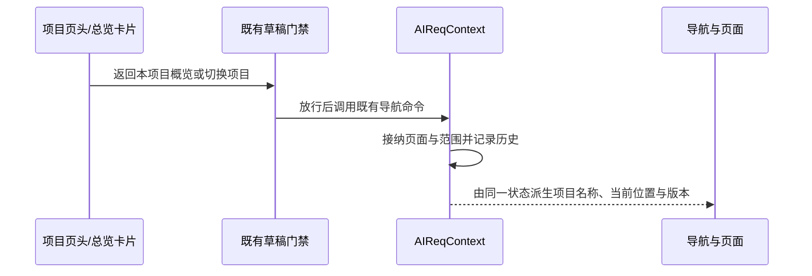
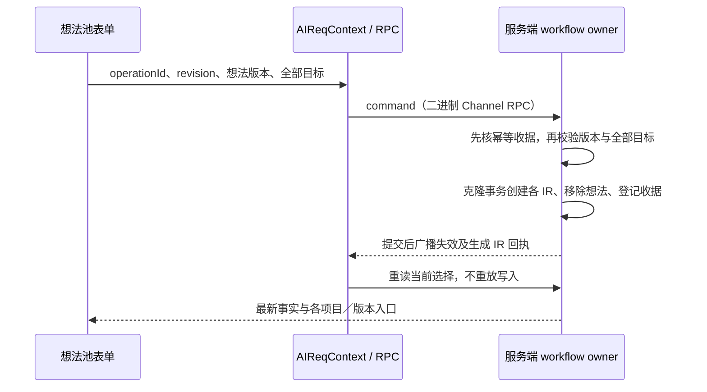

# 分区导航与想法池

2026-11-16 用户确认实施分区导航桌面稿，底部和设置保持原有控件及行为。本规格覆盖 project-space / navigation-usability 中冲突的 68px 工作台侧栏、顶部项目页签及未建设想法池条款；设置页面不改。

## 导航与布局

- 侧栏顶部固定一行现有应用 Logo 与产品名称 `AIReq`，位于“需求规划”上方；仅用于品牌识别，不增加导航、项目切换、菜单或副标题。Logo 为装饰图像，产品名称由可读文本提供，深浅主题共用现有资产；底部账户、待办与设置保持原有位置和行为。
- 工作台使用贯穿电脑浏览器内容高度的展开文字侧栏，背景为现有 `bg-background-win-alt`，正文为 `bg-background`。不设置独立项目选择器；项目总览通过项目标题与版本卡片进入对应项目／版本，跨项目待办仍可直达目标并同步当前项目与版本。仅查看全局总览不改变当前项目，项目卡片保留“当前项目”标识；所有导航继续由 AIReqContext 持有，侧栏坐标及原生底部、设置不变。
- “需求规划”分组为项目总览、想法池、需求共创；前两项明确“全部项目”，始终是全局视图。“研发交付”分组为开发任务、进度分析。我的待办仍跨项目，位于原生 footer 上方。
- 需求共创对应现有提案及讨论；开发任务对应正式 IR/SR 列表、报告、材料、审查和验收；进度分析对应分析任务及执行历史。移除重复项目页签及提案／正式切换，版本保留为项目页面的唯一范围筛选；保留项目概览的卡片入口及返回。不得恢复裁撤入口或新增开发执行能力。
- AIReqContext 继续唯一持有项目、版本、对象、页面、历史与未保存门禁；新增 mainView `ideas`。切项目保留页面类别，详情回对应列表并清除旧版本／对象。工作台 footer 仅启用现有展开呈现：账户在左、齿轮在右；原有菜单、设置页面及门禁不改。
- 全局“项目总览”仅在全局总览页选中，不把项目概览映射为全局入口的当前位置。项目页头按“项目名称 → 当前页面”组织，当前页面标识为 `aria-current="page"`；项目概览显示自己的当前位置，其他项目页及讨论的项目名称可返回同一项目概览，不切项目、不清除当前版本范围。返回继续复用 `ai.navigate`、既有草稿门禁和 `setMainView("projectOverview")`，不使用会重置版本的 `openProject`。
- 需求共创在“全部版本”下，每条提案的编号旁显示所属版本标签；依据同一工作流快照中匹配项目与 releaseId 的版本名称渲染，不新增业务缓存或读取接口。无法解析归属时明确显示版本不可用，不静默标成其他版本。标签可换行，单版本视图沿用页头范围，不增加独立表格列或修改筛选、分页和进入讨论行为。
- 侧栏在品牌行之外持续显示当前项目名称，以分隔线、项目图标和文字层级区分下方导航；全局视图仍明确作用于全部项目，此提示只反映 Context 的项目选择，不是项目选择器。项目页头提供“切换项目”入口，经过现有草稿门禁进入全项目总览；项目分组提供进入该项目全部版本的需求共创及开发任务快捷入口，项目标题和版本卡片的原有目标不变。跨项目清除旧版本和对象，快捷入口一次记录目标页面与项目历史。
- 目标项目或需求的投影尚未就绪时，不能把前一项目的快照缺项解释为无版本、无材料或读取失败；先显示读取中，读取失败后保留明确错误和重试。后台重读已有同目标快照继续保留内容，不引入延迟或第二套加载状态。

## 想法及转入版本

- 想法池只存尚未排期的原始需求，不要求项目、版本或日期，不计交付进度、不因未排期自动产生待办。支持新增、查看／编辑、按原文或编号搜索和转入版本；原提交人、提交时间不可因编辑改变。
- 公开 `AIReqWorkflowView` 同源投影增加全局 `ideas` 与用于目标选择的 `availableReleases`；服务端 workflow 是唯一业务 owner。UI 只持有选择、读取投影及未发送表单，无浏览器业务存储。
- 通过现有 command 增加 createIdea（originalText）、updateIdea（ideaId、ideaRevision、originalText）、transferIdea（ideaId、ideaRevision、targets: projectId/releaseId[]）；共同沿用 operationId、expectedRevision、真实连接身份、严格 wire schema、收据与提交后广播。
- 一次可选择一个或多个不同项目／版本组合。转入后分别创建版本内独立提案，保留原始短需求、提交人和提交时间；进入现有澄清、评审、三方确认、转正与验收流程，不运行 AI、不生成 SR。原想法从池中移除，不保留独立原始需求对象或跨项目汇总进度。
- 同一 projectId/releaseId 组合不得重复；空目标、项目或版本不存在、项目版本归属错误、旧 ideaRevision 都拒绝。所有目标验证、各提案创建、想法移除和回执在同一事务完成；任意失败全部回滚。
- 同身份同 operationId 同输入先返回原收据，不再创建；不同输入拒绝复用。另一个操作消费或编辑同一想法后，旧请求拒绝。重连只重读、不自动重发。失败保留原文、目标和操作 ID，可显式重读工作流 revision 重试，不能自动接受已变化的想法版本。
- 成功留在想法池，显示生成的项目／版本提案入口；跨项目入口通过 Context 原子定位项目、版本和 IR。全局想法池在无项目时仍可新增；没有可用版本时保留想法，明确引导原有项目配置。
- 表单关闭、切页、切项目、打开设置、退出及浏览器后退消费既有唯一草稿门禁；未保存原文或目标不能静默丢失。提交中禁止重复动作；读取失败、空池、搜索无结果与并发冲突明确反馈。

## 验收

0. Edge 电脑窗口截图确认侧栏顶部 Logo 与 `AIReq` 单行对齐，深浅主题清晰，分组导航仍可用，底部账户、待办及设置位置不变；设置页面不受品牌行影响。
1. Edge 宽窄电脑窗口、深浅主题截图检查全高侧栏、两组导航、全局范围、原生底部与原有设置往返；各页面均无独立项目选择器；总览项目／版本卡片及跨项目待办可直达目标并正确同步范围。全局总览、项目概览、想法池、需求共创、开发任务、进度分析与待办的相同导航项坐标一致；全局入口不在项目概览中误选中。业务页头按项目→页面显示，项目名称返回本项目概览并保留版本，浏览器后退恢复来源页；其他页面无独立项目选择控件。跨版本提案在编号旁显示正确版本，单版本无重复标签，宽窄窗口与长版本名称均可读；列表状态和草稿门禁保持原行为。
2. 新增／编辑想法无需项目版本；单目标和跨两个项目转入后池中消失，各版本提案原文／提交信息正确、可达且无自动 AI／SR。
3. 协议验证空／重复／错误项目版本、旧全局 revision、旧想法 revision、同操作重试及不同输入复用；拒绝时无部分写入。另一连接收到广播，刷新后同源事实一致。
4. 类型、Lint、变更架构及定向格式检查；不新增 E2E harness 或产品调试接口。实际验证另记 release-surface.md，不把本规格或历史证据当作通过。
5. 从项目页经切换入口返回总览，使用项目快捷入口进入另一项目的需求共创／开发任务，并核对当前项目、全部版本、浏览器后退及草稿门禁；版本卡片仍进入对应版本概览。加载目标项目或跨项目需求时检查无错误空态闪现，加载失败和真正无版本时分别可识别；深浅主题和电脑窗口实际截图。
