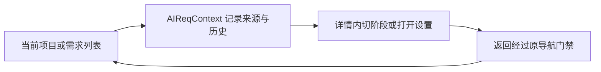
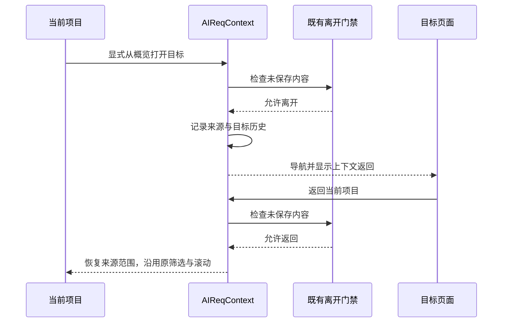

# 分区导航与想法池

提案列表及项目摘要统一使用[需求提案八态](proposals.md#提案业务状态)，状态由当前材料、评审和确认事实推导；“已转正”对象仅进入正式需求列表，不作为提案状态。

## 导航与范围

工作台仅面向电脑浏览器，使用展开文字侧栏。品牌区显示现有 Logo，右侧固定两行“AI 需求协作”和“AI Requirements”。品牌下将具名项目、Release 选择器整理为同一紧凑范围区，使用原生 Select 的轻量行呈现，图标、字段标签、当前值与展开箭头对齐；项目值加重，Release 保持次级层级。品牌中文标题使用 `text-ui-lg`（默认 16px）半粗体，英文副标题保持 `text-ui-sm`（默认 12px）；Logo 为 32px，品牌区保留 64px 高度与中英文两行，以垂直居中增强识别，不挤压下方范围选择器。选择器整行可点击，悬停、展开与键盘焦点分别可辨，下拉菜单对齐触发器左侧与宽度；长名称截断并保留完整 title。加载、无项目与无 Release 的禁用／占位保持，项目内页面共享一个具体 Release，没有“全部版本”选项。

| 位置       | 入口               | 范围                     |
| ---------- | ------------------ | ------------------------ |
| 全局       | 项目总览、想法池   | 全部项目                 |
| 需求规划   | 当前项目、需求共创 | 当前项目与具体 Release   |
| 研发交付   | 开发任务、进度分析 | 当前项目与具体 Release   |
| 底部独立行 | 我的待办           | 当前项目与具体 Release   |
| 页脚       | 账户、设置         | 现有账户菜单与设置覆盖层 |

当前页面使用选中底色、较强字重及 `aria-current="page"`，键盘焦点独立可见。提案讨论归属需求共创，正式详情归属开发任务。全局入口带“全部项目”提示，待办带“当前 Release”提示；待办上方只有分隔线，不增加分组标题。

`AIReqContext` 唯一持有项目、Release、对象、主页面、浏览器历史及未保存门禁。切项目保留页面类别，详情回对应列表；优先恢复本会话该项目上次有效版本，否则选择创建时间最新的版本。无版本显示空态及设置入口，不借其他项目数据补齐。显式对象链接同步对象所属项目及 Release。无显式对象链接时，登录和刷新进入全局项目总览。

`navigationState.ts` 仅提供历史字段校验与来源推导的纯函数，状态接纳仍归 `AIReqContext`。需求工作台由 `AIReqContext` 的同一导航历史保存根返回来源：当前项目来源使用下述带项目／Release 校验的上下文返回；从需求共创进入时根返回提案列表。任务先返回工作台，独立审查详情先返回所属汇总，再沿根来源返回。正式需求仍返回正式需求列表；详情内阶段切换和设置往返保留来源，浏览器前进／后退恢复该记录。直接分享链接没有来源时按对象类型回到提案或正式列表，不把全局总览当来源。返回按钮及提示明确目标，沿既有导航和未保存门禁执行，不用无条件 `history.back()`。当前项目在同一项目／Release 内保留挂载，局部筛选与滚动由页面自身持有；加载投影或隐藏时不覆盖已保存滚动，回到可读内容后恢复。切项目／Release 重新建立该页面局部状态。



导航、切范围、设置往返及历史消费既有草稿门禁；取消或保存失败不改变已接纳选择和历史。目标投影未就绪显示读取中，失败显示错误与重试，不用前一目标快照推断空版本、零统计或缺材料。同目标后台重读保留已读内容，迟到结果不得覆盖新目标。

### 当前项目的上下文返回

从当前项目的统计、“查看全部”或需求入口进入其他主页面时，记录来源项目及具体 Release。目标内容区左上角显示轻量 `← 返回当前项目`，与正文列左边缘对齐，放入既有 48px 顶部空间；列表标题和正文起点不随入口显示／隐藏移动。提案讨论不额外显示上下文返回带；返回统一放入聊天顶部工具栏，与右侧对象菜单和材料入口同一行，沿用原来源及门禁。右侧详情 Tab 不增加重复返回入口。

来源由 `AIReqContext` 的导航状态唯一持有，随同一会话浏览器历史记录及恢复，不放入公开链接、业务数据或本地持久存储。刷新、直接对象链接和直接侧栏进入不产生来源；点击侧栏（包括当前已选页面）、切项目或 Release 清除来源。来源仅在项目与版本仍匹配且存在时有效，设置覆盖层往返不清除。

返回走既有设置／草稿门禁，明确选择来源概览而非盲目后退；取消留在原页面且来源保留。概览保持挂载，保留当前范围内筛选、展开和滚动位置，不缓存业务投影；范围变化重新挂载，采用新范围默认展示。浏览器后退／前进恢复相应历史项的来源，不借另一身份或页面伪造返回入口。



验收覆盖：侧栏直达与概览进入的标题坐标相同；返回恢复范围、筛选及滚动；同页侧栏点击及切范围清除入口；设置往返、浏览器前后退、刷新和直链行为符合来源规则；未保存表单取消／放弃离开正确。深浅主题及宽窄电脑窗口检查对齐、焦点和无页面横向溢出。

## 页面与正文

列表、当前项目及设置共用 `shell/pageLayout.ts` 和原生 `SETTINGS_FRAME_CONTENT_CLASSNAME`：正文在实际剩余面板内居中、`max-w-4xl`、左右 `px-4 lg:px-8`，一级标题使用外观页标题角色。外层滚动与正文限宽分离，表格仅局部横滚。

项目总览、当前项目、想法池、需求共创、开发任务、进度分析、我的待办保持共同标题基线，不重复呈现项目／Release 页头。无概览来源的提案讨论详情不保留列表的顶部占位；提案工作台与任务共用顶部工具栏：工作台返回原来源，任务返回工作台，审查详情返回所属汇总；右侧为对象菜单和任务内材料入口。任务及审查参数由 Context 导航历史与对象 URL 持有，不新增业务状态。不再另占标题编号栏，也不显示复制链接。返回保持具名提示、来源规则和原导航门禁。正式详情保留自己的顶部布局。

卡片与数据表使用 `bg-card`／`border-card-border`；标题、字段和主要数值使用主文字，原文长正文、日期和说明使用次级文字。粘性表头使用不透明卡片底色。重复范围和过程解释进入已有帮助或 disclosure，错误、未分析、过期和操作门禁仍直接可见。

## 全局项目总览

- 总览只读比较各项目及 Release；项目标题、版本卡片和数字不导航，不提供项目配置、共创或开发快捷入口。业务操作只有标题与帮助旁的“添加项目”，经原设置请求及草稿门禁处理；已有项目与版本配置在设置完成。
- 每个项目分组铺满统一正文列，版本区在宽面板使用两列等宽网格，窄面板单列；无版本分组同宽。默认显示按创建时间排序的最近两个版本；超过两个时折叠态注明“最近 2 个 · 共 N 个版本”，展开态显示完整数量，其余通过展开／收起查看，分组外宽不随展开变化。
- 不显示项目整体进度区。版本百分比、进度条、正式需求数、提案数和未分析 SR 数读取同一 `projectProgress.releases` 投影，不在 UI 另算业务进度。
- `percent === null` 时，无正式需求显示“暂无正式需求”，有正式需求但无开发单元显示“暂无开发单元”，不伪造 0% 或进度条；无正式需求时省去重复“正式需求 0”，仍展示提案数量。读取失败和未分析不能解释为空需求。“当前项目”徽标使用 12px 的 `text-ui-sm`，不修改其他 Badge。
- 总览帮助先说明正式需求（IR）可拆分为开发任务（SR），再解释按正式 SR 等权平均、提案不计入、未分析为 0、合入为 99%、人工验收通过为 100%；卡片使用“未分析开发任务”明确单位。共用 ProjectPageHelp 沿原生 Popover 点击打开并固定，不随指针离开或仅获焦而开合；正文可移入、选取及滚动，Esc 关闭后焦点返回触发器，点击外部关闭并保持外部操作正常。浮层 UI 状态归原生 Popover，不新增业务状态。
- 只读卡片不使用按钮、进入箭头、手形光标或位移／缩放等可点击暗示。动效主题下，鼠标经过项目分组时边框轻微渐亮，经过版本卡片时边框与底色在 200ms 内过渡，移出以 120ms 复位，用于聚焦阅读；不改变进度、数字或导航。CSS 伪类持有瞬时反馈，不新增 React／业务状态；原浅／深主题、减少动态效果和性能模式不启用。验收覆盖分组、版本、空版本、展开后卡片及移出复位。展开状态与 `aria-expanded` 同步；进度条长度变化和展开动效服从减少动态效果偏好，不新增动画业务状态。

需求共创列表的“打开需求工作台”使用现有 Lucide `ArrowUpRight` 图标按钮，保持 32px 点击区域与明确焦点边框，悬停／聚焦提示“打开需求工作台”，无障碍名称包含提案名称；操作列收窄到 56px，点击仍经原导航门禁进入同一提案详情。

## 当前项目与我的待办

当前项目严格按侧栏所选项目及 Release 展示提案、正式 IR、正式 SR、人工验收完成 SR、整体进度及完成比例。进度采用正式 SR 等权投影；完成比例为验收完成 SR 数／正式 SR 数，无 SR 不假造 0%。提案不计交付分母，未分析数量直接保留。

待人工处理从同源待办派生事实统计：只统计当前可执行人工放行和 alignment 确认，不把未就绪评审、失败、AI 运行或等待合并当成可确认。总数按 IR 去重，人工放行及业务／开发／测试分类各自去重且允许重叠；同一人兼任不合并动作。入口进入对应提案详情，不在概览新增确认按钮。

最近提案取真实业务更新时间倒序、编号稳定排序的五个不同提案，打开当前讨论。最近 SR 显示五个不同正式 SR 的真实状态变化及前后状态，打开开发详情；无变化记录如实为空，不用刷新或分析时间冒充动态。`statusChange` 由 workflow 事务比较有效状态后写入，读取和初始化不制造记录。

我的待办先按同一项目与 Release 过滤全局只读投影，再派生“我的／待认领／全部”数量和列表，默认当前工号；三个筛选以紧凑带数量按钮呈现，而非大统计卡。范围内认领、分配及代办留痕保留，不显示全部项目筛选。切范围重挂局部筛选和分配表单，默认回“我的待办”；无项目、无版本、加载、失败各自明确。当前项目概览的待确认统计面向本 Release 全体人员，不按当前工号缩小。

## 全系统在线人员

侧栏底部、当前工号上方提供“在线人数”入口，不受项目或 Release 选择影响。入口复用 ghost 按钮与侧栏图标／文字基线，以侧栏辅助文字显示标签、主文字右对齐显示“N 人”，末尾使用次级右箭头提示可查看名单；32px 行高，悬停、弹窗打开及键盘焦点均有清晰反馈，不添加装饰状态点或循环动画。读取中显示“在线人数…”，失败显示“在线状态暂不可用”，两者均不显示人数。点击打开复用现有 Dialog 的居中弹窗，宽 640px、最大高度 70vh，仅显示“工号／访问 IP”两列；固定不透明表头，名单内部滚动，IPv6 完整换行。无搜索、分页、头像、逐行在线标记或其他操作；关闭按钮、Esc 和遮罩关闭后回焦入口。人数按工号去重，包含自己；行按工号与 IP 去重并稳定排序，同一工号的多个 IP 分行显示。工号非可信认证，不将人数称为已认证用户。

连接事实由服务端 AIReqPresence owner 持有，仅接纳校验成功并已打开的 WebSocket；注册／注销幂等，同 IP 多连接按引用计数，最后一条连接关闭才删除该行。只读快照 readPresence 与 presence 事件复用现有 AIReq Channel RPC，携带进程内递增 revision，事件不触发业务工作流重读。客户端先订阅再读，忽略迟到旧版本，每 15 秒补读以恢复暂时读取失败；不得自动重放写命令。断线由既有 main 连接 owner 管理；读取失败显示“在线状态暂不可用”，不将旧数值当实时结果。进程重启清空连接表，当前单进程部署不宣称跨实例汇总。

IP 取宿主 requestIP，缺失显示“未知”；默认忽略转发头。ZCODE_TRUSTED_PROXY_IPS 以逗号配置精确可信代理 IP，仅当直连来源在该列表时，从右向左剥离可信 X-Forwarded-For 地址，取首个不可信来源；非法链退回直连地址。连接保活使用 WebSocket ping/pong，60 秒空闲超时清理失联连接，不依赖用户操作，不保存访问历史。

```text
WebSocket open／close → 服务端 presence owner → 去重快照 revision → presence 事件
客户端订阅 → readPresence → 版本核对 → 人数入口与弹窗只读投影
```

验收覆盖两个工号实时互见、同工号多标签与多 IP 去重、关闭／切工号移除、伪造转发头不生效、可信代理链、迟到快照、真实长名单滚动不跳位置、IPv6、浅深主题、键盘焦点与弹窗关闭。在线数据只来自连接，不生成演示名单。

## 主页面对象标识展示

项目总览、想法池、当前项目、需求共创、开发任务、进度分析（含执行历史）及我的待办默认只展示可读业务内容，不在名称列或摘要中渲染内部对象 ID，也不将其称为业务编号。名称不足时不以内部 ID 兜底；保留 IR／SR 类型、父需求名称、完成数量、状态、人员工号和时间。分析历史使用执行时保存的 SR 名称，不拼接内部 ID。

表头与搜索提示使用原始需求或名称；现有内部 ID 精确检索能力保留用于已有定位流程，不另造展示编号。操作按钮的无障碍名称使用对象名称与动作。对象 ID 仍用于内部关联、导航和详情追溯；不改服务契约、数据身份或状态所有者。

验收：逐页检查默认列表与当前项目摘要无内部 ID；展开 SR 后仍能辨别父子关系与完成数量；分析任务显示所属需求名称；历史与待办用名称定位，筛选、展开、详情和分工操作仍指向原对象；浅深主题均保持可读。

## 全局想法池

想法池保存尚未排期的原始需求，无需项目、版本或日期，不计交付进度，也不因未排期产生待办。切换侧栏项目或 Release 不改变其全局范围。支持新增、查看／编辑、按原文搜索、CSV 导入导出及转入版本；编辑不改变原提交人和提交时间。

点击原文打开编辑；末列三点菜单提供“转入项目版本”，只在行悬停、键盘聚焦或菜单展开时显示。转入弹窗使用同一标题，说明可选择同一项目或不同项目的多个版本，全部转入成功后原想法移出想法池、每个目标版本生成一条独立提案；中英文含义一致。取消／Esc 返回实际入口，转入成功消费原行后回到“新增想法”。多目标表单的项目／版本标签按同一目标序号配对，删除后重新编号。

一次可转入一个或多个不同项目／Release 组合，分别创建独立提案，保留原始短需求、提交人和提交时间；成功后原想法从池中移除。此动作不运行 AI、不生成 SR，成功留在池中并提供生成提案入口。没有可用版本时保留想法并引导项目配置。

`createIdea`、`updateIdea`、`transferIdea`、`importIdeas` 沿用既有 command、连接身份、operationId、expectedRevision、想法 revision、严格 schema 及幂等收据。转入的全部目标校验、提案创建、想法移除与收据属于 workflow 同一事务；空目标、重复组合、错归属、缺失目标或旧 revision 均整批拒绝。同操作同输入返回原收据，不同输入拒绝复用；重连只重读，不自动重放写入。失败保留原文、目标及操作 ID，显式重读基线不自动接纳已变化的想法。

CSV 为 UTF-8 单列“原始需求”，支持引号、逗号及单元格内换行；跳过空行，重复正文提示但不去重。导入先预览文件名、有效条目、空行、重复行和原文，确认前不写入；非空批次任一无效则全批拒绝。导出当前搜索匹配的全部原文，不导出编号、提交信息或生成材料，空结果禁用；导出文件可重新导入为新想法。

导入文件、预览、原文和未提交目标归当前 UI 草稿，纳入唯一离开门禁。文件读取使用代次拒绝迟到结果；读取／提交中禁用重复确认，失败保留输入，取消和关闭恢复入口焦点，不静默丢弃。

## 实现依据

- `packages/ui/src/aireq/shell/AIReqSidebarNavigation.tsx`、`AIReqShell.tsx`、`pageLayout.ts`
- `packages/ui/src/aireq/AIReqContext.tsx`、`AIReqTodoPage.tsx`
- `packages/ui/src/aireq/projects/AIReqProjectProgressPage.tsx`、`AIReqProjectOverviewPage.tsx`
- `packages/ui/src/aireq/ideas/AIReqIdeaPool.tsx`、`AIReqIdeaImportExport.tsx`

右侧对象详情与材料入口见 [统一右侧工作区](unified-side-pane.md)，设置门禁见 [工具与设置](tools-settings.md)。
