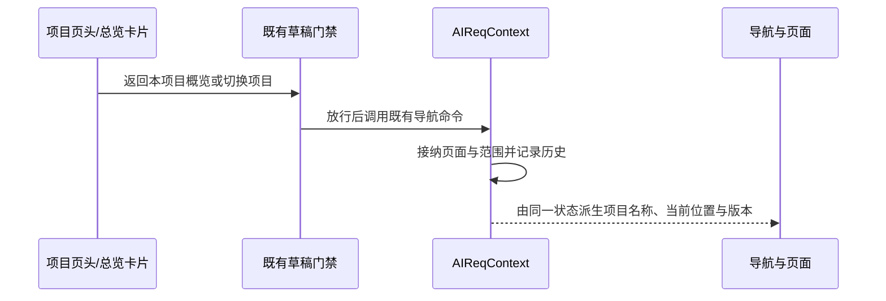
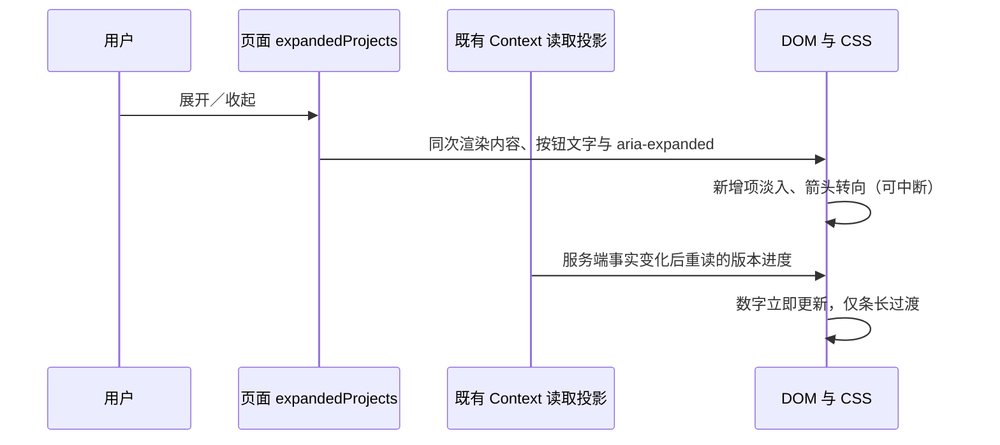
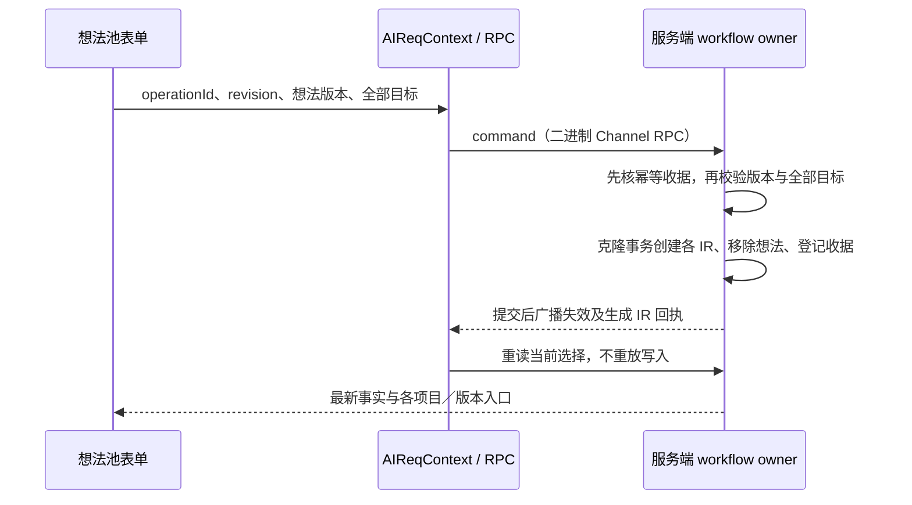
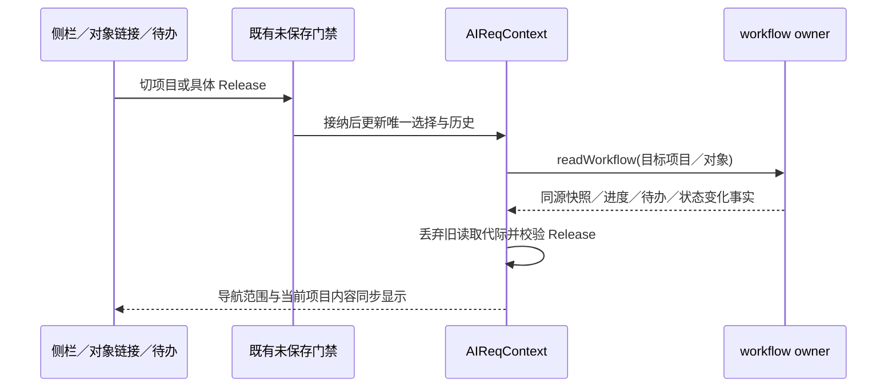

# 分区导航与想法池

2026-11-16 用户确认实施分区导航桌面稿，底部和设置保持原有控件及行为。本规格覆盖 project-space / navigation-usability 中冲突的 68px 工作台侧栏、顶部项目页签及未建设想法池条款；设置页面不改。

## 导航与布局

- 侧栏顶部固定显示现有应用 Logo，其右侧始终分两行显示中文“AI 需求协作”和英文“AI Requirements”，两行左对齐，中文在上、英文在下；不随界面语言隐藏任一行，不增加导航、项目切换或菜单。Logo 为装饰图像，名称由可读文本提供，深浅主题共用现有资产；底部账户、待办与设置保持原有位置和行为。
- 工作台使用贯穿电脑浏览器内容高度的展开文字侧栏，背景为现有 `bg-background-win-alt`，正文为 `bg-background`。不设置独立项目选择器；项目总览通过项目标题与版本卡片进入对应项目／版本，跨项目待办仍可直达目标并同步当前项目与版本。仅查看全局总览不改变当前项目，项目卡片保留“当前项目”标识；所有导航继续由 AIReqContext 持有，侧栏坐标及原生底部、设置不变。
- “需求规划”分组为项目总览、想法池、需求共创；前两项明确“全部项目”，始终是全局视图。“研发交付”分组为开发任务、进度分析。我的待办仍跨项目，位于原生 footer 上方。
- “我的待办”上方增加与现有分区同宽、同色的 1px 细分隔线，线下留 12px 间距，不增加文字分区标题。待办沿用业务导航的 `h-auto min-h-9 py-2` 行高和垂直内边距，右侧复用“全部项目／All”范围提示的字号、颜色及对齐；原有底部锚定、账户与齿轮位置、其他字号及布局保持不变。此调整仅改变导航呈现，不新增状态、接口或导航路径。
- 需求共创对应现有提案及讨论；开发任务对应正式 IR/SR 列表、报告、材料、审查和验收；进度分析对应分析任务及执行历史。移除重复项目页签及提案／正式切换，版本保留为项目页面的唯一范围筛选；保留项目概览的卡片入口及返回。不得恢复裁撤入口或新增开发执行能力。
- AIReqContext 继续唯一持有项目、版本、对象、页面、历史与未保存门禁；新增 mainView `ideas`。切项目保留页面类别，详情回对应列表并清除旧版本／对象。工作台 footer 仅启用现有展开呈现：账户在左、齿轮在右；原有菜单、设置页面及门禁不改。
- 全局“项目总览”仅在全局总览页选中，不把项目概览映射为全局入口的当前位置。项目页头按“项目名称 → 当前页面”组织，当前页面标识为 `aria-current="page"`；项目概览显示自己的当前位置，其他项目页及讨论的项目名称可返回同一项目概览，不切项目、不清除当前版本范围。返回继续复用 `ai.navigate`、既有草稿门禁和 `setMainView("projectOverview")`，不使用会重置版本的 `openProject`。
- 需求共创在“全部版本”下，每条提案的编号旁显示所属版本标签；依据同一工作流快照中匹配项目与 releaseId 的版本名称渲染，不新增业务缓存或读取接口。无法解析归属时明确显示版本不可用，不静默标成其他版本。标签可换行，单版本视图沿用页头范围，不增加独立表格列或修改筛选、分页和进入讨论行为。
- 侧栏在品牌行之外持续显示当前项目名称，以分隔线、项目图标和文字层级区分下方导航；全局视图仍明确作用于全部项目，此提示只反映 Context 的项目选择，不是项目选择器。项目页头提供“切换项目”入口，经过现有草稿门禁进入全项目总览；项目分组提供进入该项目全部版本的需求共创及开发任务快捷入口，项目标题和版本卡片的原有目标不变。跨项目清除旧版本和对象，快捷入口一次记录目标页面与项目历史。
- 目标项目或需求的投影尚未就绪时，不能把前一项目的快照缺项解释为无版本、无材料或读取失败；先显示读取中，读取失败后保留明确错误和重试。后台重读已有同目标快照继续保留内容，不引入延迟或第二套加载状态。

展开侧栏中，项目图标位于“当前项目”和名称左侧，两行共用文字起点；名称过长时截断并保留完整标题。业务导航与底部待办共用图标、名称和右对齐范围文字三列。当前页同时使用选中底色和较强字重，悬停其他行不转移当前位置；键盘焦点独立可见。分区之间的留白大于同组行距。验收在宽、窄电脑窗口检查深浅主题、Tab 焦点及激活后的选中行；底部锚定和导航归属不变。



## 项目总览的版本比较（2026-11-17）

- 总览保留既有侧栏、主题、控件、项目分组及版本入口。用户复看后明确不需要项目整体进度区，不展示项目整体百分比或新增汇总条带。
- 版本进度与数量直接读取同一 `projectProgress.releases` 投影；存在未分析 SR 时在对应版本明确显示数量。不在 UI 重算业务进度，不新增缓存、接口或业务状态。后台重读、旧快照及失败重试沿用现有 owner 和路径。
- 版本卡片使用 `w-72 max-w-full min-h-36` 的适中比例，按可用空间换行，不拉伸填满整行、不预设四个空列；名称、强调显示的版本百分比／进度条、数量纵向排列，空态不补百分比或假进度条。项目外框宽度由当前可见版本卡片数、卡片宽度、间距、内边距和边框派生，受正文可用宽度约束；各项目右边缘无需对齐，单版本外框也随内容收窄。仍默认最近四项、按原顺序展开／收起，展开后外框随可见内容更新。
- 项目标题与全部版本快捷入口在可用宽度足够时共用紧凑页头，自然换行；版本数量就近合入“全部 N 个版本”的范围说明，不再单设版本说明行。项目配置使用已有图标按钮与具名提示，保留可访问名称与原配置入口。减少外围说明占高，让版本内容成为分组主体，保留原有视觉语言与信息。
- 版本换行时，项目外框右边缘与最满一行的末卡保持相同内边距；正文不足一列时随可用宽度收窄。项目名称为分组标题，全部版本范围与两个快捷入口就近排列。版本卡底部按指标分开呈现名称和实际数量，单项可整体换行。悬停或键盘聚焦时显示进入箭头，键盘焦点另有清晰边框；聚焦版本可读取该卡的进度或空态及数量。
- 本项验收在 Edge 的 1440×900 与 1100×800 电脑窗口检查深浅主题，核对双版本与多版本分组内边距、展开收起、键盘焦点、版本导航及可访问说明。
- 项目标题具备明确可进入提示，点击仍进入该项目全部版本概览。需求共创／开发任务快捷入口旁常驻“全部版本”，其可访问名称也明确范围；版本卡片仍仅进入所选版本。导航与草稿门禁继续由 `AIReqContext` 唯一持有。
- 已读取且 `percent === null` 时，`formalCount === 0` 显示“暂无正式需求”，否则显示“暂无开发单元”；不能将 null 改成 0%，也不能将读取失败或未分析 SR 解释为空需求。已有 SR 的未分析部分仍按正式规则计入进度并显示数量。
- 项目总览的辅助文字使用现有可读语义文字等级，在 Zai Light／Zai Dark 的项目和版本表面达到至少 4.5:1；保留 `text-ui-*` 字号体系。内层版本卡片按现有嵌套圆角规范使用 `rounded-lg`。
- 直接验收：Edge 1440×900 与 1100×800 的深浅主题截图核对无项目整体进度区、卡片紧凑且不拉伸、辅助文字对比度、键盘焦点及无水平溢出；项目标题、全部版本快捷入口与单版本卡片分别进入正确范围。无正式需求、有正式需求但无 SR、存在未分析 SR、单版本及超过四版本场景通过隔离内存后端和真实页面验证，不增加公开控制口、产品夹具或新 E2E harness。帮助解释版本进度口径。实际结果写入现有 release-surface.md，不以本条规格声明验收通过。

## 项目总览动效（2026-11-17）

- 仅增强版本卡片、展开／收起和版本进度更新，不改变布局、配色、导航与数据读取，不增加依赖或接口。
- 原型后端第二个项目（Mobile 移动工作台）默认提供五个版本：保留原有两个版本，增加 2027.01、2027.02、2027.03 三个无需求版本；首页沿用最近四项及原有排序，展开后显示五项。数据仅在后端内存初始化，不向前端加入固定数据或按后端类型分支。
- 版本卡片背景与边框在悬停及键盘可见聚焦时以 150ms 过渡到现有 hover 色；焦点环立即可见，不增加浮起、缩放或位移。
- 展开时仅新增的第五项及之后版本以 200ms 淡入，无逐项延迟；前四项保持稳定，收起立即移除额外项。展开按钮保留同一向下箭头，以 180ms 旋转表达状态，文字、aria-expanded 与内容同步更新。快速反向操作立即响应，不设置定时器。
- 已挂载版本的实际进度变化沿用现有进度条，以 250ms ease-out 从当前显示长度过渡到新值；数字及可访问进度立即采用服务端投影。首次读取、重新挂载不从零播放，不补造 null 进度，不增加数字滚动或本地业务进度。
- 系统减少动态效果时取消卡片淡入、箭头旋转过渡及进度长度过渡，直接呈现最终状态；颜色反馈缩短为 100ms，键盘焦点仍清晰。
- 状态与事件顺序：



- 页面仅持有原有展开状态，动画不持有业务状态、不产生服务命令。验收用 Edge 在 1440×900、1100×800 电脑窗口及深浅主题截图检查；操作悬停、键盘聚焦、展开／收起和快速反向切换并观察中间帧；核对同一已挂载版本进度变化、数字即时更新、减少动态效果和原有卡片导航。超过四版本和进度变化可使用隔离内存后端的正式业务事实验证，不向产品增加夹具或调试入口。结果写入 release-surface.md。

## 想法及转入版本

- 想法池提供 CSV 导入、模板下载与导出。文件为 UTF-8 单列“原始需求”，支持引号、逗号及单元格内换行；空行跳过，重复正文提示但保留。导入先显示文件名、有效条目、空行数、重复行及原文预览，确认前不写入；无需项目或版本。导出当前搜索匹配的全部想法原文，空结果禁用，不导出编号、提交人、时间或生成材料；导出文件可重新导入为新想法，提交信息以本次实际操作者及服务端时间登记。
- 正式 `importIdeas(originalTexts)` 通过既有 command 接纳，沿用 operationId、expectedRevision、连接身份、严格 schema、幂等收据与提交后广播。非空批次中每条必须是非空字符串，任一无效则整批拒绝；全部创建处于 workflow 的同一克隆事务，不创建项目／提案／会话或运行 AI。重试同操作同内容返回原收据，不重复创建；不同内容拒绝复用。
- 导入文件及预览只属于当前页面未发送草稿，纳入现有唯一导航门禁；取消、Esc、切页和关闭浏览器均不能静默丢弃。读取文件使用代次拒绝迟到结果，读取／提交中禁用确认；失败保留文件、输入、操作 ID 和接纳基线，只能显式重读版本后重试，重连不自动提交。关闭后焦点回到导入入口。

  ```text
  CSV 文件 → 当前页导入草稿／预览 → 用户确认 → command → workflow 单事务 owner
                       ↑                  失败保留输入    ├─ 全批创建／收据 → 提交后广播
                       └─ 显式重读后重试                 └─ 任一无效 → 全批回滚
  搜索结果（服务端读取投影）→ CSV 下载
  ```

- 想法池只存尚未排期的原始需求，不要求项目、版本或日期，不计交付进度、不因未排期自动产生待办。支持新增、查看／编辑、按原文或编号搜索和转入版本；原提交人、提交时间不可因编辑改变。
- 最后一列沿用其他表格的三点操作菜单：默认隐藏，悬停当前行、按钮键盘聚焦或菜单展开时显示，右对齐且不改变行高。菜单保留“转入版本”，点击原文仍打开编辑；菜单触发器提供含想法编号的中英文可访问名称。菜单转入现有表单时不得抢回焦点，取消／Esc 后回到该行三点按钮，成功消费原行后仍回到“新增想法”。

  ```text
  行三点按钮（UI ref）→ 菜单 → 既有 draft owner → 转入表单
                                                 ├─ 取消／Esc → 行三点按钮
                                                 └─ 成功消费原行 → 新增想法
  ```

- 公开 `AIReqWorkflowView` 同源投影增加全局 `ideas` 与用于目标选择的 `availableReleases`；服务端 workflow 是唯一业务 owner。UI 只持有选择、读取投影及未发送表单，无浏览器业务存储。
- 通过现有 command 增加 createIdea（originalText）、updateIdea（ideaId、ideaRevision、originalText）、transferIdea（ideaId、ideaRevision、targets: projectId/releaseId[]）；共同沿用 operationId、expectedRevision、真实连接身份、严格 wire schema、收据与提交后广播。
- 一次可选择一个或多个不同项目／版本组合。转入后分别创建版本内独立提案，保留原始短需求、提交人和提交时间；进入现有澄清、评审、三方确认、转正与验收流程，不运行 AI、不生成 SR。原想法从池中移除，不保留独立原始需求对象或跨项目汇总进度。
- 同一 projectId/releaseId 组合不得重复；空目标、项目或版本不存在、项目版本归属错误、旧 ideaRevision 都拒绝。所有目标验证、各提案创建、想法移除和回执在同一事务完成；任意失败全部回滚。
- 同身份同 operationId 同输入先返回原收据，不再创建；不同输入拒绝复用。另一个操作消费或编辑同一想法后，旧请求拒绝。重连只重读、不自动重发。失败保留原文、目标和操作 ID，可显式重读工作流 revision 重试，不能自动接受已变化的想法版本。
- 成功留在想法池，显示生成的项目／版本提案入口；跨项目入口通过 Context 原子定位项目、版本和 IR。全局想法池在无项目时仍可新增；没有可用版本时保留想法，明确引导原有项目配置。
- 表单关闭、切页、切项目、打开设置、退出及浏览器后退消费既有唯一草稿门禁；未保存原文或目标不能静默丢失。提交中禁止重复动作；读取失败、空池、搜索无结果与并发冲突明确反馈。
- 多目标转入表单的可见项目与版本标签使用同一目标编号（如“目标项目 1／目标版本 1”），移除目标后按当前顺序重新编号；关联控件的可访问名称必须能唯一辨别同一组项目／版本。取消或编辑保存关闭弹窗后，焦点回到实际打开该弹窗的入口；转入成功接纳回执后、关闭弹窗前明确将返回目标切换为“新增想法”，不依赖旧行在关闭时是否仍连接 DOM。确认继续编辑保留原表单。
- 项目概览的全局想法池统计入口同时提供动作、全部项目范围与数量的可访问名称，不能只向读屏报告一个数字。



### 原型后端想法池初始数据（2026-11-17）

- 默认启动时由后端 workflow 初始化 8 条未排期想法，覆盖需求收集、讨论协作、版本规划、交付通知、验收与知识复用，提供不同原始提交人和提交时间。
- 每条数据具有稳定且不与运行时新增编号冲突的 ID、原文、提交人、创建／更新时间和初始 revision；不预设项目／版本，不生成提案、SR、会话或待办。
- 初始数据只在模拟后端初始化时创建；编辑、转入、广播及幂等继续沿用既有命令和唯一 workflow owner，读取及切换项目不补回已消费想法。服务重启恢复初始数据，既有空项目场景保持空池。
- 验收：通过正式服务读取默认 8 条记录及跨项目一致性，编辑保留原提交信息，转入后仅消费目标想法且保留其来源，不自动运行 AI；前端与公开接口不增加模拟数据或分支。

## 验收

0. 电脑浏览器截图确认侧栏顶部 Logo 右侧的中英文名称分两行且左对齐，深浅主题清晰，两种界面语言均显示两行，分组导航仍可用，底部账户、待办及设置位置不变；设置页面不受顶部名称影响。
1. Edge 宽窄电脑窗口、深浅主题截图检查全高侧栏、两组导航、全局范围、原生底部与原有设置往返；各页面均无独立项目选择器；总览项目／版本卡片及跨项目待办可直达目标并正确同步范围。全局总览、项目概览、想法池、需求共创、开发任务、进度分析与待办的相同导航项坐标一致；全局入口不在项目概览中误选中。业务页头按项目→页面显示，项目名称返回本项目概览并保留版本，浏览器后退恢复来源页；其他页面无独立项目选择控件。跨版本提案在编号旁显示正确版本，单版本无重复标签，宽窄窗口与长版本名称均可读；列表状态和草稿门禁保持原行为。
2. 新增／编辑想法无需项目版本；单目标和跨两个项目转入后池中消失，各版本提案原文／提交信息正确、可达且无自动 AI／SR。
3. 协议验证空／重复／错误项目版本、旧全局 revision、旧想法 revision、同操作重试及不同输入复用；拒绝时无部分写入。另一连接收到广播，刷新后同源事实一致。
4. 类型、Lint、变更架构及定向格式检查；不新增 E2E harness 或产品调试接口。实际验证另记 release-surface.md，不把本规格或历史证据当作通过。
5. 从项目页经切换入口返回总览，使用项目快捷入口进入另一项目的需求共创／开发任务，并核对当前项目、全部版本、浏览器后退及草稿门禁；版本卡片仍进入对应版本概览。加载目标项目或跨项目需求时检查无错误空态闪现，加载失败和真正无版本时分别可识别；深浅主题和电脑窗口实际截图。
6. 在想法池用键盘打开新增、编辑及转入弹窗，取消、Esc 或保存成功关闭后核对焦点返回原入口，转入成功且原行移除时回到“新增想法”；添加两个目标后，读屏及可见标签均能分辨目标项目 1／目标版本 1 和目标项目 2／目标版本 2，移除后编号及配对同步更新。项目概览的想法池数字入口读出动作、全局范围及数量。
7. Edge 电脑窗口深浅主题截图检查待办上方仅有细分隔线、无新增分区标题；待办与其余业务导航等高，右侧范围提示与项目总览／想法池对齐，无文字溢出。核对品牌、当前项目、原有业务分组及账户／齿轮坐标和字号不变；点击待办仍通过既有导航进入跨项目待办。
8. Edge 深浅主题检查想法池末列：静止时隐藏，悬停仅显示当前行三点；Tab 聚焦显示按钮，Enter 打开菜单后保持显示，“转入版本”进入既有表单且焦点留在表单，取消／Esc 返回该行三点按钮。原文编辑入口保持不变，电脑窗口无新增横向溢出。
9. Edge 电脑窗口检查模板下载、含逗号／引号／换行及空行／重复行的导入预览、非法格式提示、脏文件离开门禁与关闭回焦；确认后全局列表和另一连接同源更新。搜索后导出仅包含匹配原文，重新导入可正确预览。协议检查整批失败无写入、同操作重试不重复及不同内容拒绝；不增加永久 E2E harness。

## 当前项目与具体 Release 导航（2026-11-17）

本节为用户本次确认后的行为，覆盖本文及 PRODUCT.md 中“不设项目选择器”、全部版本入口、总览卡片导航等冲突旧条款。沿用现有视觉体系，仅支持电脑浏览器。

- 全局单独分区仅“项目总览”；需求规划保持“想法池（全部项目）／当前项目／需求共创”，研发交付保持“开发任务／进度分析”；我的待办、账户、设置位置与跨项目语义不变。
- 侧栏品牌下提供项目与 Release 两个具名选择器。Release 无“全部版本”，项目内页面共享唯一具体 Release。AIReqContext 唯一持有选择、项目内上次版本、历史及未保存门禁；切项目保留页面类别，详情返回相应列表。优先恢复本会话该项目上次有效版本，否则选择创建时间最新版本；无版本显示空态及设置入口，不取其他项目数据。显式对象链接／跨项目待办优先同步对象所属 Release。
- 项目页头移除重复选择器与“切换项目”入口，仅显示项目／页面及具体 Release；旧历史中的空范围在同一 owner 内规范到有效具体版本。切换门禁取消时选择与历史均不改变，迟到读取不得覆盖新选择。
- 项目总览保留各项目与版本的只读对比、展开／收起及加载重试；项目标题、卡片、数字不导航，不显示配置、共创、开发快捷入口。唯一业务写入操作为“添加项目”；既有项目／版本配置统一由设置承接。只读版本不使用按钮、箭头或可点击悬停效果。
- “当前项目”复用 projectOverview，所有数字／列表严格按所选项目和 Release。显示正式 IR、提案、正式 SR、人工验收完成 SR、整体进度及完成比例；整体进度沿用正式 SR 等权投影，完成比例为验收完成数／正式 SR 数，无 SR 不假造 0%。提案不计入交付分母；未分析数保留。
- 待人工处理按同源 deriveAIReqTodos 的可执行评审人工判断／放行与 alignment 事实统计，非就绪评审、失败、AI 运行、等合并不误计为可确认。总数按 IR 去重；人工放行、业务／开发／测试视角确认分别按 IR 去重，分类可重叠。同人兼任不合并动作。概览提供进入对应提案详情的明确入口，不新增业务确认入口。
- 最近提案使用既有 proposalUpdatedTime 的业务事实，按时间倒序、编号稳定排序取 5 个不同提案，展示编号、标题、阶段与时间；点击进入该提案当前讨论。最近 SR 为 5 个不同正式 SR 的最近真实状态变化，展示编号、标题、所属 IR、前后状态与时间并直达开发详情；无记录显示“暂无状态变化”，不使用普通刷新／分析时间冒充变化。
- SR 增加可选 statusChange={from?,to,at}，状态值沿用 AIReqProgressStatus。仅 workflow owner 事务比较提交前后 srProgressStatus，变化时写入，未变化不刷新时间，失败回滚不写；初始化迁入进度不生成虚构动态。通过原 readWorkflow 返回，不增 RPC／独立缓存或 UI 写入路径。历史数据缺少记录时如实为空。
- Loading／失败保留既有门禁和快照归属；跨项目读取中不呈现旧项目统计，失败不显示零数。深浅主题、长名称、窄电脑窗口、Tab 焦点与浏览器历史均需真实验证。



## 全局想法池与项目版本待办（2026-11-17 追加）

用户确认：想法池移到“全局”分区，与项目总览并列；需求规划仅当前项目／需求共创，研发交付和底部位置不变。想法池仍全局读写，不受所选项目／Release 限制。

“我的待办”改为项目内页面，范围为侧栏当前项目及具体 Release，默认筛选当前工号；现有待认领／全部待办与认领、分配、代办留痕能力保留，但列表与三个统计均先按同一项目／Release 过滤。移除页面内全部项目筛选和跨项目空态入口，侧栏范围提示为“当前 Release”，页头明确项目／页面／具体版本。版本为空不读取其他范围，不以旧快照冒充新范围；加载中、失败与无项目／无版本分别提示。

AIReqContext 继续唯一持有项目、Release、历史及门禁，待办从现有只读全局投影过滤，不改变服务端业务 owner、接口或派生规则。待办页面局部筛选／分配表单按项目及 Release 挂载，切范围时重置展示状态，默认回“我的待办”，不让旧对象表单留在新范围。概览待确认统计继续展示当前 Release 全体人员，不按当前工号缩小。旧跨项目待办规则及上一节保留待办全局范围的条款由本节覆盖。

验收：全局分区两个入口及原底部位置；切项目／Release 后三统计与表格同步，无跨范围行；范围为空明确空态；我的／待认领／全部均局限当前 Release；行操作打开正确对象并保留范围；浏览器前进后退恢复范围；想法池在切换范围后保持全局数量。电脑窗口深浅主题及键盘焦点不退化。

### 我的待办标题留白（2026-11-17）

按用户追加要求，我的待办不显示标题上方的项目面包屑／Release 页头，复用项目总览同一正文容器和顶部留白。仅移除重复展示，不恢复全局待办：左侧选择器仍唯一控制项目与具体 Release，待办统计、列表、工号筛选及历史规则保持本节当前行为。

### 业务列表统一标题（2026-11-17 追加）

用户继续要求开发任务、进度分析及需求共创使用与项目总览／我的待办一致的顶部空白、标题坐标与字号，不显示重复的项目／版本页头。四个列表页使用同一 h-12 顶部占位、AIREQ_PAGE_CONTENT_CLASSNAME 与 AIREQ_PAGE_TITLE_CLASSNAME；分别明确页面名称，搜索／状态／调度控制置于标题下。我的待办移除重复项目版本说明，开发任务移除逐 IR 的重复 Release 文本与对应列头中的 Release 字样。业务材料、分析确认对话框的操作范围、对象详情导航和独立责任状态不删除；需求讨论详情仍保留其必要返回导航。范围继续由左侧唯一选择器控制，不改变查询、列表过滤或业务行为。

## 外观比例与阅读减负（2026-11-17 Impeccable polish）

用户授权所有设置及主页以原生外观页为比例基准，并明确允许核对上游设计。本轮仅对上游 `fec97590` 现存 SettingsPageParts 的内容列与字号角色作只读核对，不同步上游代码或远端。

- 设置与业务主页复用原生 SETTINGS_FRAME_CONTENT_CLASSNAME：居中、宽度不超过 max-w-4xl，常规左右 px-4、电脑宽窗口 lg:px-8。标题统一外观角色 text-ui-settings-title／lg:text-ui-settings-title-lg、semibold 与同一 h-12 顶部基线。正文只以实际所属面板为居中容器，禁止按整个浏览器计算偏移或为不同页另建宽度。
- 设置的一级标题为 h1；项目总览、当前项目、想法池、需求共创、开发任务、进度分析、我的待办均使用同一标题常量。当前项目也移除重复项目页头，在正文补同一标题。讨论详情继续提供必要的对象与返回导航，不把操作按钮误当一级页面标题。
- 右侧报告／材料面板展开或拖拽时，正文在剩余面板中自然收窄，仍居中并保留左右内边距；消息、composer、需求身份及阶段导航共用同一宽度，不变更面板持久化、会话或业务 owner。窄内容面板内表格可局部横滚，不将整个页面撑宽。
- 降低首屏文字负担：重复范围／成功说明省略，完整业务口径与配置生效规则放入现有帮助或原生折叠说明；错误、未分析、过期、门禁及必要操作范围不隐藏。所有业务数据与操作仍可访问。项目、待办和设置的具体减负按本轮 home/settings/tracking-polish 局部规格。
- 旧“主页面共用较宽满幅列”、旧统一标题 page-title 和正文贴满面板的条款由本节覆盖；当前具体 Release、导航、人工确认、草稿门禁与状态事实不变。只做电脑浏览器验证，不恢复裁撤入口，不新增 debug 接口或业务缓存。

验收：1440×1000及1100×800深浅主题中，设置全部分区与主页全部入口核对内容列宽、相对面板居中、标题角色与顶部起点；开发任务打开右侧报告、需求讨论展开／收起材料时观察正文与composer对齐、留白及滚动；Tab焦点、长内容与失败恢复继续有效。

### 讨论详情重复导航清理（2026-11-17）

按用户截图，讨论详情顶部整排“返回需求共创／项目名称／需求讨论／Release”不再重复呈现左侧导航已提供的信息；沿用统一顶部留白。返回动作收敛到需求身份区的已有返回图标，保留具名提示、键盘焦点及原有 navigate／草稿门禁。身份区只保留需求标题、IR／SR编号与复制链接，不再重复版本名；正式详情身份区同样去除重复版本。左侧唯一项目／Release范围、对象归属和业务状态不变，覆盖早先要求保留讨论面包屑的呈现规则。

### 讨论详情释放顶部空间（2026-11-17）

删除讨论面包屑后不保留其48px空占位：仅提案讨论详情（chat且非formal）移除工作区顶部h-12，使聊天与材料面板共同向上扩展并获得该高度。列表、当前项目、正式开发详情的标题基线保持原来与外观一致的留白；会话草稿、面板宽度及返回操作不变。

## 总览正文宽度与添加项目位置（2026-11-17）

按用户最新要求，总览每个项目分组使用完整的统一正文列，不再按固定版本卡宽和可见数量限制外层宽度。版本区在宽面板中两列等宽，较窄时单列，展开／收起不改变项目分组外宽；无版本分组同宽。“添加项目”在页面标题和帮助旁就近呈现，保留原配置入口与草稿离开门禁。本节覆盖历史的完整列收边、卡片不拉伸限制，具体配色与验收见 home-polish.md。
