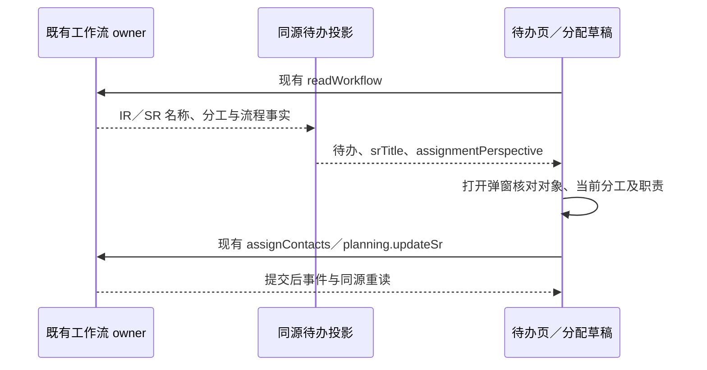

# 待办辨识与分工核对

2026-11-16：按待办页 critique 修复四项问题，优先独立 SR 辨识和分配核对；保留当前页面布局、控件、主题、字号与跨项目筛选。

## 产品规则与契约

- 有 SR 的待办以可读 SR 名称为主，辅助显示所属 IR 名称、项目和 IR／SR 编号；无 SR 的待办继续显示需求名称。处理按钮及分工入口的可访问名称包含 SR 名称和编号，区分同 IR 的独立开发单元。
- `AIReqTodo.srTitle?` 与 `assignmentPerspective` 是现有工作流读取中的只读投影，分别来自同一 owner 快照的 SR 名称及产生该事项的联系人／负责人视角。`title` 仍表示待处理动作；不增加 RPC、业务状态、名称缓存或 UI mock 分支。
- `assignmentPerspective` 明确实际分工目标：IR 待讨论／业务评审／业务补充为业务联系人，方案／完整评审／发布与文档 PR 失败为开发联系人，三方确认为各自视角联系人；SR 测试为测试负责人，其余 SR 开发／修复／失败为开发负责人。显示和写入使用同一视角，不从中文动作或 UI 当前项目推断。
- 分配弹窗显示需求／SR 名称、所属项目、IR／SR 编号、当前负责人及将修改的联系人／负责人类型。说明此操作调整对应业务分工，与仅代办不同；不虚构员工姓名或目录。保留工号格式校验、取消、失败保留输入及现有写入门禁。
- 分工省略号按钮低强调常驻，悬停／聚焦增强；保留既有菜单、键盘和焦点行为。
- 空态按我的／待认领／全部及当前项目范围解释。没有任何事项时不能声称“所有事项已有负责人”；项目筛选为空时提供“查看全部项目”，仅清除待办本地项目过滤，不改变全局项目或服务端事实。移除“制造空操作待办”等实现语言。

## 所有者与事件顺序

工作流服务仍唯一拥有业务事实；`deriveAIReqTodos` 同快照派生名称及分工视角。待办页只保留过滤和分配草稿，沿用既有命令、版本和提交后重读，不新增写入路径、自动重试或重连重放。

## 验收场景

1. 同 IR 的两个 SR 显示不同可读名称；处理与分工入口的可访问名称均能唯一辨认目标，原有直达／后退筛选保持。
2. IR 业务联系人、开发联系人及 SR 开发／测试负责人弹窗显示准确对象、项目、编号、当前负责人及分工类型；取消不写入，非法工号禁用分配。
3. 一次合法分配通过原有服务路径更新所显示的职责和待办归属，不改其他联系人／负责人；错误时保留输入并显示错误。
4. 未悬停时可见分工入口；鼠标与键盘均可打开菜单。
5. 检查我的、待认领、全部空态与有项目过滤的空态，文案准确；“查看全部项目”只清除此页项目过滤。
6. Edge 电脑浏览器的宽／较窄窗口与现有深浅主题截图检查列表、菜单及分配弹窗，保持既有视觉风格，不做手机适配。

验收结果在实际执行后补记；上述场景不表示已经验证。
