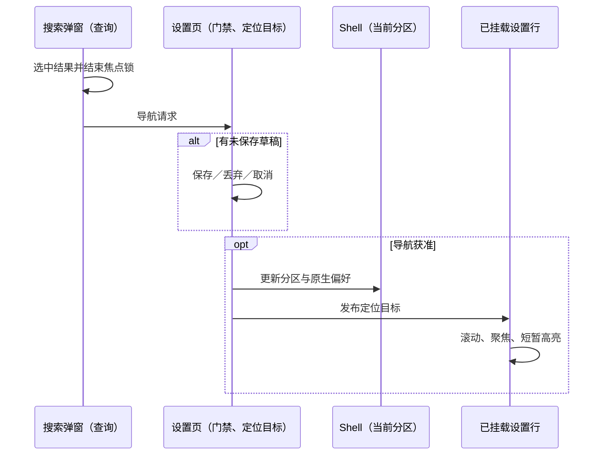
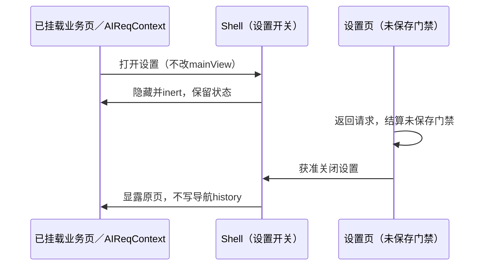
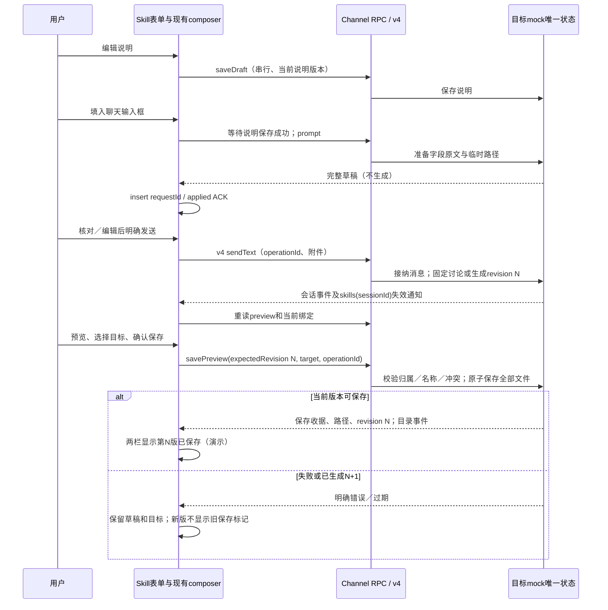
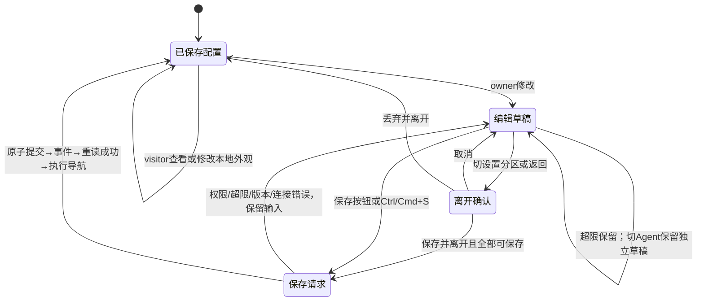
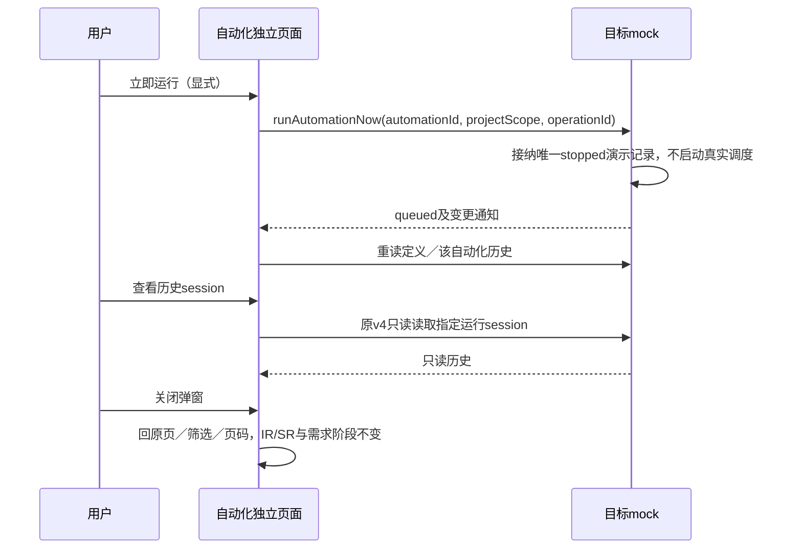

# AIReq 工具、输入辅助与设置迁移规格

状态：实现已集成，验证进行中。本文件保留 `todo.md` 第 8 节六项、第 9 节八项全部需求／场景，已按当前目标源码同步接口；不表示全部待办或浏览器门禁通过。最终权威执行证据由主集成追加至根 `todo.md`。

## 1. 权威来源与实际装配

源根 `S = F:/code2026/oh-my-pi/packages/aireq-frontend/`，下文 `U = S/packages/ui/src/`，`A = U/aireq/`。源仓库只读，不成为目标构建、运行或资源加载依赖。

直接调查依据：`todo.md:164–182`；`S/README.md` 的“设置与多人边界”“Skill 设计辅助能力”“绘图和语音输入原型”及末尾更新；`F:/code2026/oh-my-pi/openspec/specs/aireq-browser-workbench/spec.md` 的自动化、共享配置、原生附件、Skill 内容聚焦、个性化和设置离开门禁要求；下列实际页面和数据源。源 spec 旧版 version 1 描述不压过当前 `S/backend/contract.ts` 的 version 3；目标使用现有同源 `/ws` Channel RPC，不复制旧 HTTP／事件 WS／OMP 启动方式。

可达链而非文件名决定迁移范围：

- `S/app/AIReqApplication.tsx` → AIReq 主壳／Context → 工作页 Skill 设计、自动化；Skill 不在设置内，自动化不挂载需求材料栏。
- `A/AIReqSkillDesignPage.tsx` → `SessionPane`／`V4PaneConversationProvider`、可折叠分栏、表单、临时预览；`data-source.ts` → `prototype-data-source.ts` → `mock/skill-design.ts`／`mock/skills.ts`／`mock/chat.ts`。
- `A/AIReqAutomations.tsx` → `settings/AutomationsSection.tsx` → `AutomationEditView.tsx`，`onOpenSession` 只打开独立只读 Dialog。该调用没有传入 `onCreateViaChat`，所以“通过对话创建”实际回退创建表单，不能凭按钮名称恢复自由聊天。
- 自动化“工作流”Tab → `saved-workflows/SavedWorkflowsSection.tsx` → `NativeTaskRunsGate`，AIReq 分支实际是 `NativeTaskRunsSection`：只读 task/workpool 运行、父子 actor 会话和输出，不进入 `LegacySavedWorkflowsSection`。
- `U/SettingsPage.tsx` + `settings/settingsPageConfig.ts`：`general` → AIReq 项目／Release，`appearance` → `AppearanceSectionContent`，`modelProvider` → AIReq 模型，`personalization` → AIReq 个性化，`skill` → `PluginsSection(mode="skill")` → `SkillsSection`。
- Skill 列表存在 `aiReqSkills` 时 **owner 也只读**，无导入、新建、安装、启停、删除；不把通用组件内未开放分支当成产品能力。
- `v4/ConversationComposer.tsx` → `AIReqSketchButton`／`AIReqSpeechInputButton`；仅有当前可编辑输入框才装配，正式需求和只读历史无输入辅助。

## 2. 目标落点及唯一所有者

目标页面使用 AIReq 业务结构、当前 ZCode `DESIGN.md`、`components/ui`、语义 token 和 `text-ui-*`；没有旧主题、另一套通用组件、独立旧前端。以下“服务”均是目标 AIReq 浏览器安全契约下的方法族，不是新增宿主或进程。

| 状态                                                                             | 唯一所有者／范围                                                                                                          | 客户端可以持有的内容                                                              |
| -------------------------------------------------------------------------------- | ------------------------------------------------------------------------------------------------------------------------- | --------------------------------------------------------------------------------- |
| 项目、Release、平台模型配置及 revision、已保存追加指令                           | 目标 mock，单个共享模拟配置归属／全部访问工号共享；项目和 Release 用稳定 ID                                               | hooks 查询缓存和未保存设置草稿，不建 localStorage 业务镜像                        |
| Skill 说明表单、notes、会话与模型绑定、临时目录／文件 revision、模拟保存文件集合 | 单一 MockAIReqService 内存域；按 employee+client+project 绑定个人设计会话，无项目为明确 personal 范围；不是 IR/SR/Release | 表单即时编辑及待保存序列、预览投影；已接纳消息／附件仅归现有 MockRuntime v4 owner |
| Skill 未发送正文、附件、临时选模／思考意图                                       | 目标现有 composer 草稿所有者，按浏览上下文／工号／设计 session 或提案草稿隔离                                             | 同一 editor 状态；Tabs、折叠不能卸载重建或转给别的 session                        |
| Skill 模拟目录列表与保存记录                                                     | mock，项目技能为项目范围，user 为共享模拟 profile；全员设计保存例外不开放平台技能管理写权                                 | 作用域选择、查询和详情打开状态                                                    |
| 自动化定义、运行记录、task/workpool 快照／输出                                   | mock；稳定 automationId/runId，归属项目；独立于 IR/SR 和需求分析调度器                                                    | 列表／详情／筛选／历史页码、未保存编辑草稿                                        |
| 外观、字体、代码阅读偏好和独立 Skill 分栏比例                                    | 当前 ZCode 本浏览器偏好所有者                                                                                             | 允许现有偏好持久化；不能随之存业务数据或修改其他浏览器偏好                        |
| 正在绘制的画布、语音示例文字                                                     | 当前辅助输入弹层                                                                                                          | 成功回填到原 composer 后才关闭；取消不修改原草稿                                  |

工号是 `/^[a-z][0-9]{8}$/` 操作标识，保留前导零，不是认证。原型 owner 样例 `j00808874`，visitor 如 `j00808877`。后端的 owner/profile/configDirectory/userSkillsDirectory 在目标表现为明确的**模拟配置归属与模拟路径**；切换工号不切换 Token、凭据、后端账号、配置根或共享项目。

权限矩阵：全部设置对全员可查看；外观全员可改；独立 Skill 的填写／回填／显式发送／预览／确认模拟保存全员可用；项目／Release、模型、个性化写入仅 owner；技能管理当前所有人只读。自动化工作页保持源端已开放的模拟操作（源没有以 settingsWrite 限制这些操作），不误套“平台设置”只读权限。前端控件、快捷键和 mock 方法入口做同一判断；不新增真实账号、RBAC、多租户或宿主控制。

### 2.1 设置框架与离开所有权

设置页复用当前 ZCode 的 `SettingsPageParts.SettingsPageFrame/SettingsSidebarButton`，原生 SettingsPage 与 AIReq 共用侧栏宽度、窄屏图标栏、返回按钮区域、底部菜单、右侧面板及标题基线；保留原生平台条件、测试标识、帮助和面包屑。AIReq 浏览器关闭桌面窗控，仅提供外观、项目与 Release、模型设置、个性化、技能五个分区。主工作台页脚使用原生共享页脚扩展，项目与 Release 通过菜单选择，不使用常驻 HTML select 或模拟账号工具条。

Shell 唯一持有设置开关及当前分区：首次进入项目，普通齿轮记住最后选择，项目管理强制项目，输入框模型入口强制模型。子页只持有脏草稿的 pending action 和保存／丢弃／取消门禁，不另存模块级最近分区，不通过 key 重建设置绕过门禁。返回经同一门禁关闭设置，显露进入设置前仍挂载的业务页；不修改 AIReqContext 的 mainView、项目、Release、IR 或 history，不发送、不创建会话。设置覆盖整个视口；完整工作台（含业务侧栏、原生会话与 composer providers）保持挂载但隐藏且 inert，保留正文、PNG、临时选模及会话 lease。全局需求分析不受 Release 缺失门禁阻挡；提案录入与正式需求继续遵循各自项目／Release 前置条件。

最近分区复用原生 `settingsNavigation` 偏好读写，硬刷新后普通齿轮仍恢复最后接纳的分区；AIReq 的 appearance/projects/models/personalization/skills 分别映射原生 appearance/general/modelProvider/personalization/skill，其他原生分区或未知偏好回到项目。Shell 仅初始化读取，不在挂载时重写偏好；手动切分区及项目管理／模型入口的显式意图均在原有未保存门禁接纳之后更新当前分区与同一原生偏好，取消或保存失败不得修改记忆。

设置侧栏在返回按钮与分组导航之间保留 base 的“搜索设置”入口，复用现有搜索弹窗、中文／拼音模糊匹配、清空、空结果和键盘交互。搜索仅投影当前五个分区及仍保留的外观固定设置行，不恢复已裁撤的原生分区或旧平台配置项。选中分区沿用上述原生 ID 映射；外观设置行沿用稳定 searchId 的滚动、聚焦和短暂高亮。

搜索弹窗只拥有查询与打开状态，AIReqSettingsPage 拥有定位目标；Shell 仍唯一持有分区。顺序为：选择结果 → 搜索弹窗结束焦点锁 → 原有未保存门禁 → 接纳分区和定位目标 → 已挂载设置行定位。取消或保存失败保持原分区、草稿和原定位目标。验收：入口可见；搜索“字号”定位外观行；搜索“模型”进入模型设置；脏草稿搜索跳转可取消／丢弃；无匹配显示空态；Esc 先清空再关闭并恢复入口焦点。

普通侧栏分区切换获准后清空旧搜索定位；搜索命中外观行后切到模型再返回外观，不应再次滚动、聚焦或高亮旧命中。门禁取消时不清空原定位。

`aireq-ui` 通过 `settings-search` 公开入口单向依赖搜索 UI，不反向导入 AIReq 实现。

### 2.2 工作页与辅助工具显示修复

- 自动化保留独立圆角细边框内容区；shell 不在它上方额外插入 48px 空白。既有自动化面包屑及编辑离开门禁继续由原组件拥有。
- 设置返回验收：分别从需求分析、Skill 设计、自动化及正式需求打开设置再返回，仍显示原业务页；保留表单、筛选、滚动及已选对象。模型／个性化脏草稿取消返回仍停留设置，保存或丢弃后才返回原页。
- 技能作用域使用已有紧凑胶囊样式，标签仍准确表示共享模拟 profile／当前项目；无匹配时显示居中有边框空态，不保留空的“已安装技能 0”分组；只读限制不改变。
- 绘图主操作明确命名“添加附件”，不自动发送消息。颜色与粗细按钮以 `aria-pressed` 同步选中状态。尺寸手柄可聚焦并有键盘尺寸调整及操作说明，沿用鼠标调整的边界和画布保留逻辑；手柄上的键盘操作不得误触添加附件。验收包括键盘切换画笔状态、尺寸增减和焦点可见性。

## 3. 第 8 节逐项覆盖及可观察验收

表中编号顺序对应第 8 节的六个待办；子行是同项内不可丢的开放交互。

| 编号／源功能                      | 目标页面／服务                                                                          | 可观察验收                                                                                                                                                                                                                                                                                                                     |
| --------------------------------- | --------------------------------------------------------------------------------------- | ------------------------------------------------------------------------------------------------------------------------------------------------------------------------------------------------------------------------------------------------------------------------------------------------------------------------------ |
| 8.1 独立 Skill 工作页、简短空会话 | 主侧栏“自动化”下的 Skill 设计；`skillDesign.session/read`                               | 不跳设置；初始没有伪造用户消息、回复、产物；有“填写目标或直接描述”的空态；会话加载／失败明确，失败不生成文件                                                                                                                                                                                                                   |
| 8.1 说明表单                      | Skill 左栏；`AIReqSkillDesignDraft`、`skillDesign.saveDraft`                            | 保留 goal/when/inputs/outputs 四个主要字段和 boundaries/references/example 三个选填字段、notes；中文标题、placeholder、关联帮助和已填写项数保留；字段可空，不以“0/4”强制填满；选填折叠不清空                                                                                                                                   |
| 8.1 两栏、Tabs、独立滚动          | 当前 ZCode ResizablePanelGroup／Panel／Handle、Tabs、Collapsible                        | 只迁移两栏、折叠、拖动与独立滚动的功能语义，不固定源 40%/60% 或 280px/360px 几何；比例与尺寸遵循当前 ZCode 和父容器；鼠标和键盘可调，独立布局偏好；收起释放空间，展开恢复此前比例；长表单／预览分别滚动、底部动作可达，窄电脑窗口不溢出                                                                                        |
| 8.1 对话／临时文件                | Skill 右栏；`readPreview/temporaryDirectory`                                            | Tabs 均保持挂载；无文件时显示未生成并可返回对话；生成后有文件数量、文件 Select、相对文件名；不存在的旧选中文件回到当前首个文件，不能展示旧版内容                                                                                                                                                                               |
| 8.2 表单→聊天草稿                 | `skillDesign.prompt` →现有 composer 外部文本插入                                        | 先等待当前说明保存序列成功，再把全部实际字段原文及临时目录、SKILL.md 路径填入完整待发送正文；未填字段为明确未填写；保留人工编辑、原附件与模型；回填不发送，不生成文件；保存说明或生成 prompt 失败保留表单                                                                                                                      |
| 8.2 回填握手                      | composer insert requestId／applied ACK                                                  | 同时仅一个回填；编辑器未就绪不提示成功；源端 8 秒未 ACK 显示“未确认填入成功，可重试”，保留表单；旧 ACK 不确认新请求；再次回填只替换仍完整存在的上次回填片段，否则追加，已包含同一全文不重复插入                                                                                                                                |
| 8.2 显式发送与固定回复            | 现有 v4 sendText／mock Skill 回复                                                       | 人工编辑后明确发送才接纳消息；没有临时目录的首次普通讨论只记录 notes、给澄清样例，不保证马上生成；首次发送完整设计 prompt 才生成固定样例；已有 preview 后继续讨论可生成下一版。不能从表单、打开 Tab 或切页自动生成                                                                                                             |
| 8.2 全文件模拟保存                | `skillDesign.savePreview`、mock 技能目录                                                | 先预览、选目标，再“确认保存技能”；显示当前版本、所有文件数、最终目录、实际归属；一次保存包含 SKILL.md 和 references/checklist.md，不只是主文件；显示演示已保存及目录，技能列表重新读取后能看到新项；没有真实写盘／安装／执行                                                                                                   |
| 8.2 继续讨论和重生成              | 设计对话 + preview revision                                                             | “继续讨论修改”返回原对话；再次生成 revision 增加，两栏同步变为待确认保存，旧版已保存标记和旧未生成通知清除；旧保存完成响应不能把新版标为已保存                                                                                                                                                                                 |
| 8.3 摘要／完整编辑器匹配          | 当前 ChatPromptEditor 的显式可选 preview 参数                                           | 仅 `currentDraft.trim() === filledText.trim()` 且非空可显示目标摘要和“查看并编辑完整待发送内容”；展开编辑全文，编辑或追加导致不匹配立即显示完整编辑器；折叠仅隐藏不卸载，不改发送正文；发送清空后不显示旧摘要；普通提案输入不默认折叠                                                                                          |
| 8.3 Frontmatter／代码预览         | 当前 shared 分离解析工具 + MessageResponse/CodeBlock                                    | Markdown 分离 Frontmatter，紧凑显示 name/description，原始 YAML 可展开；正文不是 YAML 标题；无 Frontmatter 正常阅读；未知元数据、原始文件字节不因预览丢失；非 md 文件用 json 或 text 代码阅读，换行；不新增导出／下载／复制按钮                                                                                                |
| 8.3 路径与归属                    | preview 路径 Collapsible、保存目标 Select                                               | 临时目录和完整文件路径可展开、长路径换行；user 目标是共享模拟 profile skills/<name>/，不是当前 visitor 的“个人后端”；project 目标为有效项目 .omp/skills/<name>/；无项目仍能用 profile；无有效项目目标被禁用，不要求配置个人目录                                                                                                |
| 8.3 名称／冲突                    | mock savePreview 校验                                                                   | 推荐名符合 `^[a-z0-9]+(?:-[a-z0-9]+)*$` 且最长 64 字符；非法、目标已有同名、无 preview、错误会话／目标归属均拒绝；提示回对话调整，不提供重命名覆盖旁路；并发同名只能有一个原子成功                                                                                                                                             |
| 8.4 自动化列表与刷新／筛选        | 独立自动化工作区；listAllAutomations/listAutomations/listAutomationRuns                 | 保留全部、等待执行、执行中、已暂停、已完成、失败的状态分类及源有的空结果；启用不等于执行，须有当前 running 记录才进执行中；列表／详情状态一致；无项目／读取错误／空列表分别反馈；刷新不重置筛选                                                                                                                                |
| 8.4 新建、模板、编辑              | 复用目标自动化表单与 AIReq 模拟服务                                                     | 新建和模板预填进入可编辑表单，实际“通过对话创建”也进入表单；保留标题、指令、项目、新建目标选择／编辑归属锁定、模型、思考等级、模式及已有模式确认；必填和创建上限保留；成功保持当前筛选，提示“查看新任务／显示全部任务”；失败保留输入不假成功                                                                                   |
| 8.4 时间编辑                      | 当前 AutomationEditView/automationFormat                                                | 保留添加／移除调度、每小时／每天／工作日／每周多选／每月日期及自定义；自定义小时／日／周／月／年间隔、增减、周几／月日期、月度方式、年度月日、时间选择和可选结束日期，取消不应用；非法零间隔／非法日期不提交；无法可视化的原 cron 在未触碰时原样保留，不重写历史规则                                                           |
| 8.4 操作菜单                      | setAutomationEnabled/restartAutomation/runAutomationNow/deleteAutomation                | 保留启停、失败重启、立即运行、编辑和删除确认；取消删除无变化；busy 防连点；立即运行只登记 stopped 的模拟历史并解释“未执行模型或调度”，不假报真实成功、不新增生产定时器；错误原位／toast，删除失败不关闭编辑页或丢草稿                                                                                                          |
| 8.4 编辑离开／独立历史            | AutomationEditView 设置／历史 Tab，listAutomationRuns/deleteAutomationRun               | 保留未保存编辑离开确认；切历史／回列表不默默丢编辑；运行历史显示触发时间、触发方式、状态、耗时、失败原因、刷新及删除记录；每页 8 条，前后／页码切换，删除后夹合法页；有 sessionId 的运行可进入只读会话弹窗，关闭回原列表，不改变 IR/SR、阶段、项目选择                                                                         |
| 8.4 工作流只读样例                | NativeTaskRunsSnapshot/NativeTaskOutputContent、listNativeTaskRuns/readNativeTaskOutput | 保留工作流 Tab、刷新、task/workpool 图、父子 actor、状态／输出 chip、查看 actor 只读对话、Markdown/json/text 输出和返回列表；没有可用原会话时明确不可用，不创建需求会话解锁；无运行、输出消失和加载失败分开；不开放 LegacySavedWorkflows 的创建／启动／移动／提升                                                              |
| 8.5 提案／Skill 原生输入          | 当前 SessionPane/ConversationComposer、附件 hooks、modelSelectionService                | 保留编辑、明确发送、忙／只读状态、发送失败草稿恢复、文件选择／粘贴／拖拽、附件预览与移除、读取／上传失败；沿用当前附件 MIME／大小／最多 8 个与 v4 AttachmentRef/SHA-256 校验边界，不复制旧上传器，不恢复 Office/PDF/PPTX 产品页；附件可作为原生输入不等于恢复被裁撤预览入口                                                    |
| 8.5 临时模型／思考                | 现有模型／思考工具条、原生 Submission                                                   | 临时模型／思考／模式属于本次 Submission，不修改平台默认或 Session 默认；发送前保留草稿意图，接纳后工具条恢复 Session 默认是预期行为，不是执行丢失证据。Session 的角色绑定保留创建时配置，平台设置仅影响新会话；提交选项沿原生发送链传递，不调用真实模型。源绑定会话 setSessionModel 的拒绝语义不等同于禁止本次提交的临时选项。 |
| 8.5 材料与输入建议边界            | 目标材料阅读器／当前可编辑输入                                                          | 材料预览不改变发送目标。源 `AIReqNativeSurface.tsx:24–38` 明确两个 adapter 均未声明 native-surface，target/snapshot 始终缺席且 predictionAction 拒绝，因此预测建议当前不可达，不迁移假建议或新增预测传输；保留真实开放的正文、附件、Skill 摘要和输入辅助。                                                                     |
| 8.6 Sketch                        | 全屏应用内覆盖 + 原附件入口                                                             | 保留颜色黑红绿蓝白橡皮、细中粗笔、画布绘制、平移、缩放／100%／适应、撤销、清空、鼠标及键盘调整尺寸、添加附件与取消；添加得到完整画布PNG而非可见视窗截图，只回填原草稿；保持原文／附件／模型，不新建提案、不推进阶段；消息只接收当前同源 iframe，附件拒绝／解码失败保留画布并显示错误；关闭恢复输入焦点 |
| 8.6 语音示例                      | 输入框发送按钮左侧语音弹层                                                              | 打开演示录音→停止→示例文本可编辑→确认追加原草稿；空文本不能确认，输入不可编辑时留在弹层并保留文本；取消不改原草稿，关闭恢复焦点；不申请麦克风、不采音频、不接识别、不开真实录音服务                                                                                                                                            |

Sketch 的主操作必须同时使用目标 `--color-primary`／`--color-primary-foreground` 配对 token，深浅主题均清晰可读；不能把深色主题的白色 brand 背景与普通浅色 foreground 搭配，造成“添加附件”白字白底。
Sketch 的笔宽指示、选中边框与成功／错误提示同样使用当前 ZCode 主题语义 token；真实画笔及画布颜色保持绘图语义，不随界面主题改写。

## 4. 第 9 节逐项覆盖及可观察验收

| 编号／源功能             | 目标页面／服务                                                    | 可观察验收                                                                                                                                                                                                                                                                                                                            |
| ------------------------ | ----------------------------------------------------------------- | ------------------------------------------------------------------------------------------------------------------------------------------------------------------------------------------------------------------------------------------------------------------------------------------------------------------------------------- |
| 9.1 两组设置导航         | 当前 SettingsPage/配置 + AIReq 内容                               | 个人工具仅外观；平台配置依次项目／Release、模型、个性化、技能；保留设置返回和可见分区选择／最近设置落点；没有 Skill 设计表单、需求分析、浏览器／电脑控制、快捷键管理、子代理、插件等空分区；不加载被删除入口的服务／权限查询／事件                                                                                                    |
| 9.1 外观全部字段         | 当前 settingsCodePreview/StoreProvider                            | 跟随系统／浅色／深色、UI 字号、浅／深代码主题、显示行号、长行换行、代码字号（源12–20px）和双主题预览可用；数字输入 blur/Enter 提交、合法范围夹值，Escape 恢复，非法值不污染；使用当前目标字体范围与token，全部控件关联标签／说明，键盘可用；visitor 同样可改且不改变其他人的外观                                                      |
| 9.2 项目列表与配置       | AIReqProjectSettings、projects.saveRepository/readWorkflow        | 显示项目／Release总数、当前项目标记、名称、仓库、默认分支、每Release IR/SR/提案数量／已有需求或待规划；空项目／空Release分别有正确提示；owner可添加／修改，取消不写；只保存名称、remote URL、defaultBranch，不索要服务器目录／个人目录                                                                                                |
| 9.2 仓库／分支校验       | mock 项目写入口                                                   | 名称／仓库／分支非空；支持含主机的HTTP(S)/SSH/git URL和 user@host:path SCP，拒绝本地路径／缺主机URL；保留源 `savePrototypeRepository` 分支语法约束（空白、..、@{、非法特殊符、前导-或/、尾/或.或.lock、//、单独@、点开头路径段）；错误保留弹窗值，成功只表明内存保存、连接／分支未检查，无Git探测                                     |
| 9.2 Release创建          | createRelease、项目／Release共享状态                              | 可选所属项目并即时展示继承仓库／分支，Release名称trim、同项目忽略大小写重名拒绝；取消不写；成功分配稳定releaseId并更新计数；不单独配仓库、不建Git分支、重复提交不重复记录                                                                                                                                                             |
| 9.3 角色配置             | AIReqAgentModelSettings、models.read/save/revision/bindingChanged | 保留默认模型和每角色 inherit、显示继承模型及有效配置、思考 default/low/medium/high、模型名/供应商、保存／取消／错误；九个当前角色为 requirements、requirements-review-a/b/c、requirements-review（综合）、solution、progress-analysis、issue-analysis、skill-design；不开放 planning/execution/ir-acceptance；不新增供应商API Key设置 |
| 9.3 模型快照             | AIReqAgentModelBinding + 模拟session／analysis run                | 保存只影响后续创建；历史保留role、modelKey/name/providerId/modelId、reasoning、inherited、configurationRevision；跟随默认解析一次，不动态改历史；Skill工具条读取同一份绑定。取消恢复保存值；保存失败不更新基线，不离开                                                                                                                |
| 9.4 用户追加指令         | AIReqPersonalizationSettings、prompts.read/updateDraft/save       | Agent可切换，各自草稿不互覆盖；初始追加值为空，内置／样例职责不填入；清空保存只清用户追加；textarea、字节计数、超限agent列表、保存／取消／反馈保留；保存读取最新输入而非离开确认时旧闭包；长文本连续输入不递归更新                                                                                                                    |
| 9.4 UTF-8边界            | 当前 shared USER_INSTRUCTIONS_MAX_BYTES + mock 校验               | 每角色最多102400字节，等号可保存；中文／emoji按UTF-8而非JS长度；任一角色超限则保留全部草稿并禁普通保存、Ctrl/Cmd+S、保存并离开；缩短恢复；直接RPC同样拒绝，原保存值不变，不仅禁UI                                                                                                                                                     |
| 9.5 未保存导航门禁       | 设置主壳统一 pendingNavigation／最新draft actions                 | 模型／个性化切分区、返回工作区和所有设置导航均经“保存更改？”紧凑Dialog（max-w-md，448px）；取消停留并保留草稿；丢弃恢复全部已保存值后离开；保存成功才执行原导航，失败显示原因且留在原分区；pending中防重复，快捷键不能绕过权限／大小；不能因删除页内“未保存”文案而删除门禁                                                            |
| 9.6 技能管理实际开放能力 | 当前技能目录阅读控件、skills.list                                 | 保留共享profile／项目作用域切换、搜索／清空、匹配数量、分组、刷新、状态／路径、详情开关与键盘打开、完整正文／描述／元信息、诊断展开（返回诊断时）、加载／错误重试／空列表／空搜索；详情关闭回原触发焦点；模拟路径不能打开本机文件；owner与visitor均只读，无安装、启停、删除、导入或通用创建Skill入口                                  |
| 9.7 owner/visitor一致性  | mock 请求身份和capabilities；所有写入口                           | visitor能查全部页、切agent/范围、搜索／筛选／复制；不能编辑平台草稿、保存、Ctrl/Cmd+S或RPC越权；owner也不能通过技能列表执行源未支持操作；visitor独立Skill设计仍可保存模拟产物；权限变化时脏配置不自动提交、不静默授予写权                                                                                                             |
| 9.8 模拟配置归属         | backend模拟归属视图 + AIReqPersonalConfigScope                    | 明示共享模拟配置的owner和scope，项目技能和共享profile路径各自准确；切工号后仍同一模型／提示词／项目／Release／技能目录，不要求启动OMP、设置个人开发目录或切配置根；浏览器草稿、外观和连接独立，不错把共享业务按工号复制                                                                                                               |

设置门禁仅由主壳持有一个 pending 导航；确认弹窗打开时 Ctrl/Cmd+S 与“保存并离开”共用最新草稿、同一忙态、权限／大小检查及错误结算，成功最多执行一次原导航。没有 pending 导航的普通快捷保存仅保存留页；失败保留原输入及错误。

## 5. 接口、事件、版本与幂等

保留源领域类型 `AIReqSkillDesignDraft`、`AIReqSkillDesignPreview {name,directory,revision,files:[{path,content}]}`、`AIReqAgentModelSettings`、`AIReqAgentModelBinding`、`AIReqProject`、`AIReqRelease`；沿用当前共享 `SkillSummary/SkillsListResult`、`ZCodeAutomation/ZCodeAutomationRun/ZCodeAutomationScheduleRule`、`NativeTaskRunsSnapshot/NativeTaskOutputContent`、`ModelSelection` 和 v4 附件类型。不以通用 `{title,status}` 重造缩水产品。历史停用角色不进入新可写schema，但历史快照可阅读。

### 5.1 源方法到目标契约方法族

| 源精确调用                                                                                                                                                      | 目标保留含义／参数及结果                                                                           | 事件与边界                                                                                                                                    |
| --------------------------------------------------------------------------------------------------------------------------------------------------------------- | -------------------------------------------------------------------------------------------------- | --------------------------------------------------------------------------------------------------------------------------------------------- |
| projects.saveRepository(input)；readWorkflow(selection)；command(createRelease,selection,revision)                                                              | 保存项目（可选projectId,name,repositoryUrl,defaultBranch），读取统计、创建Release(projectId,title) | 提交后更新project revision／共享workflow revision，再通知重读；创建返回稳定ID，不通过名称代替归属                                             |
| models.read/save/revision/bindingChanged(binding)；models.samples                                                                                               | 当前 wire 保留这些方法，save(settings,expectedRevision)；读取／保存、比较绑定与只读样例            | `models` 通知，提交递增 revision；没有可见“恢复演示配置”按钮，samples 不是写旁路                                                              |
| prompts.read/updateDraft/save(Record<agentId,string>)                                                                                                           | 当前 wire 仅 read 与 save(value,expectedRevision)；updateDraft 为 UI 本地编辑适配                  | 保存原子校验全部角色／100KiB和版本；不广播未保存草稿，失败保留当前编辑                                                                        |
| skillDesign.session(projectId)/workspaceIdentity(projectId)/binding(sessionId)                                                                                  | 解析设计session及模拟归属；创建时模型绑定                                                          | 保留稳定sessionId，不与IR/SR绑定，不用visitor号替换共享归属；读取不生成回复                                                                   |
| skillDesign.read/saveDraft(sessionId,draft)/prompt(sessionId,draft)/temporaryDirectory(sessionId)                                                               | 读取说明、串行保存说明、准备完整prompt、读取临时路径                                               | prompt不生成产物；表单本地版本防止订阅重读覆盖正在编辑值                                                                                      |
| skillDesign.readPreview(sessionId)/listSkills(workspacePath)/savePreview(sessionId,workspacePath,name,target)                                                   | 查询当前产物／冲突目录、显式保存project或user全文件                                                | 源 `skills {sessionId}` 通知；目标保存附带expectedPreviewRevision和operationId，保存返回路径／revision／receipt，避免源参数缺版本导致保存错版 |
| skills.list({workspacePath,workspaceIdentity,provider,...})                                                                                                     | 读取目录、能力与诊断结果，按profile/project显示                                                    | 不提供当前未支持的目录写方法；设计保存后通知目录失效重读                                                                                      |
| zcodeAgentService.listAutomations/listAllAutomations/createAutomation/updateAutomation/deleteAutomation/setAutomationEnabled/restartAutomation/runAutomationNow | 使用既有共享自动化输入／结果语义；由目标mock持有模拟定义和记录                                     | 支持更新／历史重读通知；不引入真实scheduler；runNow返回queued只代表接纳演示记录，不是模型正在执行                                             |
| zcodeAgentService.listAutomationRuns/deleteAutomationRun                                                                                                        | 指定automationId/workspace范围历史；删除精确runId                                                  | 不删除需求会话或IR/SR；失败保留页面                                                                                                           |
| listNativeTaskRuns({scope,sessionId})/readNativeTaskOutput({scope,sessionId,runId,outputId})                                                                    | 只读运行及按需单份输出                                                                             | 有声明才订阅onNativeTaskRunsChanged，快照revision防过期；actor只读走当前v4会话读取                                                            |
| 现有v4 sendText/附件/模型选择                                                                                                                                   | 只有实际session交互复用v4；普通业务配置不包装为v4帧                                                | subscriptionId/seq/logEpoch全部由现有服务生成及schema校验，不伪造                                                                             |

独立自动化工作页必须复用现有 `AutomationsMainBreadcrumbFrame`：编辑器的 `SettingsBreadcrumbReporter` 需要同一 Provider 和可见面包屑才能返回列表。返回操作消费编辑器既有未保存确认，不以切换其他工作页丢弃草稿来代替。

AIReq 新入口继续挂载目标现有 `ConfirmDialogHost`／`AlertDialogHost`，使自动化返回、删除和原生输入确认等 Promise 弹层可见并由用户结算。不能只留下 store 请求而移除渲染宿主，也不为此恢复旧 Root 的产品入口或插件后台宿主。

### 5.2 当前目标会话组件的最小可选集成接口

当前已在 `SessionPane/ConversationComposer` 接入可选业务无关端口，由 `packages/ui/src/aireq/conversation/AIReqSessionPane.tsx` 包装，props 复用当前 `SessionPaneProps`；不复制源大组件，不新增草稿／消息 owner。实际接口包含 `conversationExtension`、`embedded`、`composerPlaceholder/composerAriaLabel/conversationEmptyState`、`externalTextInsertRequest/onExternalTextInsertApplied`、`composerInputPreview/onInputPreview`、`composerTools/composerTrailingTools`。未传业务接口时底层行为不变；精确首发结算见 `conversation.md`。

| 当前接口／需求语义                                                                             | 接线与所有权／验收                                                                                                                                                                                                                                                                                                                                                                                                                                                                       |
| ---------------------------------------------------------------------------------------------- | ---------------------------------------------------------------------------------------------------------------------------------------------------------------------------------------------------------------------------------------------------------------------------------------------------------------------------------------------------------------------------------------------------------------------------------------------------------------------------------------- |
| `composerPlaceholder/composerAriaLabel/conversationEmptyState`                                 | 向当前 composer 透传业务展示，Skill 名称为“技能设计对话输入”；通用组件不导入 AIReq store                                                                                                                                                                                                                                                                                                                                                                                                 |
| `externalTextInsertRequest` + `onExternalTextInsertApplied`                                    | 只对就绪且可写的原scope执行，request含唯一requestId和text／mode／可选replaceText，scope由包装绑定；复用现有editor句柄／draft更新，一次request至多应用一次，ACK后才显示成功；append保留人工内容，replaceText只替换完整未改片段；切scope失效，不写到新项目                                                                                                                                                                                                                                 |
| `composerInputPreview` 与 `onInputPreview({text})`                                             | 可选摘要意图与 canonical 完整草稿反馈；非空全文 trim 精确匹配才折叠，原 editor 持续挂载，编辑／发送清空立即同步；不用摘要作提交正文                                                                                                                                                                                                                                                                                                                                                      |
| `composerTools/composerTrailingTools(port)`，port 为 `appendText/addFiles/disabled/focusInput` | 原生附件 hooks 返回实际接纳结果，appendText 返回是否插入；Sketch 在模型前，语音在发送前；业务包装持有弹层并恢复焦点，不改草稿数据库                                                                                                                                                                                                                                                                                                                                                      |
| 当前草稿配置／本次提交选项                                                                     | 复用目标 draftConfig/modelSelection/思考等级／模式及原生 Submission；临时选项只作用本次提交，不提升为 Session 默认或持久覆盖。配置只读／初始化未就绪时禁提交；接纳后工具条恢复 Session 默认不构成提交选项丢失证据。mock 提交字段传递修正的运行验证以根 `todo.md` 为准，不从工具条标签推断执行配置。                                                                                                                                                                                      |
| 提案首次发送（同一原生 owner）                                                                 | `conversationExtension.prepareFirstSend(text,options,preparedSessionId)` 将已有原生预热 ID 传给 `createProposal.preparedSessionId`，校验 actor/workspace 后返回同一 ID，不创建第二 native session。原 Composer 在 dispatch 前登记结算回调，accepted/duplicate ACK 或权威接纳帧授权唯一结算，adopt 附件与结算草稿后提升 binding 并发布选择。主集成已实测完整 PNG 首发与两个独立首发自动导航，以及拒绝后保留正文／PNG、显式双击重试仅接纳一次；未知 ACK 等其余失败合同仍保留，不自动重发。 |
| history/readOnly                                                                               | 自动化历史与actor会话沿用当前readOnly参数；不装辅助输入，不允许快捷发送／模型写入；关闭只更新弹层选择，不调用AIReq选择／阶段命令                                                                                                                                                                                                                                                                                                                                                         |

首发必须遵守现有 composer draft revision／scope 和附件事务；不复制正文后清空、不另建 accepted queue，不在 ACK 前后中途切换组件／草稿 scope。预热本身不创建提案，已接纳收据不能重新首发。Skill 已有独立 session，不经过提案创建；辅助回填不触发发送。普通业务走 AIReq 服务，只有真正会话帧走 v4。

目标变更版本规则：项目／配置写入带期望版本；版本冲突拒绝且保留草稿，显示需要重读，不无条件覆盖另一客户端新值。Skill确认绑定 `sessionId + previewRevision + target + file集合摘要`，模拟服务按当前产物原子核验，拒绝旧版确认／超出目标相对路径／同名覆盖；显示版本和保存收据取同一事实。临时文件可读不等于已经保存。纯读取／切Tab／折叠／浏览历史均不得递增产物版本。

写请求采用主契约统一 operationId/收据：项目和Release创建、首次消息／后续发送、Skill保存、自动化创建及立即运行同一逻辑动作重试只接纳一次；同operationId不同payload拒绝。表单保存／配置保存相同有效值不重复制造业务副作用。删除记录重复请求返回已删除事实，不误删其他对象。未知结果（断线发生于提交后）重连先查询收据／当前状态，不自动重发。新点击“立即运行”是新显式演示记录，不冒充后台实际执行。

服务发布顺序：完整校验身份／权限／ID归属／版本／格式 → 原子提交状态及收据 → 发变更事件 → UI按当前key重读。事件不是新状态所有者；客户端按backend／项目／session和查询代次丢弃乱序响应，不能让旧scope响应覆盖新选择。缺必需能力、服务清单不匹配、连接失败直接报错；无mock兜底或旧协议重试。

## 6. 冲突裁决与失败边界

1. **源部署条款不是目标部署要求**：舍弃 OMP CLI、SQLite路径、独立后端和旧HTTP合同；业务由当前目标mock经Channel提供，所有路径是模拟标签，不宣称宿主文件存在。
2. **项目有效性不依赖旧个人开发目录**：源Skill设计使用 `readDevelopmentRoot(projectId, backend.owner)`，仅部分预置项目有值，错误文案仍要求配置开发项目；与todo的项目仅仓库配置冲突。目标由mock为有效业务项目提供明确的模拟托管技能根，不新增目录表单，也不复用旧VirtualProject。无项目仍能保存共享profile；不存在项目／无效目标拒绝。
3. **“个人profile”不能误导**：target枚举`user`可沿用，但显示共享模拟profile归属owner，不能写成visitor个人后端；不以工号复制配置或数据。
4. **生成回复不是每次首发必产物**：源 `prototypeSkillDesignReply` 首次不含临时目录只补充notes与讨论；完整prompt或已有preview的后续消息才生成固定文件。保留可达澄清行为，不硬改成每次发送自动生成。
5. **源重生成同名限制保留**：固定样例推荐同名时，之前保存目录仍存在，下一版不能覆盖；明确报冲突并允许继续讨论／换另一个无冲突的目标，不伪造不同名称以掩盖样例局限。
6. **源保存缺expected revision／持久保存标记**：目标收据及版本校验补齐todo要求，读取保存事实不依赖页面`savedPath`局部状态；保存失败、切页／重连不变成成功，也不让旧请求确认新文件。Frontmatter预览不规范化／重写待保存原文。
7. **设置owner权限不是设计权限**：Skill设计全员例外与技能目录全员只读并存；自动化是独立业务页，不扩成平台配置管理，也不扩成真实引擎。所有UI可达模拟操作必须有真实内存变化。
8. **源提示词后端仅做owner检查，未做100KiB终检**：目标同时在UI和mock强制字节限制，直调接口超限也拒绝；源全局prompt草稿不扩为访问者共享可写草稿，未保存内容属于编辑上下文。
9. **临时选模不等于改 Session 默认**：原生临时模型／思考／模式属于 Submission，不能依据接纳后工具条恢复 Session 默认判定覆盖缺陷，也不能为此改写 Session 默认或持久化临时覆盖。源 `mock/settings.ts` 拒绝绑定会话 setSessionModel 是历史接口边界，不取代当前原生提交语义；平台角色设置仍只应用新会话／分析记录。mock 提交字段传递的最新修正不在本文预报运行通过，结论以根 `todo.md` 为准。
10. **自动化工作流Tab实际只读**：保留NativeTaskRuns实际分支，绝不搬入未开放LegacySavedWorkflows执行链。源无会话时的不可用态保留，不通过创建需求或修改IR/SR换取样例图。
11. **源说明与按钮文字差异**：旧spec“准备设计对话”对应当前按钮“填入聊天输入框”；保留当前可达文字／动作语义。源Skill顶部模型摘要的历史截图已被后续内容聚焦条款淘汰，不搬三步流程、模型摘要和冗余平台权限卡；模拟身份在结果／归属等必要处真实说明，不冒充真实生成。
12. **通用资产不等于产品入口**：附件底层支持格式不恢复Office/PDF/PPTX产品页；Sketch只从composer打开，不恢复通用白板。外观使用目标现有主题，不对齐源3.18颜色或上游/base。

通用失败边界：首次读取显示加载，缺失内容与加载错误分开；有旧数据的后台刷新保留阅读位置并显示固定错误反馈、可重试。非法ID／跨项目session／目录碰撞／外部路径／过期version／越权／超限／附件失败均返回明确错误，原输入、当前目标与未保存草稿保留；不得用固定样例覆盖失败。释放订阅只影响连接，不取消mock已接纳动作；刷新／关页／断线不清共享业务、生成文件、保存记录或演示运行，mock重启才恢复初始样例。

## 7. 精确源依赖与建议迁移闭包

以下源清单保留为历史调查与迁移依据，不是尚未实现声明。当前业务 UI 已落在 `packages/ui/src/aireq/tools/`、`settings/`，data-source／AIReqContext 在根，remote adapter 在 shell；服务合同／纯派生统一在 `packages/services/src/aireq/`。UI 通过根 canonical `contract.ts` 具名消费 `@zcode/services/aireq`，页面不直接导入 services；模拟实现在 `packages/server/src/aireq/`。aireq-contract、aireq-ui、aireq-mock 已登记，UI 明确 contract/ui 层，不新增 types/domain 兼容别名或跨包深导入，源码遵守默认800行约束。

| 闭包                   | 精确源文件（相对S，A/U按第1节展开）                                                                                                                                                                                                                            | 目标处理                                                                                                                                                                                                            |
| ---------------------- | -------------------------------------------------------------------------------------------------------------------------------------------------------------------------------------------------------------------------------------------------------------- | ------------------------------------------------------------------------------------------------------------------------------------------------------------------------------------------------------------------- |
| Skill设计业务UI        | `A/AIReqSkillDesignPage.tsx`、`AIReqSkillFilePreview.tsx`、`AIReqMarkdownDocument.tsx`、`skill-design-fields.ts`、`skill-design-prompt.md`                                                                                                                     | 迁移字段、交互、内容及版本语义；改接目标services/hooks、现有composer和布局，不原样搬remote workspace注册实现                                                                                                        |
| 设置业务UI             | `A/AIReqAgentModelSettings.tsx`、`AIReqPersonalizationSettings.tsx`、`AIReqPersonalConfigScope.tsx`、`AIReqProjectSettings.tsx`                                                                                                                                | 迁移AIReq表单和草稿门禁接口；SettingsPage/config仅在目标必要接线，不复制源整页、旧宿主分支                                                                                                                          |
| 自动化与辅助输入业务UI | `A/AIReqAutomations.tsx`、`AIReqSketchButton.tsx`、`AIReqSpeechInputButton.tsx`、`sketch.html`                                                                                                                                                                 | 迁移独立包装和示例语音；Sketch绘图逻辑／完整PNG导出可选取迁移，但工具条／弹层必须适配目标控件／主题，不带源全局CSS。`AIReqNativePredictions`／`AIReqNativeSurface` 的预测传输当前不可达，不迁移另一执行器或假建议。 |
| 领域和接口来源         | `A/types.ts`（本文列出的类型）、`data-source.ts`（本文方法族）、`identity.ts`、`S/backend/contract.ts`、`S/client/remote-data-source.ts`                                                                                                                       | 仅抽取实际方法、结果、错误、事件及类型语义；目标descriptor/channel/accessor代理集中装配，不搬HTTP客户端、bootstrap、transport或第二服务进程                                                                         |
| Skill服务及静态产物    | `A/mock/skill-design.ts`、`mock/skills.ts`、`mock/skill-design-generated.md`、`mock/skill-design-checklist.md`、`mock/skill-design-chat.md`、`mock/skill-design-discussion.md`、`mock/skills-detail.md`、`skill-design-prompt.md`                              | 改为目标server mock内存域和打包静态材料；保留全部文件集合、原文、临时路径、revision、notes和冲突校验；源`mock`目录不进入UI依赖图                                                                                    |
| 配置／项目服务依赖     | `A/mock/agent-models.ts`、`mock/personalization.ts`、`mock/project-settings.ts`、`mock/project-releases.ts`（Release来源由源workflow装配）、`mock/backend.ts`、`mock/events.ts`；项目历史目录依赖`mock/project-directories.ts`／`mock/recovery.ts`仅作裁决依据 | 选择模型清单／当前角色、权限、项目校验与Release创建逻辑；去除停用角色写入口和真实宿主概念；不搬旧目录配置恢复流程；事件改目标事件基础设施                                                                           |
| 自动化模拟服务与材料   | `A/mock/automations.ts`、`mock/automation-output.md`、`mock/prompts/automation-review.md`、`mock/prompts/automation-summary.md`；模拟会话读取／回复参考`mock/chat.ts`，模型投影参考`mock/settings.ts`／`mock/model-settings.ts`                                | 只迁移自动化定义／历史CRUD、stopped演示接纳、task/workpool快照／输出及需要的v4会话样例；绝不把整个chat/settings工作流模拟服务及已退役编码链搬入                                                                     |
| 全局装配参考           | `S/app/AIReqApplication.tsx`、`A/AIReqContext.tsx`、`AIReqWorkbench.tsx`、`AIReqSidebar.tsx`、`S/backend/prototype-data-source.ts`、`mock-services.ts`；`U/SettingsPage.tsx`、`settings/settingsPageConfig.ts`                                                 | 主集成负责必要业务导航与mock注册；本文件不要求整文件替换，也不为保留接口复制已裁撤能力                                                                                                                              |

当前接线：工具模块使用 `AutomationWorkflows`／`NativeTaskRunsGate`，经 `AIReqDataSource.nativeTasks` → `nativeTasks.listRuns/readOutput` 读取只读 task/workpool 图、actor 与输出，actor 会话复用当前 v4。仅从当前项目已有自动化运行记录选择历史，无历史明确不可用，不借需求会话或创建会话解锁；未复制源 NativeTaskRunsSection／Legacy 工作流引擎。

通用 `AutomationsSection` 已有可选 `scheduledOnly/nativeWorkflowContent/projectOptions/runNowNotice`；AIReq 传 scheduledOnly，禁闲时入口／资格查询／旧 workflow 中枢，主集成实际页面已确认无 host keep-awake 提示。工具包装采用当前业务项目权威 workspace root 与 `aireq-mock` identity，表单有 projectOptions 时不读 VirtualProject，不写旧项目／tab store；其他调用方默认行为保持原样。CRUD、暂停／继续、stopped 模拟运行、只读历史／actor 和真实 JSON／text CodeViewer 已观察，不代表生产自动化引擎或真实模型执行。

### 通用依赖复用映射（源库不得复制）

| 源通用依赖                                                                                                                                                                                                                                                                            | 目标复用／必要业务适配                                                                                                                                                                                          |
| ------------------------------------------------------------------------------------------------------------------------------------------------------------------------------------------------------------------------------------------------------------------------------------- | --------------------------------------------------------------------------------------------------------------------------------------------------------------------------------------------------------------- |
| `components/ui/{button,input,label,textarea,select,tabs,collapsible,dialog,resizable,badge,switch,popover,dropdown-menu,scroll-area,tooltip,spinner}`                                                                                                                                 | 当前目标对应控件，所有`components/ui`资产保留；不复制旧版实现或CSS                                                                                                                                              |
| `settings/SettingsPageParts.tsx`、`SettingsFormTextarea.tsx`、`SettingsFormActions.tsx`、`AutomationsMainBreadcrumbFrame.tsx`、`settingsCodePreview.tsx`                                                                                                                              | 当前目标组件／外观实现；仅补业务配置分组、标签与离开门禁                                                                                                                                                        |
| `settings/{AutomationsSection,AutomationEditView,AutomationInstructionsComposer,AutomationDesignPrimitives,AutomationScheduleBadge,AutomationScheduledTemplateIcon,AutomationTemplateSkeletonGrid}.tsx`                                                                               | 复用目标版本并接AIReq模拟服务／项目选项，不复制整套源自动化UI                                                                                                                                                   |
| `settings/{automationFormat,automationCardSchedule,automationEditValidation,automationEditDirtyState,automationEditLocalizedTitle,automationAgentConfigOptions,automationWorkspaceOptions,automationTemplateCatalog,useAutomationTemplates}.ts`、`store/automationManagementStore.ts` | 沿用目标格式化、调度编辑和读缓存；状态筛选常量与纯派生收口已有 automationFormat，保留默认四组及 AIReq scheduledOnly 六态，不保留平行 helper／转发；不建立第二自动化 store；源模板实际已开放的表单预填语义不能丢 |
| `settings/saved-workflows/{NativeTaskRunsSection,NativeTaskRunGraph,AutomationsPageTitleSwitch,SavedWorkflowsSection}.tsx`                                                                                                                                                            | 复用目标图／阅读部分，显式选择AIReq只读mock路径；不用迁移Legacy工作流写入／运行链和全部同目录文件                                                                                                               |
| `settings/{PluginsSection,SkillsSection,PluginScopeMenu,SettingsSearchInput,SettingsResourceHeaderActions,SettingsResourceGroup,SettingsResourceGroupHeader,PluginInstallEmptyState}.tsx`                                                                                             | 用当前控件与列表阅读能力承载AIReq目录；scope映射模拟profile/project，不装配市场安装、Native依赖、宿主文件打开或真实目录扫描                                                                                     |
| `v4/SessionPane.tsx`、`V4ConversationContext.tsx`、`ConversationComposer.tsx`、`prompt-editor/ChatPromptEditor.tsx`、现有draft/附件hooks、`lib/chatAttachments.ts`                                                                                                                    | 继续当前v4渲染和草稿所有权，若目标缺摘要可选参数则最小补参数，非fork旧composer；保留当前校验、附件预览／移除／错误和SHA-256协议                                                                                 |
| `components/ai-elements/{message,code-block}.tsx`；shared `splitMarkdownFrontmatter/parseAgentFrontmatter`、`USER_INSTRUCTIONS_MAX_BYTES`、UUID／复制工具                                                                                                                             | 全部复用当前目标公开导出；`packages/shared/src/subagent-profile-frontmatter.ts`、`userInstructions.ts`已有对应能力，无需重造解析器、哈希或旧预览库                                                              |
| `lib/workspaceServiceProjection.ts`、`store/remoteWorkspaceSessionStore.ts`、`hooks/useServices.ts`                                                                                                                                                                                   | 目标现有服务／会话归属机制接线；由会话集成所有者处理，不能从设计页面创建新Host、目录workspace或第二session store                                                                                                |

不迁移源 `build/node_modules`、旧主题／图标库、发行嵌入资源、源绝对路径和完整通用UI包；不保留退役设置菜单、旧自由聊天和真实技能安装旁路。静态产物必须在目标源码闭包中，运行时不读源仓库。

### 原生输入与模型设置接线的回归约束

- Skill 表单回填 ACK 必须对应仍保留在原编辑器中的完整正文；摘要对象、辅助回调或 Tabs 切换不能触发原生草稿恢复并用旧空值覆盖刚插入的内容。草稿恢复只随真实 owner／scope 切换发生，预览只是派生展示，不是恢复触发器。
- 提案与 Skill 输入中的“管理模型”通过显式可选导航回调进入 AIReq 的“模型”设置，不打开退役 Tab 产品、不设置无人消费的旧设置 intent。未提供回调的通用消费者保持既有导航行为。
- 模型设置由 AIReq 壳持有，沿用当前未保存离开门禁。打开／关闭设置不卸载当前工作页和原生草稿所有者，隐藏工作页不得继续抢焦点或消费输入快捷键；返回后正文、附件、临时模型和分栏保持。
- 原生选模目录按 AIReq 的真实供应商名称提供离线候选，不继承底座样例的 Z.ai 模板、Start Plan 权益、账号访问或图标事实。它只是无凭据的模拟目录，不表示账号登录、套餐开通或真实模型连接。

## 8. 主集成已观察证据与验收边界

以下为主集成实际观察子集，不把实现清单或第 3／4 节验收合同自动标为已测。最终命令结果、全页主题和精确断线重连证据及 todo 判定均以根 `todo.md` 权威记录为准；本文不运行检查、不勾选待办。

- Chrome（精确终验版本见根 `todo.md`）、1440×1000 与 1122×763 下八工作页／五设置页已有截图，正常浏览器 console entries 0／errors 0；深色和 visitor 独立浅色已观察，不作 Firefox 声明。最终系统主题／全页覆盖不由这些局部证据外推。
- visitor Skill 四主字段准备只回填、不发送／生成；完整 canonical 正文、摘要／全文、人工补文、Tabs、左栏折叠保留。明确发送生成 v2 两文件，Frontmatter／正文分离，references/checklist 和完整路径可读；project 显式保存全部两文件且无重复保存。v3 使旧确认失效，同目标同名被拒且不覆盖，切共享模拟 profile 后显式保存 v3 两文件；owner／visitor 共享目录、作用域和只读详情均正确。
- 最新 owner Skill 1440×889 PNG 经左栏折叠、预览 Tabs 和重开仍完整保留；四字段及 canonical 全文准确，预览仍为“尚未生成”。人工追加后改表单并再次准备，人工追加、更新字段和 PNG 均保留。这不扩大为所有附件／并发失败变体已测。
- 原生完整 PNG 首发和两个独立首发自动打开 accepted 提案及 canonical 回复／材料。发送拒绝保留正文与完整 1280×788 PNG、侧栏无提案；显式双击重试只接纳一次。“管理模型”打开时原工作页隐藏且 inert，返回保留正文、PNG 与临时 GPT／medium，未自动发送。
- 自动化实际完成创建／编辑／删除、筛选、暂停／继续；项目 workspace root 与 `aireq-mock` identity 一致。脏编辑 Cancel／Discard、局部面包屑与通用 Confirm／Alert 宿主均可用。Run 只登记 stopped 演示历史，More“跳到会话”为独立只读弹窗且无编辑器；工作流 task/workpool 与 actor 只读，JSON／text 输出经真实 CodeViewer 截图确认，失败卡 Restart 后移除失败徽标。没有实际引擎执行。
- 主集成稳定 operationId 的克隆请求探针确认自动化 create/run/restart/delete 重试不重复，同 ID 改 payload 拒绝，独立点击 ID 不同，错误 scope 拒绝，visitor 读取同一共享数据。它是所列服务操作证据，不替代全部并发／未知结果合同。
- 九角色默认继承、模型保存／取消已观察：新会话继承 Opus／low，旧 seed GPT／high 不变。原生临时模型／思考／模式按 Submission 使用；接纳后工具条恢复 Session 默认正常，不声称持久覆盖缺陷或修复快照。mock 最新提交字段传递修正的运行结论由根记录给出。
- 个性化精确 100KiB ASCII／UTF-8 可保存，超限中文及 Ctrl+Enter 被拒，各 Agent 草稿隔离；真实另一客户端版本冲突使保存并离开失败且留页，丢弃加载服务器新值；visitor 有效 RPC 保存被拒且 revision 不变。第 9 节八项设置的已观察结果由主集成记录，不推导全部底层反例均已单测。
- Sketch 完整 PNG 仅回填不发送，取消保留原草稿；语音停止后追加可编辑示例文本，保留既有草稿／PNG，不采音频。连接会话读取失败后点击“重新连接”恢复同一 session 编辑器，console 0；这一读取重试不冒充专门的真实 WS 关闭／重连证明。

第 3／4 节所有业务验收及第 6 节失败边界继续有效，包括未在上述子集中逐一展示的并发、过期、权限、格式、附件和未知结果场景。工程历史结果与最终门禁严格分开；最终检查命令、主题、连接结论统一查根 `todo.md`，不在本文件保留会过期的待验证清单或预报全部通过。

## 10. 工具与设置的原版功能及原生设计语言终验

- Skill 设计：保留原版表单顺序、说明折叠、对话／文件标签、输入辅助、准备／明确发送、预览与显式模拟保存；分栏尺寸与显示以当前 ZCode 为准，折叠展开及设置往返保持用户偏好和草稿。
- 自动化／工作流：保留原版列表、筛选、面包屑、创建编辑、运行记录、输出与只读会话的业务操作及顺序；控件、布局与标题沿用当前 ZCode，不按源几何重建；仍不启动真实执行引擎。
- 五项设置：外观、项目／Release、九角色模型、个性化、技能按原版功能与控件清单逐项核对；完整窗口、导航、标题、内容框和控件必须使用当前 ZCode 同一设计语言，而非并排再造简化设置页。
- 所有颜色来自当前 ZCode token，字体和通用控件复用当前实现；不复制源 CSS 或旧组件库。原生输入、附件、保存离开门禁、设置分区记忆及权限合同不因视觉保真修正改变。
- 最终由主代理逐页实际点击并查看目标截图，验证折叠、调整分栏后保持和设置往返；原版仅核对功能，不比较坐标、固定比例或布局几何，不能以页面存在或控制台没有报错替代产品验收。
- 工作流 Tab 与独立自动化历史不是同一个入口：前者按原版只读消费当前已经存在的 canonical 业务会话，不增加源页面没有的历史会话选择器和第二个刷新按钮；无可用会话明确不可用，绝不为解锁图而新建、改绑或发送需求会话。自动化运行历史及其只读弹窗继续保持独立，不改变 IR／SR。
- 自动化现有 `scheduledOnly` 入口按源提供全部、已启用·等待执行、执行中、已暂停、已完成、失败六类筛选；没有在途运行的启用任务不能标成执行中，不显示源没有的任务类型条。复用现有列表和编辑器，标题使用当前 ZCode 普通工作区 `text-ui-*` 角色，不使用设置页大标题或源 x/y 坐标基准。
- 自动化卡片仅在卡片自身获得焦点时响应 Enter／Space 打开编辑；内部“更多”按钮的键盘事件不得冒泡触发卡片导航。更多按钮在键盘聚焦时必须可见并呈现清晰的 focus-visible ring。
- `scheduledOnly` 列表与编辑页必须复用同一运行记录派生与状态标签：active／enabled 但无 running 记录显示“已启用 · 等待执行”，存在 running 记录才显示“执行中”；暂停、完成和失败保持各自状态，默认旧入口的闲时／生命周期展示语义不变。
- 失败／暂停卡片的调度摘要与运行次数使用现有 semantic 前景色，不对文字整体应用 40% 透明度；活跃及已完成任务的既有视觉保持不变。
- 回归验收：Tab 聚焦卡片后分别用 Enter／Space 打开编辑；Tab 聚焦更多按钮后分别用 Enter／Space 仅打开菜单，焦点 ring 与按钮可见且不导航。对同一等待任务和具有 running 记录的任务分别核对列表／编辑标签，再核对暂停／失败卡片的摘要和运行次数在深浅主题下可读；已完成及默认旧入口不回归。
- 现有 canonical 业务会话的工作流读取必须使用当前选择解析出的权威 workspace，并由现有 mock 原生运行／会话实现提供只读样例；自动化历史校验不能错误地拒绝已存在业务会话。继续精确校验会话、workspace、actor与输出归属，不为未知会话制造样例，不新增真实执行器、第二套输入或测试。

### 本轮静态 Review 修复合同与证据边界

- 自动化定义唯一归原生管理 store／服务；显式保存成功后，从同一目标的已保存对象同步编辑快照并重置脏基线。普通后台列表刷新不得回填未保存草稿；暂停／恢复更新已保存快照的状态，不重填正文或清除未保存／错误输入；失败不更新保存基线。
- 立即运行对全部存在且作用域有效的原版可操作定义（含 completed／failed）登记一条独立 stopped 演示历史；保留终态，不自动重启或以演示历史消耗真实运行次数。复用 admit 收据、scope 与唯一 run/session/output 注册，明确未执行模型或调度，不隐藏入口掩盖服务拒绝。
- 本轮实现修复包括保存快照、立即运行及筛选 helper 收口；设置统一门禁与 Sketch token 遵循上述合同。全部代码与文档完成前不运行任何验证；本段不宣称本轮检查或运行验收通过，最终证据由主代理集中记录。

### 2026-11-15 界面问题修复验证

- `bun run typecheck`、`bun run lint`（0 warning／0 error）及 `bun run architecture:check --changed`（0 violation）通过。
- 当前工作树 Chromium：需求分析设置往返保留 SR 搜索；自动化、Skill 设计、正式需求设置返回原页；Skill 说明草稿保留。自动化圆角边框与去除额外顶部留白已截图检查。
- 正式需求、需求分析及三个 Issue 页标题实际为统一 18px；正式 SR 行直接显示真实分支名。技能无匹配不显示空分组，紧凑作用域与居中边框空态在深色 1280×720、浅色 900×700 检查。
- Sketch 辅助功能树暴露选中颜色／笔宽；手柄向右方向键将宽度增加 10px，Shift＋下方向键将高度增加 50px，Enter 未关闭或添加附件。点击“添加附件”后原输入框获得附件、空对话仍未发送；浅色小电脑窗口按钮和尺寸操作说明可见。
- 浏览器未记录运行错误。未执行完整读屏软件或全量设置弹窗验收。
