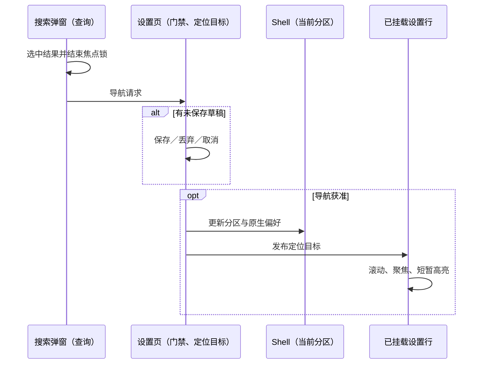
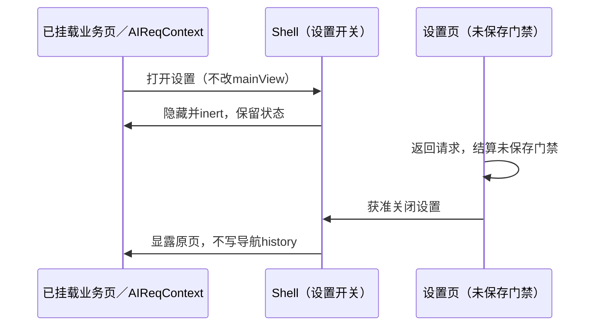
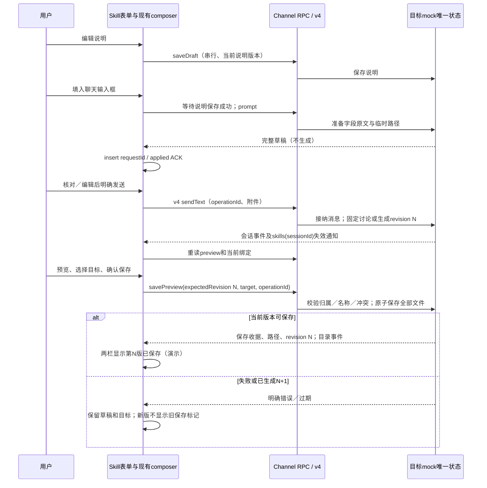
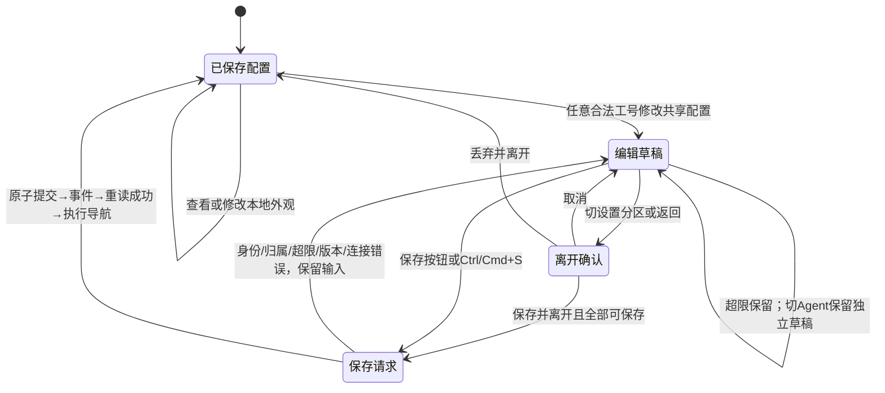
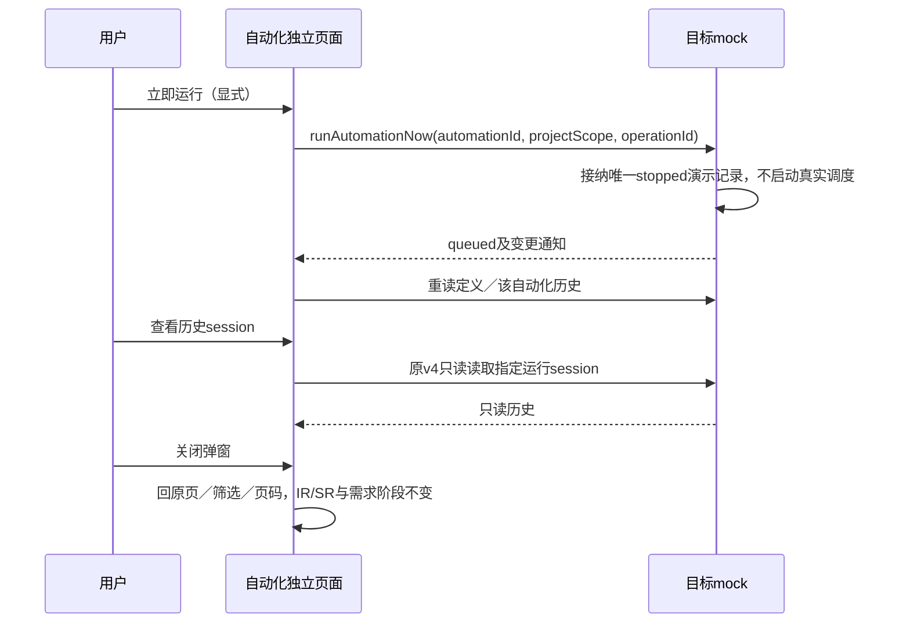

# AIReq 工具、输入辅助与设置迁移规格

> 当前产品前端与公开接口以 [发布边界](release-surface.md) 为准：原型／调试控制和场景身份参数已退出产品契约；下文相关模拟入口与浏览器故障注入记录仅属于历史版本，不构成恢复入口或接口的要求。

> 当前导航与页面组织以 [项目空间规格](project-space.md)（2026-11-16 用户确认）为准，取代下文五项并列导航、头像范围切换及四设置分区。保留 68px 图标栏与既有门禁；其余未冲突条款继续有效。

根 `.todo.md` 是最新需求权威；旧根 `todo.md`、源端调查及下方历史命令／浏览器记录仅用于版本追溯，不能覆盖当前规则。本次仅同步文档，不新增任何检查或浏览器通过声明。除明确标为历史或被取代的权限、入口、流程和验证时序外，本文后续 UI、原生会话、版本、失败保留及唯一离开门禁细化继续有效。

## 当前工作台导航与内容布局（2026-11-15）

### 主题广播连接生命周期（2026-11-17）

- 主题及其他外观字段仍由 StoreProvider 的现有 ZCode store 唯一持有。Web 重连替换 services 时保留 store、选择与未发送草稿，仅重绑当前广播服务；旧状态发送订阅和入站监听必须先释放，新绑定继续使用已有 applyingBroadcast 防回环规则。Provider 卸载释放广播与系统主题监听。
- 断线期间的主题选择仍应用于本地 DOM 和偏好存储；广播 Promise 失败必须记录可恢复诊断，不得成为未处理拒绝，也不能报告跨连接同步成功。重连不重放离线变更，之后显式选择由当前连接发送一次。
- 验收：同一 Provider 从服务 A 切换到 B 后 store 对象和本地状态保留，A 监听归零，主题只经 B 发送；B 入站更新不回发。广播拒绝不产生 unhandledrejection；释放后无旧监听。Edge 实际切换深浅主题并检查画面及日志，使用现有连接模拟验证重绑，不重启共享业务服务或重建前端草稿。

  ```text
  Web 新 accessor → 同一 StoreProvider／ZCode store → 释放旧广播监听 → 绑定新广播服务
  本地主题选择 → DOM／偏好存储 → 当前连接 send（失败记录 warn）
  当前连接入站主题 → applyingBroadcast → 同一 setter → 不回发
  Provider 卸载 → 释放广播及系统主题监听
  ```

工作台与设置分别使用同一位置、固定 68px 的单列图标导航，切换时不叠加侧栏；图标提供可访问名称及悬停／聚焦提示，项目菜单和设置入口仍可操作。工作台不显示应用内后退、前进按钮，继续支持浏览器历史导航及未保存门禁。移除工作台侧栏拖宽入口，将释放的宽度用于居中正文和表格；主页面及聊天同用较宽响应式内容列，设置正文可较宽但仍保留边距。聊天正文、阶段导航与输入框继续对齐，原生会话默认布局不变。验收在宽桌面和较窄桌面分别截图检查两种侧栏、正文及关键操作；不测试已隐藏的 Skill。

正式需求和需求提案采用不同的导航图标：正式需求保留表格图标，需求提案使用灯泡图标表达提案；保持现有尺寸、颜色和悬停／聚焦名称。

用户最新要求：Skill 设计暂从首页主导航隐藏，不进行 Skill 测试；保留现有实现和数据。本节其余原有 Skill 导航及验收记载仅供历史追溯。当前主导航依次为项目进度、待办列表、正式需求、需求提案、进度分析；登录默认项目进度。Skill 不在设置导航及搜索中，旧 `skill` 设置偏好回到项目设置。其他四项设置沿用 ZCode 设置框架、居中限宽内容列、标题字阶与统一顶部基线。切换设置分区获准后从顶部显示；搜索结果指向具体设置项时仍滚动定位该项，取消导航保留原滚动位置。

登录首页（2026-11-16）：首次登录、切换工号重新登录及刷新均由 `AIReqProvider` 的唯一导航初值进入项目进度，不恢复上一工号的页面、需求或草稿；不新增重定向 effect、持久化页面偏好或历史条目。待办仍从第二项导航访问；其“我的／待认领／全部”规则不变。验收从真实登录表单进入，确认项目进度标题及首项选中，再切换页面刷新检查首页，既有前进后退与未保存门禁不变。

本轮浏览器验证：新标签页通过真实工号表单进入后首屏为项目进度，首项导航 `aria-pressed=true`；切到待办后刷新也回到项目进度。1440×1000 首屏及 1100×760 项目页已截图，项目表／正式需求表留白与三点报告入口可见，页面错误记录为空。`bun run typecheck`、`bun run lint`（0 warning／0 error）及 `bun run architecture:check --changed`（0 violation）通过。

主导航各页面使用共同的居中内容列、统一顶部留白和标题字阶；默认列宽可比设置页宽，以容纳表格和 Skill 分栏。切换主页面时标题起点保持一致；内容可按需要滚动，正式需求详情分栏与 Skill 分栏仍可操作。参考用户指定的 ZCode 项目管理设置页，不改变业务操作。

主页面与提案会话共用较宽的响应式内容列和滚动条占位；材料栏收起时，提案讨论的流程导航、输入框与主页面内容的左右边界和中心对齐。材料栏展开时，会话内容按讨论栏宽度居中；不修改通用会话的默认宽度或消息状态。验收覆盖宽桌面和较窄桌面两种尺寸。

`AIReqContext` 仍是主页面和历史的唯一所有者；Shell 持有 Skill 首次挂载状态及设置开关，Skill 表单、会话、未发送内容的原有所有者不变。设置页的唯一 pending 导航门禁接收 Skill 草稿动作，在 Skill 或设置激活时保护导航、历史、设置入口和退出；保存失败或取消不离开，丢弃不删除预览或未发送内容。Skill 首次打开后保持挂载，隐藏时 inert；从 Skill 打开模型设置并返回保留会话、草稿和分栏。无项目时 Skill 仍可使用个人范围。

未保存提示仅在存在 Skill 草稿动作时说明 Skill 丢弃范围；单独修改模型或个性化设置时不显示无关的 Skill 说明。

```text
主导航／历史／设置入口 → AIReqContext 导航 → 唯一未保存门禁 → 接纳视图或设置
                                      ↑
                         设置表单动作 / Skill 草稿动作
```

历史验收要求：在 Edge 逐项切换六个主页面和四个设置页面，核对同组标题基线及居中列、滚动与可用控件，并检查当时的 Skill 入口和草稿。现按用户最新要求隐藏 Skill 并停止测试。

实际验收：Edge 下六个主页面在 1700px 与 1122px 视口的标题起点分别一致；四个设置页在两种宽度下的标题起点分别一致，设置列窄于主页面。模型页滚动后切换外观会回到顶部，搜索“代码字号”仍定位并聚焦对应设置行。主导航 Skill 的表单和待发送内容在模型设置往返后保留；生成临时预览后，离开取消保持当前页，丢弃后历史后退／前进仍恢复预览。模型／个性化设置草稿的取消和丢弃门禁保持可用。浅、深主题及 Skill 分栏已在桌面窗口检查；浏览器运行错误为 0。经用户授权重启模拟后端并重置共享内存后，Skill 生成说明已验证为主导航入口。

## 当前隐藏 Skill 保存规则（2026-11-16）

入口继续隐藏，仅隔离临时装配验收。逐文件预览只按当前 revision、实际可见文件登记；新版本清空旧预览资格，未看全不能保存或保存并离开。保存经现有 owner 原子登记全部正文，正式收据 path/revision 与技能清单 metadata.version、body 及通用文件 list/stat/read 一致；失败不返回收据、不中断原生草稿。项目和共享目标各自检查同名冲突，不声明宿主落盘或永久存储。旧“不测试 Skill”只保留为历史，不覆盖本轮授权。

## Skill 导航门禁缺陷回归（2026-11-15）

说明草稿自动保存与生成预览明确保存各自保持原所有者，不另建导航状态。存在未确认预览时，“保存并离开”必须同时满足预览目标目录、名称和无重名条件，不能因说明草稿未结算而绕过。自动保存仍进行时等待结算；失败后允许显式丢弃未保存修改并离开，不删除临时预览、会话或未发送消息。重试保存失败继续留页并显示原因，既不能假报已保存，也不能出现可点击却无反馈的保存。

预览因目标不可用、标识无效或同名冲突而无法保存时，离开确认弹窗直接说明原因及返回处理的方式；原因由 Skill 预览的当前校验结果派生，导航门禁只展示，不另存业务状态。

验收：生成同名冲突或无效目标预览，编辑说明并触发自动保存失败，再尝试离开；保存不可用、失败原因可见，丢弃可离开，返回仍保留临时预览与原生草稿。正常写入中不能与丢弃并发，写入完成后保存／丢弃状态立即收敛。

## 历史实施组 1 契约（2026-11-15）

本节记录 `.todo.md` 第 1 组当时共享配置、业务动作和工具入口范围。无权限及原生草稿约束仍有效；当时 Skill 设置分区、`skill` 偏好映射与搜索入口已由上方六主导航规则取代，不得恢复。下方早期 owner／visitor 写入限制及 AIReq 自动化均为已取代历史。组 1 通过不证明后续流程或六导航在当时已通过。

- 全体合法工号均可操作项目／Release、模型、追加提示词、分析设置、现有业务及 Skill 设计；backend.owner 仅标识共享模拟配置来源，不授予权限。保留身份／clientId、对象归属、私有会话绑定、参数、预期版本、幂等和阶段门禁；不改变现有完成条件或开放任意百分比。
- 历史入口：Skill 设计曾移入设置个人工具分区。当前为主页面，不在设置导航或搜索；旧 `skill` 偏好回项目设置，Skill 目录管理页不恢复。设计表单、原生会话、模型配置、预览和明确模拟保存保留。
- 继续有效的草稿约束：Skill 消费既有、唯一 pending action／保存／丢弃／取消门禁，不另设导航 owner。说明按原序列自动保存，未完成或失败不能静默离开；未确认的临时文件 revision 需要提示，丢弃仅放弃本次确认保存，不删除预览或原生未发送正文／附件，新 revision 再提示。首次打开后保持挂载，设置／模型往返复用会话、composer 与绑定，隐藏时 inert、停用焦点和快捷键。当时将 `skill` 偏好及搜索映射到设计页的规则仅属历史。
- 删除 AIReq 自动化主导航、专属模拟 owner、原生方法 manifest 和仅供该页的 task/workpool 操作；保留通用自动化控件、原生 v4 设施及需求分析调度器。无真实模型、Git、文件保存或认证。

组 1 当时验收场景：两个合法工号保存项目／Release、模型／提示词、分析设置；旧配置 revision 拒绝并保留草稿；已有业务样例满足条件可代办，阶段／版本不符拒绝，记录实际操作者。曾从设置进入 Skill，明确发送、预览全文件并模拟保存，验证脏草稿门禁和自动化裁撤；其中设置 Skill 入口已被取代。以下实际命令和浏览器观察只绑定组 1 当时版本，不证明当前六导航。

### 组 1 实际验收（2026-11-15）

以下记录原样保留当时设置 Skill／旧业务样例的版本边界，不据此恢复入口、旧流程或将其改写成六导航通过。

- 前置复核：freshness 通过，ahead 1／behind 0；变更前架构 0 违规，三个模块受控上下文及适用技能已读取。原已勾选项的规格与模块契约确已先行。
- 最终 `bun run typecheck`、`bun run lint`（0 warning／0 error）、`bun run architecture:check --changed`（0 violation／0 baseline／0 new）全部通过。首轮发现 Skill 超行数、两处类型循环依赖及未使用参数，已通过内聚表单拆分、下沉共同类型和删除死参数修复后复验。修改的 React 文件均在根 Lint 覆盖内，无需忽略目录专项扫描。
- 真实 Chromium、1440×1000、开发前端 `http://localhost:5174`（代理现有源码模拟后端 3031）：`j00808877`、`j00808875` 分别保存项目名称、创建 Release、修改模型思考强度、保存追加提示词及分析间隔。两个工号都不是配置来源 owner。旧标签页保存提示词被拒，显示“追加指令版本已变化”，原输入保留；独立 Bun 进程经公开 MockAIReqService 接口验证两工号的模型／提示词旧 revision 均拒绝，成功配置日志及 Release 收据记录实际工号和 clientId。首次探针保存未变化模型未递增 revision，修正为真实配置变更后才核验旧版本拒绝，未将该探针误判当作产品缺陷。
- 现有样例：`j00808877` 放行 `draft-report-export` 第 1 版评审进入方案，`humanDecision.employeeId` 为该工号；`j00808875` 逐份确认 `draft-resource-booking` 的五份当前材料并模拟提交 MR，`confirmedBy` 为该工号。前者不是提案提交人，后者也不是原方案接纳人。最终观察 workflow revision 93。`sr-export` 99% 且已合入，空依据不能提交，填写后由 `j00808877` 确认 100%，报告显示实际工号、依据及时间；未合入的 `sr-session` 按钮禁用，公开服务同样拒绝。对未发起评审的现有提案调用放行仍拒绝，不因取消权限绕过阶段。
- 设置 → Skill 设计：四字段回填后明确发送，生成第 1 版两文件，分别阅读 `SKILL.md` 与 `references/checklist.md`；未保存切模型出现唯一保存门禁，取消留页，“保存并离开”模拟保存全部文件后进入模型。返回显示第 1 版已保存。再次发送生成第 2 版，门禁重新出现；同名冲突阻止保存，显式丢弃允许导航但仍显示临时预览待保存，不假报保存成功。未发送正文及 1 个 `data-upload-status=ready` 图片附件在模型分区和工作区往返后均保留，不自动发送。
- 浅／深主题的 Skill 设置截图已检查；设置与工作区文档高度均为 1000px，页脚可达。主导航无自动化／独立 Skill 入口，设置保留外观、项目／Release、模型、个性化及 Skill 设计。运行 bootstrap 无 automation manifest，退休 `nativeTasks.*` 被公开入口拒绝，跨 client 读取私有 Skill 会话仍拒绝。最终重新加载后两页浏览器错误为 0，主验收页 console error 为 0；中途开发热更新日志不作最终运行失败或通过的证据。
- 全部业务结果仅为共享内存模拟，不调用真实模型、Git、写盘或开发执行。未新增业务单测、E2E harness、永久验证脚本，未运行 build／全量工程测试／推送检查。本组通过，不代表后续需求流程或最终导航已实现。以下为早期迁移的历史规格及观察，不恢复其中已被本节取代的权限和工具入口要求。

## 持续有效的 UI 细化与早期显示修复记录

下列“本轮”均指各次既有修复，不是本次文档同步的运行结果。与根 `.todo.md` 不冲突的布局、语义 token、控件、草稿和反馈约束继续有效；旧目录技能详情、Issue 及 owner 只读只保存历史边界，不恢复页面。历史 `base` 引用仅说明当时参照，不新增源码或截图对照授权；当前 UI 以检出的实现及 `DESIGN.md` 为基准。当前业务和任务状态由根 `.todo.md` 裁决，旧根 `todo.md` 仅作旧版本证据。

显示验收沿用用户指定 `base` 设置页的 SettingsRow、SettingsGroupCard、语义颜色和表单间距；首屏仅保留一条共享模拟配置来源摘要，不展示 owner／访客只读权限。配置路径、模拟归属和切换工号边界收进可展开说明，模型与个性化复用同一组件，默认模型前不重复来源文案。展开后明确路径仅为模拟标签、不访问本机或 OMP，外观仅存当前浏览器。

模型设置的表单操作与 `base` 个性化页一致：复用 SettingsFormActions，左侧实心 `size="lg"` 保存、右侧 ghost `size="lg"` 取消；保存中禁用两项，保留脏草稿、版本和保存语义，不恢复 owner 权限。主题只经既有 StoreProvider 的 Zustand owner 读写，不在 AIReqApplication 另建 useTheme 状态或系统监听。

本轮显示修复以 `base` 的语义 token 和代码预览传参约定为准：Sketch 的全部颜色色块在未选中时也有随主题变化的可见边界，选中态另有外圈，不改变画笔／橡皮擦的真实颜色；Skill 临时文件的原始 frontmatter 与非 Markdown 预览都读取同一份 ZCode store 代码设置，按当前明暗选择代码主题，并传入字号、行号及换行设置，不新增设置所有者。浏览器由用户验收。

本轮三项显示修复的非浏览器检查：workspace freshness、typecheck、lint（0 警告／0 错误）及 architecture:check --changed（0 违规）通过。真实 Skill 非 Markdown 预览的 React SSR 验证通过：在浅色应用中配置 18px／深色代码主题、深色应用中配置 16px／浅色代码主题，输出均采用对应代码字号和明暗。JSDOM 提示未实现 canvas.getContext，本场景不验证 Canvas 或真实布局；原始元数据展开、色块边界和状态标签实际对比度仍由用户在浏览器验收。

本轮四项显示修复：个性化设置从既有 draft／saved 差异派生未保存 Agent 清单，在 Agent 选项及表单内显示“未保存”，明确保存／取消作用于全部草稿；切换 Agent 保留标记，保存成功或取消后清除，失败保留。模型与个性化保存反馈采用单一带类型的反馈状态：成功保留辅助色和 status，失败使用 `text-destructive`、alert 及固定“保存失败”前缀并保留原因；修改或取消清除旧反馈。沿用 `base` 的字阶、语义错误色和未保存提示，不新增业务状态所有者。本轮不运行浏览器，由用户验收实际效果。

本轮四项修复检查：workspace freshness、typecheck、lint（0 警告／0 错误）、architecture:check --changed（0 违规）通过。Bun + JSDOM 挂载真实个性化表单的临时场景通过：编辑后显示未保存 Agent 与全量草稿范围；保存拒绝显示带前缀的错误色 alert、保留草稿；重试成功及取消清除未保存标记，取消恢复已保存内容。未运行浏览器，未实测真实服务失败、Agent 下拉切换及箭头旋转的视觉效果。

历史技能目录详情曾按用户指定 `base` SkillsSection 修复：最大宽度 xl、最大高度 min(80vh,640px)，固定标题区 `text-ui-lg`，描述独立限高滚动，字段和正文内部滚动；保留模拟来源、元信息及原文，无本机操作。该记录不授权恢复技能目录管理页；仍保留的详情弹窗可复用相同控件与滚动原则。当时浏览器显示由用户验收。

本轮六项显示修复检查：workspace freshness、`bun run typecheck`、`bun run lint`（0 警告／0 错误）与 `bun run architecture:check --changed`（0 违规）通过。未运行浏览器；技能弹窗布局、复选框实际边界对比度、菜单身份文本、路径字阶、Issue 进度条颜色及流程说明布局由用户验收。

Skill 设计空会话沿用 `base` 的空态字阶与语义色，文案读取既有 `briefOpen`：展开时可提示左侧整理目标，收起时改为下方输入或展开“技能说明”，不得指向当前隐藏面板。不增加布局状态或改变对话流程。本轮不运行浏览器。

## 1. 权威来源与实际装配

源根 `S = F:/code2026/oh-my-pi/packages/aireq-frontend/`，下文 `U = S/packages/ui/src/`，`A = U/aireq/`。源仓库只读，不成为目标构建、运行或资源加载依赖。

历史调查依据为旧根 `todo.md:164–182`、源 README、源 `aireq-browser-workbench/spec.md` 及下列实际源页面／数据源；它们不再是当前业务权威。源 spec 的 version 1／源 backend contract version 3 只表示旧协议背景。目标沿现有同源 `/ws` Channel RPC，不复制旧 HTTP／事件 WS／OMP 启动方式；当前产品与权限依根 `.todo.md`。

以下可达链仅记录源端历史装配，不授权恢复 AIReq 自动化、技能目录设置或 owner 只读；当前入口与设置以上方六导航及四设置规则为准：

- `S/app/AIReqApplication.tsx` → AIReq 主壳／Context → 工作页 Skill 设计、自动化；Skill 不在设置内，自动化不挂载需求材料栏。
- `A/AIReqSkillDesignPage.tsx` → `SessionPane`／`V4PaneConversationProvider`、可折叠分栏、表单、临时预览；`data-source.ts` → `prototype-data-source.ts` → `mock/skill-design.ts`／`mock/skills.ts`／`mock/chat.ts`。
- `A/AIReqAutomations.tsx` → `settings/AutomationsSection.tsx` → `AutomationEditView.tsx`，`onOpenSession` 只打开独立只读 Dialog。该调用没有传入 `onCreateViaChat`，所以“通过对话创建”实际回退创建表单，不能凭按钮名称恢复自由聊天。
- 自动化“工作流”Tab → `saved-workflows/SavedWorkflowsSection.tsx` → `NativeTaskRunsGate`，AIReq 分支实际是 `NativeTaskRunsSection`：只读 task/workpool 运行、父子 actor 会话和输出，不进入 `LegacySavedWorkflowsSection`。
- `U/SettingsPage.tsx` + `settings/settingsPageConfig.ts`：`general` → AIReq 项目／Release，`appearance` → `AppearanceSectionContent`，`modelProvider` → AIReq 模型，`personalization` → AIReq 个性化，`skill` → `PluginsSection(mode="skill")` → `SkillsSection`。
- Skill 列表存在 `aiReqSkills` 时 **owner 也只读**，无导入、新建、安装、启停、删除；不把通用组件内未开放分支当成产品能力。
- `v4/ConversationComposer.tsx` → `AIReqSketchButton`／`AIReqSpeechInputButton`；仅有当前可编辑输入框才装配，正式需求和只读历史无输入辅助。

## 2. 目标落点及唯一所有者

目标页面使用 AIReq 业务结构、当前 ZCode `DESIGN.md`、`components/ui`、语义 token 和 `text-ui-*`；没有旧主题、另一套通用组件、独立旧前端。以下“服务”均是目标 AIReq 浏览器安全契约下的方法族，不是新增宿主或进程。

| 状态                                                                             | 唯一所有者／范围                                                                                                          | 客户端可以持有的内容                                                              |
| -------------------------------------------------------------------------------- | ------------------------------------------------------------------------------------------------------------------------- | --------------------------------------------------------------------------------- |
| 项目、Release、平台模型配置及 revision、已保存追加指令                           | 目标 mock，单个共享模拟配置归属／全部访问工号共享；项目和 Release 用稳定 ID                                               | hooks 查询缓存和未保存设置草稿，不建 localStorage 业务镜像                        |
| Skill 说明表单、notes、会话与模型绑定、临时目录／文件 revision、模拟保存文件集合 | 单一 MockAIReqService 内存域；按 employee+client+project 绑定个人设计会话，无项目为明确 personal 范围；不是 IR/SR/Release | 表单即时编辑及待保存序列、预览投影；已接纳消息／附件仅归现有 MockRuntime v4 owner |
| Skill 未发送正文、附件、临时选模／思考意图                                       | 目标现有 composer 草稿所有者，按浏览上下文／工号／设计 session 或提案草稿隔离                                             | 同一 editor 状态；Tabs、折叠不能卸载重建或转给别的 session                        |
| Skill 模拟目录与保存记录                                                         | mock：项目范围或共享模拟 profile；全部合法工号可设计保存，不恢复已裁撤的技能目录管理产品                                  | 保存目标、冲突查询与仍有用途的只读预览；来源 owner 不是权限                       |
| 历史自动化定义／运行／task/workpool                                              | 裁撤前曾归 mock 独立项目域；AIReq 专属 owner、契约及接线现已裁撤                                                          | 不保留当前入口或草稿；通用设施仍有其他用途时保留，不恢复 AIReq 自动化             |
| 外观、字体、代码阅读偏好和独立 Skill 分栏比例                                    | 当前 ZCode 本浏览器偏好所有者                                                                                             | 允许现有偏好持久化；不能随之存业务数据或修改其他浏览器偏好                        |
| 正在绘制的画布、语音示例文字                                                     | 当前辅助输入弹层                                                                                                          | 成功回填到原 composer 后才关闭；取消不修改原草稿                                  |

工号是 `/^[a-z][0-9]{8}$/` 操作标识，保留前导零，不是认证。原型 owner 样例 `j00808874`，visitor 如 `j00808877`。后端的 owner/profile/configDirectory/userSkillsDirectory 在目标表现为明确的**模拟配置归属与模拟路径**；切换工号不切换 Token、凭据、后端账号、配置根或共享项目。

当前不设权限矩阵：全部合法工号可配置项目／Release、模型、个性化及分析设置，可代办、认领并使用 Skill；backend.owner 仅标记模拟配置来源。服务与 UI 不保留 owner／负责人专属写入门禁，但保留合法身份／client、对象与原生私有会话归属、参数、版本、幂等、阶段及大小校验。技能目录管理与 AIReq 自动化专属能力不恢复，也不新增认证、RBAC 或真实引擎。

### 2.1 设置框架与离开所有权

设置页复用 `SettingsPageParts.SettingsPageFrame/SettingsSidebarButton` 的 base 分支侧栏样式，返回按钮、搜索和分区导航保留原有布局；设置侧栏与主工作台同宽（256px），底部设置按钮与主工作台按钮位置对齐。AIReq 浏览器关闭桌面窗控，保留现有业务分区及离开门禁。验收：电脑浏览器进入设置前后侧栏右边界及底部设置按钮对齐，切换分区及返回工作台仍可用。

Shell 唯一持有设置开关及当前分区：首次项目，普通齿轮记住最后接纳分区，项目管理强制项目，输入框模型入口强制模型。子页仅提供脏草稿动作，统一门禁持有 pending 导航，不另存最近分区或用 key 重建绕过门禁。返回经同一门禁关闭设置，显露仍挂载的原业务页，不改 AIReqContext 的 mainView／范围／对象／history，不发送或创建会话。设置覆盖视口，工作台和 composer provider 隐藏且 inert，保留正文、PNG、临时选模及 lease。正式需求、提案和进度分析共用当前项目／Release；全部 Release 可读，创建／导入必须具体 Release，不能另持全局分析 scope。

最近分区复用原生 `settingsNavigation` 偏好读写，硬刷新后普通齿轮仍恢复最后接纳的分区；AIReq 的 appearance/projects/models/personalization 分别映射原生 appearance/general/modelProvider/personalization，已裁撤的 skill 或其他未知偏好回到项目。Shell 仅初始化读取，不在挂载时重写偏好；手动切分区及项目管理／模型入口的显式意图均在原有未保存门禁接纳之后更新当前分区与同一原生偏好，取消或保存失败不得修改记忆。

设置侧栏在返回按钮与分组导航之间保留“搜索设置”入口，复用现有搜索弹窗、中文／拼音模糊匹配、清空、空结果和键盘交互。搜索仅投影当前四个分区及仍保留的外观固定设置行，不恢复已裁撤的原生分区或旧平台配置项。选中分区沿用上述原生 ID 映射；外观设置行沿用稳定 searchId 的滚动、聚焦和短暂高亮。

搜索弹窗只拥有查询与打开状态，AIReqSettingsPage 拥有定位目标；Shell 仍唯一持有分区。顺序为：选择结果 → 搜索弹窗结束焦点锁 → 原有未保存门禁 → 接纳分区和定位目标 → 已挂载设置行定位。取消或保存失败保持原分区、草稿和原定位目标。验收：入口可见；搜索“字号”定位外观行；搜索“模型”进入模型设置；脏草稿搜索跳转可取消／丢弃；无匹配显示空态；Esc 先清空再关闭并恢复入口焦点。

普通侧栏分区切换获准后清空旧搜索定位；搜索命中外观行后切到模型再返回外观，不应再次滚动、聚焦或高亮旧命中。门禁取消时不清空原定位。

项目与 Release 表单提交时，文本输入保持挂载并只读，不通过禁用文本框移走键盘焦点；失败后恢复编辑且保留原值。保存／取消及归属选择继续禁用，关闭与历史仍经唯一门禁。

项目配置的 Release 总数只在当前来源、工作流快照及重读轮次加载成功后展示；未就绪显示读取中，读取失败显示数量不可用，不能把尚未知晓的数量投影为 0。成功读取的真实空集合仍显示 0。

外观页的主题、浅色／深色代码主题选择器及显示行号、长行自动换行开关必须以对应的现有国际化设置标题提供可访问名称；不改变控件视觉、值或保存路径。验收检查组合框／开关的无障碍树名称及键盘操作，而不是仅凭相邻可见文字判断已关联。

`aireq-ui` 通过 `settings-search` 公开入口单向依赖搜索 UI，不反向导入 AIReq 实现。



### 2.2 工作页与辅助工具显示修复

- 历史自动化曾保留独立圆角边框并删除 shell 额外 48px 留白，原组件持有面包屑和编辑门禁；该显示记录不授权恢复已裁撤的 AIReq 自动化页面。
- 设置返回仍保留从进度分析、Skill、正式需求等当前页面进入前的表单、筛选、滚动和对象。模型／个性化脏草稿取消返回留在设置，保存或丢弃才返回；历史自动化不作为当前验收入口。
- 历史技能目录列表的紧凑作用域胶囊、无匹配居中边框空态及不显示空分组属于当时显示修复，不恢复目录管理页或 owner 只读规则；仍使用这些通用控件的保留页面维持对应显示语义。
- 绘图主操作明确命名“添加附件”，不自动发送消息。颜色与粗细按钮以 `aria-pressed` 同步选中状态。尺寸手柄可聚焦并有键盘尺寸调整及操作说明，沿用鼠标调整的边界和画布保留逻辑；手柄上的键盘操作不得误触添加附件。验收包括键盘切换画笔状态、尺寸增减和焦点可见性。



## 3. 第 8 节逐项覆盖及可观察验收

编号追溯旧根 `todo.md` 第 8 节；当前 Skill、原生输入与辅助工具的有效细节继续保留，8.4 自动化单独标为裁撤前历史，不作为当前能力或验收清单。

| 编号／源功能                 | 目标页面／服务                                                   | 可观察验收                                                                                                                                                                                                                              |
| ---------------------------- | ---------------------------------------------------------------- | --------------------------------------------------------------------------------------------------------------------------------------------------------------------------------------------------------------------------------------- |
| 8.1 Skill 主页面、简短空会话 | 六主导航最后一项“Skill 设计”；`skillDesign.session/read`         | 不跳设置、不依赖自动化入口；无伪造消息／回复／产物，空态可填写目标或直接描述；会话加载／失败明确，失败不生成文件                                                                                                                        |
| 8.1 说明表单                 | Skill 左栏；`AIReqSkillDesignDraft`、`skillDesign.saveDraft`     | 保留 goal/when/inputs/outputs 四个主要字段和 boundaries/references/example 三个选填字段、notes；中文标题、placeholder、关联帮助和已填写项数保留；字段可空，不以“0/4”强制填满；选填折叠不清空                                            |
| 8.1 两栏、Tabs、独立滚动     | 当前 ZCode ResizablePanelGroup／Panel／Handle、Tabs、Collapsible | 只迁移两栏、折叠、拖动与独立滚动的功能语义，不固定源 40%/60% 或 280px/360px 几何；比例与尺寸遵循当前 ZCode 和父容器；鼠标和键盘可调，独立布局偏好；收起释放空间，展开恢复此前比例；长表单／预览分别滚动、底部动作可达，窄电脑窗口不溢出 |
| 8.1 对话／临时文件           | Skill 右栏；`readPreview/temporaryDirectory`                     | Tabs 均保持挂载；无文件时显示未生成并可返回对话；生成后有文件数量、文件 Select、相对文件名；不存在的旧选中文件回到当前首个文件，不能展示旧版内容                                                                                        |
| 8.2 表单→聊天草稿            | `skillDesign.prompt` →现有 composer 外部文本插入                 | 先等待当前说明保存序列成功，再把全部实际字段原文及临时目录、SKILL.md 路径填入完整待发送正文；未填字段为明确未填写；保留人工编辑、原附件与模型；回填不发送，不生成文件；保存说明或生成 prompt 失败保留表单                               |
| 8.2 回填握手                 | composer insert requestId／applied ACK                           | 同时仅一个回填；编辑器未就绪不提示成功；源端 8 秒未 ACK 显示“未确认填入成功，可重试”，保留表单；旧 ACK 不确认新请求；再次回填只替换仍完整存在的上次回填片段，否则追加，已包含同一全文不重复插入                                         |
| 8.2 显式发送与固定回复       | 现有 v4 sendText／mock Skill 回复                                | 人工编辑后明确发送才接纳消息；没有临时目录的首次普通讨论只记录 notes、给澄清样例，不保证马上生成；首次发送完整设计 prompt 才生成固定样例；已有 preview 后继续讨论可生成下一版。不能从表单、打开 Tab 或切页自动生成                      |
| 8.2 全文件模拟保存           | `skillDesign.savePreview`、mock 技能目录                         | 先预览、选目标，再“确认保存技能”；显示当前版本、所有文件数、最终目录、实际归属；一次保存包含 SKILL.md 和 references/checklist.md，不只是主文件；显示演示已保存及目录，技能列表重新读取后能看到新项；没有真实写盘／安装／执行            |
| 8.2 继续讨论和重生成         | 设计对话 + preview revision                                      | “继续讨论修改”返回原对话；再次生成 revision 增加，两栏同步变为待确认保存，旧版已保存标记和旧未生成通知清除；旧保存完成响应不能把新版标为已保存                                                                                          |
| 8.3 摘要／完整编辑器匹配     | 当前 ChatPromptEditor 的显式可选 preview 参数                    | 仅 `currentDraft.trim() === filledText.trim()` 且非空可显示目标摘要和“查看并编辑完整待发送内容”；展开编辑全文，编辑或追加导致不匹配立即显示完整编辑器；折叠仅隐藏不卸载，不改发送正文；发送清空后不显示旧摘要；普通提案输入不默认折叠   |
| 8.3 Frontmatter／代码预览    | 当前 shared 分离解析工具 + MessageResponse/CodeBlock             | Markdown 分离 Frontmatter，紧凑显示 name/description，原始 YAML 可展开；正文不是 YAML 标题；无 Frontmatter 正常阅读；未知元数据、原始文件字节不因预览丢失；非 md 文件用 json 或 text 代码阅读，换行；不新增导出／下载／复制按钮         |
| 8.3 路径与归属               | preview 路径 Collapsible、保存目标 Select                        | 临时目录和完整文件路径可展开、长路径换行；user 目标是共享模拟 profile skills/<name>/，不是当前 visitor 的“个人后端”；project 目标为有效项目 .omp/skills/<name>/；无项目仍能用 profile；无有效项目目标被禁用，不要求配置个人目录         |
| 8.3 名称／冲突               | mock savePreview 校验                                            | 推荐名符合 `^[a-z0-9]+(?:-[a-z0-9]+)*$` 且最长 64 字符；非法、目标已有同名、无 preview、错误会话／目标归属均拒绝；提示回对话调整，不提供重命名覆盖旁路；并发同名只能有一个原子成功                                                      |

### 历史 8.4：已裁撤的 AIReq 自动化

以下六行保留当时功能映射，均不是当前保留或待恢复的能力；专属页面、owner、契约和接线已裁撤，通用控件／底层设施有其他用途时保留。

| 编号／源功能               | 当时页面／服务                                                                          | 当时验收要求（历史）                                                                                                                                                                                                                                                 |
| -------------------------- | --------------------------------------------------------------------------------------- | -------------------------------------------------------------------------------------------------------------------------------------------------------------------------------------------------------------------------------------------------------------------- |
| 8.4 自动化列表与刷新／筛选 | 独立自动化工作区；listAllAutomations/listAutomations/listAutomationRuns                 | 保留全部、等待执行、执行中、已暂停、已完成、失败的状态分类及源有的空结果；启用不等于执行，须有当前 running 记录才进执行中；列表／详情状态一致；无项目／读取错误／空列表分别反馈；刷新不重置筛选                                                                      |
| 8.4 新建、模板、编辑       | 复用目标自动化表单与 AIReq 模拟服务                                                     | 新建和模板预填进入可编辑表单，实际“通过对话创建”也进入表单；保留标题、指令、项目、新建目标选择／编辑归属锁定、模型、思考等级、模式及已有模式确认；必填和创建上限保留；成功保持当前筛选，提示“查看新任务／显示全部任务”；失败保留输入不假成功                         |
| 8.4 时间编辑               | 当前 AutomationEditView/automationFormat                                                | 保留添加／移除调度、每小时／每天／工作日／每周多选／每月日期及自定义；自定义小时／日／周／月／年间隔、增减、周几／月日期、月度方式、年度月日、时间选择和可选结束日期，取消不应用；非法零间隔／非法日期不提交；无法可视化的原 cron 在未触碰时原样保留，不重写历史规则 |
| 8.4 操作菜单               | setAutomationEnabled/restartAutomation/runAutomationNow/deleteAutomation                | 保留启停、失败重启、立即运行、编辑和删除确认；取消删除无变化；busy 防连点；立即运行只登记 stopped 的模拟历史并解释“未执行模型或调度”，不假报真实成功、不新增生产定时器；错误原位／toast，删除失败不关闭编辑页或丢草稿                                                |
| 8.4 编辑离开／独立历史     | AutomationEditView 设置／历史 Tab，listAutomationRuns/deleteAutomationRun               | 保留未保存编辑离开确认；切历史／回列表不默默丢编辑；运行历史显示触发时间、触发方式、状态、耗时、失败原因、刷新及删除记录；每页 8 条，前后／页码切换，删除后夹合法页；有 sessionId 的运行可进入只读会话弹窗，关闭回原列表，不改变 IR/SR、阶段、项目选择               |
| 8.4 工作流只读样例         | NativeTaskRunsSnapshot/NativeTaskOutputContent、listNativeTaskRuns/readNativeTaskOutput | 保留工作流 Tab、刷新、task/workpool 图、父子 actor、状态／输出 chip、查看 actor 只读对话、Markdown/json/text 输出和返回列表；没有可用原会话时明确不可用，不创建需求会话解锁；无运行、输出消失和加载失败分开；不开放 LegacySavedWorkflows 的创建／启动／移动／提升    |

### 当前原生输入与辅助工具

| 编号／源功能             | 目标页面／服务                                                           | 可观察验收                                                                                                                                                                                                                                                                                                                     |
| ------------------------ | ------------------------------------------------------------------------ | ------------------------------------------------------------------------------------------------------------------------------------------------------------------------------------------------------------------------------------------------------------------------------------------------------------------------------ |
| 8.5 提案／Skill 原生输入 | 当前 SessionPane/ConversationComposer、附件 hooks、modelSelectionService | 保留编辑、明确发送、忙／只读状态、发送失败草稿恢复、文件选择／粘贴／拖拽、附件预览与移除、读取／上传失败；沿用当前附件 MIME／大小／最多 8 个与 v4 AttachmentRef/SHA-256 校验边界，不复制旧上传器，不恢复 Office/PDF/PPTX 产品页；附件可作为原生输入不等于恢复被裁撤预览入口                                                    |
| 8.5 临时模型／思考       | 现有模型／思考工具条、原生 Submission                                    | 临时模型／思考／模式属于本次 Submission，不修改平台默认或 Session 默认；发送前保留草稿意图，接纳后工具条恢复 Session 默认是预期行为，不是执行丢失证据。Session 的角色绑定保留创建时配置，平台设置仅影响新会话；提交选项沿原生发送链传递，不调用真实模型。源绑定会话 setSessionModel 的拒绝语义不等同于禁止本次提交的临时选项。 |
| 8.5 材料与输入建议边界   | 目标材料阅读器／当前可编辑输入                                           | 材料预览不改变发送目标。源 `AIReqNativeSurface.tsx:24–38` 明确两个 adapter 均未声明 native-surface，target/snapshot 始终缺席且 predictionAction 拒绝，因此预测建议当前不可达，不迁移假建议或新增预测传输；保留真实开放的正文、附件、Skill 摘要和输入辅助。                                                                     |
| 8.6 Sketch               | 全屏应用内覆盖 + 原附件入口                                              | 保留颜色黑红绿蓝白橡皮、细中粗笔、画布绘制、平移、缩放／100%／适应、撤销、清空、鼠标及键盘调整尺寸、添加附件与取消；添加得到完整画布PNG而非可见视窗截图，只回填原草稿；保持原文／附件／模型，不新建提案、不推进阶段；消息只接收当前同源 iframe，附件拒绝／解码失败保留画布并显示错误；关闭恢复输入焦点                         |
| 8.6 语音示例             | 输入框发送按钮左侧语音弹层                                               | 打开演示录音→停止→示例文本可编辑→确认追加原草稿；空文本不能确认，输入不可编辑时留在弹层并保留文本；取消不改原草稿，关闭恢复焦点；不申请麦克风、不采音频、不接识别、不开真实录音服务                                                                                                                                            |

Sketch 的主操作必须同时使用目标 `--color-primary`／`--color-primary-foreground` 配对 token，深浅主题均清晰可读；不能把深色主题的白色 brand 背景与普通浅色 foreground 搭配，造成“添加附件”白字白底。
Sketch 的笔宽指示、选中边框与成功／错误提示同样使用当前 ZCode 主题语义 token；真实画笔及画布颜色保持绘图语义，不随界面主题改写。

## 4. 第 9 节逐项覆盖及可观察验收

| 编号／源功能       | 目标页面／服务                                                    | 可观察验收                                                                                                                                                                                                                                                                                        |
| ------------------ | ----------------------------------------------------------------- | ------------------------------------------------------------------------------------------------------------------------------------------------------------------------------------------------------------------------------------------------------------------------------------------------- |
| 9.1 两组设置导航   | 当前 SettingsPage/配置 + AIReq 内容                               | 个人工具仅外观；平台配置依次项目／Release、模型、个性化；保留设置返回和可见分区选择／最近设置落点；技能设置页及搜索目标已删除；不加载被删除入口的服务／权限查询／事件                                                                                                                             |
| 9.1 外观全部字段   | 当前 settingsCodePreview/StoreProvider                            | 跟随系统／浅色／深色、UI 字号、浅／深代码主题、显示行号、长行换行、代码字号（源12–20px）和双主题预览可用；数字输入 blur/Enter 提交、合法范围夹值，Escape 恢复，非法值不污染；使用当前目标字体范围与token，全部控件关联标签／说明，键盘可用；visitor 同样可改且不改变其他人的外观                  |
| 9.2 项目列表与配置 | AIReqProjectSettings、projects.saveRepository/readWorkflow        | 保留项目／Release 计数、当前项目、名称／仓库／默认分支和需求统计、空态；全部合法工号可添加／修改，取消不写。只保存名称、remote URL、defaultBranch，不索要服务器或个人目录                                                                                                                         |
| 9.2 仓库／分支校验 | mock 项目写入口                                                   | 名称／仓库／分支非空；支持含主机的HTTP(S)/SSH/git URL和 user@host:path SCP，拒绝本地路径／缺主机URL；保留源 `savePrototypeRepository` 分支语法约束（空白、..、@{、非法特殊符、前导-或/、尾/或.或.lock、//、单独@、点开头路径段）；错误保留弹窗值，成功只表明内存保存、连接／分支未检查，无Git探测 |
| 9.2 Release创建    | createRelease、项目／Release共享状态                              | 可选所属项目并即时展示继承仓库／分支，Release名称trim、同项目忽略大小写重名拒绝；取消不写；成功分配稳定releaseId并更新计数；不单独配仓库、不建Git分支、重复提交不重复记录                                                                                                                         |
| 9.3 角色配置       | AIReqAgentModelSettings、models.read/save/revision/bindingChanged | 保留默认模型、每角色继承、有效模型／供应商／思考等级及保存／取消／错误。角色职责覆盖原始需求澄清与单评审、方案完善、完整三路审查与第四综合终审、进度分析和 Skill；不写死旧八／九角色清单，不恢复 issue-analysis、开发执行／验收或后置专用测试方案 Agent，不新增 API Key 设置                      |
| 9.3 模型快照       | AIReqAgentModelBinding + 模拟session／analysis run                | 保存只影响后续创建；历史保留role、modelKey/name/providerId/modelId、reasoning、inherited、configurationRevision；跟随默认解析一次，不动态改历史；Skill工具条读取同一份绑定。取消恢复保存值；保存失败不更新基线，不离开                                                                            |
| 9.4 用户追加指令   | AIReqPersonalizationSettings、prompts.read/updateDraft/save       | Agent可切换，各自草稿不互覆盖；初始追加值为空，内置／样例职责不填入；清空保存只清用户追加；textarea、字节计数、超限agent列表、保存／取消／反馈保留；保存读取最新输入而非离开确认时旧闭包；长文本连续输入不递归更新                                                                                |
| 9.4 UTF-8边界      | 当前 shared USER_INSTRUCTIONS_MAX_BYTES + mock 校验               | 每角色最多102400字节，等号可保存；中文／emoji按UTF-8而非JS长度；任一角色超限则保留全部草稿并禁普通保存、Ctrl/Cmd+S、保存并离开；缩短恢复；直接RPC同样拒绝，原保存值不变，不仅禁UI                                                                                                                 |
| 9.5 未保存导航门禁 | 设置页唯一 pending 导航及最新 draft actions                       | 模型／个性化切区、返回和设置导航均经紧凑“保存更改？”Dialog（max-w-md，448px）；取消留页保留草稿，丢弃恢复已保存值，保存成功才执行原导航，失败显示原因留页，防重复；快捷键不绕过大小／版本／阶段约束，Skill 共用同一门禁                                                                           |
| 9.7 全体工号一致性 | mock 请求身份与全部写入口                                         | 全部合法工号可配置、代办、认领，owner 只表示来源；联系人／负责人不授予独占操作，同人可兼任，实际操作者留痕。仍拒绝跨对象／私有会话、旧版本、非法参数或阶段不符，不保留 visitor 平台只读门禁                                                                                                       |
| 9.8 模拟配置归属   | backend模拟归属视图 + AIReqPersonalConfigScope                    | 明示共享模拟配置的owner和scope，项目技能和共享profile路径各自准确；切工号后仍同一模型／提示词／项目／Release／技能目录，不要求启动OMP、设置个人开发目录或切配置根；浏览器草稿、外观和连接独立，不错把共享业务按工号复制                                                                           |

设置门禁只持有一个 pending 导航；确认弹窗打开时 Ctrl/Cmd+S 与“保存并离开”共用最新草稿、忙态、大小／版本校验及错误结算，成功最多执行一次原导航。普通快捷保存没有 pending 导航时只保存留页；失败保留输入和错误，不恢复 owner 权限。

## 5. 接口、事件、版本与幂等

保留 Skill、模型绑定、项目／Release、当前共享技能预览、ModelSelection 和 v4 附件类型，避免以通用 `{title,status}` 缩水。历史 `ZCodeAutomation*`、`NativeTaskRuns*` 仅在仍有其他消费者的通用设施中保留，不作为 AIReq 专属数据源字段。停用角色不进入新可写 schema，历史快照仍可阅读。

### 5.1 源方法到目标契约方法族

| 源精确调用                                                                                                    | 目标保留含义／参数及结果                                                                           | 事件与边界                                                                                                                                    |
| ------------------------------------------------------------------------------------------------------------- | -------------------------------------------------------------------------------------------------- | --------------------------------------------------------------------------------------------------------------------------------------------- |
| projects.saveRepository(input)；readWorkflow(selection)；command(createRelease,selection,revision)            | 保存项目（可选projectId,name,repositoryUrl,defaultBranch），读取统计、创建Release(projectId,title) | 提交后更新project revision／共享workflow revision，再通知重读；创建返回稳定ID，不通过名称代替归属                                             |
| models.read/save/revision/bindingChanged(binding)；models.samples                                             | 当前 wire 保留这些方法，save(settings,expectedRevision)；读取／保存、比较绑定与只读样例            | `models` 通知，提交递增 revision；没有可见“恢复演示配置”按钮，samples 不是写旁路                                                              |
| prompts.read/updateDraft/save(Record<agentId,string>)                                                         | 当前 wire 仅 read 与 save(value,expectedRevision)；updateDraft 为 UI 本地编辑适配                  | 保存原子校验全部角色／100KiB和版本；不广播未保存草稿，失败保留当前编辑                                                                        |
| skillDesign.session(projectId)/workspaceIdentity(projectId)/binding(sessionId)                                | 解析设计session及模拟归属；创建时模型绑定                                                          | 保留稳定sessionId，不与IR/SR绑定，不用visitor号替换共享归属；读取不生成回复                                                                   |
| skillDesign.read/saveDraft(sessionId,draft)/prompt(sessionId,draft)/temporaryDirectory(sessionId)             | 读取说明、串行保存说明、准备完整prompt、读取临时路径                                               | prompt不生成产物；表单本地版本防止订阅重读覆盖正在编辑值                                                                                      |
| skillDesign.readPreview(sessionId)/listSkills(workspacePath)/savePreview(sessionId,workspacePath,name,target) | 查询当前产物／冲突目录、显式保存project或user全文件                                                | 源 `skills {sessionId}` 通知；目标保存附带expectedPreviewRevision和operationId，保存返回路径／revision／receipt，避免源参数缺版本导致保存错版 |

#### 历史自动化方法映射

以下三行是裁撤前接线，不是当前 AIReq 公开方法或恢复计划：

| 源精确调用                                                                                                                                                      | 当时含义                                                       | 历史边界                                                                                          |
| --------------------------------------------------------------------------------------------------------------------------------------------------------------- | -------------------------------------------------------------- | ------------------------------------------------------------------------------------------------- |
| zcodeAgentService.listAutomations/listAllAutomations/createAutomation/updateAutomation/deleteAutomation/setAutomationEnabled/restartAutomation/runAutomationNow | 使用既有共享自动化输入／结果语义；由目标mock持有模拟定义和记录 | 支持更新／历史重读通知；不引入真实scheduler；runNow返回queued只代表接纳演示记录，不是模型正在执行 |
| zcodeAgentService.listAutomationRuns/deleteAutomationRun                                                                                                        | 指定automationId/workspace范围历史；删除精确runId              | 不删除需求会话或IR/SR；失败保留页面                                                               |
| listNativeTaskRuns({scope,sessionId})/readNativeTaskOutput({scope,sessionId,runId,outputId})                                                                    | 只读运行及按需单份输出                                         | 有声明才订阅onNativeTaskRunsChanged，快照revision防过期；actor只读走当前v4会话读取                |

#### 当前原生会话

| 源精确调用                    | 目标含义                                            | 当前边界                                                          |
| ----------------------------- | --------------------------------------------------- | ----------------------------------------------------------------- |
| 现有v4 sendText/附件/模型选择 | 只有实际session交互复用v4；普通业务配置不包装为v4帧 | subscriptionId/seq/logEpoch全部由现有服务生成及schema校验，不伪造 |

历史自动化曾复用 `AutomationsMainBreadcrumbFrame` 和编辑器未保存门禁；AIReq 包装已裁撤，不再要求挂载该页面。仍有其他消费者的通用面包屑与编辑门禁不得删除。

AIReq 入口保留现有 `ConfirmDialogHost`／`AlertDialogHost`，供仍有用途的原生输入等 Promise 弹层结算，不能只留 store 请求却删渲染宿主；这不授权恢复自动化页面、旧 Root 或插件后台宿主。

### 5.2 当前目标会话组件的最小可选集成接口

当前已在 `SessionPane/ConversationComposer` 接入可选业务无关端口，由 `packages/ui/src/aireq/conversation/AIReqSessionPane.tsx` 包装，props 复用当前 `SessionPaneProps`；不复制源大组件，不新增草稿／消息 owner。实际接口包含 `conversationExtension`、`embedded`、`composerPlaceholder/composerAriaLabel/conversationEmptyState`、`externalTextInsertRequest/onExternalTextInsertApplied`、`composerInputPreview/onInputPreview`、`composerTools/composerTrailingTools`。未传业务接口时底层行为不变；精确首发结算见 `conversation.md`。

| 当前接口／需求语义                                                                             | 接线与所有权／验收                                                                                                                                                                                                                                                                              |
| ---------------------------------------------------------------------------------------------- | ----------------------------------------------------------------------------------------------------------------------------------------------------------------------------------------------------------------------------------------------------------------------------------------------- |
| `composerPlaceholder/composerAriaLabel/conversationEmptyState`                                 | 向当前 composer 透传业务展示，Skill 名称为“技能设计对话输入”；通用组件不导入 AIReq store                                                                                                                                                                                                        |
| `externalTextInsertRequest` + `onExternalTextInsertApplied`                                    | 只对就绪且可写的原scope执行，request含唯一requestId和text／mode／可选replaceText，scope由包装绑定；复用现有editor句柄／draft更新，一次request至多应用一次，ACK后才显示成功；append保留人工内容，replaceText只替换完整未改片段；切scope失效，不写到新项目                                        |
| `composerInputPreview` 与 `onInputPreview({text})`                                             | 可选摘要意图与 canonical 完整草稿反馈；非空全文 trim 精确匹配才折叠，原 editor 持续挂载，编辑／发送清空立即同步；不用摘要作提交正文                                                                                                                                                             |
| `composerTools/composerTrailingTools(port)`，port 为 `appendText/addFiles/disabled/focusInput` | 原生附件 hooks 返回实际接纳结果，appendText 返回是否插入；Sketch 在模型前，语音在发送前；业务包装持有弹层并恢复焦点，不改草稿数据库                                                                                                                                                             |
| 当前草稿配置／本次提交选项                                                                     | 复用 draftConfig、模型／思考／模式与原生 Submission，临时选项只作用本次提交，不提升为 Session 默认。原生只读会话或初始化未就绪时禁提交，不恢复 owner 只读；接纳后工具条恢复默认不构成选项丢失证据。旧根 `todo.md` 的提交字段核验仅属当时版本，当前权威为 `.todo.md`，不从工具条标签推断执行配置 |
| 提案创建与首次讨论                                                                             | 当前先独立保存原始短需求成提案，成功留表、无 AI／SR；主动进入该 IR 才开始讨论。历史 `prepareFirstSend/createProposal.preparedSessionId` 聊天首发创建机制已取代。原生 Composer 继续唯一处理 ACK、附件 adopt 和草稿结算，拒绝保留输入，不因会话预热创建提案或第二队列                             |
| history/readOnly                                                                               | 历史阶段和原生只读会话不装输入辅助、不允许发送／模型写入；仅浏览不推进业务。旧自动化／actor 历史接线属于裁撤前记录，不恢复专属读取入口                                                                                                                                                          |

现有 IR 的首次讨论仍遵守 composer draft revision／scope 和附件事务：不复制正文后清空、不另建 accepted queue、不在 ACK 前后切换草稿 owner。预热不创建提案，收据不能重复接纳。Skill 独立 session 不走提案创建，辅助回填不发送；普通业务用 AIReq 服务，真正会话才用 v4。

目标变更版本规则：项目／配置写入带期望版本；版本冲突拒绝且保留草稿，显示需要重读，不无条件覆盖另一客户端新值。Skill确认绑定 `sessionId + previewRevision + target + file集合摘要`，模拟服务按当前产物原子核验，拒绝旧版确认／超出目标相对路径／同名覆盖；显示版本和保存收据取同一事实。临时文件可读不等于已经保存。纯读取／切Tab／折叠／浏览历史均不得递增产物版本。

写请求沿现有契约的稳定 operationId／收据去重：项目／Release／提案创建、消息、Skill 保存、文档 PR、转正、建分支、验收及清理同一逻辑动作重试不重复，同 ID 改参数拒绝；相同有效配置不重复制造副作用。未知结果重连先核实收据／当前事实、不自动重发。历史自动化创建／立即运行不再是 AIReq 可调用能力。

服务发布顺序：完整校验合法身份／client、对象与原生会话归属、版本、格式、幂等及阶段 → 原子提交状态／收据 → 变更事件 → UI 按当前 key 重读。不存在 owner 权限检查；客户端按 backend／项目／session 和代次丢弃乱序结果。缺能力、清单不符或断线应报错，不回退旧协议或伪造成功。





以下自动化时序图是裁撤前历史，仅解释既有证据，不是当前流程或恢复授权：



## 6. 冲突裁决与失败边界

1. **源部署条款不是目标部署要求**：舍弃 OMP CLI、SQLite路径、独立后端和旧HTTP合同；业务由当前目标mock经Channel提供，所有路径是模拟标签，不宣称宿主文件存在。
2. **项目有效性不依赖旧个人开发目录**：源Skill设计使用 `readDevelopmentRoot(projectId, backend.owner)`，仅部分预置项目有值，错误文案仍要求配置开发项目；与todo的项目仅仓库配置冲突。目标由mock为有效业务项目提供明确的模拟托管技能根，不新增目录表单，也不复用旧VirtualProject。无项目仍能保存共享profile；不存在项目／无效目标拒绝。
3. **“个人profile”不能误导**：target枚举`user`可沿用，但显示共享模拟profile归属owner，不能写成visitor个人后端；不以工号复制配置或数据。
4. **生成回复不是每次首发必产物**：源 `prototypeSkillDesignReply` 首次不含临时目录只补充notes与讨论；完整prompt或已有preview的后续消息才生成固定文件。保留可达澄清行为，不硬改成每次发送自动生成。
5. **源重生成同名限制保留**：固定样例推荐同名时，之前保存目录仍存在，下一版不能覆盖；明确报冲突并允许继续讨论／换另一个无冲突的目标，不伪造不同名称以掩盖样例局限。
6. **源保存缺expected revision／持久保存标记**：目标收据及版本校验补齐todo要求，读取保存事实不依赖页面`savedPath`局部状态；保存失败、切页／重连不变成成功，也不让旧请求确认新文件。Frontmatter预览不规范化／重写待保存原文。
7. **不设 owner 权限**：全部合法工号可配置和设计保存，配置 owner 仅为来源；对象／原生私有会话归属不是权限。技能目录管理及 AIReq 自动化专属能力已裁撤，保留通用设施不等于恢复产品入口。
8. **提示词终检保留**：UI 与 mock 均强制 UTF-8 100KiB、身份和版本校验，不再要求 owner。未保存指令属于各自编辑上下文，不广播或覆盖其他人的草稿。
9. **临时选模不等于改 Session 默认**：模型／思考／模式属于本次 Submission，不因接纳后工具条复位而判定执行丢失，也不持久覆盖 Session 默认。源 `mock/settings.ts` 拒绝绑定会话 setSessionModel 只是历史接口边界；角色设置只应用新会话／分析。旧根 `todo.md` 的提交字段运行结论只属当时证据，当前规则以 `.todo.md` 为准，不在本文新增运行通过声明。
10. **自动化历史只读不授权恢复**：原工作流 Tab 的 NativeTaskRuns 属裁撤前接线；删除 AIReq 专属字段／调用，仍有其他用途的底层原生运行设施保留，不搬回 LegacySavedWorkflows 执行链或为样例新建需求会话。
11. **源说明与按钮文字差异**：旧spec“准备设计对话”对应当前按钮“填入聊天输入框”；保留当前可达文字／动作语义。源Skill顶部模型摘要的历史截图已被后续内容聚焦条款淘汰，不搬三步流程、模型摘要和冗余平台权限卡；模拟身份在结果／归属等必要处真实说明，不冒充真实生成。
12. **通用资产不等于产品入口**：附件底层支持格式不恢复Office/PDF/PPTX产品页；Sketch只从composer打开，不恢复通用白板。外观使用目标现有主题，不对齐源3.18颜色或上游/base。

通用失败边界：首次读取区分加载／缺失／失败，后台重读保留旧内容和位置、固定错误反馈并可重试。非法 ID、跨对象／私有会话、目录碰撞、外部路径、过期版本、超限、阶段不符和附件失败均明确拒绝，保留原输入、目标与草稿，不用样例覆盖。取消订阅不取消已接纳操作，刷新／关页／断线不清共享事实，mock 重启才恢复样例；不恢复 owner／visitor 权限。

## 7. 精确源依赖与建议迁移闭包

以下源清单是历史调查和迁移依据，不是当前待迁移或待恢复清单；其中 AIReq 自动化、NativeTaskRuns 专属接线和技能目录设置已裁撤，配置权限已移除。当前 UI 在 `packages/ui/src/aireq/tools/`、`settings/`，data-source／Context 在根，remote adapter 在 shell；公共合同／纯派生在 services，mock 在 server。沿既有受管模块和 canonical port，不新增别名、深导入或第二 owner；无冲突的 UI 与原生输入复用规则继续有效。

| 闭包                   | 精确源文件（相对S，A/U按第1节展开）                                                                                                                                                                                                                            | 目标处理                                                                                                                                                                                                            |
| ---------------------- | -------------------------------------------------------------------------------------------------------------------------------------------------------------------------------------------------------------------------------------------------------------- | ------------------------------------------------------------------------------------------------------------------------------------------------------------------------------------------------------------------- |
| Skill设计业务UI        | `A/AIReqSkillDesignPage.tsx`、`AIReqSkillFilePreview.tsx`、`AIReqMarkdownDocument.tsx`、`skill-design-fields.ts`、`skill-design-prompt.md`                                                                                                                     | 迁移字段、交互、内容及版本语义；改接目标services/hooks、现有composer和布局，不原样搬remote workspace注册实现                                                                                                        |
| 设置业务UI             | `A/AIReqAgentModelSettings.tsx`、`AIReqPersonalizationSettings.tsx`、`AIReqPersonalConfigScope.tsx`、`AIReqProjectSettings.tsx`                                                                                                                                | 迁移AIReq表单和草稿门禁接口；SettingsPage/config仅在目标必要接线，不复制源整页、旧宿主分支                                                                                                                          |
| 自动化与辅助输入业务UI | `A/AIReqAutomations.tsx`、`AIReqSketchButton.tsx`、`AIReqSpeechInputButton.tsx`、`sketch.html`                                                                                                                                                                 | 迁移独立包装和示例语音；Sketch绘图逻辑／完整PNG导出可选取迁移，但工具条／弹层必须适配目标控件／主题，不带源全局CSS。`AIReqNativePredictions`／`AIReqNativeSurface` 的预测传输当前不可达，不迁移另一执行器或假建议。 |
| 领域和接口来源         | `A/types.ts`（本文列出的类型）、`data-source.ts`（本文方法族）、`identity.ts`、`S/backend/contract.ts`、`S/client/remote-data-source.ts`                                                                                                                       | 仅抽取实际方法、结果、错误、事件及类型语义；目标descriptor/channel/accessor代理集中装配，不搬HTTP客户端、bootstrap、transport或第二服务进程                                                                         |
| Skill服务及静态产物    | `A/mock/skill-design.ts`、`mock/skills.ts`、`mock/skill-design-generated.md`、`mock/skill-design-checklist.md`、`mock/skill-design-chat.md`、`mock/skill-design-discussion.md`、`mock/skills-detail.md`、`skill-design-prompt.md`                              | 改为目标server mock内存域和打包静态材料；保留全部文件集合、原文、临时路径、revision、notes和冲突校验；源`mock`目录不进入UI依赖图                                                                                    |
| 配置／项目服务依赖     | `A/mock/agent-models.ts`、`mock/personalization.ts`、`mock/project-settings.ts`、`mock/project-releases.ts`（Release来源由源workflow装配）、`mock/backend.ts`、`mock/events.ts`；项目历史目录依赖`mock/project-directories.ts`／`mock/recovery.ts`仅作裁决依据 | 选择模型清单／当前角色、权限、项目校验与Release创建逻辑；去除停用角色写入口和真实宿主概念；不搬旧目录配置恢复流程；事件改目标事件基础设施                                                                           |
| 自动化模拟服务与材料   | `A/mock/automations.ts`、`mock/automation-output.md`、`mock/prompts/automation-review.md`、`mock/prompts/automation-summary.md`；模拟会话读取／回复参考`mock/chat.ts`，模型投影参考`mock/settings.ts`／`mock/model-settings.ts`                                | 只迁移自动化定义／历史CRUD、stopped演示接纳、task/workpool快照／输出及需要的v4会话样例；绝不把整个chat/settings工作流模拟服务及已退役编码链搬入                                                                     |
| 全局装配参考           | `S/app/AIReqApplication.tsx`、`A/AIReqContext.tsx`、`AIReqWorkbench.tsx`、`AIReqSidebar.tsx`、`S/backend/prototype-data-source.ts`、`mock-services.ts`；`U/SettingsPage.tsx`、`settings/settingsPageConfig.ts`                                                 | 主集成负责必要业务导航与mock注册；本文件不要求整文件替换，也不为保留接口复制已裁撤能力                                                                                                                              |

历史接线：工具包装曾通过 `AIReqDataSource.nativeTasks` 读取 task/workpool、actor 和输出；这些 AIReq 专属字段和入口已随自动化裁撤，不是当前接线。历史无会话不创建需求解锁、原生 v4 只读及不复制 Legacy 引擎的边界仍适用于保留的通用设施。

历史自动化包装曾使用 `scheduledOnly/nativeWorkflowContent/projectOptions/runNowNotice`、权威样例 workspace 和 `aireq-mock` identity，观察过 CRUD／stopped 历史／只读 actor 与 CodeViewer；只证明当时版本，未执行真实引擎。当前删除 AIReq 专属包装与 manifest，仍有其他用途的通用 AutomationsSection 和底层设施保留默认行为。

### 通用依赖复用映射（源库不得复制）

| 源通用依赖                                                                                                                                                                                                                                                                            | 目标复用／必要业务适配                                                                                                                                                                                          |
| ------------------------------------------------------------------------------------------------------------------------------------------------------------------------------------------------------------------------------------------------------------------------------------- | --------------------------------------------------------------------------------------------------------------------------------------------------------------------------------------------------------------- |
| `components/ui/{button,input,label,textarea,select,tabs,collapsible,dialog,resizable,badge,switch,popover,dropdown-menu,scroll-area,tooltip,spinner}`                                                                                                                                 | 当前目标对应控件，所有`components/ui`资产保留；不复制旧版实现或CSS                                                                                                                                              |
| `settings/SettingsPageParts.tsx`、`SettingsFormTextarea.tsx`、`SettingsFormActions.tsx`、`AutomationsMainBreadcrumbFrame.tsx`、`settingsCodePreview.tsx`                                                                                                                              | 当前目标组件／外观实现；仅补业务配置分组、标签与离开门禁                                                                                                                                                        |
| `settings/{AutomationsSection,AutomationEditView,AutomationInstructionsComposer,AutomationDesignPrimitives,AutomationScheduleBadge,AutomationScheduledTemplateIcon,AutomationTemplateSkeletonGrid}.tsx`                                                                               | 复用目标版本并接AIReq模拟服务／项目选项，不复制整套源自动化UI                                                                                                                                                   |
| `settings/{automationFormat,automationCardSchedule,automationEditValidation,automationEditDirtyState,automationEditLocalizedTitle,automationAgentConfigOptions,automationWorkspaceOptions,automationTemplateCatalog,useAutomationTemplates}.ts`、`store/automationManagementStore.ts` | 沿用目标格式化、调度编辑和读缓存；状态筛选常量与纯派生收口已有 automationFormat，保留默认四组及 AIReq scheduledOnly 六态，不保留平行 helper／转发；不建立第二自动化 store；源模板实际已开放的表单预填语义不能丢 |
| `settings/saved-workflows/{NativeTaskRunsSection,NativeTaskRunGraph,AutomationsPageTitleSwitch,SavedWorkflowsSection}.tsx`                                                                                                                                                            | 复用目标图／阅读部分，显式选择AIReq只读mock路径；不用迁移Legacy工作流写入／运行链和全部同目录文件                                                                                                               |
| `settings/{PluginsSection,SkillsSection,PluginScopeMenu,SettingsSearchInput,SettingsResourceHeaderActions,SettingsResourceGroup,SettingsResourceGroupHeader,PluginInstallEmptyState}.tsx`                                                                                             | 用当前控件与列表阅读能力承载AIReq目录；scope映射模拟profile/project，不装配市场安装、Native依赖、宿主文件打开或真实目录扫描                                                                                     |
| `v4/SessionPane.tsx`、`V4ConversationContext.tsx`、`ConversationComposer.tsx`、`prompt-editor/ChatPromptEditor.tsx`、现有draft/附件hooks、`lib/chatAttachments.ts`                                                                                                                    | 继续当前v4渲染和草稿所有权，若目标缺摘要可选参数则最小补参数，非fork旧composer；保留当前校验、附件预览／移除／错误和SHA-256协议                                                                                 |
| `components/ai-elements/{message,code-block}.tsx`；shared `splitMarkdownFrontmatter/parseAgentFrontmatter`、`USER_INSTRUCTIONS_MAX_BYTES`、UUID／复制工具                                                                                                                             | 全部复用当前目标公开导出；`packages/shared/src/subagent-profile-frontmatter.ts`、`userInstructions.ts`已有对应能力，无需重造解析器、哈希或旧预览库                                                              |
| `lib/workspaceServiceProjection.ts`、`store/remoteWorkspaceSessionStore.ts`、`hooks/useServices.ts`                                                                                                                                                                                   | 目标现有服务／会话归属机制接线；由会话集成所有者处理，不能从设计页面创建新Host、目录workspace或第二session store                                                                                                |

不迁移源 `build/node_modules`、旧主题／图标库、发行嵌入资源、源绝对路径和完整通用UI包；不保留退役设置菜单、旧自由聊天和真实技能安装旁路。静态产物必须在目标源码闭包中，运行时不读源仓库。

### 原生输入与模型设置接线的回归约束

- Skill 表单回填 ACK 必须对应仍保留在原编辑器中的完整正文；摘要对象、辅助回调或 Tabs 切换不能触发原生草稿恢复并用旧空值覆盖刚插入的内容。草稿恢复只随真实 owner／scope 切换发生，预览只是派生展示，不是恢复触发器。
- 提案与 Skill 输入中的“管理模型”通过显式可选导航回调进入 AIReq 的“模型”设置，不打开退役 Tab 产品、不设置无人消费的旧设置 intent。未提供回调的通用消费者保持既有导航行为。
- 模型设置由 AIReq 壳持有，沿用当前未保存离开门禁。打开／关闭设置不卸载当前工作页和原生草稿所有者，隐藏工作页不得继续抢焦点或消费输入快捷键；返回后正文、附件、临时模型和分栏保持。
- 原生选模目录按 AIReq 的真实供应商名称提供离线候选，不继承底座样例的 Z.ai 模板、Start Plan 权益、账号访问或图标事实。它只是无凭据的模拟目录，不表示账号登录、套餐开通或真实模型连接。

## 8. 主集成已观察证据与验收边界

以下为早期迁移版本的历史观察，包含裁撤前自动化／Issue、owner 拒绝写入、聊天首发创建和旧角色数量；命令、浏览器和对象证据不改写为当前行为，也不授权恢复这些旧约束。旧根 `todo.md` 仅定位该历史版本；当前权威为 `.todo.md`。

以下历史子集不把实现清单或第 3／4 节验收条款自动标为已测；旧根 `todo.md` 的命令、全页主题和断线重连记录只属于旧版本。本文本次不运行检查、不勾选待办、不新增浏览器声明。

- Chrome（精确终验版本见根 `todo.md`）、1440×1000 与 1122×763 下八工作页／五设置页已有截图，正常浏览器 console entries 0／errors 0；深色和 visitor 独立浅色已观察，不作 Firefox 声明。最终系统主题／全页覆盖不由这些局部证据外推。
- visitor Skill 四主字段准备只回填、不发送／生成；完整 canonical 正文、摘要／全文、人工补文、Tabs、左栏折叠保留。明确发送生成 v2 两文件，Frontmatter／正文分离，references/checklist 和完整路径可读；project 显式保存全部两文件且无重复保存。v3 使旧确认失效，同目标同名被拒且不覆盖，切共享模拟 profile 后显式保存 v3 两文件；owner／visitor 共享目录、作用域和只读详情均正确。
- 最新 owner Skill 1440×889 PNG 经左栏折叠、预览 Tabs 和重开仍完整保留；四字段及 canonical 全文准确，预览仍为“尚未生成”。人工追加后改表单并再次准备，人工追加、更新字段和 PNG 均保留。这不扩大为所有附件／并发失败变体已测。
- 原生完整 PNG 首发和两个独立首发自动打开 accepted 提案及 canonical 回复／材料。发送拒绝保留正文与完整 1280×788 PNG、侧栏无提案；显式双击重试只接纳一次。“管理模型”打开时原工作页隐藏且 inert，返回保留正文、PNG 与临时 GPT／medium，未自动发送。
- 自动化实际完成创建／编辑／删除、筛选、暂停／继续；项目 workspace root 与 `aireq-mock` identity 一致。脏编辑 Cancel／Discard、局部面包屑与通用 Confirm／Alert 宿主均可用。Run 只登记 stopped 演示历史，More“跳到会话”为独立只读弹窗且无编辑器；工作流 task/workpool 与 actor 只读，JSON／text 输出经真实 CodeViewer 截图确认，失败卡 Restart 后移除失败徽标。没有实际引擎执行。
- 主集成稳定 operationId 的克隆请求探针确认自动化 create/run/restart/delete 重试不重复，同 ID 改 payload 拒绝，独立点击 ID 不同，错误 scope 拒绝，visitor 读取同一共享数据。它是所列服务操作证据，不替代全部并发／未知结果合同。
- 九角色默认继承、模型保存／取消已观察：新会话继承 Opus／low，旧 seed GPT／high 不变。原生临时模型／思考／模式按 Submission 使用；接纳后工具条恢复 Session 默认正常，不声称持久覆盖缺陷或修复快照。mock 最新提交字段传递修正的运行结论由根记录给出。
- 个性化精确 100KiB ASCII／UTF-8 可保存，超限中文及 Ctrl+Enter 被拒，各 Agent 草稿隔离；真实另一客户端版本冲突使保存并离开失败且留页，丢弃加载服务器新值；visitor 有效 RPC 保存被拒且 revision 不变。第 9 节八项设置的已观察结果由主集成记录，不推导全部底层反例均已单测。
- Sketch 完整 PNG 仅回填不发送，取消保留原草稿；语音停止后追加可编辑示例文本，保留既有草稿／PNG，不采音频。连接会话读取失败后点击“重新连接”恢复同一 session 编辑器，console 0；这一读取重试不冒充专门的真实 WS 关闭／重连证明。

上述记录只证明各历史版本的实际观察，不再要求第 3／4 节已裁撤自动化或 owner 权限合同继续生效。当前保留的并发、版本、归属、大小、附件和未知结果边界仍须遵守；当前任务和逐组验收以根 `.todo.md` 为准，不依据旧根 `todo.md` 预报通过。

## 10. 工具与设置的原版功能及原生设计语言终验

- Skill 设计：保留原版表单顺序、说明折叠、对话／文件标签、输入辅助、准备／明确发送、预览与显式模拟保存；分栏尺寸与显示以当前 ZCode 为准，折叠展开及设置往返保持用户偏好和草稿。
- 历史自动化／工作流曾保留列表、筛选、面包屑、编辑、运行输出与只读会话；当前 AIReq 专属入口和能力已裁撤，不以视觉保真恢复它们，仍有其他用途的通用控件保留。
- 四项设置为外观、项目／Release、当前流程角色的模型和个性化，不沿用旧八角色数量；窗口、导航、标题、内容列及控件使用当前 ZCode 设计语言，不再造简化设置页。
- 所有颜色用当前 ZCode token，字体和控件复用现有实现，不复制源 CSS。原生输入、附件、唯一离开门禁和分区记忆不因视觉修正改变；owner 仅表示来源，不保留旧权限合同。
- 当前保留页面的截图与实际操作在所属功能组收口前完成，折叠、分栏偏好和设置往返均在本组验证后才能进入下一组，不等全部任务结束终验。源版仅参考业务语义，不比较坐标、固定比例或布局几何；不以页面存在或无控制台错误代替验收。本次纯文档同步不运行这些验证。

### 历史自动化 UI 回归条款（已裁撤的 AIReq 接线）

以下各项曾约束自动化／工作流页面及通用控件修复，现在仅作历史追溯，不是当前 AIReq 可见入口、公开操作或验收任务。通用控件仍有其他消费者时保留其原有语义，不恢复 AIReq 包装、owner、manifest 或 `nativeTasks` 字段。

- 工作流 Tab 与独立自动化历史不是同一个入口：前者按原版只读消费当前已经存在的 canonical 业务会话，不增加源页面没有的历史会话选择器和第二个刷新按钮；无可用会话明确不可用，绝不为解锁图而新建、改绑或发送需求会话。自动化运行历史及其只读弹窗继续保持独立，不改变 IR／SR。
- 自动化现有 `scheduledOnly` 入口按源提供全部、已启用·等待执行、执行中、已暂停、已完成、失败六类筛选；没有在途运行的启用任务不能标成执行中，不显示源没有的任务类型条。复用现有列表和编辑器，标题使用当前 ZCode 普通工作区 `text-ui-*` 角色，不使用设置页大标题或源 x/y 坐标基准。
- 自动化卡片仅在卡片自身获得焦点时响应 Enter／Space 打开编辑；内部“更多”按钮的键盘事件不得冒泡触发卡片导航。更多按钮在键盘聚焦时必须可见并呈现清晰的 focus-visible ring。
- `scheduledOnly` 列表与编辑页必须复用同一运行记录派生与状态标签：active／enabled 但无 running 记录显示“已启用 · 等待执行”，存在 running 记录才显示“执行中”；暂停、完成和失败保持各自状态，默认旧入口的闲时／生命周期展示语义不变。
- 失败／暂停卡片的调度摘要与运行次数使用现有 semantic 前景色，不对文字整体应用 40% 透明度；活跃及已完成任务的既有视觉保持不变。
- 回归验收：Tab 聚焦卡片后分别用 Enter／Space 打开编辑；Tab 聚焦更多按钮后分别用 Enter／Space 仅打开菜单，焦点 ring 与按钮可见且不导航。对同一等待任务和具有 running 记录的任务分别核对列表／编辑标签，再核对暂停／失败卡片的摘要和运行次数在深浅主题下可读；已完成及默认旧入口不回归。
- 现有 canonical 业务会话的工作流读取必须使用当前选择解析出的权威 workspace，并由现有 mock 原生运行／会话实现提供只读样例；自动化历史校验不能错误地拒绝已存在业务会话。继续精确校验会话、workspace、actor与输出归属，不为未知会话制造样例，不新增真实执行器、第二套输入或测试。

### 历史静态 Review 修复合同与证据边界

- 自动化定义唯一归原生管理 store／服务；显式保存成功后，从同一目标的已保存对象同步编辑快照并重置脏基线。普通后台列表刷新不得回填未保存草稿；暂停／恢复更新已保存快照的状态，不重填正文或清除未保存／错误输入；失败不更新保存基线。
- 立即运行对全部存在且作用域有效的原版可操作定义（含 completed／failed）登记一条独立 stopped 演示历史；保留终态，不自动重启或以演示历史消耗真实运行次数。复用 admit 收据、scope 与唯一 run/session/output 注册，明确未执行模型或调度，不隐藏入口掩盖服务拒绝。
- 当时修复包含保存快照、立即运行和筛选 helper；其结果不授权恢复 AIReq 自动化。设置唯一门禁与 Sketch token 约束继续有效。当时“全部代码与文档完成前不验证、最后集中记录”的时序已被根 `.todo.md` 逐组规格→实现→检查验收→下一组门禁取代；本段不新增本次检查或浏览器结果。

### 历史界面问题修复验证（2026-11-15，当时迁移版本）

以下原命令／Chromium 记录含当时自动化、Issue 和技能目录页面，只证明当时观察；不代表这些页面当前保留，也不代表本次文档同步重新运行验证。

- `bun run typecheck`、`bun run lint`（0 warning／0 error）及 `bun run architecture:check --changed`（0 violation）通过。
- 当前工作树 Chromium：需求分析设置往返保留 SR 搜索；自动化、Skill 设计、正式需求设置返回原页；Skill 说明草稿保留。自动化圆角边框与去除额外顶部留白已截图检查。
- 正式需求、需求分析及三个 Issue 页标题实际为统一 18px；正式 SR 行直接显示真实分支名。技能无匹配不显示空分组，紧凑作用域与居中边框空态在深色 1280×720、浅色 900×700 检查。
- Sketch 辅助功能树暴露选中颜色／笔宽；手柄向右方向键将宽度增加 10px，Shift＋下方向键将高度增加 50px，Enter 未关闭或添加附件。点击“添加附件”后原输入框获得附件、空对话仍未发送；浅色小电脑窗口按钮和尺寸操作说明可见。
- 浏览器未记录运行错误。未执行完整读屏软件或全量设置弹窗验收。
