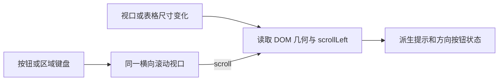
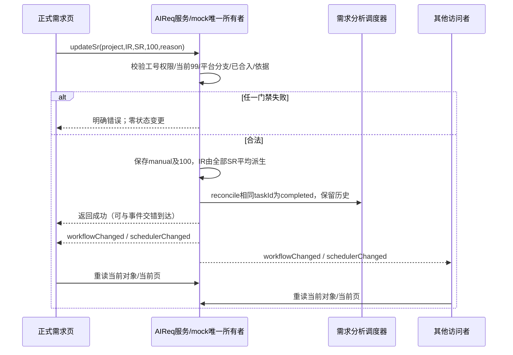
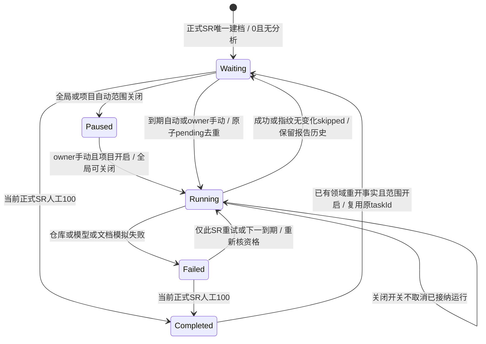
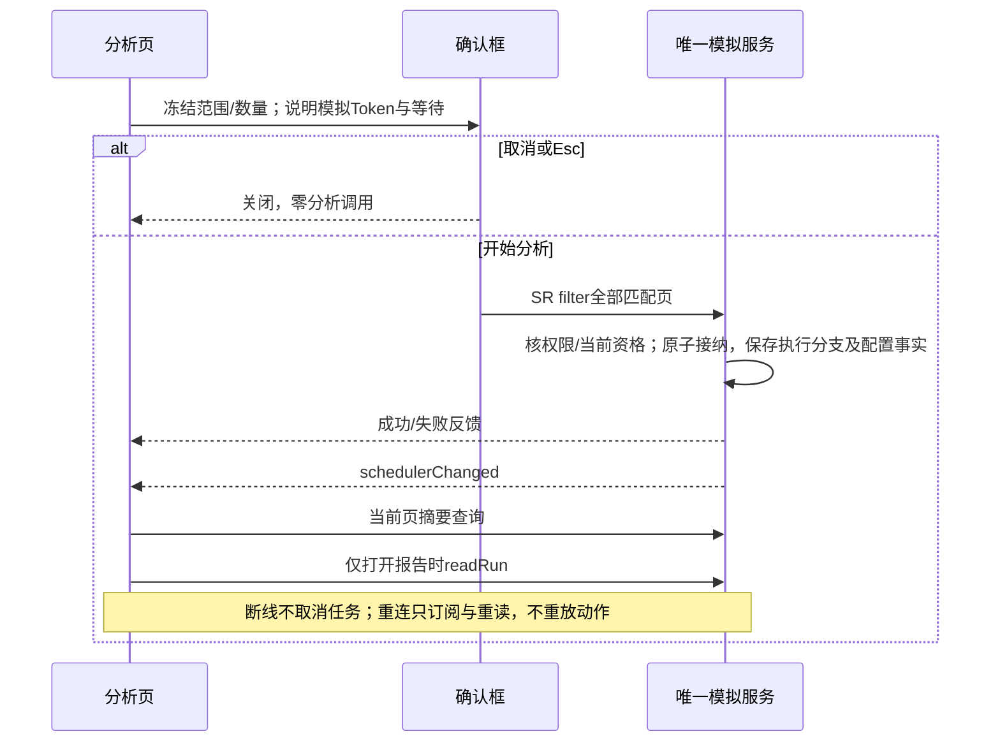

# 正式需求与统一分析迁移规格

状态：实现已集成，验证进行中；本文件按当前源码同步接口与所有权，不表示整体验收或全部浏览器门禁通过。当前范围为正式需求与需求分析；Issue 已按 `integration.md` 裁撤节删除，此前 Issue 迁移要求及验收义务不再生效，历史观察不代表当前产品能力。最终权威证据由主集成追加至根 `todo.md`。源仓库只读，目标不依赖源绝对路径、不接真实模型/Git/MR/数据库/认证。

## 1. 依据与实际开放装配

源路径以下以 `S = F:/code2026/oh-my-pi/packages/aireq-frontend/`、`U = S/packages/ui/src/aireq/` 表示；这些仅为调查定位，不得进入目标运行时依赖。

- 产品依据：目标 `todo.md:135-162`；源 `openspec/specs/aireq-browser-workbench/spec.md` 的“正式需求大表格与同页报告”“代码证据、百分比与完成条件”“项目范围与统一 SR 分析调度”“需求分析后台刷新不扰动阅读”“Issue 独立登记、分析与进度跟踪”“手动批量分析须先确认成本与范围”“正式需求切行只更新右栏”“进度与分支约束在原型后端同样生效”及项目切换条款。
- 实际链路：`S/app/AIReqApplication.tsx` 对正式对象不绑定开发 session；`S/packages/ui/src/app-shell/WorkspaceShellLayout.tsx:1723` 按 `workspaceMainView` 装配 Issue 三页、需求分析或 `AIReqFormalWorkspace`；`DeferredWorkspacePages.tsx` 懒加载需求分析。不是仅因文件存在认定开放。
- 导航链：`U/AIReqSidebar.tsx:54-60` 正式入口及三个 Issue 按钮；需求分析在 Skill 设计之后、正式需求之前，Issue 在正式需求之后。正式页无左侧 IR/SR 树，登录默认需求分析由主壳规格负责。
- 数据链：`S/backend/prototype-data-source.ts` 每个后端样例作用域创建一次 `createPrototypeProgressScheduler`、`createPrototypeIssues`；`readWorkflow` 叠加 progress/planning 投影；`S/backend/scope.ts:46-58,77-79` 将 workflow、scheduler、issues 事件与相应写入口公开；`S/client/remote-data-source.ts` 为现有网络适配参考。
- 当前契约 `S/backend/contract.ts` 是 **version 3**。README 中旧版 contract/version、历史任意人工百分比、94% 直接完成及旧布局记录不是当前合同。
- 原版仅作为功能、字段和业务操作语义依据；架构、控件、布局、配色、字体与显示只以当前检出的 ZCode、`DESIGN.md`、当前 `components/ui/`、`styles.css` 与现有壳为准。源坐标、宽高、默认分区比例和旧主题不构成视觉验收标准，不对比 upstream/base；已有合理业务布局不重建。
- 自动化、需求分析、正式需求的业务页标题统一使用 `text-ui-page-title font-medium tracking-[0.114px]`：默认字号 30px、行高 34px，字号为 `--ui-font-size + 16px`；电脑窄窗口也保持同级，不使用 Settings 专用标题 token。不调整页面顶部留白。

正式需求与需求分析沿用全宽外层纵向滚动、`SETTINGS_FRAME_CONTENT_CLASSNAME` 的 4xl 居中内容列、原生主题控件与字号；标题、筛选、表头和表格行随页面滚动，详情面板独立滚动。表格按以下四列信息组重新排版，以弹性列和单元格辅助信息行适应约 832px 的正文宽度，取消 1168px／864px 的旧最小宽度；仅较窄内容面板保留约 640px 表格最小宽度和横向滚动。不隐藏字段、不缩小字号、不改变既有业务状态、计算或权限。

正式需求、SR 任务与执行历史表头按 `base` 快捷键列表的 `bg-surface` 层级呈现，不再与页面同用纯 `bg-background`。普通表头单元格透出同一层 surface；正式需求横向固定的首列表头以不透明 background 为底、叠加一层 surface，避免横向滚动透字以及半透明 surface 重复叠加造成深浅不一致。表头不额外响应行悬停底色。仅调整三张表头，不改字号、布局或业务行为；本轮不运行浏览器。

本轮按需求选择的直接源码参照均来自 `fec97590`：页面框架采用 `SettingsPage.tsx:1749` 与 `settings/SettingsPageParts.tsx:22-23` 的外层纵向滚动及 4xl 内容列；多列表格参考 `components/ai-elements/markdown-table.tsx:1231-1245` 的普通内联模式，列宽溢出仅在表格内部横向滚动，不套用其预览弹窗的固定表头，也不引入复制／下载等额外功能；多行与分页参考 `resource-manager/NetworkSection.tsx:7,137-165`（100 行分页、仅横向滚动的表格和普通表头），保留需求分析已有分页合同，不照搬其页大小。项目管理会折叠字段、每次追加 50 行，ArtifactTable 则有内层限高、固定表头和 200 行截断，均不符合本轮“保留全部列、外层纵向滚动”的完整要求，不作为主参照。

### 四列信息分组与保留规则

- 正式需求：**需求**（IR／SR 标题、编号、完成数量、展开／收起）；**状态与问题**（状态、语义色、百分比、进度条、问题数量）；**人员与计划**（IR 负责人或 SR 开发人员、分配／调整、AI 建议／人工确认、明确分行的开始／结束、未排期）；**开发与分析**（分支及复制、依赖及原因、排期协调提示、最近分析）。
- SR 任务：**需求与项目**（标题、项目／IR／SR）；**状态与进度**；**分支与分析时间**（分支及复制、明确下次／最近）；**操作**（报告、原因、重试）。
- 执行历史：**需求与项目**；**执行信息**（分支及复制、时间、定时／手动、耗时）；**结果与进度**（状态、执行前后百分比）；**操作**（查看详情）。
- 开始／结束日期保持各自含义；IR 汇总、SR 明细和状态计算继续读取现有函数。标题允许换行；分支、依赖必要截断时通过鼠标和键盘可读完整内容，复制保持可用；排期协调原因也能键盘聚焦查看。操作保持可见，不只在悬停时出现，内嵌按钮仍阻止整行导航。
- 未新增数据 owner、服务或布局状态。保留搜索、项目／Release 与状态／人员筛选、IR／SR 展开、人员分配、排期编辑、依赖查看、分支复制、报告、分页及所有空态。正常正文宽度优先显示全部主要列，详情展开后按实际面板宽度允许横向滚动；接受合理增高的紧凑多行行布局。本轮只做非浏览器验证；常用桌面、较窄面板、长标题／分支和详情展开后的实际显示由用户验收。

### 横向溢出入口与行密度

- 只优化正式需求及两张分析表的滚动可发现性和正式需求行密度，保留外层纵向滚动、4xl 内容列、四组字段、语义色及字号。不因窄窗口隐藏操作或缩小字体。
- 三张表共用 tracking 内部横向滚动容器：仅实际溢出时显示明确提示与左／右原生按钮；工具条随页面滚动吸附在内容面板顶部，并受所属表格范围约束，不要求滚到长表格底部。无溢出时不占用额外高度；到边界时禁用相应方向按钮。视口宽度、表格内容尺寸、缩放或详情分栏变化时按实际 DOM 尺寸重算。
- 横向位置唯一事实是滚动视口 DOM 的 scrollLeft；派生的左右可滚动状态只用于提示和按钮。按钮或聚焦滚动区域后的左右方向键／Home／End操作同一视口，内嵌表单控件和分支按钮的键盘事件不被截获；不改写纵向滚动。
- 正式需求压缩单元格纵向 padding、段间间距及重复标签，将人员与排期来源并排、依赖标签与内容并排。保留所有字段、完整分支复制、可聚焦的依赖／排期原因、未排期提示，开始和结束仍分别成行且有明确标签；不限制长标题／多依赖的必要高度，不承诺未经浏览器测量的像素行高。
- 本轮遵照用户既有要求不运行浏览器。用隔离 DOM 验证溢出检测、滚动按钮、键盘边界、尺寸重算及事件隔离；实际窄窗口可见性、工具条吸附及行高由用户验收。

隔离 DOM 场景已通过：无溢出不显示工具条；583px 视口／640px 内容可通过按钮滚至右端，边界按钮正确禁用；左右键、Home／End操作同一 scrollLeft，单元格输入和带修饰键的快捷键不被接管；视口／内容尺寸变化重算边界、恢复无溢出时隐藏工具条、卸载时释放观察器。上述尺寸是测试几何输入，不是浏览器布局实测。

本轮非浏览器回归：Bun + JSDOM 挂载真实正式表、任务表和历史表，通过四列表头／四格行、长标题与分支字段保留、完整分支复制且不选行、IR 收起／展开且不导航、SR 行打开对应详情、历史报告传递正确执行 ID 和焦点还原触发按钮。测试使用内存样例和隔离的上下文／剪贴板边界，临时脚本已删除；JSDOM 提示 Canvas getContext 未实现，本场景不验证绘图或实际布局尺寸。浏览器的宽度、换行、横向滚动及详情展开视觉效果未验证。

本轮按用户指定的 `base` 字阶验收排期与合入说明：排期假设、待确认事项、可并行需求、原 AI 建议、人工调整说明、排期提醒、工号格式及项目时区提示，以及报告中的分支合入状态和版本判断均为辅助说明，使用 `text-ui-sm` 与现有语义颜色。SR 编号和提交哈希等弱元数据保持原字阶。浏览器须检查正式需求报告、开发安排及调整弹窗的实际可读性，不改变数据和状态所有权。

1100×450 桌面窗口中，需求分析内容自然撑高并由全宽外层页面纵向滚动，不能由顶部摘要和筛选项挤压表格；保留分页，取消表格内部纵向滚动和固定表头。分析报告的已实现、待完成、问题风险及代码活动为正文，使用 `text-ui-base text-foreground` 和正文行高；执行元数据保留辅助层级。

中性状态标签（分析待分析／暂停／跳过、正式需求待开发）保留 Badge 的字阶、尺寸和中性底色，但使用不透明 `text-foreground`，不得将关键状态文字降为半透明辅助色；成功、进行中、警告和失败仍使用既有成对语义色。

分析设置的“项目分析范围”“调度设置”折叠箭头按 `base` 的 trigger `data-state` 驱动旋转，展开与收起可见方向不同，不增加第二份展开状态。

需求分析任务与历史无结果时保留表头、筛选和分页，空态正文在带合理最小高度的空内容区居中。空表格不占据剩余视口高度；有数据时表格自然撑高，随页面纵向滚动。

本轮三项空态修复的 workspace freshness、typecheck、lint（0 警告／0 错误）及 architecture:check --changed（0 违规）均通过。未打开浏览器，面板收起文案、Issue 无结果摘要及分析任务／历史空态的实际位置由用户验收。

## 2. 逐项源 → 目标 → 可观察验收

以下页面已集成于 AIReq 业务模块；服务逻辑落在单一 MockAIReqService 内存域，页面经 hooks／UI canonical contract port 消费服务投影。`T` 为正式需求，`A` 为需求分析；覆盖行仍为必须观察的需求，不自动代表已通过。

统一调度器在 mock 启动时仅创建一个实例，所有浏览器、工号和查询参数共享其任务／配置／并发门禁。规模样例通过启动环境变量 `AIREQ_DEMO=analysis-scale` 选择，再打开 `/?demo=analysis-scale`；没有该启动配置时明确拒绝该具名样例，不为请求身份另建第二个调度器。规模样例保留真实正式 SR，不能使同一 SR 在普通与规模浏览器中各自并发执行。

### 2.1 第 6 节七项

| ID / todo | 已开放源功能及精确依据                                                                      | 目标页面/服务                                          | 可观察验收（包括反例）                                                                                                                                                                                                                                                                                                                                                                                                                                                                                                   |
| --------- | ------------------------------------------------------------------------------------------- | ------------------------------------------------------ | ------------------------------------------------------------------------------------------------------------------------------------------------------------------------------------------------------------------------------------------------------------------------------------------------------------------------------------------------------------------------------------------------------------------------------------------------------------------------------------------------------------------------ |
| T1 / 6.1  | `AIReqFormalProgress.tsx:51-147` IR/SR 表、搜索、状态及人员组合筛选、展开与统计             | 正式需求表；共享 workflow/progress 读取                | 四列为需求、状态与问题、人员与计划、开发与分析，原九列字段在行内完整保留；页面外层纵向滚动，内容列限宽 4xl 居中；较窄面板仅表格横向滚动并固定名称列，标题、筛选及表头随页面滚动。搜索名称/编号；“我负责的”含本人负责 IR 或任一所属 SR 开发人员，“指定负责人”仅精确匹配 IR 工号，“未分配”仅无 IR 负责人；目录选择在弹层，清除同时重置工号。当前匹配 IR 数与当前项目/Release IR/SR 总数分开，后者不随筛选变。无项目、无 Release、无需求、无匹配分别提示。筛选可自动展开匹配 SR，但手动收起有效且不污染无筛选偏好；无左树。 |
| T2 / 6.2  | `AIReqFormalWorkspace`、`AIReqFormalReport`、`AIReqMaterialsPane`；源 spec 切行局部更新条款 | 同页右栏“进度报告/需求材料”；只读材料服务              | 点 IR 汇总全部 SR，点 SR 只读自身，立即更新高亮；连续点选仅接纳最后一项响应。Root、表格、项目连接不重挂；筛选、手动展开、纵横滚动、标签、分栏宽度保留。右栏可拖拽/关闭，布局沿用当前 ZCode 可调整面板并按实际父容器保证表格与报告可读、操作可达，不以源默认比例或固定宽度验收。失败只在右栏显示目标与重试，不跳详情/开发聊天、不发消息/执行/Git。后台同目标读取保留旧报告，不用加载态卸载正文。                                                                                                                          |
| T3 / 6.3  | `AIReqRequirementPlanning.tsx`、`planning.ts`、`mock/planning.ts`、`mock/progress.ts:48-55` | IR 唯一负责人、SR 开发安排弹窗；progress/planning 服务 | 管理员分配单个 IR 负责人；管理员或该 IR 负责人改 SR 单个开发工号及起止。工号 `[a-z][0-9]{8}` 保留前导零；SR 可清空开发人，负责人不能为空，目录外合法工号可保存。日期 Asia/Shanghai、分钟精度，必须同时填或同时清空，结束严格晚于开始；坏日期/无权/对象不属 IR 时拒绝且保留输入。保留原 AI 建议、人工来源、修改工号/时间。依赖先后、前置无排期、人员时间重叠为持续提醒，允许保存而不移动其他 SR。IR 开始取最早 SR 开始，结束取最晚 SR 结束，有缺项标不完整；提案工作日不换算正式日期。                                    |
| T4 / 6.4  | `BranchCopy.tsx`、正式表格第 129 行、`trackingBranch`                                       | 开发分支列；共享复制组件                               | SR 直接显示真实 `trackingBranch.name`，不以“复制分支”或“已复制”替换名字；长名字沿用表格截断，悬停/键盘聚焦可见完整名字。成功原位勾选图标及可访问播报，剪贴板拒绝反馈失败；共享复制控件不保留无人使用的 compact 展示选项。列宽沿用当前 ZCode 表格布局，不以源固定 112px 验收。访客也可复制，点击/键盘停止冒泡，不选行、不变 URL/筛选/展开/滚动、不调用 Git。IR 显示“见各 SR”。缺失/空白映射明确“开发分支缺失”，禁止复制和完成；禁止分析分支/旧执行记录/猜测 `sr/<id>` 兜底。                                              |
| T5 / 6.5  | `progress.ts:34-41`、`ConfirmProgress`、`mock/progress.ts:57-69`                            | SR 报告人工确认 Dialog；后端进度门禁                   | AI 输出只能 0～99。当前 SR 必须存在 AI 报告、原始 AI percent 恰为 99、平台分支非空、已核实合入；管理员或该 IR 负责人填写非空依据才能设 100。无任意百分比输入；直接 RPC 传 94/99/负数/101/NaN、缺报告/分支/合入/权限/依据均拒绝且零变更。禁用按钮旁显示具体可访问原因。100% 显示“人工确认”及判断工号/时间/依据，旧 AI 问题/代码证据标为此前报告，不冒充新分析；重复确认不重复生成记录。                                                                                                                                   |
| T6 / 6.6  | `progress.ts:6-30` 的 `srProgress/irProgress/progressLabel`                                 | IR 派生展示；无 IR 进度写接口                          | IR 取全部所属 SR 的算术平均（不按当前筛选子集、工作日或人员加权），无 SR 为 0。最多一位小数；非精确 100 最高显示 99.9，不能舍入成完成。全部 SR 100 才 IR 完成；全 0 待开发；有待开发/开发中则开发中；余下有待合入则待合入，否则待验收。人员/排期/提案合入不增进度。                                                                                                                                                                                                                                                      |
| T7 / 6.7  | 新转正数据及 `AIReqFormalReport:187-202`、`mock/progress.ts:29-31` 无样例不添报告           | 转正接入、正式报告、分析任务建档                       | 同一稳定 IR/SR 转正后保留平台分支映射与基点，新 SR 0%、待分析，无其他记录的时间/代码版本/问题/结论；提案文档合入基点不成为代码分析版本。首次分析前报告明确无证据，AI 与人工记录分开；读失败不能退回其他 SR 或预置报告。                                                                                                                                                                                                                                                                                                  |

### 2.2 需求分析可验收项

| ID / todo           | 已开放源功能及依据                                                   | 目标页面/服务                                | 可观察验收                                                                                                                                                                                                                                                                                                                                                                                                                                                                          |
| ------------------- | -------------------------------------------------------------------- | -------------------------------------------- | ----------------------------------------------------------------------------------------------------------------------------------------------------------------------------------------------------------------------------------------------------------------------------------------------------------------------------------------------------------------------------------------------------------------------------------------------------------------------------------- |
| A1 / 7.1.1          | `AIReqRequirementAnalysisPage.tsx`、`progress-scheduler.ts`          | 独立需求分析、分析设置、分页服务             | 项目范围表支持项目名称检索、开关、待分析/运行数、最近结果；主页紧凑摘要，设置收在 Dialog。SR 任务/执行历史 Tabs，项目→IR 联动、SR 名称/编号搜索；历史再按状态/起止时间，反向时间报错不提交查询。任务状态 waiting/running/failed/completed/paused；历史 running/succeeded/failed/skipped；每行项目/IR/SR、分支、进度、下次/最近时间及操作可达。失败行“原因/重试”、报告弹窗按 ID 读取，显示仓库读取/模型调用/文档读取阶段、原因、下一步、可重试说明；单 SR 重试仅作用精确项目/IR/SR。 |
| A2 / 7.1.2          | `mock/progress-scheduler.ts` 的 reconcile/admit/advance              | 后端唯一需求分析调度器                       | 每个 `(projectId, irId, srId)` 一条稳定任务，无每 SR timer/cron。新项目关闭；全局默认 60 分钟，安全正整数并校验下一周期日期可表示。自动仅接纳项目开启、到期、未完成、未运行的 SR；全局关只停自动，项目关同时排除手动；关闭不取消已接纳任务或删历史。同 SR 并发去重，单条失败不阻塞其余；未变需求/代码指纹显示 skipped。已完成记录保留、自动排除；若已有领域动作重新打开，复用任务并重新判断开关，不新增 SR 重开产品入口。                                                           |
| A3 / 7.1.3          | `mock/progress-scheduler.ts:140-186,247-261`；source spec 规模场景   | 后端 analysis-scale 具名样例；25/50 服务分页 | 初始恰 300 SR 任务、1000 历史，普通和规模走同一服务实现，不污染正式需求列表；后续执行历史可增长，重启恢复初始。默认 25、可选 50，只返回当前页摘要/total/page/pageSize/eligibleCount；报告仅按需读取。首尾页实际行数可核对，任务/历史各留页码，筛选改回第一页，数据变少夹合法页。历史必须保留执行时分支、需求/代码证据及模型配置事实，改配置不改旧记录。                                                                                                                             |
| A4 / 7.1.4          | `AnalysisRunConfirmation`、analysisRequest 冻结 filter；`BranchCopy` | 批量确认、报告 Dialog、复制/重试             | 按钮只在任务页；打开确认冻结当前任务 filter 与提示数量，明确全部匹配分页；取消/Esc 零调用，默认焦点取消，仅开始分析提交。说明模拟 Token 成本与等待，不伪造实际耗用/耗时；受忙态/权限控制，服务接纳时重核资格。同一页数超过 25/50 时分析数可大于本页。报告关闭恢复触发控件焦点；复制完整分支成功/失败反馈；无权、项目关、完成、运行中重试禁用且说明。                                                                                                                                |
| A5 / 7.1.5          | `useSchedulerQuery`、`QueryFeedback/UpdateFeedback`；源 spec:462-466 | 需求分析查询 hook、固定状态区                | 首次读取及主动换范围有加载态；后台事件重读保留表格节点、滚动、报告、筛选，固定高度底部区域显示错误/重试，不插顶部提示。错误在重试中保留到成功。查询键含范围/页/标签/选中 run；旧请求晚到不可覆盖新选择。换筛选/页/标签关旧报告，后台同查询不强关。订阅持续，状态/计数实更新，不能用冻结 UI 消除抖动。                                                                                                                                                                               |
| B1 / 7.2.6 需求范围 | 源 `AnalysisRunConfirmation` 和 scheduler.runNow(filter)             | 需求分析批量接纳                             | 确认冻结项目/IR/SR/搜索，覆盖所有分页匹配可接纳 SR，历史状态/时间不影响；关闭项目、100%、运行中排除。确认后数据改变由服务重新核资格，不承诺旧数量必然接纳；重连不自动再提交。                                                                                                                                                                                                                                                                                                       |

## 3. 领域 ID、唯一状态所有者与权限

### 3.1 领域契约沿用而非简化重造

- 保留 `AIReqRequirementGroup` 的 projectId/releaseId/id/revision/srIds/snapshot/files/srDependencyFile/ownerEmployeeId；保留 `AIReqSystemRequirement` 的 projectId/irId/id/documentPath/trackingBranch/progress/planning/solutionAnalysis。正式对象必须由后端验证项目、Release、IR、SR 真实归属，不凭字符串相同跨项目匹配。
- `AIReqProgressAnalysis` 保留 percent、merged、certain、branch、analysedAt、codeVersion/defaultVersion、implemented/remaining/issues/activity、manual；manual 是工号/依据/时间，不能被 report 文本替代。
- `AIReqSrPlanningInput/AIReqSrPlanning` 保留 developerEmployeeId、plannedStart/plannedEnd、source、assumptions、suggestion、updatedBy/updatedAt；当前模型是最新修改记录，并非源中不存在的完整审计系统，不额外造审计数据库。
- `AIReqAnalysisTask/RunSummary/Run/Failure/Filter/HistoryFilter/Page/Snapshot` 保留源字段和联合状态；taskId 使用稳定三元组键（源 JSON.stringify([projectId,irId,srId])），不是标题/行号；runId、batchId 独立稳定，批量同 batch。历史分支是运行事实，不从当前任务现读。
- `AIReqAgentModelBinding` 保留 role、roleName、modelKey/name、providerId/modelId、reasoning、inherited、configurationRevision。需求分析 Run 保留接纳时的 modelConfig 快照，不能丢失历史配置事实，也不构造真实模型调用证据。

| 状态                                                        | 唯一所有者                                                                              | UI 可持有内容                                |
| ----------------------------------------------------------- | --------------------------------------------------------------------------------------- | -------------------------------------------- |
| 项目/Release/正式 IR/SR、映射分支、材料与版本               | 单一 MockAIReqService／AIReq 共享内存域；native 消息与附件另归既有 MockRuntime v4 owner | 当前查询只读投影，无第二业务或聊天存储       |
| IR 负责人、SR 人员/计划、AI 报告/人工完成记录               | 同一 mock 域中的 progress/planning 子状态                                               | 弹窗未保存输入、查询结果                     |
| 唯一需求分析配置、项目范围、时钟、任务、pending、指纹、runs | 同一服务生命周期的需求分析调度器                                                        | Tabs、筛选、页码/size、打开报告 ID、只读缓存 |
| 操作者工号与原型 owner capability                           | 目标既有操作者/连接上下文                                                               | 显示工号；不可用全局可变工号代替请求上下文   |
| 分栏宽度/展开偏好/焦点/滚动、未发送表单                     | 浏览器该用户/页面作用域                                                                 | 可按现有偏好设施持久化；不存业务数据库       |

设置所有者、正式管理员与普通登录工号不是同一规则：源正式管理员为 `j00808874`，IR 负责人可排期/确认但不可重新分配 IR 负责人；设置写权限沿用共享 Web owner capability，需求调度全部写入口要求 owner。工号并非认证，不增加真实 RBAC、多租户或人员服务。所有人可读/筛选/分页/看报告/复制，不能因只读把整页藏掉。前端禁用/隐藏不替代后端校验。

## 4. 服务、事件与失败合同

当前经 `IAIReqService`／`IServiceAccessor.aiReqService` 和现有同源 `/ws` 二进制 Channel RPC；实际 tuple/result 为 `packages/services/src/aireq/remote-operations.ts` 的 `AIReqRemoteOperations`，UI 页面经 `../contract.ts` 选择性 port 消费服务合同／纯派生。下表保留源到目标业务映射，不沿用旧 HTTP 或增加进程，不包装成 v4 命令／伪造 subscriptionId/seq/logEpoch。源 void 写入在当前 wire 返回 null；`readRun` 未找到为 null 并由 UI 明确提示，不把 null envelope 硬套 v4 ACK。

| 源 version3 方法                    | 参数 → 结果                                        | 目标语义 / 事件                                                                                  |
| ----------------------------------- | -------------------------------------------------- | ------------------------------------------------------------------------------------------------ |
| readWorkflow                        | AIReqSelection → workflow view 与只读材料上下文    | 项目/Release 正式列表与同页选中对象投影；读取无阶段/任务副作用                                   |
| progress.assignOwner                | projectId, irId, employeeId → void                 | 原子分配负责人；workflowChanged，触发相关投影更新                                                |
| planning.updateSr                   | projectId, irId, srId, AIReqSrPlanningInput → void | 原子更新安排及修改记录；workflowChanged                                                          |
| progress.updateSr                   | projectId, irId, srId, percent, reason → void      | 仅 percent=100 且门禁通过；workflowChanged 后调度 reconcile，发布 schedulerChanged               |
| progressScheduler.read              | 无 → AIReqAnalysisSnapshot                         | 全局配置、项目摘要、IR 筛选元数据和总量；不得带全量报告                                          |
| progressScheduler.queryTasks        | filter, page, pageSize → TaskPage                  | 服务端筛选/分页，eligibleCount 是全部匹配可接纳数                                                |
| progressScheduler.queryRuns         | historyFilter, page, pageSize → Page<RunSummary>   | 仅摘要，按 startedAt/id 最新排序                                                                 |
| progressScheduler.readRun           | runId → Run 或未找到                               | 只读单报告、失败诊断及运行时事实；未找到明确反馈                                                 |
| progressScheduler.setProjectEnabled | projectId, enabled → void                          | owner；已存在项目；schedulerChanged                                                              |
| progressScheduler.configure         | enabled, intervalMinutes → void                    | owner；先验完整检查后变更；schedulerChanged                                                      |
| progressScheduler.runNow            | AIReqAnalysisFilter → void                         | owner；冻结过滤全部匹配，原子去重接纳；schedulerChanged                                          |
| progressScheduler.advance           | 无 → null                                          | owner；受控模拟推进，非真实模型执行；服务生命周期亦每五秒推进已接纳 running 任务，不依赖页面存活 |

需求跟踪使用 `workflow`、`scheduler` 事件通知后重读，事件不是浏览器写业务副本的依据。写操作须先在唯一所有者提交合法状态，再发布失效事件；事件可能在 RPC 返回前抵达，UI 不假设两者先后，只把成功返回作为操作反馈，把读回当前状态作为展示事实。同一对象变更顺序由服务端串行/原子接纳保证，客户端以查询 generation 只接纳当前查询最新有效响应。

错误沿用源 `NOT_FOUND/FORBIDDEN/INVALID_IDENTITY/INVALID_ARGUMENT/BACKEND_UNAVAILABLE` 等语义并按目标错误体系承载；失效对象/跨项目/无权/坏日期/坏分页或服务失联不伪装空样例。材料未生成、缺失、失败、过期是不同状态；只读正文未返回不能由元数据冒充。失败保留输入、对象及已读内容；首次失败有重试，后台失败在固定底部状态区，连接异常与业务失败分开。报告历史在需求/代码/配置更新后仍是历史，不改写成新结论；当前材料过期不能沿用旧图/确认。

### 4.1 幂等与重连

1. SR task 按稳定三元组建档；重复转正、重命名、配置或查看不建新任务。同 SR pending 占位与 run 创建必须原子处理，连续点击/多客户端并发不能重复接纳。同样的完成确认不重复写人工记录；不满足前置条件返回明确原因，不假报新成功。
2. 浏览器刷新/断线/关页只释放该连接订阅，绝不 dispose 共享调度器/取消已接纳 pending。重连建立订阅并读取当前 snapshot、当前页及必要已开报告；不自动重发完成确认或 runNow，也不按旧响应恢复过期选择。mock 服务重启才恢复初始样例；重启后旧 runId 不存在要明确显示，不悄悄匹配同标题。
3. 需求 scheduler 保留虚拟时钟 `advance` 和服务端 pending；MockAIReqService 每五秒推进已接纳的 running 任务，页面不创建 per-SR timer；不冒称真实模型／仓库分析。
4. 需求 scheduler 执行报告不覆盖正式需求已有 progress；正式表格固定证据样例与后续人工确认仍由 progress 子状态所有者管理。不能为了“有变化”让模拟执行虚增完成度。

### 4.2 事件与状态顺序

## 5. 已裁决冲突，不留 fallback 或隐藏功能恢复

| 冲突/源偏差                                                                                                                       | 目标裁决                                                                                                                                                                                                                    |
| --------------------------------------------------------------------------------------------------------------------------------- | --------------------------------------------------------------------------------------------------------------------------------------------------------------------------------------------------------------------------- |
| README:158 允许 trackingBranch 后读分析分支 fallback；scheduler/mock progress 也用 `progress.branch ?? trackingBranch ?? sr/<id>` | 按 todo 6.4 和最新源 spec，**平台映射是正式 SR 当前开发分支唯一来源**。删除目标任务/正式报告生成中的猜测 fallback，缺失报异常且阻止完成；历史 run.branch 仅展示历史执行事实，不能反填当前映射。样例从后端明确提供合法映射。 |
| README 与源实现/spec 的正式右栏默认比例及最小／最大宽度不同                                                                       | 这些数值仅是源历史布局记录，不再裁决目标视觉。正式需求保留同页右栏及拖拽/开合功能；尺寸与显示沿用当前 ZCode 可调整面板和实际父容器，不为匹配源几何重建布局。                                                                |
| README 旧验证曾人工任意调百分比、94%直接完成                                                                                      | 不迁移；当前前后端均仅99→100门禁，无人工0～99编辑，无用于伪造合入/代码证据的新增按钮。                                                                                                                                      |
| 源 scheduler Run 无模型配置字段，todo 要求历史配置事实                                                                            | 补运行时 binding 快照；不改历史，不构造真实调用证据。                                                                                                                                                                       |
| 源 workflow/types 中残留 startSr、执行阶段、交付/验收动作和个人目录                                                               | 不作为 tracking 开放功能迁移，不通过复制 import 图恢复开发聊天/Agent/旧目录模型。仅保留当前所需领域数据、只读材料及业务派生。                                                                                               |
| 源有独立 HTTP/事件 WS/worker、冻结客户端和真实 OMP/数据库目标文字                                                                 | 只迁业务含义与事件，不复制部署；目标服务 RPC 集中 mock 装配，不引入第二进程、宿主、真实持久化。                                                                                                                             |
| 源 spec 早期允许左侧开合，后续条款始终展开                                                                                        | 源开合与展开几何不约束目标导航；以当前 ZCode 导航和布局为准，不恢复已裁撤功能。                                                                                                                                             |

## 6. 精确源依赖与建议迁移文件闭包

以下源闭包保留为历史调查依据；当前目标已落地并登记 aireq-contract、aireq-ui、aireq-mock managed 模块，owner 为 requirements。服务合同为 app 层、server 为 adapters 层、UI canonical contract.ts 为 contract 层，其余 UI 为 ui 层；不是尚待创建或登记的模块建议。

### 6.1 源直接业务闭包与应抽取内容

| 源文件（相对 U，除非标 S）                                                                                                                            | 本模块所需符号/内容                                                                      | 迁移处置                                                                       |
| ----------------------------------------------------------------------------------------------------------------------------------------------------- | ---------------------------------------------------------------------------------------- | ------------------------------------------------------------------------------ |
| `AIReqFormalProgress.tsx`                                                                                                                             | AIReqFormalTable/Report/Workspace、ConfirmProgress、状态和报告组织                       | 迁业务布局与操作，不复制源 WorkspaceSidebarToolbar/store/theme 通用实现        |
| `progress.ts`、`planning.ts`                                                                                                                          | 全部纯进度/时间/冲突派生                                                                 | 迁为纯领域辅助；补范围验证并使用已确认平台映射                                 |
| `AIReqRequirementPlanning.tsx`、`AIReqEmployeePicker.tsx`                                                                                             | AssignOwner、Dependencies、EditPlanning、PlanningSummary、工号弹层                       | 迁当前正式入口所需部分，提案预估共享实现归提案模块，不复制业务所有者           |
| `AIReqRequirementAnalysisPage.tsx`、`progress-scheduler.ts`                                                                                           | 查询 hook、项目配置、分页/任务/历史/报告/失败/重试和完整领域接口                         | UI 重接目标服务，保留后台刷新语义；契约放 services/shared 公开边界             |
| `AnalysisRunConfirmation.tsx`、`BranchCopy.tsx`                                                                                                       | 两分析页共享确认与复制合同                                                               | 迁为本模块共享业务控件，复用目标 AlertDialog/剪贴板能力而非另造公共库          |
| `types.ts`                                                                                                                                            | 上述第3节列出的当前领域字段、模型绑定类型                                                | 从共享领域合同复用/迁移，删除本迁移不需要的执行动作及别名，不整包带旧命令      |
| `identity.ts`、`data-source.ts`、`AIReqContext.tsx`                                                                                                   | 工号格式、capability、选择/刷新公开语义                                                  | 由主壳公共层提供，页面适配；不是将源全局状态带入目标                           |
| `sr-dependencies.ts`、`domain.ts`                                                                                                                     | readSrDependencies/srDependencyMap/parallelSrIds、当前方案版本有效性及正式选择           | 提案共享领域公开入口；不复制另一份依赖事实                                     |
| `AIReqWorkbench.tsx` 中 `AIReqMaterialsPane`、`AIReqMarkdownDocument.tsx`                                                                             | 只读 IR/SR/方案/依赖材料、路径/正文/缺失失败/过期                                        | 由材料公共实现复用；不得整文件拉入旧工作台/聊天依赖                            |
| `mock/progress.ts`、`mock/planning.ts`                                                                                                                | 样例报告/负责人/计划、写入校验及记录                                                     | 搬到目标 server，浏览器不得 import；去掉分支 fallback，不扩大固定证据样例      |
| `mock/progress-scheduler.ts`                                                                                                                          | 唯一调度器、指纹、pending、分页、300/1000 样例、三类失败                                 | 搬到目标 server；服务生命周期共享，不在每连接 dispose                          |
| `mock/workflow.ts`、`mock/project-settings.ts`、`mock/project-releases.ts`、`mock/materials.ts`、`mock/proposal-flow.ts`                              | getPrototypeWorkflow/prototypeWorkflowChanges、项目/Release/正式样例/依赖/方案有效性投影 | 依赖公共项目/提案所有者；只抽当前读投影/fixture，不迁 workflow.ts 整体执行分支 |
| `mock/agent-models.ts`、`mock/backend.ts`、`mock/events.ts`                                                                                           | 模型绑定快照、settingsWrite、事件                                                        | 公共设置/身份/事件适配，禁止另建工号全局副本                                   |
| `S/backend/contract.ts`、`S/backend/call-validation.ts`、`S/backend/scope.ts`、`S/backend/prototype-data-source.ts`、`S/client/remote-data-source.ts` | version3 的方法参数/结果/错误/事件/共享生命周期参考                                      | 映射目标正式 services/RPC；不复制旧 HTTP/worker/第二客户端/Node 进入 browser   |

源 `mock/workflow.ts` 的真实导入图另含 `sr-delivery.ts`、`ir-acceptance.ts`、`project-directories.ts`、`proposal-pr-handoff.ts`、`requirements-review.ts`、`proposal-delivery.ts`、`recovery.ts` 等；前两者属于退役执行流水线，不能因为被 workflow 引用就纳入 tracking 迁移闭包。提案评审/入库/故障材料由对应提案公共实现按可达功能提供，tracking 只依赖正式只读投影与变更事件。此抽取边界是必要切割，不是遗漏源运行时隐性依赖。

### 6.2 当前目标实现闭包

- `packages/ui/src/aireq/tracking/` 包含 `FormalProgress.tsx`、`RequirementPlanning.tsx`、`RequirementAnalysisPage.tsx`、`BranchCopy.tsx`、`AnalysisRunConfirmation.tsx`，并按 `formal/analysis` 拆分读取与页面子区。页面依赖根 AIReqContext/data-source、根 canonical `contract.ts` 和局部业务 port；不直接从 services/server 或源仓库导入。
- 共享领域类型／纯派生落在 `packages/services/src/aireq/` 的 types、progress、planning、progress-scheduler 等实际职责文件，由 `@zcode/services/aireq` 公开，再由 UI contract 具名选择；不另造 tracking.ts 简化领域或 types/domain 兼容层。
- 服务接入已使用 `IAIReqService`、accessor `aiReqService`、channel `aireq` 和当前 RemoteServiceAccess。`createMockServices` 仅创建一次 MockAIReqService，注册 remote，并传同一对象给使用现有 MockRuntime 的原生会话服务；无第二传输／AIReq 状态表。
- server 有 `progress.ts`、`planning.ts`、`progress-scheduler.ts`、fixtures 等内存实现；业务读写与分析均由同一 AIReq owner 组织，不按浏览器／连接重建，不在 mock/domains 再装配一份。
- 主壳为 `packages/ui/src/aireq/shell/AIReqApplication.tsx`／`AIReqShell.tsx` 和根 AIReqContext；不再以旧 WorkspaceShellLayout 接入。旧产品专属 App/Root 入口已移除，通用布局／组件全部保留；正式表、默认分析和历史导航语义不变。
- 后续行为改动仍先读 architecture-governance，触及项目/workspace/session 时读 session-management；模块合同与规格同步，源码集成不自动等于最终类型／架构／浏览器验收。
- 新移植源码遵守默认 800 行限制；巨大源 workflow 必须按当前开放职责拆分并裁撤死执行逻辑，不能关闭 lint 绕过。tracking 本身没有首次消息发送、草稿 handoff 或输入辅助入口，不创建 SessionPane/ConversationComposer 副本；提案/Skill 如需共用确认或材料入口只依赖其公开业务组件合同，聊天最小可选扩展由提案/工具规格负责。

### 6.3 复用组件可观察合同

目标现有 `components/ui/button/input/textarea/label/select/badge/progress/switch/tabs/popover/dialog/alert-dialog/resizable/tooltip` 为唯一基础；表格用目标原生 table/已存在表格原语，不复制源 Markdown 聊天工具栏。UI 字阶 `text-ui-*`、主题语义 token；浅/深/系统和窄电脑窗口可用。

- BranchCopy：`branch: string, compact?: boolean, onMessage(message)`；不代查分支、不做业务写入；所有访问者可用、停止选择事件，完整值悬停/聚焦、成功/失败可访问反馈。
- AnalysisRunConfirmation：受控 open/count/unit/scope/disabled/onConfirm；默认焦点取消、Esc/取消不调用，忙态防连点；需求分析覆盖所有匹配分页。
- 读写 Dialog：取消不提交、失败保留输入与目标，桌面限宽、最大 85dvh 内滚动；报告仅单一关闭入口并还原焦点。
- 正式需求分栏布局只按实际父面板宽度，右栏开合/拖动不重建业务连接，不把固定旧宽度带入窄电脑窗口。
- 正式表沿用当前 ZCode 工作区布局和原生控件，按实际父容器保证字段、筛选、操作可达；不把源最大宽度、边距、顶栏高度作为视觉验收条件。长表内部横滚，详情独立纵滚，固定反馈区不扰动正文。
- Sketch 粗细指示点用当前 foreground、选中边框用 brand，成功／错误提示使用对应语义表面及前景配对；iframe 通过既有 onLoad 变量复制获得实际所需 token。真实画笔调色板及画布内容颜色保持不变，不另建色板或主题传输机制。本轮只记录修复机制，尚未执行验证。

## 7. 验收场景清单与已观察证据

以下六项保留完整场景义务，是验收清单而非逐项已测声明；实际观察在其后单列，最终判定由根 `todo.md` 记录。

1. 用管理员、IR负责人、普通合法工号分别验证分配/排期/完成/设置写限制；直接服务调用同样拒绝无权与非法百分比，不只看禁用态。
2. 正式表多条件筛选、指定负责人/未分配/我负责差异、展开与清除、全量平均（含0 SR、接近100但未完成）、键盘/鼠标复制及拒绝剪贴板；连续切 IR/SR 令旧请求晚到，表格/标签/宽度/滚动不重置。
3. 转正新 SR 0/待分析、合法分支且无代码证据；缺失分支、无报告、94、99未合入、99已合入分别验证门禁，成功保留判断记录和旧报告。
4. 300/1000 样例首尾页实际行数、25/50、任务/历史各自页码、联动筛选/时间、页夹取、按需单报告、全筛选跨页确认/取消、失败单 SR重试/并发去重、开关关闭不取消已接纳任务、成功/失败/skipped历史。
5. 后台读失败固定区重试、报告仍开、滚动不跳；刷新/断线/关页已接纳任务不消失，重连不重复创建/完成/分析；服务重启恢复样例并正确报告旧对象不存在。所有结果明确模拟，不以源 README 旧验证或源码阅读冒充目标运行验收。

主集成 Chrome（精确终验版本见根 `todo.md`）此前已观察；其中像素、宽度与拖动距离仅为历史测量证据，不再作为视觉验收标准，也不代表本轮修复已经验证：

- 正式表搜索＋“待合入”筛为1个IR，项目总量仍5 IR/10 SR；SR报告同页可读，材料标签及切IR保留查询、展开和scrollLeft300。真实指针拖分隔条90px使表宽805→715，无文档横向溢出；切行保留已选材料标签/宽度。
- 负责人目录搜索“陈宁”显示两名不同工号/部门，选择 `j00808876` 仅更新IR dashboard负责人。SR audit开发人 `j00808875`、人工11月11→12日保存，原AI建议11月18→20日与修改人/时间保留；依赖与同人重叠只提醒、不自动移动。结束11月12日早于开始14日时明确Save拒绝“计划结束时间必须晚于开始时间”，输入保留；此前大写工号也已拒绝。
- SR session 99% 未合入和 auth 72% 禁止完成；export 99% 已合入填写人工依据后 100%，旧 AI 报告保留。IR auth 的全量均值 61.2% 与 export 所属 IR 100% 已观察；错误百分比及未合入门禁均保留。提案转正的新 SR 为 0／待分析且无伪代码证据。分支复制先实际反馈剪贴板权限拒绝，随后复制成功并实际读取 `sr/sr-session`。
- Issue三个页面均已打开；新项目无Release可创建稳定 `ISSUE-0007`/映射分支、0%。搜索仅1条时确认框仍为项目全部4个未完成项，取消不增历史，再明确运行全部4项。此前Issue3合入99→人工100→有原因重开99、visitor共享读取且IR不变已观察；当前Issue2未合入99禁止完成。
- 同项目Release十一月→十二月保留所选Issue2/报告；切项目保留Issue功能页并清对象，侧栏Back/Forward恢复项目。此前刷新保留已接纳状态、mock重启恢复样例的观察不代替完整断线回归。

- 规模验证使用实际重启的同一个服务，启动环境 `analysis-scale` 下初始 300 任务／1000 历史；任务和历史的 25／50 分页均实际遍历各页，50 条时任务末页 6/6、历史末页 20/20。不是为浏览器另建调度器，不改变普通正式 SR 的唯一任务／并发门禁。
- 批量确认按全匹配 133 项而非当前 Mobile 末页计算；取消后历史仍 1000，明确运行后 1133 历史／133 running，无同 SR 并发重复。完成项排除；权限失败 SR 不阻塞其余任务，明确仅重试该 SR 后历史 1134。两项目关闭时范围显示 0/2，间隔 30 即时保存，再启用 Aurora；visitor 读到相同历史和配置且只读。
- 实际生产 SDK 连接下后台 interval 45 的更新发生时，已打开 SR 报告的内容事实仍保留，Escape 关闭恢复焦点；报告适配视口。没有以该次观察声称验证了非零纵向滚动位置。

上述为历史已观察子集，不从页面实现推导所有失败、历史快照或并发反例均已单独实测。刷新／关页持久状态及 mock 重启样例的观察不等同于专门的真实 WS 关闭／重连证明。Issue 历史记录不再属于当前验收范围；最终命令、主题、连接精确证据及全任务结论统一以根 `todo.md` 为准，公共工程记录见 `integration.md`。

## 8. 逐页功能与布局保真补充

正式需求、需求分析逐页以原版为功能项、工具栏操作顺序、字段、筛选、分页、表格与同页右栏／报告关系的业务依据，不另造操作流程或省略控件。架构、控件、布局、配色、字体与全部显示遵循当前检出的 ZCode 与 `DESIGN.md`；源坐标、间距、固定尺寸和默认分区比例不构成目标视觉验收标准。保留现有合理分栏与用户偏好，不复制源旧组件库，不重建布局；现有服务契约、唯一事实所有者、共享状态与访客门禁保持不变。

所有代码与文档完成后，由主集成实际操作并截图目标各页及关键展开态；报告／材料切换、分栏拖动、筛选保留和页级范围分别验收。原版仅核对业务功能，不做视觉或几何比对；目标显示按当前 ZCode 与 `DESIGN.md` 验收。不能以任务数量、渲染成功或工程测试通过代替功能与显示验收，本轮未执行检查、测试或浏览器验证。

### 2026-11-15 标题层级统一复验

- 引入共享 `text-ui-page-title`（默认 30px／34px、500 字重），替换业务页的 18px 标题与自动化固定字号，并注册到 `cn` 字号合并组，避免被前景色类覆盖。
- 当前 Chromium 在 1280×720、900×700 实测自动化、需求分析、正式需求、新建 Issue、Issue 分析、Issue 进度均为 30px／34px、500 字重；截图确认正式需求窄窗口筛选换行后仍可见，自动化原有标题几何保持。
- 浏览器未记录运行错误。未新增业务测试。
