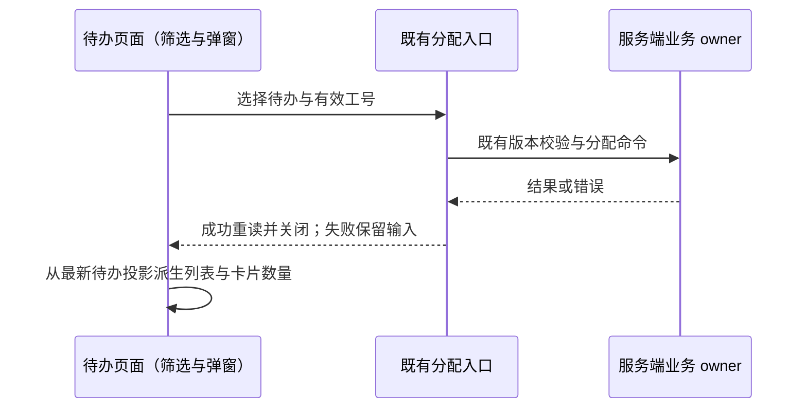
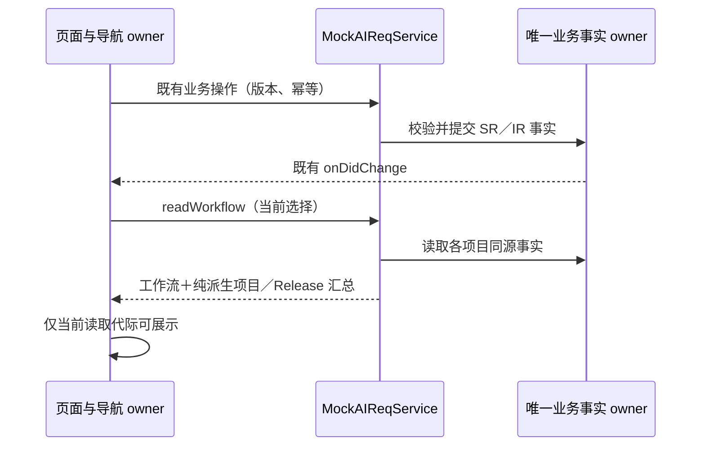
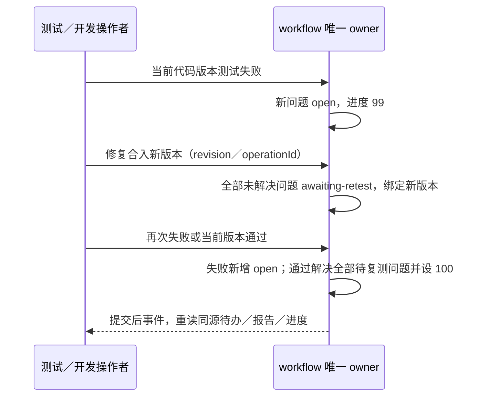
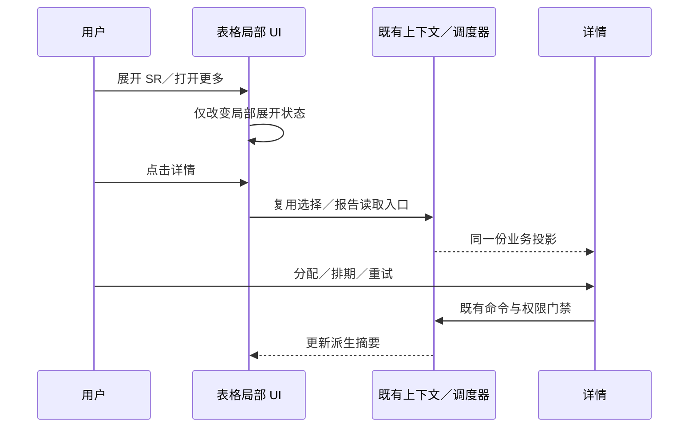
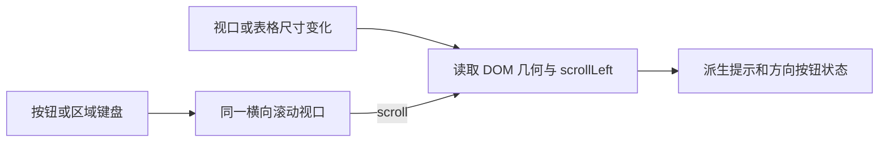
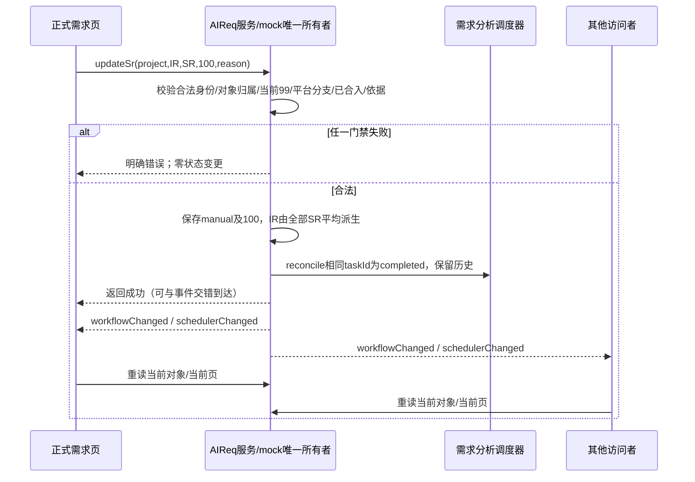
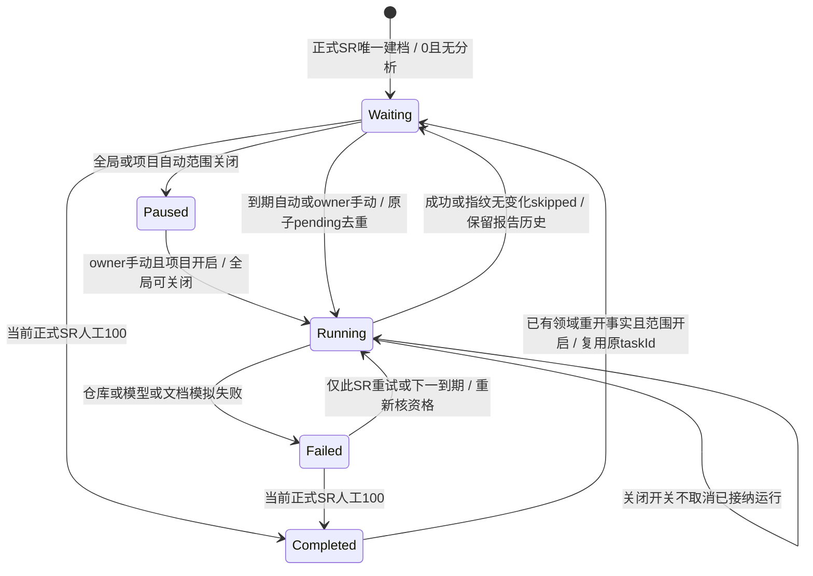
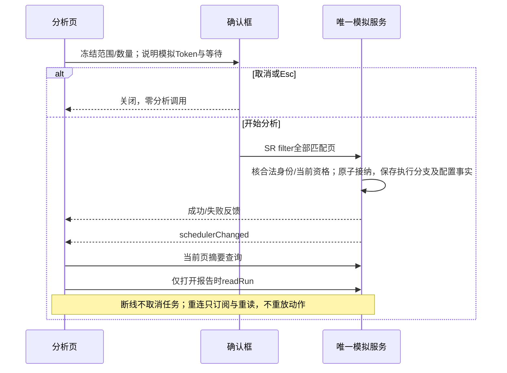

# 正式需求与统一分析迁移规格

> 当前产品前端与公开接口以 [发布边界](release-surface.md) 为准：原型／调试控制和场景身份参数已退出产品契约；下文相关模拟入口与浏览器故障注入记录仅属于历史版本，不构成恢复入口或接口的要求。

## 当前项目空间与待办组织（2026-11-16）

页面层级和验收以 [项目空间规格](project-space.md) 为准，取代下方旧并列导航与混合项目页：全项目总览与项目内概览分开；项目内概览、需求、分析运行及 IR／SR 详情共用常驻页头的唯一项目／Release。正式需求是需求的正式视图，继续使用原 IR／SR 表及同页报告／材料。分析运行保留任务、历史、重试及明确模拟控制，全局周期／开关和项目分析配置移入设置 AI 配置 → 分析设置。

跨项目待办的对象主文案显示 `requirementTitle`，辅助显示项目及 IR／SR 编号；当前事项直接可点击处理，分工仍走既有认领／分配操作。投影的 `requirementTitle`／`releaseId` 从所属 IR 同源派生，进入时按目标 Release 定位，不额外读取并缓存各项目，也不把三视角合并为一项业务确认。我的／待认领／全部和独立项目筛选保持原语义。报告首屏优先状态、关注问题、当前动作，分支维护后置；任何进度计算、人工验收与清理门禁均不变。

本轮实际验证由主集成在实现后记录；下文已有日期与通过结论仅证明各自当时版本。

## 项目进度无障碍修复（2026-11-16）

- 共享 `Progress` 将确定数值传入 Radix Root，使 `aria-valuenow`、完成状态与现有指示条一致；未提供数值或显式 `null` 时保留不确定语义。继续由调用方提供业务数值与可访问名称，不增加状态、接口或进度计算路径。
- 项目进度正式需求表保留现有默认辅助文字色与行悬停背景；行悬停时编号及未分析提示使用现有 `text-foreground`，保证深浅主题普通文字对比度至少 4.5:1，不修改全局主题。
- 验收：Edge 中核对项目页 0%、部分进度、99%、100% 的 `aria-valuenow`、`data-state` 及可见数值；检查未传值／`null` 的不确定语义。截图检查深浅主题的默认及悬停行，按实际层叠颜色核算编号与未分析提示对比度；完成类型、Lint（含受忽略基础组件的 Hooks 专项）及架构检查。

实际验证：Edge 中 Aurora 的 8 个进度条均暴露正确数值，0／部分／99 为 `loading`，100 为 `complete`；直接渲染实际共享组件验证未传值／`null` 仍为 `indeterminate`。Mobile 的编号与未分析提示在深浅主题默认及悬停画面均已截图检查；按计算样式合成颜色，悬停对比度由深色约 3.95:1 提升至 10.79:1，浅色为 14.29:1，默认分别约 4.79:1／6.25:1。`bun run typecheck`、`bun run lint`（0 警告／错误）、两处修改文件 Hooks 专项（0 警告／错误）及根目录 `bun run architecture:check --changed`（0 违规）通过，浏览器 warning／error 为空，主题已恢复深色。未运行屏幕阅读器实测，不作为无障碍认证声明。

## 待办列表概览与操作（2026-11-16）

- 待办页使用“我的待办／待认领／全部”摘要卡片展示当前项目筛选范围内的数量，卡片同时承担原筛选操作；无项目筛选时统计跨项目待办。数量只从既有 `view.todos` 派生，不增加业务状态。默认仍为“我的待办”，项目筛选独立保留。
- 表格保留项目及 IR／SR、业务动作、归属，压缩重复文字；固定宽度三点操作列复用既有菜单，提供进入处理、由我认领／接手、分配负责人。工号输入放入对话框，继续使用既有格式校验及原分配入口；成功后关闭，失败保留输入并显示既有错误，忙碌时禁止重复提交。视角确认的独立动作标记仍可见。
- 验收：检查摘要数量与项目／归属筛选一致、空态、表格与三点菜单、弹窗校验，验证定位及分配的既有路径；电脑浏览器截图检查深浅主题、可见焦点和主要弹窗。

内置浏览器实测：全部项目共 17 项，筛选 Mobile 后卡片与列表均为 4 项；测试工号初始我的待办为 0，分配一项后为 1，恢复原负责人后回到 0。无效工号不可提交；三点菜单可键盘打开，进入处理定位到对应提案，分配弹窗有效工号保存后关闭。深浅主题、卡片焦点、菜单及弹窗已截图检查，浏览器错误日志为空；未人为制造服务端分配失败。

## 项目首页概览布局（2026-11-16）

- 首页视觉细化：压缩项目卡片的垂直间距，交互卡片提供悬停与键盘焦点提示；范围进度的数值优先显示并靠近进度条，正式 IR、SR 和未分析数清晰分层。进度条使用有区分度的底轨和主题强调色，保留文本数值；辅助信息使用可读的现有语义文字色。数据、范围选择和导航行为不变。
- 本次验收在电脑浏览器检查深浅主题、项目卡片悬停与键盘焦点、项目和 Release 切换及无正式需求状态，并截图检查首页。
- 视觉细化实测：内置浏览器检查深浅主题及卡片悬停；键盘焦点边框可见，Enter 可切换至 Mobile（50%、2 IR、4 SR、1 未分析），选择其空 Release 显示暂无正式需求。截图检查首页及菜单，浏览器错误日志为空；主题已恢复深色。
- 登录后的项目进度页以项目卡片展示各项目全部 Release 的进度、提案数及正式 IR 数；卡片标示当前项目并通过既有导航门禁切换。项目与 Release 的唯一选择仍由 `AIReqContext` 持有，数据仍读取 `view.projectProgress`，不增加缓存或写入。
- 当前项目概览突出范围进度、正式 IR、SR 和未分析数，保留 Release 筛选、提案数及无数据／重试状态；下方保留正式需求明细与报告入口。进度计算规则以可展开说明呈现。
- 验收：真实登录后检查首页布局和数据；切换项目及 Release，核对卡片选择、概览与明细范围；展开计算说明并检查报告入口，截图检查电脑浏览器画面。

内置浏览器实测：测试工号重新登录进入项目进度；Aurora 全部 Release 为 55.6%、5 个正式 IR、10 个 SR、3 个未分析。切至 Mobile 后显示 50%、2 个正式 IR、4 个 SR、1 个未分析；选择其 2026.12 Release 显示无正式需求，而项目卡片仍为全部 Release 的 50%。计算说明可展开，Aurora 的 IR 原文可打开对应报告；页面及筛选菜单已截图检查，浏览器错误日志为空。`bun run typecheck`、`bun run lint` 和 `bun run architecture:check --changed` 通过。

## 项目进度正式需求报告操作列（2026-11-16）

- 仅调整项目进度页的“正式需求进度”表，将“同页报告”改为“操作”：固定 56px 列、32px 三点按钮，沿用进度分析的行悬停／键盘聚焦显现规则，菜单打开期间入口保持可见。
- 原 IR 与全部所属 SR 的报告入口收进同一个菜单；菜单保留 SR 标题及编号，不删除任何报告入口，选择后仍调用既有 `openReport`／唯一导航 owner，范围、历史和未保存门禁不变。原文按钮仍可直接打开 IR 报告。
- 表格采用固定布局，原文 32%、Release 20%、SR 数 16%，进度使用除 56px 操作列外的剩余宽度；不再由多个 SR 报告按钮占据横向空间。保留电脑窄窗口横滚及原进度语义，不调整全部项目总览。
- 验收：浏览器宽屏及窄窗口检查操作列与进度分析同宽，三点悬停／聚焦可见；含多个 SR 的菜单可分别打开 IR／SR 正确报告，其他列可读，空态保持。

浏览器实测：Chromium 1440×1000 与 1100×760 截图查看完整项目页；正式进度表操作列均为 56px、按钮为 32px，其余列在这两个尺寸未发生单元格横向溢出。首行悬停显示三点，其余行保持透明；键盘可打开包含 IR 与全部 5 个 SR 的菜单，选择 IR 及 `sr-session` 分别进入正确报告，未改进度或项目范围。最终页面无浏览器错误；`bun run typecheck`、`bun run lint`（0 warning／0 error）、`bun run architecture:check --changed`（0 violation）通过。

## 执行历史结果列两行布局（2026-11-16）

- 仅调整进度分析的执行历史表：需求与项目列从 44% 调整为 36%，开始时间仍为 144px、操作列仍为 56px，释放宽度给“结果与进度”。
- 结果列最多两行：第一行显示执行状态，缺失分支提示同排显示，不另增一行；第二行合并进度标签及执行前后值，如“进度：23% → 35%”，不再单独显示标签行。长异常提示单行省略，可悬停／聚焦读取；状态及有效进度数值不变。
- 验收：真实电脑浏览器宽屏和窄窗口检查成功、失败、跳过等已有记录，结果列两行、缺分支不增行、三点详情入口保持可用；不调整 SR 任务表或报告内容。

浏览器实测：Chromium 1440×1000 与 1100×760 查看同一 5 条历史（成功／失败／跳过），结果列分别约 525.8px／388.8px，每格均为状态一行、进度一行（进度行高 21px）。键盘三点入口可打开既有报告；页面错误记录为空。本次记录均有分支，未额外构造缺失分支数据。`bun run typecheck`、`bun run lint`（0 warning／0 error）、`bun run architecture:check --changed`（0 violation）通过。

## 正式需求紧凑列布局（2026-11-16）

- 操作列与进度分析统一固定为 56px，三点按钮为 32px；表头与单元格使用紧凑左右留白；IR／SR 行仅放三点更多入口，不随表格宽度扩张，保留当前悬停／键盘聚焦显现、菜单和行导航语义。
- “负责人及计划”加宽：需求列从 40% 调整为 36%，状态列保持 24%，负责人及计划使用剩余宽度，操作列保持固定 56px。每个 IR／SR 单元格严格最多两行：首行并排显示开发与测试，次行显示计划；长内容单行省略，不增加附加文字行。IR 仍分别去重汇总所属 SR 工号，空值仍显示未分配／待认领。
- 无起止时间时只显示“计划：未排期”，不重复显示两个未排期或附加“部分未排期”；已有时间时显示日期区间，部分未排期说明及完整起止时间保留在鼠标悬停／键盘聚焦提示中。排期警示图标与计划同一行，完整协调原因仍可查看；不改变业务 owner、协议或计算。
- 浏览器验收：桌面宽屏及窄详情分栏检查 IR／SR 负责人及计划恰为两行，无独立“部分未排期”文字行；长人员摘要、完整／空／部分计划及警示不撑高单元格，省略内容可悬停／聚焦读取。操作列与进度分析仍同为 56px、按钮同为 32px。

此前三行布局验证（已被上述两行规则取代）：真实 Chromium 1440×1000 表格及 1100×760 详情分栏实测，正式 IR／SR 与进度分析操作列均为 56px、按钮均为 32px；当时负责人及计划三行各为 18px。已观察完整日期、未排期／部分未排期与冲突图标，键盘聚焦省略的计划可读完整起止时间及警告。三点菜单未选中行，原分工计划弹窗可打开并取消；深浅主题截图可读，观察期间无页面错误。未额外构造长工号数据。`bun run typecheck`、`bun run lint`（0 warning／0 error）及 `bun run architecture:check --changed`（0 violation）通过。

两行布局复验：真实 Chromium 1440×1000 查看展开的 IR／SR，人员计划列约 397.6px；1100×760 详情分栏中表格横滚、该列约 200px。10 个已渲染 IR／SR 单元格均为两行，每行 18px、合计含间距 40px；无“部分未排期”行内文字，操作列保持 56px。窄栏长人员摘要省略，键盘聚焦提示能读完整开发／测试工号。页面错误记录为空；`bun run typecheck`、`bun run lint`（0 warning／0 error）及 `bun run architecture:check --changed`（0 violation）通过。

## 正式需求详情布局（2026-11-15）

从提案转正或其他入口进入正式 IR／SR 详情时，表格页标题仍保留工作台顶部留白；详情栏展开后，表格内容列按剩余表格面板宽度居中并使用可用空间。关闭详情恢复完整主页面内容列；不改变 IR/SR 选择、详情、报告或导航语义。Edge 浏览器需截图检查转正后自动打开详情、关闭详情及普通正式需求入口的标题、表格和详情栏。

## 当前规格：第 3 组项目进度

本节依据根 `.todo.md` 的完整当前规则，增量补齐第 2 组业务事实的聚合与导航，不改变已验收流程。项目进度由服务端在 `readWorkflow` 的 `view.projectProgress` 中纯派生返回，各项目含全部 Release 汇总与逐 Release 汇总；不保存独立进度，也不增加写接口。每个汇总含提案数、正式 IR 数、正式 SR 数、未分析 SR 数、有效进度及全部正式 IR 摘要。本次仅文档同步，不新增工程检查、浏览器或真实 AI／Git 验证声明。

- 聚合直接平均范围内所有正式 IR 所属 SR，不先平均 IR；提案及其 SR 不进入分母。未分析按 0 并标注，代码合入按 99，匹配代码版本的人工测试通过按 100。无正式 SR 的进度为 `null`，显示“暂无正式需求”；非全完成显示最多 99.9%。IR 摘要按同一有效进度规则计算，原始 AI 报告仍仅为证据。
- 项目页先列各项目全部 Release 的提案数、正式需求数与总进度；当前项目详情使用唯一导航 owner 的项目／Release 选择，显示范围计数及全部正式 IR 的进度、SR 数和未分析标记。选择具体 Release 不影响其他项目的全项目统计，不把一个项目的 Release ID 用于另一个项目。
- 进入项目、选择 Release、查看正式 IR/SR 复用现有导航历史和未保存门禁；正式需求、提案、分析沿用该范围。无项目或无 Release 提供既有项目设置入口，不自动创建或改用其他项目。
- 业务 owner 提交事实后发既有事件，UI 重读同一工作流及聚合投影；代际丢弃迟到读取，刷新和多标签页均不重放业务操作。聚合不持有另一个报告缓存或进度状态。
- 当前六主导航依次为“项目进度、待办列表、正式需求、需求提案、进度分析、Skill 设计”，登录默认项目进度。Skill 设计为主页面，不在设置导航或设置搜索，旧 `skill` 设置偏好回项目设置；保留原生会话、预览、模拟保存、设置往返草稿和唯一未保存门禁。模型、Agent、项目与外观设置保留；Issue、AIReq 自动化专属能力、旧侧栏提案列表及独立新建提案导航不恢复，通用控件及仍有用途的底层设施保留。
- 所有合法工号均可配置、代办、指定与认领，不设 owner／管理员／负责人授权；owner 仅标来源与状态所有权。联系人和负责人、开发安排及实际操作者是业务事实，不随权限裁撤删除。合法身份／clientId、参数、对象及原生会话归属、阶段、版本、幂等校验仍保留。

### 第 3 组浏览器验收场景

1. 使用正常创建、讨论、转正入口准备同项目两个不同 SR 数的 IR，核算项目／Release 直接 SR 平均，与 IR 平均的错误结果区分；检查提案不计分母、无正式 SR、未分析 0、验收 100 及新增正式需求降低进度。非全部完成不得显示舍入 100。
2. 经正式表／报告的现有合入或测试按钮改变一个 SR，项目概览、正式表、报告自动同值，多标签页重读一致；不得直接写聚合值。
3. 检查项目进入、Release 范围、正式 IR/SR 跳转、历史前后退和未保存取消／丢弃不串对象；登录默认项目进度，六项主导航顺序及真实入口正确，Skill 在主页面且设置往返草稿／唯一门禁保留，深浅主题及电脑布局可操作。下方 2026-11-15 五导航／设置 Skill 仅证明当时版本；当前入口证据边界见 tools-settings“当前工作台导航与内容布局”，本次同步不补造验收。
4. 本组完成后记录实际对象与数值、命令结果和限制；复用前两组未变路径证据，不重复全流程验收。

### 第 3 组实际验收（2026-11-15，当时五导航／设置 Skill）

以下保留当时对象、数值、命令和观察，不改写为六导航已在当时通过；仅旧导航／Skill 设置入口已被当前规则取代，其余未变路径证据仍保留原范围。

- 实际链路：`projectProgress` 公共纯函数 → `MockAIReqService.readWorkflow` 的 `view.projectProgress` → 既有远程 data source／读取代际 → 项目进度页。新增 `progress-types.ts` 只承载投影类型；不保存派生事实、不增加 RPC 或事件。项目范围的原工作流仍只返回当前项目对象。
- Chromium 1440×1000，以 `j00808876` 实际操作；1100×760 的 `j00808877` 标签页持续观察。Aurora 最初 5 个正式 IR 的 SR 数为 5／2／1／1／1；有效值依次为 `[23,99,35,0,100]`、`[0,0]`、`[99]`、`[100]`、`[100]`。总和 556／10，概览为 55.6%，而非错误的 IR 均值 70.08%；3 个未分析标记与正式报告一致。Mobile 的 3／1 SR 两个 IR 分别 66.7%／0%，项目为 50%，不是 IR 均值 33.3%。
- 经设置真实创建“聚合验收项目”，0 Release／0 IR／0 SR 显示暂无正式需求，详情没有其他项目对象，管理 Release 打开既有项目设置。Aurora 下一迭代的空 Release 同样显示暂无正式需求。该临时项目在后续类型归属修正触发 Bun watch 重启时恢复样例；不宣称跨进程保存，也不影响随后稳定版本的业务证据。
- 在 Aurora `release-2026-12` 新建 `ir-demo-16`，原文“聚合验收：跨团队通知在失败后可重试，并记录处理结果。”。提案 5→6，而项目仍 55.6%、该 Release 仍无正式 SR。主动讨论、原始单评审／人工通过、原生方案、完整三审终审／人工通过、三视角确认后，确认 13 件文件创建模拟 MR #102；选择完整候选合入，由正常 owner 核验转正，生成 `sr-ir-demo-16-1/-2`，文档基点 `sample-proposal-merged-29`。未直接改业务内存或聚合值。
- 转正自动事件使提案回到 5、正式 IR 为 6、SR 为 12；两新 SR 未分析 0，项目 556／12 显示 46.3%，该 Release 为 0%。与现有 5 SR 的 `ir-auth` 同屏核算，覆盖不同 SR 数、提案不计分母及新增正式需求下降。
- 从概览的 SR 按钮打开既有正式表／报告，模拟代码合入 SR1 为 `simulated-code-sr-ir-demo-16-1-30`，立即 99，IR／Release 49.5%、项目 54.6%；`j00808876` 填写业务验收依据后 SR1 才 100，IR／Release 50%、项目 54.7%。SR2 合入 `simulated-code-sr-ir-demo-16-2-32` 后 IR／Release 为 99.5%、项目 62.9%，未显示 100；22:24:15 人工通过后 IR／Release 才 100%、项目为 756／12＝63%。观察标签页无需刷新即收到相同 54.6→54.7→62.9→63 的事实投影；最终报告显示实际操作者、验收依据和代码版本。
- 不另建业务测试体系。一次性 `bun -e` 调用真实公共聚合函数，构造 1／20 SR 的 IR（100／99.95），结果为 2099／21＝99.95238095238095，`progressLabel` 为 99.9%；空 Release 为 null，提案 SR 不计入。加入一个未分析正式 SR 后为 2099／22＝95.4090909090909、未分析数 1。此为纯函数边界证据，不冒称浏览器生成了 21 个 SR。
- 真实主题与布局、范围／历史／未保存导航、Skill 设置及最终命令结果见 integration 第 3 组记录；前两组未变流程复用其原验收，不重跑分支清理或整套失败矩阵。

## 当前规格：第 2 组进度、验收、待办

本节依据根 `.todo.md` 当前规则及第 2 组业务范围取代下方旧合同，先列现行规则，再记录该组真实观察；最终命令与边界见 integration 本组收口。第 3 组项目进度在当时不属第 2 组范围，现由上节记录，不是当前未交付声明。Issue、AIReq 自动化不恢复；提案创建、独立 SR change、前置单评审／完整三审终审、整包失效与同候选文档 PR 转正规则见 proposals 和 contract-design 当前规格，不沿用历史四阶段或 IR/change 映射。

### 正式表与统一分析

- 分析任务详情、执行历史详情和正式需求报告的开发分支只展示一次，保留完整分支名复制控件及缺失提示；报告中不可复制的已清理或未创建分支仍展示名称。截图检查详情、报告及复制反馈。
- 分析任务详情和执行详情打开时，焦点进入弹窗容器，不自动触发分支复制提示；键盘仍可访问复制和关闭，关闭后按原路径恢复入口焦点。验收截图检查两个弹窗和键盘焦点。

2026-11-16 内置浏览器实测：任务详情及从中打开的执行详情初始均无复制提示遮挡，Tab 可聚焦复制按钮并显示提示，Escape 关闭报告后焦点回到对应任务入口。

同日内置浏览器复核分析设置：按项目名搜索仅显示匹配项目；输入 0 分钟时提示输入正整数且保存不可用，改回原有 60 分钟后关闭，未保存设置变更。

同日在隔离模拟项目验证新转正的两个 SR：代码合入后为 99%，测试失败后须修复再复测；两个 SR 均通过后 IR 为 100%。模拟清理时一项成功、一项失败；重新预览显示成功项不重试，仅重试失败项后两项均为已清理，进度保持 100%。未操作真实 Git 分支。

- 正式需求以 IR 为主行，显示原始短需求、Release、整体状态及进度；展开 SR 显示开发／测试负责人、有效进度、登记分支、最新审查摘要及操作。IR 汇总与 SR 独立材料／报告复用同页面板，不建立 SR 开发工作台或聊天、编码／执行按钮。
- “进度分析”与正式需求、需求提案共用当前项目／Release，支持全部 Release 读取，创建必须具体 Release；不得另持跨项目筛选事实。无项目／Release 使用设置入口，不自动建项目或取其他项目数据。
- 唯一共享业务 owner 保存调度、报告及进度，沿用现有手动／定时、筛选、分页、全匹配批量确认和去重。分析输入包括 SR OpenSpec tasks、代码／默认分支版本、材料与合并事实，指纹涵盖这些版本；不执行任务，不把勾选数当进度。输入未变可跳过，迟到结果只允许写回匹配对象及版本。
- 最新成功报告是唯一报告事实，正式表和分析页读同一报告；失败保留上次成功值并明确失败／过期，不回落 0。原始 AI 评分和意见是证据，与业务有效进度分开。
- 后台使用服务时钟按真实配置间隔检查，即使当前没有运行项也能接纳到期分析；处理运行中结果不跳过虚拟小时。显式“模拟推进下一次调度检查”才可推进模拟时间，仍消费同一调度 owner 的去重、指纹及结果接纳路径。

### 有效进度与问题复测

- 未合入且未验收的 SR 由 AI 估计 0–99，可随证据下降；代码核实合入后有效进度固定 99，不依赖 AI 原始评分恰好为 99，低分及迟到分析不得覆盖该事实。
- 只有已合入且有效进度 99 才能人工记录测试通过转为 100；需非空验收依据，并记录实际操作者、时间及代码版本。所有合法工号可代办，不以负责人／管理员授权。AI 不设置 100，不覆盖既有人工完成。
- 测试不通过保持 99，保存问题及失败版本、派生开发处理待办；不能只再点“通过”绕过问题。修复提交合入，问题进入已处理待复测，产生测试待办，绑定不同于失败版本的新代码重新人工验收。不退回提案流程，不提供直接设置 100 的模拟按钮。
- IR 为全部所属 SR 有效进度等权平均，全部 100 才完成；项目／Release 聚合直接平均范围内全部正式 SR，不先平均 IR。提案不入分母，未分析正式 SR 按 0 并标记未分析，已验收 100，无正式 SR 显示“暂无正式需求”。非全部完成不得四舍五入显示 100，新增正式需求可降低聚合值。第 2 组当时仅验证正式表／报告／分析中的数值，第 3 组项目页证据另见上节。

### 评审缺陷回归约束（2026-11-15）

- 任何未解决测试问题（含待复测）存在时拒绝普通代码合入；修复合入将全部未解决问题绑定同一个新版本并置为待复测，不修改已解决问题。多轮失败／修复后仍可在当前版本复测通过达到 100%。
- 负责人、计划开始／结束日期的显式清空必须经 RPC 保留清空语义，不得保存成功却仍为旧值；“由我负责开发”与手工改值使用相同校验清理路径。
- 分支恢复后分析任务立即清除该分支不可用的旧错误，不清除尚未修复的分析运行错误；启动样例写回成功报告后，首次任务查询即与报告有效进度一致。
- 分支清理 RPC 失败时错误显示在当前确认弹框内，保留预览供显式重试，不以遮罩后提示代替。

回归验收：失败 v1→修复 v2→失败 v2→修复 v3→通过 v3；待复测时普通合入被拒，修复合入后仍可通过；清空负责人和日期后重开及刷新确认；非法工号提交后点击“由我负责开发”可提交；失败分支修复后立即查询任务状态；初始任务进度与最近成功报告一致；清理失败在弹框内可见。

2026-11-16 使用内置浏览器及隔离模拟服务验证 `sr-export`：`sr-export-head` 记录失败后保持 99%，验收及普通合入禁用；修复至 `simulated-fix-sr-export-47` 后复测再次失败，再修复至 `simulated-fix-sr-export-49`，两项未解决问题均绑定新版本并等待复测。人工记录通过后 IR／SR 均为 100%，两项问题显示已解决并保留失败与修复版本。此为模拟事实，不代表执行了真实开发或测试。

同日使用 `sr-ir-demo-17-1` 验证分工与排期：非法开发工号被拦截，快捷“由我负责”恢复有效；保存两个负责人和完整起止时间后重新打开可回读，随后清空四项并保存，重新打开及浏览器刷新后仍为空。测试仅修改隔离模拟内存，样例恢复为待认领、未排期。

#### 该轮修复的历史验证边界

19 项评审缺陷已实施修复。一次性真实 `MockAIReqService` 调用通过：初始调度任务与报告进度一致、多轮失败／修复后当前版本验收 100%、未解决问题阻止普通合入、批量导入关联全部新 IR 而非旧选择、评审场景仅消费一次、首次完整评审审批来源不被覆盖、通知样例可确认交付、退回后派生业务补充待办。未保留验证脚本或新增业务单测。

`bun run typecheck` 最终通过；已执行 `bun run lint`（2305 文件，0 warning／0 error）和 `bun run architecture:check --changed`（0 violation／0 baseline／0 new）。首轮类型检查发现 UI 契约缺少 `AIReqReviewScenario` 类型导出，补齐公开出口后类型复验通过。

该轮桌面浏览器已观察材料菜单的 SR 归属及非法工号改为“由我负责开发”后原生校验恢复有效；负责人／日期清空的完整保存回读、历史材料、弹框故障和 Skill 故障组合当时未完成浏览器验收。用户要求自行测试后，该轮停止浏览器测试及进一步检查，未重启现有服务；这些未执行场景不记通过，也不将当次停止要求推广为后续绝对禁止必要验证。

### 分支清理

转正逐 SR 建分支，保存真实模拟状态和错误。仅整个 IR 全部 SR 100 才能打开清理确认，列出本 IR 登记开发分支；永不删除主分支、材料、报告、验收历史。逐项保存成功／失败，重复请求只处理未成功项、已删除不再产生副作用；清理不改进度，不引入通用分支管理。

### 待办及联系人

待办是第一手业务事实的服务端派生投影，不复用 `tasks.md` 或分析调度任务，不保存一套手工完成状态。默认“我的待办”，可选“待认领／全部”，跨项目汇总、按项目定位，不受当前业务表 scope 误限。操作后事件重读使待办出现／消失；点击定位 IR/SR 及阶段，不能任意新建或勾选完成。

| 业务事实                     | 归属／业务动作                                    |
| ---------------------------- | ------------------------------------------------- |
| 提案待讨论／业务补充         | IR 业务联系人，进入原始需求讨论                   |
| 单评审完成待人工决定         | IR 业务联系人，通过／退回                         |
| 待 SR 拆分或完整材料         | IR 开发联系人，进入方案                           |
| 完整审查／终审待决定         | IR 开发联系人，处理意见后通过／退回               |
| 三方视角尚未确认             | IR 对应业务／开发／测试联系人，各自独立动作       |
| 三方齐备待提交 PR            | IR 开发联系人，提交整包 PR                        |
| 正式 SR 待开发／问题待修复   | SR 开发负责人，查看任务、分支、代码意见及处理问题 |
| 已合入待测／修复已合入待复测 | SR 测试负责人，记录本版本验收                     |
| Agent／提交等步骤失败        | 对应阶段联系人，查看失败并使用现有运行入口处理    |

无归属进入待认领；指定／领取更新真实联系人／负责人，实际代办不暗改负责人。IR 业务默认提交人，SR 开发／测试可继承 IR 后显式调整；同人兼任仍看到三个确认动作，不形成权限。正常 AI 运行、等文档 PR 合并、等调度不制造空操作待办。

### 本组真实浏览器验收场景

1. 正式 IR/SR 行、材料和分析页同 scope、报告版本及有效数值一致；手动／定时、未变跳过、失败保留成功值、旧版本拒绝均可观察。
2. 指定 SR“模拟代码合入”经正常合并事实接纳后立即固定 99，保留不同 AI 原始分数；分析不能覆盖 99／100。未合入、无依据不得验收。
3. 测试失败仍 99，开发问题待办出现，直接通过被拒；“模拟修复合入”生成新版本及待复测事实，测试待办出现，再人工通过才 100。
4. “下一次分析失败”、暂缓旧结果／显式释放和指定分支“下一次清理失败”均明确模拟且由正常操作消费。全部 SR 完成前拒绝清理，完成后确认清单、部分失败重试只处理未成功项，主分支、历史、进度不变。
5. 全流程观察我的／待认领／全部、指定／领取、双工号代办、同人三视角、跨项目及深链接；完成业务动作自动消失，刷新／重连不重放写操作。

按根 `.todo.md` 每组先写规格，再完整实现并在本组收口前完成必要工程检查、浏览器验收及记录，不留到最后统一补首次验证；后组影响旧证据时由该组修复并复验受影响路径。不新建业务单测／E2E／协议测试体系，纯业务不默认 build、knip 或全量测试；必要工程验证及受影响已有门禁仍保留，产品不运行实际构建／测试不等于仓库禁验。

### 第 2 组已观察的分析、待办与验收场景（2026-11-15）

- 正式表与分析页共用项目／Release：创建主 IR 前 Aurora 下一迭代均为 0 个正式 SR；切到 Mobile 后分析仅列该项目 4 个 SR、正式表为 2 个 IR／4 个 SR，没有独立分析项目事实。
- `sr-auth` 原 AI 23%，手动未变化运行跳过且仍为 23；模拟下一次失败保留同份成功报告及 23。暂缓旧分析后模拟合入 `simulated-code-sr-auth-27`，释放结果明确提示输入版本变化、拒绝写回，运行记录有效进度 23→99，原 AI 23／旧代码分析版本保留。另一个未合入样例 `sr-session` 在新证据下估计可由 99 降至 33，不将 tasks 勾选冒充进度。
- 真实 1 分钟配置保存后关闭并重新打开独立标签页，观察到定时 `memory-demo-run-2`（`sr-auth`，北京时间 21:19:48→21:19:53），未点击模拟推进；历史 5→19，是两个到期批次各 7 个未完成 SR，未开启的 Mobile 不被接纳。随后恢复 60 分钟。held-only 持续 30 秒多轮后台 tick，下一次检查仍为 22:23、不暗跳小时；同期间 `sr-audit` 可正常完成，再显式释放，恢复 0 running。
- 工号 `j00808876` 在未合入的 `sr-session` 看到测试通过禁用；已合入 `sr-export` 空依据不能提交。不通过后保持 99，保存失败代码 `sr-export-head`、实际操作者、`2026-11-15T13:43:03.154Z` 及问题依据；开发待办出现，不能直接再点通过。模拟修复合入 `simulated-fix-sr-export-250` 后问题为已处理待复测，人工填写新版本依据后才为 100，原失败／修复版本、操作人和时间均保留。
- 待办实际工号 `j00808876`／`j00808877` 验证清空联系人进入待认领、认领进入我的、分配另一工号后原我的消失；当前业务项目切 Mobile 仍能看 Aurora 待办，项目过滤及深链接、后退／前进正确。代办原生澄清及单评审后旧业务待办自动消失，未分配开发联系人产生方案待认领；同工号三视角只在完成对应业务确认后各自消失，不能勾选完成。
- 新建版本拒绝保留原文；明确重新读取保留输入与操作 ID，未自动重发，随后明确保存只得到一个 IR。未保存后退取消保留输入、确认丢弃后前进不恢复旧输入。失败提示不再被后台成功重读吞掉。
- 主 IR `ir-demo-25` 转正后两 SR 均为 0、尚未分析，SR2 正常重试失败分支后取得与 SR1 相同的文档基点 `sample-proposal-merged-328`。刷新仍为总计 6 IR／12 SR、该 IR 恰好两个 SR，没有复制对象。原始短需求、Release、人员及 13 份材料保持原身份。
- SR1 原 AI 0；模拟代码合入 `simulated-code-sr-ir-demo-25-1-357` 立即有效 99，原 AI 仍 0。`j00808876` 于 `2026-11-15T13:50:31.135Z` 人工通过后，释放同版本分析 `memory-demo-run-4` 得到原 AI 69，但业务仍为 100，人工记录与代码版本保留。SR2 原 AI 0，合入 `simulated-code-sr-ir-demo-25-2-373` 为 99，21:53:08 人工通过才为 100；正式表、IR/SR 报告、分析任务均同源显示两个 100、完成／停止。
- SR1 100／SR2 0 时 IR 为 50，SR2 99 时 IR 为 99.5，均禁止清理；全部 100 后清理预览只列本 IR 两支、不含 main。指定 SR2 一次故障后首轮为 SR1 已删／SR2 失败，下一轮只重试 SR2，最终两项已清理，再预览确认禁用。整个 IR 仍为 100；共享材料、两份独立 SR 包、验收历史、AI 报告及 main 依据可读。清理只是明确模拟分支状态，无物理 Git 删除。
- 收口发现并修复两处实际缺陷：初始 `sr-export` 同版报告 merged=true 却误写“等待合入”，只更正样例生成分支、不重写运行中历史；PR 轮询仅刷新 checkedAt 却推进全局业务 revision，导致无关验收／清理弹窗每五秒过期，改为仅真实 MR 状态或转正改变 revision。后者的定时弹窗稳定性复验与最终静态结果见 integration。

## 历史迁移依据与观察（第 2 组之前）

以下旧源码定位、显示修复及测试记录保留当时证据，不是当前实现要求或本组验收结果。各历史章节中的旧“AI 恰好 99＋角色权限才完成”、自由百分比、删除联系人／负责人事实、默认需求分析、独立分析 scope、Issue／自动化及最终统一首验均已由上方当前规格替代；不冲突的表格层次、横滚、弹窗、主题与字号细化继续保留，末尾当前 UI 条款明确其边界。

## 历史 §1. 依据与当时开放装配

源路径以下以 `S = F:/code2026/oh-my-pi/packages/aireq-frontend/`、`U = S/packages/ui/src/aireq/` 表示；这些仅为调查定位，不得进入目标运行时依赖。

- 产品依据：目标 `todo.md:135-162`；源 `openspec/specs/aireq-browser-workbench/spec.md` 的“正式需求大表格与同页报告”“代码证据、百分比与完成条件”“项目范围与统一 SR 分析调度”“需求分析后台刷新不扰动阅读”“Issue 独立登记、分析与进度跟踪”“手动批量分析须先确认成本与范围”“正式需求切行只更新右栏”“进度与分支约束在原型后端同样生效”及项目切换条款。
- 实际链路：`S/app/AIReqApplication.tsx` 对正式对象不绑定开发 session；`S/packages/ui/src/app-shell/WorkspaceShellLayout.tsx:1723` 按 `workspaceMainView` 装配 Issue 三页、需求分析或 `AIReqFormalWorkspace`；`DeferredWorkspacePages.tsx` 懒加载需求分析。不是仅因文件存在认定开放。
- 导航链：`U/AIReqSidebar.tsx:54-60` 正式入口及三个 Issue 按钮；需求分析在 Skill 设计之后、正式需求之前，Issue 在正式需求之后。正式页无左侧 IR/SR 树，登录默认需求分析由主壳规格负责。
- 数据链：`S/backend/prototype-data-source.ts` 每个后端样例作用域创建一次 `createPrototypeProgressScheduler`、`createPrototypeIssues`；`readWorkflow` 叠加 progress/planning 投影；`S/backend/scope.ts:46-58,77-79` 将 workflow、scheduler、issues 事件与相应写入口公开；`S/client/remote-data-source.ts` 为现有网络适配参考。
- 当前契约 `S/backend/contract.ts` 是 **version 3**。README 中旧版 contract/version、历史任意人工百分比、94% 直接完成及旧布局记录不是当前合同。
- 原版仅作为功能、字段和业务操作语义依据；架构、控件、配色与字体以当前检出的 ZCode、`DESIGN.md`、当前 `components/ui/`、`styles.css` 与现有壳为准。本次用户明确提供的三张上游“项目管理”截图作为需求分析、正式需求两页表格的视觉与交互参考；不读取或对比上游快照，不恢复已裁撤功能。
- 自动化、需求分析、正式需求的业务页标题统一使用 `text-ui-page-title font-medium tracking-[0.114px]`：默认字号 30px、行高 34px，字号为 `--ui-font-size + 16px`；电脑窄窗口也保持同级，不使用 Settings 专用标题 token。不调整页面顶部留白。

正式需求与需求分析沿用全宽外层纵向滚动、`SETTINGS_FRAME_CONTENT_CLASSNAME` 的 4xl 居中内容列、原生主题控件与字号；标题、筛选、表头和表格行随页面滚动，详情面板独立滚动。默认仅展示摘要，辅助字段移至详情，不缩小字号、不改变既有业务状态、计算或权限；窄面板保留表格内部横向滚动。

正式需求、SR 任务与执行历史表头按当前 `bg-surface` 层级呈现，不再与页面同用纯 `bg-background`。普通表头单元格透出同一层 surface；正式需求横向固定的首列表头以不透明 background 为底、叠加一层 surface，避免横向滚动透字以及半透明 surface 重复叠加造成深浅不一致。表头不额外响应行悬停底色。

表格沿用当前组件、主题和居中内容列，按用户提供的项目管理截图统一列表呈现。此次替代此前“全部字段在表格展开”的展示规则，只减少默认可见内容，不删减字段或业务操作。

### 四列信息分组与保留规则（布局保留，旧去负责人要求已取代）

以下保留当时四列布局依据，但“不展示／不分配负责人”“既有权限不变”等旧产品限制不再生效。当前正式 IR 须可读原始短需求、Release、状态与进度，SR 须可读开发／测试负责人、进度、分支及最新意见；联系人／负责人可指定／认领且不构成权限。人员与计划的无冲突摘要和详情布局不因此删除或回退。

- 正式需求：默认展示需求标题／编号、SR 完成数量、状态／进度、问题数；人员列只展示“开发”和“计划”摘要，不展示“负责人”一行，IR 开发人员由其全部 SR 开发工号去重汇总。右端使用省略号更多入口。点击标题或行查看详情，更多面板也保留详情入口。IR 初始收起 SR；搜索或状态筛选命中 SR 时仍默认展开匹配结果。
- SR 任务：默认展示需求／项目摘要、状态／进度、下次分析及报告入口；分支、最近分析和重试等次要操作按需打开详情／更多，不删除既有权限和禁用原因。
- 执行历史：默认展示需求／项目摘要、开始时间、结果／进度变化及详情入口；分支、触发方式与耗时移至详情。
- 标题最多两行，长标题和摘要支持鼠标悬浮与键盘聚焦读取全文；浮层只承载简短补充，不放复杂表单。异常状态、问题数量、未排期／排期冲突和分支缺失仍直接可见，不能只藏在浮层。正式需求更多面板不显示或分配负责人，只保留查看详情及 SR 开发安排、分支复制，面板内按钮阻止行导航。
- 点击正式需求行／“详情”复用同页右栏，完整展示分支及复制、依赖与原因、排期来源与协调原因、最近分析和报告材料；不以“更多”隐藏阅读内容。所有详情继续读取同一上下文／调度器，表格 owner 仅持有筛选、展开和临时浮层，不复制业务状态。保留搜索、筛选、人员分配、排期编辑、报告、分页及所有空态。

### 项目管理式表格（2026-11-15；保留布局，旧人员限制已取代）

- 两个业务页统一使用“标题与说明 → 搜索／范围筛选 → 圆角表格 → 计数／分页”的层次；需求分析保留 SR 任务、执行历史 Tabs 与调度摘要，但筛选区不嵌在表格卡片内，不形成多层边框。
- 搜索框优先占据工具栏左侧剩余宽度，带搜索图标；筛选控件使用统一的 36px 高度、圆角和主题 surface 层级，电脑窄窗口自然换行。正式页仅保留名称／编号搜索、项目／Release 和开发状态筛选，移除“我负责的”“指定 IR 负责人”“未分配 IR 负责人”以及工号选择浮层及其局部状态，不替换为新的人员筛选；分析页保留项目→IR 联动及历史状态／时间范围，不引入仅排序当前分页的伪全局排序。
- 表格为单层圆角、细边框、surface 底色；表头使用低强调文字、无垂直分隔线，行间仅保留细横线。正文垂直居中、左右留白一致，不再用不同底色区分 IR／SR，改用缩进和展开箭头表达层级。选中、悬停、键盘焦点仍有主题反馈，固定首列与行底色一致且不透字。
- 名称列采用“低强调文档图标＋主标题／次级编号及项目”的主次层次；辅助文字使用既有字号 token，不通过缩小主文字容纳字段；关键异常继续直接显示。
- 两页所有行右端的省略号默认透明且不接收鼠标点击，只在鼠标悬停所属整行或按钮键盘聚焦时显示；预留原操作列宽度，显隐不导致布局移动。正式需求操作面板打开期间保持入口可见，移到其他行不显示无关行的入口。按钮保留可访问名称和 Tab 焦点；查看详情、SR 开发安排和完整分支复制仍走原入口，不显示负责人相关标签或分配入口。需求分析使用同等紧凑的图标式详情入口打开原有任务／执行 Dialog，保留报告切换及关闭回焦，不增加无实际操作的空菜单。
- 截图中的设备、会话数、项目编辑／移除、已移除项目折叠区不属于这两张业务表，不复制其领域语义；不增加没有对应批量命令的复选框。分析全部匹配分页的确认范围、取消零提交和后端权限不变。
- 验收：真实电脑浏览器深浅主题查看两页及分析历史；覆盖正式 IR 展开、SR 行选择／同页报告、省略号操作不误选行、人员／排期表单取消、分析搜索／无结果／清除、任务详情与执行报告关闭回焦；窄电脑分栏横滚仍可用。集中运行 typecheck、lint（含 Hooks 诊断）和 architecture:check --changed。

2026-11-15 本轮验收：真实 Chromium 深色 1440×1000、浅色 1100×760 检查两页；分析任务与历史省略号在未悬停时全部透明，悬停后只有当前行显示，正式 IR／SR 同规则且 Tab 聚焦入口可见。人员列实测仅有开发工号汇总与计划摘要，未显示负责人行。搜索无结果仍保留表头和分页，清除后恢复；任务详情切报告仅一层 Dialog，关闭回焦任务入口；IR 展开不选行、更多不选行、分配／排期弹窗取消及 SR 同页报告均已观察，窄分栏横滚入口可见。typecheck、lint（0 警告／0 错误）及 architecture:check --changed（0 违规）通过。开发预览曾重启，浏览器记录过 `ChannelClient is disposed`，本次不将其归因为表格改动或声称运行期零异常。

历史去负责人入口安排（已取代，非当前指令）：当时移除表格负责人过滤与分配入口，不改同页报告数据和服务端合同；清除筛选只重置搜索及开发状态，项目／Release 不变，保留详情、开发安排与分支复制。下方验收记录只证明当时入口形态；当前联系人／SR 负责人可指定／认领及所有合法工号可代办，不删除人员与计划事实，也不强制恢复旧人员筛选。

本轮去负责人入口验收：Chromium 1440×1000 实测筛选区只剩搜索、项目、Release、开发状态；IR 更多仅有查看详情与 SR 操作位置说明，SR 更多保留查看详情、调整开发安排和完整分支，无负责人相关内容。排期弹窗可打开并取消，搜索无结果及清除恢复正常；观察区间 pageerror 为 0。typecheck、lint（0 警告／0 错误）、architecture:check --changed（0 违规）通过。

历史详情去负责人安排（已取代，非当前指令）：当时 IR／SR 报告去掉负责人字段、工号和分配入口，保留 SR 开发人员、计划、依赖及人工确认记录；非授权工号提示没有人工确认权限。这是旧版本行为，不再保留“无负责人概念”或角色禁用要求；当前分工字段与可指定／认领入口遵循上方合同，人工验收只受合法身份与业务正确性门禁约束。

本轮详情验收：Chromium 1440×1000 实测 IR／SR 报告均无负责人文案或分配入口，开发人员／计划内容保留，开发安排弹窗可打开并取消且无负责人文案。非授权样例工号读取相同 SR 时，人工确认仍禁用并显示“当前工号没有人工确认完成权限”。两个浏览器观察区间 pageerror 为 0；typecheck、lint（0 警告／0 错误）、architecture:check --changed（0 违规）通过。

### 横向溢出入口与行密度

- 本轮在正式需求及两张分析表实施分层展示，取代此前“默认保留全部字段”的密度规则；保留外层纵向滚动、4xl 内容列、语义色及字号。
- 三张表共用 tracking 内部横向滚动容器：仅实际溢出时显示明确提示与左／右原生按钮；工具条随页面滚动吸附在内容面板顶部，并受所属表格范围约束，不要求滚到长表格底部。无溢出时不占用额外高度；到边界时禁用相应方向按钮。视口宽度、表格内容尺寸、缩放或详情分栏变化时按实际 DOM 尺寸重算。
- 横向位置唯一事实是滚动视口 DOM 的 scrollLeft；派生的左右可滚动状态只用于提示和按钮。按钮或聚焦滚动区域后的左右方向键／Home／End操作同一视口，内嵌表单控件和分支按钮的键盘事件不被截获；不改写纵向滚动。
- 正式需求起止时间合并为有明确语义的区间摘要；未排期提示常显。主列表不展开分支／依赖／分析元数据，详情中保留完整信息与操作；标题限制两行，不承诺未经浏览器测量的固定行高。
- 浏览器验收：初始 IR 收起、展开 SR、长标题聚焦提示、行／详情选中右栏、更多操作不误触行导航、复制分支、打开人员／排期表单并取消、分析任务／历史详情、关闭恢复焦点。桌面深浅主题和窄详情分栏检查可读性；运行 typecheck、lint 与架构检查，如实记录既有失败。

2026-11-15 分层展示验收：真实 Chromium 检查深色 1365×768、浅色 1100×760；正式需求初始 IR 收起、展开 SR、聚焦标题提示、更多不选行、人员分配／排期表单打开后取消、复制完整分支（剪贴板值 `sr/sr-auth`）、行选择同页完整报告均已观察。窄分栏保留横向滚动入口。分析任务元数据（含尚无报告）、失败执行诊断、历史执行分支／触发方式／耗时可读；任务详情先卸载再打开报告，报告关闭后回焦任务表格入口，未并存两层 modal。

检查结果：`bun run lint` 为 0 error、1 条非本次文件的 `useDataSyncProviders.ts:48` cleanup-ref 警告；`bun run typecheck` 被 `cloud-content/cloudContent.ts:1` 引用缺失的 `MarketingAsset` 导出阻断，不能声称全量类型通过；架构检查被并发工作树中 6 条不存在的 workflow／offPeak 路径登记阻断，未修改这些无关路径或策略。

隔离 DOM 场景已通过：无溢出不显示工具条；583px 视口／640px 内容可通过按钮滚至右端，边界按钮正确禁用；左右键、Home／End操作同一 scrollLeft，单元格输入和带修饰键的快捷键不被接管；视口／内容尺寸变化重算边界、恢复无溢出时隐藏工具条、卸载时释放观察器。上述尺寸是测试几何输入，不是浏览器布局实测。

本轮非浏览器回归：Bun + JSDOM 挂载真实正式表、任务表和历史表，通过四列表头／四格行、长标题与分支字段保留、完整分支复制且不选行、IR 收起／展开且不导航、SR 行打开对应详情、历史报告传递正确执行 ID 和焦点还原触发按钮。测试使用内存样例和隔离的上下文／剪贴板边界，临时脚本已删除；JSDOM 提示 Canvas getContext 未实现，本场景不验证绘图或实际布局尺寸。浏览器的宽度、换行、横向滚动及详情展开视觉效果未验证。

本轮按用户指定的 `base` 字阶验收排期与合入说明：排期假设、待确认事项、可并行需求、原 AI 建议、人工调整说明、排期提醒、工号格式及项目时区提示，以及报告中的分支合入状态和版本判断均为辅助说明，使用 `text-ui-sm` 与现有语义颜色。SR 编号和提交哈希等弱元数据保持原字阶。浏览器须检查正式需求报告、开发安排及调整弹窗的实际可读性，不改变数据和状态所有权。

1100×450 桌面窗口中，需求分析内容自然撑高并由全宽外层页面纵向滚动，不能由顶部摘要和筛选项挤压表格；保留分页，取消表格内部纵向滚动和固定表头。分析报告的已实现、待完成、问题风险及代码活动为正文，使用 `text-ui-base text-foreground` 和正文行高；执行元数据保留辅助层级。

中性状态标签（分析待分析／暂停／跳过、正式需求待开发）保留 Badge 的字阶、尺寸和中性底色，但使用不透明 `text-foreground`，不得将关键状态文字降为半透明辅助色；成功、进行中、警告和失败仍使用既有成对语义色。

分析设置的“项目分析范围”“调度设置”折叠箭头按 `base` 的 trigger `data-state` 驱动旋转，展开与收起可见方向不同，不增加第二份展开状态。

需求分析任务与历史无结果时保留表头、筛选和分页，空态正文在带合理最小高度的空内容区居中。空表格不占据剩余视口高度；有数据时表格自然撑高，随页面纵向滚动。

本轮三项空态修复的 workspace freshness、typecheck、lint（0 警告／0 错误）及 architecture:check --changed（0 违规）均通过。未打开浏览器，面板收起文案、Issue 无结果摘要及分析任务／历史空态的实际位置由用户验收。

## 历史 §2. 逐项源 → 目标 → 当时可观察验收

以下是当时已集成页面及场景库存，不是当前验收清单；其中 AI 原分恰 99、owner 调度、独立分析 scope、无负责人入口等已由当前规格取代。服务继续使用唯一 MockAIReqService，UI 读取投影的未冲突架构保留；`T` 为正式需求，`A` 为当时需求分析。

统一调度器在 mock 启动时仅创建一个实例，所有浏览器、工号和查询参数共享其任务／配置／并发门禁。规模样例通过启动环境变量 `AIREQ_DEMO=analysis-scale` 选择，再打开 `/?demo=analysis-scale`；没有该启动配置时明确拒绝该具名样例，不为请求身份另建第二个调度器。规模样例保留真实正式 SR，不能使同一 SR 在普通与规模浏览器中各自并发执行。

### 2.1 第 6 节七项

| ID / todo | 已开放源功能及精确依据                                                                      | 目标页面/服务                             | 可观察验收（包括反例）                                                                                                                                                                                                                                                                                                                                                                                                                                                      |
| --------- | ------------------------------------------------------------------------------------------- | ----------------------------------------- | --------------------------------------------------------------------------------------------------------------------------------------------------------------------------------------------------------------------------------------------------------------------------------------------------------------------------------------------------------------------------------------------------------------------------------------------------------------------------- |
| T1 / 6.1  | `AIReqFormalProgress.tsx:51-147` IR/SR 表、搜索、状态筛选、展开与统计                       | 正式需求表；共享 workflow/progress 读取   | 四列为需求、状态与问题、人员与计划、操作，辅助信息及完整操作由同页详情保留；页面外层纵向滚动，内容列限宽 4xl 居中；较窄面板仅表格横向滚动并固定名称列，标题、筛选及表头随页面滚动。搜索名称/编号，组合项目、Release 和开发状态，不提供负责人筛选或工号选择；清除重置搜索与开发状态。当前匹配 IR 数与当前项目/Release IR/SR 总数分开，后者不随筛选变。无项目、无 Release、无需求、无匹配分别提示。筛选可自动展开匹配 SR，但手动收起有效且不污染无筛选偏好；无左树。          |
| T2 / 6.2  | `AIReqFormalWorkspace`、`AIReqFormalReport`、`AIReqMaterialsPane`；源 spec 切行局部更新条款 | 同页右栏“进度报告/需求材料”；只读材料服务 | 点 IR 汇总全部 SR，点 SR 只读自身，立即更新高亮；连续点选仅接纳最后一项响应。Root、表格、项目连接不重挂；筛选、手动展开、纵横滚动、标签、分栏宽度保留。右栏可拖拽/关闭，布局沿用当前 ZCode 可调整面板并按实际父容器保证表格与报告可读、操作可达，不以源默认比例或固定宽度验收。失败只在右栏显示目标与重试，不跳详情/开发聊天、不发消息/执行/Git。后台同目标读取保留旧报告，不用加载态卸载正文。                                                                             |
| T3 / 6.3  | `AIReqRequirementPlanning.tsx`、`planning.ts`、`mock/planning.ts`、`mock/progress.ts:48-55` | SR 开发安排弹窗；progress/planning 服务   | UI 不提供 IR 负责人展示或分配入口；全部合法工号可安排 SR 开发。工号 `[a-z][0-9]{8}` 保留前导零；SR 可清空开发人，目录外合法工号可保存。日期 Asia/Shanghai、分钟精度，必须同时填或同时清空，结束严格晚于开始；坏日期／非法身份／对象不属 IR 时拒绝且保留输入。保留原 AI 建议、人工来源、实际修改工号／时间。依赖先后、前置无排期、人员时间重叠为持续提醒，允许保存而不移动其他 SR。IR 开始取最早 SR 开始，结束取最晚 SR 结束，有缺项标不完整；提案工作日不换算正式日期。     |
| T4 / 6.4  | `BranchCopy.tsx`、正式表格第 129 行、`trackingBranch`                                       | 开发分支列；共享复制组件                  | SR 直接显示真实 `trackingBranch.name`，不以“复制分支”或“已复制”替换名字；长名字沿用表格截断，悬停/键盘聚焦可见完整名字。成功原位勾选图标及可访问播报，剪贴板拒绝反馈失败；共享复制控件不保留无人使用的 compact 展示选项。列宽沿用当前 ZCode 表格布局，不以源固定 112px 验收。访客也可复制，点击/键盘停止冒泡，不选行、不变 URL/筛选/展开/滚动、不调用 Git。IR 显示“见各 SR”。缺失/空白映射明确“开发分支缺失”，禁止复制和完成；禁止分析分支/旧执行记录/猜测 `sr/<id>` 兜底。 |
| T5 / 6.5  | `progress.ts`、`ConfirmProgress`                                                            | SR 报告人工确认 Dialog；后端进度门禁      | AI 输出只能 0～99。当前 SR 必须存在 AI 报告、原始 AI percent 恰为 99、平台分支非空、已核实合入；任一合法工号填写非空依据才能设 100。无任意百分比输入；直接 RPC 传 94／99／负数／101／NaN、缺报告／分支／合入／合法身份／依据均拒绝且零变更。禁用按钮旁显示具体可访问原因。100% 显示“人工确认”及实际判断工号／时间／依据，旧 AI 问题／代码证据标为此前报告，不冒充新分析；重复确认不重复生成记录。                                                                           |
| T6 / 6.6  | `progress.ts:6-30` 的 `srProgress/irProgress/progressLabel`                                 | IR 派生展示；无 IR 进度写接口             | IR 取全部所属 SR 的算术平均（不按当前筛选子集、工作日或人员加权），无 SR 为 0。最多一位小数；非精确 100 最高显示 99.9，不能舍入成完成。全部 SR 100 才 IR 完成；全 0 待开发；有待开发/开发中则开发中；余下有待合入则待合入，否则待验收。人员/排期/提案合入不增进度。                                                                                                                                                                                                         |
| T7 / 6.7  | 新转正数据及 `AIReqFormalReport:187-202`、`mock/progress.ts:29-31` 无样例不添报告           | 转正接入、正式报告、分析任务建档          | 同一稳定 IR/SR 转正后保留平台分支映射与基点，新 SR 0%、待分析，无其他记录的时间/代码版本/问题/结论；提案文档合入基点不成为代码分析版本。首次分析前报告明确无证据，AI 与人工记录分开；读失败不能退回其他 SR 或预置报告。                                                                                                                                                                                                                                                     |

### 2.2 需求分析可验收项

| ID / todo           | 已开放源功能及依据                                                   | 目标页面/服务                                | 可观察验收                                                                                                                                                                                                                                                                                                                                                                                                                                                                          |
| ------------------- | -------------------------------------------------------------------- | -------------------------------------------- | ----------------------------------------------------------------------------------------------------------------------------------------------------------------------------------------------------------------------------------------------------------------------------------------------------------------------------------------------------------------------------------------------------------------------------------------------------------------------------------- |
| A1 / 7.1.1          | `AIReqRequirementAnalysisPage.tsx`、`progress-scheduler.ts`          | 独立需求分析、分析设置、分页服务             | 项目范围表支持项目名称检索、开关、待分析/运行数、最近结果；主页紧凑摘要，设置收在 Dialog。SR 任务/执行历史 Tabs，项目→IR 联动、SR 名称/编号搜索；历史再按状态/起止时间，反向时间报错不提交查询。任务状态 waiting/running/failed/completed/paused；历史 running/succeeded/failed/skipped；每行项目/IR/SR、分支、进度、下次/最近时间及操作可达。失败行“原因/重试”、报告弹窗按 ID 读取，显示仓库读取/模型调用/文档读取阶段、原因、下一步、可重试说明；单 SR 重试仅作用精确项目/IR/SR。 |
| A2 / 7.1.2          | `mock/progress-scheduler.ts` 的 reconcile/admit/advance              | 后端唯一需求分析调度器                       | 每个 `(projectId, irId, srId)` 一条稳定任务，无每 SR timer/cron。新项目关闭；全局默认 60 分钟，安全正整数并校验下一周期日期可表示。自动仅接纳项目开启、到期、未完成、未运行的 SR；全局关只停自动，项目关同时排除手动；关闭不取消已接纳任务或删历史。同 SR 并发去重，单条失败不阻塞其余；未变需求/代码指纹显示 skipped。已完成记录保留、自动排除；若已有领域动作重新打开，复用任务并重新判断开关，不新增 SR 重开产品入口。                                                           |
| A3 / 7.1.3          | `mock/progress-scheduler.ts:140-186,247-261`；source spec 规模场景   | 后端 analysis-scale 具名样例；25/50 服务分页 | 初始恰 300 SR 任务、1000 历史，普通和规模走同一服务实现，不污染正式需求列表；后续执行历史可增长，重启恢复初始。默认 25、可选 50，只返回当前页摘要/total/page/pageSize/eligibleCount；报告仅按需读取。首尾页实际行数可核对，任务/历史各留页码，筛选改回第一页，数据变少夹合法页。历史必须保留执行时分支、需求/代码证据及模型配置事实，改配置不改旧记录。                                                                                                                             |
| A4 / 7.1.4          | `AnalysisRunConfirmation`、analysisRequest 冻结 filter；`BranchCopy` | 批量确认、报告 Dialog、复制/重试             | 按钮只在任务页；打开确认冻结当前任务 filter 与提示数量，明确全部匹配分页；取消/Esc 零调用，默认焦点取消，仅开始分析提交。说明模拟 Token 成本与等待，不伪造实际耗用/耗时；受忙态/权限控制，服务接纳时重核资格。同一页数超过 25/50 时分析数可大于本页。报告关闭恢复触发控件焦点；复制完整分支成功/失败反馈；无权、项目关、完成、运行中重试禁用且说明。                                                                                                                                |
| A5 / 7.1.5          | `useSchedulerQuery`、`QueryFeedback/UpdateFeedback`；源 spec:462-466 | 需求分析查询 hook、固定状态区                | 首次读取及主动换范围有加载态；后台事件重读保留表格节点、滚动、报告、筛选，固定高度底部区域显示错误/重试，不插顶部提示。错误在重试中保留到成功。查询键含范围/页/标签/选中 run；旧请求晚到不可覆盖新选择。换筛选/页/标签关旧报告，后台同查询不强关。订阅持续，状态/计数实更新，不能用冻结 UI 消除抖动。                                                                                                                                                                               |
| B1 / 7.2.6 需求范围 | 源 `AnalysisRunConfirmation` 和 scheduler.runNow(filter)             | 需求分析批量接纳                             | 确认冻结项目/IR/SR/搜索，覆盖所有分页匹配可接纳 SR，历史状态/时间不影响；关闭项目、100%、运行中排除。确认后数据改变由服务重新核资格，不承诺旧数量必然接纳；重连不自动再提交。                                                                                                                                                                                                                                                                                                       |

## 历史 §3. 领域 ID、状态所有者与权限

### 3.1 领域契约沿用而非简化重造

- 保留 `AIReqRequirementGroup` 的 projectId/releaseId/id/revision/srIds/snapshot/files/srDependencyFile/ownerEmployeeId；保留 `AIReqSystemRequirement` 的 projectId/irId/id/documentPath/trackingBranch/progress/planning/solutionAnalysis。正式对象必须由后端验证项目、Release、IR、SR 真实归属，不凭字符串相同跨项目匹配。
- `AIReqProgressAnalysis` 保留 percent、merged、certain、branch、analysedAt、codeVersion/defaultVersion、implemented/remaining/issues/activity、manual；manual 是工号/依据/时间，不能被 report 文本替代。
- `AIReqSrPlanningInput/AIReqSrPlanning` 保留 developerEmployeeId、plannedStart/plannedEnd、source、assumptions、suggestion、updatedBy/updatedAt；当前模型是最新修改记录，并非源中不存在的完整审计系统，不额外造审计数据库。
- `AIReqAnalysisTask/RunSummary/Run/Failure/Filter/HistoryFilter/Page/Snapshot` 保留源字段和联合状态；taskId 使用稳定三元组键（源 JSON.stringify([projectId,irId,srId])），不是标题/行号；runId、batchId 独立稳定，批量同 batch。历史分支是运行事实，不从当前任务现读。
- `AIReqAgentModelBinding` 保留 role、roleName、modelKey/name、providerId/modelId、reasoning、inherited、configurationRevision。需求分析 Run 保留接纳时的 modelConfig 快照，不能丢失历史配置事实，也不构造真实模型调用证据。

| 状态                                                        | 唯一所有者                                                                              | UI 可持有内容                                            |
| ----------------------------------------------------------- | --------------------------------------------------------------------------------------- | -------------------------------------------------------- |
| 项目/Release/正式 IR/SR、映射分支、材料与版本               | 单一 MockAIReqService／AIReq 共享内存域；native 消息与附件另归既有 MockRuntime v4 owner | 当前查询只读投影，无第二业务或聊天存储                   |
| IR 负责人、SR 人员/计划、AI 报告/人工完成记录               | 同一 mock 域中的 progress/planning 子状态                                               | 弹窗未保存输入、查询结果                                 |
| 唯一需求分析配置、项目范围、时钟、任务、pending、指纹、runs | 同一服务生命周期的需求分析调度器                                                        | Tabs、筛选、页码/size、打开报告 ID、只读缓存             |
| 操作者 employee/client/demo 身份                            | 目标既有操作者／连接请求上下文                                                          | 显示工号及实际操作记录；不可用全局可变工号代替请求上下文 |
| 分栏宽度/展开偏好/焦点/滚动、未发送表单                     | 浏览器该用户/页面作用域                                                                 | 可按现有偏好设施持久化；不存业务数据库                   |

全部合法工号均可写共享设置、调整排期、人工确认和操作需求调度；没有固定管理员、owner 或负责人授权规则，也不保留 settingsWrite 能力投影。工号并非认证，不增加真实 RBAC、多租户或人员服务。所有人可读／筛选／分页／看报告／复制；现有对象、参数、阶段、版本、幂等及完成条件仍由后端校验，前端不可替代。

## 历史 §4. 服务、事件与失败合同

下表及后续图表是旧接口调查，不是当前方法／权限白名单；表中 owner、无权门禁及“分析不回写正式进度”均已取代。当前所有合法工号可配置／代办，成功报告与有效进度同源回写，分析指纹包含材料、代码及合并事实版本；普通旧百分比接口不得替代明确人工测试动作。

当前经 `IAIReqService`／`IServiceAccessor.aiReqService` 和现有同源 `/ws` 二进制 Channel RPC；实际 tuple/result 为 `packages/services/src/aireq/remote-operations.ts` 的 `AIReqRemoteOperations`，UI 页面经 `../contract.ts` 选择性 port 消费服务合同／纯派生。下表保留源到目标业务映射，不沿用旧 HTTP 或增加进程，不包装成 v4 命令／伪造 subscriptionId/seq/logEpoch。源 void 写入在当前 wire 返回 null；`readRun` 未找到为 null 并由 UI 明确提示，不把 null envelope 硬套 v4 ACK。

| 源 version3 方法                    | 参数 → 结果                                        | 目标语义 / 事件                                                                                  |
| ----------------------------------- | -------------------------------------------------- | ------------------------------------------------------------------------------------------------ |
| readWorkflow                        | AIReqSelection → workflow view 与只读材料上下文    | 项目/Release 正式列表与同页选中对象投影；读取无阶段/任务副作用                                   |
| progress.assignOwner                | projectId, irId, employeeId → void                 | 原子分配负责人；workflowChanged，触发相关投影更新                                                |
| planning.updateSr                   | projectId, irId, srId, AIReqSrPlanningInput → void | 原子更新安排及修改记录；workflowChanged                                                          |
| progress.updateSr                   | projectId, irId, srId, percent, reason → void      | 仅 percent=100 且门禁通过；workflowChanged 后调度 reconcile，发布 schedulerChanged               |
| progressScheduler.read              | 无 → AIReqAnalysisSnapshot                         | 全局配置、项目摘要、IR 筛选元数据和总量；不得带全量报告                                          |
| progressScheduler.queryTasks        | filter, page, pageSize → TaskPage                  | 服务端筛选/分页，eligibleCount 是全部匹配可接纳数                                                |
| progressScheduler.queryRuns         | historyFilter, page, pageSize → Page<RunSummary>   | 仅摘要，按 startedAt/id 最新排序                                                                 |
| progressScheduler.readRun           | runId → Run 或未找到                               | 只读单报告、失败诊断及运行时事实；未找到明确反馈                                                 |
| progressScheduler.setProjectEnabled | projectId, enabled → void                          | owner；已存在项目；schedulerChanged                                                              |
| progressScheduler.configure         | enabled, intervalMinutes → void                    | owner；先验完整检查后变更；schedulerChanged                                                      |
| progressScheduler.runNow            | AIReqAnalysisFilter → void                         | owner；冻结过滤全部匹配，原子去重接纳；schedulerChanged                                          |
| progressScheduler.advance           | 无 → null                                          | owner；受控模拟推进，非真实模型执行；服务生命周期亦每五秒推进已接纳 running 任务，不依赖页面存活 |

需求跟踪使用 `workflow`、`scheduler` 事件通知后重读，事件不是浏览器写业务副本的依据。写操作须先在唯一所有者提交合法状态，再发布失效事件；事件可能在 RPC 返回前抵达，UI 不假设两者先后，只把成功返回作为操作反馈，把读回当前状态作为展示事实。同一对象变更顺序由服务端串行/原子接纳保证，客户端以查询 generation 只接纳当前查询最新有效响应。

错误沿用源 `NOT_FOUND/FORBIDDEN/INVALID_IDENTITY/INVALID_ARGUMENT/BACKEND_UNAVAILABLE` 等语义并按目标错误体系承载；失效对象/跨项目/无权/坏日期/坏分页或服务失联不伪装空样例。材料未生成、缺失、失败、过期是不同状态；只读正文未返回不能由元数据冒充。失败保留输入、对象及已读内容；首次失败有重试，后台失败在固定底部状态区，连接异常与业务失败分开。报告历史在需求/代码/配置更新后仍是历史，不改写成新结论；当前材料过期不能沿用旧图/确认。

### 历史 §4.1 幂等与重连

1. SR task 按稳定三元组建档；重复转正、重命名、配置或查看不建新任务。同 SR pending 占位与 run 创建必须原子处理，连续点击/多客户端并发不能重复接纳。同样的完成确认不重复写人工记录；不满足前置条件返回明确原因，不假报新成功。
2. 浏览器刷新/断线/关页只释放该连接订阅，绝不 dispose 共享调度器/取消已接纳 pending。重连建立订阅并读取当前 snapshot、当前页及必要已开报告；不自动重发完成确认或 runNow，也不按旧响应恢复过期选择。mock 服务重启才恢复初始样例；重启后旧 runId 不存在要明确显示，不悄悄匹配同标题。
3. 需求 scheduler 保留虚拟时钟 `advance` 和服务端 pending；MockAIReqService 每五秒推进已接纳的 running 任务，页面不创建 per-SR timer；不冒称真实模型／仓库分析。
4. 需求 scheduler 执行报告不覆盖正式需求已有 progress；正式表格固定证据样例与后续人工确认仍由 progress 子状态所有者管理。不能为了“有变化”让模拟执行虚增完成度。

### 历史 §4.2 事件与状态顺序（旧 owner／重开分支不再实施）

## 历史 §5. 当时已裁决冲突（非当前产品裁决）

| 冲突/源偏差                                                                                                                       | 目标裁决                                                                                                                                                                                                                    |
| --------------------------------------------------------------------------------------------------------------------------------- | --------------------------------------------------------------------------------------------------------------------------------------------------------------------------------------------------------------------------- |
| README:158 允许 trackingBranch 后读分析分支 fallback；scheduler/mock progress 也用 `progress.branch ?? trackingBranch ?? sr/<id>` | 按 todo 6.4 和最新源 spec，**平台映射是正式 SR 当前开发分支唯一来源**。删除目标任务/正式报告生成中的猜测 fallback，缺失报异常且阻止完成；历史 run.branch 仅展示历史执行事实，不能反填当前映射。样例从后端明确提供合法映射。 |
| README 与源实现/spec 的正式右栏默认比例及最小／最大宽度不同                                                                       | 这些数值仅是源历史布局记录，不再裁决目标视觉。正式需求保留同页右栏及拖拽/开合功能；尺寸与显示沿用当前 ZCode 可调整面板和实际父容器，不为匹配源几何重建布局。                                                                |
| README 旧验证曾人工任意调百分比、94%直接完成                                                                                      | 不迁移；当前前后端均仅99→100门禁，无人工0～99编辑，无用于伪造合入/代码证据的新增按钮。                                                                                                                                      |
| 源 scheduler Run 无模型配置字段，todo 要求历史配置事实                                                                            | 补运行时 binding 快照；不改历史，不构造真实调用证据。                                                                                                                                                                       |
| 源 workflow/types 中残留 startSr、执行阶段、交付/验收动作和个人目录                                                               | 不作为 tracking 开放功能迁移，不通过复制 import 图恢复开发聊天/Agent/旧目录模型。仅保留当前所需领域数据、只读材料及业务派生。                                                                                               |
| 源有独立 HTTP/事件 WS/worker、冻结客户端和真实 OMP/数据库目标文字                                                                 | 只迁业务含义与事件，不复制部署；目标服务 RPC 集中 mock 装配，不引入第二进程、宿主、真实持久化。                                                                                                                             |
| 源 spec 早期允许左侧开合，后续条款始终展开                                                                                        | 源开合与展开几何不约束目标导航；以当前 ZCode 导航和布局为准，不恢复已裁撤功能。                                                                                                                                             |

## 历史 §6. 精确源依赖与当时迁移闭包

以下源闭包保留为历史调查依据；当前目标已落地并登记 aireq-contract、aireq-ui、aireq-mock managed 模块，owner 为 requirements。服务合同为 app 层、server 为 adapters 层、UI canonical contract.ts 为 contract 层，其余 UI 为 ui 层；不是尚待创建或登记的模块建议。

### 历史 §6.1 源直接业务闭包与抽取内容

旧表中的“负责人分配已裁撤”“settingsWrite”等只是当时边界，不覆盖现行联系人／负责人事实和无权限规则；保留已有开发安排、计划、依赖与公开契约复用，不据此删除当前分工入口。

| 源文件（相对 U，除非标 S）                                                                                                                            | 本模块所需符号/内容                                                                      | 迁移处置                                                                                         |
| ----------------------------------------------------------------------------------------------------------------------------------------------------- | ---------------------------------------------------------------------------------------- | ------------------------------------------------------------------------------------------------ |
| `AIReqFormalProgress.tsx`                                                                                                                             | AIReqFormalTable/Report/Workspace、ConfirmProgress、状态和报告组织                       | 迁业务布局与操作，不复制源 WorkspaceSidebarToolbar/store/theme 通用实现                          |
| `progress.ts`、`planning.ts`                                                                                                                          | 全部纯进度/时间/冲突派生                                                                 | 迁为纯领域辅助；补范围验证并使用已确认平台映射                                                   |
| `AIReqRequirementPlanning.tsx`                                                                                                                        | Dependencies、EditPlanning、PlanningSummary                                              | 保留开发安排及依赖，负责人分配与专属工号弹层已裁撤；提案预估共享实现归提案模块，不复制业务所有者 |
| `AIReqRequirementAnalysisPage.tsx`、`progress-scheduler.ts`                                                                                           | 查询 hook、项目配置、分页/任务/历史/报告/失败/重试和完整领域接口                         | UI 重接目标服务，保留后台刷新语义；契约放 services/shared 公开边界                               |
| `AnalysisRunConfirmation.tsx`、`BranchCopy.tsx`                                                                                                       | 两分析页共享确认与复制合同                                                               | 迁为本模块共享业务控件，复用目标 AlertDialog/剪贴板能力而非另造公共库                            |
| `types.ts`                                                                                                                                            | 上述第3节列出的当前领域字段、模型绑定类型                                                | 从共享领域合同复用/迁移，删除本迁移不需要的执行动作及别名，不整包带旧命令                        |
| `identity.ts`、`data-source.ts`、`AIReqContext.tsx`                                                                                                   | 工号格式、capability、选择/刷新公开语义                                                  | 由主壳公共层提供，页面适配；不是将源全局状态带入目标                                             |
| `sr-dependencies.ts`、`domain.ts`                                                                                                                     | readSrDependencies/srDependencyMap/parallelSrIds、当前方案版本有效性及正式选择           | 提案共享领域公开入口；不复制另一份依赖事实                                                       |
| `AIReqWorkbench.tsx` 中 `AIReqMaterialsPane`、`AIReqMarkdownDocument.tsx`                                                                             | 只读 IR/SR/方案/依赖材料、路径/正文/缺失失败/过期                                        | 由材料公共实现复用；不得整文件拉入旧工作台/聊天依赖                                              |
| `mock/progress.ts`、`mock/planning.ts`                                                                                                                | 样例报告/负责人/计划、写入校验及记录                                                     | 搬到目标 server，浏览器不得 import；去掉分支 fallback，不扩大固定证据样例                        |
| `mock/progress-scheduler.ts`                                                                                                                          | 唯一调度器、指纹、pending、分页、300/1000 样例、三类失败                                 | 搬到目标 server；服务生命周期共享，不在每连接 dispose                                            |
| `mock/workflow.ts`、`mock/project-settings.ts`、`mock/project-releases.ts`、`mock/materials.ts`、`mock/proposal-flow.ts`                              | getPrototypeWorkflow/prototypeWorkflowChanges、项目/Release/正式样例/依赖/方案有效性投影 | 依赖公共项目/提案所有者；只抽当前读投影/fixture，不迁 workflow.ts 整体执行分支                   |
| `mock/agent-models.ts`、`mock/backend.ts`、`mock/events.ts`                                                                                           | 模型绑定快照、settingsWrite、事件                                                        | 公共设置/身份/事件适配，禁止另建工号全局副本                                                     |
| `S/backend/contract.ts`、`S/backend/call-validation.ts`、`S/backend/scope.ts`、`S/backend/prototype-data-source.ts`、`S/client/remote-data-source.ts` | version3 的方法参数/结果/错误/事件/共享生命周期参考                                      | 映射目标正式 services/RPC；不复制旧 HTTP/worker/第二客户端/Node 进入 browser                     |

源 `mock/workflow.ts` 的真实导入图另含 `sr-delivery.ts`、`ir-acceptance.ts`、`project-directories.ts`、`proposal-pr-handoff.ts`、`requirements-review.ts`、`proposal-delivery.ts`、`recovery.ts` 等；前两者属于退役执行流水线，不能因为被 workflow 引用就纳入 tracking 迁移闭包。提案评审/入库/故障材料由对应提案公共实现按可达功能提供，tracking 只依赖正式只读投影与变更事件。此抽取边界是必要切割，不是遗漏源运行时隐性依赖。

### 历史 §6.2 当时目标实现闭包

- `packages/ui/src/aireq/tracking/` 包含 `FormalProgress.tsx`、`RequirementPlanning.tsx`、`RequirementAnalysisPage.tsx`、`BranchCopy.tsx`、`AnalysisRunConfirmation.tsx`，并按 `formal/analysis` 拆分读取与页面子区。页面依赖根 AIReqContext/data-source、根 canonical `contract.ts` 和局部业务 port；不直接从 services/server 或源仓库导入。
- 共享领域类型／纯派生落在 `packages/services/src/aireq/` 的 types、progress、planning、progress-scheduler 等实际职责文件，由 `@zcode/services/aireq` 公开，再由 UI contract 具名选择；不另造 tracking.ts 简化领域或 types/domain 兼容层。
- 服务接入已使用 `IAIReqService`、accessor `aiReqService`、channel `aireq` 和当前 RemoteServiceAccess。`createMockServices` 仅创建一次 MockAIReqService，注册 remote，并传同一对象给使用现有 MockRuntime 的原生会话服务；无第二传输／AIReq 状态表。
- server 有 `progress.ts`、`planning.ts`、`progress-scheduler.ts`、fixtures 等内存实现；业务读写与分析均由同一 AIReq owner 组织，不按浏览器／连接重建，不在 mock/domains 再装配一份。
- 主壳为 `packages/ui/src/aireq/shell/AIReqApplication.tsx`／`AIReqShell.tsx` 和根 AIReqContext；不再以旧 WorkspaceShellLayout 接入。旧产品专属 App/Root 入口已移除，通用布局／组件全部保留；正式表、默认分析和历史导航语义不变。
- 后续行为改动仍先读 architecture-governance，触及项目/workspace/session 时读 session-management；模块合同与规格同步，源码集成不自动等于最终类型／架构／浏览器验收。
- 新移植源码遵守默认 800 行限制；巨大源 workflow 必须按当前开放职责拆分并裁撤死执行逻辑，不能关闭 lint 绕过。tracking 本身没有首次消息发送、草稿 handoff 或输入辅助入口，不创建 SessionPane/ConversationComposer 副本；提案/Skill 如需共用确认或材料入口只依赖其公开业务组件合同，聊天最小可选扩展由提案/工具规格负责。

### 历史 §6.3 当时复用组件可观察合同

目标现有 `components/ui/button/input/textarea/label/select/badge/progress/switch/tabs/popover/dialog/alert-dialog/resizable/tooltip` 为唯一基础；表格用目标原生 table/已存在表格原语，不复制源 Markdown 聊天工具栏。UI 字阶 `text-ui-*`、主题语义 token；浅/深/系统和窄电脑窗口可用。

- BranchCopy：`branch: string, compact?: boolean, onMessage(message)`；不代查分支、不做业务写入；所有访问者可用、停止选择事件，完整值悬停/聚焦、成功/失败可访问反馈。
- AnalysisRunConfirmation：受控 open/count/unit/scope/disabled/onConfirm；默认焦点取消、Esc/取消不调用，忙态防连点；需求分析覆盖所有匹配分页。
- 读写 Dialog：取消不提交、失败保留输入与目标，桌面限宽、最大 85dvh 内滚动；报告仅单一关闭入口并还原焦点。
- 正式需求分栏布局只按实际父面板宽度，右栏开合/拖动不重建业务连接，不把固定旧宽度带入窄电脑窗口。
- 正式表沿用当前 ZCode 工作区布局和原生控件，按实际父容器保证字段、筛选、操作可达；不把源最大宽度、边距、顶栏高度作为视觉验收条件。长表内部横滚，详情独立纵滚，固定反馈区不扰动正文。
- Sketch 粗细指示点用当前 foreground、选中边框用 brand，成功／错误提示使用对应语义表面及前景配对；iframe 通过既有 onLoad 变量复制获得实际所需 token。真实画笔调色板及画布内容颜色保持不变，不另建色板或主题传输机制。本轮只记录修复机制，尚未执行验证。

## 历史 §7. 旧验收场景库存与当时观察

以下保留旧场景库存而非当前逐项验收义务或已测声明；旧负责人筛选、AI 原分恰 99、访客只读和 Issue 路径不再作为当前要求。旧 `todo.md` 仅保存该次最终证据，当前权威为根 `.todo.md`；不据历史库存重跑全量或恢复裁撤能力。

1. 用原管理员、IR 负责人、普通合法工号验证分配／排期／完成／设置写均不按角色限制；直接服务调用保留非法身份、对象、版本及非法百分比等正确性拒绝，不只看按钮状态。
2. 正式表多条件筛选、指定负责人/未分配/我负责差异、展开与清除、全量平均（含0 SR、接近100但未完成）、键盘/鼠标复制及拒绝剪贴板；连续切 IR/SR 令旧请求晚到，表格/标签/宽度/滚动不重置。
3. 转正新 SR 0/待分析、合法分支且无代码证据；缺失分支、无报告、94、99未合入、99已合入分别验证门禁，成功保留判断记录和旧报告。
4. 300/1000 样例首尾页实际行数、25/50、任务/历史各自页码、联动筛选/时间、页夹取、按需单报告、全筛选跨页确认/取消、失败单 SR重试/并发去重、开关关闭不取消已接纳任务、成功/失败/skipped历史。
5. 后台读失败固定区重试、报告仍开、滚动不跳；刷新/断线/关页已接纳任务不消失，重连不重复创建/完成/分析；服务重启恢复样例并正确报告旧对象不存在。所有结果明确模拟，不以源 README 旧验证或源码阅读冒充目标运行验收。

主集成 Chrome（精确终验版本见根 `todo.md`）此前已观察；其中像素、宽度与拖动距离仅为历史测量证据，不再作为视觉验收标准，也不代表本轮修复已经验证：

- 正式表搜索＋“待合入”筛为1个IR，项目总量仍5 IR/10 SR；SR报告同页可读，材料标签及切IR保留查询、展开和scrollLeft300。真实指针拖分隔条90px使表宽805→715，无文档横向溢出；切行保留已选材料标签/宽度。
- 负责人目录搜索“陈宁”显示两名不同工号/部门，选择 `j00808876` 仅更新IR dashboard负责人。SR audit开发人 `j00808875`、人工11月11→12日保存，原AI建议11月18→20日与修改人/时间保留；依赖与同人重叠只提醒、不自动移动。结束11月12日早于开始14日时明确Save拒绝“计划结束时间必须晚于开始时间”，输入保留；此前大写工号也已拒绝。
- SR session 99% 未合入和 auth 72% 禁止完成；export 99% 已合入填写人工依据后 100%，旧 AI 报告保留。IR auth 的全量均值 61.2% 与 export 所属 IR 100% 已观察；错误百分比及未合入门禁均保留。提案转正的新 SR 为 0／待分析且无伪代码证据。分支复制先实际反馈剪贴板权限拒绝，随后复制成功并实际读取 `sr/sr-session`。
- Issue三个页面均已打开；新项目无Release可创建稳定 `ISSUE-0007`/映射分支、0%。搜索仅1条时确认框仍为项目全部4个未完成项，取消不增历史，再明确运行全部4项。此前Issue3合入99→人工100→有原因重开99、visitor共享读取且IR不变已观察；当前Issue2未合入99禁止完成。
- 同项目Release十一月→十二月保留所选Issue2/报告；切项目保留Issue功能页并清对象，侧栏Back/Forward恢复项目。此前刷新保留已接纳状态、mock重启恢复样例的观察不代替完整断线回归。

- 规模验证使用实际重启的同一个服务，启动环境 `analysis-scale` 下初始 300 任务／1000 历史；任务和历史的 25／50 分页均实际遍历各页，50 条时任务末页 6/6、历史末页 20/20。不是为浏览器另建调度器，不改变普通正式 SR 的唯一任务／并发门禁。
- 批量确认按全匹配 133 项而非当前 Mobile 末页计算；取消后历史仍 1000，明确运行后 1133 历史／133 running，无同 SR 并发重复。完成项排除；权限失败 SR 不阻塞其余任务，明确仅重试该 SR 后历史 1134。两项目关闭时范围显示 0/2，间隔 30 即时保存，再启用 Aurora；visitor 读到相同历史和配置且只读。
- 实际生产 SDK 连接下后台 interval 45 的更新发生时，已打开 SR 报告的内容事实仍保留，Escape 关闭恢复焦点；报告适配视口。没有以该次观察声称验证了非零纵向滚动位置。

上述为历史已观察子集，不从页面实现推导所有失败、快照或并发反例均曾实测。刷新／关页及重启样例不等于专门真实 WS 关闭／重连证明。Issue 历史不属于当前范围；旧 `todo.md` 保留该次最终命令与证据，当前以根 `.todo.md` 为准，公共工程历史见 integration。visitor 只读观察不构成现行权限要求，也不把本次同步记成旧缺口已通过。

## 当前 UI 细化：逐页功能与布局保真补充

人工验收弹窗关闭动画期间应保留本次操作的标题、依据标签和代码版本，不得闪现另一种验收结果或清空版本；提交成功引起的版本更新不得显示为冲突，再次打开时使用新请求。

分支清理弹窗退出期间保留预览清单；成功提示在弹窗外显示，不得在退出动画中以错误样式闪现。

批量分析确认框退出期间保留提交前的筛选范围和数量，不得因提交后状态变化闪成空范围或零项。

正式需求表分别标明 AI 分析问题数与未解决测试问题数；SR 测试不通过或待复测时，SR 行和所属 IR 汇总行均显示相应测试问题数量，复测通过后移除。保留既有进度状态与验收门禁。

正式需求、进度分析仅沿用原版未冲突的工具栏、分页、表格与同页报告关系，不恢复旧导航、独立 scope、去负责人或角色门禁。架构、控件、布局、配色、字体及显示遵循当前检出的 ZCode 与 `DESIGN.md`；源坐标、固定尺寸和默认分区比例不作视觉验收标准。保留合理分栏、偏好及上文未冲突的项目管理式表格、横滚、行密度、状态、字号和空态细化，不复制源旧组件库或重建布局；服务唯一事实 owner、共享投影及合法身份／对象／阶段／版本等正确性门禁保留，不保留访客／负责人权限。

在所属任务组完成实现后、进入下一组前验收受影响页面及关键展开态，分别检查报告／材料切换、分栏拖动、筛选保留与统一范围；不得等全部代码与文档完成才补首次验证。沿用当前 ZCode 与 `DESIGN.md`，不做上游截图／几何比对。功能与显示不能仅靠任务数量、渲染或工程检查通过替代；未变路径复用有效证据，文档同步不将历史检查、测试或浏览器记录冒充本次结果，必要检查仍遵守当前请求与仓库规则。

### 历史观察：2026-11-15 标题层级统一复验

- 引入共享 `text-ui-page-title`（默认 30px／34px、500 字重），替换业务页的 18px 标题与自动化固定字号，并注册到 `cn` 字号合并组，避免被前景色类覆盖。
- 当前 Chromium 在 1280×720、900×700 实测自动化、需求分析、正式需求、新建 Issue、Issue 分析、Issue 进度均为 30px／34px、500 字重；截图确认正式需求窄窗口筛选换行后仍可见，自动化原有标题几何保持。
- 浏览器未记录运行错误。未新增业务测试。
