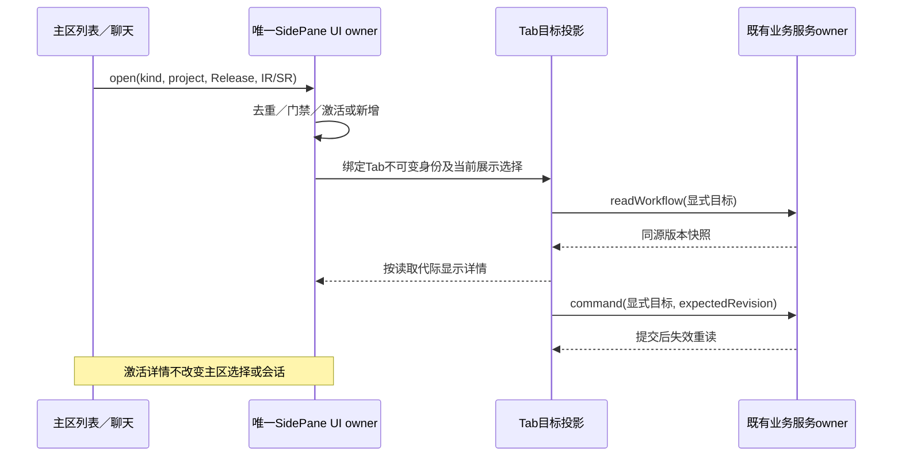

# 统一右侧工作区与详情 Tab

2026-11-17 用户确认恢复原生 Side Pane 框架、Tab 管理，并接入报告、材料和历史。以当前保留的原生 Tab 交互、面板样式为视觉与操作依据；新标签页只提供当前业务入口，不恢复裁撤能力。

## 所有者与范围

- 工作台唯一 AIReqSidePaneProvider 持有 UI Tab、激活项、顺序、最近关闭、折叠和完整视图；业务事实仍由服务端 owner 唯一持有。主区导航继续归 AIReqContext，不因激活右侧 Tab 改变。
- Tab 集合按当前项目＋具体 Release 在本会话保留；切主导航页面不清空，切项目／版本先过现有草稿门禁，再切相应集合。工号切换沿应用挂载边界清除。Tab 稳定身份由 kind＋projectId＋releaseId＋IR＋SR（分析报告另含 runId）组成；重复打开激活已有实例。
- 每个 Tab 可失效查询自己的目标，同一 readWorkflow 端口读取不应写共享默认 selection；命令、材料重试和版本CAS都显式绑定该 Tab 目标与快照。迟到读取只在当前查询代际接纳；失败可重试，不借其他 Tab／主区快照假装成功。
- AIReqContext 的草稿门禁扩为具名 owner 汇总，默认 primary owner 兼容现有调用；详情注册独立 tab owner，切换／关闭Tab检查其门禁，切项目／版本检查全部门禁。仅未保存输入属于局部UI状态，不复制业务状态。
- 收起面板不关闭Tab，不卸载已打开内容；切Tab保留滚动／局部输入。关闭Tab明确释放其状态；关闭激活Tab选择相邻项，最后一项关闭后保留新标签入口。设置覆盖层隐藏右侧工作区，返回恢复。 非激活、收起或被设置覆盖的工作区不得显示 Portal 弹窗或抢夺焦点；弹窗仅约束可见性，保留局部输入、草稿门禁及迟到异步预览，恢复后继续。
- 恢复原生紧凑Tab外观、图标、选中／关闭、中键关闭、右键关闭其他／全部、拖动排序、标签总览搜索、最近关闭重开、新标签页、折叠／展开及完整视图。拖动只能调整到最小宽度，折叠必须经过显式开关与门禁；真实 Tab 与 tabpanel 具有匹配的可访问关系。框架可复用保留控件并将原有Tab触发器抽出接受通用标题／图标的呈现层，原有调用行为保持。
- 工作台外层只保留一组主区与右侧可调宽面板；提案不再私有材料分栏，正式需求不再私有固定报告／材料／历史Tabs。右侧打开时主区按当前面板自然收窄、正文居中留白，聊天SessionPane仅一个实例；完整视图不复制或重新挂载聊天。

## 内容与入口

- report：正式IR或SR的进度报告；materials：正式或提案材料；history：正式IR讨论／评审历史；analysis：指定执行run的分析报告；launcher：当前业务的新标签页。
- 开发任务点击对象打开独立报告Tab，行菜单可打开材料与历史；不改主列表选择、过滤和浏览器历史。显式IR／SR链接仍可定位主区并一次打开对应报告。报告内跨对象打开另一个Tab，同对象材料路径／阶段／历史选择更新该Tab展示目标，不新建或抢夺激活态；后台操作完成亦不夺回焦点。侧栏身份区不显示返回主区按钮，主区导航由现有导航入口负责。
- 提案讨论主区保留原会话／阶段控制，首次进入对象时确保材料Tab存在；已存在时不强制展开或激活，手动关闭后不在同次挂载中自动复活。阶段“查看材料”动作显式打开该材料Tab。
- 分析列表的执行报告也打开同一侧栏中的分析Tab，读取／重试／打开需求功能保留，所有操作绑定原目标。
- 新标签页提供当前上下文可用的材料、报告、历史入口与最近关闭；没有对象时清晰引导从主区选择，不伪造内容。标签显示对象名称及详情种类，范围与无效目标有可理解反馈。

## 验收

实际电脑浏览器深浅主题与宽／窄窗口验证：多对象多种类并存、同对象复用、主区不随Tab切换改变；材料／报告／历史／分析均可读取，命令不串目标；折叠恢复内容和滚动、排序与最近关闭、中键／菜单关闭、完整视图及设置往返；切项目／Release恢复各自集合；未保存门禁取消保持原Tab／主区／范围，读取失败与迟到结果不污染其他目标。不得增加产品调试入口或永久E2E harness。

