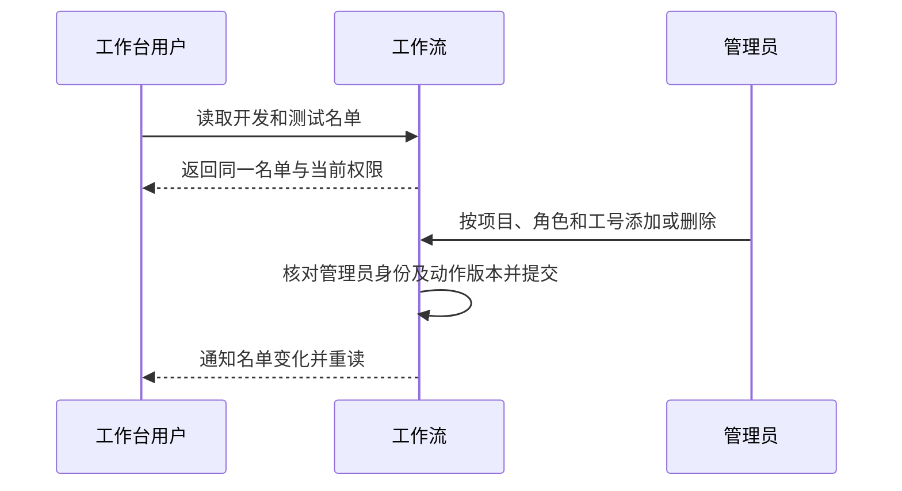

# 连接身份、版本与顺序

服务清单见[契约设计](contract-design.md)，部署访问控制与内存限制见[后端拓扑](../../architecture/mock-backend.md)。

## 1. 身份来源

应用入口只填写工号。校验格式通过即可进入，工号用来标记消息发送人和实际操作者，应用登录无需本人认证。用户可查看所有项目和 Release 的共享内容，可使用业务页面，其他操作依项目角色开放。

Web entry 持有连接生命周期，首次连接读取持久 `getV4ClientId()` 并固定；工号来自 `EmployeeEntry`。AIReq identity、WebSocket、v4 握手与命令共用同一 clientId，设备 stream 指纹不代替业务身份。浏览器每次页面加载生成独立的 `pageId`，重连沿用。服务端以工号、clientId 和 `pageId` 绑定页面云龙快照，最后一个连接断开后保留 30 分钟供重连。不传 `pageId` 时仅在当前连接内保留快照，不跨连接复用。

`AIReqIdentity` 仅含 employeeId/clientId：

- employeeId 匹配 `/^[a-z][0-9]{8}$/`。
- clientId 为非空白字符串，长度不超过 200；不额外假定必须为 UUID。
- 额外身份字段拒绝。`/ws` 查询只接受必填 `employeeId`、`clientId` 和可选部署 `token`、UUID 形式的可选 `pageId`，每项最多出现一次；场景参数拒绝。`pageId` 不是身份字段或凭据。

服务端在升级前验证自报身份；`getConnectionServices` 冻结连接身份，后续 bootstrap/call 的 employee/client 精确匹配，原生命令 envelope.clientId 也匹配。项目树与目录解析通过同一身份读取。请求局部上下文使用 `AsyncLocalStorage`，不用全局可变工号。

独立聊天页面 `/chat` 使用 `/ws/chat`，连接查询只接受 UUID 形式的 `clientId` 和可选部署 `token`，不接收工号或 `pageId`，不共享 AIReq 目录快照。

正式服务默认监听回环地址。WebSocket 与 API 只接受本部署地址的请求；浏览器带有 Origin 时须来自本实例的服务页、开发前端或显式配置的对外来源。非回环监听使用部署令牌，可由受控代理提供。从带 `?token=…` 的链接打开 AIReq 或 Chat 时，浏览器把令牌传给同源 WebSocket 和 HTTP API。正式实例逐请求核验令牌，仅在原型保留旧版部署 cookie。工号和项目角色仍由业务层校验。

工作流按项目、IR 和会话校验业务归属，记录执行时的工号，并按当前项目名单校验方案会话、方案评审和文档确认。Release 用于项目版本范围和归属校验，不是会话键。

### 项目角色

每个合法工号默认拥有业务权限。侧栏工号上方提供「角色管理」。页面内选择项目，分别显示开发名单和测试名单，每行显示工号及删除操作。所有用户均可查阅两个名单，并能看到添加和删除按钮。普通用户的操作按钮禁用，页面说明通过项目负责人向管理员申请所需角色。管理员在对应表格直接添加合法工号，确认后删除指定成员。同一工号可同时属于两个名单，同一项目的同一角色下工号唯一。

管理员工号固定为 `y00000000`，在所有项目都拥有开发和测试权限。其他工号的权限来自该项目名单。所有人可进入需求 Agent、发起需求评审和查阅文档。开发和测试均可进入方案 Agent、评审方案和确认最新版。原型和正式服务均按连接时填写的工号校验项目角色，确认记录使用实际提交时的工号。

角色管理在项目选择器和名单之间显示当前工号在所选项目的角色与可执行操作。摘要区分开发、测试、开发与测试、未加入名单，以及管理员继承的开发与测试权限；按该项目的有效角色说明方案 Agent、方案评审和确认最新版是否可用。角色摘要复用现有 `hasProjectRole` 和已读取的名单投影，不增加状态所有者或接口。名单若包含当前工号，其行显示「本人」，管理员继承权限不产生虚构名单行。

工作流持有名单。所有用户从 `readWorkflow.view.projectRoleMembers` 读取有效成员。只有管理员连接可执行 `addProjectRoleMember` 或 `removeProjectRoleMember`。工作流按项目、角色、工号和当前版本校验，成功后记录操作者并通知所有连接重读；接下来提交的开发／测试操作使用更新后的名单。连接恢复只重读。

验收覆盖不同身份看到同一名单与按钮、管理员添加和删除、普通用户通过接口写入被拒、双角色独立、重复添加和过期操作被拒、跨项目隔离，以及成员移除后角色写入不再可用。浏览器分别用普通、单角色、双角色和管理员工号核对摘要、本人行与名单编辑按钮；切换至同一用户角色不同的项目后，摘要和能力随所选项目更新。

## 2. 工作区与会话

opaque backend.id/workspaceIdentity 用于隔离，不用于来源展示或产品模式分支。`MockRuntime.workspaceKeyOf` 优先使用非空 workspaceIdentity，否则由主机及规范工作路径生成稳定身份；wire 完整 workspace 引用同时含 workspacePath/workspaceKey。调用方不得另造与实际请求不一致的 key。

浏览器的工作区请求使用当前 WebSocket 的基础服务，不按工作区另行注册桌面远程主机连接。显式带有旧远程目标或远程会话 ID 的工作区不回退到当前后端；只有稳定 `workspaceIdentity` 的工作区照常请求并按该身份隔离。

Web 命令以外层请求的工作区为准，拒绝 `envelope.workspace`；服务端派生内部工作区引用。命令、分页、会话、附件及订阅继续检查业务绑定与 workspace。Project 树仅投影当前业务及该连接身份可访问的会话，不枚举宿主目录或他人的私有草稿。

原生会话绑定与项目目录从 workflow owner 的即时只读查询取得最小事实；绑定查询无需逐项目重读完整 workflow，目录一次取得项目工作区及 canonical 会话映射。查询只复制所需结果，不缓存另一份目录、不改变 revision、状态或事件。公开资格仍由当前项目及 IR 的 canonical 引用裁决，故障会话过滤、私有草稿 actor 与 Skill 私有归属、workspace 精确匹配继续在原边界执行；轻投影不能替代这些校验。

浏览器的 SR 选择只定位文档。工作流读取与会话恢复按项目、IR 和 Agent 定位原生会话，不接收 SR。

`origin:"realUser"` 行使用接纳时已校验的 clientId；引导和跟进在实际交付时保留原命令和提交人。实时帧、快照与分页读取同一行事实。

已发送的消息、附件和评审结果按各 Agent 会话的权限共享。未发送正文、附件和输入历史按工号、客户端、工作区及会话隔离。

验收使用两个工号和两个浏览器会话，核对已发送内容的共享读取、发送人显示、切工号后的草稿隔离及同工号在不同浏览器中的草稿隔离。

## 3. 相互独立的版本

| 版本或标识                              | 含义                                                                             |
| --------------------------------------- | -------------------------------------------------------------------------------- |
| `AIREQ_CONTRACT_VERSION=39`             | bootstrap 契约兼容性，文档预检回传签字范围和文件清单；客户端版本不匹配则拒绝装配 |
| Protocol v4 wire `3`                    | hello/clientHello 与二进制 wire 版本                                             |
| snapshot `protocolVersion=1`            | 会话投影格式，不是 wire 版本                                                     |
| workflow revision                       | 普通业务写入的 CAS 基线                                                          |
| 文档版本号、预检 `snapshot`             | 版本号描述材料版本；快照标识绑定定版前检查的版本及文件，同版编辑也会改变快照     |
| 项目仓库配置、模型配置、提示词 revision | 各自的编辑基线，不互相替代                                                       |
| session revision                        | 原生命令 CAS                                                                     |
| topic logEpoch/seq                      | 投影日志代际与顺序，不是 AIReq bootstrap 水位                                    |

AIReq 事件和 bootstrap 不提供全局事件水位，不承诺持久重放或跨重启 exactly-once。在线人员快照的 `revision` 只用于在线人员投影排序。

## 4. CAS 与幂等

- `command` 按 employee/client/operationId 保存回执，摘要包含业务目标（`projectId`／`irId`）与参数，不包含阅读选择或第三参 `expectedRevision`。同 ID 同内容显式重试返回原回执，同 ID 改内容拒绝。普通写入首次接纳时比对 workflow revision。
- `projects.saveRepository` 以当前页快照中的现有项目 ID 为目标，不接收项目名或创建参数。按实际工号、clientId 和 operationId 去重；同 ID 同配置先复用结果，同 ID 不同配置拒绝。`expectedRevision` 不进入摘要，只在首次写入时比对被编辑项目的配置 revision。Skill 预览另用会话、目标、预览 revision 与 operationId，不共享全局事务号。
- `models.save`、`prompts.save` 只有 expectedRevision，没有 operationId。
- `skillDesign.saveDraft` 没有请求 CAS／operationId，按提交顺序覆盖可编辑字段，不覆盖会话补充记录。

原生命令先解析 envelope、核对身份和请求工作区，再按 actor/session/commandId 查决定。相同完整请求返回原 ACK，不因首次成功后的 revision 变化重复执行；同 ID 不同输入拒绝。新命令才校验 `COMMANDS_REQUIRING_BASE_REVISION`。Web 不接纳定位行命令或信封字段 `baseLogEpoch`；订阅恢复仍使用 `logEpoch`。陈旧请求不改变事实、队列或水位。两个入口都可查询同一接纳归属下的决定，不从回执读取回合状态；当前执行事实由会话投影提供。首发使用空会话键。

accepted 表示已接纳命令，后台执行结果由会话投影提供。无需变化为 noop，未实现为 rejected 与明确 reasonCode。原型回执在当前进程内有效。正式业务命令的重启与去重规则见[服务端契约](../../../packages/server/src/aireq/CONTRACT.md#调用与回执)。

确认版本不比对 workflow revision：提交预检返回的 `snapshot`，只在相同版本及文件仍未定版时按当前规则复核、固定预检范围内的文件并记录确认人及时间。材料漂移或已定版时 RPC 拒绝；快照仍匹配但复核未通过时，`result.documentValidation` 与 `receipt` 同级。评审也不比较 workflow revision，但不提交预检快照，而是捕获接纳时最新已保存材料供独立评审。两者均沿用操作编号去重。

## 5. 失效通知与重连

`createRemoteAIReqDataSource` 先订阅 onDidChange，再读 bootstrap 和项目 workspace。读取捕获失效代次，期间有事件则丢弃并补读；初始化失败释放订阅。后续 metadata 刷新单 flight，读取期间再失效则继续补读。

事件只失效投影；错误可见，后续读取可修复。刷新不抢占导航、不覆盖 dirty prompt，保存不能清掉保存期间的新编辑。dispose 与读取代次使迟到响应失效。

`projects.refreshSnapshot` 只在完整云龙目录读取成功时替换该页快照；在途普通读取与失败后的读取仍使用旧快照。首次普通读取可以取得部分成功结果，所选失败项目若没有可用数据则报错。其他页面与自动同步不改变已绑定的快照。`retrySession` 按 `readWorkflow` 同源的页面目录和当前工作流校验目标。空参数 `proposals.syncToRedZone` 在接纳时固定当前页已加载的云龙目录，无目录则拒绝；提交给传输端口时才取当前需求材料。同页在途请求可复用结果，不承诺永久去重或 exactly-once。

连接关闭或出错终结旧 pending 请求。重连替换 accessor、attachment 和订阅，保留同一工号生命周期中的组件挂载、store、正文与附件草稿，重新绑定广播且入站偏好只应用一次。有限退避后可显式重连，退出工号终止旧连接尝试。重连只订阅与重读，不自动重放 create/send/save/confirm mutation。

## 6. 原生 topic

- conversation 的 seq/logEpoch 属于 MockSession。
- 快照 fromSeq=0、toSeq=当前水位，不推进；增量 `(fromSeq,toSeq]` 每条发布推进一次，同 topic 订阅者使用相同区间。
- conversation 随投影推进，即使暂无订阅者。
- 每次订阅生成新 subscriptionId；`createZCodeAgentConnectionScope` 只路由本连接所属帧。重连重新订阅，不复用旧 ID。
- 跨连接 resync 为 `fault.subscription.notOwned`，未知订阅为 `fault.subscription.unknownSubscription`；非本连接 unsubscribe 幂等忽略，不删除他人订阅。
- conversation 按会话及 workspace 隔离。服务端释放工作区后，迟到 turn 不重新创建会话或启动下一队列项；Web 不提供会话删除命令。

## 7. 浏览器 ID 与附件摘要

局域网非 loopback HTTP 不能依赖 crypto.randomUUID/subtle。普通浏览器 UUID 使用 shared createUuid 的 getRandomValues 路径，不改写全局 crypto，不改变命令／操作 ID 分配和显式重试时点。附件仍提交完整字节 `sha256:<hex>`：安全上下文用 WebCrypto，其他支持环境用浏览器 SHA-256 实现，不放宽服务端校验。

## 8. 二进制与协议接线

同源 `/ws` 使用 `@zcode/rpc` 的 SocketProtocol。`connectViaWebSocket` 用 ArrayBuffer 包装 ISocket，收到 Channel Initialize 后返回 RemoteServiceAccess。替换后端须实现相同字节格式：

- 帧头固定 13 字节：type:u8、id:u32BE、ack:u32BE、payloadLength:u32BE，普通消息 type=1；跨 message 半帧与粘包按 `packages/rpc/src/protocol.ts`，不增加透明重放。
- payload 的 header/body 序列化、类型标签、VQL 长度、UTF-8 与二进制 marker 按 `serialization.ts`，不能替换成自定义 JSON。
- 服务端为每条连接装配 ChannelServer，客户端在收到 Initialize 后发起调用。
- 请求 ID 对应当前连接，Promise success/error、取消、事件 listen/fire/dispose 按 channels.shared/channelClient/channelServer。
- ProxyChannel 方法实参为数组；onXxx 为 Event，onDynamicXxx(arg) 为参数化 Event，释放监听即退订，不作为普通 Promise 方法。

v4 hello/initialize 后订阅 conversation，ACK 与 owned notification 分离；首帧经现有 response 后通知路径发送。wire complete/fragment 使用 shared wire-codec/wire-reassembly 的尺寸、校验与 typed fault，客户端重组后才应用逻辑帧。

## 9. 附件传输

附件通过 begin/chunk/commit/abort/read，不经宿主路径转移。begin 绑定 actor、session、workspace、文件名、MIME、总字节／块数及 SHA-256；当前上限 20 MiB、4096 块，每块不超过 512 KiB。块按序提交，相同已接纳块可复用但不可改写；commit 校验完整大小与 `sha256:<hex>` 后返回 ref。

发送采用同一真实字节。abort 不删除已被行、队列或提升项采用的字节；读取核实 workspace／会话／采用行和可见性。其他操作者只可读取已发布共享会话真实采用的附件，不可读取私人暂存。`attachmentReadV4` 的 `offset` 非负、`limit` 为 1—512 KiB，返回 `dataBase64`、`mediaType` 和 `totalBytes`。请求偏移加分片解码后的字节数小于总字节数时继续读取；到达或超过末尾则没有下一片。会话已删除不能因读取重建。

## 10. 源码依据

- 身份与业务分派：[`identity.ts`](../../../packages/server/src/aireq/identity.ts)、[`service.ts`](../../../packages/server/src/aireq/service.ts)、[`remote-operations.ts`](../../../packages/services/src/aireq/remote-operations.ts)。
- 浏览器连接、装配与失效：[`main.tsx`](../../../packages/web/src/main.tsx)、[`websocket.ts`](../../../packages/client/src/websocket.ts)、[`remote-data-source.ts`](../../../packages/ui/src/aireq/shell/remote-data-source.ts)。
- 传输：`packages/rpc/src/{protocol,serialization,proxy-channel,channelClient,channelServer}.ts`。原生 CAS 与 topic：`packages/server/src/mock/{runtime,zcodeAgent}.ts`。协议版本及会话投影：`packages/shared/src/zcode-protocol-v4/{core,snapshot,sessions-index}.ts`。
