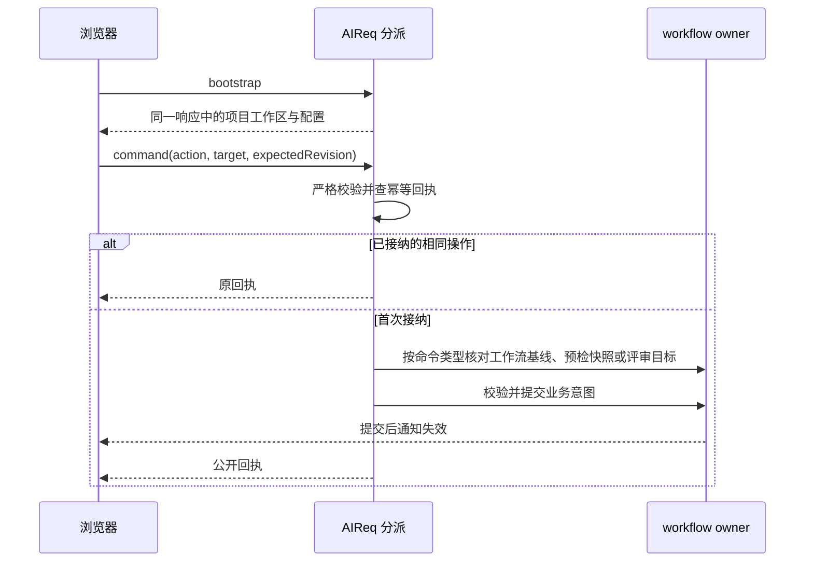

# 公开服务与 AIReq 契约

本文件是当前对接目录，不以内部类成员、旧页面、纯 DTO 或协议 schema 扩大服务能力。[后端拓扑](../../architecture/mock-backend.md)记录实现限制，[连接身份](connection-identity.md)记录身份、版本、幂等与二进制接线。

## 1. 权威契约与公开范围

- `packages/services/src/aireq/contract.ts` 定义 `IAIReqService` descriptor；公开子入口 `@zcode/services/aireq`。
- `remote-operations.ts` 定义 correlated path/args/result；`AIReqRemotePath` 是 operation map 的键，不接受任意字符串或万能 unknown[] 代理。
- `packages/server/src/aireq/wire-schemas.ts`、`validation.ts` 做运行时校验，静态类型不代替 wire 校验。
- `packages/server/src/http.ts` 的 `publicMembers` 是部署白名单。只公开指定方法／事件；overrides 不绕过白名单，不能反射实现类私有方法。
- `RemoteServiceAccess` 和 `createMockServices` 装配当前 Web 服务。白名单只公开下列 7 个频道，不把通用 Agent 服务的桌面成员带入 Web。

| 频道            | 方法                                                                         | 事件        |
| --------------- | ---------------------------------------------------------------------------- | ----------- |
| aireq           | bootstrap、call                                                              | onDidChange |
| zcode-agent     | 见下一节                                                                     | 见下一节    |
| file            | searchWorkspaceFiles、stat、checkFilesExist、readMediaPreview、readFileRange | 无          |
| project         | resolveSessionDirectories、readTree                                          | 无          |
| broadcast       | send                                                                         | onMessage   |
| setting         | get、update                                                                  | 无          |
| model-selection | getView                                                                      | 无          |

AIReq 的七个频道在 `/ws` 连接上复用同一二进制传输，共 28 个方法和 3 个事件。独立聊天的浏览器页面是 `/chat`，在同一 HTTP 服务上通过 `/ws/chat` 升级连接；该连接只公开 Agent 的 10 个方法和 1 个事件，以及 ModelSelection 的 1 个方法。

Git、文件监听、MCP 同步、独立媒体预览、client-config RPC、skills RPC、任务分组、跨宿主附件转移不属于公开服务。HTTP configs、原生 Skill catalog 与 AIReq Skill 不因此消失。受管 worktree、插件、终端等纯类型或通用展示组件存留不授权对应 RPC。

Web 不公开 `system.info`，不读取也不返回宿主主目录或平台。工作区目录继续使用业务工作区标识及路径。

Web 不公开 `provider-settings`。AIReq 和 `/chat` 通过 `model-selection.getView` 读取模型目录，不订阅目录事件。供应商条目不包含 `templateId`；供应商的 `config` 只包含可选的 `logo`、`api` 和 `access`，不下发分组、可见性规则或模型 ID／排序配置。`config.api` 只投影 `type`，不下发 `baseUrl` 或 `headers`；`config.access` 只投影访问类型和套餐展示字段，不下发 `apiKey` 或 `apiKeyManagementUrl`。Web 发送遥测保留模型与供应商 ID，不上报端点主机名。模型候选和顺序以 `providers[].models` 为准，模型配置不另返回 `enabled`；服务端供应商可见性与模型可用性判断不变。模型的 `config.optionSpecs` 只包含 `reasoningLevel.values`，用于展示与校验思考档位；`config.properties` 只包含 `inputFormat.supportsImage`，用于展示图片能力。运行中的上下文窗口由会话用量快照提供。AIReq 业务模型设置仍由 AIReq 管理，变更通过 `aireq.onDidChange` 的 `models` 通知投影失效。

`model-selection.getView` 可无参调用，或接收一个 `{ selection }` 参数；第二个实参在读取目录前拒绝。`selection` 为 `null` 时和无参查询一样使用当前入口的默认选择；非空选择只包含 `providerId`、`modelId` 和可选的 `options.reasoningLevel`。请求及嵌套对象中的额外字段在读取目录前拒绝，响应只使用校验后的选择。

`file` 的 descriptor、浏览器代理和服务端共用 `WebFileService`。`stat({path})` 对目录只返回 `{type: "directory"}`，对文件只返回 `{type: "file", size, mtimeMs}`；`size` 为字节数，缺失路径拒绝。

`project` 的 descriptor、浏览器代理和服务端共用 `WebProjectService`；仓储 DTO 不扩大 Web 查询参数或投影。

Web 的 `project.resolveSessionDirectories` 只接收一个会话引用对象，字段为 `taskId`、`workspacePath` 和可选的 `workspaceIdentity`。第二个实参及对象中的 `hostId` 等额外字段均在查询前拒绝。只返回 `{ projectId }`。服务端仍校验会话归属、路径和稳定身份；文件提及在校验后只搜索当前工作区，不查询附加目录。

Web 的 `project.readTree()` 不接收参数；传入 `hostId` 或其他实参时拒绝请求。顶层只返回 `{ projects, tasks }`。`projects` 条目只包含 `id` 和 `name`；`tasks` 条目只包含 `taskId`、`title`、`workspacePath`、`workspaceIdentity`、`createdAt`、`updatedAt` 和 `projectId`。会话提及按 `projectId` 分组，搜索关键词使用前端当前 Agent 类型；会话范围、排序和权限校验不变。

## 2. 原生 Agent 精确公开成员

方法按用途列出，名称是 Channel 包装方法，不是 wire 路径：

- 目录：`getSkillReferenceCatalog`、`getConversationCommandCatalog`。
- 握手／会话：`helloConversationV4`、`initializeConversationV4`、`subscribeConversationV4`、`resyncConversationV4`、`unsubscribeConversationV4`、`conversationRowsRangeV4`、`sendConversationCommandV4`、`queryConversationCommandsV4`。
- 附件：`attachmentBeginV4`、`attachmentChunkV4`、`attachmentCommitV4`、`attachmentAbortV4`、`attachmentReadV4`。

独立聊天不公开技能目录或附件事务，额外公开 `listRecentChatSessions`，仅查询当前匿名客户端的最近会话。

AIReq 与 `/chat` 的 `getConversationCommandCatalog` 按已选连接定位目录。请求对象只接收 `workspacePath`、可选的 `workspaceIdentity` 和可选的 `sessionId`；`remoteSessionId` 等额外字段在读取目录前拒绝。目录内容和会话归属校验不变。

唯一会话事件为 `onDynamicConversationFrame`。AIReq 与 `/chat` 的 Web 监听只接收 `workspacePath` 和可选的 `workspaceIdentity`；`remoteSessionId` 等额外字段在建立帧监听前拒绝。帧仍按当前连接、工作区、topic 和 `subscriptionId` 校验归属，帧格式和释放语义不变。Web 通过连接、订阅、快照和 `logEpoch` 恢复，不查询或订阅独立的 Agent 进程／会话生命周期。

AIReq Web 的 `getSkillReferenceCatalog` 只返回 `{ skills }`，其中只包含已启用且正文非空的技能，条目没有 `enabled` 字段。带 `sessionId` 时读取所属会话的冻结目录，否则读取当前工作区目录；会话归属校验和通用技能目录契约不变。

`getSkillReferenceCatalog` 按已选连接定位目录。请求对象只接收 `workspacePath`、可选的 `workspaceIdentity` 和可选的 `sessionId`；`remoteSessionId` 等额外字段在读取目录前拒绝。前端的连接作用域隔离不变。

AIReq 与 `/chat` 的 `helloConversationV4` 只返回 `kind`、`protocolVersion` 和 `capabilities`；`capabilities` 只允许可选的 `historyFirst`，原型宣告为 `true`。连接标识、模式和投递策略由服务端持有。旧 Plan、Hook 审批、GenUI、工作流增量、输入预测及桌面、手机和传输标识不在 Web 握手中；Web 仍拒绝 Plan 和 GenUI 命令输入。通用 ZCode 握手不变。

AIReq 业务工作流通知仍走 `aireq.onDidChange`。WebSocket 二进制传输、原生会话快照、普通增量和工作记录不变。

AIReq 与 `/chat` 的 `initializeConversationV4` 只接收 `kind`、`protocolVersion`、`clientId` 和可选 `capabilities`。`capabilities` 只接受可选的 `historyFirst`，拒绝 `workspaceHookReviewUi`、`workflowRunDeltas` 和其他字段；请求不接收 `clientKind` 或 `appVersion`。客户端只在宿主宣告 `historyFirst` 时回传该能力。连接模式和投递策略仍由服务端连接上下文决定，身份校验与通用 ZCode 握手协议不变。

AIReq 与 `/chat` 的 `subscribeConversationV4` 接收 `workspacePath`、可选 `workspaceIdentity`、`sessionId` 和可选 `base`，在创建订阅前拒绝 `remoteSessionId`、`visibility` 和 `retryInitialization`。浏览器前后台不改变订阅策略，手动重试重新订阅，不指定宿主初始化尝试。Web 回执的 `ack` 只包含 `subscriptionId`、`mode` 和 `logEpoch`，不返回桌面端打开耗时 `openTiming`。会话归属、`base` 水位、首次快照、实时帧和通用订阅协议不变。

AIReq 与 `/chat` 的 `resyncConversationV4` 只接收 `workspacePath`、可选的 `workspaceIdentity`、`subscriptionId`、`base` 和可选的 `forceSnapshot`；`remoteSessionId`、`runtimePolicy` 等额外字段在查询订阅归属及恢复前拒绝。Web 回执的 `ack` 只包含 `subscriptionId` 和 `mode`，恢复版本从会话帧的 `logEpoch` 获取。订阅归属、恢复行为和通用协议不变。

AIReq 与 `/chat` 的 `unsubscribeConversationV4` 只接收 `workspacePath`、可选的 `workspaceIdentity` 和 `subscriptionId`；`remoteSessionId`、`runtimePolicy` 等额外字段在查询订阅归属及释放前拒绝。正常退订的归属检查、幂等语义和返回值不变。

AIReq 与 `/chat` 的 `conversationRowsRangeV4` 在读取前拒绝 `remoteSessionId`，按当前连接、工作区和 `sessionId` 定位会话。通用分页游标与 `residency: "resident-only"` 行为不变；返回 `rows`、`hasMore`、`atLogEpoch` 和 `atRevision`，不返回 `atSeq`。会话实时帧的水位和通用接口不变。

AIReq 与 `/chat` 的 `sendConversationCommandV4` 只在请求外层携带 `workspacePath` 和可选的 `workspaceIdentity`，在执行前拒绝信封中的 `workspace`、桌面／移动来源 `inputOrigin`、本机首字耗时遥测 `ttft` 和定位行命令的 `baseLogEpoch`，以及顶层 `remoteSessionId`、`projectId`、`clientMode`。服务端从外层工作区构造内部信封；项目归属由 AIReq 业务服务校验，执行模式由服务端连接决定。浏览器可保留本地草稿和待确认命令的项目标记，不随原生命令发送。Web 回执 `WebCommandAck` 不返回 `memoryEnabled` 或 `ttftExcluded`。命令信封中的 `sessionId`、`baseRevision`、归属校验、幂等语义和通用协议不变。

Web 的 `createSession` 载荷不接收 `workspaceId`；创建归属只使用请求外层工作区。浏览器按原命令编号和工作区查询回执；读取旧待确认记录时仍可用其中的 `workspaceId` 定位工作区，用户确认重发时新载荷不携带该字段。通用创建协议仍保留 `workspaceId`。

AIReq 与 `/chat` 的 `queryConversationCommandsV4` 接收 `workspacePath`、可选的 `workspaceIdentity` 和 `commands`，在读取回执前拒绝 `remoteSessionId` 和本地校时字段 `clock`。只返回 `{ results: [{ key, result }] }`，其中 `result` 为 `unknown` 或与即时回执同形状的 `WebCommandAck`；当前回合状态由会话快照和帧提供。回执归属、重连恢复及通用 ZCode 查询协议不变。

AIReq 的 `attachmentBeginV4` 在创建上传事务前拒绝 `remoteSessionId`，按当前身份、工作区、`sessionId` 和 `uploadId` 绑定上传。`staging` 回执只返回 `state` 与 `nextChunkIndex`，`committed` 回执只返回 `state` 与 `ref`。续传、重复初始化及通用接口不变。

AIReq Web 的 `attachmentChunkV4` 在写入分片前拒绝 `remoteSessionId`，以当前上传者、`sessionId` 和 `uploadId` 定位上传事务。回执只返回 `nextChunkIndex`；分片顺序、重试、归属校验及通用接口不变。

AIReq Web 的 `attachmentCommitV4` 在提交前拒绝 `remoteSessionId`，按上传者、`sessionId` 和 `uploadId` 定位事务。分片完整性和 SHA-256 校验不变；重复提交返回同一 `ref`。通用接口不变。

AIReq Web 的 `attachmentAbortV4` 在清理前拒绝 `remoteSessionId`，按上传者、`sessionId` 和 `uploadId` 定位事务。重复取消无副作用；已被消息或队列采用的附件继续保留。通用接口不变。

AIReq 的 `attachmentReadV4` 在读取前拒绝 `remoteSessionId`，按当前连接、工作区、`sessionId` 和 `ref` 定位附件并校验消息行归属。回执只包含 `dataBase64`、`mediaType` 和 `totalBytes`。前端用请求偏移与实际解码字节数计算后续偏移；分片限制和通用 CLI 协议不变。

精确请求／结果由 `packages/services/src/zcode-agent/zcodeAgent.ts` 和 shared `zcode-protocol-v4` 的 schemas 定义。当前服务接口不提供 Host 流控、按工作区或全局销毁、旧 Plan／子代理查询、选区批注探测及独立会话生命周期查询或事件。WebSocket 关闭由服务端释放该连接的订阅；不清除共享会话、其他连接的订阅或历史。原生帧 schema、进程观察信号和 workspace-config 通用 wire 类型不变。

AIReq 与 `/chat` 的发送、停止和状态使用 [OMP 对齐的聊天语义](conversation.md#聊天命令和会话配置)。`/chat` 白名单包含 `queryConversationCommandsV4`，回执与会话同受匿名归属约束。现有二进制传输、时间线行和其他 Agent 消费者的契约保持不变。

AIReq 会话命令接纳创建、发送、目标停止、确认退回输入和会话标题更新。`/chat` 另支持会话级模型切换，通过 OMP 拼写 `/rename <title>` 更新标题。会话队列投影的 `returnedInputs` 只发给原提交者，重订可恢复尚未确认的原文、附件与引用。客户端应用草稿后通过 `acknowledgeReturnedInputs` 提交已回填的原命令编号，服务端只移除当前可信提交身份的对应记录。不向两端暴露旧 Plan 目录、子代理目录与控制、选区批注或桌面运行时设置同步。移除队列编辑与提升、单条选模、协作模式、分叉、文件回滚、后台任务恢复、回复反馈、会话删除及原生工具交互裁决。手写已移除的 RPC/命令不可执行；不删通用消费者需要的共享类型、组件及协议值。

## 3. AIReq 服务入口

```ts
bootstrap(identity: AIReqIdentity): Promise<AIReqRemoteBootstrap>;
call<P extends AIReqRemotePath>(
  identity: AIReqIdentity,
  path: P,
  args: AIReqRemoteArgs<P>,
): Promise<AIReqRemoteResult<P>>;
readonly onDidChange: Event<AIReqRemoteEvent>;
```

`call` 只接收 `identity`、`path` 和 `args`，在进入业务处理前拒绝额外实参。操作在各自的 `args` 中声明和校验目标；不接收独立的导航选择。

`bootstrap` 无业务创建副作用，返回 `contractVersion`、opaque `backend.id`、`capabilities.workflowCommands`、可选 `initialProjectId`、模型 `choices/settings/revision`、提示词 `saved/revision`、`projects.workspaces` 和可选 Skill 存储目标。`projects.workspaces` 以项目 ID 为键，与同项目的 `readWorkflow.workspace` 同源，包含 `identity`、`kind` 及可选 `path`、`error`。初始化和元数据失效只读一次 bootstrap；浏览器不拼接身份、不用旧值覆盖不可用结果，也不猜测省略的默认项目。显式分享链接优先。响应不返回导航、私人草稿、服务注册清单或后端配置；刷新不覆盖未保存的提示词草稿。

AIReq bootstrap 业务契约版本为 `38`，退役原有静态创建／删除能力，并收窄仓库配置写入参数。共享类型、浏览器调用与服务端 wire 校验同批切换，不接受历史参数作为兼容格式。该版本与原生 Agent 的 Protocol v4 独立。工作流修订号用于适用 CAS 的写入，文档版本号由该需求的材料与确认事实决定。

`models.settings.agents` 是模型与追加指令页签的有序角色目录，包含 `requirements`、`requirements-review`、`solution` 和 `solution-review`。

工作流首次按项目、IR 和目标 Agent 返回可访问的讨论会话引用时，原子绑定当时已保存的 `modelConfig`；评审在接纳时绑定。目录加载、无 IR 的项目投影和需求详情不绑定配置；右侧材料区只读项目投影。稳定会话 ID 预先分配，未绑定的目录条目不具有运行时模型。后续保存不改写已绑定会话、已接纳执行或历史报告，绑定本身不推进工作流写入 revision。公开绑定只含 `role`、`roleName`、`modelKey`、`modelName`、`reasoning`、`inherited`、`promptSnapshot`。提示词快照是已保存的追加指令；空字符串仅用内建指令。原生执行使用同次捕获的供应商与运行时模型标识，不从公开 DTO 还原。模型保存 CAS 使用 bootstrap 的 `models.revision`，不把配置版本复制到每个绑定。

`readWorkflow` 返回 `{view,session?,workspace}`，将业务投影、IR 级原生会话引用与同源工作区配对。读取与恢复会话共用 `AIReqWorkflowTarget`，仅接纳可选 `projectId`、`irId`、`discussionPhase`；省略 `discussionPhase` 时使用需求 Agent。方案会话要求所属项目开发或测试。SR 链接仍可在浏览器定位文档，但 SR、阅读路径及历史版本不随工作流或命令请求往返。

`proposals.syncToRedZone` 只接收空参数 `[]`。服务端在请求接纳时固定该页已加载的云龙目录；没有已加载目录时拒绝，不额外发起读取，也不等排队执行时重读页面快照。同步范围不受当前项目、Release、筛选、分页或列配置影响。提交给传输端口时，从当前工作流读取目录内各 IR 的需求材料。任一项目读取失败或已有的需求文档不可读取，整次同步失败，不交接部分结果。

交接仅包含项目组 ID 和名称、快照内的 IR 业务字段（含原始完整描述、所属 PI、进展、人员和创建时间）及可选的当前 `requirements.md` 完整正文，不携带仓库配置、评论、其他材料、历史版本或会话。接收端按项目组 ID 和 IR 业务号更新目录与随附的文档，单独存放导入副本，不覆盖红区自有的同名文档或方案；未附正文不触发文件删除。回执 `status`、`projectCount`、`count`、`documentCount` 表示本次交接状态和项目、IR、需求文档数，原型状态为 `simulated`。

服务端每 5 分钟使用云龙目录读取端口和同一传输端口执行自动全量同步，不修改页面快照。自动任务和手动任务串行，已有自动任务尚未完成时不再入队；失败只记录日志，下一周期继续。同页进行中的手动同步复用该次结果，不新增公开操作或持久的去重保证。

`proposalTable.readPreferences` 和 `proposalTable.savePreferences` 只访问当前连接工号的列配置。列键由共享契约定义，必须至少一个且不能重复。排序字段必须可见，默认排序允许在创建时间列隐藏时按创建时间降序。原型以每个工号一份 JSON 原子落盘到服务工作目录的 `.zcode-runtime/aireq/proposal-table`。列配置键 `owner` 保留为当前责任人列，继续应用已保存的可见性和顺序；需求提出人使用独立键 `requester`。迁移写入使用 `initializeOnly`，服务端已有记录时返回该记录。可选 `autoFit` 标记精简配置会按表格宽度显示进展、停留时间、工作量和开发及测试责任人，显式为 false 表示自定义配置。

`projects.refreshSnapshot` 以 `[workflowTarget]` 请求更新当前页面的云龙快照，并按当前目标返回与 `readWorkflow` 相同的投影。普通工作流读取、详情读取和通知造成的重读复用该页旧目录，叠加当前本地业务状态，不因刷新在途而切换。只有项目目录及其全部项目的 IR 均读取成功，刷新才替换该页快照；失败拒绝请求并保留原快照。首次普通读取可展示部分成功的目录和项目，所选项目读取失败且没有可用数据时返回错误。云龙读取共享并发请求及完成后 3 秒结果缓存，但各页面独立采纳版本。WebSocket 的可选 `pageId` 与重连保留窗口见[连接身份](connection-identity.md#1-身份来源)。

`readRequirementDetails` 按项目组 ID 和 IR 业务号返回页面快照中的原始描述、字段名和可读值。数组和对象以 JSON 字符串返回。同一项目的 `ir list --all` 可返回多个需求域，目录保留每条 IR 自己的需求域。评论使用独立的 `requirementComments.list`、`requirementComments.add` 和 `requirementComments.delete`；服务端按当前页快照校验项目与 IR 归属并取得该 IR 的需求域，再调用云龙。评论列表按云龙返回顺序投影，缺少有效 ID 的条目以 `id: null` 返回。评论新增和删除只由用户显式操作发起。

AIReq 工作区 `kind` 仅为 `proposal`（已登记项目）或 `unavailable`。切换对象需匹配新目标的读取结果；对象未就绪不借前一个对象的工作区。历史文档通过工作流的已确认快照读取。AIReq 不自建原生 UI 状态或输入预测帧；现用原生会话仍走 Protocol v4。

工作流读取失败通过 RPC 拒绝返回，`view` 不含通用 `error` 字段。工作区和单份材料的错误仍随各自的投影返回。

项目和 IR 来自云龙；`view.releases` 按各项目快照内的 `pi` 分组，名称取 `piName`，不提供独立 Release 录入。每项提供 `id`、`projectId`、`title`、`createdAt` 和统计字段。`view.projectRequirementCounts` 按项目 ID 提供相同的统计字段，项目级别包含未分配 Release 的 IR。`requirementCount` 是总数，`completedRequirementCount` 统计云龙状态为「完成」的 IR，`confirmedRequirementCount` 统计当前文档版本已确认的需求。详情、材料与会话按查询项目返回。

项目摘要只含 `id`、`name`、`revision`、`defaultBranch` 和可选的 `repositoryUrl`、`workDirectory`。`workDirectory` 是共享文档链接的配置路径，和浏览器使用的逻辑工作区不同；内部存储元数据不下发。命令回执返回实际操作者工号 `actorEmployeeId`，不下发身份对象或 `clientId`；幂等记录不作为工作流历史下发。`readWorkflow.view.requirements` 返回当前项目的全部需求，包含可用的云龙进展 `process` 和人员字段 `delivererOwner`（当前责任人）、`owner`（需求提出人）、`seId`（设计责任人）、`de`（开发责任人）、`te`（测试责任人），不含录入来源或重复的文件清单，当前文件统一从 `view.materials` 读取。可选 `cloudFields` 携带当前快照中用于额外列表列的云龙字段，按共享白名单投影为字符串、数字、布尔值或字符串数组。数组保留各选项用于多选筛选，其他复合值转换为可读字符串。列配置继续使用原有列键，`release`、`date` 和 `process` 的页面文案为「PI」「创建时间」和「进展」。

`view.projectRoleMembers` 包含全部项目的角色成员记录，每行含 `projectId`、`employeeId` 和 `role`；角色页按所选项目过滤。`view.roleAdministrator` 来自当前连接身份。

`view.materials` 提供当前文件。每条需求的 `documentVersion` 包含当前版本号和可选确认记录。已确认的早期版本通过 `documentHistory` 提供完整材料、SR 清单和确认记录。`documentReviews` 提供按需评审状态、报告、评审角色、版本号和快照是否过时。

`view.documentFormats` 存放全局格式规则，以 `requirements.md`、`proposal.md`、`design.md`、`tasks.md`、`test-plan.md` 和 `spec.md` 为键，值为必需章节标题数组。格式规则用于阅读、编写和定版校验。

`onDidChange` 发送 `presence(snapshot)`、`workflow`、`models`、`prompts` 或 `skills(sessionId)`，不携带通用顶层元数据。工作流、模型、提示词和 Skill 通知用于标记投影失效；连接恢复通过重读取得当前事实。

`readPresence` 和 `presence` 事件复用 `{ revision, rows }` 快照。在线人数由前端按 `rows[].employeeId` 去重计算，不随快照重复下发。

## 4. AIReq 操作登记

当前 operation map、wire argumentSchemas 与服务分派对应以下操作。`args` 是有序 tuple；`workflowTarget` 表示 `AIReqWorkflowTarget`。省略的结构字段、可选性及联合类型以源码为准。

| path                          | args                                                                                   | result                                    |
| ----------------------------- | -------------------------------------------------------------------------------------- | ----------------------------------------- |
| readPresence                  | `[]`                                                                                   | `AIReqPresenceSnapshot`                   |
| readWorkflow                  | `[workflowTarget]`                                                                     | `AIReqRemoteWorkflow`                     |
| proposals.syncToRedZone       | `[]`                                                                                   | `AIReqRequirementListSyncReceipt`         |
| proposalTable.readPreferences | `[]`                                                                                   | `AIReqProposalTablePreferences` 或 `null` |
| proposalTable.savePreferences | `[preferences,initializeOnly]`                                                         | `AIReqProposalTablePreferences`           |
| projects.refreshSnapshot      | `[workflowTarget]`                                                                     | `AIReqRemoteWorkflow`                     |
| readRequirementDetails        | `[{projectId,irId}]`                                                                   | `AIReqRequirementDetails`                 |
| requirementComments.list      | `[{projectId,irId}]`                                                                   | `AIReqRequirementComment[]`               |
| requirementComments.add       | `[{projectId,irId},body]`                                                              | `AIReqRequirementComment`                 |
| requirementComments.delete    | `[{projectId,irId},commentId]`                                                         | `null`                                    |
| validateDocumentVersion       | `[{projectId,irId}]`                                                                   | `AIReqDocumentValidation`                 |
| command                       | `[action,{projectId?,irId?},expectedRevision]`                                         | `AIReqWorkflowResult`                     |
| retryMaterial                 | `[{projectId,releaseId,irId,path,sha256}]`                                             | `boolean`                                 |
| retrySession                  | `[workflowTarget,sessionId]`                                                           | `null`                                    |
| projects.saveRepository       | `[{projectId,repositoryUrl,defaultBranch,workDirectory,expectedRevision,operationId}]` | `null`                                    |
| models.save                   | `[{defaultModel,agents:[{id,model,reasoning},…]},expectedRevision]`                    | `null`                                    |
| prompts.save                  | `[value,expectedRevision]`                                                             | `null`                                    |
| skillDesign.session           | `[projectId]`                                                                          | `AIReqSkillDesignSession`                 |
| skillDesign.read              | `[sessionId]`                                                                          | `AIReqSkillDesignDraft`                   |
| skillDesign.saveDraft         | `[sessionId,editableFields]`                                                           | `null`                                    |
| skillDesign.prompt            | `[sessionId,editableFields]`                                                           | `string`                                  |
| skillDesign.readPreview       | `[sessionId]`                                                                          | `AIReqSkillDesignPreview` 或 `null`       |
| skillDesign.listSkills        | `[sessionId]`                                                                          | `string[]`                                |
| skillDesign.savePreview       | `[sessionId,target,expectedPreviewRevision,operationId]`                               | `AIReqSkillSaveReceipt`                   |

`skillDesign.savePreview` 的收据只包含 `path`、`revision` 和 `target`；`skillDesign.readPreview` 重读时附带同形状的已保存收据。保存不接收路径：项目目标由私有会话关联的项目及当前已登记工作区确定，无项目的会话只可保存到共享目录。保存请求按会话和 `operationId` 幂等裁决，比较目标与预览版本；新保存校验 `expectedPreviewRevision`，再由服务端从该版预览读取并校验候选名称。

`skillDesign.session` 按项目和当前工号／客户端打开或读取同一私有会话，一次返回 `sessionId`、可直接使用的 `workspaceIdentity` 和 `temporaryDirectory`。后两项不设独立查询；浏览器不拼接工作区身份。`skillDesign.readPreview` 的文件路径相对于该会话的临时目录，没有预览时仍可从会话结果展示目录。切换项目或浏览器身份不得复用其他作用域的会话。

`skillDesign.listSkills` 按私有会话校验归属并解析工作区，只返回该范围可见技能的 `SKILL.md` 路径数组，供设计页在保存前检查同名冲突。服务端保存时仍校验冲突；原生会话的技能引用目录不变。

关键输入语义：

- `retrySession` 使用当前页绑定的云龙目录和当前本地工作流，按与 `readWorkflow` 相同的规则解析 `AIReqWorkflowTarget`，只恢复该目标绑定的已有原生会话。`sessionId` 必须精确匹配，不匹配、目标不可用或会话不存在时拒绝，不绕过页面目录、不创建替代会话、不修改材料或重放输入。
- `projects.saveRepository` 只更新当前页快照中已登记且仍有效的云龙项目；`projectId`、`repositoryUrl`、`defaultBranch`、`workDirectory`、`expectedRevision`、`operationId` 均必填，不接受 `name` 或其他额外字段，也不能创建或重命名项目。仓库地址与默认分支用于只读代码访问，文档存储及归档独立于代码配置。
- `models.save` 只接收默认模型和每个角色的 ID、模型、思考档位；名称与描述由模型设置 owner 提供，只在读取中返回。写入仍要求完整角色集合和有效 CAS。
- Skill target 仅 project/user；会话归属、预览版本、路径与同名冲突均由 owner 校验。prompt 只是准备正文，不发送；saveDraft 不等于保存产物。
- `skillDesign.saveDraft` 和 `skillDesign.prompt` 的说明入参只包含 `goal`、`when`、`inputs`、`outputs`、`boundaries`、`references`、`example`，拒绝 `notes`。原生对话完成时由服务端追加 `notes`，表单保存不改写它。草稿读取仍返回补充记录；`skillDesign.prompt` 使用提交的表单字段和当前会话已提交的 `notes` 生成正文。

## 5. command 动作与领域门禁

`command` 通过 `receipt.operationId`、`receipt.status` 和 `receipt.error` 返回操作编号、处理状态和已接纳操作的失败说明。RPC 拒绝仍通过 Promise 错误返回。唯一 CAS 值是第三参：编辑命令使用表单开始编辑时的基线，普通命令使用发起时当前视图的版本。`action` 拒绝 `expectedRevision`。同一操作编号和同一业务目标及参数，先返回已接纳回执，再考虑版本校验；编号复用但业务参数不同则拒绝。切换阅读视图不改变请求目标或幂等摘要；直接发送阅读字段在写入前拒绝。首次接纳的编辑命令直接读取 workflow owner 的版本。客户端不自动重发，命令摘要不进入公开投影。

操作版本记录在 `receipt.revision`；完整工作流及 `view.revision` 通过 `readWorkflow` 获取，命令结果不携带 `view` 或顶层 `revision`。仅 `saveDocumentFormats` 成功时返回 `documentFormatSnapshot: { documentFormats, revision }`。

`addProjectRoleMember` 和 `removeProjectRoleMember` 提交 `projectId`、`employeeId` 和 `role`，沿用通用操作编号和工作流版本。服务端只接纳管理员对指定项目开发或测试名单的修改。

公开动作白名单：

- 文档格式使用 `saveDocumentFormats`。
- 项目角色使用 `addProjectRoleMember` 和 `removeProjectRoleMember`。
- 文档评审和定版使用 `reviewDocuments` 和 `confirmDocumentVersion`。

AIReq 不接受创建项目、创建 Release、创建或删除 IR 的请求。验收数据由测试环境的云龙目录提供，不通过生产 RPC 创建。

`reviewDocuments` 接收 `projectId`、`irId`、`agent` 和操作 ID，从工作流捕获接纳时最新已保存文件并派发独立评审。`confirmDocumentVersion` 接收 `projectId`、`irId`、操作 ID 和预检返回的 `snapshot`，只确认同一未定版的版本和文件。两者均不使用第三参的工作流 revision 比较；定版使用快照比对并复核当前规则。同一成功操作重试返回原回执，其他未匹配的快照或已确认版本拒绝。历史清单与正文由工作流保存，原生会话负责投递评审结果。

`saveDocumentFormats` 提交完整 `documentFormats` 记录，沿用 `command` 的版本检查、幂等和提交后通知，不绑定当前项目或 Release。



验收覆盖：初次及失效刷新没有逐项目工作流查询；切范围不复用他项目的工作区或统计；包含未分配 Release 的 IR，且没有 IR 的项目统计为零；旧编辑基线拒绝且不写入，已有操作重读后返回原回执；退役动作和请求键被拒绝，公开视图及回执不包含服务端私有字段。

Agent 讨论的完成回调核验项目、IR、会话、写权限及原生执行身份后提交材料。未确认版本内容可更新，已经固定的版本保留原件。以文件路径、摘要及字节数判断实际变化；评审绑定发起时的文件快照。

## 项目工作目录

`projects.saveRepository` 校验服务端绝对路径 `workDirectory`、项目归属及独立的配置 revision。保存串行处理；同一身份、同一操作编号及同一配置的显式重试复用成功结果，比较内容时不含 `expectedRevision`，同编号不同配置则拒绝。首次写入才比对编辑开始时捕获的配置 revision。异步准备本地共享文档目录和当前文件期间继续读取既有配置，提交设置前核对已发布文件仍为当前内容。项目摘要返回已配置的 `workDirectory`，客户端由此生成项目级链接命令。当前文档由同一工作流按项目和 IR 发布到就绪目录，历史版本继续由工作流读取。

## 6. 拒绝、文件与设置

未知 path/action、额外封闭字段、非法 tuple／身份／归属／版本在 owner 执行前拒绝；不返回占位成功。请求失败通过原 RPC 的 Promise 错误语义返回，不走 `onDidChange`，不新增统一结果 envelope，也不依赖 Error 自定义属性必定跨 RPC 保留。只有显式安全业务说明对用户保留，未知异常留服务端诊断，不下发内部堆栈。

`retryMaterial` 仅重试当前文件，目标、路径和内容摘要必须匹配当前材料。历史正文由所选的已确认版本提供。

`validateDocumentVersion` 按项目与 IR 只读检查最新版并校验开发或测试权限，返回可选版本号、文件数、当前版本与文件的不可解析 `snapshot` 标识，以及按路径标记的 missing／invalid 问题。检查无问题时客户端可将 `snapshot` 原样交回 `confirmDocumentVersion`。快照仍匹配但复核不通过时，结果包含 `receipt.status: "failed"` 及与 `receipt` 同级的 `documentValidation`；快照变化或版本已确认则 RPC 拒绝。失败不改工作流或版本。

Web 文件接口只接收一个请求对象；搜索、读取属性、批量存在检查、媒体预览和分段读取均在访问文件前拒绝额外实参或对象字段。分段读取的请求对象只包含 `path`、`offset` 和 `length`。

文件 stat.size、分片 offset 按实际 UTF-8 原始字节；readFileRange 的 offset、length 必须是非负安全整数，非法范围在读取前拒绝，不取整、不把负偏移解释为从文件尾部计数。length=0 返回空字节；到达或超过 EOF 返回短数组或空数组。目录误读与缺失失败，零字节文件成功，next offset 按原契约。没有公开目录全量索引下载或宿主写盘。

Web 的 `file.searchWorkspaceFiles` 请求只接收 `rootPath`、`query` 和可选的 `limit`，在搜索前拒绝 `workspaceIdentity`、客户端索引刷新参数 `refresh` 和其他额外字段。文件提及仍在会话归属校验和前端结果隔离中使用 `workspaceIdentity`。搜索按当前可读文件事实匹配，只返回文件条目的 `path` 和 `relativePath`；`relativePath` 使用 `/` 分隔，最后一段是文件名，目录不进入结果。未命中直接返回空结果；文件目录或索引的新鲜度由服务端负责。

Web 的 `file.stat` 只接收 `{ path }`，不回显路径。目录只返回 `{ type: "directory" }`；文件返回 `{ type: "file", size, mtimeMs }`。文件复制仍使用字节数 `size` 和修改时间 `mtimeMs` 检测读取期间的变化。

Web 的 `file.checkFilesExist` 接收 `{ paths: string[] }`，按请求顺序返回存在的原始路径字符串。文件和目录均计入，不存在的路径不返回。

Web 的 `file.readMediaPreview` 请求只包含 `path`，返回媒体类型 `mediaType` 和完整预览的 `dataBase64`，不回显路径或总字节数。

Web 的 `setting.get` 返回 `AppSettings` 的 Web 投影：保留其他设置及其默认值，不返回下列宿主字段，不能以默认值或空值占位。`setting.update(patch)` 只接收设置 patch，不接收桌面 Provider 的 `expectedAccountSettings`；额外实参在写入前拒绝。

Web 回读和补丁均排除宿主网络配置 `httpProxy`、`httpProxyNoProxy`、`httpProxyCaCertPath`，终端配置 `terminalInheritSystemProfile`、`terminalFontFamily`、`integratedTerminalShell`，以及桌面窗口及电源配置 `desktopZoomLevel`、`desktopWindowSize`、`desktopChromiumHardwareAccelerationEnabled`、`keepAwakeWhileRunning`、`closeToTrayOnWindows`、`closeToTrayOnWindowsMigrationInitialized`、`closeToTrayLinuxMigrationInitialized`。

Web 回读和补丁也均排除桌面远程宿主配置 `sourceServers`、`connectionProfiles`、`sourceServerWorkspaceHistory`、`remoteConversationWorkspaceBySourceServerId`、`remoteStartupAutoReconnectEnabled`、`sourceServerDirectoryMigrationVersion`、`remoteBoundaryOnboardingVersion` 和 `remoteBoundaryIntroAcknowledgedVersion`。浏览器的重连仍按当前 Web 连接协议处理。

Web 回读和补丁均排除桌面最近项目与恢复字段 `recentProjects`、`lastActiveWorkspace`、`lastWorkspaceSession`、`lastActiveTabIndex` 和 `lastActiveTaskByWorkspace`。AIReq 项目入口与 `/chat` 最近会话不从这些设置读取。

Web 回读和补丁均排除旧 ZCode Agent 的工具搜索配置 `nativeSearchEnhancementsEnabled`、`toolSearchMode` 和记忆开关 `memoryEnabled`。

Web 回读和补丁均排除旧桌面账户连接设置 `providerFamilyDomain`、`providerFamilyConnectionSelections`、`providerFamilyDomainUpdatedAt`、`providerFamilyDomainMigrated`，以及桌面运行偏好 `askUserQuestionAutoResolutionEnabled`、`modelIoFullRetentionEnabled`。Web 不切换桌面账户连接、不向 Agent 同步这些偏好；会话选模仍使用当前入口的只读模型目录。

Web 回读和补丁均排除旧 ZCode 内置 Agent CLI 启用列表 `enabledBuiltinAgentCliProviders`。命令、技能和模型仍由各自的目录接口提供。

Web 回读和补丁均排除旧桌面「电脑操作」入口偏好 `computerUseComposerEntryHidden`。

Web 回读和补丁均排除不使用的套餐推荐和引导字段 `startPlanRecommendationDismissed`、`onboardingOccupation`、`proactiveSuggestionsEnabled`，以及旧思考展示迁移标记 `messageStreamShowReasoningMigrationInitialized`。实际的思考与 Todo 展示偏好不变。

Web 不提供自动归档设置：回读不返回 `taskAutoArchiveEnabled`、`taskAutoArchiveOlderThanDays` 或 `taskAutoArchiveResetVersion`，补丁也不接纳这些字段。会话归档事实与恢复行为不变。

Web 回读和补丁均排除桌面数据目录 `dataBaseDir` 和首次设置同步提示标记 `settingsSyncFirstRunPromptHandled`。

Web 回读和补丁均排除旧端点覆盖字段 `zcodeEndpointOrigin`。AIReq 的 WebSocket 地址由启动配置提供，`/chat` 使用同源 `/ws/chat`；连接地址不归设置服务管理。

严格 patch 全部验证后一次合并，partial 不补默认，混合非法输入原子失败。语言沿 locale/localePreference，外观沿正式 theme 与 12—20 整数字号 uiFontSizePx。该服务不改变浏览器本地 store owner，也不自动发送广播。`state:theme` 只同步会话内外观。当前页面已有主动选择时，该选择优先于广播。AIReq 新页面固定从钴蓝日间主题启动。外观设置和账号菜单还可选择浅蓝灰、双区电光、极光深夜及已支持的主题。

Web 的 `broadcast.send` 只接收一个含 `channel` 和 `payload` 的对象，事件 `broadcast.onMessage` 返回同一形状。额外实参、`sourceWindowId` 及其他额外字段在广播前拒绝，不产生事件。来源由服务端按连接确定，不向接收端下发；发送连接不接收自己的广播。

参数版本、幂等和事件时序见[连接身份](connection-identity.md)，不得为表中没有版本／操作标识的接口添加虚构保证。

## 发布边界

原型阶段按已确认的业务要求完善实现、公开契约和测试。原型验收通过的版本作为正式对接基线。切换正式后端时复用同一份前端构建产物、SDK、二进制传输、descriptor、DTO、协议 schema 和测试。接入 OMP、只读代码源和持久化使用后端实现与部署配置。前端 UT 和后端 ST 的源码、步骤及断言沿用基线。

原型和正式测试环境通过运行配置指定服务地址、测试仓库和云龙前置目录；项目、IR 及由 IR 归组的 Release 不由测试调用 AIReq 创建。两种环境通过同一公开接口验证当前文档、按需评审及确认版本。正式环境另验证对项目代码的只读访问。

材料摘要和字节数以实际正文为准，确认人和时间以已提交的操作为准。部署限制、工号与进程内数据范围见[后端说明](../../architecture/mock-backend.md#5-部署限制与后端替换)。

发布验收关联前端构建、公开契约、测试版本和实际服务入口。替换后端时核对前端产物和契约的字节一致性，并按[测试复用规则](../../testing/unit-test-quality.md#原型与正式环境的测试复用)运行同一套测试，分别记录环境、实测结果和限制。
