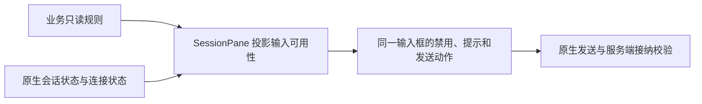

# 原生讨论、附件与连接恢复

## 会话产品要求与原型范围

正式产品的业务聊天使用 OMP 原生 Agent。用户在会话中发送消息，消息由 OMP 接收和处理，运行中的输入、回复和执行控制均沿用 OMP 的默认对话行为。AIReq 负责把会话关联到相应 IR、任务或评审，并按业务状态决定会话是否只读。

当前阶段使用内存原型开发并验证业务流程和界面，OMP 的实际对接属于正式实现。[内存后端说明](../../architecture/mock-backend.md#3-当前实现能力)记录原型会话的模拟行为。

## 讨论入口与所有权

新增／导入先保存可见提案，成功留在需求共创表。新增成功提示可直达该提案的需求澄清，其余提案入口进入工作台。打开需求澄清、方案设计或独立审查任务时读取需求和专属会话。可编辑且未开始讨论的需求澄清在会话空态显示服务端保存的原始需求和第一条场景提示，原文保留换行，长文可滚动阅读。验收时通过新增成功入口和工作台分别打开空会话，均可看到同一原文，输入区保持各自原有草稿。用户显式发送才开始本轮需求或方案讨论。

同一 IR 的需求澄清、需求评审、方案、三路审查和综合终审使用独立原生会话。需求澄清会话生成和完善 IR 的 `requirements.md`。业务人员确认需求评审结果后，由用户在方案会话中发消息开始拆 SR，方案会话只读该 IR 正文。讨论完成只更新材料和[格式校验](proposals.md#材料格式校验)结果。工作流接到人工提交当前校验通过的材料版本后才启动需求评审或方案审查。SR 作为材料和报告目标。历史阶段、历史评审和冻结交付只读，返回当前只恢复视图。历史任务页在页头显示只读状态和摘要，主动作是查看当前阶段或返回工作台。材料读取中、失败、空态分别显示，失败可重试。评审追问只追加到对应会话。

需求澄清的历史只读摘要显示原始需求和当前阶段。人工确认额外展示工号与时间，须来自通过且与当前材料版本和评审 ID 匹配的决定。验收覆盖已进入需求评审但仍待人工确认，以及人工已确认两种状态。

文件列表与输入器中的文件引用统一使用文件夹、文档、图片和代码四类图标，未知文件类型使用文档图标。

主区承载讨论，材料、报告与历史使用[统一右侧多 Tab](unified-side-pane.md)；阅读目标切换不复制正文、重建会话或发送消息。

AIReqSessionPane 复用 SessionPane、原生 Composer 和 V4PaneConversationProvider。业务服务持有需求、材料、阶段版本与会话引用。原生会话服务持有消息行、命令收据、附件字节、订阅序列和恢复水位。业务事件用于更新工作流投影，聊天消息由原生会话服务发布。

草稿正文、附件、输入历史与临时选项归原生 owner，按工号、浏览器客户端、工作区和会话分别保留。切回原工号或原会话恢复对应草稿。同一工号在不同浏览器各自保留未发送内容。设置往返保留挂载和输入，非活动工作区禁止交互和抢焦点。需求、阶段或评审之间切换只调整会话引用。

对象读取中、失败、归属无效或阶段只读时不可发送；目标不存在、读取失败、会话不可用与交付状态分别显示，不自动创建会话兜底。

## 输入可用性与反馈

AIReq 业务讨论复用原生输入框，各会话保有自己的草稿。业务只读时保留草稿，禁用编辑、附件、画板、工具及发送，并显示原因。当前有效评审即使已完成，也可以在该会话内追问。历史、阶段不符或已交付的会话沿工作流规则只读。

可编辑会话的输入、发送、停止及恢复沿用 OMP 原生行为。输入区按当前会话的接纳状态、执行状态及连接状态展示可用动作，断线或恢复中说明暂不可用的原因。只读会话禁用修改执行状态的操作。禁用状态同时作用于控件和快捷键。各 Agent 独立展示自己的会话状态。

## 显式发送与临时选项

Composer 冻结本次正文、附件、模型、思考等级、模式与计划状态，随同一次 Submission 原子提交。临时选模只属于本次消息，不改共享会话默认配置；Agent 保留创建模型快照。模型菜单的“管理模型”进入已有设置，返回保持草稿与临时选择。

消息接纳成功后，仅将仍与本次提交一致的临时模型／模式／计划字段恢复默认；等待期间用户的新选择保留。拒绝、失败或已切换草稿不重置。

命令身份归原生 registry。同一操作者、会话、commandId 与相同输入复用原决定。消息接纳和材料完成分别展示。失败或回执不明时保留输入和附件，回执不明时先查询原请求，确认未接纳后由用户显式重试。刷新、导航与重连只恢复或读取已有状态。

需要版本裁决的原生命令首次检查 revision，定位行命令还检查日志 epoch 与行／实体；拒绝同样稳定保存。普通发送不因此增加另一套业务版本协议。

## 完成、取消与迟到结果

业务消息接纳先核对项目、IR、阶段、轮次与输入身份。原生会话实际开始执行时，工作流重新核对阶段和轮次，冻结当时的材料版本及已接纳输入。完成回调按自己的执行快照提交材料。执行中版本变化、旧轮次或已历史化的评审结果只用于对应历史。

顺序为用户发送 → 原生会话接纳并处理 → 实际执行开始时冻结工作流快照 → 完成时核对版本 → 原子提交临时材料 → 发布业务事件供页面重读。工作流校验提案材料，校验通过后启动对应评审，失败原因随材料状态发布。原生消息和回执按原生会话发布，业务结果以当前对象和版本为准。

收到当前执行已中断的事实后，工作流撤销该轮未完成的业务提交。旧轮的迟到回调只用于结束该轮记录，已经开始的新执行继续使用自己的会话状态和材料快照。

## 附件与辅助输入

浏览器文件与 Sketch 完整 PNG 走原生上传、预览及发送事务，不只存文件名或摘要。浏览器附件不是主机 localPath 暂存移交，沿用单次 finalize／adopt，不另建附件重试队列或补发消息。

Sketch 支持绘制、撤销、取消，并将 PNG 加入当前草稿；保留正文与其他附件，不自动发送、创建需求或推进阶段。没有识别服务时不显示伪录音／语音识别入口。

文字插入扩展只回填草稿，使用请求身份与应用回执；摘要展示须完整 canonical text 精确匹配，不从摘要推断正文。取消、失败不改变原输入，不构成业务执行证据。

附件字节统一归原生 owner。尚未发送的附件只在对应草稿中可读。随消息发送的附件全员可见，通过原生消息的正式附件引用读取，并核对工作区、会话、消息行和附件索引。上传、取消上传和提交仍校验当前操作者。

## 共享读取与重连

Composer Skill 引用目录不带 sessionId 时读取当前工作区可用技能；带 sessionId 时只读取该驻留会话首次初始化时冻结的目录，返回 session authority。目录条目只投影身份、描述、路径、scope 和启用状态，不携带正文或管理元数据。原生会话 owner 持有该快照；后续保存技能只影响工作区目录及新会话，不改变旧会话。未知／未驻留会话、工作区不匹配或私有会话归属无效必须拒绝，不补建会话，不回退工作区目录。

业务工作流保存正式的会话引用。进入系统的所有工号都可以读取这些业务会话中已发送的消息、附件和评审报告，读取时核对指定会话与工作区归属。发送人显示实际输入的工号。未发送草稿及私有会话沿各自的归属范围读取。登录及共享规则见[连接身份](connection-identity.md#1-身份来源)。

显式重新连接先用当前业务选择与原 `sessionId` 恢复会话，再重试原 v4 lease。失败保留故障、已读消息和输入，不新建、清空或恢复其他历史／私有会话。等待期间 pane、session、workspace 或连接已变化时，旧结果不得用于新目标。

恢复快照、分页和实时帧来自同一权威消息集合。重连重订原会话，查询未决命令的回执，恢复会话和输入状态。重新发送由用户显式发起。原型的回复、生成及外部执行边界见[后端运行说明](../../architecture/mock-backend.md)。

## 当前原型差异

原型会话由 `MockRuntime` 和 `MockZCodeAgentService` 提供。当前忙碌会话将新输入放进内存队列，停止时保留队列并暂停自动续跑。这些行为属于内存模拟，正式聊天的发送与执行行为由 OMP 原生会话提供。

正文和输入历史保存在当前浏览器；未发送的 File 与预览保留在原生 composer 内存，不跨整页刷新。服务端校验暂存附件的操作者，已发送附件仍通过共享会话读取。验收使用两个工号和两个浏览器客户端，对同一会话验证草稿隔离、切回恢复、只读门禁、重连保留原消息，以及已接纳消息只执行一次。

## 事实来源

`packages/ui/src/aireq/conversation/AIReqSessionPane.tsx`、`shell/AIReqProposalWorkspace.tsx`；`packages/server/src/aireq/native-business.ts`；原生 `packages/ui/src/v4/SessionPane.tsx`、`ConversationComposer.tsx`；`packages/services/src/aireq/remote-operations.ts`。
