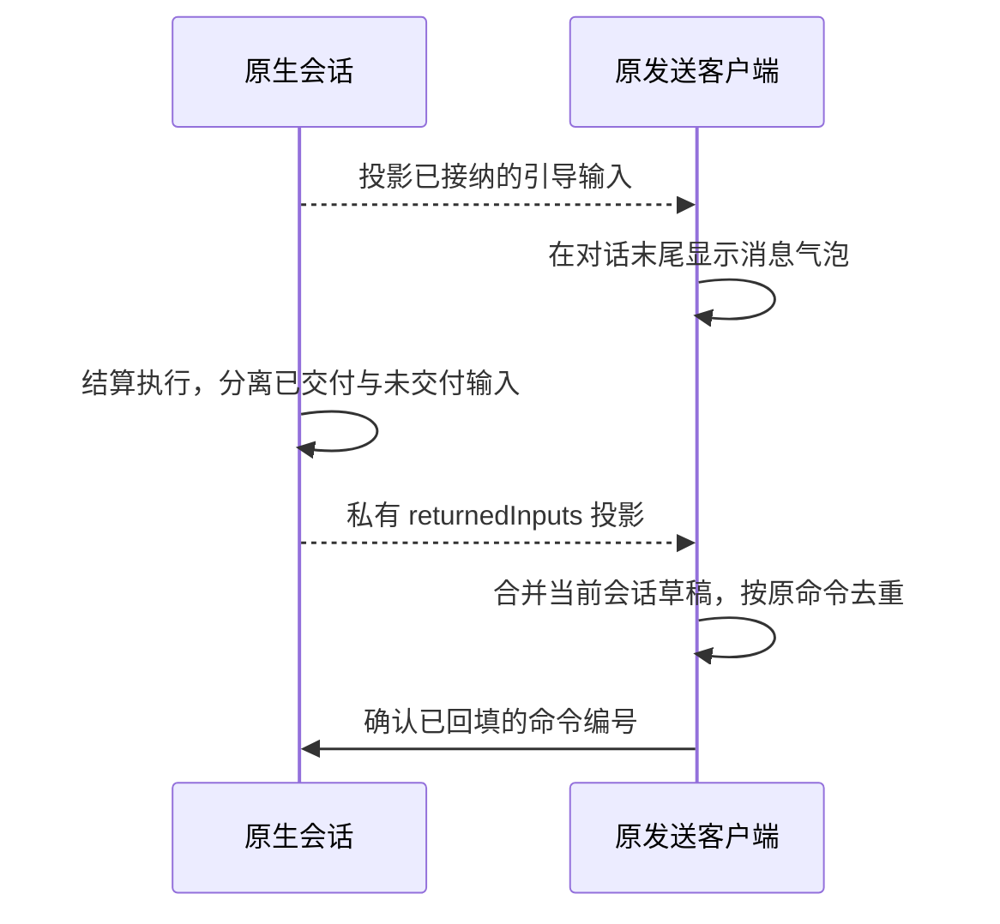
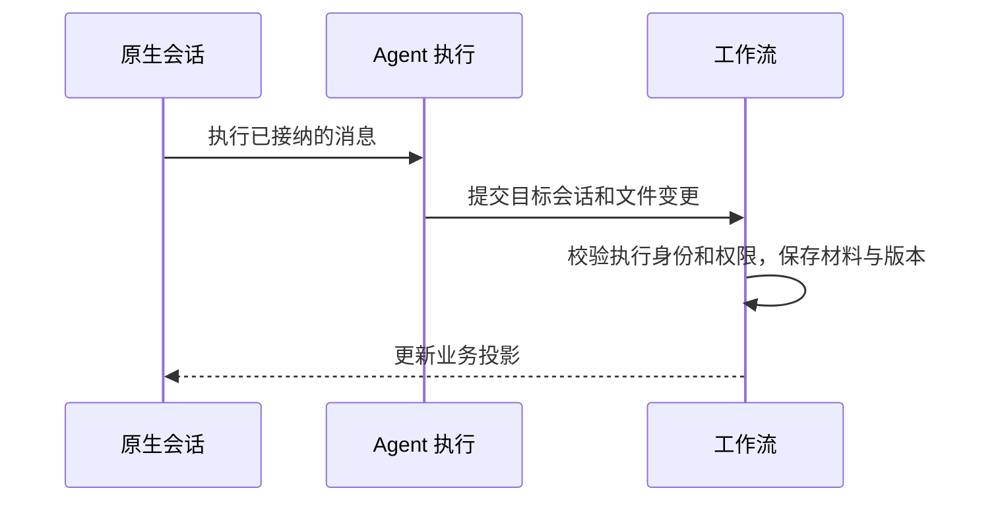

# 原生讨论、附件与连接恢复

## 会话产品要求与原型范围

AIReq 和 [`/chat`](../web-agent-chat.md) 共用与 OMP `AgentSession` 对齐的聊天命令和 v4 投影。正式执行使用未修改的 OMP SDK；当前由原型服务实现同一公开行为。OMP 核心、TUI、原有 Agent 聊天及其他原生界面的默认行为不属于本契约的变更范围。

AIReq 工作流持有 IR、文档版本、评审记录及两个 Agent 的会话关联。聊天的接纳、投递、执行与投影由原生会话服务负责，浏览器不读取 OMP 日志、事件或宿主会话文件。

## 讨论入口与所有权

正式部署按[两区分工](proposals.md#入口与权限)进入本区会话。只有同一 IR 的另一个 Agent 会话对当前工号可用时才显示切换按钮。切换保留项目、Release、IR 和 SR 阅读定位，沿用浏览器历史，读取目标会话后聚焦其标题。显式打开不可访问的会话时说明当前会话不可用，并保留返回入口。工作流按项目、IR 和 Agent 解析 IR 级会话。选择 SR 只定位文档。打开或切换只读取当时的原文和会话，显式发送才开始讨论。

主区复用原生 `SessionPane` 和 V4 Composer，集中管理会话命令、消息、附件、队列与恢复水位。工作流接纳实际完成的材料变更并通知客户端更新业务投影。评审入口位于输入框左下角、附件入口旁。有材料时按钮文字和可访问名称均显示当前投影的最新版本，例如「评审需求 · 最新 V2」，分栏收窄时保留文字，阅读历史版本时也显示最新版本。点击直接发起独立子代理评审，保留输入正文和附件。评审捕获服务端接纳时最新已保存材料，不使用阅读版本或定版预检快照。对话显示发起记录和评审意见，固定指令交给子代理执行。

最新会话轮次和历史轮次使用同一内容列及左右内边距。新轮次开始后，上一轮移入虚拟历史列表，气泡、工作过程及回复的左右位置保持对齐。

正文、附件和输入历史按工号、浏览器客户端、工作区和会话分别保留。设置往返保留输入。进入 Agent 时[右侧文档区](unified-side-pane.md)默认展开，同一对话内保留用户的收起选择。原生工作区与显式文件选择不改变 Agent 权限。

## 输入可用性与反馈

会话不存在、连接正在恢复或当前身份没有访问权限时禁止写入。可用时提供发送、附件和停止操作。定版后可继续讨论，后续文件修改遵循[材料与版本](proposals.md#材料与版本)。

执行时继续使用同一个发送按钮。输入框上方省略通用的执行和排队说明。

## 聊天命令和会话配置

`sendText` 提交正文及已接纳附件引用。空闲时直接执行。聊天执行中使用同一个发送键或 Enter，以 `streamingBehavior: "steer"` 引导当前执行。引导输入携带 `expectedForegroundExecutionId`，目标已变更时保留草稿。引导输入一经接纳就在对话末尾显示用户气泡，并沿用上游的单条消息状态。实际交付时用同一条消息的正式用户行替换气泡。协议的显式 `followUp` 输入及匿名聊天并发首发沿用既有投递边界。

Web 排队项与用户历史行保留原提交的 `clientId` 和 `sourceCommandId`，不填仅区分桌面与移动宿主的可选 `inputOrigin`。

`stop` 只中断 `expectedForegroundExecutionId` 指定的执行。尚未交付的输入从运行时移出，按接纳顺序退回原工号及客户端的当前会话草稿，保留原有草稿、附件和对话引用。已交付输入留在时间线。执行失败的未交付输入同样退回。按需评审结束时无法参与本轮的引导输入也退回。前端把退回内容放在当前正文之前，用空行分隔，用户确认后显式发送。

模型、思考档位与执行模式是会话级配置；AIReq 使用创建时绑定，不接纳单次发送覆盖或从输入器改写会话绑定。消息接纳只清理由该请求实际采用的正文和附件，失败或回执不明保留草稿。按原 `commandId` 查询回执；只在明确未接纳时允许用户重试，不自动重放。聊天运行失败和业务材料提交失败均明确可见，不用接纳或一个结束事件代替结果。

Web 聊天保留普通文字引用；选区可添加到当前会话，不提供辅助对话入口，也不提交选区批注。不提供删除会话、点赞／点踩、会话分叉、文件回滚、协作模式、后台任务恢复及原生工具审批。子代理只在父会话展示记录，不提供可选目录或独立控制；Todo 使用当前快照，不查询旧计划目录。文档定版属于 AIReq 工作流，不是原生命令。

需要版本裁决的 Web 原生命令首次检查 `baseRevision`（例如 `/chat` 会话模型切换）；陈旧命令的拒绝同样稳定保存。Web 不接纳定位行命令，订阅和恢复仍通过 `logEpoch` 辨别日志代次。普通发送不因此增加另一套业务版本协议。

## OMP 内置命令和技能

两个入口从各自服务端的 `getConversationCommandCatalog` 读取当前可用命令，复用 `/` 补全。选中条目只插入命令，显式发送才执行。目录仅有命令名、描述和来源 `builtin`／`skill`；不含指令正文、凭据或宿主路径。会话目录按归属读取；新会话只列首发可用的条目。

本地内置命令使用 OMP 拼写。原型支持 `/session`（等同 `/session info`）和 `/rename <title>`：前者仅返回当前会话的公开信息，后者只改会话标题，不改提案或评审。以 `localCommand` 回执返回实际结果，不创建模型回合。未实现的拼写、参数、TUI 命令和需宿主能力的操作明确拒绝，不当普通消息发送，也不模拟成功。

技能使用 OMP `/skill:<name> [arguments]` 拼写，包括新会话首发。服务端按当前会话冻结的可用技能解析正文与参数，保留用户键入的命令与执行归因；正文不进入回执或公开目录。AIReq 保留当前可用业务技能，匿名聊天只使用原型内置技能，不读取 AIReq 私有技能。原型加载指令并模拟交互，不执行技能脚本、真实模型、Git 或宿主文件写入。正式后端使用未修改 OMP 支持的命令和 Skill；Web 不硬编码目录或区分原型和正式后端。

## 完成、取消与迟到结果

业务执行结果只提交到对应项目、IR 和会话。切换 IR 后，原请求的迟到回执或错误不作用于新 IR，也不改变其会话、材料或输入。原生输入实际进入执行时捕获当前材料，完成时只接纳仍有效的执行。发送者因权限变化而无法继续写入时，已完成的聊天历史保留，未提交材料不写入。

取消撤销尚未提交的结果。评审结果只追加意见，并记录原输入快照与当前文件是否一致。

## 附件与辅助输入

浏览器文件与 Sketch 完整 PNG 走原生上传、预览及发送事务，不只存文件名或摘要。浏览器附件不是主机 localPath 暂存移交，沿用单次 finalize／adopt，不另建附件重试队列或补发消息。

输入框的添加菜单只显示当前会话可用的操作，Enter 或空格激活选项，Tab 移动焦点。待发送附件提供常驻、可点击的移除按钮。

Sketch 支持绘制、撤销、取消，并将 PNG 加入当前草稿；保留正文与其他附件，不自动发送。没有识别服务时不显示伪录音／语音识别入口。

文字插入扩展只回填草稿，使用请求身份与应用回执；摘要展示须完整 canonical text 精确匹配，不从摘要推断正文。取消、失败不改变原输入，不构成业务执行证据。

附件字节统一归原生 owner。尚未发送的附件只在对应草稿中可读。随消息发送的附件全员可见，通过原生消息的正式附件引用读取，并核对工作区、会话、消息行和附件索引。上传、取消上传和提交仍校验当前操作者。

## 共享读取与重连

正式部署在本区 SQLite 中分别保存团队讨论与个人 Chat 的会话元数据、消息行、水位及命令回执。消息和水位提交后再向订阅者广播。附件的上传进度、已提交字节及所属会话随服务重启恢复。重启中断运行中的回合，保留已生成的正文和工具记录；未交付的引导及排队消息退回各自的提交者，重连读取或查询回执不重发命令。

Composer Skill 引用目录不带 `sessionId` 时读取当前工作区可用技能；带 `sessionId` 时只读取该驻留会话首次初始化时冻结的目录。Web 响应只返回 `{ skills }`，不回显目录来源，也不携带正文或管理元数据。原生会话 owner 持有该快照；后续保存技能只影响工作区目录及新会话，不改变旧会话。未知／未驻留会话、工作区不匹配或私有会话归属无效必须拒绝，不补建会话，不回退工作区目录。

业务工作流保存两个 Agent 的会话引用。需求会话对所有有效工号共享；方案会话的消息和附件只向所属项目的开发和测试开放。已确认的历史文档从文档区查阅，不从原生会话分页读取。

显式重新连接先用当前项目、IR、Agent 和原 `sessionId` 恢复会话，再重试原 v4 lease。失败保留故障、已读消息和输入，不新建、清空或回退到其他会话。等待期间 pane、session、workspace 或连接已变化时，旧结果不得用于新目标。

恢复快照、分页和实时帧来自同一权威消息集合。重连重订原会话，查询未决命令的回执，恢复会话和输入状态。重新发送由用户显式发起。原型的回复、生成及外部执行边界见[后端运行说明](../../architecture/mock-backend.md)。

## 原型工作记录

AIReq 与 `/chat` 的思考行复用同一展开控件。流式阶段没有服务端耗时时，界面可以本地计时；收到原生行的耗时则优先显示该值。耗时更新不改变用户的展开选择。

AIReq 和 `/chat` 的原型后端为每个实际开始的聊天回合模拟流式思考、Todo 与子代理复核。使用现有 v4 思考行、工具行、Todo 计划和子代理行，复核以 `parentToolCallId` 关联父工具，不创建可下钻的子会话。停止或失败时收口本轮未结束的工作，不把未完成的 Todo 标成完成。未开始的排队输入和本地命令不产生工作记录。

模拟运行时从各阶段进入运行状态时开始计时。思考至少 3 秒并在期间发布增量，每次模拟工具调用至少 2 秒，子代理复核和按需文档评审至少 5 秒。停止立即中断正在等待的阶段，保留已发布的记录并标明中断。

这些记录只演示界面，不运行真实子代理，不改变材料提交和文档定版规则。正式接入时只显示 OMP 实际产生的记录，不要求每次对话展示同一组工作。

原型业务会话收到未触发写入的输入时，由模拟后端在聊天回复中给出当前 Agent 可直接发送的示例。需求 Agent 提示「请生成需求文档」，方案 Agent 提示「请生成方案材料」。用户发送示例后，工作流按当前需求生成对应材料，右侧文档区展示保存结果。

## 正式工作记录

个人 Chat、黄区需求 Agent、红区方案 Agent 都展示 OMP 实际返回的思考文字、Todo 和子代理。思考块只展示可读文字，不展示隐藏或加密内容；模型未返回文字时不生成占位。Todo 当前状态来自 SDK 成功的计划更新，历史 Todo 卡保留该次更新的任务与状态，自动清空只移除当前计划。子代理用真实生命周期按 `parentToolCallId` 关联父工具，结束后显示实际结果状态，不暴露子会话路径或独立控制。

AIReq 两个讨论入口可调用 SDK 原生 Todo 和前台 `scout` 子代理。子代理只读当前 IR 上下文，不调用材料写工具、宿主文件工具、MCP 或其他子代理，不在回合结束后继续运行。工作流仍只由父会话提交材料。该限制不改变独立个人 Chat 的 SDK 工具配置。

## 验收

- 用两个工号和两个浏览器验证共享已发送消息及附件、原发送人、草稿隔离、只读门禁和重连不补发。
- 在单进程原型的 1100 × 700 打开右侧文档，用键盘从需求 Agent 直接切换方案 Agent，再切回，核对标题焦点、项目／Release／需求及逐会话保留的草稿。普通工号只能激活需求 Agent。
- 右侧阅读历史 V1 时，检查输入框中的评审或审查入口仍常驻显示最新 V2，打开方案和需求会话时均用对应动作名称。
- 验证忙时发送后立即显示用户气泡，实际交付后同一条消息仅显示一次。停止时只有尚未交付的输入回到原发送者，正文按顺序合并。覆盖跨客户端停止、已有草稿、附件、重连和再次发送。接纳过的同文输入按命令身份各自归因。
- 连续发送两次相同的短消息，检查两轮气泡和回复分别对齐，展开或收起右侧文档区后仍对齐。
- 原型中验证思考增量、Todo 状态和子代理关联在最终回复前可见，停止后没有悬挂的运行记录。流式思考切换到完成耗时时，展开状态保持且浏览器控制台无告警。快照、实时和分页读取同一历史；正式环境不要求每次对话生成固定工作记录。
- 原型验收从 v4 行的起止时间核对思考、工具和评审的最短运行时间，并验证停止可以立即结束等待中的评审。
- 用真实 GPT‑6 Luna 分别在个人 Chat、黄区需求和红区方案回合实际更新 Todo、启动子代理并完成。桌面时间线展开后可看到可读思考、任务状态及正确配对的子代理卡；在个人 Chat 的同回合中也验证后台子代理从启动到结算。
- AIReq 与 `/chat` 均拒绝退役的 Host 流控、销毁及旧查询／事件。关闭连接后，其他参与者仍可读同一原生会话；重连按既有工作区身份与水位重新订阅，不清空历史、不补发命令。原生 v4 帧仍使用同一 schema。
- 验证已接纳输入生成或修改当前材料、取消时不提交、失去权限时拒绝写入。设置往返保留正文和附件。
- 在 IR A 发起业务写入，在回执返回前切到 IR B，核对 A 的结果或错误只归属 A，B 的会话、材料与输入不变。
- 在两个 Agent 中发送普通短消息，分别确认回复给出对应示例，再发送示例验证右侧出现对应文件。

## 事实来源

AIReq 会话装配见 [`AIReqSessionPane.tsx`](../../../packages/ui/src/aireq/conversation/AIReqSessionPane.tsx) 和 [`AIReqProposalWorkspace.tsx`](../../../packages/ui/src/aireq/shell/AIReqProposalWorkspace.tsx)，原生控件见 [`SessionPane.tsx`](../../../packages/ui/src/v4/SessionPane.tsx) 和 [`ConversationComposer.tsx`](../../../packages/ui/src/v4/ConversationComposer.tsx)。服务端绑定见 [`native-business.ts`](../../../packages/server/src/aireq/native-business.ts)，操作定义见 [`remote-operations.ts`](../../../packages/services/src/aireq/remote-operations.ts)。
