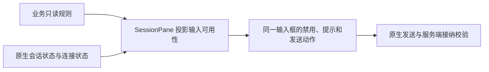
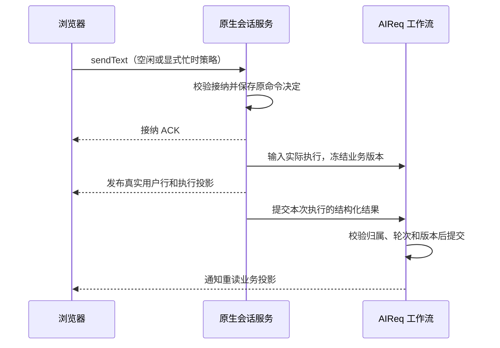

# 原生讨论、附件与连接恢复

## 会话产品要求与原型范围

AIReq 和 [`/chat`](../web-agent-chat.md) 共用与 OMP `AgentSession` 对齐的聊天命令和 v4 投影。正式执行使用未修改的 OMP SDK；当前由原型服务实现同一公开行为。OMP 核心、TUI、原有 Agent 聊天及其他原生界面的默认行为不属于本契约的变更范围。

AIReq 只拥有 IR、任务、评审的会话关联与业务写权限。聊天的接纳、投递、执行与投影由原生会话服务负责，浏览器不读取 OMP 日志、事件或宿主会话文件。

## 讨论入口与所有权

新增／导入先保存可见提案，成功留在需求共创表。新增成功提示可直达该提案的需求澄清，其余提案入口进入工作台。打开需求澄清、方案设计或独立审查任务时读取需求和专属会话。可编辑且未开始讨论的需求澄清在会话空态显示服务端保存的原始需求和第一条场景提示，原文保留换行，长文可滚动阅读。验收时通过新增成功入口和工作台分别打开空会话，均可看到同一原文，输入区保持各自原有草稿。用户显式发送才开始本轮需求或方案讨论。

同一 IR 的需求澄清、需求评审、方案、三路审查和综合终审使用独立原生会话。需求澄清会话生成和完善 IR 的 `requirements.md`。业务人员确认需求评审结果后，由用户在方案会话中发消息开始拆 SR，方案会话只读该 IR 正文。讨论完成只更新材料和[格式校验](proposals.md#材料格式校验)结果。工作流接到人工提交当前校验通过的材料版本后才启动需求评审或方案审查。送审成功后打开对应评审汇总。SR 作为材料和报告目标。历史阶段、历史评审和冻结交付只读，返回当前只恢复视图。历史任务页在页头显示只读状态和摘要，主动作是查看当前阶段或返回工作台。材料读取中、失败、空态分别显示，失败可重试。评审追问只追加到对应会话。

方案审查或交付确认的「退回修改」返回同一 IR 的可写方案会话。需求评审的「退回修改」和方案设计的「退回业务澄清」开启下一轮需求澄清。退回意见在目标讨论中显示。退回命令记录阶段和意见，保留现有文件、文件清单、材料快照及历史文件。工作材料的修改或删除仍属于用户后续与 Agent 讨论后的执行结果。旧轮次迟到的会话结果不得改写退回后的材料。

需求澄清的历史只读摘要显示原始需求和当前阶段。人工确认额外展示工号与时间，须来自通过且与当前材料版本和评审 ID 匹配的决定。验收覆盖已进入需求评审但仍待人工确认，以及人工已确认两种状态。

文件列表与输入器中的文件引用统一使用文件夹、文档、图片和代码四类图标，未知文件类型使用文档图标。

主区承载讨论，材料、报告与历史使用[统一右侧多 Tab](unified-side-pane.md)；阅读目标切换不复制正文、重建会话或发送消息。

AIReqSessionPane 复用 SessionPane、原生 Composer 和 V4PaneConversationProvider。业务服务持有需求、材料、阶段版本与会话引用。原生会话服务持有消息行、命令收据、附件字节、订阅序列和恢复水位。业务事件用于更新工作流投影，聊天消息由原生会话服务发布。

草稿正文、附件与输入历史按工号、浏览器客户端、工作区和会话分别保留。切回原工号或原会话恢复对应草稿。同一工号在不同浏览器各自保留未发送内容。设置往返保留挂载和输入，非活动工作区禁止交互和抢焦点。需求、阶段或评审之间切换只调整会话引用。

对象读取中、失败、归属无效或阶段只读时不可发送；目标不存在、读取失败、会话不可用与交付状态分别显示，不自动创建会话兜底。

## 输入可用性与反馈

AIReq 业务讨论复用具备可访问名称的原生输入框，各会话保有自己的草稿。业务只读时保留草稿，禁用编辑、附件、画板、工具及发送，并显示原因。当前有效评审即使已完成，也可以在该会话内追问。历史、阶段不符或已交付的会话沿工作流规则只读。

可编辑会话以服务端投影显示发送、排队及停止。当前执行期间，输入框提供「加入队列」和停止操作。断线或恢复时不接纳新输入；只读会话禁用修改执行状态的控件和快捷键。方案讨论和方案审查的写入仍要求当前项目开发角色；历史、已冻结及已交付会话只允许读取。

## 聊天命令和会话配置

`sendText` 提交正文及已接纳附件引用。空闲时直接执行；忙碌时若投影 `inputRouting.mode=streamingChoice`，浏览器的「加入队列」发送 `streamingBehavior: "followUp"`（随后运行）。协议仍支持 `"steer"`（引导当前执行）。忙时未指定策略明确拒绝。接纳不是执行或完成；引导输入实际进入当前执行时才成为用户行，不强制产生新回合或独立回复。跟进输入保留原提交身份，并在当前执行后交付。v4 ACK 沿用 `startNow`／`guide`／`queue`，对应即时、引导、跟进三种接纳事实。

Web 排队项与用户历史行保留原提交的 `clientId` 和 `sourceCommandId`，不填仅区分桌面与移动宿主的可选 `inputOrigin`。

`stop` 中断目标执行；包含 `expectedForegroundExecutionId` 时过期目标不得中断后续执行。不删除尚未交付的用户输入，不切换队列偏好或隐式送入新提示；尚未交付的输入继续可见。普通发送和停止不提供按队列条目编辑、删除、重排、提升、恢复成草稿或自动续跑管理。两端均以服务端能力显示操作，不借用其他聊天界面的 held queue 和队列编辑协议。

模型、思考档位与执行模式是会话级配置；AIReq 使用创建时绑定，不接纳单次发送覆盖或从输入器改写会话绑定。消息接纳只清理由该请求实际采用的正文和附件，失败或回执不明保留草稿。按原 `commandId` 查询回执；只在明确未接纳时允许用户重试，不自动重放。聊天运行失败和业务材料提交失败均明确可见，不用接纳或一个结束事件代替结果。

Web 聊天保留普通文字引用；选区可添加到当前会话，不提供辅助对话入口，也不提交选区批注。不提供删除会话、点赞／点踩、会话分叉、文件回滚、协作模式、后台任务恢复及原生工具审批。子代理只在父会话展示记录，不提供可选目录或独立控制；Todo 使用当前快照，不查询旧计划目录。AIReq 的原有业务审批与提案删除规则不变。

需要版本裁决的 Web 原生命令首次检查 `baseRevision`（例如 `/chat` 会话模型切换）；陈旧命令的拒绝同样稳定保存。Web 不接纳定位行命令，订阅和恢复仍通过 `logEpoch` 辨别日志代次。普通发送不因此增加另一套业务版本协议。

## OMP 内置命令和技能

两个入口从各自服务端的 `getConversationCommandCatalog` 读取当前可用命令，复用 `/` 补全。选中条目只插入命令，显式发送才执行。目录仅有命令名、描述和来源 `builtin`／`skill`；不含指令正文、凭据或宿主路径。会话目录按归属读取；新会话只列首发可用的条目。

本地内置命令使用 OMP 拼写。原型支持 `/session`（等同 `/session info`）和 `/rename <title>`：前者仅返回当前会话的公开信息，后者只改会话标题，不改提案或评审。以 `localCommand` 回执返回实际结果，不创建模型回合。未实现的拼写、参数、TUI 命令和需宿主能力的操作明确拒绝，不当普通消息发送，也不模拟成功。

技能使用 OMP `/skill:<name> [arguments]` 拼写，包括新会话首发。服务端按当前会话冻结的可用技能解析正文与参数，保留用户键入的命令与执行归因；正文不进入回执或公开目录。AIReq 保留当前可用业务技能，匿名聊天只使用原型内置技能，不读取 AIReq 私有技能。原型加载指令并模拟交互，不执行技能脚本、真实模型、Git 或宿主文件写入。正式后端使用未修改 OMP 支持的命令和 Skill；Web 不硬编码目录或区分原型和正式后端。

## 完成、取消与迟到结果

业务消息接纳先核对项目、IR、阶段、轮次与输入身份。输入实际进入执行时，工作流冻结当时的材料版本与已接纳输入；引导输入属于同一次执行。Agent 回复是聊天事实，不是材料、评审报告或批准。执行器以独立的结构化结果暂存本轮材料或报告；原型用现有模拟业务逻辑生成结果，不调用真实 OMP。工作流只接纳与执行身份和冻结版本匹配的结果，按现有格式校验与提案规则提交，然后通知页面重读。

收到本次执行被取消的事实后，工作流撤销未提交结果。旧轮次、已历史化评审或版本变化后的结果不得修改当前材料；已提交记录不因停止被撤销。材料完成不替代用户提交评审和人工确认。

## 附件与辅助输入

浏览器文件与 Sketch 完整 PNG 走原生上传、预览及发送事务，不只存文件名或摘要。浏览器附件不是主机 localPath 暂存移交，沿用单次 finalize／adopt，不另建附件重试队列或补发消息。

Sketch 支持绘制、撤销、取消，并将 PNG 加入当前草稿；保留正文与其他附件，不自动发送、创建需求或推进阶段。没有识别服务时不显示伪录音／语音识别入口。

文字插入扩展只回填草稿，使用请求身份与应用回执；摘要展示须完整 canonical text 精确匹配，不从摘要推断正文。取消、失败不改变原输入，不构成业务执行证据。

附件字节统一归原生 owner。尚未发送的附件只在对应草稿中可读。随消息发送的附件全员可见，通过原生消息的正式附件引用读取，并核对工作区、会话、消息行和附件索引。上传、取消上传和提交仍校验当前操作者。

## 共享读取与重连

Composer Skill 引用目录不带 `sessionId` 时读取当前工作区可用技能；带 `sessionId` 时只读取该驻留会话首次初始化时冻结的目录。Web 响应只返回 `{ skills }`，不回显目录来源，也不携带正文或管理元数据。原生会话 owner 持有该快照；后续保存技能只影响工作区目录及新会话，不改变旧会话。未知／未驻留会话、工作区不匹配或私有会话归属无效必须拒绝，不补建会话，不回退工作区目录。

业务工作流保存正式的会话引用。进入系统的所有工号都可以读取这些业务会话中已发送的消息、附件和评审报告，读取时核对指定会话与工作区归属。发送人显示实际输入的工号。未发送草稿及私有会话沿各自的归属范围读取。登录及共享规则见[连接身份](connection-identity.md#1-身份来源)。

显式重新连接先用当前业务选择与原 `sessionId` 恢复会话，再重试原 v4 lease。失败保留故障、已读消息和输入，不新建、清空或恢复其他历史／私有会话。等待期间 pane、session、workspace 或连接已变化时，旧结果不得用于新目标。

恢复快照、分页和实时帧来自同一权威消息集合。重连重订原会话，查询未决命令的回执，恢复会话和输入状态。重新发送由用户显式发起。原型的回复、生成及外部执行边界见[后端运行说明](../../architecture/mock-backend.md)。

## 原型工作记录

AIReq 与 `/chat` 的思考行复用同一展开控件。流式阶段没有服务端耗时时，界面可以本地计时；收到原生行的耗时则优先显示该值。耗时更新不改变用户的展开选择。

AIReq 和 `/chat` 的原型后端为每个实际开始的聊天回合模拟流式思考、Todo 与子代理复核。使用现有 v4 思考行、工具行、Todo 计划和子代理行，复核以 `parentToolCallId` 关联父工具，不创建可下钻的子会话。停止或失败时收口本轮未结束的工作，不把未完成的 Todo 标成完成。未开始的排队输入和本地命令不产生工作记录。

这些记录只演示界面，不运行真实子代理，不改变材料和审批的提交规则。正式接入时只显示 OMP 实际产生的记录，不要求每次对话展示同一组工作。

## 验收

- 用两个工号和两个浏览器验证共享已发送消息及附件、原发送人、草稿隔离、只读门禁和重连不补发。
- 验证忙时缺省策略拒绝，`steer` 输入进入当前执行，`followUp` 输入按实际交付启动，停止只取消目标执行；接纳过的同文输入按命令身份各自归因。
- 原型中验证思考增量、Todo 状态和子代理关联在最终回复前可见，停止后没有悬挂的运行记录。流式思考切换到完成耗时时，展开状态保持且浏览器控制台无告警。快照、实时和分页读取同一历史；正式环境不要求每次对话生成固定工作记录。
- AIReq 与 `/chat` 均拒绝退役的 Host 流控、销毁及旧查询／事件。关闭连接后，其他参与者仍可读同一原生会话；重连按既有工作区身份与水位重新订阅，不清空历史、不补发命令。原生 v4 帧仍使用同一 schema。
- 验证已接纳输入仍可生成与校验现有材料。取消、旧轮次结果、失去写权限及材料版本变化均不推进工作流。设置往返保留正文和附件；未发送文件不跨整页刷新。

## 事实来源

`packages/ui/src/aireq/conversation/AIReqSessionPane.tsx`、`shell/AIReqProposalWorkspace.tsx`；`packages/server/src/aireq/native-business.ts`；原生 `packages/ui/src/v4/SessionPane.tsx`、`ConversationComposer.tsx`；`packages/services/src/aireq/remote-operations.ts`。
