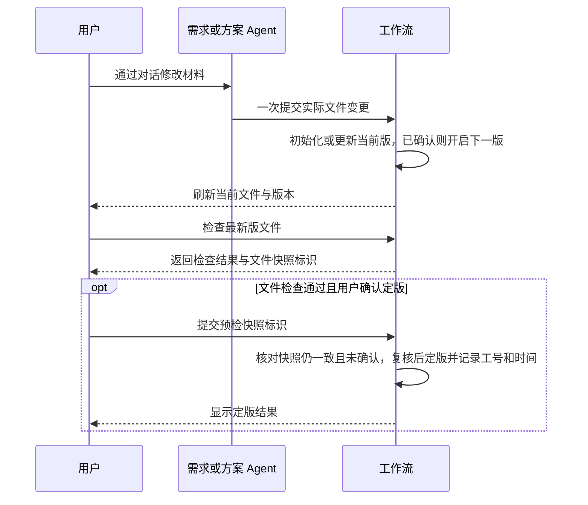
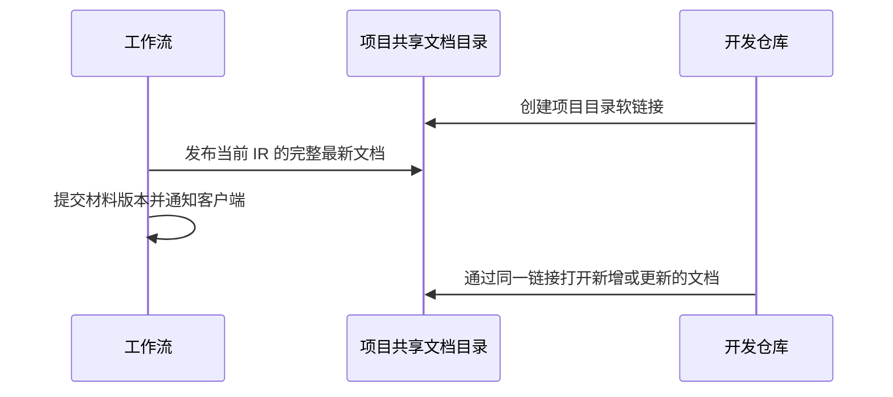

# 需求共创

## 黄区需求澄清与云龙对接

黄区负责需求澄清和讨论。方案设计在内网进行。云龙持有项目和 IR 的业务记录。AIReq 通过 `clouddragon projects --name 开发` 读取当前账号可访问且名称包含「开发」的项目。当前接入的项目各有一个需求域。首页为每个项目并行执行一次 `clouddragon --project <项目组 ID> irs`，由 CLI 自动翻页，读取项目内全部 IR。服务端按 IR 的 `pi` 在本地汇总 Release 和需求统计，以 `piName` 显示 Release 名称。讨论和需求文档由 AIReq 工作流管理。

当前 AIReq 原型服务调用 `projects` 和 `irs`。「所有项目」和「项目配置」使用同一份项目目录。设置页只从云龙同步项目名，仓库地址、默认分支和工作目录由 AIReq 按项目 ID 保存。读取失败应显示错误，空列表只表示云龙确实返回空结果。使用真实的云龙数据验收，不使用预置项目、IR 或评论补齐结果。澄清结束后，可通过 CLI 的 `comment-add` 将最新需求文档正文作为评论同步到对应 IR。

### 安装与登录

`clouddragon-cli` 需要 Python 3.10 或更高版本，以及可访问云龙门户和企业 SSO 的内网环境。唯一的运行时依赖是 `httpx`，安装时自动获取。在 CLI 源码目录运行 `pip install .`，使 `clouddragon` 可在运行 AIReq 服务的账号的 `PATH` 下找到。也可在 CLI 源码目录的上一级运行 `python -m clouddragon_cli --help`。

| 必填环境变量 | 含义         |
| ------------ | ------------ |
| `w3Account`  | 云龙登录账号 |
| `password`   | 云龙登录密码 |

CLI 使用内置默认项目和 API 入口，请求超时默认 20 秒。启动 AIReq 服务时提供这两个环境变量，CLI 子进程会继承它们。手工运行时也可在终端交互式输入，避免把密码写进命令历史。

```bash
read -r -p '云龙账号：' w3Account
read -r -s -p '云龙密码：' password
printf '\n'
export w3Account password
clouddragon projects --name 开发
```

```powershell
$env:w3Account = Read-Host '云龙账号'
$env:password = [System.Net.NetworkCredential]::new('', (Read-Host '云龙密码' -AsSecureString)).Password
clouddragon projects --name 开发
```

CLI 从环境变量读取账号和密码，密码不写入文件或日志。登录成功后的会话 cookie 按账号缓存在 `~/.clouddragon/session.json`。后续命令复用缓存。会话失效时，CLI 自动重新登录一次并覆盖缓存。需要强制下次重新登录时，可删除该缓存文件。

CLI 依赖门户下发的 `prod_cftk` 会话 cookie，并以 `verify=False` 请求来兼容内网门户。真实凭据仅在可信内网使用。门户或 SSO 策略调整时，登录兼容性由 CLI 的 `client.py` 维护。

### 云龙命令

| 标识             | 从哪里获取                                          | 用途                                   |
| ---------------- | --------------------------------------------------- | -------------------------------------- |
| 项目组 ID        | `projects` 的 `data.projects[].id`，等于 `group_id` | 传给 `--project`                       |
| 需求域 ID 或名称 | `domains` 的 `data.domains[].id` 或 `offeringName`  | 传给 `--domain`                        |
| IR 业务号        | `irs` 的 `data.domains[].irs[].businessNo`          | 传给 `ir`、`comments`、`status` 等命令 |

```sh
# 列出当前账号可访问的项目
clouddragon projects

# 按名称模糊匹配，忽略大小写
clouddragon projects --name 开发

# 列出所选项目下的需求域
clouddragon --project gexample0001 domains

# 自动翻页读取所选项目的全部 IR
clouddragon --project gexample0001 irs

# 列出指定需求域的全部 IR，可重复传入 --domain
clouddragon --project gexample0001 irs --domain 900001

# 按业务号查看 IR，省略 --domain 时在所选项目内跨域查找
clouddragon --project gexample0001 ir IR20990101000001 --domain 900001

# 查看、新增和删除评论
clouddragon --project gexample0001 comments IR20990101000001
clouddragon --project gexample0001 comment-add IR20990101000001 --content "看起来不错"
clouddragon --project gexample0001 comment-delete IR20990101000001 \
  --comment-id 00000000-0000-4000-8000-000000000001

# 修改进展，可选初始、分析、开发、测试、完成
clouddragon --project gexample0001 status IR20990101000001 --process 完成

# 编辑详情
clouddragon --project gexample0001 ir-edit IR20990101000001 --description "<p>更新后的示例描述</p>"

# 创建 IR
clouddragon --project gexample0001 create --domain "示例需求域" --name "新需求" \
  --priority 高 --expected-date 2026-12-31
```

使用 `clouddragon <命令> --help` 查看完整参数。上面的项目组 ID、域、业务号和评论 UUID 均为匿名示例。

### 全局选项

除 `--version` 外，全局选项可写在子命令前或后。同一选项重复传入时，以靠后的值为准。

| 选项                | 含义                                                                   |
| ------------------- | ---------------------------------------------------------------------- |
| `--project VALUE`   | 覆盖本次使用的项目，接受项目组 ID 或包含 `/project/<groupId>` 的 URL。 |
| `--timeout SECONDS` | 覆盖本次请求超时，单位为秒，默认 `20`。                                |
| `--compact`         | 输出单行 JSON。                                                        |
| `--debug`           | 失败时在 stderr 额外输出 Python traceback。                            |
| `--version`         | 显示 CLI 版本，只能写在子命令前。                                      |

省略 `--project` 时使用 CLI 内置默认项目。

```sh
clouddragon --project gexample0001 domains
clouddragon domains --project gexample0001
clouddragon --version
```

### `irs` 筛选与分页

| 参数              | 默认       | 含义                                                 |
| ----------------- | ---------- | ---------------------------------------------------- |
| `--domain VALUE`  | 全部需求域 | 接受需求域 ID 或名称，可重复传入。                   |
| `--page NO`       | 自动翻页   | 指定时只取第 `NO` 页，页码从 1 开始。                |
| `--page-size N`   | `200`      | 每次请求的条数，适用于单页和自动翻页。               |
| `--process STATE` | 全部进展   | 服务端按进展筛选，可选初始、分析、开发、测试、完成。 |

- 省略 `--page` 时，CLI 对每个需求域逐页递增 `pageNo`，累计到服务端返回的 `total` 后停止，并按 IR 的 `id` 去重。响应中的 `count` 是最终返回条数。
- 指定 `--page` 时，每个需求域只请求一页。响应在各域额外返回 `page`、`page_size`、`total`。`total` 是符合当前筛选条件的跨页总数，`count` 是本页条数。指定 `--process` 后，两者均按该进展统计。
- `--page` 和 `--page-size` 均须为大于等于 1 的整数。`--process` 只接受表中列出的值。参数错误由 argparse 报告，退出码为 `2`。

```sh
# 自动翻页，每次请求 200 条
clouddragon --project gexample0001 irs --domain 900001

# 只取第 2 页，页大小为 50
clouddragon --project gexample0001 irs --domain 900001 --page 2 --page-size 50

# 自动翻页，每次请求 50 条
clouddragon --project gexample0001 irs --domain 900001 --page-size 50

# 服务端筛选已完成的 IR，从 total 读取完成数
clouddragon --project gexample0001 irs --domain 900001 --process 完成 --page 1 --page-size 1

# 每个需求域只取一页，输出各域的完成数
clouddragon --project gexample0001 irs --process 完成 --page 1 --page-size 1 |
  jq -c '.data.domains[] | {name, count: .total}'

# 只列出测试中的 IR，自动取完各页
clouddragon --project gexample0001 irs --domain "示例需求域" --process 测试
```

需要按 Release 一次统计总数与完成数时，可不传 `--page`，把全量结果交给 `jq` 本地分组。下面按 `piName` 展示，AIReq 自身按 `pi` 归组、用 `piName` 显示。

```sh
clouddragon --project gexample0001 irs --domain 900001 --compact |
  jq -c '[.data.domains[].irs[] | select((.piName // "") != "")]
    | group_by(.piName)[]
    | {release: .[0].piName, total: length, done: (map(select(.process == "完成")) | length)}'
```

### `ir` 查询详情

`ir` 接收 IR 业务号。`--domain` 支持需求域 ID 或名称，省略时在所选项目内逐域查找。成功响应包含 `data.business_no`、`data.domain`（`id` 和 `name`）以及 `data.ir`（门户返回的原始 IR 对象）。列表命令 `irs` 将 IR 对象放在 `data.domains[].irs[]` 中，两个命令的响应外层结构不同。

### 评论命令

| 命令             | 参数                                           | 输出或行为                                                            |
| ---------------- | ---------------------------------------------- | --------------------------------------------------------------------- |
| `comments`       | 可选 `--domain`                                | 每条评论包含 `uuid`、`type`、`author`、`display_author` 和 `detail`。 |
| `comment-add`    | 必填 `--content`，可选 `--domain`              | 当前登录账号为作者，返回的 `comment_id` 是评论 UUID。                 |
| `comment-delete` | 必填 `--comment-id`，可选 `--type`、`--domain` | 使用 `comments` 返回的 `uuid`，评论接口的 `id` 为 `null`。            |

`comment-delete` 省略 `--type` 时，会先从评论列表按 UUID 查询类型，查不到时返回 `NotFoundError`。删除不可撤销，执行前用 `comments` 确认 UUID 对应的评论。

将本地已保存的最新需求文档正文作为评论同步时，可直接把文件内容传给 `--content`。

```sh
clouddragon --project gexample0001 comment-add IR20990101000001 \
  --content "$(cat ./requirements.md)"
```

### `status` 修改进展

`--process` 默认 `完成`，可选 `初始`、`分析`、`开发`、`测试`、`完成`。`--domain` 可省略，此时在所选项目内查找。成功响应包含 `old_process`、`new_process` 和更新后的 `ir`。进展通过 `status` 修改，`ir-edit` 会拒绝修改 `process`。

### `ir-edit` 修改详情

`ir-edit` 按业务号编辑 IR，调用门户的 `PUT /v1/reqanalyzesvr/rest/v3/items/editItem`。

| 参数                         | 含义                            |
| ---------------------------- | ------------------------------- |
| `--name TEXT`                | IR 名称。                       |
| `--description HTML`         | 富文本描述。                    |
| `--priority VALUE`           | 优先级，可选 `高`、`中`、`低`。 |
| `--owner USER`               | 责任人账号。                    |
| `--expected-date YYYY-MM-DD` | 期望实现日期。                  |

至少提供一个字段，否则返回 `No IR fields to edit were supplied.`。未指定的字段从当前 IR 回填。传入值和当前值相同时，CLI 跳过更新请求，返回空的 `changed` 对象。

成功响应包含 `business_no`、`item_id`、`changed`（实际变化及新值）、`before`（对应原值）和更新后的完整 `ir`。

### `create` 新建 IR

| 参数                         | 必填 | 默认         | 含义                                           |
| ---------------------------- | ---- | ------------ | ---------------------------------------------- |
| `--domain VALUE`             | 是   | —            | 需求域 ID 或名称。                             |
| `--name TEXT`                | 是   | —            | IR 名称。                                      |
| `--description HTML`         | 否   | 需求模板     | 富文本描述。门户要求 IR 有描述后才能修改进展。 |
| `--owner USER`               | 否   | 当前登录账号 | 责任人。                                       |
| `--priority VALUE`           | 否   | `中`         | 可选 `高`、`中`、`低`。                        |
| `--expected-date YYYY-MM-DD` | 否   | —            | 期望实现日期。                                 |

成功响应包含 `domain`、`id`、`business_no` 和 `ir`。门户异步分配业务号时，`business_no` 可能为 `null`。可先记录 `id`，待分配后从 `irs` 查找对应的 `businessNo`。

### CLI 输出契约

| 结果     | 输出流 | 退出码 | 内容                                                                                 |
| -------- | ------ | ------ | ------------------------------------------------------------------------------------ |
| 成功     | stdout | `0`    | `{"ok": true, "data": …}`                                                            |
| 执行失败 | stderr | `1`    | `{"ok": false, "error": {"type": "AuthenticationError", "message": "示例错误信息"}}` |
| 参数错误 | stderr | `2`    | argparse 参数错误信息                                                                |

成功响应的 `data` 字段随子命令变化，使用 `clouddragon <command> --help` 查看。执行失败响应的 `error.type` 和 `error.message` 均为字符串，表中以鉴权错误为例。启用 `--debug` 后，stderr 还会包含 Python traceback。帮助和版本信息按文本输出。

### `projects` 成功响应

`projects` 列出当前账号可访问的项目。`--name TEXT` 使用与门户项目搜索一致的服务端过滤，保留名称包含 `TEXT` 的项目，并忽略大小写。省略时列出全部可访问项目。

CLI 使用门户的 `/project/cd-cloud-project/v3/user/project` 接口。该接口位于 `/cloudreq-obp` 之外，CLI 按门户的绝对地址请求，并按 `offset` 和 `limit` 自动翻页。

以下是省略 `--name` 时的匿名示例。

```json
{
  "ok": true,
  "data": {
    "project": "gexample0001",
    "name": null,
    "count": 3,
    "projects": [
      {
        "id": "gexample0001",
        "name": "示例开发项目甲",
        "group_id": "gexample0001",
        "project_id": "pexample0001",
        "current": true
      },
      {
        "id": "gexample0002",
        "name": "示例开发项目乙",
        "group_id": "gexample0002",
        "project_id": "pexample0002",
        "current": false
      },
      {
        "id": "gexample0003",
        "name": "示例验收项目",
        "group_id": "gexample0003",
        "project_id": "pexample0003",
        "current": false
      }
    ]
  }
}
```

`data.project` 是本次生效的项目组 ID。`data.name` 是本次名称筛选条件，省略 `--name` 时为 `null`。`data.count` 是返回的项目数。示例中的前两条符合 `--name 开发`。

| `data.projects[]` 字段 | 含义                                              |
| ---------------------- | ------------------------------------------------- |
| `id`                   | 项目标识，等于 `group_id`，可传给 `--project`。   |
| `name`                 | 项目名称。                                        |
| `group_id`             | 项目组 ID，供 `domains` 和 `irs` 等命令选定项目。 |
| `project_id`           | 门户侧的项目 ID。                                 |
| `current`              | 是否为本次生效的项目。                            |

### `domains` 成功响应

以下是实测 JSON 响应的匿名示例，保留字段名、层级、值类型和样本中的 `null`。

```json
{
  "ok": true,
  "data": {
    "project": "gexample0001",
    "count": 1,
    "domains": [
      {
        "isFusionDomain": "false",
        "unticket2DefectOwner": null,
        "vulnDefaultOwner": null,
        "id": "900001",
        "groupId": "gexample0001",
        "groupName": "示例开发项目甲",
        "offeringPbi": "EXAMPLE0001",
        "offeringName": "示例需求域",
        "name": null,
        "domainid": "900001",
        "creator": "x00000001",
        "domainType": "示例域类型",
        "productName": null,
        "productPbi": null,
        "authorityType": null,
        "domainSource": "",
        "picName": null,
        "picId": null,
        "picVersion": null,
        "sourceSystem": null,
        "domain": "900001",
        "owner": null,
        "expectDownOwner": null,
        "modeType": null,
        "modeDesc": "示例模式说明",
        "modeName": "示例协作模式",
        "createTime": "2000-01-01 00:00:00",
        "needAcrossWorkspace": false,
        "description": null,
        "safety": null,
        "aggregateBy": null,
        "followId": null,
        "followDate": null,
        "rrDownOwner": "x00000001",
        "moveToEdevops": false,
        "convDts": null,
        "convTc": null,
        "isMigrate": null,
        "checkMaxSizeFlag": null,
        "associatePicFlag": null,
        "picNodeType": null
      }
    ]
  }
}
```

- `data.project` 与需求域的 `groupId` 都是所查询项目的组 ID。`data.domains` 是所选项目的需求域列表。AIReq 当前接入的项目各只有一个域，样本的 `count` 为 `1`。
- 样本中 `id`、`domainid` 和 `domain` 是值相同的数字字符串，`name` 为 `null`。此时 `irs --domain` 可传需求域 `id` 或 `offeringName`。项目显示名来自 `projects` 的 `name`。
- `isFusionDomain` 是字符串，`needAcrossWorkspace` 和 `moveToEdevops` 是 JSON 布尔值。`sourceSystem` 在样本中有字符串和 `null` 两种取值。`createTime` 的格式为 `YYYY-MM-DD HH:mm:ss`。

### `irs` 单页成功响应

以下是指定 `--page` 时返回的 JSON 结构。示例替换了业务数据和分页数值，保留一条需求域记录、一条 IR 和一条自定义属性。

```sh
clouddragon --project gexample0001 irs --domain 900001 --page 3 --page-size 7
```

```json
{
  "ok": true,
  "data": {
    "project": "gexample0001",
    "domains": [
      {
        "id": "900001",
        "name": "示例需求域",
        "page": 3,
        "page_size": 7,
        "total": 15,
        "count": 1,
        "irs": [
          {
            "correspondingCategory": "",
            "isRelatedArc": "",
            "isRelatedDoc": "",
            "iteration": "",
            "featureValue": "",
            "implTracingState": "",
            "pmsNetworkSecurityIdentity": "",
            "isRelatedMicroService": "",
            "upstreamreqchangeflag": "",
            "id": "9000000101",
            "mksId": "9000000101",
            "pmsId": "",
            "type": "",
            "subType": "示例需求子类型",
            "name": "示例需求标题",
            "tag": "",
            "pmsRRNumber": "",
            "relatedOwner": "",
            "sendSystem": "",
            "sourceSystemLink": "",
            "process2upstream": "",
            "businessNo": "IR20990101000001",
            "creator": "示例创建人",
            "createDate": "2000-01-01 09:00:00",
            "demandSource": "",
            "priorityLevel": "示例优先级",
            "bugId": "",
            "microServiceId": "",
            "microServiceName": "",
            "serviceId": "",
            "serviceName": "",
            "board": "",
            "netype": "",
            "seId": "",
            "de": "",
            "te": "",
            "estimatedWorkloadManday": "",
            "sumWorkloadManday": "",
            "expectedImplementationDate": "2000-02-01 00:00:00",
            "category": "",
            "process": "初始",
            "developEndTime": "",
            "testingEndTime": "",
            "parentId": "",
            "parentMKSId": "",
            "submitter": "示例提交人",
            "modifiedBy": "示例修改人",
            "modifiedDate": "2000-01-02 09:00:00",
            "delivererOwner": "示例交付负责人",
            "owner": "示例负责人",
            "health_degree": "示例健康度",
            "baseline": "",
            "noBreakReason": "",
            "noDevelopReason": "",
            "status": "",
            "description": "这是一段用于说明响应结构的示例需求描述。",
            "dependedBy": "",
            "pmsWorkloadKloc": "",
            "source_system": "example-system",
            "offeringRelease": "",
            "deliver_status_to": "",
            "needBreak": "",
            "needDevelop": "",
            "completedDate": "",
            "turn_analysis_time": "",
            "completed_analysis_time": "",
            "turn_test_time": "",
            "ir2feature": "",
            "deliverStatusTo": "",
            "domain": "900001",
            "domainName": "示例需求域",
            "iterateId": "",
            "iterateName": "",
            "pi": "9000010001",
            "piName": "2099.Q4",
            "isDecompose": false,
            "decomposes_to": "",
            "customProps": [
              {
                "name": "示例属性",
                "value": "示例属性值"
              }
            ],
            "labels": [],
            "items": [],
            "safetyAnalyze": "",
            "crid": "",
            "successors": "",
            "targetCustomer": "",
            "businessCode": "",
            "pmsStatus": "",
            "pmsPI": "",
            "trustCategory": "",
            "verificationPolicy": "",
            "verificationPolicyDesc": "",
            "rmChangeFlag": "",
            "decomposed_from": "",
            "sumWorkloadKloc": "",
            "realWorkloadKloc": "",
            "realWorkloadManday": "",
            "requirement2task": "9",
            "collaborationAmount": {}
          }
        ]
      }
    ]
  }
}
```

- `data.domains` 按需求域分组，每组的 `id` 和 `name` 分别是需求域 ID 和名称。样本中，IR 的 `domain` 和 `domainName` 与所在组的 `id` 和 `name` 对应。
- `page` 和 `page_size` 是当前页码和页大小。`total` 是该域符合筛选条件的 IR 总数，`count` 是该页返回的条数，与 `irs` 数组长度一致。分页字段均为整数。
- `businessNo` 是 IR 业务号。`id` 和 `mksId` 在样本中为值相同的字符串。`customProps` 的元素包含字符串 `name` 和 `value`。样本中的 `labels`、`items` 为空数组，`collaborationAmount` 为空对象。
- `name` 是标题，`description` 是原始需求描述，可包含 HTML。AIReq 清理 HTML 标签并保留段落换行后填入 `originalText`，清理后为空时使用标题。
- `process` 是 IR 的云龙状态，取值为初始、分析、开发、测试、完成。项目总览的「完成」只统计 `process` 为「完成」的 IR。
- `pi` 是 Release ID，`piName` 是 Release 名称。两者均为字符串。相同项目中 `pi` 相同的 IR 归入同一个 Release。未分配 `pi` 的 IR 可从「全部需求」查看。
- 本样本展示单页模式。AIReq 读取全量模式时使用 `data.project` 和 `data.domains[]` 中的 `id`、`irs`，并核对返回项目与 IR 的需求域归属。全量读取无需单页响应中的 `page`、`page_size` 和 `total`。

### CLI 开发与离线测试

以下命令在 `clouddragon-cli` 源码目录运行。测试通过 `httpx.MockTransport` 模拟 HTTP，可离线运行，无需真实凭据。

```sh
pip install -e ".[dev]"
pytest
```

`__main__.py` 是模块入口，`cli.py` 定义 argparse 命令、JSON 输出及错误处理，`client.py` 负责认证、HTTP 和云龙业务操作，`errors.py` 声明异常类型。`pyproject.toml` 管理打包、依赖和 pytest 配置，离线测试位于 `tests/`。

## 入口与权限

AIReq 按云龙项目展示 IR，点击标题可查看原始需求、提交人和时间。需求共创表格每行直接提供「讨论需求」和「查看文档」，「更多操作」提供「讨论方案」和「复制链接命令」。「讨论需求」和「讨论方案」分别打开需求 Agent 和方案 Agent 的会话。所有人可进入需求 Agent 和查看文档。项目配置了工作目录即可复制链接命令。项目开发或测试可进入方案 Agent、修改方案及确认版本。管理员沿用已有全项目角色。项目地址和默认分支供正式后端只读访问项目代码。

「查看文档」保留列表位置，在右侧展开对应需求。进入任一 Agent 对话时，默认打开右侧文档区。用户可收起或重新打开；当前对话中的消息和材料更新保持面板开合。两个会话各保有自己的历史、草稿消息与附件。原生会话按当前项目、IR 和角色路由。

## 材料与版本

需求 Agent 维护业务需求文档。方案 Agent 维护各 SR 的提案、技术方案、任务、测试方案与规格，以及 IR 的 SR 依赖。材料路径以平台内对象为根；交付、评审和版本确认均读取平台材料。

没有文件时显示「暂无文档」。首次保存文件时建立 V1。未确认期间，新增、编辑及删除文件都更新同一版本。开发或测试点击「确认版本」时，工作流检查最新版文件并返回文件快照标识。用户在弹窗点击「确认定版」时提交该标识；工作流只接受仍未确认且与预检相同的版本和文件，按当前规则复核后一次性固定全部文件，记录实际确认人的工号和时间。内容不同（包括同版编辑）或已被他人确认时拒绝，不定版其他快照；用户可重新检查尚未确认的最新版。无关的工作流修订不影响定版。已成功的同一操作重试返回原回执。确认后的首次实际文件变更创建下一未确认版本，无文件变化的对话和评审不生成版本。确认版本只读，由工作流保存独立快照。

列表与文档区默认显示最新版及确认状态；文档区可切换已确认的历史版本并查阅文件正文与确认记录。继续讨论和修改始终作用于最新版本。确认不会结束会话或改变阅读导航。原始短需求独立保留，文档和历史均保存在平台中。



## 定版检查

服务端检查 IR 的业务需求文档、至少一个 SR、每个 SR 的提案、技术方案、开发任务、测试方案、规格，以及覆盖全部 SR 的依赖清单。按平台文档路径查找文件，校验可读正文、文档格式设置的必需章节与正文，以及依赖 JSON 的结构、依赖项、环路与工期预估。缺失和不合法按路径分别报告，列出具体原因。检查和取消均为只读，失败保留当前未确认版本。定版使用同一校验，校验失败时返回报告。

## 在开发仓库中查看最新文档

项目的共享文档目录为 `<工作目录>/docs/areq`。工作流将每个 IR 的最新版发布到 `<工作目录>/docs/areq/<ir-id>/`。IR 文档和依赖清单位于 IR 根目录，SR 材料位于 `<ir-id>/<sr-id>/`，保留 SR 规格子目录。未定版的保存也发布到该目录。已有项目初次配置工作目录时发布当前材料。历史定版仍从工作流快照读取。

「查看文档」旁的复制按钮根据服务端工作目录生成链接命令。POSIX 路径使用 Bash 的软链接命令，Windows 盘符路径使用 PowerShell 的目录联接命令。悬停或聚焦时预览，单击复制并播报结果。工作目录未配置时提示到项目配置完成设置。开发者在自己的仓库根目录执行一次，仓库中的 `docs` 目录需存在，开发环境须能访问项目的共享目录。

```sh
ln -s /xxx/yyy/docs/areq ./docs/areq
```

```powershell
New-Item -ItemType Junction -Path '.\docs\areq' -Target 'C:\xxx\yyy\docs\areq' -ErrorAction Stop
```

Windows 后端使用普通目录发布文档。编辑时先在同一磁盘准备完整目录，再切换到新内容。共享路径始终由项目工作目录和 IR 编号确定。创建目录联接及发布文档可在拥有目标目录写权限的普通用户下完成。



## 按需评审

需求 Agent 输入框内提供「评审需求」，方案 Agent 输入框内提供「审查方案」。首次保存材料后即可发起，按钮显示当前最新版号，阅读历史版本时也显示评审目标。当前评审运行中显示进度。点击把固定评审指令交给独立子代理，保留当前输入，工作流使用发起时最新材料快照并把结果关联回当前对话。评审只给意见。报告记录版本与文件快照，材料变化时标记为对应修改前的内容，即使版本号未变。可再次评审最新材料。评审与版本确认分别可用，评审、失败及重试都不改变需求状态。

## 需求录入与查阅

需求共创页头提供「新建需求」。用户选择所属 Release 并保存短需求，表单草稿归前端，创建由工作流通过 `createProposal` 完成。

需求在列表和右侧文档区内查阅。尚未确认过版本的需求可经确认移除，已有确认记录的需求保留材料与历史，并隐藏移除入口。

## 验收

- 普通工号可讨论需求和查看材料，未经授权的方案访问和确认请求被拒绝。开发和测试均可独立讨论方案、评审和确认。
- 首次写入为 V1，未确认期间连续修改仍为 V1。确认记录保留完整文件、实际确认人和时间；后续首次变化生成 V2，V1 仍可读。
- 预检后同一版本的文件变化，或另一人先确认并开启下一版，原弹窗均不能定版；重新检查后才可确认当前快照。复核按最新文档格式规则执行，失败不写入文件或确认记录。
- 评审不改文件或版本。评审之后的同版本内容变化使报告指向修改前的内容。切换项目、需求和 Agent 时保持来源隔离。
- 测试覆盖桌面列表操作、点击后文档侧栏、默认展开及手动收起、深浅主题和上一确认版本阅读。
- 验收同项目每行复制的链接命令一致。在自己的克隆中执行一次后，验证新增需求及未定版的文档更新可通过原链接读取。
- 桌面验收检查页头仅提供「新建需求」，可在所选 Release 保存短需求并回到列表。
