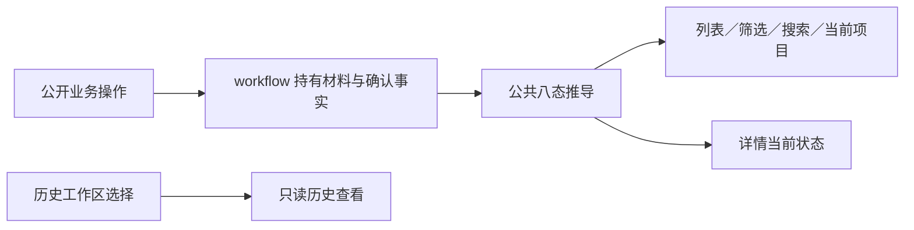
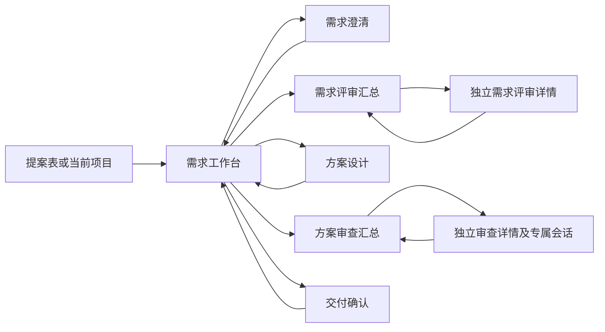
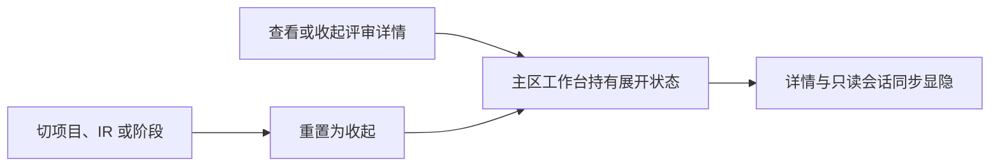
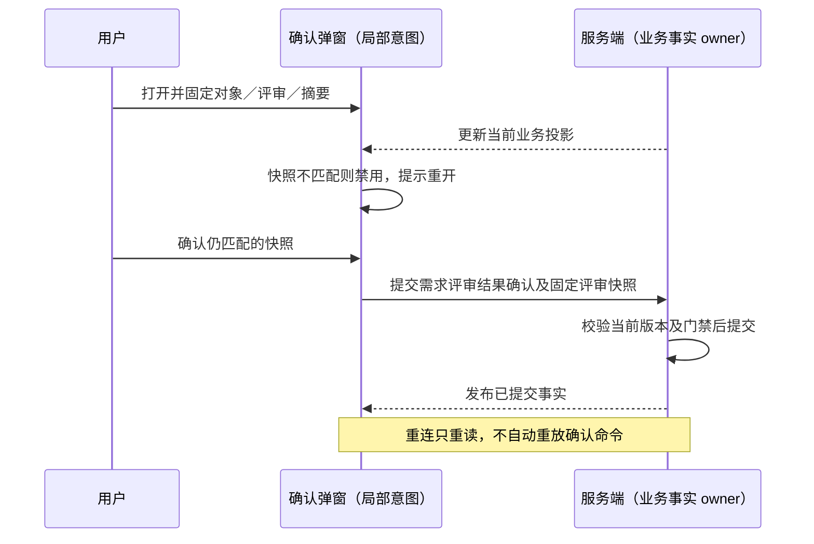

# 需求共创与提案转正

本文定义提案的产品要求。当前模拟后端的实现见[后端契约](../../../packages/server/src/aireq/CONTRACT.md#业务所有权)。

## 身份与材料

IR 从创建起归属唯一项目和 Release。提案转正保留 IR ID、Release、原始短需求、联系人、讨论、材料及历史。原始短需求独立保存，不被生成文档覆盖。

| 对象    | 固定材料                                                                                                           |
| ------- | ------------------------------------------------------------------------------------------------------------------ |
| IR      | `docs/requirements/<ir-id>/` 下的 `requirements.md` 和 `sr-dependencies.json`                                      |
| 每个 SR | `openspec/changes/<sr-id>/` 下的 `proposal.md`、`design.md`、`tasks.md`、`test-plan.md` 和 `specs/<sr-id>/spec.md` |

每个 SR 对应独立 OpenSpec change。依赖 JSON 是 SR 依赖、工作日预估与假设的唯一来源，不从正文或元数据补造。预估不直接转换为正式排期，工作日求和也不是 IR 总周期。交付前，需求和方案材料在提案的临时目录内生成、校验和评审，表中路径相对于该目录。工作流持有材料快照、程序校验结果、评审报告和人工确认记录。材料阅读规则见[材料阅读](unified-side-pane.md#材料阅读)，运行边界见[后端运行说明](../../architecture/mock-backend.md)。

### 材料格式校验

服务端在开始检查时读取已保存的[文档格式规则](tools-settings.md#文档格式)。对当前阶段的必需 Markdown，先检查路径、文件类型和正文可读性，再确认每个必需章节都存在且有正文。按完整标题文字匹配，章节顺序自由。代码块内的标题示例不计入章节，仅含空白或标题的章节没有正文。空章节清单只执行基础文件检查。依赖 JSON 使用独立的结构和关系校验。

规则保存后，尚未开始的检查使用最新设置。进行中的检查沿用开始时读取的规则，已检查材料保留原结果。材料修订后按原流程检查修订版。比如需求阶段已经检查过 `requirements.md`，随后改动设置，尚未检查的方案文件使用新规则，方案阶段继续使用原 IR 正文及校验结果。

## 提案业务状态

提案有且仅有下列八个业务状态，顺序用于展示，不代表只能单向推进。状态由 services 公共纯函数依据 workflow owner 返回的当前有效材料、评审、确认和交付事实推导，不新增持久化状态字段，不由页面选择、会话是否打开、历史浏览或本地缓存决定。`status`、`proposalStage` 仍是底层生命周期与讨论路由事实，不能代替业务状态。

| 稳定标识                        | 状态       | 判断条件                                                                  |
| ------------------------------- | ---------- | ------------------------------------------------------------------------- |
| `not-started`                   | 未启动     | 当前 IR 业务文档尚未生成、格式校验未通过或当前校验已失效                  |
| `ir-review-pending`             | IR 待评审  | 当前 IR 业务文档已通过格式校验，对应的需求评审报告尚未成功产出            |
| `ir-confirmation-pending`       | IR 待确认  | 已有当前材料的有效需求评审报告，等待业务人员确认                          |
| `solution-incomplete`           | 方案待完善 | 业务人员已确认需求评审结果，当前完整方案材料尚未通过程序校验              |
| `solution-review-pending`       | 方案待评审 | 完整方案已通过程序校验，当前材料的三路审查和综合终审报告尚未齐备          |
| `solution-confirmation-pending` | 方案待确认 | 当前材料的审查报告齐备，业务、开发、测试的独立确认尚未齐全                |
| `submission-pending`            | 待提交     | 当前材料的三方确认齐全，尚无与当前交付候选一致的有效文档 PR               |
| `merge-pending`                 | 待合入     | 当前交付候选的文档 PR 已创建且未关闭，尚未完成 owner 的完整合入核验与转正 |

八态按推进阶段分为三组，用于筛选菜单分组展示：需求确认（未启动、IR 待评审、IR 待确认）、方案确认（方案待完善、方案待评审、方案待确认）、交付（待提交、待合入）。分组与组内顺序沿用状态定义顺序，不新增状态、稳定标识或持久化字段；组标题是展示标签，不是可筛选值。

状态详情展示程序校验错误、评审运行或失败、退回和交付核验异常。Agent 的建议随报告展示，是否采纳由确认人判断。推送成功但 PR 创建失败仍是待提交；平台已合入且完整核验未通过时保持待合入，并展示原因。退回和材料变化按[材料变更规则](#版本失效与文档交付)重新计算状态。

转正后同一 IR 保留身份、材料和历史，移入正式需求列表。已删除或已转正的 IR 不参与提案八态推导。文档 PR 打开期间的材料冻结仍属于「待合入」。

列表、筛选、搜索、当前项目和详情当前状态共用八态定义与稳定标识。状态筛选菜单按上述三组分组展示，组内保持状态定义顺序，“全部状态”独立于分组之外；筛选值仍是稳定标识，分组不改变匹配逻辑。旧四阶段筛选缓存不能按数字映射到新状态；无法识别时回到全部状态。需求、原始评审、方案和交付四个工作区仅作为操作环节与历史入口保留，明确区别于八态；浏览历史不改变当前状态，也不恢复旧版批准或写权限。

## 创建与导入导出

需求共创使用左侧当前项目与具体 Release。提案表首列以服务端提案名称进入工作台，与当前项目和工作台标题一致；下方保留原始需求，并列展示提交人、提交日期与状态。当前状态列在「IR 待确认」与「方案待确认」下显示只读的「需人工确认」标记，「待提交」显示「需人工提交」。「待合入」且当前合并请求仍打开时显示「需人工合入」，已合并、等待后台核验时仅显示状态名。标记随当前业务状态更新。搜索匹配提案名称或原始需求，保留既有内部 ID 定位；可叠加提交人工号及状态筛选。分页、数量与导出均复用同一筛选结果，返回列表保留当前项目内的筛选。

新增只保存短需求。成功刷新并留在提案表，在当前项目与 Release 的表格上方提示已保存，并提供「开始需求澄清」。该入口由前端根据本次成功回执的项目和 IR 以及保存时的 Release 定位，直接打开这条提案的需求澄清任务，不受表格筛选或分页影响。失败保留输入。保存和打开任务均不会发送消息、生成材料或 SR，显式发送才开始本次澄清。

- UTF-8 CSV 模板只有“原始需求”一列，支持中文、逗号、引号与单元格内换行。空白行跳过，重复正文提示但不去重，格式错误阻止整批提交。CSV 导出包含全部筛选结果而非当前页，只含短需求。
- Markdown 业务文档支持 `.md`／`.markdown`，一次一份，UTF-8 正文不超过 1 MiB。预览完整正文，并单独确认可编辑的短需求，默认来自首个一级标题或文件名。
- 导入以 `proposals: { originalText, businessDocument? }[]` 整批校验、原子创建新提案。预览按当前格式设置提示缺少或为空的章节，仍可将正文原样保存为提案。进入需求澄清后可使用该正文，缺项由用户和业务需求 Agent 一起补齐。按[材料格式校验](#材料格式校验)检查通过后，自动启动需求评审。
- Markdown 导出明确选择筛选结果中的一个 IR，只下载其当前有效、可读取的业务文档；未生成、失效或读取失败时说明原因，不下载占位文本。
- SR 规格、方案、任务、测试方案及依赖不提供导入导出。

文件、预览与原文受同一草稿门禁保护；在途禁止重复提交和离开，失败保留输入，成功回执后才清理。版本冲突需显式重读后重试，不自动覆盖。

验收：在提案表筛选掉新提案后保存短需求，仍可从成功提示进入本次回执对应的需求澄清。键盘保存后焦点到达该入口，点击前后均无自动发送。导入成功仍直接回到表格。

## 需求工作台与任务页

提案入口先到需求工作台，以需求标题作为正文一级标题，最多两行并截断超长标题；原始需求置于任务列表下方的“查看原始需求”，默认收起，展开后完整保留换行并在限定高度内滚动，不影响上方状态与主要操作的位置。短原文不预留正文空白；切换需求重新收起。顶部工具栏标识“需求工作台”，避免重复需求标题。工作台展示当前进展、下一项待办、确认记录和任务列表；入口不挂载聊天或默认展开右侧栏。工作台按统一八态及前置条件显示当前状态和下一项待办，退回或材料失效时同步更新。需求澄清、需求评审、方案设计、方案审查、交付确认、管理需求分别为独立任务页。需求评审与完整方案审查各有汇总页，汇总只呈现结论、意见与人工决定，没有输入框或 Agent 切换 Tab。点击某一路审查进入独立详情与其原生会话，返回到所属汇总；其余任务返回本需求工作台，工作台再沿原来源返回项目或提案表。

当前评审报告的正文略去与任务重复的 Markdown 一级标题，正文的二级标题在报告区标题下呈现为三级。验收时展开当前需求评审报告，标题导航应依次读到一级「需求评审」、二级「评审报告」和三级「评审意见」。

提案信息与操作记录弹窗只显示提案标题；来源需求用标题，共享侧栏对象上下文使用类型与标题，不显示内部 IR／SR ID。需求文件保留实际技术路径，不作为对象标识。操作记录显示操作人；历史缺少身份时标“未记录”，未识别类型显示原始类型。删除提案在菜单与确认弹窗统一使用“移除需求”；弹窗说明移除后材料、评审、确认与操作记录不可恢复，并保留已入库、已有修订或已开始开发时的不可删除条件；菜单项与提案信息／操作记录分组。

评审汇总展示当前材料的校验状态、待运行、运行中、失败或已产出报告。校验失败显示具体文件和原因；评审失败提供重试。已确认后提供“前往管理需求修改材料”，定位同一提案的管理页。用户选择材料范围并提交修改说明，沿用既有 `reviseProposalMaterial` 命令。工作流按材料范围使旧评审及确认失效，更新后的材料通过校验后重新评审。冻结中的文档 PR 须先关闭。

任务地址使用同一对象链接的 `aireqTask` 和必要的 `aireqAgent` 参数。任务与浏览器历史只归 AIReqContext，不加入服务端选择 DTO 或业务数据；详情原生会话由已有 selection 中的阶段和 reviewer 选择绑定。刷新及直链恢复同一任务，浏览器前后退恢复页面和来源。旧链接无任务参数时打开工作台，显式 SR 链接保持对应文档目标；非法任务或审查标识明确失败，不静默进入错误 Agent。提案转正后，已有任务链接和历史记录进入同一 IR 的正式只读详情，并移除任务及审查参数；后台转正同步规范化当前导航，不新增历史记录。设置覆盖层往返保留任务，普通侧栏离开不携带旧任务上下…

标题下直接显示单行八态轨迹，与任务列表共用正文宽度，首项文字与任务名称起点对齐；空间足够时各状态横向均布。当前状态用“当前”标记和强调色，已完成与未来状态分别弱化；轨迹只读展示进度，不承担导航，不赋予 Tab／按钮角色。处理页入口收束为标题下的“下一步”卡片，主按钮沿既有下一任务映射进入处理页；卡片展示当前业务状态、处理动作、具体处理角色与已配置联系人，未配置时显示未分配。轨迹空间不足时只在局部横滚，进入需求、状态回退及调整面板宽度时确保当前项可见，不滚动主页面。移除重复状态标题、完整流程折叠入口和重复的主要进入按钮。轨迹不增加八个聊天 Tab 或百分比进度。任务列表只标记推荐入口，未来任务可查看前置条件，不伪装成可立即执行；`管理需求` 在底部以 `管理需求（联系人与材料）` 明示为工具入口，不与五项操作任务混用状态。

报告齐备时以人工确认为主动作。等待校验或报告时，确认按钮禁用并关联可见原因；执行失败时可重试当前评审。已有有效确认后显示实际工号、北京时间与后续入口；材料失效后旧记录供追溯。三方确认页按当前材料显示剩余视角；待提交突出文件核对与提交，待合入优先展示 PR 及核验事实，分支、基点等技术详情折叠。等待合入时展示确认记录，失败保留重试及管理入口。页面导航和刷新只读取工作流。

交付确认未就绪时，页头显示交付任务状态，主区列出前置条件（方案审查、三方确认、文件清单）和当前版本、材料数；主按钮进入第一个未完成项。不得只写“处理以下前置任务”而没有清单。材料入口与工具栏去重，正文不重复放置展开材料按钮。

每一路原生会话沿用独立 sessionId、草稿、附件、只读与发送路由；同一页面内不切换当前 Agent。自动评审由服务端在当前材料通过校验后启动，工作台和汇总页读取执行状态。人工确认绑定材料版本、reviewId、snapshotDigest 和实际操作者，由服务端校验；过期结果不能推进其他需求。未来阶段可查看前置条件，缺条件时不能执行写动作。需求与方案讨论页保留原生 composer；材料仍由统一右侧工作区提供，阅读区不提供业务推进按钮。任务页标题旁显示当前任务状态；无消息时说明可继续讨论及材料位置。历史任务页在页头显示 `历史阶段 · 只读`，主区提供历史摘要（原始需求、确认事实、当前阶段）和查看当前阶段／返回工作台入口，隐藏可写 composer；材料加载、失败和空态分别明确。

验收覆盖列表和项目入口、任务详情返回层级、独立审查 URL、前后退与设置往返恢复、各审查会话独立草稿、历史只读、文件全选和材料侧栏宽度。深浅主题和宽窄电脑窗口均需验证。

## 业务澄清与原始评审

业务需求 Agent 在需求澄清阶段生成和完善临时目录中的 `requirements.md`，记录业务目标、范围和验收标准。工作流接收文件后按[材料格式校验](#材料格式校验)检查。失败时显示对应文件、缺少或为空的章节及其他校验原因，由业务需求 Agent 修正后重新检查。当前文件通过检查后，工作流自动启动独立的需求评审 Agent。

需求评审 Agent 就目标、范围、歧义和可验收性给出意见。评审成功并产出完整、可读且匹配当前材料的报告后，业务人员可以确认该评审结果，是否采纳意见由业务人员判断。评审失败或缺报告时可重试。确认绑定评审 ID 和所用材料快照，Release 归属始终沿用创建时的选择。

评审区显示当前执行或确认状态。已有匹配当前评审的人工确认时，显示确认人的工号、时间和评审对象。工作台用默认收起的「查看评审详情」展示轮次、输入材料及技术版本标识，评审汇总页用报告卡展示结论、检查范围、评审意见和材料版本，「查看会话」为次级入口。展开状态归当前页面，切换项目、IR 或阶段时重置，收起保留已挂载的会话。

业务人员确认评审结果后开放方案设计。由用户在方案会话中显式发送，才开始方案讨论和 SR 拆分。业务人员也可以填写原因退回补充，工作流保留操作者、时间及轮次，补充后的材料重新校验和评审。退回弹窗显示「退回原因」及后续步骤，提交失败保留输入，取消或 Esc 关闭弹窗。

## 方案、完整审查与三方确认

方案讨论在所属 IR 的 AI 会话中进行。方案 Agent 只读已确认的 `requirements.md`，并在临时目录生成和完善各 SR 的提案、规格、设计、开发任务、测试方案以及共享的 `sr-dependencies.json`。测试方案追溯 IR 的业务验收标准，跨 SR 的具体验证场景可写入负责验证的 SR 的 `test-plan.md`。后续补充保留已有 SR 身份。

工作流按[材料格式校验](#材料格式校验)检查方案阶段的必需 Markdown 及依赖 JSON，并引用需求阶段已经通过检查的 IR 正文。依赖 JSON 准确覆盖当前 SR。前置项属于本 IR，不重复、不自依赖、无环，依赖原因、正有限工作日和假设完整。预估缺项时可以阅读有效拓扑，详情显示尚未通过的检查。方案材料修正后重新检查，通过后自动启动三路方案审查。

方案评审 A、B、C 针对同一材料快照分别检查需求覆盖与一致性、技术方案与依赖、任务可执行性与测试充分性。三份报告成功产出后，由方案综审 Agent 给出汇总报告。当前材料的报告齐备且可读后，开始业务、开发、测试的三方确认。是否采纳审查意见由实际确认的人判断。Agent 的模型和指令见[AI 配置](tools-settings.md#agent-角色)。

业务、开发、测试是三个业务确认角色，每个角色单独提交一次。任一进入系统的工号都可以承担其中一个或多个角色。只有一个人负责时，他可以分别确认全部三个角色。工作流按材料快照和角色保存首次成功确认的实际工号与时间。同一材料和角色已有有效确认时，页面显示原确认工号，后续操作保留原确认记录。三方确认齐备即进入待提交。

工作流分别管理需求评审和方案审查的轮次与历史。自动启动按项目、IR、评审类型和材料快照去重。重复收到同一材料完成事件或页面重读时复用已接纳的轮次。报告失败可重试，确认始终使用当前材料的成功报告。

需求评审结果确认沿用确认弹窗。打开前须展开当前评审报告，弹窗说明确认对象、所用材料和下一步，默认聚焦取消。弹窗打开时固定项目、IR、reviewId 和 snapshotDigest，工作流提交时校验快照及重复确认。目标、评审或材料变化时禁用确认并提示重新阅读后再打开。取消或 Esc 关闭后焦点返回入口。报告展开状态归当前页面，评审变化时重置。

审查页分区展示三路独立审查与综合终审。三路的「查看会话」打开各自的原生会话，综合报告单独命名。综合摘要展示轮次、材料数、主要意见和审查完成数。页面展示三方确认和剩余角色，历史视图显示当时的结果。

独立审查详情以“审查会话”标识，H1 显示 Agent 名 + 审查会话；页头展示审查业务状态（如“已完成 · 待人工确认”）并提供返回所属汇总确认的出口。报告消息不提供赞/踩反馈；追问输入明确只追加会话，不修改材料、报告或人工决定。聊天工作过程折叠标题使用“工作过程”，不与审查状态共用“已处理”。

已确认的需求评审或方案审查页先展示确认记录与下一步，再展示报告。报告卡展示轮次、材料数、主要意见和正文，报告标题与 Agent 名称分别显示，「查看会话」为次级入口。确认记录和下一步放在同一区域。

验收：正常打开时取消获焦，取消／Esc 后返回入口；打开后其他协作者重审或更新材料时，不得自动改为确认新评审，必须禁用确认并提示重新阅读；重新打开后展示当前轮次，提交绑定新打开时的对象与版本。

## 版本失效与文档交付

需要修改 IR 业务正文时，通过「管理需求」或退回操作回到需求澄清阶段。修改后重新检查业务文档、启动需求评审，并由业务人员再次确认，原方案报告和三方确认随之失效。只修改 SR 提案、规格、设计、任务、测试方案或依赖时，保留 IR 正文、其检查结果、需求评审与业务确认，重新检查方案并完成三路审查、综合终审和三方确认。旧材料、报告、确认和失效原因保留只读，迟到结果不能覆盖当前事实。

交付确认弹窗按提交目标、文件确认及固定底部操作组织，正文单独滚动，头部和关闭／提交按钮不随清单滚走。仓库和来源／目标分支只展示一份摘要，材料完整路径次级展示，版本技术信息按需展开，不重复嵌入材料准备卡片及第二份清单。文件区提供全选／取消全选、半选状态及实际选中数量，空清单不可全选和提交；批量勾选仅改变当前弹窗快照的文件选择，不自动勾选最终人工授权。只有完整清单全部勾选且明确确认后才允许提交；版本失效、只读、未就绪及提交中沿用原禁用和防重复提交规则。确认选择仍由交付弹窗持有，不新增业务事实 owner。

三方确认齐备且用户明确提交时，工作流为当前候选创建文档交付分支，将临时目录里该候选的完整材料提交到该分支，并为该 IR 创建一个文档 PR。交付确认绑定当前材料快照、候选与完整清单。分支创建、推送和 PR 创建分别保留结果；部分成功后重试当前候选缺失的步骤，复用已创建的分支。

文档 PR 打开期间冻结候选材料。需要修改时先关闭当前未合入 PR，再回临时目录修改，并按受影响的范围重新校验、评审和确认。只有同一候选的文档 PR 已合入，且合入的材料版本与完整清单核验一致，工作流才将整个 IR 转为正式需求。

IR 转正后，工作流以同一个文档合入提交为基点，为各 SR 创建独立开发分支并分别记录结果。某个分支创建失败时，IR 保持已转正，其他分支可正常使用。只重试失败分支，沿用原分支名和合入基点；重复核验不复制 IR、SR 或成功分支。正式范围新增另建关联 IR，原正式需求保留原 SR 拆分和 Release 归属。

### 流程验收场景

- 需求文件格式错误时，详情显示实际文件和原因，评审尚未启动。修正后自动启动一次。报告包含负面意见时业务人员仍可确认，随后由用户主动发起方案对话。
- 导入的 Markdown 缺少必需章节时可先保存提案。业务需求 Agent 补齐后，材料通过检查并启动需求评审。
- 修改章节规则后，尚未开始的检查使用新配置，已检查材料的结果不变。用已确认的 IR 正文生成方案时，该正文保持只读，只有新方案材料接受检查。
- Agent 执行失败或报告缺失时，评审页显示当前原因及重试入口。成功产出当前材料的报告后才开放人工确认。
- 方案文件缺失或依赖成环时，先修正材料。通过校验后自动启动三路审查，三路成功后启动综合终审，报告齐备即可逐角色确认。最后一次角色确认完成后进入待提交。
- 同一工号可以依次完成三个角色的确认。另一个工号对同一材料快照重复确认其中一个角色时，页面仍显示那个角色的首次成功确认记录。
- 更改业务正文会使两类评审及确认失效；只改方案材料时原需求评审确认有效。重复提交同一版本和迟到的旧报告不会改变当前确认结果。
- 提案的临时目录在文档提交前承载全部材料。PR 打开时材料冻结，合入并核对完整材料后才转正并创建 SR 开发分支。单个分支失败后可以单独重试。

### 当前内存模拟

内存原型的正常文档 MR 生命周期由服务端内部模拟，仍经过上述公开业务流程与同一核验 owner。发布时登记与候选绑定的 opened 事实，至少保留 10 秒真实服务时钟的待合入窗口；既有后台轮询到期后才观测为 merged，再检查当前候选、材料版本及完整清单，满足后转正。重复发布同一候选不重置窗口或另建 MR；对于已有 PR 但尚未开始内部合入观测的初始记录，显式发布会为原候选与原 PR 启动一次正常观测，不重复推送。窗口内关闭未合入 MR 会撤销当前交付，旧候选的迟到轮询不能重新合入或转正。该模拟不连接 Git，不证明真实平台合入，公开 MR 的 platformVerified 始终为 false；私有时钟和模拟 MR 状态不进入 DTO、回执或历史投影，也不提供测试控制接口。

内存 Git 依赖对每个新转正 IR 的首个 SR 首次推送记录一次暂时失败，其余登记成功；显式内部依赖故障输入优先于该正常生命周期。失败保持原分支名与文档合入基点，用户通过现有分支重试命令重新推送，成功后再进入后续代码合入观测。尝试次数归服务端内部事实，不进入公开字段，不按工号、客户端或测试用途选择结果。

## 分工与工作区

IR 业务联系人默认提交人，开发／测试联系人可指定或待认领；SR 分工、验收及待办见[正式需求与进度](tracking.md)。实际操作者与联系人分别记录，联系人不是独占权限。

讨论复用[原生会话](conversation.md)，材料、报告与历史使用[统一右侧多 Tab](unified-side-pane.md)。SR 只读材料不挂开发会话，阅读不修改业务。联系人、补充说明、退回原因和交付确认绑定原对象与编辑版本，后台重读不提升草稿基线；失败保留输入，在途冻结重复提交及关闭。

普通草稿可经确认删除；正式、已合入或具有受保护历史的需求不能以删除释放记录。公开入口不提供场景控制、强制推进、手填合入事实或编码执行；外部 AI、Git 与 PR 限制集中见[后端运行说明](../../architecture/mock-backend.md)。

## 当前实现参考

`packages/server/src/aireq/` 下的 `workflow.ts`、`proposal-mutations.ts`、`proposal-delivery.ts`、`native-business.ts`、`requirements-review.ts`；`packages/services/src/aireq/` 下的 `domain.ts`、`sr-dependencies.ts`、`remote-operations.ts`；`packages/ui/src/aireq/` 下的提案表、导出组件和 `shell/AIReqProposalWorkspace.tsx`。
