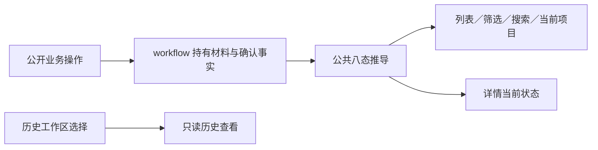
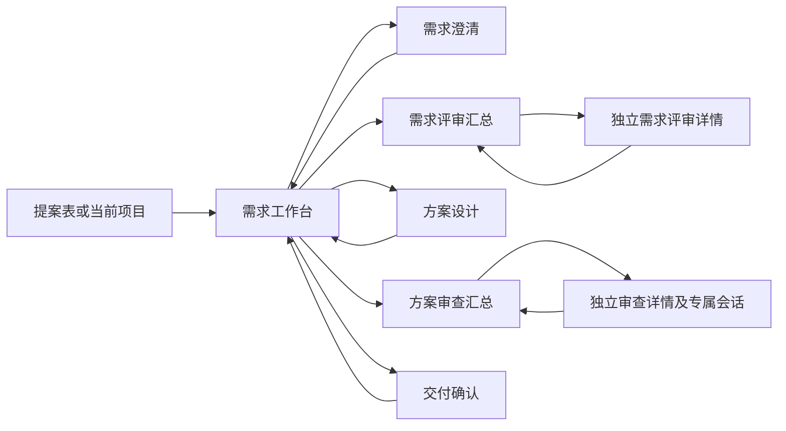
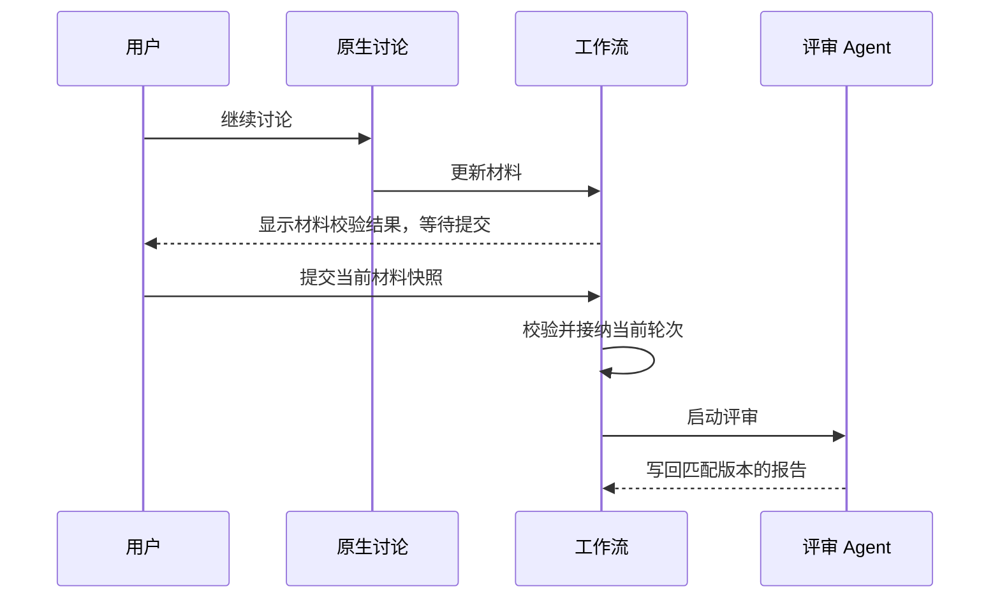
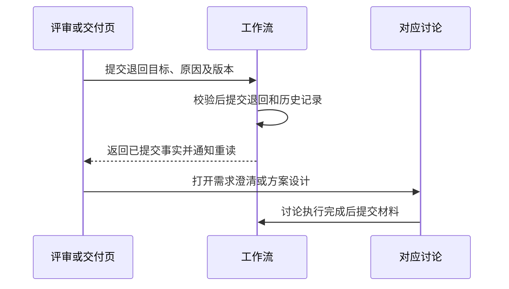
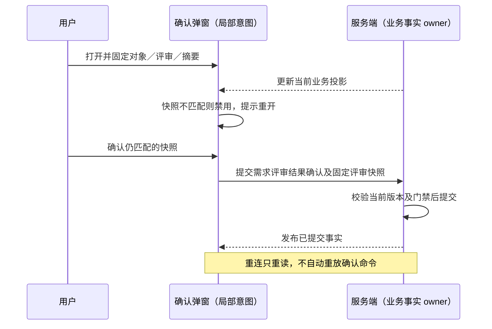

# 需求共创与提案转正

本文定义提案的产品要求。当前模拟后端的实现见[后端契约](../../../packages/server/src/aireq/CONTRACT.md#业务所有权)。

## 身份与材料

IR 从创建起归属唯一项目和 Release。提案转正保留 IR ID、Release、原始短需求、讨论、材料及历史。原始短需求独立保存，不被生成文档覆盖。

| 对象    | 固定材料                                                                                                           |
| ------- | ------------------------------------------------------------------------------------------------------------------ |
| IR      | `docs/requirements/<ir-id>/` 下的 `requirements.md` 和 `sr-dependencies.json`                                      |
| 每个 SR | `openspec/changes/<sr-id>/` 下的 `proposal.md`、`design.md`、`tasks.md`、`test-plan.md` 和 `specs/<sr-id>/spec.md` |

每个 SR 对应独立 OpenSpec change。依赖 JSON 是 SR 依赖、工作日预估与假设的唯一来源，不从正文或元数据补造。预估不直接转换为正式排期，工作日求和也不是 IR 总周期。交付前，需求和方案材料在提案的临时目录内生成、校验和评审，表中路径相对于该目录。工作流持有材料快照、程序校验结果、评审报告和人工确认记录。材料阅读规则见[材料阅读](unified-side-pane.md#材料阅读)，运行边界见[后端运行说明](../../architecture/mock-backend.md)。

### 材料格式校验

服务端在开始检查时读取已保存的[文档格式规则](tools-settings.md#文档格式)。对当前阶段的必需 Markdown，先检查路径、文件类型和正文可读性，再确认每个必需章节都存在且有正文。按完整标题文字匹配，章节顺序自由。代码块内的标题示例不计入章节，仅含空白或标题的章节没有正文。空章节清单只执行基础文件检查。依赖 JSON 使用独立的结构和关系校验。

规则保存后，尚未开始的检查使用最新设置。进行中的检查沿用开始时读取的规则，已检查材料保留原结果。材料修订后按原流程检查修订版。比如需求阶段已经检查过 `requirements.md`，随后改动设置，尚未检查的方案文件使用新规则，方案阶段继续使用原 IR 正文及校验结果。

## 提案业务状态

提案有且仅有下列八个业务状态，顺序用于展示，不代表只能单向推进。状态由 services 公共纯函数依据 workflow owner 返回的当前有效材料、评审、确认和交付事实推导，不新增持久化状态字段，不由页面选择、会话是否打开、历史浏览或本地缓存决定。`status`、`proposalStage` 仍是底层生命周期与讨论路由事实，不能代替业务状态。

| 稳定标识                        | 状态       | 判断条件                                                                  |
| ------------------------------- | ---------- | ------------------------------------------------------------------------- |
| `not-started`                   | 未启动     | 当前 IR 业务文档尚未通过格式校验，或当前版本尚未由人提交评审              |
| `ir-review-pending`             | IR 待评审  | 已提交当前 IR 业务文档发起需求评审，报告尚未成功产出                      |
| `ir-confirmation-pending`       | IR 待确认  | 已有当前材料的有效需求评审报告，等待业务人员确认                          |
| `solution-incomplete`           | 方案待完善 | 业务已确认需求；当前完整方案材料尚未通过校验，或当前版本尚未由人提交审查  |
| `solution-review-pending`       | 方案待评审 | 已提交当前完整方案，三路审查和综合终审报告尚未齐备                        |
| `solution-confirmation-pending` | 方案待确认 | 当前材料的审查报告齐备，业务、开发、测试的独立确认尚未齐全                |
| `submission-pending`            | 待提交     | 当前材料的三方确认齐全，尚无与当前交付候选一致的有效文档 PR               |
| `merge-pending`                 | 待合入     | 当前交付候选的文档 PR 已创建且未关闭，尚未完成 owner 的完整合入核验与转正 |

八态按推进阶段分为三组，用于筛选菜单分组展示：需求确认（未启动、IR 待评审、IR 待确认）、方案确认（方案待完善、方案待评审、方案待确认）、交付（待提交、待合入）。分组与组内顺序沿用状态定义顺序，不新增状态、稳定标识或持久化字段；组标题是展示标签，不是可筛选值。

状态详情展示程序校验错误、评审运行或失败、退回和交付核验异常。提案列表保留八态筛选，给待评审且执行失败的对象显示「上次评审失败 · 可重试」。待合入的动作提示依据公开 PR 链接及跟踪事实，区分仓库合入、开始跟踪和后台核验。首次向业务说明 IR 为整体业务需求、SR 为拆分的需求项。Agent 的建议随报告展示，是否采纳由确认人判断。推送成功但 PR 创建失败仍是待提交；平台已合入且完整核验未通过时保持待合入，并展示原因。退回和材料变化按[材料变更规则](#版本失效与文档交付)重新计算状态。

转正后同一 IR 保留身份、材料和历史，在需求共创列表中显示「已归档」。已删除或已转正的 IR 不参与提案八态推导。文档 PR 打开期间的材料冻结仍属于「待合入」。

列表、筛选、搜索、当前项目和详情当前状态共用八态定义与稳定标识。状态筛选菜单按上述三组分组展示，组内保持状态定义顺序，“全部状态”独立于分组之外；筛选值仍是稳定标识，分组不改变匹配逻辑。旧四阶段筛选缓存不能按数字映射到新状态；无法识别时回到全部状态。需求、原始评审、方案和交付四个工作区仅作为操作环节与历史入口保留，明确区别于八态；浏览历史不改变当前状态，也不恢复旧版批准或写权限。

## 创建与导入导出

需求共创使用左侧当前项目与具体 Release。提案表首列以服务端提案名称进入工作台，与当前项目和工作台标题一致；下方保留原始需求，并列展示提交人、提交日期与状态。当前状态列在「IR 待确认」与「方案待确认」下显示只读的「需人工确认」标记，「待提交」显示「需人工提交」。「待合入」根据当前文档 PR 的状态显示「需要开始跟踪」「等待仓库合入」或「后台跟踪中」。标记随当前业务状态更新。搜索匹配提案名称或原始需求，保留既有内部 ID 定位；可叠加提交人工号及状态筛选。分页、数量与导出均复用同一筛选结果，返回列表保留当前项目内的筛选。

项目概览页头、零提案空态和需求共创复用「新建需求」表单。表单说明原始需求保存后成为提案，预选当前 Release，有有效预选时聚焦原始需求。新建与导入共用目标 Release 草稿，列表范围、历史与概览返回来源由 `AIReqContext` 持有。改选目标只更新表单及相应 CSV 重复项预览，取消不改变原页面、范围或返回来源，焦点回到实际入口。

成功回执后打开目标 Release 的提案表。新建在表格上方提示已保存，并提供「开始需求澄清」，焦点移到该按钮。入口根据本次回执的项目和 IR 以及提交时的 Release 直接打开澄清任务，不受表格筛选或分页影响。失败保留输入及目标。保存和打开任务均不会发送消息、生成材料或 SR，显式发送才开始本次澄清。

- UTF-8 CSV 模板只有“原始需求”一列，支持中文、逗号、引号与单元格内换行。空白行跳过，重复正文提示但不去重，格式错误阻止整批提交。CSV 导出包含全部筛选结果而非当前页，只含短需求。
- Markdown 业务文档支持 `.md`／`.markdown`，一次一份，UTF-8 正文不超过 1 MiB。预览完整正文，并单独确认可编辑的短需求，默认来自首个一级标题或文件名。
- 导入以 `proposals: { originalText, businessDocument? }[]` 整批校验、原子创建新提案。预览按当前格式设置提示缺少或为空的章节，仍可将正文原样保存为提案。进入需求澄清后可使用该正文，缺项由用户和业务需求 Agent 一起补齐。按[材料格式校验](#材料格式校验)检查通过后，可由人提交需求评审。
- Markdown 导出明确选择筛选结果中的一个 IR，只下载其当前有效、可读取的业务文档；未生成、失效或读取失败时说明原因，不下载占位文本。
- SR 规格、方案、任务、测试方案及依赖不提供导入导出。

文件、预览与原文受同一草稿门禁保护；在途禁止重复提交和离开，失败保留输入，成功回执后才清理。版本冲突需显式重读后重试，不自动覆盖。

验收：从项目概览和提案表打开新建，改选目标后取消仍保留原范围、返回来源及入口焦点；有输入时经过原草稿门禁。跨版本保存到目标列表并进入刚保存的澄清，同版本保存保留列表筛选及概览返回。导入预览按实际目标计算重复项，成功后回到目标版本提案表。

## 需求工作台与任务页

从任务页的顶部工具栏打开需求材料，在[右侧工作区](unified-side-pane.md)查阅。

提案入口先到需求工作台，以需求标题作为正文一级标题，最多两行并截断超长标题；原始需求置于任务列表下方的“查看原始需求”，默认收起，展开后完整保留换行并在限定高度内滚动，不影响上方状态与主要操作的位置。短原文不预留正文空白；切换需求重新收起。顶部工具栏标识“需求工作台”，避免重复需求标题。工作台展示当前进展、下一项操作、确认记录和任务列表；入口不挂载聊天或默认展开右侧栏。工作台按统一八态及前置条件显示当前状态和下一项操作，退回或材料失效时同步更新。需求澄清、需求评审、方案设计、方案审查、交付确认分别为独立任务页。需求评审与完整方案审查各有汇总页，汇总只呈现结论、意见与人工决定，没有输入框或 Agent 切换 Tab。已有的独立审查会话链接仍可直达会话，并返回所属汇总；其余任务返回本需求工作台，工作台再沿原来源返回项目或提案表。

当前评审报告的正文略去与任务重复的 Markdown 一级标题，正文的二级标题在报告区标题下呈现为三级。模拟评审报告直接呈现结果与意见。需求评审和方案审查共用带边界的报告阅读面，使用卡片表面与工作区留白区分，正文及独立报告不得出现指针柔光。直接打开需求评审汇总时，标题导航应依次读到一级「需求评审」、二级「评审报告」和三级「评审意见」。

提案信息与操作记录弹窗只显示提案标题；来源需求用标题，共享侧栏对象上下文使用类型与标题，不显示内部 IR／SR ID。需求文件保留实际技术路径，不作为对象标识。操作记录显示操作人；历史缺少身份时标“未记录”，未识别类型显示原始类型。删除提案在菜单与确认弹窗统一使用“移除需求”；弹窗说明移除后材料、评审、确认与操作记录不可恢复，并保留已入库、已有修订或已开始开发时的不可删除条件；菜单项与提案信息／操作记录分组。

评审汇总展示当前材料的校验状态、待运行、运行中、失败或已产出报告。校验失败显示具体文件和原因；评审失败提供重试。送审成功后，从当前讨论直接打开同一需求对应的评审汇总，等待该次导航的结果后显示评审状态；失败留在原讨论并显示原因，迟到回执沿用当前导航。当前需求评审、方案审查和待提交的交付确认页提供「退回修改」。需求评审退回需求澄清，方案审查和交付确认退回方案设计。冻结中的文档 PR 须先在交付确认页关闭。

任务地址使用同一对象链接的 `aireqTask` 和必要的 `aireqAgent` 参数。任务与浏览器历史只归 AIReqContext，不加入服务端选择 DTO 或业务数据；详情原生会话由已有 selection 中的阶段和 reviewer 选择绑定。刷新及直链恢复同一任务，浏览器前后退恢复页面和来源。旧链接无任务参数时打开工作台，显式 SR 链接保持对应文档目标；非法任务或审查标识明确失败，不静默进入错误 Agent。提案转正后，已有任务链接和历史记录进入同一 IR 的正式只读详情，并移除任务及审查参数；后台转正同步规范化当前导航，不新增历史记录。设置覆盖层往返保留任务，普通侧栏离开不携带旧任务上下…

标题下直接显示单行八态轨迹，与任务列表共用正文宽度，首项文字与任务名称起点对齐；空间足够时各状态横向均布。当前状态用「当前」标记和强调色，已走过的状态使用中性标记并提供可访问的已历经标签，未来阶段使用次级文字；轨迹只读展示进度，不承担导航，不赋予 Tab／按钮角色。处理页入口收束为标题下的“下一步”卡片，主按钮沿既有下一任务映射进入处理页；卡片展示当前业务状态、处理动作和处理角色。轨迹空间不足时只在局部横滚，进入需求、状态回退及调整面板宽度时确保当前项可见，不滚动主页面。移除重复状态标题、完整流程折叠入口和重复的主要进入按钮。轨迹不增加八个聊天 Tab 或百分比进度。任务列表只标记推荐入口，未来任务可查看前置条件，不伪装成可立即执行。

报告齐备时以人工确认为主动作。等待校验或报告时，确认按钮禁用并关联可见原因；执行失败时可重试当前评审。已有有效确认后显示实际工号、北京时间与后续入口；材料失效后旧记录供追溯。三方确认页按当前材料显示剩余视角；待提交突出文件核对与提交，待合入优先展示 PR 及核验事实，分支、基点等技术详情折叠。等待合入时展示确认记录及自动核验状态，尚未启动跟踪的已打开文档 PR 提供「开始跟踪 PR」。失败保留对应步骤的重试。交付页面统一使用「文档 PR」。页面导航和刷新只读取工作流。

交付确认未就绪时，页头显示交付任务状态，主区列出前置条件（方案审查、三方确认、文件清单）和当前版本、材料数；主按钮进入第一个未完成项。不得只写“处理以下前置任务”而没有清单。材料入口与工具栏去重，正文不重复放置展开材料按钮。IR 尚未确认时列出「需求评审」及阻塞事实，再列方案审查、三方确认与文件清单。

每一路原生会话沿用独立 sessionId、草稿、附件、只读与发送路由；同一页面内不切换当前 Agent。材料校验通过后，用户在对应讨论页主动提交评审，工作台和汇总页读取执行状态。人工确认绑定材料版本、reviewId、snapshotDigest 和实际操作者，由服务端校验；过期结果不能推进其他需求。未来阶段可查看前置条件，缺条件时不能执行写动作。需求与方案讨论页保留原生 composer；材料由工具栏显式打开到统一右侧工作区，不因生成而自动展开。材料校验通过时在送审旁显示当前材料数和通过状态。退回提示卡随主内容列居中；无附带意见时居中排列状态、操作人、说明和材料入口。退回页给出针对本次修改的输入提示和上一版材料入口；成功更新后保留同一退回原因并标明已处理，等待再次送审。阅读区不提供业务推进按钮。任务页标题旁显示当前任务状态；无消息时说明可继续讨论及材料位置。历史任务页在页头显示 `历史阶段 · 只读`，主区提供历史摘要（原始需求、确认事实、当前阶段）和查看当前阶段／返回工作台入口，隐藏可写 composer；材料加载、失败和空态分别明确。

验收覆盖列表和项目入口、任务详情返回层级、独立审查 URL、前后退与设置往返恢复、各审查会话独立草稿、历史只读、文件全选和材料侧栏宽度。深浅主题和宽窄电脑窗口均需验证。

## 业务澄清与原始评审

业务需求 Agent 在需求澄清阶段生成和完善临时目录中的 `requirements.md`，记录业务目标、范围和验收标准。工作流接收文件后按[材料格式校验](#材料格式校验)检查。失败时显示对应文件、缺少或为空的章节及其他校验原因，由业务需求 Agent 修正后重新检查。当前文件通过检查后仍留在澄清阶段。用户在「需求澄清」页点击「提交需求评审」，工作流校验项目、IR、当前材料快照及评审接纳状态后，启动独立的需求评审 Agent。

首次澄清突出原始需求、场景提示与输入框。提交需求评审尚不可用时，按钮旁显示当前前置条件；输入提示引导补充使用者、场景和期望结果。

需求评审 Agent 就目标、范围、歧义和可验收性给出意见。评审成功并产出完整、可读且匹配当前材料的报告后，业务人员可以确认该评审结果，是否采纳意见由业务人员判断。评审失败或缺报告时可重试。确认绑定评审 ID 和所用材料快照，Release 归属始终沿用创建时的选择。

评审汇总以报告正文为主。当前报告可读时直接显示正文和主要意见，页头保留执行或确认状态，人工操作和有效确认记录位于报告之后。校验失败显示文件和原因。评审未就绪时聚合一次失败原因及一次重试入口；方案审查标明未完成的审查主题。等待分析、确认、提交及合入使用等待或中性样式，成功颜色留给已完成的事实。评审汇总正文和工作台正文不展示评审 ID、材料摘要、模型、指令快照或会话入口。

业务人员确认评审结果后开放方案设计。由用户在方案会话中显式发送，才开始方案讨论和 SR 拆分。空会话提示从方案讨论开始，送审按钮关联当前材料的校验阻塞原因。业务人员在需求尚未确认时可点击「返回需求澄清」直接返工。工作流保留操作者、时间、轮次和材料，新一轮打开后由用户在会话补充内容。当前评审转为历史，待材料更新并通过校验后由人再次送审。此入口无需填写原因，后续阶段的跨角色退回仍说明原因。

## 方案、完整审查与三方确认

方案讨论在所属 IR 的 AI 会话中进行。方案 Agent 只读已确认的 `requirements.md`，并在临时目录生成和完善各 SR 的提案、规格、设计、开发任务、测试方案以及共享的 `sr-dependencies.json`。测试方案追溯 IR 的业务验收标准，跨 SR 的具体验证场景可写入负责验证的 SR 的 `test-plan.md`。后续补充保留已有 SR 身份。

当前可写的「方案设计」对话页提供「提交方案审查」和「退回业务澄清」。遇到需业务澄清的规则、范围或验收问题时，用户填写非空退回意见后确认。退回绑定当前项目、IR 及操作版本，在可写的方案对话中可用。冻结或已转正的需求保持只读。弹窗说明业务澄清会接手意见，取消或提交失败保留未提交意见，版本变化时须重新核对当前需求。

退回权限由工作流依据当前状态裁决。当前需求评审阶段允许业务人员退回澄清；进入方案阶段后，退回需要当前项目开发角色。交付待提交时先退回方案设计，已打开的文档 PR 须先关闭。

工作流通过 `returnProposal` 接纳 `requirements` 或 `solution` 退回目标，校验同一 IR 与操作版本；仅业务确认前从需求评审返回澄清时允许空原因，记录意见、操作者、时间与原轮次。退回需求澄清将两类评审、确认及候选转为历史，开启同一 IR 的新一轮澄清。退回方案设计保留有效的需求评审与业务确认，将方案审查、三方确认和交付候选转为历史，恢复原方案会话的写入。两种退回事务均保留当前文件路径、正文、清单和快照。成功后打开对应讨论页并显示退回意见；后续 Agent 在讨论中更新材料，通过校验后由人重新送审。

工作流按[材料格式校验](#材料格式校验)检查方案阶段的必需 Markdown 及依赖 JSON，并引用需求阶段已经通过检查的 IR 正文。依赖 JSON 准确覆盖当前 SR。前置项属于本 IR，不重复、不自依赖、无环，依赖原因、正有限工作日和假设完整。预估缺项时可以阅读有效拓扑，详情显示尚未通过的检查。方案材料修正后重新检查，通过后由用户在「方案设计」页点击「提交方案审查」，工作流校验当前快照并启动三路方案审查。

方案评审 A、B、C 针对同一材料快照分别检查需求覆盖与一致性、技术方案与依赖、任务可执行性与测试充分性。三份报告成功产出后，由方案综审 Agent 给出汇总报告。当前材料的报告齐备且可读后，开始业务、开发、测试的三方确认。是否采纳审查意见由实际确认的人判断。Agent 的模型和指令见[AI 配置](tools-settings.md#agent-角色)。

业务、开发、测试是三个业务确认角色，每个角色单独提交一次。业务角色默认开放，开发和测试权限按项目名单生效。同一工号可分别确认自己拥有的角色。工作流按材料快照和角色保存首次成功确认的实际工号与时间。同一材料和角色已有有效确认时，页面显示原确认工号，后续操作保留原确认记录。三方确认齐备即进入待提交。

工作流分别管理需求评审和方案审查的轮次与历史。首次接纳按项目、IR、评审类型和材料快照去重。讨论、导入、修订材料和页面重读仅更新或读取材料与校验结果。当前材料变化后，旧轮次的迟到结果不会被采纳，新版本须由人再次提交。报告失败可重试，确认始终使用当前材料的成功报告。

需求评审结果确认沿用确认弹窗。当前有效报告显示后即可打开弹窗，弹窗说明确认对象、评审轮次和下一步，默认聚焦取消。弹窗打开时固定项目、IR、reviewId 和 snapshotDigest，工作流提交时校验快照及重复确认。目标、评审或材料变化时禁用确认并提示重新阅读后再打开。取消或 Esc 关闭后焦点返回入口。

方案审查在综合报告尚未就绪时展示三路完成数以及实际失败原因。综合报告之后、签认之前，展示标明主题和执行结果的三路只读报告，可逐一展开。综合报告就绪后向业务、开发和测试展示同一份报告，报告后才显示三方确认。独立审查会话及开发动作沿用项目角色校验。当前方案审查页提供「退回修改」，确认后打开同一 IR 的方案设计会话并保留原审查和确认供追溯。

三方确认始终按全部三个角色显示进度、确认人与剩余角色；操作者权限控制可提交的按钮。不能提交的行说明由有相应项目角色的人员确认，并提供角色管理入口。按钮说明以该角色确认当前材料，记录时间使用北京时间。已确认记录注明操作者、角色与轮次。

独立审查详情以“审查会话”标识，H1 显示 Agent 名 + 审查会话；页头展示审查业务状态（如“已完成 · 待人工确认”）并提供返回所属汇总确认的出口。报告消息不提供赞/踩反馈；追问输入明确只追加会话，不修改材料、报告或人工决定。聊天工作过程折叠标题使用“工作过程”，不与审查状态共用“已处理”。

已有匹配当前评审的人工确认时，报告下方显示实际确认人的工号、时间、轮次与下一步。

验收：打开待确认或已确认的评审，正文直接可读。待确认报告之后可以打开确认弹窗；正常打开时取消获焦，取消／Esc 后返回入口；打开后其他协作者重审或更新材料时，不得自动改为确认新评审，必须禁用确认并提示重新阅读；重新打开后展示当前轮次，提交绑定新打开时的对象与版本。

## 版本失效与文档交付

业务需求确认及方案的每一次角色确认，随现有工作流事务保存当时文件正文、清单、实际工号、角色和时间。同一内容的不同确认分别留痕。只有当前快照可确认，历史确认保持与原正文的绑定。

需要修改已进入评审的 IR 业务正文时，先退回需求澄清阶段。修改后重新检查业务文档，由人再次提交需求评审，并由业务人员再次确认，原方案报告和三方确认随之失效。只修改 SR 提案、规格、设计、任务、测试方案或依赖时，保留 IR 正文、其检查结果、需求评审与业务确认，重新检查方案，由人提交并完成三路审查、综合终审和三方确认。旧材料、报告、确认和失效原因保留只读，迟到结果不能覆盖当前事实。

交付确认弹窗按提交目标、文件确认及固定底部操作组织，正文单独滚动，头部、人工授权及关闭／提交按钮不随清单滚走。仓库和来源／目标分支只展示一份摘要，材料完整路径次级展示，版本技术信息按需展开，不重复嵌入材料准备卡片及第二份清单。文件区提供全选／取消全选、半选状态及实际选中数量，空清单不可全选和提交；批量勾选仅改变当前弹窗快照的文件选择，不自动勾选最终人工授权。显示每项是否已打开预览，全选仅选择纳入提交的文件。只有全部文件已打开可读预览、完整清单全部勾选且明确确认后才允许提交；版本失效、只读、未就绪及提交中沿用原禁用和防重复提交规则。确认选择仍由交付弹窗持有，不新增业务事实 owner。

三方确认齐备且用户明确提交时，工作流为当前候选创建文档交付分支，将临时目录里该候选的完整材料提交到该分支，并为该 IR 创建一个文档 PR。交付确认绑定当前材料快照、候选与完整清单。核对弹窗按业务需求、SR 和依赖组织文件，按对象、路径、摘要及字节数匹配逐项只读预览。缺失或读取失败的文件可以重新读取，全部文件可读且已预览、勾选且用户授权后才可提交；候选变化后须重新打开核对。分支创建、推送和 PR 创建分别保留结果；部分成功后重试当前候选缺失的步骤，复用已创建的分支。

本次提交中的工作流回读可以先于操作回执到达；弹窗继续保持提交中，成功时关闭并展示 PR 创建事实，失败后才允许显示候选过期提示。关闭未合入 PR 前明确显示 PR 号、停止跟踪、解除冻结和回到待提交的影响，提交成功后显示对应关闭回执。文档 PR 打开期间冻结候选材料。需要修改时先关闭当前未合入 PR，再回临时目录修改，并按受影响的范围重新校验、评审和确认。只有同一候选的文档 PR 已合入，且合入的材料版本与完整清单核验一致，工作流才将整个 IR 转为正式需求。

### 流程验收场景

- 需求文件格式错误时，详情显示实际文件和原因，评审尚未启动。修正并校验通过后，连续讨论仍保留可写会话且没有评审。显式提交当前版本才启动一轮；过期材料和重复提交不能再启动。报告包含负面意见时业务人员仍可确认，随后由用户主动发起方案对话。
- 导入的 Markdown 缺少必需章节时可先保存提案。业务需求 Agent 补齐后，材料通过检查后等待人工提交评审。
- 修改章节规则后，尚未开始的检查使用新配置，已检查材料的结果不变。用已确认的 IR 正文生成方案时，该正文保持只读，只有新方案材料接受检查。
- Agent 执行失败或报告缺失时，评审页显示当前原因及重试入口。成功产出当前材料的报告后才开放人工确认。
- 方案文件缺失或依赖成环时，先修正材料。通过校验且人工提交后启动三路审查，三路成功后启动综合终审，报告齐备即可逐角色确认。最后一次角色确认完成后进入待提交。
- 从需求待评审或待确认页点击「返回需求澄清」后直接进入新一轮，展示退回记录与已有材料。从方案审查或待提交的交付确认「退回修改」后进入可写的原方案设计会话并展示原因，需求评审确认仍有效。退回保留文件和快照，后续阶段的空白意见、过期操作及冻结候选应被拒绝。新材料通过校验后由人重新送审。
- 同时列入开发和测试名单的工号可以依次完成三个角色的确认。另一个工号对同一材料快照重复确认其中一个角色时，页面仍显示那个角色的首次成功确认记录。
- 更改业务正文会使两类评审及确认失效；只改方案材料时原需求评审确认有效。重复提交同一版本和迟到的旧报告不会改变当前确认结果。
- 提案的临时目录在文档提交前承载全部材料。PR 打开时材料冻结，合入并核对完整材料后才转正。同一 IR 及其 SR 材料在需求共创内以只读方式查阅。

### 当前内存模拟

模拟材料的工作稿以初始诉求和业务说明组织为可核对正文，聊天指令、前轮会话和退回理由在历史保留。普通文本业务说明汇入统一章节，完整替换用显式 Markdown 提交；避免逐轮复制相同标题；显式 Markdown 及图表仍按原有材料规则保存。方案材料按各文档职责呈现用户提供的方案说明，测试材料区分已写明的可执行场景与需要人工补充的通用项。格式检查只确认材料格式，通过后仍须人工核对。

内存原型的正常文档 MR 生命周期由服务端内部模拟，仍经过上述公开业务流程与同一核验 owner。发布时登记与候选绑定的 opened 事实，至少保留 10 秒真实服务时钟的待合入窗口；既有后台轮询到期后才观测为 merged，再检查当前候选、材料版本及完整清单，满足后转正。重复发布同一候选不重置窗口或另建 MR；对于已有 PR 但尚未开始合入观测的记录，手动开始跟踪为原候选与原 PR 启动一次正常观测，不重复推送。窗口内关闭未合入 MR 会撤销当前交付，旧候选的迟到轮询不能重新合入或转正。该模拟不连接 Git，不证明真实平台合入，公开 MR 的 platformVerified 始终为 false；私有时钟和模拟 MR 状态不进入 DTO、回执或历史投影，也不提供测试控制接口。

## 已归档需求

文档 PR 合入且工作流核验候选、版本和完整材料后，原 IR 在所属项目与 Release 的需求共创列表中变为「已归档」。归档保留原始需求、SR 规格、合入记录、材料和讨论评审历史。工作流持有唯一归档事实，列表状态和只读详情以同一 IR 的合入核验结果为准。

需求共创按提交时间从新到旧显示进行中和已归档需求，搜索匹配名称与原始需求，状态筛选提供「已归档」。点击列表标题或通过键盘打开同一需求工作区。归档详情提供材料、历史、PR 链接、核验记录和关联新提案入口。显式 IR 链接打开需求，SR 链接同时定位对应材料，旧任务链接只恢复对象。详情沿来源返回项目概览或需求共创。

验收覆盖同一 IR 在合入核验前后始终可在需求共创找到、核验后状态变为已归档、筛选和搜索可定位、原材料与历史仍可读、原 IR／SR 链接可打开。切换项目或 Release 使用对应范围，归档详情只开放阅读及创建新提案。

## 项目角色与工作区

提案操作按当前工号的项目角色、阶段及版本校验，评审与确认记录实际操作者。归档规则见[已归档需求](#已归档需求)。

讨论复用[原生会话](conversation.md)，材料、报告与历史使用[统一右侧多 Tab](unified-side-pane.md)。SR 只读材料不挂开发会话，阅读不修改业务。补充说明、退回原因和交付确认绑定原对象与编辑版本，后台重读不提升草稿基线；失败保留输入，在途冻结重复提交及关闭。

普通草稿可经确认删除；正式、已合入或具有受保护历史的需求不能以删除释放记录。公开入口不提供场景控制、强制推进、手填合入事实或编码执行；外部 AI、Git 与 PR 限制集中见[后端运行说明](../../architecture/mock-backend.md)。

## 当前实现参考

`packages/server/src/aireq/` 下的 `workflow.ts`、`proposal-mutations.ts`、`proposal-delivery.ts`、`native-business.ts`、`requirements-review.ts`；`packages/services/src/aireq/` 下的 `domain.ts`、`sr-dependencies.ts`、`remote-operations.ts`；`packages/ui/src/aireq/` 下的提案表、导出组件和 `shell/AIReqProposalWorkspace.tsx`。
