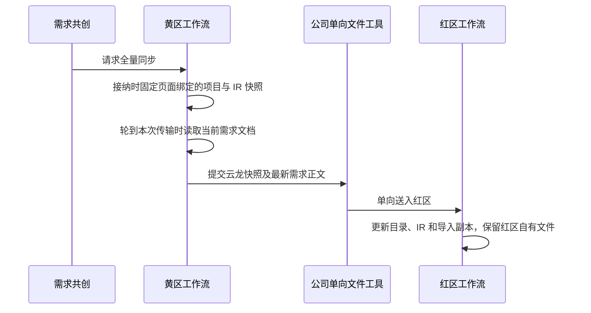
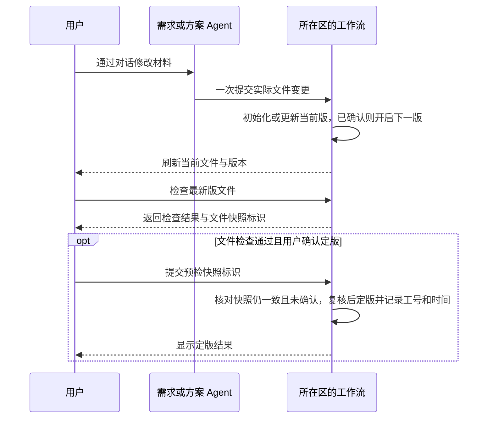
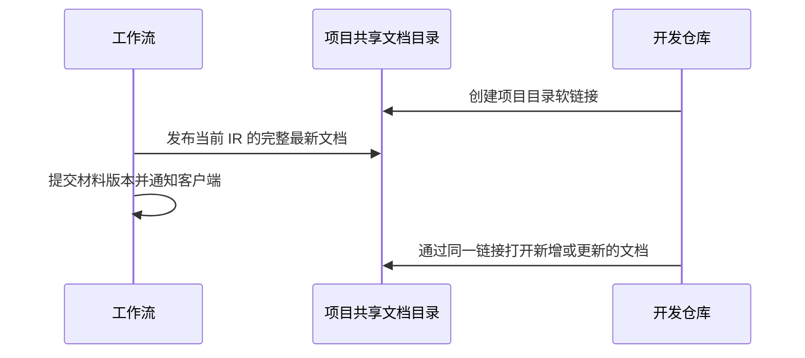

# 需求共创

## 黄区需求澄清与云龙对接

AIReq 分别部署在黄区和红区。业务同学在黄区与需求 Agent 澄清场景和验收标准，再与开发对齐。每个 IR 的正式需求文档由黄区 AIReq 管理。红区接收云龙目录和需求文档，开发和测试在红区结合项目代码和知识库做方案。

云龙维护项目及原始 IR。黄区从账号可访问、名称含「开发」且有项目组 ID 的项目读取全部需求域。以项目组 ID 定位项目、以 IR 业务号关联同一需求。Release 仅从全部 IR 的 `pi` 归组，名称取 `piName`。未分配 PI 的 IR 计入项目总数，没有 IR 的 Release 不展示。项目、Release 和 IR 的增删均在云龙完成。

首次加载或点击「刷新项目」时读取快照。域与条目不一致或项目内 IR 业务号重复时，该项目读取失败。刷新失败保留原快照。成功刷新仅更新云龙目录、标题、描述及业务字段。云龙移除的 IR 不再列出，AIReq 已有的需求正文、版本、讨论与评审继续保留。页面快照与并发读取遵循[公开接口](contract-design.md)。

家庭开发机默认使用可单独运行的离线云龙 CLI。服务端对两种 CLI 执行相同的命令、解析和校验，前端共用同一业务流程。命令行产生的项目数据变更可在平台刷新后读取。启动方式见[开发与产品入口](../../../README.md#开发与产品入口)，命令、返回数据和字段类型见[云龙 CLI 实现参考](../../architecture/clouddragon-cli.md)。

### 黄区到红区的全量同步

在黄区点击「同步到红区（所有项目）」，或由服务端每 5 分钟自动发起。两种方式均传全部项目、IR 字段（含完整原始描述）和各 IR 已保存的最新需求正文。手动同步不受筛选、Release 或分页影响。手动请求固定接纳时的页面目录，执行时读取正文。自动任务读取自己的目录，与手动任务串行，上一轮未完成时不重复排队。

正式部署通过公司的单向文件工具交接。任一项目读取失败或已有需求正文不可读时，整次同步失败。红区按 IR 业务号更新云龙字段和需求导入副本，草稿和已确认正文都能导入。未附正文时保留已有文件。重传保留红区自有项目文档、同名需求文档、SR 拆分、设计、测试方案和定版记录。同步成功只表示交接完成。当前原型在内存中模拟传输。



验收从指定 Release 发起同步，核对所有项目及未分配 Release 的 IR 都进入快照，长描述与需求文档正文完整。让手动请求等待前一轮传输，在等待期间刷新云龙目录并保存文档；核对交接仍使用接纳时的目录，但携带轮到本次传输时的当前文档。重复同步后确认已有红区方案、同名需求文档及快照未附带的文件仍在。

### 云龙字段与页面列

列表和详情读取当前快照的 `businessNo`、`name`、`description` 和业务字段。列表搜索使用清理后的描述，空描述回退到标题。需求空间取该 IR 所属域名称，缺名称时显示域 ID。当前责任人取 `delivererOwner`，提出人、设计、开发、测试责任人依次取 `owner`、`seId`、`de`、`te`。提交人缺失时使用创建人，其他缺值显示「—」。

预估和卷积工作量合为一列，单位为人天。排序先取预估值，缺失时取卷积值。「停留时间」从进入当前进展的时间起算，按初始、分析、开发、测试、完成依次取 `createDate`、`turnAnalysisTime`、`completedAnalysisTime`、`turnTestTime`、`completedDate`。时间无效时显示「—」，列可见时每分钟更新。完整列定义见[需求列表字段](../../../packages/ui/src/aireq/proposals/proposalColumns.ts)，交互见[项目与版本导航](section-navigation.md)。

### IR 详情评论

评论属于云龙 IR，由服务端使用页面快照中该条 IR 的项目组 ID、需求域 ID 和业务号查询、新增或删除。真实模式使用服务端配置的云龙账号执行 CLI，由云龙执行权限校验。模拟模式在服务进程内保存评论变更，供同一项目和 IR 的访问者读取。

用户可提交最多 10,000 字符的非空评论，保留多行正文。只有带评论 ID 的条目提供删除入口，并要求用户确认。写入成功后回读该 IR 的评论。回读失败时保留已获知的结果和重试入口。写入结果、错误和后续回读只归属发起操作的项目和 IR，不得修改其他 IR 的评论、输入或反馈。网络错误或超时后可重新读取评论确认结果，页面不会自动重发写操作。

### 手动将需求文档发到云龙评论

黄区为每个 IR 提供「同步需求文档到云龙评论」按钮。一次点击取该 IR 最新已保存的 `requirements.md` 全文，固定此次发送的正文、版本号和确认状态。草稿也可发送。每条评论标明 IR 业务号、版本号及「草稿」或「已确认」。用户再次主动发送时追加评论，保留之前的评论。文档保存、确认版本、黄区到红区的手动或定时同步都不触发该按钮。

分条标记计入单条评论的长度上限。超长正文优先按段落拆分，单个段落仍超限时继续拆分，依次发送并标明「第几条／共几条」。发送使用同一份已保存正文。部分成功后显示各条发送结果，保留已成功的评论。结果不明时先回读对应 IR 的评论，用户可手动补发剩余部分。没有可读需求正文时说明原因，不提交空评论。

当前原型已提供普通评论的读取、新增和删除。以上专用按钮、文档分条及补发是一期验收要求，当前原型尚未实现。

真实云龙评论由服务端调用 `comment list`、`comment add`、`comment delete`。读取范围和写入回执见[公开接口](contract-design.md)，项目、需求域及评论标识的解析见[服务端云龙适配器](../../../packages/server/src/aireq/clouddragon.ts)。

## 入口与权限

黄区「讨论需求」对所有有效工号开放。红区「讨论方案」面向项目开发和测试，正式后端可通过项目地址和默认分支只读访问代码。各区的版本由项目开发或测试确认，管理员沿用已有全项目角色。当前单进程原型在同一工作台演示两个入口。逐行操作、阅读与会话交互分别见[导航](section-navigation.md)、[右侧文档区](unified-side-pane.md)和[原生会话](conversation.md)。

### IR 详情阅读

详情在桌面视口内分为约 5:1 的两列。左列先显示完整描述，再按云龙评论接口返回顺序显示评论及可用的作者、时间。正文支持 Markdown、纯文本和经过清理的 HTML。左列共用一个滚动区，可在描述与评论之间跳转。右栏用中文业务标签显示已知字段，空值显示「—」；「原始字段」展开快照中的其他门户字段，不重复展示 `description` 或快照内嵌的 `comments`。描述和每条评论都有独立的全屏阅读入口，全屏正文跨越整个视口并可滚动。关闭全屏回到该段正文的操作按钮，保留详情列和正文滚动位置。关闭详情回到打开时的标题或行操作入口，保留列表筛选和滚动位置。

原始字段保留字段名、空值、布尔值、数组和对象。打开时才读取所选 IR，关闭或切换后丢弃旧请求的结果。详情读取失败提供重试。评论加载失败时独立提示并提供重试。

验收覆盖长描述、多条长评论、空评论、复杂字段、键盘打开和逐层关闭。在 1100×700 桌面窗口确认两列和全屏可滚动，查看下一条评论不受上一条长度影响，关闭后原位置和焦点可恢复。延迟 IR A 的评论新增或删除回执，在等待期间打开 IR B；检查 A 的回执、错误和回读不会串到 B，也不会清空 B 的输入。

## 材料与版本

黄区需求 Agent 维护每个 IR 的正式需求文档。业务与开发对齐后，由该项目的开发或测试独立确认需求版本，只固定该 IR 当时的需求正文。

红区做方案时，每个 IR 必须拆成至少一个 SR。方案 Agent 维护各 SR 的提案、设计文档、开发任务、测试方案和规格，以及 IR 的 SR 依赖。该 IR 下全部 SR 的设计文档和测试方案共同构成正式交付，按 IR 即可查齐，无需另写 IR 级设计或测试汇总正文。拆分和红区定版均不影响读取云龙、回写评论或黄区需求定版。

两区分别管理版本。首次写入建立 V1，草稿修改沿用当前版。确认时工作流复核预检快照，固定本次文件并记录确认人的工号和时间。同版文件已改动或他人已确认时须重新检查。无关工作流修订不使快照失效，重复提交同一成功操作返回原回执。确认后的首次文件变化开启下一版，历史快照只读。

列表与文档区默认显示最新版及确认状态；文档区可切换已确认的历史版本并查阅文件正文与确认记录。继续讨论和修改始终作用于最新版本。确认不会结束会话或改变阅读导航。原始描述来自云龙快照，独立于平台保存的文档及其历史。



## 定版检查

| 确认对象 | 服务端检查范围 |
| --- | --- |
| 黄区需求版本 | 该 IR 的 `requirements.md` 必须有可读正文，已配置的必需章节均须有正文。尚无 SR 时也可确认。 |
| 红区方案版本 | 检查该 IR 的需求依据、至少一个 SR、每个 SR 的提案、设计、开发任务、测试方案、规格，以及覆盖全部 SR 的依赖清单。检查各文档的必需章节及正文、依赖 JSON 的结构、依赖项、环路与工期预估。 |

缺失和不合法按路径分别报告，列出具体原因。检查和取消均为只读，失败保留当前未确认版本。定版时复核同一范围。当前原型的[服务端校验](../../../packages/server/src/aireq/document-validation.ts)仍对整套 IR 和 SR 材料一起预检，尚不支持黄区单独定版。

## 在开发仓库中查看最新文档

项目的共享文档目录为 `<工作目录>/docs/areq`。工作流将每个 IR 的最新版发布到 `<工作目录>/docs/areq/<ir-id>/`。IR 文档和依赖清单位于 IR 根目录，SR 材料位于 `<ir-id>/<sr-id>/`，保留 SR 规格子目录。未定版的保存也发布到该目录。已有项目初次配置工作目录时发布当前材料。历史定版仍从工作流快照读取。

每行「更多操作」中的「复制链接命令」根据服务端工作目录生成命令。POSIX 路径使用 Bash 的软链接命令，Windows 盘符路径使用 PowerShell 的目录联接命令。悬停或聚焦时预览，单击复制并播报结果。工作目录未配置时提示到项目配置完成设置。开发者在自己的仓库根目录执行一次，仓库中的 `docs` 目录需存在，开发环境须能访问项目的共享目录。

```sh
ln -s /xxx/yyy/docs/areq ./docs/areq
```

```powershell
New-Item -ItemType Junction -Path '.\docs\areq' -Target 'C:\xxx\yyy\docs\areq' -ErrorAction Stop
```

Windows 后端使用普通目录发布文档。编辑时先在同一磁盘准备完整目录，再切换到新内容。共享路径始终由项目工作目录和 IR 编号确定。创建目录联接及发布文档可在拥有目标目录写权限的普通用户下完成。



## 按需评审

需求 Agent 输入框内提供「评审需求」，方案 Agent 输入框内提供「审查方案」。首次保存材料后即可发起，按钮显示当前最新版号，阅读历史版本时也显示评审目标。当前评审运行中显示进度。点击把固定评审指令交给独立子代理，保留当前输入，工作流使用发起时最新材料快照并把结果关联回当前对话。评审只给意见。报告记录版本与文件快照，材料变化时标记为对应修改前的内容，即使版本号未变。可再次评审最新材料。评审与版本确认分别可用，评审、失败及重试都不改变需求状态。


## 验收

- 在黄区仅保存需求正文，核对未建 SR 也能由项目开发或测试确认，修改后能查阅之前确认的正文。红区拆一个或多个 SR 后，可从 IR 查齐各 SR 的设计和测试方案。
- 在黄区分别手动发送草稿和已确认版本，核对对应 IR 评论保留两次正文、版本和状态。长文分条后能还原全文。中途失败后手动补发，只补剩余部分。单独保存、定版或向红区同步均不新增云龙评论。
- 普通工号可讨论需求和查看材料，未经授权的方案访问和确认请求被拒绝。开发和测试均可独立讨论方案、评审和确认。
- 首次写入为 V1，未确认期间连续修改仍为 V1。确认记录保留完整文件、实际确认人和时间；后续首次变化生成 V2，V1 仍可读。
- 预检后同一版本的文件变化，或另一人先确认并开启下一版，原弹窗均不能定版；重新检查后才可确认当前快照。复核按最新文档格式规则执行，失败不写入文件或确认记录。
- 评审不改文件或版本。评审之后的同版本内容变化使报告指向修改前的内容。切换项目、需求和 Agent 时保持来源隔离。
- 测试覆盖桌面列表操作、点击后文档侧栏、默认展开及手动收起、深浅主题和上一确认版本阅读。
- 验收同项目每行复制的链接命令一致。在自己的克隆中执行一次后，验证新纳入云龙快照的需求及未定版的文档更新可通过原链接读取。
- 在云龙录入、变更或删除 IR 后刷新项目，核对列表和统计按新快照更新；已有需求的本地材料、版本及会话不被云龙字段覆盖，目录移除不删除本地记录。
- 读取包含多个需求域的项目，核对各域 IR 均进入列表和统计、每条 IR 的「需求空间」取自身域名称（缺名称时取域 ID），评论读取和写入也使用自身域。分别返回域与条目不一致、同项目 IR 业务号重复的数据，核对该项目读取失败，显式刷新不替换已有快照。
- 详情快照同时含有 `description`、`comments` 和其他业务字段时，确认完整描述只在独立描述区出现，评论来自评论接口，原始字段不重复显示这两项。
