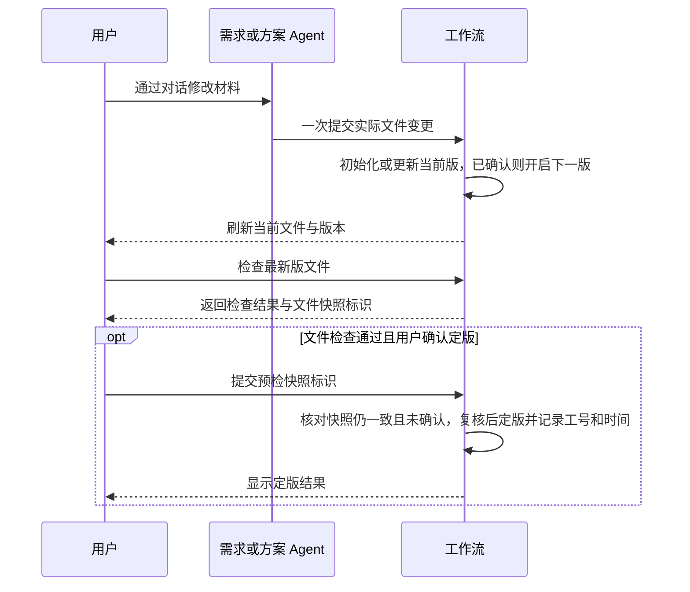
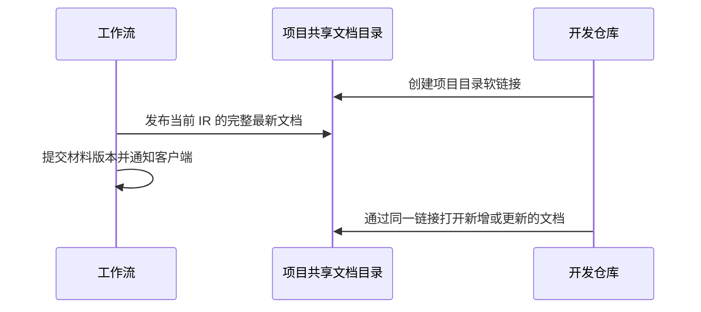

# 需求共创

## 入口与权限

IR 从创建起归属唯一项目与 Release，保留原始短需求、提交人和时间。需求共创表格每行提供「讨论需求」「讨论方案」「查看文档」和「复制软链接命令」。前两个入口分别打开需求 Agent 和方案 Agent 的会话。所有人可进入需求 Agent 和查看文档。项目工作目录准备好后即可复制软链接命令。项目开发或测试可进入方案 Agent、修改方案及确认版本。管理员沿用已有全项目角色。项目地址和默认分支供正式后端只读访问项目代码。

「查看文档」保留列表位置，在右侧展开对应需求。进入任一 Agent 对话时，默认打开右侧文档区。用户可收起或重新打开；当前对话中的消息和材料更新保持面板开合。两个会话各保有自己的历史、草稿消息与附件。原生会话按当前项目、IR 和角色路由。

## 材料与版本

需求 Agent 维护业务需求文档。方案 Agent 维护各 SR 的提案、技术方案、任务、测试方案与规格，以及 IR 的 SR 依赖。材料路径以平台内对象为根；交付、评审和版本确认均读取平台材料。

没有文件时显示「暂无文档」。首次保存文件时建立 V1。未确认期间，新增、编辑及删除文件都更新同一版本。开发或测试点击「确认版本」时，工作流检查最新版文件并返回文件快照标识。用户在弹窗点击「确认定版」时提交该标识；工作流只接受仍未确认且与预检相同的版本和文件，按当前规则复核后一次性固定全部文件，记录实际确认人的工号和时间。内容不同（包括同版编辑）或已被他人确认时拒绝，不定版其他快照；用户可重新检查尚未确认的最新版。无关的工作流修订不影响定版。已成功的同一操作重试返回原回执。确认后的首次实际文件变更创建下一未确认版本，无文件变化的对话和评审不生成版本。确认版本只读，由工作流保存独立快照。

列表与文档区默认显示最新版及确认状态；文档区可切换已确认的历史版本并查阅文件正文与确认记录。继续讨论和修改始终作用于最新版本。确认不会结束会话或改变阅读导航。原始短需求独立保留，文档和历史均保存在平台中。



## 定版检查

服务端检查 IR 的业务需求文档、至少一个 SR、每个 SR 的提案、技术方案、开发任务、测试方案、规格，以及覆盖全部 SR 的依赖清单。按平台文档路径查找文件，校验可读正文、文档格式设置的必需章节与正文，以及依赖 JSON 的结构、依赖项、环路与工期预估。缺失和不合法按路径分别报告，列出具体原因。检查和取消均为只读，失败保留当前未确认版本。定版使用同一校验，校验失败时返回报告。

## 在开发仓库中查看最新文档

项目的共享文档目录为 `<工作目录>/docs/areq`。工作流将每个 IR 的最新版发布到 `<工作目录>/docs/areq/<ir-id>/`。IR 文档和依赖清单位于 IR 根目录，SR 材料位于 `<ir-id>/<sr-id>/`，保留 SR 规格子目录。未定版的保存也发布到该目录。已有项目初次配置工作目录时发布当前材料。历史定版仍从工作流快照读取。

「查看文档」旁的复制按钮按项目生成同一条 POSIX 命令。悬停或聚焦时预览，单击复制并播报结果。工作目录未配置时提示到项目配置完成设置。开发者在自己的仓库根目录执行一次，仓库中的 `docs` 目录需存在，开发环境须能访问项目的共享目录。

```sh
ln -s /xxx/yyy/docs/areq ./docs/areq
```



## 按需评审

需求 Agent 输入框内提供「评审需求」，方案 Agent 输入框内提供「审查方案」。首次保存材料后即可发起，按钮显示当前最新版号，阅读历史版本时也显示评审目标。当前评审运行中显示进度。点击把固定评审指令交给独立子代理，保留当前输入，工作流使用发起时最新材料快照并把结果关联回当前对话。评审只给意见。报告记录版本与文件快照，材料变化时标记为对应修改前的内容，即使版本号未变。可再次评审最新材料。评审与版本确认分别可用，评审、失败及重试都不改变需求状态。

## 需求录入与查阅

需求共创页头提供「新建需求」。用户选择所属 Release 并保存短需求，表单草稿归前端，创建由工作流通过 `createProposal` 完成。想法通过想法池转入目标 Release，保留原文。

需求在列表和右侧文档区内查阅。尚未确认过版本的需求可经确认移除，已有确认记录的需求保留材料与历史，并隐藏移除入口。

## 验收

- 普通工号可讨论需求和查看材料，未经授权的方案访问和确认请求被拒绝。开发和测试均可独立讨论方案、评审和确认。
- 首次写入为 V1，未确认期间连续修改仍为 V1。确认记录保留完整文件、实际确认人和时间；后续首次变化生成 V2，V1 仍可读。
- 预检后同一版本的文件变化，或另一人先确认并开启下一版，原弹窗均不能定版；重新检查后才可确认当前快照。复核按最新文档格式规则执行，失败不写入文件或确认记录。
- 评审不改文件或版本。评审之后的同版本内容变化使报告指向修改前的内容。切换项目、需求和 Agent 时保持来源隔离。
- 测试覆盖桌面列表操作、点击后文档侧栏、默认展开及手动收起、深浅主题和上一确认版本阅读。
- 验收同项目每行复制的链接命令一致。在自己的克隆中执行一次后，验证新增需求及未定版的文档更新可通过原链接读取。
- 桌面验收检查页头仅提供「新建需求」，可在所选 Release 保存短需求并回到列表。想法池仍可通过 CSV 录入，并能将想法转入版本。
