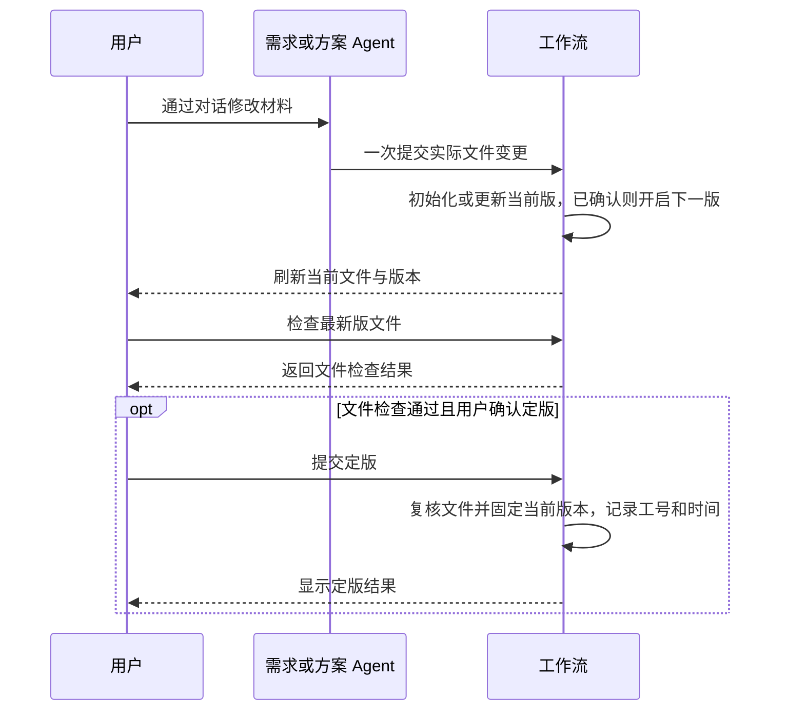
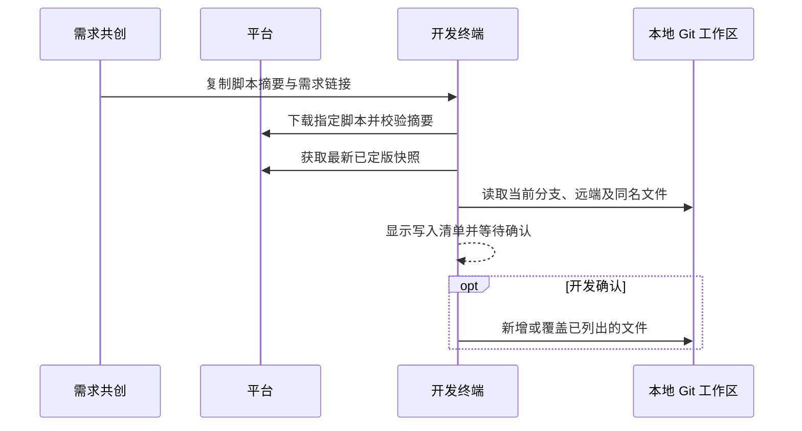

# 需求共创

## 入口与权限

IR 从创建起归属唯一项目与 Release，保留原始短需求、提交人和时间。需求共创表格每行提供「需求 Agent」「方案 Agent」「查看文档」和「复制同步命令」。所有人可进入需求 Agent 和查看文档。有已定版文档时可复制同步命令。项目开发或测试可进入方案 Agent、修改方案及确认版本。管理员沿用已有全项目角色。项目地址和默认分支供正式后端只读访问项目代码。

「查看文档」保留列表位置，在右侧展开对应需求。进入任一 Agent 对话时，默认打开右侧文档区。用户可收起或重新打开；当前对话中的消息和材料更新保持面板开合。两个会话各保有自己的历史、草稿消息与附件。原生会话按当前项目、IR 和角色路由。

## 材料与版本

需求 Agent 维护业务需求文档。方案 Agent 维护各 SR 的提案、技术方案、任务、测试方案与规格，以及 IR 的 SR 依赖。材料路径以平台内对象为根；交付、评审和版本确认均读取平台材料。

没有文件时显示「暂无文档」。首次保存文件时建立 V1。V1 未确认期间，新增、编辑及删除文件都更新同一版本。开发或测试任一人点击「确认版本」时，工作流先检查最新版的文件。检查通过后，用户在弹窗点击「确认定版」，工作流复核并一次性固定全部文件，保留版本号，记录确认人工号和时间。确认后发生首次实际文件变更才创建下一未确认版本，后续变更继续更新它。没有改变文件的聊天及评审不生成版本。确认版本只读，由工作流保存独立快照。

列表与文档区默认显示最新版及确认状态；文档区可切换已确认的历史版本并查阅文件正文与确认记录。继续讨论和修改始终作用于最新版本。确认不会结束会话或改变阅读导航。原始短需求独立保留，文档和历史均保存在平台中。

## 定版检查

服务端检查 IR 的业务需求文档、至少一个 SR、每个 SR 的提案、技术方案、开发任务、测试方案、规格，以及覆盖全部 SR 的依赖清单。按平台文档路径查找文件，校验可读正文、文档格式设置的必需章节与正文，以及依赖 JSON 的结构、依赖项、环路与工期预估。缺失和不合法按路径分别报告，列出具体原因。检查和取消均为只读，失败保留当前未确认版本。定版使用同一校验，校验失败时返回报告。

## 同步已定版文档到本地分支

「查看文档」旁的复制图标悬停或键盘聚焦时显示当前可同步的已定版版本、执行时取最新已定版的说明和完整命令。单击或按空格复制与预览一致的命令，复制结果通过状态消息播报，按 Esc 关闭预览。按钮的无障碍描述仅包含版本说明或禁用原因。验收时检查最新版本未确认、已有历史定版的情形，预览显示当前可同步的历史版本。暂无已定版文档时禁用并提示原因。

命令使用 Python 3.10 或以上的标准库和本机 Git。开发在 Bash 或 PowerShell 中粘贴执行，系统仅提供 `python3` 命令时使用 `python3` 启动。平台在复制时固定脚本 SHA-256，用需求直达链接传递 `aireqProject`、`aireqRelease` 和 `aireqIr`。命令下载脚本到临时目录并校验摘要后执行。脚本更新且旧摘要不可获取时，提示重新复制命令。

脚本在执行时下载整套最新已定版快照。V1 已确认、V2 未确认时同步 V1，V2 定版后再执行则同步 V2。运行目录可以是仓库的子目录，文件以 Git 工作树根目录为基准。脚本检查当前分支、仓库远端与项目地址、文件 SHA-256 及相对路径。它列出分支、版本及所有新增和覆盖路径，等待一次确认，默认取消。确认后按快照原路径写入，含已有本地修改的同名文件。保留包外文件和相同内容的文件。仓库提交与推送沿用开发日常流程。

平台只提供下载。部署设置访问令牌时，在终端输入令牌或设置 `AIREQ_SYNC_TOKEN`，由文档下载请求的 Bearer 头传递。

## 按需评审

需求 Agent 输入框内提供「评审需求」，方案 Agent 输入框内提供「审查方案」。首次保存材料后即可发起，当前评审运行中显示进度。点击把固定评审指令交给独立子代理，保留当前输入，工作流使用发起时最新材料快照并把结果关联回当前对话。评审只给意见。报告记录版本与文件快照，材料变化时标记为对应修改前的内容，即使版本号未变。可再次评审最新材料。评审与版本确认分别可用，评审、失败及重试都不改变需求状态。

## 需求录入与查阅

需求共创页头提供「新建需求」。用户选择所属 Release 并保存短需求，表单草稿归前端，创建由工作流通过 `createProposal` 完成。想法通过想法池转入目标 Release，保留原文。

需求在列表和右侧文档区内查阅。尚未确认过版本的需求可经确认移除，已有确认记录的需求保留材料与历史，并隐藏移除入口。

## 验收

- 普通工号可讨论需求和查看材料，未经授权的方案访问和确认请求被拒绝。开发和测试均可独立讨论方案、评审和确认。
- 首次写入为 V1，未确认期间连续修改仍为 V1。确认记录保留完整文件、实际确认人和时间；后续首次变化生成 V2，V1 仍可读。
- 评审不改文件或版本。评审之后的同版本内容变化使报告指向修改前的内容。切换项目、需求和 Agent 时保持来源隔离。
- 测试覆盖桌面列表操作、点击后文档侧栏、默认展开及手动收起、深浅主题和上一确认版本阅读。
- 验收复制命令与悬停内容一致、无定版时禁用、历史定版回退、取消无写入及确认覆盖。
- 桌面验收检查页头仅提供「新建需求」，可在所选 Release 保存短需求并回到列表。想法池仍可通过 CSV 录入，并能将想法转入版本。
