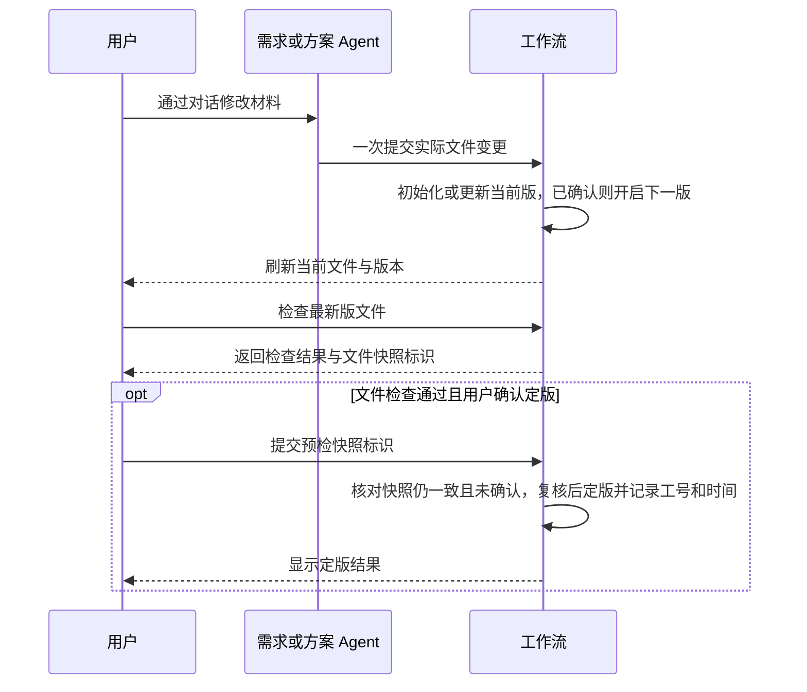
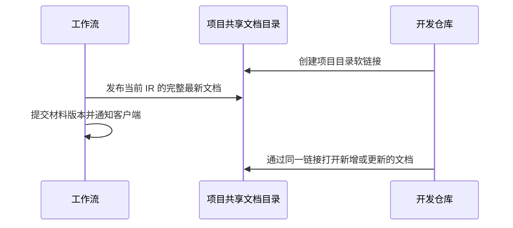

# 需求共创

## 黄区需求澄清与云龙对接

黄区负责需求澄清和讨论。方案设计在内网进行。云龙持有项目和 IR 的业务记录。AIReq 从 `clouddragon projects` 读取当前账号可访问的项目，只显示名称包含「开发」的项目。每个项目对应一个需求域。进入项目时，服务端先用 `clouddragon domains` 取得该域的 ID，再用 `clouddragon irs` 分页读取对应的 IR。按 IR 的 `pi` 汇总项目内的 Release，并以 `piName` 显示名称。讨论和需求文档由 AIReq 工作流管理。澄清结束后，用户可以将当前最新需求文档的正文作为一条评论同步到对应 IR。

原型服务直接执行 `clouddragon` 读取项目及 IR 列表。「所有项目」和「项目配置」使用同一份项目目录。设置页只从云龙同步项目名，仓库地址、默认分支和工作目录由 AIReq 按项目 ID 保存。同步文档时使用 `comment-add`。读取失败应显示错误，空列表只表示云龙确实返回空结果。使用真实的云龙数据验收，不使用预置项目、IR 或评论补齐结果。

### 云龙命令

```sh
# 列出当前账号可访问的项目
clouddragon projects

# 读取所选项目的唯一需求域
clouddragon --project gexample0001 domains

# 按项目组 ID 和需求域 ID 读取 IR
clouddragon --project gexample0001 irs --domain 900001

# 按业务号查看 IR，省略 --domain 时跨所有域查找
clouddragon ir IR202401001 --domain "示例需求域"

# 查看、新增和删除评论
clouddragon comments IR202401001
clouddragon comment-add IR202401001 --content "看起来不错"
clouddragon comment-delete IR202401001 --comment-id '<uuid>'

# 修改进展，可选初始、分析、开发、测试、完成
clouddragon status IR202401001 --process 完成

# 创建 IR
clouddragon create --domain "示例需求域" --name "新需求" \
  --priority 高 --expected-date 2026-12-31
```

`projects` 返回的项目 `id` 即 `group_id`，用于子命令前的 `--project`。AIReq 取 `domains` 返回的唯一一条记录的 `id` 作为 `irs --domain` 的值。需求域返回零条或多条时，页面报读取错误。

### `irs` 分页

| 参数            | 类型           | 默认行为           | 含义                               |
| --------------- | -------------- | ------------------ | ---------------------------------- |
| `--page NO`     | 大于等于 1 的整数 | 省略时自动取完各页 | 指定时只取第 `NO` 页，页码从 1 开始 |
| `--page-size N` | 大于等于 1 的整数 | `200`              | 每次请求的页大小，适用于两种模式   |

```sh
# 自动翻页，每次请求 200 条
clouddragon --project gexample0001 irs --domain 900001

# 只取第 2 页，页大小为 50
clouddragon --project gexample0001 irs --domain 900001 --page 2 --page-size 50
```

### CLI 输出契约

| 结果 | 输出流 | 退出码 | JSON 结构 |
| ---- | ------ | ------ | --------- |
| 成功 | stdout | `0` | `{"ok": true, "data": …}` |
| 失败 | stderr | `1` | `{"ok": false, "error": {"type": "AuthenticationError", "message": "示例错误信息"}}` |

成功响应的 `data` 字段随子命令变化，使用 `clouddragon <command> --help` 查看。失败响应的 `error.type` 和 `error.message` 均为字符串，表中以鉴权错误为例。

### `projects` 成功响应

以下示例已匿名化，数组缩为三条。

```json
{
  "ok": true,
  "data": {
    "project": "gexample0001",
    "count": 3,
    "projects": [
      {
        "id": "gexample0001",
        "name": "示例开发项目甲",
        "group_id": "gexample0001",
        "project_id": "pexample0001",
        "current": true
      },
      {
        "id": "gexample0002",
        "name": "示例开发项目乙",
        "group_id": "gexample0002",
        "project_id": "pexample0002",
        "current": false
      },
      {
        "id": "gexample0003",
        "name": "示例验收项目",
        "group_id": "gexample0003",
        "project_id": "pexample0003",
        "current": false
      }
    ]
  }
}
```

- `data.project` 是当前项目的组 ID，`current` 标识当前项目。样本中的 `data.count` 等于 `data.projects` 的长度。
- AIReq 以每条记录的 `id` 作为项目 ID，并将其传入 `--project`。`project_id` 是返回中的另一个标识字段。
- 从 `name` 读取显示名并按是否包含「开发」筛选。示例中的前两条符合此条件。

### `domains` 成功响应

以下是实测 JSON 响应的匿名示例，保留字段名、层级、值类型和样本中的 `null`。

```json
{
  "ok": true,
  "data": {
    "project": "gexample0001",
    "count": 1,
    "domains": [
      {
        "isFusionDomain": "false",
        "unticket2DefectOwner": null,
        "vulnDefaultOwner": null,
        "id": "900001",
        "groupId": "gexample0001",
        "groupName": "示例开发项目甲",
        "offeringPbi": "EXAMPLE0001",
        "offeringName": "示例产品",
        "name": null,
        "domainid": "900001",
        "creator": "x00000001",
        "domainType": "示例域类型",
        "productName": null,
        "productPbi": null,
        "authorityType": null,
        "domainSource": "",
        "picName": null,
        "picId": null,
        "picVersion": null,
        "sourceSystem": null,
        "domain": "900001",
        "owner": null,
        "expectDownOwner": null,
        "modeType": null,
        "modeDesc": "示例模式说明",
        "modeName": "示例协作模式",
        "createTime": "2000-01-01 00:00:00",
        "needAcrossWorkspace": false,
        "description": null,
        "safety": null,
        "aggregateBy": null,
        "followId": null,
        "followDate": null,
        "rrDownOwner": "x00000001",
        "moveToEdevops": false,
        "convDts": null,
        "convTc": null,
        "isMigrate": null,
        "checkMaxSizeFlag": null,
        "associatePicFlag": null,
        "picNodeType": null
      }
    ]
  }
}
```

- `data.project` 与需求域的 `groupId` 都是所查询项目的组 ID。`data.domains` 包含该项目的唯一需求域，`count` 为 `1`。
- 样本中 `id`、`domainid` 和 `domain` 是值相同的数字字符串，`name` 为 `null`。`irs --domain` 可传需求域 ID 或名称。项目显示名来自 `projects` 的 `name`。
- `isFusionDomain` 是字符串，`needAcrossWorkspace` 和 `moveToEdevops` 是 JSON 布尔值。`sourceSystem` 在样本中有字符串和 `null` 两种取值。`createTime` 的格式为 `YYYY-MM-DD HH:mm:ss`。

### `irs` 单页成功响应

以下是指定 `--page` 时返回的 JSON 结构。示例替换了业务数据和分页数值，保留一条需求域记录、一条 IR 和一条自定义属性。

```sh
clouddragon --project gexample0001 irs --domain 900001 --page 3 --page-size 7
```

```json
{
  "ok": true,
  "data": {
    "project": "gexample0001",
    "domains": [
      {
        "id": "900001",
        "name": "示例需求域",
        "page": 3,
        "page_size": 7,
        "total": 15,
        "count": 1,
        "irs": [
          {
            "correspondingCategory": "",
            "isRelatedArc": "",
            "isRelatedDoc": "",
            "iteration": "",
            "featureValue": "",
            "implTracingState": "",
            "pmsNetworkSecurityIdentity": "",
            "isRelatedMicroService": "",
            "upstreamreqchangeflag": "",
            "id": "9000000101",
            "mksId": "9000000101",
            "pmsId": "",
            "type": "",
            "subType": "示例需求子类型",
            "name": "示例需求标题",
            "tag": "",
            "pmsRRNumber": "",
            "relatedOwner": "",
            "sendSystem": "",
            "sourceSystemLink": "",
            "process2upstream": "",
            "businessNo": "IR20990101000001",
            "creator": "示例创建人",
            "createDate": "2000-01-01 09:00:00",
            "demandSource": "",
            "priorityLevel": "示例优先级",
            "bugId": "",
            "microServiceId": "",
            "microServiceName": "",
            "serviceId": "",
            "serviceName": "",
            "board": "",
            "netype": "",
            "seId": "",
            "de": "",
            "te": "",
            "estimatedWorkloadManday": "",
            "sumWorkloadManday": "",
            "expectedImplementationDate": "2000-02-01 00:00:00",
            "category": "",
            "process": "示例进展",
            "developEndTime": "",
            "testingEndTime": "",
            "parentId": "",
            "parentMKSId": "",
            "submitter": "示例提交人",
            "modifiedBy": "示例修改人",
            "modifiedDate": "2000-01-02 09:00:00",
            "delivererOwner": "示例交付负责人",
            "owner": "示例负责人",
            "health_degree": "示例健康度",
            "baseline": "",
            "noBreakReason": "",
            "noDevelopReason": "",
            "status": "",
            "description": "这是一段用于说明响应结构的示例需求描述。",
            "dependedBy": "",
            "pmsWorkloadKloc": "",
            "source_system": "example-system",
            "offeringRelease": "",
            "deliver_status_to": "",
            "needBreak": "",
            "needDevelop": "",
            "completedDate": "",
            "turn_analysis_time": "",
            "completed_analysis_time": "",
            "turn_test_time": "",
            "ir2feature": "",
            "deliverStatusTo": "",
            "domain": "900001",
            "domainName": "示例需求域",
            "iterateId": "",
            "iterateName": "",
            "pi": "9000010001",
            "piName": "2099.Q4",
            "isDecompose": false,
            "decomposes_to": "",
            "customProps": [
              {
                "name": "示例属性",
                "value": "示例属性值"
              }
            ],
            "labels": [],
            "items": [],
            "safetyAnalyze": "",
            "crid": "",
            "successors": "",
            "targetCustomer": "",
            "businessCode": "",
            "pmsStatus": "",
            "pmsPI": "",
            "trustCategory": "",
            "verificationPolicy": "",
            "verificationPolicyDesc": "",
            "rmChangeFlag": "",
            "decomposed_from": "",
            "sumWorkloadKloc": "",
            "realWorkloadKloc": "",
            "realWorkloadManday": "",
            "requirement2task": "9",
            "collaborationAmount": {}
          }
        ]
      }
    ]
  }
}
```

- `data.domains` 按需求域分组，每组的 `id` 和 `name` 分别是需求域 ID 和名称。样本中，IR 的 `domain` 和 `domainName` 与所在组的 `id` 和 `name` 对应。
- `page` 和 `page_size` 是当前页码和页大小。`total` 是该域的 IR 总数，`count` 是该页返回的条数，与 `irs` 数组长度一致。分页字段均为整数。
- `businessNo` 是 IR 业务号。`id` 和 `mksId` 在样本中为值相同的字符串。`customProps` 的元素包含字符串 `name` 和 `value`。样本中的 `labels`、`items` 为空数组，`collaborationAmount` 为空对象。
- `pi` 是 Release ID，`piName` 是 Release 名称。两者均为字符串。相同项目中 `pi` 相同的 IR 归入同一个 Release。未分配 `pi` 的 IR 可从「全部需求」查看。
- 本样本展示单页模式。自动翻页模式的响应字段以对应命令输出为准。

## 入口与权限

AIReq 按云龙项目展示 IR，保留原始需求、提交人和时间。需求共创表格每行提供「讨论需求」「讨论方案」「查看文档」和「复制链接命令」。前两个入口分别打开需求 Agent 和方案 Agent 的会话。所有人可进入需求 Agent 和查看文档。项目配置了工作目录即可复制链接命令。项目开发或测试可进入方案 Agent、修改方案及确认版本。管理员沿用已有全项目角色。项目地址和默认分支供正式后端只读访问项目代码。

「查看文档」保留列表位置，在右侧展开对应需求。进入任一 Agent 对话时，默认打开右侧文档区。用户可收起或重新打开；当前对话中的消息和材料更新保持面板开合。两个会话各保有自己的历史、草稿消息与附件。原生会话按当前项目、IR 和角色路由。

## 材料与版本

需求 Agent 维护业务需求文档。方案 Agent 维护各 SR 的提案、技术方案、任务、测试方案与规格，以及 IR 的 SR 依赖。材料路径以平台内对象为根；交付、评审和版本确认均读取平台材料。

没有文件时显示「暂无文档」。首次保存文件时建立 V1。未确认期间，新增、编辑及删除文件都更新同一版本。开发或测试点击「确认版本」时，工作流检查最新版文件并返回文件快照标识。用户在弹窗点击「确认定版」时提交该标识；工作流只接受仍未确认且与预检相同的版本和文件，按当前规则复核后一次性固定全部文件，记录实际确认人的工号和时间。内容不同（包括同版编辑）或已被他人确认时拒绝，不定版其他快照；用户可重新检查尚未确认的最新版。无关的工作流修订不影响定版。已成功的同一操作重试返回原回执。确认后的首次实际文件变更创建下一未确认版本，无文件变化的对话和评审不生成版本。确认版本只读，由工作流保存独立快照。

列表与文档区默认显示最新版及确认状态；文档区可切换已确认的历史版本并查阅文件正文与确认记录。继续讨论和修改始终作用于最新版本。确认不会结束会话或改变阅读导航。原始短需求独立保留，文档和历史均保存在平台中。



## 定版检查

服务端检查 IR 的业务需求文档、至少一个 SR、每个 SR 的提案、技术方案、开发任务、测试方案、规格，以及覆盖全部 SR 的依赖清单。按平台文档路径查找文件，校验可读正文、文档格式设置的必需章节与正文，以及依赖 JSON 的结构、依赖项、环路与工期预估。缺失和不合法按路径分别报告，列出具体原因。检查和取消均为只读，失败保留当前未确认版本。定版使用同一校验，校验失败时返回报告。

## 在开发仓库中查看最新文档

项目的共享文档目录为 `<工作目录>/docs/areq`。工作流将每个 IR 的最新版发布到 `<工作目录>/docs/areq/<ir-id>/`。IR 文档和依赖清单位于 IR 根目录，SR 材料位于 `<ir-id>/<sr-id>/`，保留 SR 规格子目录。未定版的保存也发布到该目录。已有项目初次配置工作目录时发布当前材料。历史定版仍从工作流快照读取。

「查看文档」旁的复制按钮根据服务端工作目录生成链接命令。POSIX 路径使用 Bash 的软链接命令，Windows 盘符路径使用 PowerShell 的目录联接命令。悬停或聚焦时预览，单击复制并播报结果。工作目录未配置时提示到项目配置完成设置。开发者在自己的仓库根目录执行一次，仓库中的 `docs` 目录需存在，开发环境须能访问项目的共享目录。

```sh
ln -s /xxx/yyy/docs/areq ./docs/areq
```

```powershell
New-Item -ItemType Junction -Path '.\docs\areq' -Target 'C:\xxx\yyy\docs\areq' -ErrorAction Stop
```

Windows 后端使用普通目录发布文档。编辑时先在同一磁盘准备完整目录，再切换到新内容。共享路径始终由项目工作目录和 IR 编号确定。创建目录联接及发布文档可在拥有目标目录写权限的普通用户下完成。



## 按需评审

需求 Agent 输入框内提供「评审需求」，方案 Agent 输入框内提供「审查方案」。首次保存材料后即可发起，按钮显示当前最新版号，阅读历史版本时也显示评审目标。当前评审运行中显示进度。点击把固定评审指令交给独立子代理，保留当前输入，工作流使用发起时最新材料快照并把结果关联回当前对话。评审只给意见。报告记录版本与文件快照，材料变化时标记为对应修改前的内容，即使版本号未变。可再次评审最新材料。评审与版本确认分别可用，评审、失败及重试都不改变需求状态。

## 需求录入与查阅

需求共创页头提供「新建需求」。用户选择所属 Release 并保存短需求，表单草稿归前端，创建由工作流通过 `createProposal` 完成。

需求在列表和右侧文档区内查阅。尚未确认过版本的需求可经确认移除，已有确认记录的需求保留材料与历史，并隐藏移除入口。

## 验收

- 普通工号可讨论需求和查看材料，未经授权的方案访问和确认请求被拒绝。开发和测试均可独立讨论方案、评审和确认。
- 首次写入为 V1，未确认期间连续修改仍为 V1。确认记录保留完整文件、实际确认人和时间；后续首次变化生成 V2，V1 仍可读。
- 预检后同一版本的文件变化，或另一人先确认并开启下一版，原弹窗均不能定版；重新检查后才可确认当前快照。复核按最新文档格式规则执行，失败不写入文件或确认记录。
- 评审不改文件或版本。评审之后的同版本内容变化使报告指向修改前的内容。切换项目、需求和 Agent 时保持来源隔离。
- 测试覆盖桌面列表操作、点击后文档侧栏、默认展开及手动收起、深浅主题和上一确认版本阅读。
- 验收同项目每行复制的链接命令一致。在自己的克隆中执行一次后，验证新增需求及未定版的文档更新可通过原链接读取。
- 桌面验收检查页头仅提供「新建需求」，可在所选 Release 保存短需求并回到列表。
