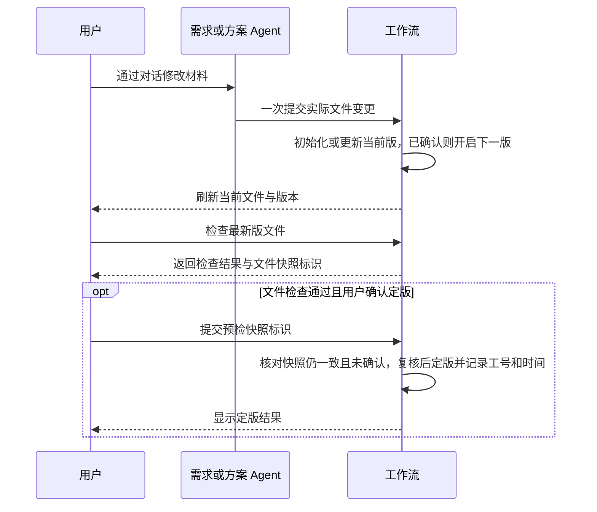
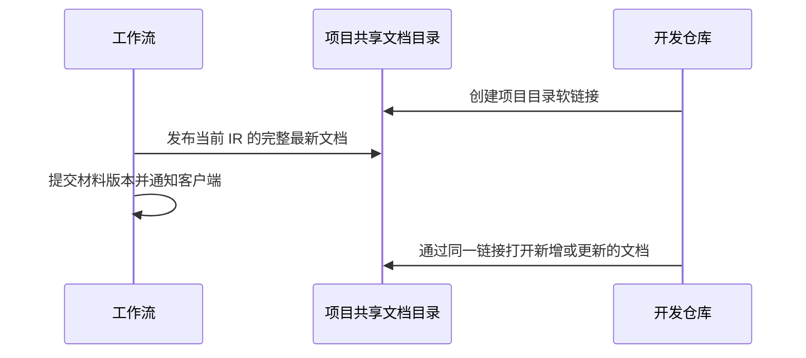

# 需求共创

## 黄区需求澄清与云龙对接

黄区负责需求澄清和讨论。方案设计在内网进行。云龙保存项目和 IR 的业务记录，AIReq 工作流管理讨论和需求文档。澄清结束后，可用云龙 CLI 将最新需求文档正文作为评论同步到对应 IR。

AIReq 读取当前账号可访问、名称包含「开发」且有项目组 ID 的项目。当前接入的项目各有一个需求域。连接初始化先读取项目目录并返回项目工作区。首页并行读取各项目的全部 IR，按 `pi` 汇总 Release 和需求统计，以 `piName` 显示 Release 名称。「所有项目」和「项目配置」使用同一份项目目录。项目名由云龙数据源提供，仓库地址、默认分支和工作目录由 AIReq 按项目 ID 保存。读取失败时显示错误，空列表表示数据源确实返回空结果。

`bun run dev` 默认由服务端提供本地云龙样例，无需内网、CLI 或凭据。使用示例工号 `a00000001` 登录后，可以查看项目、Release、已完成的 IR 和未分配 Release 的 IR，并打开需求讨论。

`bun run dev --use-clouddragon` 使用真实 CLI，直接启动服务端也默认使用真实 CLI。服务端通过 `project list --name 开发` 读取项目，通过 `ir list --all` 读取全部 IR。请将支持这些命令的新版 CLI 安装到服务端运行账号的 `PATH`。真实模式下，安装、鉴权和读取错误都沿业务读取路径显示。见[服务端云龙适配器](../../../packages/server/src/aireq/clouddragon.ts)。

### 安装与登录

`clouddragon-cli` 需要 Python 3.10 或更高版本，以及可访问云龙门户和企业 SSO 的内网环境。安装会自动获取运行时依赖 `httpx`。在 CLI 源码目录运行以下命令。

```bash
pip install .
clouddragon --help
```

也可在 CLI 源码目录的上一级运行 `python -m clouddragon_cli --help`。

| 必填环境变量 | 含义         |
| ------------ | ------------ |
| `w3Account`  | 云龙登录账号 |
| `password`   | 云龙登录密码 |

CLI 从环境变量读取凭据。启动 AIReq 服务时设置这两个变量，CLI 子进程会继承它们。手工运行时可交互输入，避免将密码写入命令历史。

```bash
read -r -p '云龙账号：' w3Account
read -r -s -p '云龙密码：' password
printf '\n'
export w3Account password
clouddragon project list --name 开发
```

```powershell
$env:w3Account = Read-Host '云龙账号'
$env:password = [System.Net.NetworkCredential]::new('', (Read-Host '云龙密码' -AsSecureString)).Password
clouddragon project list --name 开发
```

CLI 使用内置默认项目和 API 入口，HTTP 请求默认超时 20 秒。登录成功后，门户下发的 `prod_cftk` 会话 cookie 按账号缓存在 `~/.clouddragon/session.json`。后续命令复用缓存，会话失效时自动重新登录一次。CLI 当前使用 `verify=False` 关闭 TLS 证书校验，真实凭据应在可信内网使用。门户改版或企业 SSO 策略变化时，可能需要调整 CLI 的 `client.py`。

### 查项目和需求域

命令格式为 `clouddragon <资源> <动作>`。运行 `clouddragon --help` 查看资源，或用 `clouddragon ir list --help` 查看参数及输出。以下命令使用示例项目组 ID、需求域和 IR 业务号。

```bash
clouddragon project list --name 开发
clouddragon domain list --project gexample0001
```

- `project list` 在 `data.items` 返回当前账号可访问的项目。`--name` 按项目名做大小写不敏感的包含匹配。项目项的 `id` 是 `--project` 所需的项目组 ID，`current` 表示本次选中的项目。
- `domain list` 在 `data.items` 返回所选项目的需求域。`--domain` 接受需求域的 `id` 或名称。
- 项目或需求域缺少可用标识时，该项的 `id` 为 `null`。

### 全局选项

| 选项 | 含义 |
| ---- | ---- |
| `--project VALUE` | 选择项目，省略时使用内置默认项目。接受项目组 ID 或 URL，显式传入空值会报错。URL 路径须包含完整的字母数字项目 ID，例如 `/project/g123`。 |
| `--timeout SECONDS` | 覆盖本次 HTTP 请求超时，默认 20 秒。 |
| `--compact` | 输出单行 JSON。 |
| `--debug` | 执行失败时向 stderr 额外输出 Python traceback。 |
| `--version` | 使用 `clouddragon --version` 查看版本。 |

`--project`、`--timeout`、`--compact` 和 `--debug` 可放在资源前、资源和动作之间，或动作之后。同一选项重复传入时，最后一次生效。

### 查 IR

```bash
# 取项目内全部 IR
clouddragon --project gexample0001 ir list --all

# 只取指定需求域中处于测试阶段的 IR 的第 2 页
clouddragon ir list --project gexample0001 --domain 900001 --process 测试 --page 2 --page-size 50

# 从列表的 data.domains[].items[].businessNo 取业务号，再查详情
clouddragon ir show IR20990101000001 --project gexample0001 --domain 900001
```

`ir list` 默认取每个选中需求域的第一页，每页 200 条。`--domain` 可重复，省略时查询项目内所有需求域。`--page` 和 `--page-size` 接受从 1 开始的整数。`--all` 自动翻页并按各域内的 IR `id` 去重，与 `--page` 互斥。

每个 `data.domains[]` 条目包含 `id`、`name`、`items`、`count`、`page`、`page_size`、`total` 和 `next_page`。`page_size` 是请求的页大小，`count` 是实际返回条数，`total` 是服务端报告的跨页总数。按域把 `next_page` 传给 `--page`，直到它为 `null`。最后一次请求可能返回空页。使用 `--all` 时，`page`、`total` 和 `next_page` 均为 `null`。

以下是 `--page-size 1` 的响应示例，IR 对象节选了用于定位需求和统计 Release 的字段。

```json
{
  "ok": true,
  "data": {
    "project": "gexample0001",
    "domains": [
      {
        "id": "900001",
        "name": "示例需求域",
        "items": [
          {
            "id": "9000000101",
            "businessNo": "IR20990101000001",
            "domain": "900001",
            "name": "示例需求标题",
            "process": "完成",
            "pi": "10001",
            "piName": "示例 Release"
          }
        ],
        "count": 1,
        "page": 1,
        "page_size": 1,
        "total": 2,
        "next_page": 2
      }
    ]
  }
}
```

`--process` 在服务端按进展筛选，可选 `初始`、`分析`、`开发`、`测试`、`完成`。只需统计各域的完成数时，可用每页 1 条的请求读取 `total`。

```bash
clouddragon ir list --project gexample0001 --process 完成 --page-size 1 |
  jq -c '.data.domains[] | {name, count: .total}'
```

按 Release 统计时，先用 `--all` 取得全量数据，再按 `pi` 归组，以 `piName` 显示名称。以下命令只统计已分配 Release 的 IR，项目总数仍包含未分配 `pi` 的 IR。

```bash
clouddragon ir list --project gexample0001 --all --compact |
  jq -c '[.data.domains[].items[] | select((.pi // "") != "")]
    | group_by(.pi)[]
    | {id: .[0].pi, release: .[0].piName, total: length,
       done: (map(select(.process == "完成")) | length)}'
```

`ir show` 接收门户业务号，在 `data.ir` 返回门户原始字段。查看、更新和评论命令均接受 `--domain`，省略时按业务号逐域查找。AIReq 将原始 `description` 清理为保留段落换行的纯文本，清理后为空时使用标题 `name`。

### 创建和更新 IR

```bash
clouddragon ir create --project gexample0001 --domain "示例需求域" --name "新需求" --priority 高
clouddragon ir update IR20990101000001 --project gexample0001 --process 完成
clouddragon ir update IR20990101000001 --project gexample0001 --description "<p>更新后的示例描述</p>"
```

| 选项 | 说明 |
| ---- | ---- |
| `--domain VALUE` | 需求域 ID 或名称。创建时必填，更新时可用于缩小查找范围。 |
| `--name TEXT` | IR 名称，创建时必填。 |
| `--description HTML` | 富文本描述，创建时默认使用需求模板。 |
| `--priority VALUE` | 可选 `高`、`中`、`低`，创建时默认 `中`。 |
| `--owner USER` | 责任人账号，创建时默认当前账号。 |
| `--expected-date YYYY-MM-DD` | 期望实现日期，更新时可传空字符串清除。 |
| `--process STATE` | 更新时设置目标进展，取值与 `ir list --process` 相同。 |

`ir create` 返回 `domain`、`id`、`business_no` 和 `ir`。创建已返回内部 ID，但回查失败或暂时找不到 IR 时，命令仍成功退出，`business_no` 为 `null`，原因见 `data.ir.warning`。保留内部 `id`，稍后用 `ir list` 获取对应的 `businessNo`。

`ir update` 至少需要一个更新字段。进展和详情字段需分开提交。结果包含 `business_no`、`item_id`、`changed`、`before` 和服务端回读的 `ir`。`changed` 和 `before` 分别给出变化字段的新值和原值。详情字段使用门户字段名，例如 `priorityLevel` 和 `expectedImplementationDate`。

收到 `UpdateUnconfirmedError` 表示门户已接受更新，但回读失败或回读值与请求不同。先用 `ir show` 查询当前状态，再决定是否重试。

### 评论与需求文档同步

```bash
clouddragon comment list IR20990101000001 --project gexample0001
clouddragon comment add IR20990101000001 "看起来不错" --project gexample0001
clouddragon comment delete IR20990101000001 00000000-0000-4000-8000-000000000001 --project gexample0001
```

`comment list` 在 `data.items` 返回评论，`comment add` 在 `data.comment` 返回新增评论。删除命令接收对应的 `data.items[].id` 或 `data.comment.id` 作为评论 UUID。列表中缺少 UUID 的条目返回 `id: null`。省略 `--type` 时，CLI 从评论列表查询类型，找不到该 ID 时返回 `NotFoundError`。删除不可撤销，执行前先用 `comment list` 核对评论 ID。

将最新需求文档保存为本地文件后，可把文件正文作为评论内容传入。

```bash
clouddragon comment add IR20990101000001 "$(cat ./requirements.md)" --project gexample0001
```

### CLI 输出契约

| 结果 | 输出流 | 退出码 | 内容 |
| ---- | ------ | ------ | ---- |
| 成功 | stdout | `0` | `{"ok": true, "data": …}` |
| 执行失败 | stderr | `1` | `{"ok": false, "error": {"type": "AuthenticationError", "message": "示例错误信息"}}` |
| 参数错误 | stderr | `2` | 同样的失败结构，`error.type` 为 `ArgumentError`。 |

`--help` 和 `--version` 输出纯文本。启用 `--debug` 后，执行失败时 stderr 还会包含 Python traceback。

### CLI 开发与离线测试

在 `clouddragon-cli` 源码目录运行以下命令。测试使用模拟客户端或 `httpx.MockTransport`，无需访问内网或提供真实凭据。

```bash
pip install -e . pytest
pytest
```

## 入口与权限

AIReq 按云龙项目展示 IR，点击标题可查看原始需求、提交人和时间。需求共创表格每行直接提供「讨论需求」和「查看文档」，「更多操作」提供「讨论方案」和「复制链接命令」。「讨论需求」和「讨论方案」分别打开需求 Agent 和方案 Agent 的会话。所有人可进入需求 Agent 和查看文档。项目配置了工作目录即可复制链接命令。项目开发或测试可进入方案 Agent、修改方案及确认版本。管理员沿用已有全项目角色。项目地址和默认分支供正式后端只读访问项目代码。

「查看文档」保留列表位置，在右侧展开对应需求。进入任一 Agent 对话时，默认打开右侧文档区。用户可收起或重新打开；当前对话中的消息和材料更新保持面板开合。两个会话各保有自己的历史、草稿消息与附件。原生会话按当前项目、IR 和角色路由。

## 材料与版本

需求 Agent 维护业务需求文档。方案 Agent 维护各 SR 的提案、技术方案、任务、测试方案与规格，以及 IR 的 SR 依赖。材料路径以平台内对象为根；交付、评审和版本确认均读取平台材料。

没有文件时显示「暂无文档」。首次保存文件时建立 V1。未确认期间，新增、编辑及删除文件都更新同一版本。开发或测试点击「确认版本」时，工作流检查最新版文件并返回文件快照标识。用户在弹窗点击「确认定版」时提交该标识；工作流只接受仍未确认且与预检相同的版本和文件，按当前规则复核后一次性固定全部文件，记录实际确认人的工号和时间。内容不同（包括同版编辑）或已被他人确认时拒绝，不定版其他快照；用户可重新检查尚未确认的最新版。无关的工作流修订不影响定版。已成功的同一操作重试返回原回执。确认后的首次实际文件变更创建下一未确认版本，无文件变化的对话和评审不生成版本。确认版本只读，由工作流保存独立快照。

列表与文档区默认显示最新版及确认状态；文档区可切换已确认的历史版本并查阅文件正文与确认记录。继续讨论和修改始终作用于最新版本。确认不会结束会话或改变阅读导航。原始短需求独立保留，文档和历史均保存在平台中。



## 定版检查

服务端检查 IR 的业务需求文档、至少一个 SR、每个 SR 的提案、技术方案、开发任务、测试方案、规格，以及覆盖全部 SR 的依赖清单。按平台文档路径查找文件，校验可读正文、文档格式设置的必需章节与正文，以及依赖 JSON 的结构、依赖项、环路与工期预估。缺失和不合法按路径分别报告，列出具体原因。检查和取消均为只读，失败保留当前未确认版本。定版使用同一校验，校验失败时返回报告。

## 在开发仓库中查看最新文档

项目的共享文档目录为 `<工作目录>/docs/areq`。工作流将每个 IR 的最新版发布到 `<工作目录>/docs/areq/<ir-id>/`。IR 文档和依赖清单位于 IR 根目录，SR 材料位于 `<ir-id>/<sr-id>/`，保留 SR 规格子目录。未定版的保存也发布到该目录。已有项目初次配置工作目录时发布当前材料。历史定版仍从工作流快照读取。

「查看文档」旁的复制按钮根据服务端工作目录生成链接命令。POSIX 路径使用 Bash 的软链接命令，Windows 盘符路径使用 PowerShell 的目录联接命令。悬停或聚焦时预览，单击复制并播报结果。工作目录未配置时提示到项目配置完成设置。开发者在自己的仓库根目录执行一次，仓库中的 `docs` 目录需存在，开发环境须能访问项目的共享目录。

```sh
ln -s /xxx/yyy/docs/areq ./docs/areq
```

```powershell
New-Item -ItemType Junction -Path '.\docs\areq' -Target 'C:\xxx\yyy\docs\areq' -ErrorAction Stop
```

Windows 后端使用普通目录发布文档。编辑时先在同一磁盘准备完整目录，再切换到新内容。共享路径始终由项目工作目录和 IR 编号确定。创建目录联接及发布文档可在拥有目标目录写权限的普通用户下完成。



## 按需评审

需求 Agent 输入框内提供「评审需求」，方案 Agent 输入框内提供「审查方案」。首次保存材料后即可发起，按钮显示当前最新版号，阅读历史版本时也显示评审目标。当前评审运行中显示进度。点击把固定评审指令交给独立子代理，保留当前输入，工作流使用发起时最新材料快照并把结果关联回当前对话。评审只给意见。报告记录版本与文件快照，材料变化时标记为对应修改前的内容，即使版本号未变。可再次评审最新材料。评审与版本确认分别可用，评审、失败及重试都不改变需求状态。

## 需求录入与查阅

需求共创页头提供「新建需求」。用户选择所属 Release 并保存短需求，表单草稿归前端，创建由工作流通过 `createProposal` 完成。

需求在列表和右侧文档区内查阅。尚未确认过版本的需求可经确认移除，已有确认记录的需求保留材料与历史，并隐藏移除入口。

## 验收

- 普通工号可讨论需求和查看材料，未经授权的方案访问和确认请求被拒绝。开发和测试均可独立讨论方案、评审和确认。
- 首次写入为 V1，未确认期间连续修改仍为 V1。确认记录保留完整文件、实际确认人和时间；后续首次变化生成 V2，V1 仍可读。
- 预检后同一版本的文件变化，或另一人先确认并开启下一版，原弹窗均不能定版；重新检查后才可确认当前快照。复核按最新文档格式规则执行，失败不写入文件或确认记录。
- 评审不改文件或版本。评审之后的同版本内容变化使报告指向修改前的内容。切换项目、需求和 Agent 时保持来源隔离。
- 测试覆盖桌面列表操作、点击后文档侧栏、默认展开及手动收起、深浅主题和上一确认版本阅读。
- 验收同项目每行复制的链接命令一致。在自己的克隆中执行一次后，验证新增需求及未定版的文档更新可通过原链接读取。
- 桌面验收检查页头仅提供「新建需求」，可在所选 Release 保存短需求并回到列表。
